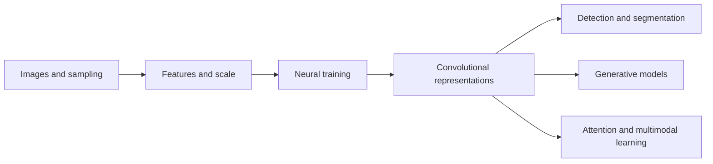

# Deep Learning for Computer Vision — Knowledge Map

[[exam-study-guide|Exam study guide]] · [[exam-question-index|Question index]]

Weeks 6–12 are **provisional**: topics inferred from past papers; replace when official syllabus is available.

## Curriculum spine

| Week | Report | Exam notes | Core question | Status |
| :--- | :--- | :--- | :--- | :--- |
| 1 | [[week-1-report\|Report]] | [[week-1-exam-notes\|Exam notes]] | How are images represented, filtered, transformed and sampled? | Complete |
| 2 | [[week-2-report\|Report]] | [[week-2-exam-notes\|Exam notes]] | How are edges, features and visual regions detected across scales? | Complete |
| 3 | [[week-3-report\|Report]] | [[week-3-exam-notes\|Exam notes]] | How are neural networks trained and regularized? | Complete |
| 4 | [[week-4-report\|Report]] | [[week-4-exam-notes\|Exam notes]] | How do convolutional networks compute and learn visual features? | Complete |
| 5 | [[week-5-report\|Report]] | [[week-5-exam-notes\|Exam notes]] | How do modern CNN architectures and detectors improve visual recognition? | Complete |
| 6 | [[week-6-report\|Report]] | [[week-6-exam-notes\|Exam notes]] | How are objects localized and evaluated? | Provisional |
| 7 | [[week-7-report\|Report]] | [[week-7-exam-notes\|Exam notes]] | How are image regions segmented and structured? | Provisional |
| 8 | [[week-8-report\|Report]] | [[week-8-exam-notes\|Exam notes]] | How do generative models represent and synthesize images? | Provisional |
| 9 | [[week-9-report\|Report]] | [[week-9-exam-notes\|Exam notes]] | How does attention support visual representation? | Provisional |
| 10 | [[week-10-report\|Report]] | [[week-10-exam-notes\|Exam notes]] | How do sequence models and attention process visual information? | Provisional |
| 11 | [[week-11-report\|Report]] | [[week-11-exam-notes\|Exam notes]] | How are visual and language representations aligned? | Provisional |
| 12 | [[week-12-report\|Report]] | [[week-12-exam-notes\|Exam notes]] | How do modern generative and multimodal systems synthesize and interpret content? | Provisional |

## Governing paradigm

## Concept taxonomy

### Week 1

**Topics:** Vision and image formation; Image representation and point operations; Spatial filtering and convolution; Frequency-domain images; Sampling and reconstruction.

No atomic concept notes currently assigned. · [[image-representation]] · [[point-operations]] · [[histogram-equalization]] · [[linear-filtering]] · [[cross-correlation]] · [[convolution]] · [[kernel-separability]] · [[normalized-cross-correlation]] · [[median-filter]] · [[bilateral-filter]] · [[fourier-transform]] · [[convolution-theorem]] · [[nyquist-shannon-sampling]] · [[image-aliasing]] · [[image-interpolation]]

### Week 2

**Topics:** Edges and differential operators; Corners and blobs; Scale space, pyramids and filter banks; Invariant features and geometric descriptors; Classical image segmentation; Human visual system.

No atomic concept notes currently assigned. · [[canny-edge-detector]] · [[non-maximum-suppression]] · [[hysteresis-thresholding]] · [[edgelet-representation]] · [[harris-corner-detector]] · [[scale-space-theory]] · [[difference-of-gaussians]] · [[sift-descriptor]] · [[surf-descriptor]] · [[gloh-descriptor]] · [[shape-context]] · [[mser-regions]] · [[gestalt-grouping]] · [[biological-visual-pathway]]

### Week 3

**Topics:** Perceptrons and feedforward networks; Backpropagation and losses; Gradient descent and variants; Regularization and generalization; Initialization and normalization.

No atomic concept notes currently assigned.

### Week 4

**Topics:** CNN operations and spatial dimensions; Pooling and receptive fields; CNN backpropagation; AlexNet and early CNN classifiers; VGG and stacked convolutions.

No atomic concept notes currently assigned.

### Week 5

**Topics:** Inception and bottleneck convolutions; Residual and connected CNN architectures; Efficient convolutional networks; Transfer learning and fine-tuning; CNN visualization and interpretability; Two-stage detection and R-CNN; Single-stage detection and YOLO.

No atomic concept notes currently assigned.

### Week 6 — provisional

**Topics:** Dense detectors and focal loss; Detection losses, boxes and matching; Multiscale feature pyramids; Semantic and instance segmentation; SegNet encoder-decoder segmentation; Optical flow and image registration.

[[feature-pyramid-network]] · [[focal-loss]] · [[intersection-over-union]] · [[semantic-segmentation]]

### Week 7 — provisional

**Topics:** Recurrent networks and sequence architectures; Recurrent training and gradient dynamics; LSTM and GRU gating; Encoder-decoder attention; Soft and hard attention; Recurrent image captioning and evaluation.

[[backpropagation-through-time]] · [[encoder-decoder-attention]] · [[gated-recurrent-unit]] · [[recurrent-neural-network]]

### Week 8 — provisional

**Topics:** Generative models and KL divergence; Autoencoder representations; Variational autoencoders; GAN objectives and equilibrium; Metric learning and face verification; Generative model evaluation.

[[generative-adversarial-network]] · [[kullback-leibler-divergence]] · [[triplet-loss]] · [[variational-autoencoder]]

### Week 9 — provisional

**Topics:** Self-attention and QKV projections; Transformer encoders and decoders; Token and positional representations; Vision transformers; Transformer object detection.

[[detr-set-prediction]] · [[multi-head-attention]] · [[position-encoding]] · [[scaled-dot-product-attention]] · [[vision-transformer-patches]]

### Week 10 — provisional

**Topics:** Progressive and style-based GANs; GAN diversity and failure modes; Vector-quantized autoencoders; Forward diffusion and noise schedules; Reverse diffusion and guidance; Neural style transfer.

[[classifier-free-guidance]] · [[diffusion-process]] · [[gan-mode-collapse]] · [[gram-matrix-style]] · [[progressive-growing]] · [[vector-quantization]]

### Week 11 — provisional

**Topics:** Self-supervised objectives and pretext tasks; Contrastive representation learning; Few-shot and low-data adaptation; CLIP and image-text contrastive alignment; Vision-language tasks and retrieval.

[[clip-alignment]] · [[contrastive-learning]] · [[few-shot-learning]] · [[infonce-loss]] · [[vision-language-retrieval]]

### Week 12 — provisional

**Topics:** BLIP architecture and objectives; Promptable segmentation and SAM; Adversarial examples and attacks; Multimodal foundation models and conditioning; Multimodal generation and decoding.

[[adversarial-examples]] · [[blip-pretraining]] · [[multimodal-decoding]] · [[promptable-segmentation]]

## Daily working notes

No daily working notes are currently present.
