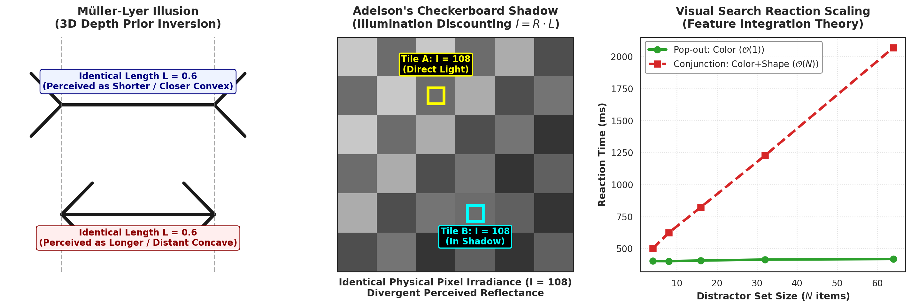
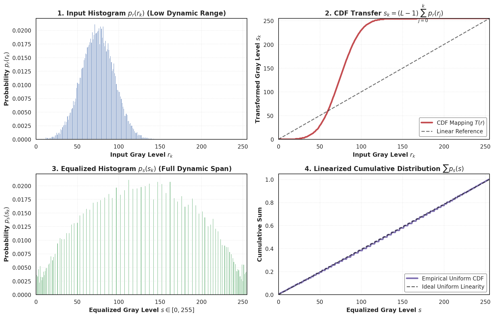
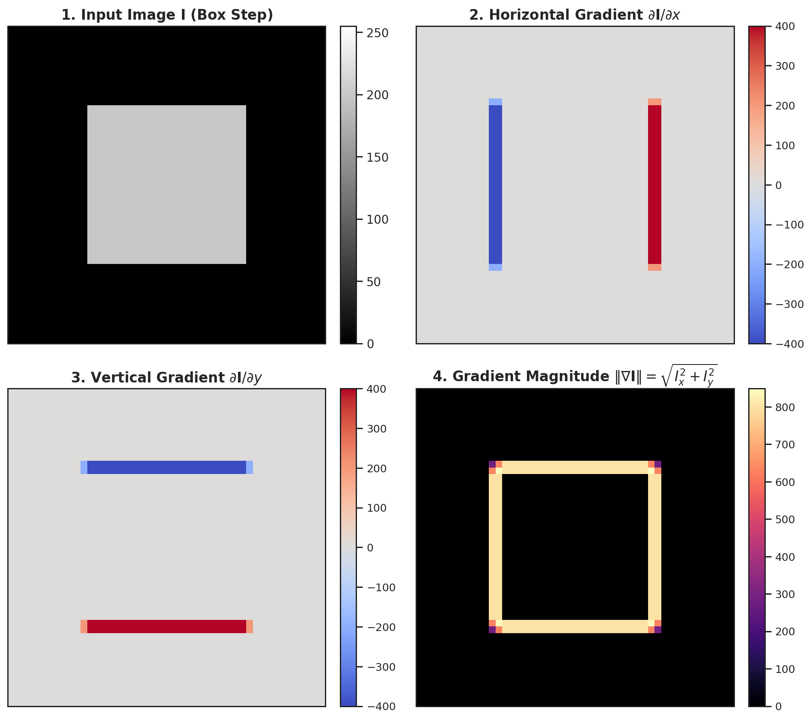
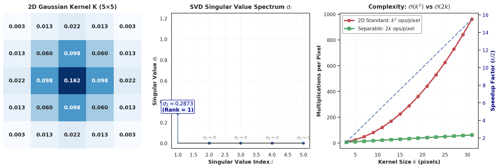
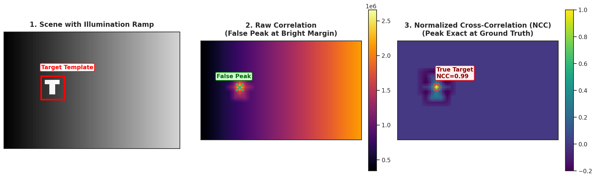
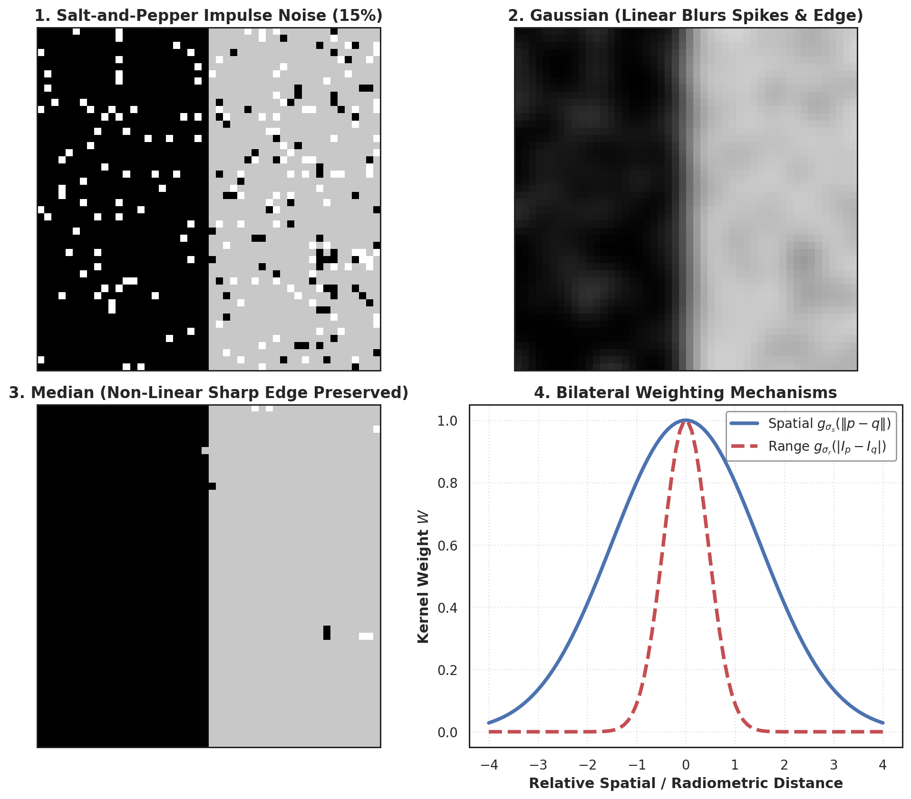
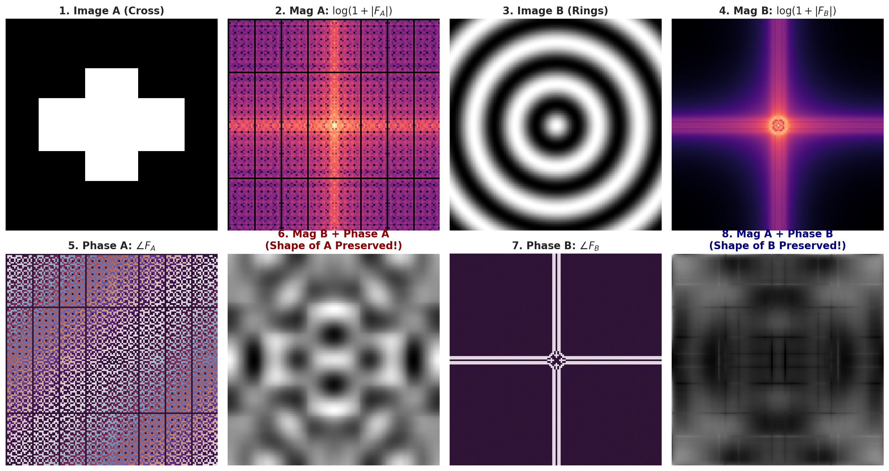
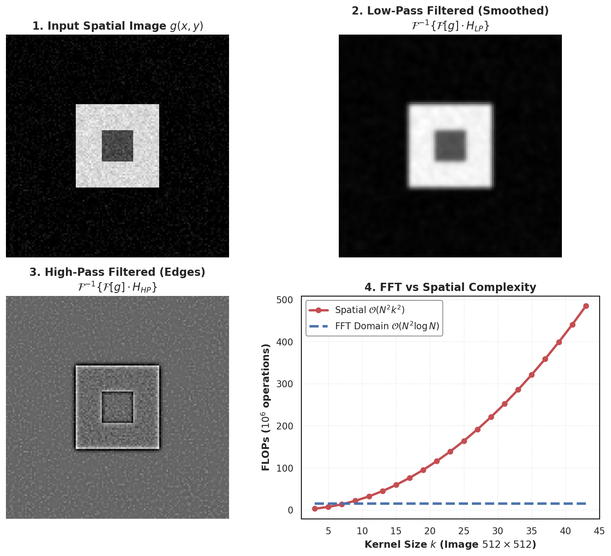
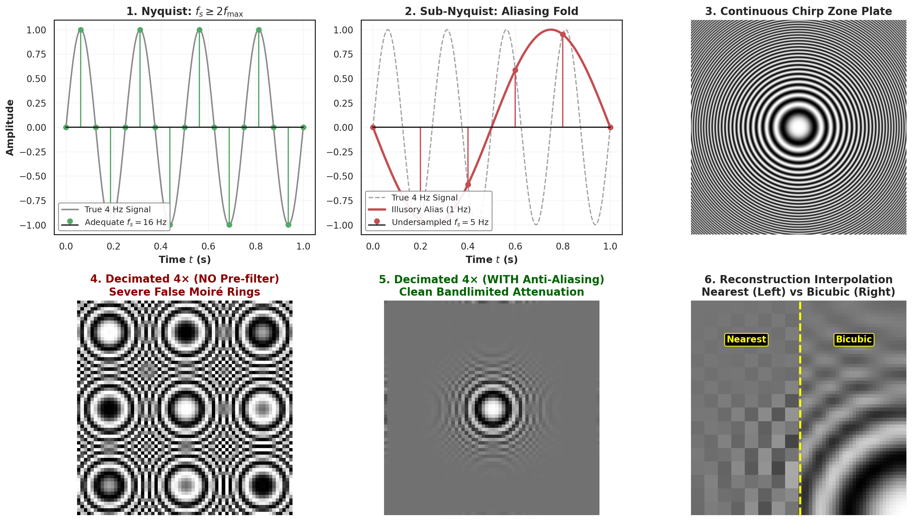

# Week 1 Exam Revision Notes: Visual Signals, Filtering, Fourier & Sampling

> **Purpose:** Ultra-condensed, high-yield exam revision guide. Contains all essential mathematical derivations, governing formulas, complexity benchmarks, visual anchors, common exam traps, and high-probability test questions for rapid pre-exam mastery.

---

## 1. High-Yield Master Formula & Concept Cheat Sheet

| Topic / Method | Governing Equation / Formula | Computational Complexity | Key Invariance / Property | High-Yield Exam Trap |
| :--- | :--- | :--- | :--- | :--- |
| **Point Negative** | $s = (L-1) - r = 255 - r$ | $\mathcal{O}(1)$ per pixel | Reverses dynamic intensity | Reversible: applying twice restores original. |
| **Contrast Stretch** | $s = \operatorname{clip}\left(\frac{r - r_{\min}}{r_{\max} - r_{\min}} (L-1), 0, L-1\right)$ | $\mathcal{O}(1)$ per pixel | Affine contrast scaling | Outliers (dead pixels) ruin $r_{\min}, r_{\max}$; requires percentile clipping. |
| **Frame Averaging** | $\bar{I}_N = \frac{1}{N}\sum_{i=1}^N I_i \implies \sigma_N = \frac{\sigma}{\sqrt{N}}$ | $\mathcal{O}(N)$ per pixel | Stationary scenes | Only attenuates **uncorrelated zero-mean noise**; fails on motion/ghosting. |
| **Histogram Equalization** | $s_k = T(r_k) = \operatorname{round}\left(\frac{L-1}{N_{\text{total}}} \sum_{j=0}^k n_j\right)$ | $\mathcal{O}(HW + L)$ | Maximizes global entropy | Continuous CDF yields exact uniform PDF; **discrete yields gaps** (cannot split identical pixels). |
| **2D Convolution** | $(I * K)[x, y] = \sum_u \sum_v I[x-u, y-v] K[u, v]$ | $\mathcal{O}(k^2)$ per pixel | Commutative, Associative, Distributive | Kernel is **rotated $180^\circ$**; anti-symmetric kernels flip sign under correlation vs convolution. |
| **Separable Filter** | $\mathbf{K} = \mathbf{v}\mathbf{h}^T \iff \operatorname{rank}(\mathbf{K}) = 1$ | $\mathcal{O}(2k)$ vs $\mathcal{O}(k^2)$ | SVD: $\sigma_1 > 0, \sigma_2 = 0$ | Speedup is $\frac{k^2}{2k} = \frac{k}{2}$. For $k=15$, separable is $7.5\times$ faster. |
| **Normalized Cross-Corr (NCC)** | $\gamma(x, y) = \frac{\sum (I - \bar{I})(T - \bar{T})}{\sqrt{\sum(I - \bar{I})^2 \sum(T - \bar{T})^2}}$ | $\mathcal{O}(k^2)$ per window | **Invariant to $I' = a I + b$** ($a > 0$) | Raw correlation $\sum I \cdot T$ fails because bright background patches generate false peaks. |
| **Median Filter** | $I_{\text{med}}[x, y] = \operatorname{median}(\Omega_{k \times k})$ | $\mathcal{O}(k^2 \log k)$ or $\mathcal{O}(k)$ | Non-linear order statistic | **Eliminates $100\%$ salt-and-pepper spikes** while preserving step edges. Gaussian smears spikes into gray halos. |
| **Bilateral Filter** | $I_{\text{BF}}(p) = \frac{1}{W_p} \sum_{q} I(q) g_{\sigma_s}(\|p-q\|) g_{\sigma_r}(\|I_p - I_q\|)$ | $\mathcal{O}(k^2)$ (or $\mathcal{O}(1)$ approx) | Edge-preserving smoothing | Across step edges, $|I_p - I_q| \gg \sigma_r \implies g_{\sigma_r} \approx 0$, preventing boundary blurring. |
| **2D DFT** | $F(u, v) = \sum_x \sum_y f(x, y) e^{-j 2\pi (\frac{ux}{M} + \frac{vy}{N})}$ | $\mathcal{O}(N^2 \log N)$ via FFT | Hermitian symmetry: $F(-u,-v) = F^*(u,v)$ | **Oppenheim-Lim experiment:** Phase dictates **spatial geometry/edges**; Magnitude dictates **contrast energy**. |
| **Nyquist Criterion** | $f_s \ge 2 f_{\max} \iff T_s \le \frac{1}{2 f_{\max}}$ | Discretization boundary | Prevents spectral folding | Sampling at $f_s < 2 f_{\max}$ folds frequency $f$ to $|f_s - f|$, creating **irreversible Moiré patterns**. |
| **Anti-Aliasing** | Downsampling by $s\times \implies \sigma_{\text{filter}} \ge \frac{s}{2}$ | Low-pass pre-filtering | Bandlimits before decimation | Subsampling without Gaussian filtering aliases high frequencies permanently. |

---

## 2. Core Concepts & "Must-Know" Derivations

### 2.1 The Paradox of Visual Perception & Trichromatic Theory
- **Paradox:** Vision feels effortless because $\sim 50\%$ of the primate cerebral cortex is dedicated to visual processing. Mathematically, it is an **ill-posed inverse problem**: 3D world $\xrightarrow{\text{projection}}$ 2D discrete sensor matrix. Countless 3D configurations produce identical 2D projections.
- **Optical Illusions as Bayesian Priors:**
  - *Müller-Lyer Illusion:* Outward arrow fins ($>---<$) trigger convex 3D exterior corner priors (perceived as closer $\to$ scaled down in mental size). Inward arrow fins ($<--->$) trigger concave interior room corner priors (perceived as further $\to$ scaled up).
  - *Adelson's Checkerboard Shadow:* Measured pixel irradiance is identical ($I_A = I_B = 108$). The human visual cortex automatically discounts illumination ($I = R \cdot L$), inferring true surface reflectance $R$ rather than raw sensor irradiance $I$.
  - *Visual Search (Treisman):* Feature pop-out (color alone) is **parallel $\mathcal{O}(1)$**; Conjunction search (color + shape) requires serial spatial attention binding, scaling as **linear $\mathcal{O}(N)$**.
- **Trichromatic Theory ($L, M, S$ Cones):**
  - Primate retina has three cone photopigments: Long ($\sim 560\text{ nm}$, red), Medium ($\sim 530\text{ nm}$, green), Short ($\sim 420\text{ nm}$, blue).
  - Additive Color (RGB): Direct radiant emission (monitors). White = $R + G + B$.
  - Subtractive Color (CMY): Reflective chemical absorption (pigments/printing). Absorbs complementary wavelengths: $C = W - R$, $M = W - G$, $Y = W - B$.

---

### 2.2 Full Derivation of Continuous Histogram Equalization
- **Goal:** Find a monotonic transformation $s = T(r)$ that maps arbitrary input probability density function $p_r(r)$ ($r \in [0, 1]$) into a uniform output PDF $p_s(s) = 1$ ($s \in [0, 1]$).
- **Conservation of Probability:**
  $$p_s(s) \, ds = p_r(r) \, dr \implies p_s(s) = p_r(r) \left| \frac{dr}{ds} \right| = \frac{p_r(r)}{\left| \frac{ds}{dr} \right|}$$
- **Substitute Desired $p_s(s) = 1$:**
  $$\frac{ds}{dr} = p_r(r) \implies s = T(r) = \int_0^r p_r(w) \, dw = F_r(r)$$
- **Proof:**
  $$\frac{ds}{dr} = \frac{d}{dr} \left[\int_0^r p_r(w) \, dw\right] = p_r(r)$$
  $$p_s(s) = \frac{p_r(r)}{\frac{ds}{dr}} = \frac{p_r(r)}{p_r(r)} = 1 \quad \forall s \in [0, 1] \quad \blacksquare$$
- **Discrete Formula (for $L=256$ levels):**
  $$s_k = \operatorname{round}\left( (L-1) \sum_{j=0}^k \frac{n_j}{N_{\text{total}}} \right)$$

---

### 2.3 Spatial Filtering: Convolution vs. Cross-Correlation
- **Cross-Correlation (Sliding Dot Product):**
  $$(I \otimes K)[x, y] = \sum_{u=-k}^k \sum_{v=-k}^k I[x+u, y+v] K[u, v]$$
- **Convolution (Linear Time-Invariant Operator):**
  $$(I * K)[x, y] = \sum_{u=-k}^k \sum_{v=-k}^k I[x-u, y-v] K[u, v] = (I \otimes K_{\text{flipped}})[x, y]$$
- **Why Flip the Kernel ($180^\circ$)?**
  1. *Associativity:* $(I * K_1) * K_2 = I * (K_1 * K_2)$ holds for convolution, but **fails for cross-correlation**.
  2. *Commutativity:* $I * K = K * I$.
- **Centrosymmetric vs. Anti-symmetric Kernels:**
  - If $K[-u, -v] = K[u, v]$ (e.g., Gaussian, Box filter): Convolution $\equiv$ Cross-Correlation.
  - If $K[-u, -v] = -K[u, v]$ (e.g., Sobel, Central Difference $[-1, 0, 1]$): Convolution = **$-1 \times$ Cross-Correlation**.

---

### 2.4 Kernel Separability & The SVD Rank-1 Theorem
- **Definition:** A 2D spatial kernel $\mathbf{K} \in \mathbb{R}^{k \times k}$ is separable if it factors into outer product of two 1D vectors: $\mathbf{K} = \mathbf{v} \mathbf{h}^T$.
- **Theorem:** A 2D matrix $\mathbf{K}$ is separable if and only if its **Singular Value Decomposition (SVD) has exactly Rank 1**:
  $$\mathbf{K} = \sum_{i=1}^k \sigma_i \mathbf{u}_i \mathbf{v}_i^T \implies \sigma_1 > 0, \quad \sigma_2 = \sigma_3 = \cdots = \sigma_k = 0$$
- **Complexity Advantage:**
  - Standard 2D: $k^2$ multiply-accumulate ops per pixel.
  - Separable 2D: Apply $\mathbf{h}^T$ horizontally ($k$ ops) then $\mathbf{v}$ vertically ($k$ ops) $\implies 2k$ ops per pixel.
  - Speedup factor: $\frac{k^2}{2k} = \frac{k}{2}$.

---

### 2.5 Template Matching: Why NCC is Required
- **Failure of Raw Cross-Correlation:**
  $$\text{Score}(x, y) = \sum_{u, v} I[x+u, y+v] T[u, v]$$
  If the scene has an intense background spot (e.g., a white wall $I \approx 255$), the dot product explodes to huge values, yielding **false positives** away from the true target.
- **Normalized Cross-Correlation (NCC):**
  $$\gamma(x, y) = \frac{\sum_{u, v} (I[x+u, y+v] - \bar{I}_{x,y})(T[u, v] - \bar{T})}{\sqrt{\sum_{u, v} (I[x+u, y+v] - \bar{I}_{x,y})^2} \sqrt{\sum_{u, v} (T[u, v] - \bar{T})^2}}$$
- **Proof of Affine Radiometric Invariance:** Let $I' = a I + b$ with $a > 0$:
  $$I' - \bar{I}' = (aI + b) - (a\bar{I} + b) = a(I - \bar{I})$$
  $$\gamma'(x, y) = \frac{\sum a(I - \bar{I})(T - \bar{T})}{\sqrt{a^2 \sum (I - \bar{I})^2} \sqrt{\sum (T - \bar{T})^2}} = \frac{a}{|a|} \gamma(x, y) = \gamma(x, y) \quad \blacksquare$$

---

### 2.6 Non-Linear Filters: Median & Bilateral Filtering
- **Median Filter:** Sorts pixel values in window $\Omega_{k \times k}$ and outputs the middle element.
  - Perfectly removes impulse noise ($p < 50\%$) without computing an arithmetic mean.
  - Linear Gaussian filtering smears impulses into broad, visible halos.
- **Bilateral Filter:** Edge-preserving smoothing combining spatial and range weights:
  $$I_{\text{BF}}(p) = \frac{1}{W_p} \sum_{q \in \Omega} I(q) \underbrace{\exp\left(-\frac{\|p - q\|^2}{2\sigma_s^2}\right)}_{\text{Spatial Domain Weight}} \underbrace{\exp\left(-\frac{|I(p) - I(q)|^2}{2\sigma_r^2}\right)}_{\text{Radiometric Range Weight}}$$
  - **Flat regions:** $|I(p) - I(q)| \approx 0 \implies \exp(0) = 1$; behaves like Gaussian smoother.
  - **Step edges:** $|I(p) - I(q)| \gg \sigma_r \implies \exp(-\text{large}) \approx 0$; across-edge pixels get zero weight, preserving razor-sharp boundaries.

---

### 2.7 Frequency Domain, Convolution Theorem & Phase Duality
- **2D Discrete Fourier Transform (DFT):**
  $$F(u, v) = \sum_{x=0}^{M-1} \sum_{y=0}^{N-1} f(x, y) e^{-j 2\pi \left(\frac{ux}{M} + \frac{vy}{N}\right)}$$
- **Convolution Theorem:**
  $$g * h \iff G(u, v) \cdot H(u, v) \implies g * h = \mathcal{F}^{-1}\{\mathcal{F}[g] \cdot \mathcal{F}[h]\}$$
- **Computational Crossover:**
  - Spatial 2D convolution: $\mathcal{O}(N^2 k^2)$ FLOPs.
  - FFT-based convolution: $\mathcal{O}(N^2 \log_2 N)$ FLOPs (independent of kernel size $k$!).
  - For $N=512$, the crossover point where FFT beats spatial convolution is approximately $k \ge 11 \times 11$.
- **Oppenheim & Lim Phase vs. Magnitude Swap Experiment:**
  - Magnitude $|F(u, v)|$ encodes total energy across spatial frequencies (contrast, luminance distribution, periodic orientation).
  - Phase $\angle F(u, v)$ encodes relative spatial alignment and constructive interference of waves (edges, corners, geometry, semantic object shape).
  - Synthesizing $|F_{\text{Image B}}| e^{j \angle F_{\text{Image A}}}$ produces an image containing the **geometric content of Image A**.

---

### 2.8 Sampling, Aliasing & Reconstruction Interpolation
- **Nyquist-Shannon Sampling Theorem:** A continuous bandlimited signal with maximum frequency $f_{\max}$ can be perfectly reconstructed if and only if the sampling rate satisfies:
  $$f_s \ge 2 f_{\max} \quad (\text{or } T_s \le \frac{1}{2 f_{\max}})$$
- **Aliasing Mechanics:** If $f_s < 2 f_{\max}$, high-frequency spectral copies overlap and fold back into the baseband at illusory frequency:
  $$f_{\text{alias}} = |f_s - f_{\text{input}}|$$
- **Anti-Aliasing Rule of Thumb:** Before decimation by downsampling factor $s$, apply a low-pass Gaussian pre-filter with standard deviation $\sigma \approx \frac{s}{2}$ to suppress all spectral energy beyond the new Nyquist limit $\frac{\pi}{s}$.
- **Reconstruction Interpolation Kernels:**
  1. *Nearest-Neighbor (Box filter):* 0-th order hold; fastest, but causes severe blocking artifacts.
  2. *Bilinear (Triangle filter):* 1-st order linear interpolation; smooth, but blurs sharp edges.
  3. *Bicubic (Cubic spline):* 3-rd order piecewise polynomial with negative sidelobes; sharpest edges and optimal perceptual fidelity.

---

## 3. High-Yield Exam Pitfalls & Concept Traps

> [!CAUTION]
> **Exam Pitfall 1: Discrete vs. Continuous Histogram Equalization**
> - *Question:* "Does discrete histogram equalization produce a perfectly flat, uniform histogram?"
> - *Answer:* **NO.** In continuous calculus, $p_s(s) = 1$ is perfectly flat. In discrete processing, identical input pixels must map to the same output level ($T(r)$ cannot split pixels of equal value). If a gray level has high frequency, it maps to an isolated spike; adjacent levels receive zero counts, resulting in **periodic histogram gaps**.

> [!WARNING]
> **Exam Pitfall 2: Why Cross-Correlation Fails as a Convolution**
> - *Question:* "Can we implement a CNN convolutional layer using cross-correlation without flipping the weights?"
> - *Answer:* In deep learning libraries (PyTorch, TensorFlow), `nn.Conv2d` actually implements **cross-correlation**! This is mathematically valid during neural network training because the weights are learned parameters; the network simply learns the pre-flipped weights. However, in analytical signal processing with fixed mathematical filters (like Sobel), failing to flip the kernel inverts the sign of odd-derivative operators ($\mathbf{K}_x * I = -(\mathbf{K}_x \otimes I)$).

> [!TIP]
> **Exam Pitfall 3: Separability Check via Rank**
> - *Question:* "Is the Sobel kernel separable? Is a circular disk kernel separable?"
> - *Answer:*
>   - Sobel $K_x = \begin{bmatrix}-1 & 0 & 1\\-2 & 0 & 2\\-1 & 0 & 1\end{bmatrix} = \begin{bmatrix}1\\2\\1\end{bmatrix} \begin{bmatrix}-1 & 0 & 1\end{bmatrix}$. All rows are multiples of each other $\implies \operatorname{rank} = 1 \implies$ **SEPARABLE**.
>   - Circular disk / Pillbox filter $K = \begin{bmatrix}0 & 1 & 0\\1 & 1 & 1\\0 & 1 & 0\end{bmatrix}$. Rows are linearly independent $\implies \operatorname{rank} = 3 \implies$ **NOT SEPARABLE**.

---

## 4. Rapid-Fire Exam Question Bank

### Q1: Numerical Histogram Equalization
**Problem:** An image with $N=100$ total pixels and $L=8$ gray levels $[0, 7]$ has counts: $n_0=10, n_1=20, n_2=40, n_3=15, n_4=10, n_5=5, n_6=0, n_7=0$. Find the transformed gray level $s_2$ for input level $r_2$.
- **Solution:**
  1. Compute CDF at $k=2$: $\sum_{j=0}^2 n_j = 10 + 20 + 40 = 70$.
  2. Apply transformation formula:
     $$s_2 = \operatorname{round}\left( \frac{L-1}{N} \sum_{j=0}^2 n_j \right) = \operatorname{round}\left( \frac{7}{100} \times 70 \right) = \operatorname{round}(4.9) = 5$$
  - **Answer:** $s_2 = 5$.

### Q2: Nyquist Downsampling Calculation
**Problem:** An image has high-frequency textures up to $f_{\max} = 120\text{ cycles/mm}$. The original scanning sensor sampled at $f_s = 300\text{ samples/mm}$. If we downsample by a factor of $2\times$ without pre-filtering, will aliasing occur? What is the maximum allowable decimation factor without aliasing?
- **Solution:**
  1. Downsampled sampling rate: $f_s' = \frac{300}{2} = 150\text{ samples/mm}$.
  2. New Nyquist frequency: $f_{\text{Nyq}}' = \frac{f_s'}{2} = 75\text{ cycles/mm}$.
  3. Since $f_{\max} = 120 > 75$, **aliasing will definitely occur**. The frequency $120$ folds to $|150 - 120| = 30\text{ cycles/mm}$.
  4. To avoid aliasing without filtering, need $f_s' \ge 2 f_{\max} = 240\text{ samples/mm} \implies \text{max factor } s \le \frac{300}{240} = 1.25\times$.

### Q3: Spatial vs. Frequency Domain Complexity
**Problem:** A $1024 \times 1024$ satellite image is filtered with a $31 \times 31$ non-separable kernel. Which is faster: 2D spatial direct convolution or FFT-based frequency domain multiplication?
- **Solution:**
  - Spatial cost: $N^2 k^2 = (1024^2) \times (31^2) = 1,048,576 \times 961 \approx 1.008 \times 10^9$ operations.
  - FFT cost: $2\text{ forward FFTs} + 1\text{ inverse FFT} + \text{pointwise mult} \approx 3 \times 2 N^2 \log_2(N) + N^2$
    $$6 \times 1024^2 \times 10 + 1024^2 \approx 6.4 \times 10^7\text{ operations}$$
  - **Answer:** FFT-based filtering is $\approx \frac{1.008 \times 10^9}{6.4 \times 10^7} \approx 15.7\times$ faster!

## High-frequency exam traps (from PYQs)

- **Integral images use inclusion–exclusion.** For an inclusive rectangle with 1-indexed corners $(r_1,c_1)$ and $(r_2,c_2)$, compute $S=II(r_2,c_2)-II(r_1-1,c_2)-II(r_2,c_1-1)+II(r_1-1,c_1-1)$; terms beyond the top or left boundary are zero. The bottom-right cumulative total alone is not a general rectangle sum.
- **NumPy views and copies behave differently.** `arr = alias` creates another reference; `view()` and usually `ravel()` share the underlying storage, while `flatten()` and `copy()` allocate independent arrays. Check whether the operation returns a view before deciding if a write changes the original.
- **Contrast stretching must use the stated endpoints.** For 8-bit output, $s=(r-I_{\min})255/(I_{\max}-I_{\min})$; the minimum maps to 0 and maximum to 255. If asked for a transformed-image mean, transform every pixel first and then average; it is not generally the transform of the original mean when clipping or rounding is involved.
- **Raw image memory includes every channel and its dtype width.** Compute $H\,W\,C\,b$ bytes, where $b$ is bytes per channel (1 for 8-bit, 4 for 32-bit float). Do not confuse bits with bytes or omit RGB channels.
