# Week 2 Exam Revision Notes: Mid-Level Primitives, Invariant Features & Segmentation

> **Purpose:** Ultra-condensed, high-yield exam revision guide. Contains all essential mathematical derivations, governing formulas, complexity benchmarks, visual anchors, common exam traps, and high-probability test questions for rapid pre-exam mastery.

---

## 1. High-Yield Master Formula & Concept Cheat Sheet

| Primitive / Method | Governing Equation / Criterion | Complexity | Invariance Properties | High-Yield Exam Trap |
| :--- | :--- | :--- | :--- | :--- |
| **Canny Edge Detector** | 1. Low Error / High SNR 2. Exact Localization 3. Single Response | $\mathcal{O}(HW)$ per image | Rotation-invariant magnitude | NMS requires **sub-pixel interpolation along gradient normal** $\theta$; hysteresis eliminates streaking. |
| **Edgelet Second Moment PCA** | $\mathbf{C} = \frac{1}{N} \sum (\mathbf{x}_i - \boldsymbol{\mu})(\mathbf{x}_i - \boldsymbol{\mu})^T$ Straightness: $\lambda_1 / \lambda_2 \ge 10$ | $\mathcal{O}(N)$ per chain | Rigid translation & rotation | $\mathbf{v}_1$ gives edge direction; $\lambda_1 \gg \lambda_2$ confirms straightness, while $\lambda_1 \approx \lambda_2$ denotes high curvature. |
| **Structure Tensor (Harris)** | $\mathbf{A} = \sum w \begin{bmatrix} I_x^2 & I_x I_y \\ I_x I_y & I_y^2 \end{bmatrix}$ | $\mathcal{O}(HW)$ | Rotation, translation, affine contrast ($R \propto a^4$) | **NOT scale invariant!** Cornerness score $R = \det(\mathbf{A}) - \kappa \operatorname{tr}^2(\mathbf{A})$ avoids computing eigenvalues. |
| **Scale-Space LoG Extrema** | $\sigma^* = \arg\max_\sigma \sigma^2 \|\nabla^2 G_\sigma * I\|$ | $\mathcal{O}(HW \cdot S)$ | Scale, translation, rotation | For circular disk of radius $r$, peak response occurs at **$\sigma^* = r / \sqrt{2}$**. |
| **Difference of Gaussians (DoG)** | $D(x, y, \sigma) = (G_{k\sigma} - G_\sigma) * I$ $\approx (k-1) \sigma^2 \nabla^2 G$ | $\mathcal{O}(HW \cdot S)$ | Subtraction in scale space | Approximates scale-normalized LoG without calculating 2nd derivatives directly. |
| **SIFT Keypoint Hessian Test** | $\frac{\operatorname{Tr}(\mathbf{H})^2}{\operatorname{Det}(\mathbf{H})} = \frac{(\alpha+1)^2}{\alpha} < \frac{(r+1)^2}{r}$ | $\mathcal{O}(1)$ per candidate | Rejects unstable 1D edges | If ratio $> \frac{(10+1)^2}{10} = 12.1$, reject as edge-like response. |
| **SIFT 128-D Descriptor** | $4 \times 4 \text{ grid} \times 8 \text{ orientation bins} = 128\text{-D}$ | $\mathcal{O}(1)$ per keypoint | Scale, 2D rotation, affine illumination | Normalized to unit norm, clipped at $0.2$, and re-normalized to reject non-linear saturation. |
| **GLOH Descriptor** | 17 log-polar spatial bins $\times$ 16 bins = 272-D $\xrightarrow{\text{PCA}}$ 128-D | $\mathcal{O}(1)$ | Log-polar spatial layout | Higher matching accuracy than SIFT, but more computationally expensive. |
| **SURF Descriptor** | Haar box filters via Integral Image; 64-D vector | $\mathcal{O}(1)$ per box lookup | Fast scale/rotation invariance | **$3\times$ faster than SIFT**; integral images evaluate arbitrary box sums in **4 lookups**. |
| **Shape Context** | $C_{ij} = \frac{1}{2} \sum_k \frac{(h_i(k) - h_j(k))^2}{h_i(k) + h_j(k)}$ ($\chi^2$ cost) | $\mathcal{O}(N^3)$ bipartite | Scale (mean distance) & 2D translation | Log-polar binning (5 radial $\times$ 12 angular = 60 bins); gives high weight to nearby points. |
| **MSER Regions** | $q(g) = \frac{\|Q_{g+\Delta} \setminus Q_{g-\Delta}\|}{\|Q_g\|}$ | $\mathcal{O}(HW)$ via union-find | **Continuous monotonic intensity shifts** | Invariant to non-linear illumination, shadows, and affine geometric warping. |
| **Cortical Receptive Fields** | Retina: On/Off DoG; V1: Gabor wavelets; Dual streams: Ventral vs Dorsal | Biological neural hierarchy | Progressive hierarchical abstraction | Retinal DoG detects blobs; V1 detects oriented edges; Ventral stream ("What") recognizes objects. |

---

## 2. Core Concepts & "Must-Know" Derivations

### 2.1 The Canny Edge Detector: 4-Stage Optimization Pipeline
John Canny (1986) formulated edge detection as an optimal trade-off across three mathematical criteria:
1. **Low Error Rate (Good Detection):** High SNR; no spurious false edges and no missing real edges.
2. **Good Localization:** Distance between detected edge pixel and center of true physical edge must be minimized.
3. **Single Response:** Exactly one edge response per physical discontinuity (no multiple peak responses).

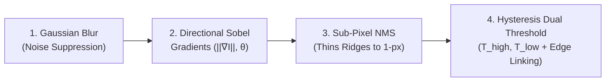

#### Step-by-Step Mechanics:
1. **Gaussian Smoothing:** Filter $I$ with $G_\sigma$. By associativity, $\nabla (G * I) = (\nabla G) * I$.
2. **Gradient Magnitude & Orientation:**
   $$I_x = \frac{\partial (G * I)}{\partial x}, \quad I_y = \frac{\partial (G * I)}{\partial y}$$
   $$M(x, y) = \|\nabla \mathbf{I}\| = \sqrt{I_x^2 + I_y^2}, \quad \theta(x, y) = \operatorname{arctan2}(I_y, I_x)$$
3. **Non-Maximum Suppression (NMS):**
   - Thick gradient ridges are thinned into 1-pixel contours.
   - At pixel $q$, examine the gradient vector normal $\theta$. Linearly interpolate gradient magnitudes at points $p$ and $r$ along $\pm \theta$.
   - Preserve $q$ if and only if $M(q) \ge M(p)$ and $M(q) \ge M(r)$; otherwise set $M(q) = 0$.
4. **Hysteresis Dual-Thresholding:**
   - Pixels with $M \ge T_{\text{high}}$ are classified as **Strong Edges**.
   - Pixels with $T_{\text{low}} \le M < T_{\text{high}}$ are classified as **Weak Edges**.
   - Pixels with $M < T_{\text{low}}$ are suppressed.
   - **Recursive Linking:** A weak edge is retained if and only if it is 8-connected to a strong edge. This prevents contour fragmentation (streaking) without admitting noise.

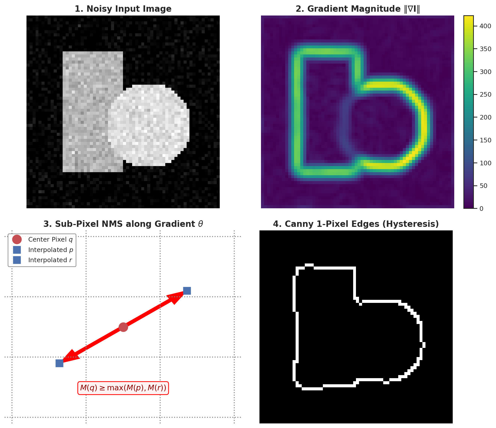

---

### 2.2 Edgelet Extraction & Second-Moment PCA
- **Edgelet Definition:** A connected chain of edge pixels approximated by a parametric straight line segment with center $(\mu_x, \mu_y)$, orientation $\theta$, and length $L$.
- **Covariance Matrix (Second Moment Tensor):**
  $$\mathbf{C}_{\text{edgelet}} = \frac{1}{N} \sum_{i=1}^N \begin{bmatrix} (x_i - \mu_x)^2 & (x_i - \mu_x)(y_i - \mu_y) \\ (x_i - \mu_x)(y_i - \mu_y) & (y_i - \mu_y)^2 \end{bmatrix} = \begin{bmatrix} \sigma_{xx} & \sigma_{xy} \\ \sigma_{xy} & \sigma_{yy} \end{bmatrix}$$
- **Eigendecomposition:**
  $$\mathbf{C} \mathbf{v}_1 = \lambda_1 \mathbf{v}_1, \quad \mathbf{C} \mathbf{v}_2 = \lambda_2 \mathbf{v}_2 \quad (\lambda_1 \ge \lambda_2)$$
  - Principal eigenvector $\mathbf{v}_1$ gives the **exact line orientation**: $\theta_{\text{edgelet}} = \operatorname{arctan2}(v_{1,y}, v_{1,x})$.
  - **Straightness Metric:** The eigenvalue ratio $\frac{\lambda_1}{\lambda_2}$ measures segment linearity. If $\frac{\lambda_1}{\lambda_2} \ge 10$, the segment is a clean straight line; if $\frac{\lambda_1}{\lambda_2} \approx 1$, the edgelet is curved or scattered.

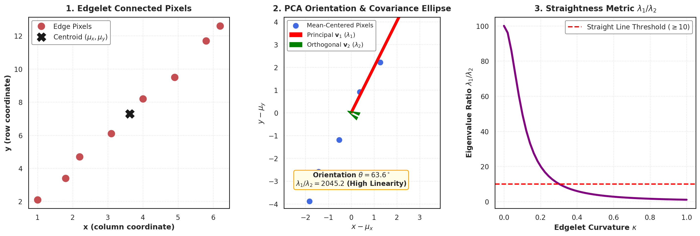

---

### 2.3 The Harris Corner Detector & Structure Tensor
- **The Aperture Problem:** In a local window along an edge, motion parallel to the edge produces zero intensity change ($\Delta I = 0$). Only at **2D corners / junctions** does intensity vary in all spatial directions, resolving correspondence unambiguously.
- **Autocorrelation / SSD Formulation:** For a small spatial displacement $[u, v]$:
  $$E(u, v) = \sum_{(x, y) \in W} w(x, y) \left[ I(x+u, y+v) - I(x, y) \right]^2$$
- **1st-Order Taylor Expansion:**
  $$I(x+u, y+v) \approx I(x, y) + u I_x + v I_y$$
  $$E(u, v) \approx \sum_{x, y} w(x, y) (u I_x + v I_y)^2 = [u, v] \mathbf{A} \begin{bmatrix} u \\ v \end{bmatrix}$$
- **The Structure Tensor (Autocorrelation Matrix):**
  $$\mathbf{A} = \sum_{(x, y) \in W} w(x, y) \begin{bmatrix} I_x^2 & I_x I_y \\ I_x I_y & I_y^2 \end{bmatrix}$$
- **Eigenvalue Decision Surface:**
  - $\lambda_1 \approx 0, \lambda_2 \approx 0 \implies$ **Flat Region** (no gradients).
  - $\lambda_1 \gg \lambda_2$ (or $\lambda_2 \gg \lambda_1$) $\implies$ **Edge Region** (variation in one direction only).
  - $\lambda_1 \gg 0, \lambda_2 \gg 0 \implies$ **Corner Region** (strong variation in all directions).
- **Harris Cornerness Score ($R$):** Avoids costly eigenvalue decomposition:
  $$R = \det(\mathbf{A}) - \kappa \operatorname{trace}^2(\mathbf{A}) = \lambda_1 \lambda_2 - \kappa (\lambda_1 + \lambda_2)^2 \quad (\kappa \approx 0.04 - 0.06)$$
  - $R > 0 \implies$ Corner; $R < 0 \implies$ Edge; $|R| \approx 0 \implies$ Flat.
- **Invariance Summary:**
  - *2D Rotation:* Strictly invariant ($R$ depends on trace and determinant, which are invariant under orthogonal similarity transforms $\mathbf{R} \mathbf{A} \mathbf{R}^T$).
  - *Affine Contrast:* $I' = a I \implies \mathbf{A}' = a^2 \mathbf{A} \implies R' = a^4 R$ (order of extrema is preserved).
  - *Scale Variations:* **FAILS.** A sharp corner at high resolution zooms into a smooth edge at low resolution.

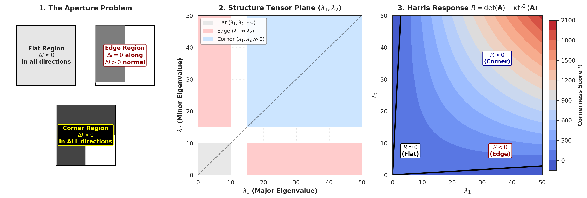

---

### 2.4 Multi-Scale Theory, LoG & Difference of Gaussians (DoG)
- **Scale-Space Causality (Lindeberg):** The Gaussian kernel is the **unique linear kernel** guaranteed not to create new spurious extrema as scale increases.
- **Scale-Normalized Laplacian of Gaussian (LoG):**
  $$\nabla_{\text{norm}}^2 L(x, y; \sigma) = \sigma^2 \left( \frac{\partial^2 G_\sigma}{\partial x^2} + \frac{\partial^2 G_\sigma}{\partial y^2} \right) * I$$
  - Multiplying by $\sigma^2$ is mandatory: derivatives naturally decay as $\sigma^{-2}$; without scale normalization, response peaks always drift to the smallest scale $\sigma \to 0$.
  - **Characteristic Scale Peak:** For a circular blob of radius $r$, the scale-normalized response achieves its maximum at:
    $$\sigma^* = \frac{r}{\sqrt{2}}$$
- **Difference of Gaussians (DoG) Approximation:**
  $$D(x, y, \sigma) = (G_{k\sigma} - G_\sigma) * I \approx (k - 1) \sigma^2 \nabla^2 G$$
  - Evaluated via simple image subtractions between adjacent blurred octaves in an image pyramid, saving massive computation over analytical LoG.

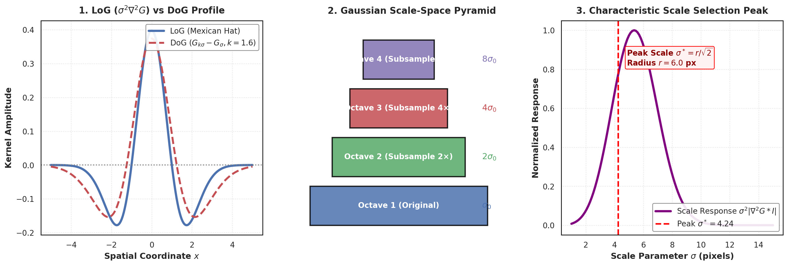

---

### 2.5 Lowe's SIFT Extraction Pipeline (128-D)
David Lowe (2004) synthesized invariant feature matching into four sequential algorithmic steps:

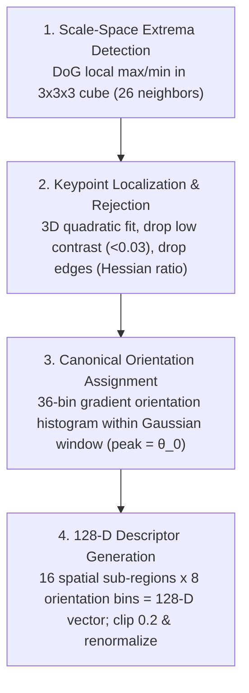

#### Step Details:
1. **Extrema Detection:** Compare each sample in DoG pyramid against its 8 spatial neighbors on the same scale, 9 on the scale above, and 9 on the scale below ($8 + 9 + 9 = 26$ neighbors).
2. **Sub-Pixel Localization & Rejection:**
   - *3D Quadratic Fit:* $\mathbf{x}^* = -\mathbf{H}^{-1} \nabla D$, locating keypoint with sub-pixel and sub-scale accuracy.
   - *Low-Contrast Rejection:* If $|D(\mathbf{x}^*)| < 0.03$, reject keypoint (unstable noise spike).
   - *Edge Elimination (Hessian Ratio Test):* 2D Hessian $\mathbf{H} = \begin{bmatrix} D_{xx} & D_{xy} \\ D_{xy} & D_{yy} \end{bmatrix}$. Let $\alpha = \lambda_1 / \lambda_2$ be the eigenvalue ratio:
     $$\frac{\operatorname{Tr}(\mathbf{H})^2}{\operatorname{Det}(\mathbf{H})} = \frac{(\alpha + 1)^2}{\alpha} < \frac{(r + 1)^2}{r} \quad (\text{typically } r = 10 \implies 12.1)$$
     If the ratio exceeds $12.1$, reject as an unstable 1D edge.
3. **Canonical Orientation:** Compute 36-bin orientation histogram weighted by gradient magnitude and Gaussian spatial window. Dominant peak defines reference angle $\theta_0$. If secondary peak is $\ge 80\%$, a separate co-located keypoint is created with that orientation.
4. **128-D Descriptor Pooling:**
   - Rotate a $16 \times 16$ sample patch by $-\theta_0$ to align with canonical orientation.
   - Divide patch into a $4 \times 4$ grid of spatial sub-regions (each $4 \times 4$ pixels).
   - In each sub-region, accumulate an 8-bin orientation histogram.
   - Total dimensions: $4 \times 4 \times 8 = 128$ dimensions.
   - **Illumination Normalization:** Normalize vector to unit length $\|\mathbf{f}\|_2 = 1$; clip values to $0.2$ to eliminate non-linear sensor saturation; re-normalize to unit length.

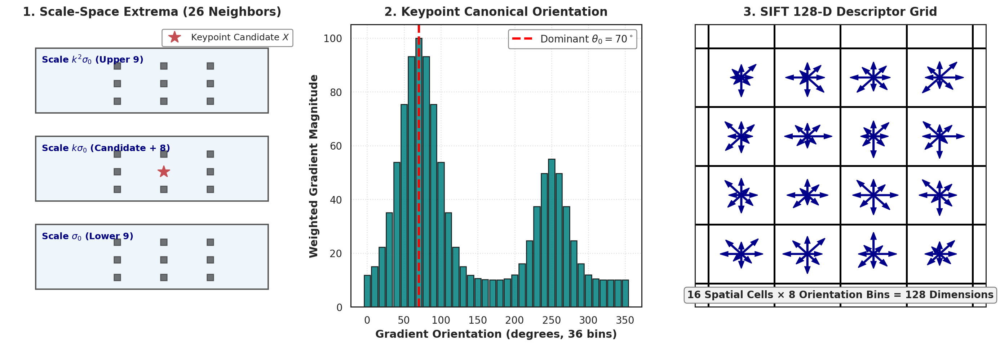

---

### 2.6 Classical Segmentation & Perceptual Grouping
- **Gestalt Laws:** Proximity, Similarity, Continuity, Closure, Symmetry, Common Fate.
- **Watershed Algorithm:** Treats gradient magnitude as a 3D topographic relief surface flooded from local minima. Catchment basins fill with water; where two distinct water bodies meet, a dam (watershed line) is erected. Over-segmentation is resolved by marker-controlled flooding.
- **Mean Shift Clustering:** Non-parametric mode-seeking algorithm. For each point, computes the mean shift vector towards the local density centroid within kernel window $h$:
  $$\mathbf{m}(\mathbf{x}) = \frac{\sum_{i} K\left(\frac{\mathbf{x}_i - \mathbf{x}}{h}\right) \mathbf{x}_i}{\sum_{i} K\left(\frac{\mathbf{x}_i - \mathbf{x}}{h}\right)} - \mathbf{x}$$
  Points iteratively shift until converging to stationary modes without assuming pre-defined cluster shapes.
- **Graph Cuts (Min $s-t$ Cut):** Represents image as graph $G=(V, E)$. Maps segmentation to binary energy minimization:
  $$E(f) = \sum_{p \in V} \underbrace{D_p(f_p)}_{\text{Unary Data Term (Color Likelihood)}} + \sum_{(p, q) \in \mathcal{N}} \underbrace{V_{p,q}(f_p, f_q)}_{\text{Pairwise Smoothness (Boundary Continuity)}}$$
  Solved in polynomial time via Ford-Fulkerson / Boykov-Kolmogorov max-flow min-cut theorem.

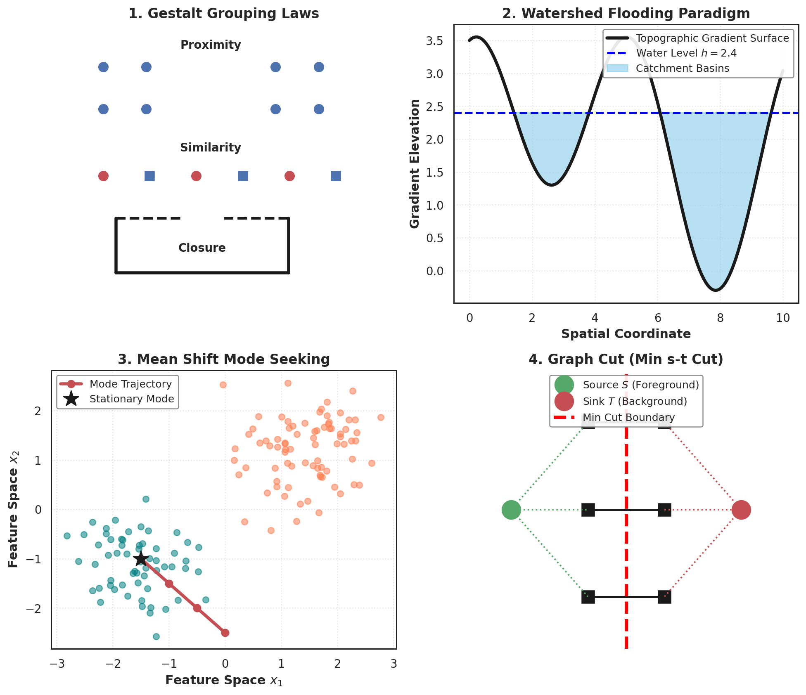

---

### 2.7 Geometric Shape Descriptors: Shape Context & MSER
- **Shape Context (Belongie et al.):**
  - Pick $N$ sampled contour points. For keypoint $p_i$, build a log-polar histogram of relative vector coordinates $(p_j - p_i)$.
  - 5 radial bins ($\log r$) and 12 angular bins ($\theta$) $\implies 60$ bins.
  - Log-polar weighting gives high sensitivity to close neighboring points and robustness to distant shape variations.
  - $\chi^2$ test matching cost: $C_{ij} = \frac{1}{2} \sum_k \frac{(h_i(k) - h_j(k))^2}{h_i(k) + h_j(k)}$.
- **MSER (Maximally Stable Extremal Regions):**
  - Sweeps binarization threshold $g \in [0, 255]$ through grayscale intensity landscape.
  - Tracks connected components $Q_g$. Stability function measures rate of area change:
    $$q(g) = \frac{|Q_{g+\Delta} \setminus Q_{g-\Delta}|}{|Q_g|}$$
  - Local minima of $q(g)$ define MSERs.
  - **Key Invariance:** Strictly invariant to **continuous monotonic intensity transformations** ($I' = f(I)$) and covariant to continuous affine geometric transformations.

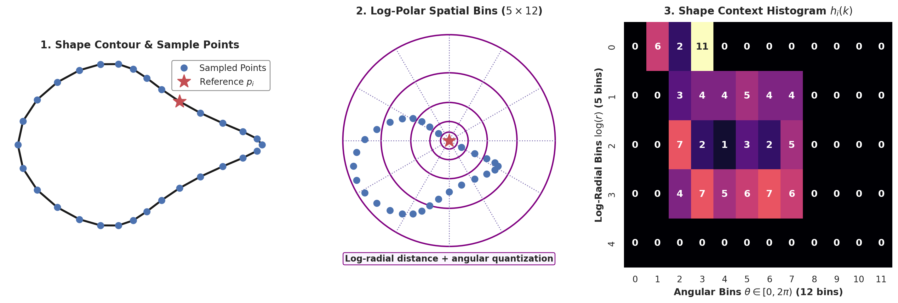
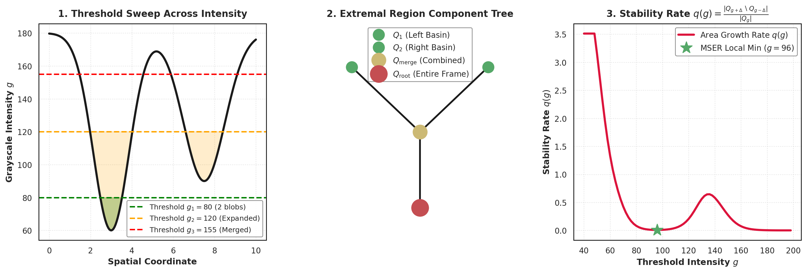

---

### 2.8 Primate Biological Vision Hierarchy
- **Retinal Ganglion Cells:** Circular on-center / off-surround receptive fields, modeled mathematically by 2D **Difference of Gaussians (DoG)**. Pre-filters high-frequency noise and enhances contrast edges before transmission through the optic nerve.
- **Primary Visual Cortex (V1 / Striate Cortex):**
  - *Simple Cells:* Direction-selective receptive fields with alternating parallel excitatory and inhibitory zones, modeled by **2D Gabor wavelets**:
    $$g(x, y; \lambda, \theta, \psi, \sigma, \gamma) = \exp\left(-\frac{x'^2 + \gamma^2 y'^2}{2\sigma^2}\right) \cos\left(2\pi \frac{x'}{\lambda} + \psi\right)$$
  - *Complex Cells:* Tuned to oriented bars but invariant to exact phase / position within receptive field.
  - *Hypercomplex (End-Stopped) Cells:* Respond to line terminations, corners, and junctions (biological Harris detectors).
- **Dual Processing Streams:**
  - *Ventral Stream ("What" Pathway):* V1 $\to$ V2 $\to$ V4 $\to$ Inferior Temporal (IT) cortex. Dedicated to object recognition, shape invariance, and color perception.
  - *Dorsal Stream ("Where/How" Pathway):* V1 $\to$ V2 $\to$ MT/V5 $\to$ Posterior Parietal cortex. Dedicated to motion perception, spatial localization, and visuomotor action.

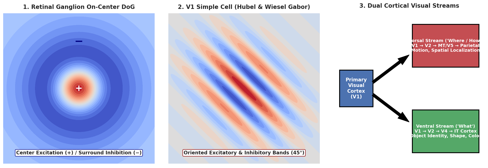

---

## 3. High-Yield Exam Pitfalls & Concept Traps

> [!CAUTION]
> **Exam Pitfall 1: Why the Harris Detector Fails Under Scale**
> - *Question:* "Is the Harris Corner Detector scale-invariant?"
> - *Answer:* **NO.** The Harris detector uses a fixed-size integration window $w(x, y)$ (e.g., Gaussian $\sigma_i = 1.5$). If the image is zoomed in, a sharp corner becomes a broad, gradual curved boundary; inside the fixed window, the boundary appears as a 1D straight edge ($\lambda_1 \gg \lambda_2$). Hence, the cornerness response vanishes. **To achieve scale invariance, one must find the characteristic scale via scale-space LoG/DoG.**

> [!WARNING]
> **Exam Pitfall 2: Why SIFT Clips Descriptor Values to 0.2**
> - *Question:* "Why does SIFT normalize, clip at 0.2, and re-normalize the 128-D descriptor?"
> - *Answer:*
>   - First normalization ensures invariance to affine illumination changes ($I' = a I + b$).
>   - However, real-world scenes experience **non-linear radiometric changes**, such as specular highlights, camera sensor saturation, and 3D surface orientation shifts affecting Lambertian shading.
>   - These phenomena cause disproportionately large gradient magnitudes in a few bins.
>   - Clipping values at $0.2$ bounds the maximum influence of any single gradient, and the second normalization re-establishes unit length $\|\mathbf{f}\|_2 = 1$.

> [!TIP]
> **Exam Pitfall 3: The SIFT Hessian Ratio Threshold**
> - *Question:* "Why is the SIFT edge rejection threshold written as $(r+1)^2 / r$ instead of testing eigenvalues directly?"
> - *Answer:* Finding eigenvalues of a $2 \times 2$ matrix requires solving a quadratic equation with square roots ($\sqrt{\operatorname{Tr}^2 - 4\operatorname{Det}}$), which is computationally expensive across thousands of candidate keypoints. Since $\operatorname{Tr}(\mathbf{H}) = \lambda_1 + \lambda_2$ and $\operatorname{Det}(\mathbf{H}) = \lambda_1 \lambda_2$, setting $\lambda_1 = r \lambda_2$ gives:
>   $$\frac{\operatorname{Tr}(\mathbf{H})^2}{\operatorname{Det}(\mathbf{H})} = \frac{(r\lambda_2 + \lambda_2)^2}{r \lambda_2^2} = \frac{(r+1)^2}{r}$$
>   This checks the eigenvalue ratio using **only basic additions and multiplications**.

---

## 4. Rapid-Fire Exam Question Bank

### Q1: Harris Corner Tensor Numerical Walkthrough
**Problem:** At a candidate interest point, the image gradients over a local $3 \times 3$ window yield:
$$\sum I_x^2 = 80, \quad \sum I_y^2 = 70, \quad \sum I_x I_y = 10$$
With Harris parameter $\kappa = 0.05$:
1. Calculate the determinant and trace of structure tensor $\mathbf{A}$.
2. Compute the cornerness response $R$.
3. Determine whether the point is a corner, edge, or flat region.

- **Solution:**
  1. $\mathbf{A} = \begin{bmatrix} 80 & 10 \\ 10 & 70 \end{bmatrix}$
     $$\det(\mathbf{A}) = (80)(70) - (10)^2 = 5600 - 100 = 5500$$
     $$\operatorname{trace}(\mathbf{A}) = 80 + 70 = 150$$
  2. $R = \det(\mathbf{A}) - \kappa \operatorname{trace}^2(\mathbf{A}) = 5500 - 0.05 \times (150)^2 = 5500 - 0.05 \times 22500 = 5500 - 1125 = 4375$
  3. Since $R = +4375 \gg 0$ (both eigenvalues are large and positive: $\lambda_1 \approx 86.2, \lambda_2 \approx 63.8$), the point is an **unambiguous, strong 2D CORNER**.

### Q2: Characteristic Scale Selection Calculation
**Problem:** A synthetic satellite image contains a circular fuel storage tank with physical radius $R = 10\text{ pixels}$. At what Gaussian scale $\sigma^*$ will the scale-normalized Laplacian of Gaussian achieve its maximum response?
- **Solution:**
  - For a 2D circular blob of radius $R$, the scale-normalized LoG response $\sigma^2 |\nabla^2 G_\sigma * I|$ peaks exactly when the positive central lobe of the Mexican Hat kernel matches the disk diameter.
  - Formula: $\sigma^* = \frac{R}{\sqrt{2}}$.
  - Calculation: $\sigma^* = \frac{10}{\sqrt{2}} \approx 7.07\text{ pixels}$.
  - **Answer:** $\sigma^* = 7.07\text{ pixels}$.

### Q3: SIFT Keypoint Invalidation via Hessian Test
**Problem:** During SIFT extraction, a scale-space candidate keypoint has 2D Hessian matrix:
$$\mathbf{H} = \begin{bmatrix} 24 & 18 \\ 18 & 15 \end{bmatrix}$$
Using Lowe's standard threshold $r = 10$, determine whether this candidate keypoint should be kept or rejected.
- **Solution:**
  1. $\operatorname{Tr}(\mathbf{H}) = 24 + 15 = 39$
  2. $\operatorname{Det}(\mathbf{H}) = (24)(15) - (18)(18) = 360 - 324 = 36$
  3. Compute curvature ratio metric:
     $$\frac{\operatorname{Tr}(\mathbf{H})^2}{\operatorname{Det}(\mathbf{H})} = \frac{39^2}{36} = \frac{1521}{36} = 42.25$$
  4. Compare with threshold $\frac{(r+1)^2}{r} = \frac{(10+1)^2}{10} = 12.1$:
     $$42.25 > 12.1$$
  - **Answer:** **REJECT.** The eigenvalue ratio $\lambda_1 / \lambda_2$ exceeds $10$; the keypoint lies along an unstable 1D edge boundary rather than a stable corner/blob.
