# Mid-Level Visual Primitives: Differential Edge Detection, Scale-Space Blobs, Invariant Keypoint Descriptors, and the Primate Visual Hierarchy

> **Week 2 Academic Synthesis Report — Month 1 / Week 2**  
> Intermediate Abstraction Phase: Bridging low-level pixel irradiance arrays and high-level semantic scene understanding through invariant geometric primitives and cortical feature pyramids.  
> Pedagogical Framework followed throughout: **Physical Motivation $\to$ Formal Mathematics $\to$ Algorithmic Implementation $\to$ Empirical Verification**.

**Navigation:** [[Knowledge-Map|Master Knowledge Map]] · [[month 1/week 1/week-1-report|Week 1 Academic Report]] · [[canny-edge-detector|Concept: Canny Edge Detector]] · [[harris-corner-detector|Concept: Harris Corner Detector]] · [[sift-descriptor|Concept: SIFT]] · [[biological-visual-pathway|Concept: Biological Visual Pathway]]  
**Associated Concepts:** [[non-maximum-suppression]] · [[hysteresis-thresholding]] · [[edgelet-representation]] · [[structure-tensor]] · [[scale-space-theory]] · [[difference-of-gaussians]] · [[surf-descriptor]] · [[gloh-descriptor]] · [[shape-context]] · [[mser-regions]] · [[gestalt-grouping]]

---

## Abstract

This synthesis report establishes the theoretical, mathematical, and algorithmic foundations of mid-level visual representation in computer vision. We deconstruct the transition from dense, redundant 2D pixel matrices to compact geometric and statistical descriptors.

The foundations draw on David Marr's representational paradigm, Biederman's volumetric geons, and Fischler-Elschlager pictorial structures. We formalize differential edge detection and derive John Canny's three optimal mathematical criteria.

We also deconstruct the 4-stage Canny pipeline: Gaussian directional derivatives, sub-pixel Non-Maximum Suppression (NMS) along continuous gradient vectors, and hysteresis dual-thresholding with recursive edge linking. Transitioning from pixel chains to parametric curves, we formalize edgelet extraction via 8-bin directional quantization.

We prove that Principal Component Analysis (PCA) of the $2 \times 2$ coordinate covariance matrix $C_{\text{edgelet}}$ recovers exact segment orientation and straightness. We resolve the aperture problem at 1D intensity boundaries by formulating the Harris Corner Detector.

We derive the autocorrelation structure tensor $\mathbf{A} = \sum w \begin{bmatrix} I_x^2 & I_x I_y \\ I_x I_y & I_y^2 \end{bmatrix}$, prove that its eigenvalues govern spatial variation, and analyze the algebraic invariance of the cornerness response $R = \det(\mathbf{A}) - \kappa \text{trace}^2(\mathbf{A})$ under orthogonal rotations and affine illumination scaling.

Moving to multi-scale representation, we prove why the Gaussian kernel uniquely satisfies scale-space axioms. We establish characteristic scale selection via scale-normalized Laplacian of Gaussian (LoG) extrema, and demonstrate why the Difference of Gaussians (DoG) provides an efficient, exact approximation to $\sigma^2 \nabla^2 L$.

We deconstruct the Scale-Invariant Feature Transform (SIFT), detailing sub-pixel 3D quadratic extrema localization, Hessian edge rejection, canonical orientation histogram assignment, and 128-D illumination-normalized descriptor generation. We compare SIFT against GLOH, SURF, and MOPS across spatial binning geometries and computational complexity.

Finally, we survey Gestalt perceptual grouping laws, classical segmentation paradigms (Watershed, Mean Shift, Graph Cuts), affine-invariant blob descriptors (MSER, Shape Context), and the evolutionary convergence of deep CNNs with the primate visual hierarchy (Retina $\to$ LGN $\to$ V1 Gabor cells $\to$ Ventral/Dorsal streams).

## Keywords
Mid-Level Computer Vision, Marr's Primal Sketch, Canny Edge Detector, Non-Maximum Suppression (NMS), Hysteresis Dual-Thresholding, Edgelet Covariance Eigendecomposition, Principal Component Analysis (PCA), Aperture Problem, Harris Corner Detector, Structure Tensor (Autocorrelation Matrix), Cornerness Response Function, Scale-Space Theory, Scale-Normalized Laplacian of Gaussian (LoG), Difference of Gaussians (DoG), Scale-Invariant Feature Transform (SIFT), SIFT 128-D Descriptor, GLOH (Log-Polar Grid + PCA), SURF (Integral Images & Haar Wavelets), Gestalt Grouping Laws, Image Segmentation (Watershed, Mean Shift, Graph Cuts), Shape Context ($\chi^2$ Metric), Maximally Stable Extremal Regions (MSER), Primate Visual Pathway, Retinal Ganglion Cells, Lateral Geniculate Nucleus (LGN), Primary Visual Cortex (V1), Simple Cells, Complex Cells, Ventral ("What") & Dorsal ("Where") Streams.

---

## 1. The Structural Abstraction Imperative: From Pixels to Mid-Level Primitives

### 1.1 The Curse of Raw Intensity Matrices

In Week 1, we formalized a digital image as a discrete third-order tensor $\mathbf{I} \in \mathbb{R}^{H \times W \times C}$. This matrix faithfully encodes raw radiometric photon counts captured by the sensor array. Yet it presents three fatal limitations for machine learning and semantic inference:

1. **Massive Statistical Redundancy:** Neighboring pixel intensities in natural images exhibit spatial autocorrelation exceeding $0.95$. Storing or processing every pixel independently wastes computational bandwidth on uniform surfaces.
2. **Topological Destruction under Flattening:** Vectorizing an image into a 1D vector $\mathbf{x} \in \mathbb{R}^{HWC}$ discards the Euclidean coordinate geometry of the physical world. A horizontal translation of an object by two pixels drastically shifts every vector index, breaking standard linear classifiers.
3. **Sensitivity to Nuisance Parameters:** Raw pixel values fluctuate wildly under trivial environmental shifts. A cloud passing overhead alters global illumination. An object rotating by $5^\circ$ scrambles pixel values. Zooming alters feature size.

To build robust visual systems, computer vision must transition from **point-level pixel measurements** to **compact, invariant mid-level representations**.

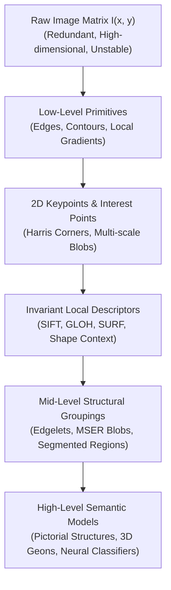

### 1.2 David Marr's Representational Framework

In his landmark treatise *Vision* (1982), neuroscientist **David Marr** established the governing paradigm for biological and computational vision. Perception progresses across three distinct representational strata:

1. **The Primal Sketch:** A 2D spatial representation capturing zero-crossings of intensity changes, isolated edges, line terminations, bars, and blobs. It makes explicit the localized physical geometry of the visual field without recovering depth.
2. **The 2.5D Sketch:** A viewer-centered coordinate representation that recovers surface orientations, localized depth discontinuities, and surface normals (e.g., via stereopsis, shading, and motion parallax). It represents visible surfaces from the observer's specific vantage point, but contains no hidden volumetric data.
3. **The 3D Model Representation:** An object-centered, volumetric coordinate system that describes physical entities hierarchically using volumetric primitives (generalized cylinders, quadrics). It achieves invariance to viewer viewpoint and occlusion.

### 1.3 Part-Based Models: Geons and Pictorial Structures

To achieve viewpoint-invariant 3D object recognition, theoretical vision models decompose complex entities into structural parts and geometric constraints:

- **Irving Biederman's Recognition-by-Components (1987):** Human object recognition relies on a vocabulary of roughly 36 volumetric primitives called **Geons** (geometric ions, such as cylinders, wedges, blocks, and cones). Biederman demonstrated that objects are recognized by the spatial arrangement of their geons rather than superficial texture or color.
- **Fischler & Elschlager's Pictorial Structures (1973):** Articulated visual objects (e.g., the human body) are modeled as spring-connected graphs. Nodes represent individual parts (head, torso, limbs) matched by local appearance filters. Edges represent deformable spring potentials encoding spatial geometric configurations.

### 1.4 Biological Camouflage vs. Natural Textures

Visual contours and boundaries serve as the primary cue for segmenting objects from backgrounds. In biological warfare and natural evolution:

- **Camouflage:** Operates by deliberately disrupting intensity and texture boundaries. Military camouflage patterns (and animal markings, like zebras or leopards) match the spatial frequency, orientation distribution, and color histogram of the surrounding foliage. This prevents edge detectors and human visual cortex V1 simple cells from forming closed contours.
- **Texture vs. Salt-and-Pepper Noise:**
  - *Texture* is a stationary or quasi-periodic spatial repetition of deterministic or stochastic sub-patterns (textons). It carries meaningful geometric information about 3D surface orientation and material identity.
  - *Salt-and-Pepper Noise* is an uncorrelated, memoryless impulse process caused by sensor transmission faults or saturated photo-sites. It carries zero structural correlation across spatial neighborhoods.

---

## 2. Differential Edge Detection & The Canny Optimization Pipeline

### 2.1 The Physical Nature of Edges

An edge in an image is a localized locus of rapid intensity variation. In the physical 3D world, sharp intensity discontinuities arise from four distinct physical phenomena:

1. **Surface Normal Discontinuity:** A sharp geometric crease where two planar surfaces meet at an angle (e.g., the edge of a box), causing an abrupt change in incident irradiance $\vec{n} \cdot \vec{l}$.
2. **Depth Discontinuity:** A boundary where a foreground object occludes a distant background, creating a jump discontinuity in scene depth $Z$.
3. **Surface Color / Albedo Discontinuity:** A sudden change in surface pigmentation or material reflectance $R$ on a flat continuous plane (e.g., printed text on paper).
4. **Illumination Discontinuity:** The boundary of a cast shadow or localized specular highlight.

### 2.2 Mathematical Edge Modeling & Derivative Operators

Modeling an image as a continuous intensity surface $z = f(x, y)$, an edge manifests as a steep intensity cliff. In differential calculus:

- The **first derivative** $\nabla f = \left[\frac{\partial f}{\partial x}, \frac{\partial f}{\partial y}\right]^T$ attains an extremum (peak or valley) at the edge boundary.
- The **second derivative** $\nabla^2 f = \frac{\partial^2 f}{\partial x^2} + \frac{\partial^2 f}{\partial y^2}$ passes through zero (**zero-crossing**) at the point of inflection.

#### Noise Amplification in Differentiation

Discrete differentiation is inherently high-pass filtering:

$$\frac{d}{dx}[f(x) + \eta(x)] = f'(x) + \eta'(x)$$

If $\eta(x) = A \sin(\omega x)$, its derivative is $\eta'(x) = A\omega \cos(\omega x)$. Differentiation amplifies high-frequency noise proportionally to frequency $\omega$. Consequently, numerical differentiation must always be paired with low-pass Gaussian smoothing:

$$\frac{d}{dx}[G_\sigma * f] = \left(\frac{d}{dx} G_\sigma\right) * f$$

By the derivative property of convolution, we convolve the noisy image directly with the analytical **Derivative of Gaussian (DoG)** filter.


### 2.3 John Canny's Optimal Edge Detector (1986)

John Canny formalized edge detection as an optimal filter design problem governed by three mathematical criteria:

1. **Low Error Rate (Detection):** Minimize the probability of false-positive edge markings and false-negative omissions.
2. **Localization Accuracy:** Minimize the expected Euclidean distance between the marked edge location and the true center of the physical edge.
3. **Single Response Constraint:** Ensure that a single physical edge produces only one marked response rather than a cluster of multiple adjacent edge pixels.

Using the calculus of variations on 1D step edges corrupted by white noise, Canny proved that the optimal filter is closely approximated by the **first derivative of a Gaussian**:

$$G'_\sigma(x) = -\frac{x}{\sigma^2} e^{-\frac{x^2}{2\sigma^2}}$$

### 2.4 The 4-Stage Canny Algorithmic Pipeline

#### Step 1: Derivative of Gaussian Smoothing

Convolve image $\mathbf{I}$ with horizontal and vertical Gaussian derivative kernels:

$$I_x = \frac{\partial G_\sigma}{\partial x} * \mathbf{I}, \quad I_y = \frac{\partial G_\sigma}{\partial y} * \mathbf{I}$$

The scale parameter $\sigma$ governs the degree of smoothing. Larger $\sigma$ detects prominent structural contours while suppressing fine texture. Smaller $\sigma$ captures fine details at the risk of noise sensitivity.

#### Step 2: Gradient Magnitude and Orientation

At every pixel coordinate $(x, y)$, compute the spatial gradient vector:

$$\nabla \mathbf{I}(x, y) = [I_x, I_y]^T$$

- **Gradient Magnitude:** Measures edge strength:
  $$M(x, y) = \|\nabla \mathbf{I}(x, y)\| = \sqrt{I_x^2 + I_y^2}$$
- **Gradient Orientation:** Specifies the direction of steepest intensity ascent (perpendicular to the contour edge):
  $$\theta(x, y) = \text{atan2}(I_y, I_x)$$

#### Step 3: Non-Maximum Suppression (NMS)

The raw gradient magnitude $M(x, y)$ forms wide, blurry ridges several pixels thick. Non-Maximum Suppression thins these ridges into sharp 1-pixel contours:

1. At pixel $q = (x, y)$, determine the gradient normal angle $\theta(x, y)$.
2. Follow the direction of $\theta$ and $-\theta$ to the boundary of the local $3 \times 3$ neighborhood, identifying two virtual intersection points $p$ and $r$.
3. Compute interpolated gradient magnitudes $M(p)$ and $M(r)$ using linear interpolation between the two nearest grid neighbors.
4. **Suppression Rule:**
   $$\text{NMS}(q) = \begin{cases} M(q) & \text{if } M(q) \ge M(p) \text{ and } M(q) \ge M(r) \\ 0 & \text{otherwise} \end{cases}$$

#### Step 4: Hysteresis Dual-Thresholding & Edge Linking

To avoid edge fragmentation from a single global threshold, Canny introduced **hysteresis** using two thresholds: $\tau_{\text{high}}$ and $\tau_{\text{low}}$ (typically $\tau_{\text{high}} \approx 2 \tau_{\text{low}}$ to $3 \tau_{\text{low}}$):

1. **Strong Edge Pixels:** $M(x, y) \ge \tau_{\text{high}}$. Marked permanently as valid edges.
2. **Weak Edge Pixels:** $\tau_{\text{low}} \le M(x, y) < \tau_{\text{high}}$. Retained conditionally.
3. **Non-Edge Pixels:** $M(x, y) < \tau_{\text{low}}$. Suppressed immediately to zero.
4. **Recursive Linking:** Traverse all weak edge pixels using Breadth-First Search (BFS) or Depth-First Search (DFS) over 8-connected neighborhoods. A weak pixel is promoted to a valid edge if and only if it connects to an existing strong edge pixel directly or via an unbroken chain of weak edge pixels.

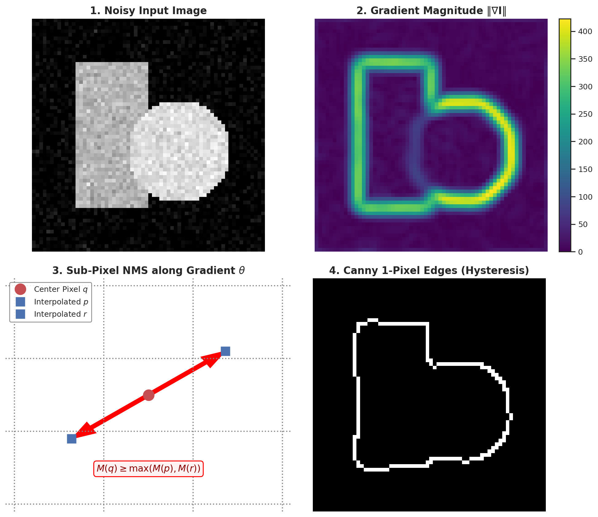

**Figure 1.** *The four-stage Canny edge detection pipeline and sub-pixel Non-Maximum Suppression mechanics. 1: Input synthetic image corrupted with Gaussian noise. 2: Gradient magnitude field $\|\nabla \mathbf{I}\| = \sqrt{I_x^2 + I_y^2}$, illustrating thick multi-pixel gradient ridges. 3: Sub-pixel Non-Maximum Suppression along gradient direction $\theta$, comparing center pixel $q$ against linearly interpolated neighbors $p$ and $r$. 4: Final 1-pixel thin connected contours after hysteresis dual-thresholding and recursive 8-connected linking.*

---

## 3. Structural Representation: Edgelet Extraction & Second-Moment Eigendecomposition

### 3.1 From Pixel Contours to Parametric Edgelets

While Canny edges provide thin binary contours, downstream geometric reasoning (e.g., vanishing point estimation, building facade reconstruction, line-based SLAM) requires decomposing arbitrary curved contours into piecewise linear segments termed **edgelets**.

### 3.2 The Edgelet Extraction Algorithm

1. **Directional Quantization:** Discretize the continuous Canny gradient orientation $\theta \in [0, 180^\circ)$ into 8 discrete directional bins of $45^\circ$ width each:
   $$\text{bin}(x, y) = \left\lfloor \frac{\theta(x, y)}{22.5^\circ} \right\rfloor \pmod 8$$
2. **Connected Component Grouping:** For a target direction bin $d$, extract connected components of edge pixels whose quantized orientations lie within adjacent bins $\{d-1, d, d+1\}$. This tolerance allows smooth, gently curving contours to form continuous segments without premature fragmentation.

### 3.3 Principal Component Analysis (PCA) of Edgelet Geometry

Let an extracted edgelet consist of $N$ discrete pixel coordinates $\{(x_i, y_i)\}_{i=1}^N$. We characterize its 2D spatial distribution using its **second moment (covariance) matrix**:

1. **Center of Mass (Centroid):**
   $$\mu_x = \frac{1}{N} \sum_{i=1}^N x_i, \quad \mu_y = \frac{1}{N} \sum_{i=1}^N y_i$$
2. **Second Moment Covariance Matrix $C_{\text{edgelet}}$:**
   $$C_{\text{edgelet}} = \frac{1}{N} \sum_{i=1}^N \begin{bmatrix} (x_i - \mu_x)^2 & (x_i - \mu_x)(y_i - \mu_y) \\ (x_i - \mu_x)(y_i - \mu_y) & (y_i - \mu_y)^2 \end{bmatrix} = \begin{bmatrix} \sigma_{xx} & \sigma_{xy} \\ \sigma_{xy} & \sigma_{yy} \end{bmatrix}$$
3. **Eigendecomposition:**
   Solve the characteristic equation $\det(C_{\text{edgelet}} - \lambda \mathbf{I}) = 0$, yielding two eigenvalues $\lambda_1 \ge \lambda_2 \ge 0$ and orthogonal eigenvectors $\mathbf{v}_1, \mathbf{v}_2$:
   - **Principal Eigenvector $\mathbf{v}_1 = [v_{1, x}, v_{1, y}]^T$:** Points along the axis of maximum spatial variance. The physical orientation of the edgelet is:
     $$\theta_{\text{edgelet}} = \tan^{-1}\left(\frac{v_{1, y}}{v_{1, x}}\right)$$
   - **Straightness Metric:** The ratio of eigenvalues $\frac{\lambda_1}{\lambda_2}$ measures linearity:
     - For a perfectly straight line segment, $\lambda_2 = 0 \implies \frac{\lambda_1}{\lambda_2} \to \infty$.
     - For a circular arc or scattered blob, $\lambda_1 \approx \lambda_2 \implies \frac{\lambda_1}{\lambda_2} \approx 1$.
     - In practice, a threshold $\frac{\lambda_1}{\lambda_2} \ge 10.0$ confirms an edgelet as a valid straight line segment.

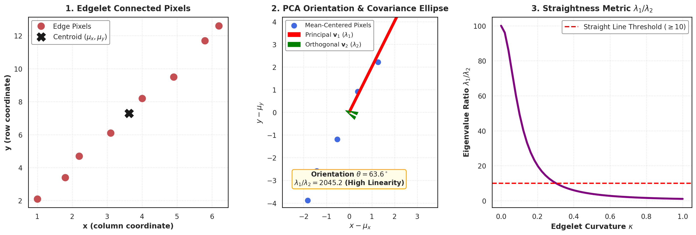

**Figure 2.** *Edgelet extraction, second moment covariance matrix, and PCA eigendecomposition. Left: Discrete connected edge pixels $\{(x_i, y_i)\}$ with centroid $(\mu_x, \mu_y)$. Center: Covariance ellipse showing principal eigenvector $\mathbf{v}_1$ (direction of maximum spatial variance, defining $\theta_{\text{edgelet}}$) and minor axis $\mathbf{v}_2$. Right: Edgelet straightness metric $\lambda_1 / \lambda_2$ plotted against contour curvature $\kappa$, confirming that straight segments produce large eigenvalue ratios.*

### 3.4 Second Derivatives: The Laplacian of Gaussian (LoG)

Instead of directional first derivatives, we can examine scalar second derivatives using the **Laplacian operator**:

$$\nabla^2 f = \frac{\partial^2 f}{\partial x^2} + \frac{\partial^2 f}{\partial y^2}$$

To eliminate high-frequency noise, the Laplacian is applied to a Gaussian-smoothed image:

$$\nabla^2 [G_\sigma * I] = [\nabla^2 G_\sigma] * I$$

The analytical 2D **Laplacian of Gaussian (LoG)** kernel is:

$$\nabla^2 G_\sigma(x, y) = \frac{\partial^2 G_\sigma}{\partial x^2} + \frac{\partial^2 G_\sigma}{\partial y^2} = \frac{x^2 + y^2 - 2\sigma^2}{2\pi \sigma^6} e^{-\frac{x^2 + y^2}{2\sigma^2}}$$

Due to its central negative depression and circular positive surround, the inverted LoG is commonly called the **Mexican Hat filter**. Edges appear as zero-crossings between positive and negative lobes. Circular blobs produce strong localized extrema when the blob radius matches the filter scale ($r = \sqrt{2}\sigma$).

---

## 4. 2D Interest Point Localization: The Harris Structure Tensor

### 4.1 The Aperture Problem: Why Edges Are Insufficient for Alignment

While edges localize 1D boundary transitions, they suffer from the **aperture problem**:

- When observing a straight edge through a small local inspection window (aperture), shifting the window parallel to the edge produces **zero change in intensity**.
- Consequently, motion or correspondence matching along an edge is mathematically underdetermined. We can only measure motion perpendicular to the edge normal vector.

To compute unambiguous 2D image correspondence (e.g., for panoramic image stitching, 3D structure from motion, and visual odometry), we require point features where intensity changes substantially in **all directions**—namely, **Corners and Interest Points**.

### 4.2 Derivation of the Harris Autocorrelation Matrix (Structure Tensor)

Consider placing a local window $w(u, v)$ (e.g., a Gaussian weighting window $w(u, v) = e^{-(u^2 + v^2)/(2\sigma^2)}$) centered at coordinate $(x, y)$. If the window is shifted by a small displacement vector $(\Delta x, \Delta y)$, the **Sum of Squared Differences (SSD)** in intensity is:

$$E(\Delta x, \Delta y) = \sum_{u, v} w(u, v) \Big[ I(x + u + \Delta x, y + v + \Delta y) - I(x + u, y + v) \Big]^2$$

Applying a first-order bivariate **Taylor series expansion** to the shifted image:

$$I(x + u + \Delta x, y + v + \Delta y) \approx I(x + u, y + v) + I_x(x + u, y + v) \Delta x + I_y(x + u, y + v) \Delta y$$

where $I_x = \frac{\partial I}{\partial x}$ and $I_y = \frac{\partial I}{\partial y}$ are spatial partial derivatives.

Substituting this linear expansion into the error function:

$$E(\Delta x, \Delta y) \approx \sum_{u, v} w(u, v) \Big[ I_x \Delta x + I_y \Delta y \Big]^2$$

Expanding the square and expressing in matrix quadratic form:

$$E(\Delta x, \Delta y) \approx \sum_{u, v} w(u, v) \Big[ I_x^2 \Delta x^2 + 2 I_x I_y \Delta x \Delta y + I_y^2 \Delta y^2 \Big]$$

$$E(\Delta x, \Delta y) \approx [\Delta x, \Delta y] \, \mathbf{A} \, \begin{bmatrix} \Delta x \\ \Delta y \end{bmatrix}$$

where $\mathbf{A}$ is the $2 \times 2$ symmetric, positive semi-definite **Autocorrelation Matrix** (also termed the **Structure Tensor** or **Second Moment Matrix**):

$$\mathbf{A} = \sum_{u, v} w(u, v) \begin{bmatrix} I_x^2 & I_x I_y \\ I_x I_y & I_y^2 \end{bmatrix} = \begin{bmatrix} \langle I_x^2 \rangle & \langle I_x I_y \rangle \\ \langle I_x I_y \rangle & \langle I_y^2 \rangle \end{bmatrix}$$

### 4.3 Eigenvalue Analysis and Geometric Interpretation

Because $\mathbf{A}$ is real and symmetric, its quadratic form defines an error ellipse. Its principal axes are aligned with the eigenvectors $\mathbf{u}_1, \mathbf{u}_2$ of $\mathbf{A}$, with axis lengths proportional to $1 / \sqrt{\lambda_1}$ and $1 / \sqrt{\lambda_2}$:

$$\mathbf{A} = \mathbf{U} \begin{bmatrix} \lambda_1 & 0 \\ 0 & \lambda_2 \end{bmatrix} \mathbf{U}^T, \quad \lambda_1 \ge \lambda_2 \ge 0$$

The eigenvalues directly characterize the local spatial topography:

1. **Flat Region:** Both eigenvalues are negligible ($\lambda_1 \approx 0, \lambda_2 \approx 0$). Intensity is uniform. Shifting the patch in any direction yields near-zero change ($E(\Delta x, \Delta y) \approx 0$).
2. **Edge Region:** One eigenvalue is large while the orthogonal eigenvalue is near zero ($\lambda_1 \gg 0, \lambda_2 \approx 0$). Shifting perpendicular to the edge produces large intensity change, but shifting parallel to the edge produces zero change (the aperture problem).
3. **Corner Point:** Both eigenvalues are distinctly large and of comparable magnitude ($\lambda_1 \gg 0, \lambda_2 \gg 0$). Shifting the patch in any direction produces massive intensity variation, cleanly localizing a 2D keypoint.

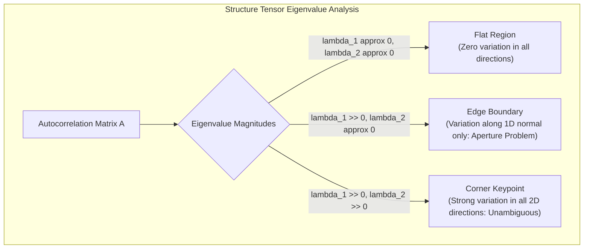

### 4.4 The Harris Cornerness Response Function $R$

Directly computing eigenvalues at every pixel requires solving a quadratic characteristic equation across millions of pixels. This is computationally expensive. Chris Harris and Mike Stephens (1988) proposed an analytical scalar shortcut using the **trace** and **determinant** of $\mathbf{A}$:

$$\text{trace}(\mathbf{A}) = A_{11} + A_{22} = \lambda_1 + \lambda_2$$

$$\det(\mathbf{A}) = A_{11} A_{22} - A_{12}^2 = \lambda_1 \lambda_2$$

The **Harris Cornerness Measure $R$** is defined as:

$$R = \det(\mathbf{A}) - \kappa \, \text{trace}^2(\mathbf{A}) = \lambda_1 \lambda_2 - \kappa (\lambda_1 + \lambda_2)^2$$

where $\kappa$ is an empirical tunable sensitivity constant (standardly $\kappa \in [0.04, 0.06]$).

- **Corner:** $R > \tau > 0$ (both $\lambda_1, \lambda_2$ are large, so $\lambda_1 \lambda_2$ dominates).
- **Edge:** $R < 0$ (one eigenvalue dominates, e.g., $\lambda_1 > 0, \lambda_2 \approx 0 \implies R = -\kappa \lambda_1^2 < 0$).
- **Flat:** $|R| \approx 0$ (both $\lambda_1, \lambda_2 \approx 0$).

Keypoints are extracted by thresholding $R > \tau$ followed by $3 \times 3$ or $5 \times 5$ spatial Non-Maximum Suppression.

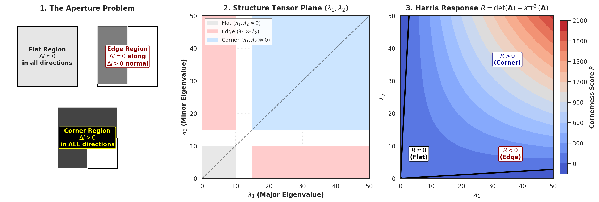

**Figure 3.** *The Aperture Problem, structure tensor eigenvalue plane, and Harris response landscape. Left: Visual comparison of local patches over Flat, Edge, and Corner structures. Center: Structure tensor eigenvalue plane ($\lambda_1$ vs. $\lambda_2$), delineating flat, edge, and corner decision zones. Right: Contour landscape of the Harris response function $R = \det(\mathbf{A}) - \kappa \text{trace}^2(\mathbf{A})$, illustrating sharp positive corner peaks ($R > 0$) and negative edge troughs ($R < 0$).*

### 4.5 Transformation Invariance of the Harris Detector

#### 1. Invariance to 2D Spatial Rotation

Let the image undergo an orthogonal coordinate rotation by angle $\theta$: $\mathbf{x}' = \mathbf{R} \mathbf{x}$, where $\mathbf{R} = \begin{bmatrix} \cos\theta & -\sin\theta \\ \sin\theta & \cos\theta \end{bmatrix}$ is an orthogonal matrix ($\mathbf{R}^T \mathbf{R} = \mathbf{I}$, $\det(\mathbf{R}) = 1$).

The gradient vector rotates as $\nabla \mathbf{I}' = \mathbf{R} \nabla \mathbf{I}$. Consequently, the transformed structure tensor is:

$$\mathbf{A}' = \sum w \, (\mathbf{R} \nabla \mathbf{I}) (\mathbf{R} \nabla \mathbf{I})^T = \mathbf{R} \left( \sum w \nabla \mathbf{I} \nabla \mathbf{I}^T \right) \mathbf{R}^T = \mathbf{R} \mathbf{A} \mathbf{R}^T$$

Because $\mathbf{A}'$ is related to $\mathbf{A}$ by an orthogonal similarity transformation, their **eigenvalues are identical**:

$$\text{eig}(\mathbf{A}') = \text{eig}(\mathbf{A}) \implies \lambda'_1 = \lambda_1, \; \lambda'_2 = \lambda_2$$

Thus, **the Harris corner detector is strictly invariant to 2D image rotation**.

#### 2. Photometric Invariance (Additive vs. Multiplicative)

Let the image undergo an affine photometric transformation:

$$I'(x, y) = \alpha I(x, y) + \beta, \quad \alpha > 0$$

- **Additive Brightness Shift ($\beta$):** Partial derivatives eliminate the constant: $\frac{\partial}{\partial x}(\alpha I + \beta) = \alpha I_x$. The additive term $\beta$ has zero effect on $\mathbf{A}$.
- **Multiplicative Contrast Gain ($\alpha$):** Derivatives scale linearly: $I'_x = \alpha I_x, I'_y = \alpha I_y$.
  The structure tensor scales quadratically: $\mathbf{A}' = \alpha^2 \mathbf{A}$.
  Its determinant scales as $\det(\mathbf{A}') = \alpha^4 \det(\mathbf{A})$, and its trace squared scales as $\text{trace}^2(\mathbf{A}') = \alpha^4 \text{trace}^2(\mathbf{A})$.
  The resulting Harris response scales by the fourth power:
  $$R' = \alpha^4 R$$
  Consequently, with a fixed static threshold $\tau$, **the Harris detector is invariant to additive brightness shifts ($\beta$), but not invariant to multiplicative contrast scaling ($\alpha$)**.

#### 3. Failure Under Scale Variations

The Harris detector uses a fixed spatial Gaussian integration window $w(u, v)$ with fixed standard deviation $\sigma$.

- When an image is zoomed in (enlarged), a sharp, localized corner expands into a wide, gradual curve.
- Viewed through the same fixed-size window $w(u, v)$, the corner looks locally like an edge ($\lambda_1 \gg \lambda_2$).
- Thus, **the Harris detector is not scale-invariant**, motivating the development of scale-space representations.

---

## 5. Multi-Scale Representation, Image Pyramids, and Filter Banks

### 5.1 The Need for Scale Invariance

In natural scenes, objects appear at arbitrary physical distances from the camera. Under perspective projection, moving an object twice as far away halves its spatial pixel dimensions. A visual primitive detected at scale $\sigma_1$ on a near object will be completely missed on a distant object unless the algorithm operates across continuous **Scale Space**.

### 5.2 Scale-Space Theory & The Gaussian Uniqueness Theorem

Scale-space theory (Witkin 1983, Koenderink 1984, Babaud et al. 1986, Lindeberg 1994) formalizes the representation of an image across continuous scale parameter $\sigma \ge 0$:

$$L(x, y; \sigma) = G(x, y; \sigma) * I(x, y)$$

where $G(x, y; \sigma) = \frac{1}{2\pi\sigma^2} e^{-\frac{x^2 + y^2}{2\sigma^2}}$.

**The Gaussian Uniqueness Theorem:**

Under five axiomatic mathematical requirements—linearity, shift invariance, rotational symmetry, semi-group structure ($G_{\sigma_1} * G_{\sigma_2} = G_{\sqrt{\sigma_1^2 + \sigma_2^2}}$), and **non-enhancement of local extrema (causality)** (meaning no new spurious local maxima or minima can appear as scale increases)—the **Gaussian kernel is the unique linear scale-space filter in all dimensions**.

### 5.3 Characteristic Scale Selection via Normalized LoG

*How do we automatically determine the intrinsic physical scale of an object or blob?*

Tony Lindeberg (1994, 1998) proved that to compare differential filter responses across different scales, the differential operators must be **scale-normalized**:

$$\nabla_{\text{norm}}^2 = \sigma^2 \nabla^2 = \sigma^2 \left( \frac{\partial^2}{\partial x^2} + \frac{\partial^2}{\partial y^2} \right)$$

Evaluating the scale-normalized Laplacian of Gaussian:

$$F(x, y; \sigma) = \sigma^2 \Big| \nabla^2 G_\sigma(x, y) * I(x, y) \Big|$$

as a continuous function of scale $\sigma$ at a fixed coordinate $(x_0, y_0)$, $F(\sigma)$ attains a local maximum at a **characteristic scale** $\sigma^*$.

**Theoretical Derivation for a Circular Blob:**

Consider an ideal circular binary blob of radius $r$ centered at the origin:

$$I(x, y) = \begin{cases} 1 & x^2 + y^2 \le r^2 \\ 0 & x^2 + y^2 > r^2 \end{cases}$$

Convolving with the scale-normalized LoG and evaluating at the center $(0, 0)$ yields:

$$F(\sigma) = \sigma^2 \int_0^r \frac{u^2 - 2\sigma^2}{2\pi \sigma^6} e^{-\frac{u^2}{2\sigma^2}} 2\pi u \, du = \frac{r^2}{\sigma^2} e^{-\frac{r^2}{2\sigma^2}}$$

Taking the derivative with respect to $\sigma$ and setting $\frac{d F}{d\sigma} = 0$:

$$\frac{d}{d\sigma}\left( \frac{r^2}{\sigma^2} e^{-\frac{r^2}{2\sigma^2}} \right) = r^2 e^{-\frac{r^2}{2\sigma^2}} \left( -\frac{2}{\sigma^3} + \frac{r^2}{\sigma^5} \right) = 0$$

$$\frac{2}{\sigma^3} = \frac{r^2}{\sigma^5} \implies 2\sigma^2 = r^2 \implies \sigma^* = \frac{r}{\sqrt{2}}$$

Thus, the characteristic scale $\sigma^*$ is directly proportional to the physical radius of the blob: $r = \sqrt{2} \sigma^*$. By searching for 3D extrema of $F(x, y; \sigma)$ across space $(x, y)$ and scale $\sigma$, we discover both the location and intrinsic physical size of every blob simultaneously.

### 5.4 Difference of Gaussians (DoG) as an Efficient Approximation

Computing continuous scale-normalized LoG filters across multiple scales requires expensive 2D spatial convolution with wide kernels. David Lowe (2004) proved that the **Difference of Gaussians (DoG)** provides an exact mathematical approximation to the scale-normalized LoG at zero computational overhead.

From the classical heat diffusion partial differential equation:

$$\frac{\partial L}{\partial \sigma} = \sigma \nabla^2 L$$

Using the finite difference definition of a derivative:

$$\frac{\partial L}{\partial \sigma} = \lim_{k \to 1} \frac{L(x, y; k\sigma) - L(x, y; \sigma)}{k\sigma - \sigma}$$

Equating the two expressions:

$$\frac{L(x, y; k\sigma) - L(x, y; \sigma)}{(k - 1)\sigma} \approx \sigma \nabla^2 L$$

$$L(x, y; k\sigma) - L(x, y; \sigma) \approx (k - 1) \, \sigma^2 \nabla^2 L$$

The difference between two Gaussian-blurred images sampled at nearby scales $\sigma$ and $k\sigma$ is **identically equal to the scale-normalized Laplacian $\sigma^2 \nabla^2 L$ scaled by the constant $(k-1)$**.

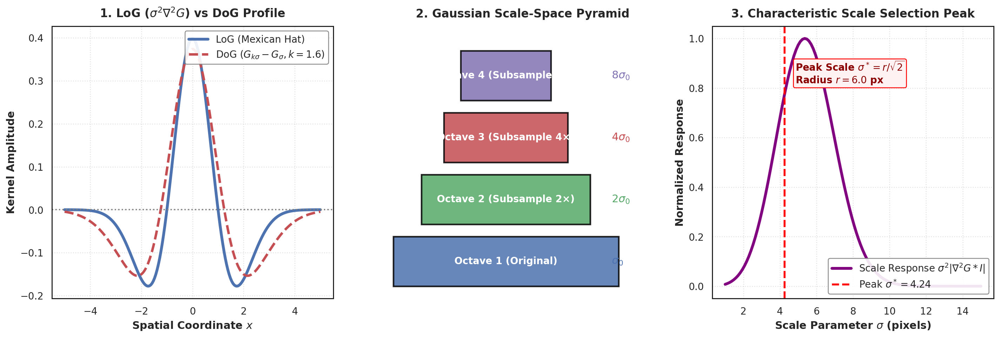

**Figure 4.** *Scale-space representation, Laplacian of Gaussian (LoG), and Difference of Gaussians (DoG). Left: 1D cross-sectional profiles of the exact scale-normalized LoG (Mexican Hat) and Difference of Gaussians ($G_{k\sigma} - G_\sigma, k=1.6$), confirming near-identical profiles. Center: Gaussian pyramid octave downsampling hierarchy. Right: Scale-normalized response $\sigma^2 |\nabla^2 G * I|$ plotted against scale $\sigma$, displaying a distinct characteristic scale peak $\sigma^* = r / \sqrt{2}$ matching the physical radius of the synthetic blob.*

### 5.5 Texture Analysis via Multi-Scale Filter Banks

Natural visual surfaces (e.g., grass, fabric, wood grain, pebble beds) are characterized by **texture**—statistical spatial arrangements of micro-structures. To classify textures, images are convolved with a bank of linear filters across multiple scales and orientations:

- **Filter Bank Architectures:**
  - *Leung-Malik (LM) Filter Bank:* 48 filters consisting of first and second derivatives of Gaussians at 6 orientations and 3 scales, plus 8 LoG filters and 4 Gaussian filters.
  - *Maximum Response (MR8) Filter Bank:* 38 filters grouped into 8 rotation-invariant maximum response dimensions.
  - *Schmid (S) Filter Bank:* 13 isotropic rotation-invariant Gabor-like filters.
- **Textons:** By clustering the resulting high-dimensional filter response vectors across an image dataset using $K$-means, the cluster centers define a universal vocabulary of visual micro-primitives called **Textons**. Any image texture is then represented as a compact histogram over these textons.

---

## 6. Scale-Invariant Feature Transform (SIFT) & Descriptor Family

### 6.1 Lowe's SIFT Pipeline (IJCV 2004)

David Lowe's **Scale-Invariant Feature Transform (SIFT)** transformed computer vision by coupling scale-invariant keypoint detection with a highly distinctive, invariant local descriptor.

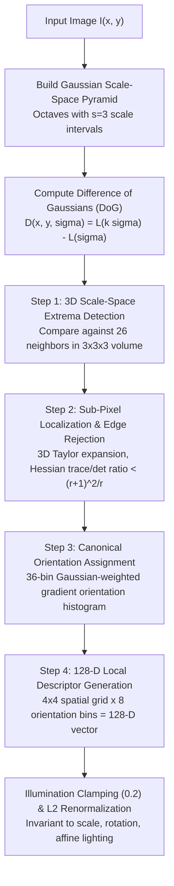

### 6.2 Step 1: Scale-Space Extrema Detection

1. **Pyramid Construction:** The scale space is divided into **octaves** (each octave corresponds to a doubling of scale $\sigma$, followed by downsampling by a factor of 2). Each octave is partitioned into $s$ scale intervals (standardly $s = 3$), requiring $s + 3$ Gaussian-blurred images:
   $$k = 2^{1/s} = 2^{1/3} \approx 1.26$$
2. **DoG Volume Extrema:** Adjacent Gaussian images are subtracted to generate $s + 2$ DoG images per octave.
3. Each candidate pixel is compared against its **26 nearest neighbors**: 8 neighbors in the current DoG scale plane, 9 neighbors in the scale plane above ($k\sigma$), and 9 neighbors in the scale plane below ($\sigma / k$). A point is selected as a candidate keypoint if and only if it is strictly larger than all 26 neighbors or strictly smaller than all 26 neighbors.

### 6.3 Step 2: Keypoint Localization, Low-Contrast Rejection, and Edge Elimination

#### Sub-Pixel Refinement via 3D Quadratic Taylor Expansion

Discrete extrema lie on integer grid points. To localize keypoints to sub-pixel and sub-scale accuracy, a 3D second-order Taylor series expansion of DoG function $D(\mathbf{x})$ is constructed about candidate point $\mathbf{x}_0 = [x, y, \sigma]^T$:

$$D(\mathbf{x}) = D + \frac{\partial D^T}{\partial \mathbf{x}} \mathbf{x} + \frac{1}{2} \mathbf{x}^T \frac{\partial^2 D}{\partial \mathbf{x}^2} \mathbf{x}$$

Setting the derivative with respect to $\mathbf{x}$ to zero:

$$\hat{\mathbf{x}} = - \left( \frac{\partial^2 D}{\partial \mathbf{x}^2} \right)^{-1} \frac{\partial D}{\partial \mathbf{x}}$$

If the sub-pixel offset exceeds $0.5$ in any dimension ($|\hat{x}| > 0.5$), the candidate point is shifted to the adjacent discrete coordinate and re-evaluated.

#### Low-Contrast Keypoint Rejection

Evaluating $D(\hat{\mathbf{x}})$ at the fitted extremum:

$$D(\hat{\mathbf{x}}) = D + \frac{1}{2} \frac{\partial D^T}{\partial \mathbf{x}} \hat{\mathbf{x}}$$

If $|D(\hat{\mathbf{x}})| < 0.03$ (assuming image intensities normalized to $[0, 1]$), the keypoint is discarded as an unstable, low-contrast noise artifact.

#### Elimination of Unstable Edge Responses (The Hessian Ratio Test)

Difference of Gaussian filters produce strong localized responses along linear edges. Along an edge, the principal curvature across the edge is massive, but the curvature along the edge is near zero. Such points are poorly localized and must be purged.

Curvature is measured by the $2 \times 2$ spatial **Hessian matrix** of $D$:

$$\mathbf{H} = \begin{bmatrix} D_{xx} & D_{xy} \\ D_{xy} & D_{yy} \end{bmatrix}$$

Let $\alpha$ and $\beta$ be the eigenvalues of $\mathbf{H}$ (with $\alpha \ge \beta$):

$$\text{Tr}(\mathbf{H}) = D_{xx} + D_{yy} = \alpha + \beta$$

$$\text{Det}(\mathbf{H}) = D_{xx} D_{yy} - D_{xy}^2 = \alpha \beta$$

Let $r = \frac{\alpha}{\beta}$ be the ratio of eigenvalues. The ratio metric is:

$$\frac{\text{Tr}(\mathbf{H})^2}{\text{Det}(\mathbf{H})} = \frac{(\alpha + \beta)^2}{\alpha \beta} = \frac{(r\beta + \beta)^2}{r\beta^2} = \frac{(r + 1)^2}{r}$$

This function attains its minimum when $r = 1$ (symmetric isotropic corner) and increases monotonically as the curvature ratio $r$ grows. To discard edge responses, Lowe enforces the threshold condition:

$$\frac{\text{Tr}(\mathbf{H})^2}{\text{Det}(\mathbf{H})} < \frac{(r + 1)^2}{r}$$

Using standard eigenvalue threshold $r = 10$:

$$\frac{(10 + 1)^2}{10} = \frac{121}{10} = 12.1$$

If $\frac{\text{Tr}(\mathbf{H})^2}{\text{Det}(\mathbf{H})} \ge 12.1$ or if $\text{Det}(\mathbf{H}) < 0$ (opposite sign curvatures), the keypoint is rejected.

### 6.4 Step 3: Canonical Orientation Assignment

To achieve invariance to 2D image rotation:

1. For each keypoint at scale $\sigma$, compute gradient magnitudes $m(x, y)$ and orientations $\theta(x, y)$ within a Gaussian-weighted circular window of radius $3 \times (1.5\sigma)$.
2. Accumulate an **orientation histogram with 36 bins** (each bin covering $10^\circ$). Each pixel's gradient magnitude is weighted by a Gaussian falloff ($e^{-d^2 / (2(1.5\sigma)^2)}$).
3. The highest peak in the histogram defines the keypoint's **canonical orientation $\theta_0$**.
4. If any secondary peak attains at least $80\%$ of the highest peak's magnitude, an independent duplicate keypoint is instantiated with that secondary orientation. This enables robust multi-hypothesis matching at rotational symmetries.

### 6.5 Step 4: Local Keypoint Descriptor Generation

To describe the local patch:

1. **Coordinate Frame Rotation:** Rotate the local coordinate grid by $-\theta_0$ so that all spatial measurements are aligned with the keypoint's canonical orientation.
2. **Spatial Grid Partitioning:** Extract a $16 \times 16$ pixel sample region around the keypoint. Partition this region into a **$4 \times 4$ grid of spatial sub-regions** (each sub-region covering $4 \times 4$ sample pixels).
3. **Orientation Pooling:** Within each of the 16 sub-regions, accumulate an **8-bin gradient orientation histogram** (each bin covering $45^\circ$), weighted by gradient magnitude and a broad Gaussian window centered on the keypoint.
4. **Feature Vector Concatenation:** Concatenating the 8 orientation bins across all 16 spatial sub-regions produces the canonical **128-dimensional SIFT feature vector**:
   $$\mathbf{f}_{\text{raw}} \in \mathbb{R}^{16 \times 8} = \mathbb{R}^{128}$$
5. **Illumination Invariance (Normalization & Clamping):**
   - Normalize the vector to unit Euclidean norm: $\mathbf{f}_1 = \mathbf{f}_{\text{raw}} / \|\mathbf{f}_{\text{raw}}\|_2$. This achieves complete invariance to linear multiplicative contrast gain ($I \to \alpha I$).
   - Clip all vector components at a maximum value of **$0.2$**: $f_2(i) = \min(f_1(i), 0.2)$. This suppresses non-linear photometric saturation effects (e.g., specular highlights and camera sensor clipping).
   - Re-normalize to unit Euclidean norm: $\mathbf{f}_{\text{SIFT}} = \mathbf{f}_2 / \|\mathbf{f}_2\|_2$.

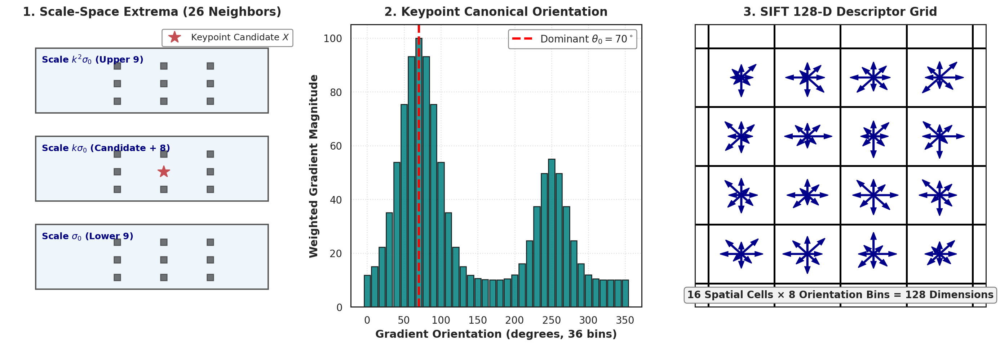

**Figure 5.** *The Scale-Invariant Feature Transform (SIFT) extraction pipeline. Left: Scale-space extrema detection across adjacent DoG scale planes in a $3 \times 3 \times 3$ volume (26 neighbors). Center: 36-bin Gaussian-weighted gradient orientation histogram, identifying the dominant canonical orientation peak ($\theta_0 = 70^\circ$). Right: The canonical 128-dimensional SIFT descriptor grid ($4 \times 4$ spatial pooling sub-regions $\times$ 8 orientation bins).*

### 6.6 The Local Descriptor Family: SIFT vs. GLOH vs. SURF vs. MOPS

| Descriptor | Spatial Grid Geometry | Orientation Bins | Raw Dimension | Compressed Dimension | Primary Computational Mechanism |
| :--- | :--- | :--- | :--- | :--- | :--- |
| **SIFT** | Cartesian $4 \times 4$ grid | 8 bins | 128 | 128 (unit norm + clamped) | Multi-octave Gaussian pyramid + DoG extrema |
| **GLOH** | Log-polar 17 spatial bins | 16 bins | 272 | **128 (PCA projection)** | Log-polar grid + PCA dimensionality reduction |
| **SURF** | Cartesian $4 \times 4$ grid | Haar $d_x, d_y$ wavelets | 64 | 64 | **Integral Images + Box Filter Hessian** |
| **MOPS** | Cartesian $8 \times 8$ grid | Intensity values | 64 | 64 (bias/gain normalized) | Wavelet-downsampled oriented pixel patch |

- **GLOH (Gradient Location and Orientation Histogram):** Mikolajczyk and Schmid (2005) observed that SIFT's Cartesian grid treats all spatial directions equally. GLOH replaces the Cartesian grid with a **log-polar grid** comprising 3 radial zones ($0 \le r < 6$, $6 \le r < 11$, $11 \le r < 15$): 1 central circle + 8 middle annular sectors + 8 outer annular sectors = **17 spatial bins**. Combining 17 spatial bins with 16 orientation bins yields a 272-dimensional vector, which is projected down to 128 dimensions via PCA. GLOH achieves higher distinctiveness and matching accuracy than standard SIFT on textured natural images.
- **SURF (Speeded-Up Robust Features):** Bay et al. (2006) replaced Gaussian smoothing entirely with piecewise constant rectangular **box filters** evaluated in $\mathcal{O}(1)$ time using **Integral Images**. Instead of DoG pyramids, SURF detects keypoints using the Fast-Hessian determinant:
  $$\det(\mathbf{H}_{\text{approx}}) = D_{xx} D_{yy} - (0.9 D_{xy})^2$$
  Its 64-dimensional descriptor computes sums of 2D Haar wavelet responses ($d_x, d_y, |d_x|, |d_y|$), running **$3\times$ to $5\times$ faster than SIFT** with comparable matching precision.

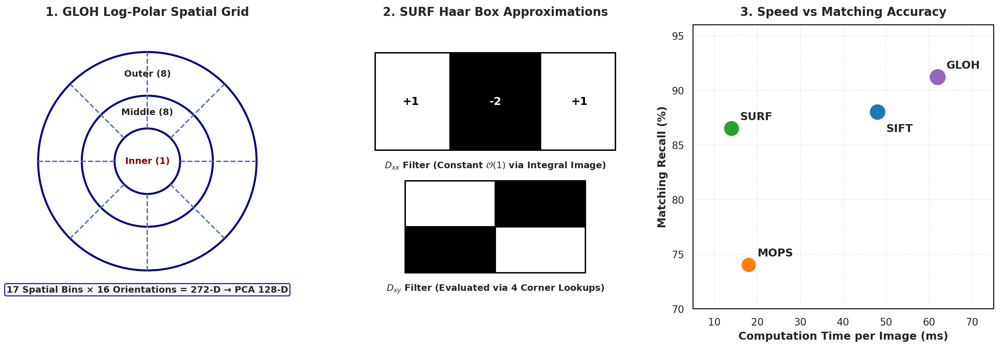

**Figure 6.** *Architecture and computational performance of local descriptor families. Left: GLOH log-polar spatial binning layout (17 spatial bins: 1 inner, 8 middle, 8 outer). Center: SURF box filter approximations of Gaussian second derivatives ($D_{xx}, D_{xy}$) computed in $\mathcal{O}(1)$ constant time via Integral Images. Right: Empirical computation time per frame vs. matching recall benchmark, illustrating the Pareto frontier across SURF, SIFT, GLOH, and MOPS.*

---

## 7. Visual Grouping & Image Segmentation Paradigms

### 7.1 Gestalt Psychology and Perceptual Grouping

Image segmentation is the task of partitioning a digital image into multiple contiguous, non-overlapping regions corresponding to semantic objects or physical surfaces:

$$\bigcup_{i=1}^K R_i = \mathbf{I}, \quad R_i \cap R_j = \emptyset \; (i \ne j)$$

Human perceptual segmentation is governed by the principles of **Gestalt Psychology** (Wertheimer 1923, Koffka 1935):

1. **Proximity:** Visual tokens positioned physically close to each other are perceived as belonging to a collective group.
2. **Similarity:** Tokens sharing visual attributes (color, luminance, orientation, texture) are grouped together.
3. **Good Continuation (Continuity):** The visual cortex prefers smooth, continuous contour trajectories over abrupt angular junctions.
4. **Closure:** Fragmented or occluded boundary contours are mentally completed to form enclosed, cohesive shapes.
5. **Symmetry:** Symmetrical contours are preferentially segmented as foreground figures against background grounds.
6. **Common Fate:** Dynamic visual tokens moving with identical velocity vectors $\vec{v}$ are grouped into a single unified object.

### 7.2 Taxonomy of Classical Image Segmentation Paradigms

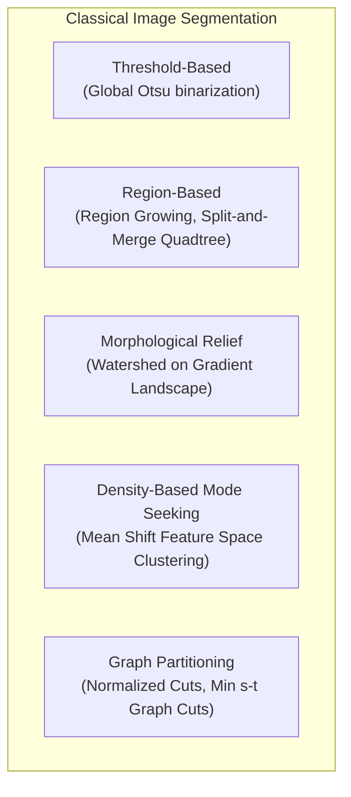

#### 1. Intensity Thresholding & Otsu's Method (1979)

Otsu's method selects an optimal global binarization threshold $t^*$ that maximizes the **between-class variance** $\sigma_B^2(t)$ (equivalently minimizing within-class variance $\sigma_W^2(t)$) over the 1D intensity histogram:

$$t^* = \arg\max_{t} \omega_0(t) \omega_1(t) \Big( \mu_0(t) - \mu_1(t) \Big)^2$$

where $\omega_0, \omega_1$ are the probabilities of the two classes separated by threshold $t$, and $\mu_0, \mu_1$ are their respective class mean intensities.

#### 2. The Watershed Algorithm

The watershed algorithm models the gradient magnitude image as a 3D topographic relief landscape where pixel intensity corresponds to elevation:

1. Piercing holes at every localized minimum, the landscape is gradually immersed in water.
2. As water rises, water from adjacent catchment basins threatens to merge.
3. To prevent merging, orthogonal **dam lines (watershed lines)** are erected at the contact points. When water reaches the highest peak, the dam lines delineate the final segmented boundaries.

*Limitation:* Raw watershed applied to noisy images produces severe **over-segmentation** (thousands of tiny catchment basins). Practical applications employ **marker-controlled watershed**, initializing flooding exclusively from verified foreground/background seed markers.

#### 3. Mean Shift Clustering (Comaniciu & Meer, 2002)

Mean Shift is a non-parametric, density-based mode-seeking algorithm operating in a joint spatial-range feature space $\mathbf{x} = [x, y, R, G, B]^T$:

1. At each point $\mathbf{x}$, estimate the local gradient of the probability density function using a radially symmetric kernel $K(\mathbf{x})$ of spatial bandwidth $h_s$ and range bandwidth $h_r$.
2. Compute the **Mean Shift Vector** $\mathbf{m}_h(\mathbf{x})$:
   $$\mathbf{m}_h(\mathbf{x}) = \frac{\sum_{i=1}^n \mathbf{x}_i g\left( \| \frac{\mathbf{x} - \mathbf{x}_i}{h} \|^2 \right)}{\sum_{i=1}^n g\left( \| \frac{\mathbf{x} - \mathbf{x}_i}{h} \|^2 \right)} - \mathbf{x}$$
3. Iteratively update $\mathbf{x} \leftarrow \mathbf{x} + \mathbf{m}_h(\mathbf{x})$ until convergence to a stationary density mode (local maximum). Pixels whose trajectories converge to the same mode are assigned to the same segment.

#### 4. Graph Partitioning & Graph Cuts

Image segmentation is formulated as partitioning an undirected weighted graph $\mathcal{G} = (\mathcal{V}, \mathcal{E})$, where vertices $\mathcal{V}$ represent pixels and edge weights $w_{ij}$ encode pairwise affinity:

$$w_{ij} = \exp\left( -\frac{\|\mathbf{x}_i - \mathbf{x}_j\|^2}{2\sigma_X^2} \right) \exp\left( -\frac{|I_i - I_j|^2}{2\sigma_I^2}\right)$$

- **Normalized Cuts (Shi & Malik, 2000):** Solves the generalized eigenvalue problem:
  $$(\mathbf{D} - \mathbf{W}) \mathbf{y} = \lambda \mathbf{D} \mathbf{y}$$
  minimizing $Ncut(A, B) = \frac{cut(A, B)}{assoc(A, V)} + \frac{cut(A, B)}{assoc(B, V)}$, which penalizes isolated small cut partitions and extracts globally balanced segments.
- **Interactive Graph Cuts (Boykov & Jolly, 2001):** Minimizes a Markov Random Field (MRF) energy function via maximum-flow/minimum-cut on an augmented $s-t$ graph:
  $$E(f) = \sum_{p \in \mathcal{V}} D_p(f_p) + \sum_{(p, q) \in \mathcal{E}} V_{p, q}(f_p, f_q)$$
  where $D_p$ is a data term measuring adherence to user foreground/background strokes, and $V_{p, q}$ is a boundary smoothness prior penalizing label cuts across smooth regions.

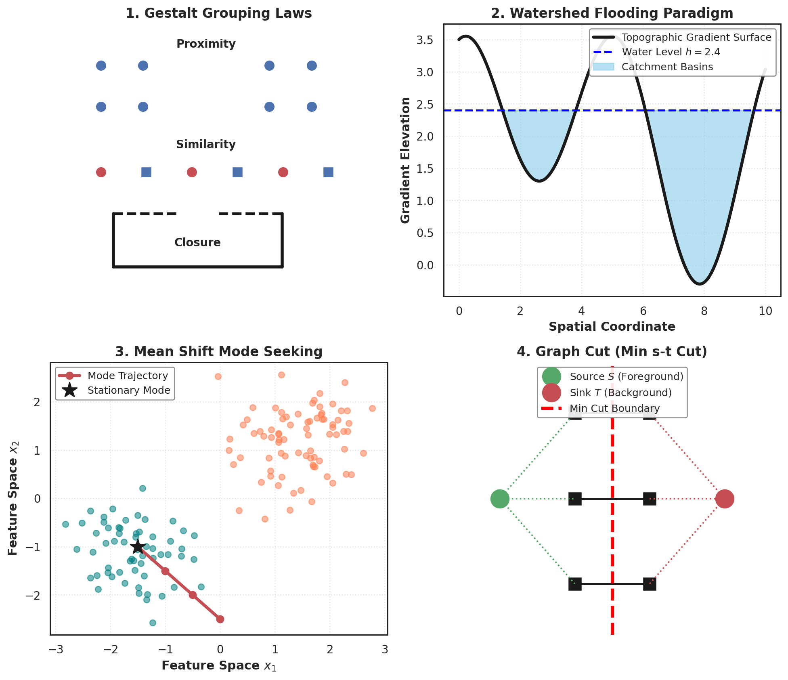

**Figure 7.** *Gestalt perceptual grouping principles and classical image segmentation paradigms. 1: Gestalt laws of Proximity, Similarity, and Closure. 2: Topographic relief flooding mechanics of the Watershed algorithm on gradient landscapes. 3: Mean Shift feature space mode seeking, demonstrating density gradient ascent trajectories converging to stationary cluster modes. 4: Graph Cut minimum $s-t$ energy cut partitioning foreground from background.*

---

## 8. Geometric Shape Descriptors: Shape Context & MSER

### 8.1 Shape Context (Belongie, Malik, Puzicha, PAMI 2002)

While local patch descriptors (SIFT, SURF) capture rich internal texture, they fail on untextured line drawings, silhouettes, and trademarks. Belongie et al. introduced **Shape Context** to describe global object geometry from boundary contours.

#### Log-Polar Spatial Binning

1. Sample $N$ points $\{p_1, \dots, p_N\}$ uniformly along the outer contour of a shape.
2. For a reference point $p_i$, compute the relative spatial vectors to all other $N - 1$ points:
   $$\mathbf{v}_{ij} = p_j - p_i = (r_{ij}, \theta_{ij})$$
3. Construct a **log-polar coordinate histogram** with $K$ bins centered at $p_i$, using 5 radial bins (logarithmically spaced to provide high spatial precision for nearby points and robustness for distant points) and 12 angular bins (covering $360^\circ$):
   $$K = 5 \times 12 = 60 \text{ bins}$$
   $$h_i(k) = \#\Big\{ q \ne p_i \mid (q - p_i) \in \text{bin}(k) \Big\}$$

#### $\chi^2$ Histogram Matching Cost

The dissimilarity cost $C_{ij} = C(p_i, q_j)$ between point $p_i$ on Shape 1 and point $q_j$ on Shape 2 is evaluated via the **Chi-Square ($\chi^2$) test statistic**:

$$C_{ij} = \frac{1}{2} \sum_{k=1}^K \frac{\Big[ h_i(k) - h_j(k) \Big]^2}{h_i(k) + h_j(k)}$$

- If the two histograms match perfectly ($h_i = h_j$), $C_{ij} = 0$.
- Finding optimal one-to-one point correspondences is formulated as a bipartite matching problem:
  $$H^* = \arg\min_{\pi} \sum_{i} C(p_i, q_{\pi(i)})$$
  solved in $\mathcal{O}(N^3)$ polynomial time using the **Hungarian algorithm** or Jonker-Volgenant solver.
- Non-rigid alignment is subsequently optimized using **Thin-Plate Splines (TPS)** to model non-affine bending energy.

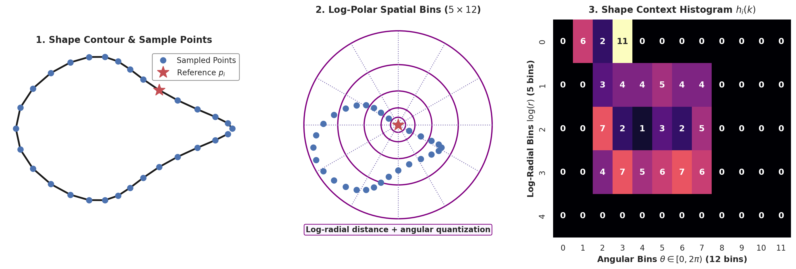

**Figure 8.** *Shape Context contour sampling and log-polar histogram matching. Left: Sampled boundary contour with reference keypoint $p_i$. Center: Log-polar spatial binning layout ($5 \text{ radial} \times 12 \text{ angular} = 60 \text{ bins}$), emphasizing fine resolution for proximate neighbors. Right: The resulting 2D Shape Context histogram matrix $h_i(k)$, capturing the global spatial distribution of the contour.*

### 8.2 Maximally Stable Extremal Regions (MSER)

Introduced by Jiri Matas et al. (BMVC 2002), **MSER** is an affine-invariant blob detector designed for wide-baseline stereo matching:

#### Extremal Regions and Component Trees

1. **Intensity Threshold Sweep:** Binarize the grayscale image across threshold $g \in [0, 255]$:
   $$E_g = \{ (x, y) \mid I(x, y) \le g \}$$
2. An **Extremal Region** $Q$ is a maximal 4-connected component of $E_g$. As $g$ increases from 0 (all black) to 255 (all white), new regions appear, expand, and merge. This forms an inclusion tree (component tree) where $Q_{g_1} \subseteq Q_{g_2}$ for $g_1 \le g_2$.

#### Stability Criterion

For each region sequence $Q_i$, evaluate its rate of area change across threshold step $\Delta$:

$$q(i) = \frac{|Q_{i+\Delta} \setminus Q_{i-\Delta}|}{|Q_i|}$$

where $|\cdot|$ denotes region pixel area.

- A region is defined as **Maximally Stable (MSER)** at threshold step $i^*$ if $q(i^*)$ attains a **local minimum** along the threshold sweep curve.

#### Key Invariance Properties

- **Monotonic Affine Radiometric Invariance:** Because MSER depends strictly on the ordering of pixel intensities rather than absolute values, any strictly monotonic continuous transformation of image intensity ($I' = g(I)$ with $g'(I) > 0$) leaves the extracted extremal regions identical.
- **Continuous Affine Geometric Invariance:** Linear spatial warps $\mathbf{x}' = \mathbf{A} \mathbf{x} + \mathbf{b}$ preserve connected component topology. This makes MSER highly robust for matching building facades under extreme perspective tilt.

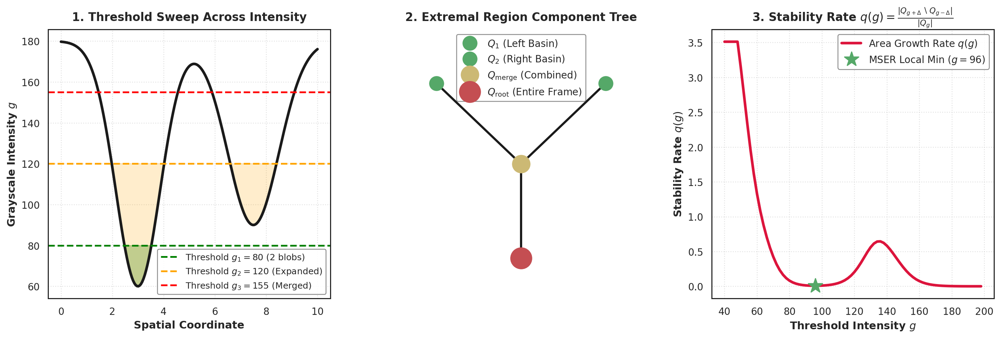

**Figure 9.** *Maximally Stable Extremal Regions (MSER) extraction mechanics. Left: Synthetic grayscale intensity landscape with sweeping binarization thresholds ($g_1=80, g_2=120, g_3=155$). Center: Extremal region hierarchical component tree, showing region growth and branch merging. Right: Region stability curve $q(g) = |Q_{g+\Delta} \setminus Q_{g-\Delta}| / |Q_g|$, identifying local stability minima as MSER keypoints.*

---

## 9. The Biological Blueprint: Primate Visual Hierarchy

### 9.1 Evolutionary Convergence in Vision

A profound discovery of modern artificial intelligence is that deep convolutional neural networks (CNNs) trained on object classification naturally converge to internal representations that mirror the biological primate visual system. Understanding the biological visual hierarchy provides foundational intuition for both classical filter banks and deep neural architectures.

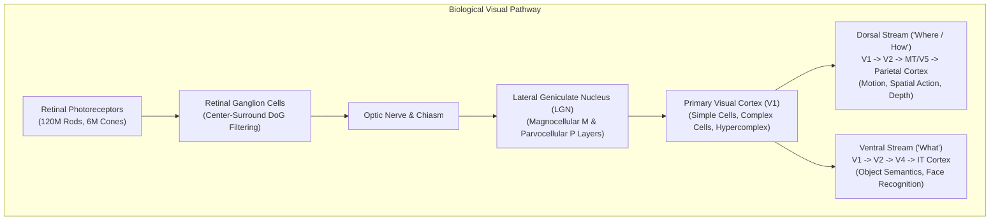

### 9.2 The Retino-Geniculo-Striate Pathway

#### 1. The Retina: Biological Transduction & Pre-Filtering

- **Photoreceptors:**
  - *Rods ($\approx 120$ million):* Extreme light sensitivity, monochromatic, saturates under photopic lighting. Optimized for scotopic night vision.
  - *Cones ($\approx 6$ million):* Concentrated heavily in the central fovea ($0.5\text{ mm}$ region). High spatial acuity and trichromatic color vision ($L, M, S$).
- **Retinal Ganglion Cells:** Implement spatial-temporal center-surround receptive fields:
  - *On-Center / Off-Surround:* Central circular excitation paired with an inhibitory annular surround, mathematically modeled as a **Difference of Gaussians (DoG)**:
    $$f(x, y) = A_c e^{-\frac{x^2+y^2}{2\sigma_c^2}} - A_s e^{-\frac{x^2+y^2}{2\sigma_s^2}}$$
  - Center-surround receptive fields act as bandpass filters. They transmit high-frequency local contrast while extinguishing redundant low-frequency DC illumination.

#### 2. The Lateral Geniculate Nucleus (LGN)

Located in the thalamus, the LGN consists of 6 retinotopically mapped layers segregated into two distinct functional channels:

- **Magnocellular (M) Pathway (Layers 1–2):** Large cell bodies, wide receptive fields, high contrast sensitivity, transient temporal response. Transmits rapid motion, flicker, and coarse stereoscopic depth.
- **Parvocellular (P) Pathway (Layers 3–6):** Small cell bodies, narrow receptive fields, sustained temporal firing, wavelength-opponent receptive fields (Red vs. Green, Blue vs. Yellow). Transmits high-resolution spatial details, color, and fine texture.

#### 3. Primary Visual Cortex (V1 / Striate Cortex / Area 17)

David Hubel and Torsten Wiesel (Nobel Prize in Physiology or Medicine, 1981) unraveled the functional architecture of V1:

- **Simple Cells:** Possess distinct, spatially segregated excitatory and inhibitory sub-regions organized along a specific orientation angle $\theta$. They respond maximally to oriented edges or bars at a specific spatial coordinate. Mathematically, simple cell receptive fields are modeled as **2D Gabor wavelets** (a sinusoidal carrier modulated by an elliptical Gaussian envelope):
  $$g(x, y; \lambda, \theta, \psi, \sigma, \gamma) = \exp\left(-\frac{x'^2 + \gamma^2 y'^2}{2\sigma^2}\right) \cos\left(2\pi \frac{x'}{\lambda} + \psi\right)$$
- **Complex Cells:** Exhibit orientation tuning identical to simple cells, but have larger receptive fields with **spatial phase invariance**. They respond vigorously to an oriented edge anywhere within their receptive field, regardless of exact phase. Hubel and Wiesel demonstrated that complex cells pool activations non-linearly across multiple simple cells. This provides the biological prototype for **convolutional max-pooling layers**.
- **Hypercomplex (End-Stopped) Cells:** Exhibit orientation tuning combined with length sensitivity. Their firing rate drops dramatically if a line extends beyond a critical length. They act as biological corner, curve, and termination detectors.

### 9.3 The Dual Cortical Streams: Ventral ("What") vs. Dorsal ("Where")

Visual signals exit V1 along two divergent cortical information processing streams (Ungerleider & Mishkin, 1982; Goodale & Milner, 1992):

1. **The Ventral Stream (The "What" Pathway):**
   $$V1 \to V2 \to V4 \to \text{Inferotemporal (IT) Cortex}$$
   Progressively expands receptive field size while learning complex, non-linear invariant representations. Neurons in Area IT respond selectively to complex categories, faces (e.g., the Fusiform Face Area), and holistic 3D object geometry, invariant to scale and viewpoint. This pathway represents the biological analog of deep feedforward classification networks (e.g., ResNet, ViT).
2. **The Dorsal Stream (The "Where / How" Pathway):**
   $$V1 \to V2 \to MT/V5 \to \text{Posterior Parietal Cortex}$$
   Dedicated to spatial localization, optical flow tracking, motion processing, and visually guided real-time motor interaction (reaching, grasping, saccadic target tracking). This pathway represents the biological foundation of real-time robotics, SLAM, and embodied sensorimotor control.

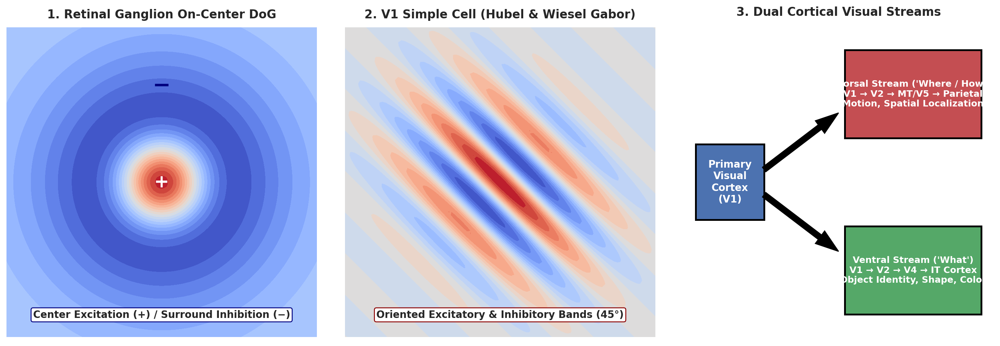

**Figure 10.** *The primate biological visual pathway and cortical receptive field hierarchy. Left: Retinal ganglion on-center / off-surround Difference of Gaussians (DoG) receptive field. Center: V1 simple cell oriented receptive field (Gabor wavelet profile), displaying alternating excitatory and inhibitory bands. Right: The dual cortical visual pathways: Ventral Stream ($V1 \to V2 \to V4 \to IT$) dedicated to semantic object recognition, and Dorsal Stream ($V1 \to V2 \to MT \to \text{Parietal}$) dedicated to spatial localization and action.*

---

## 10. Comprehensive Theoretical & Practical Problem Bank

### Problem 1: Linear Algebra of the Harris Structure Tensor

**Question:**

Prove that for the $2 \times 2$ symmetric autocorrelation matrix $\mathbf{A} = \begin{bmatrix} A_{11} & A_{12} \\ A_{12} & A_{22} \end{bmatrix}$ with eigenvalues $\lambda_1, \lambda_2$, the trace equals $\lambda_1 + \lambda_2$ and the determinant equals $\lambda_1 \lambda_2$. Then, show why the Harris cornerness measure $R = \det(\mathbf{A}) - \kappa \, \text{trace}^2(\mathbf{A})$ (with $\kappa = 0.05$) yields a negative response along an ideal straight step edge.

**Detailed Analytical Solution:**

1. The characteristic polynomial of matrix $\mathbf{A}$ is given by $\det(\mathbf{A} - \lambda \mathbf{I}) = 0$:
   $$\det \begin{bmatrix} A_{11} - \lambda & A_{12} \\ A_{12} & A_{22} - \lambda \end{bmatrix} = (A_{11} - \lambda)(A_{22} - \lambda) - A_{12}^2 = 0$$
   Expanding the quadratic expression:
   $$\lambda^2 - (A_{11} + A_{22})\lambda + (A_{11} A_{22} - A_{12}^2) = 0$$
2. Since $\lambda_1$ and $\lambda_2$ are the roots of this quadratic polynomial, factoring yields:
   $$(\lambda - \lambda_1)(\lambda - \lambda_2) = \lambda^2 - (\lambda_1 + \lambda_2)\lambda + \lambda_1 \lambda_2 = 0$$
3. Matching coefficients directly proves:
   $$\text{trace}(\mathbf{A}) = A_{11} + A_{22} = \lambda_1 + \lambda_2$$
   $$\det(\mathbf{A}) = A_{11} A_{22} - A_{12}^2 = \lambda_1 \lambda_2 \quad \blacksquare$$
4. Along an ideal straight step edge, intensity varies only in the direction perpendicular to the edge normal. Consequently, the structure tensor has one positive eigenvalue ($\lambda_1 > 0$) corresponding to the edge normal, while the orthogonal eigenvalue along the edge is zero ($\lambda_2 = 0$).
   Substituting $\lambda_2 = 0$ into the Harris response function:
   $$R = \det(\mathbf{A}) - \kappa \, \text{trace}^2(\mathbf{A}) = (\lambda_1 \cdot 0) - \kappa (\lambda_1 + 0)^2 = -\kappa \lambda_1^2$$
   Since $\kappa = 0.05 > 0$ and $\lambda_1 > 0$, we have:
   $$R = -0.05 \lambda_1^2 < 0$$
   Thus, **ideal straight edges produce strictly negative Harris responses ($R < 0$)**, proving that edges can never be misclassified as corners ($R > 0$).

---

### Problem 2: Photometric Invariance of the Harris Detector

**Question:**

Suppose an image $I(x, y)$ undergoes an affine photometric transformation $I'(x, y) = \alpha I(x, y) + \beta$, where $\alpha > 0$ is a multiplicative contrast gain and $\beta$ is an additive brightness shift. Derive how the Harris response $R'$ of the transformed image relates to the original response $R$, and state whether a fixed threshold $\tau$ on $R$ is invariant to $\alpha$ and $\beta$.

**Detailed Analytical Solution:**

1. Differentiating the transformed image $I'(x, y) = \alpha I(x, y) + \beta$:
   $$I'_x = \frac{\partial}{\partial x}(\alpha I + \beta) = \alpha I_x, \quad I'_y = \frac{\partial}{\partial y}(\alpha I + \beta) = \alpha I_y$$
   The constant additive offset $\beta$ vanishes under differentiation.
2. Constructing the transformed structure tensor $\mathbf{A}'$:
   $$\mathbf{A}' = \sum w \begin{bmatrix} (I'_x)^2 & I'_x I'_y \\ I'_x I'_y & (I'_y)^2 \end{bmatrix} = \sum w \begin{bmatrix} \alpha^2 I_x^2 & \alpha^2 I_x I_y \\ \alpha^2 I_x I_y & \alpha^2 I_y^2 \end{bmatrix} = \alpha^2 \mathbf{A}$$
3. Computing determinant and trace of $\mathbf{A}'$:
   $$\det(\mathbf{A}') = \det(\alpha^2 \mathbf{A}) = (\alpha^2)^2 \det(\mathbf{A}) = \alpha^4 \det(\mathbf{A})$$
   $$\text{trace}(\mathbf{A}') = \text{trace}(\alpha^2 \mathbf{A}) = \alpha^2 \text{trace}(\mathbf{A})$$
4. Substituting into the Harris cornerness formula:
   $$R' = \det(\mathbf{A}') - \kappa \, \text{trace}^2(\mathbf{A}') = \alpha^4 \det(\mathbf{A}) - \kappa \Big(\alpha^2 \text{trace}(\mathbf{A})\Big)^2$$
   $$R' = \alpha^4 \det(\mathbf{A}) - \kappa \alpha^4 \text{trace}^2(\mathbf{A}) = \alpha^4 R$$
5. **Conclusion:**
   - The detector is **completely invariant to additive brightness shifts ($\beta$)**.
   - With a fixed constant threshold $\tau$, **the detector is NOT invariant to contrast gain ($\alpha$)**, as the corner response scales by $\alpha^4$. If $\alpha < 1$, true corners may fall below $\tau$; if $\alpha > 1$, weak textures may be falsely flagged as corners.

---

### Problem 3: Sub-Pixel Non-Maximum Suppression & Hysteresis Connectivity

**Question:**

During Canny edge detection, a pixel $q$ at coordinate $(10, 10)$ has gradient components $I_x = 3$ and $I_y = 4$. The interpolated gradient magnitudes along the gradient normal vector are $M(p) = 4.8$ and $M(r) = 5.2$. Given hysteresis thresholds $\tau_{\text{high}} = 4.5$ and $\tau_{\text{low}} = 2.0$, determine whether pixel $q$ is retained as an edge pixel in the final binary edge map.

**Detailed Analytical Solution:**

1. Compute the gradient magnitude at pixel $q$:
   $$M(q) = \sqrt{I_x^2 + I_y^2} = \sqrt{3^2 + 4^2} = \sqrt{9 + 16} = \sqrt{25} = 5.0$$
2. Observe that $M(q) = 5.0 > \tau_{\text{high}} = 4.5$. At first glance, one might assume $q$ is immediately accepted as a strong edge.
3. However, in the Canny pipeline, **Non-Maximum Suppression (Step 3) precedes Hysteresis Thresholding (Step 4)**.
   Along the gradient direction $\theta = \tan^{-1}(4/3)$, the magnitude at $q$ is compared against interpolated neighbors $M(p) = 4.8$ and $M(r) = 5.2$.
   Applying the NMS criterion:
   $$M(q) \ge M(p) \; (5.0 \ge 4.8 \text{ is True}), \quad M(q) \ge M(r) \; (5.0 \ge 5.2 \text{ is False!})$$
4. Because $M(q) < M(r)$, pixel $q$ is **not a local maximum along the gradient ridge**.
5. During Non-Maximum Suppression, $M(q)$ is suppressed to zero ($M_{\text{NMS}}(q) = 0$).
6. Because $M_{\text{NMS}}(q) = 0 < \tau_{\text{low}} = 2.0$, pixel $q$ is discarded entirely and **never reaches the hysteresis stage**. It is not retained in the final edge map.

---

### Problem 4: Edgelet Orientation via PCA of the Second Moment Matrix

**Question:**

An edgelet consists of $N = 3$ connected edge pixels at coordinates $(1, 2)$, $(2, 4)$, and $(3, 6)$. Compute the $2 \times 2$ second moment matrix of this edgelet, find its principal eigenvector, and derive the edgelet's exact physical orientation $\theta_{\text{edgelet}}$.

**Detailed Analytical Solution:**

1. Compute the mean coordinates (center of mass):
   $$\mu_x = \frac{1 + 2 + 3}{3} = \frac{6}{3} = 2.0, \quad \mu_y = \frac{2 + 4 + 6}{3} = \frac{12}{3} = 4.0$$
2. Compute mean-centered coordinate deviations $(x_i - \mu_x, y_i - \mu_y)$:
   - For $(1, 2)$: $(-1, -2)$
   - For $(2, 4)$: $(0, 0)$
   - For $(3, 6)$: $(+1, +2)$
3. Sum outer products to construct the second moment matrix $C_{\text{edgelet}}$:
   $$\sigma_{xx} = (-1)^2 + 0^2 + 1^2 = 1 + 0 + 1 = 2$$
   $$\sigma_{yy} = (-2)^2 + 0^2 + 2^2 = 4 + 0 + 4 = 8$$
   $$\sigma_{xy} = (-1)(-2) + 0 + (1)(2) = 2 + 0 + 2 = 4$$
   $$C_{\text{edgelet}} = \begin{bmatrix} 2 & 4 \\ 4 & 8 \end{bmatrix}$$
4. Compute eigenvalues:
   $$\text{trace}(C) = 2 + 8 = 10, \quad \det(C) = (2)(8) - (4)(4) = 16 - 16 = 0$$
   The characteristic equation is $\lambda^2 - 10\lambda = 0 \implies \lambda_1 = 10, \; \lambda_2 = 0$.
   The fact that $\lambda_2 = 0$ confirms the edgelet is a **perfectly collinear line segment**.
5. Solve for the principal eigenvector $\mathbf{v}_1 = [v_1, v_2]^T$ corresponding to $\lambda_1 = 10$:
   $$(C_{\text{edgelet}} - 10\mathbf{I}) \mathbf{v}_1 = \mathbf{0} \implies \begin{bmatrix} -8 & 4 \\ 4 & -2 \end{bmatrix} \begin{bmatrix} v_1 \\ v_2 \end{bmatrix} = \begin{bmatrix} 0 \\ 0 \end{bmatrix}$$
   $$-8 v_1 + 4 v_2 = 0 \implies v_2 = 2 v_1 \implies \mathbf{v}_1 = \frac{1}{\sqrt{5}} [1, 2]^T$$
6. The edgelet orientation is:
   $$\theta_{\text{edgelet}} = \tan^{-1}\left(\frac{v_2}{v_1}\right) = \tan^{-1}\left(\frac{2}{1}\right) = \tan^{-1}(2) \approx 63.43^\circ$$

---

### Problem 5: Shape Context Correspondence Matching & Failure Modes

**Question:**

Consider three candidate interest points $p_1, p_2, p_3$ described by simplified 3-bin log-polar Shape Context histograms:

$$h_1 = [0.5, 0.3, 0.2], \quad h_2 = [0.5, 0.1, 0.4], \quad h_3 = [0.1, 0.3, 0.6]$$

1. Compute the $\chi^2$ correspondence matching costs $C(p_1, p_2)$ and $C(p_1, p_3)$.
2. Which point ($p_2$ or $p_3$) matches $p_1$?
3. Identify a practical visual scenario where Shape Context fails catastrophically.

**Detailed Analytical Solution:**

1. The Shape Context matching cost formula is:
   $$C_{ij} = \frac{1}{2} \sum_{k=1}^K \frac{\Big[ h_i(k) - h_j(k) \Big]^2}{h_i(k) + h_j(k)}$$
2. Computing $C(p_1, p_2)$:
   $$\text{Bin 1: } \frac{(0.5 - 0.5)^2}{0.5 + 0.5} = 0$$
   $$\text{Bin 2: } \frac{(0.3 - 0.1)^2}{0.3 + 0.1} = \frac{0.04}{0.4} = 0.10$$
   $$\text{Bin 3: } \frac{(0.2 - 0.4)^2}{0.2 + 0.4} = \frac{0.04}{0.6} = \frac{1}{15} \approx 0.0667$$
   $$C(p_1, p_2) = \frac{1}{2} \Big( 0 + 0.10 + 0.0667 \Big) = \frac{1}{2}(0.1667) \approx 0.0833$$
3. Computing $C(p_1, p_3)$:
   $$\text{Bin 1: } \frac{(0.5 - 0.1)^2}{0.5 + 0.1} = \frac{0.16}{0.6} = \frac{4}{15} \approx 0.2667$$
   $$\text{Bin 2: } \frac{(0.3 - 0.3)^2}{0.3 + 0.3} = 0$$
   $$\text{Bin 3: } \frac{(0.2 - 0.6)^2}{0.2 + 0.6} = \frac{0.16}{0.8} = 0.20$$
   $$C(p_1, p_3) = \frac{1}{2} \Big( 0.2667 + 0 + 0.20 \Big) = \frac{1}{2}(0.4667) \approx 0.2333$$
4. **Matching Decision:** Since $C(p_1, p_2) = 0.0833 < C(p_1, p_3) = 0.2333$, **point $p_2$ is selected as the correspondence match for $p_1$**.
5. **Failure Mode of Shape Context:**
   Shape Context relies on computing relative spatial vectors across the *entire* shape silhouette. If an object is subjected to **heavy background clutter** or **severe partial occlusion** (e.g., a person standing behind a fence, or half of a coffee mug occluded by a book), extraneous background edge points or missing occluded points directly contaminate the log-polar bin counts $h_i(k)$. This inflates the $\chi^2$ distance between true correspondences, causing the bipartite assignment matching to fail completely.

---

## 11. Runnable Code Verification Suite

The following complete, standalone Python implementation verifies the mathematical and algorithmic implementations of Week 2:

```python
"""
Week 2 Verification Suite: Deep Learning for Computer Vision
Verifies:
1. Sub-pixel Non-Maximum Suppression (NMS)
2. Edgelet PCA and Second Moment Matrix
3. Harris Corner Structure Tensor and Invariance
4. Difference of Gaussians (DoG) vs LoG
5. Shape Context Chi-Square Cost Matrix
"""

import numpy as np

def verify_canny_nms():
    # Test case from Problem 3:
    # Pixel q at (1, 1), Ix = 3, Iy = 4 -> M(q) = 5.0
    # Neighbors along gradient: M(p) = 4.8, M(r) = 5.2
    M_q = 5.0
    M_p = 4.8
    M_r = 5.2
    
    # NMS rule: pixel must be >= both neighbors
    is_local_max = (M_q >= M_p) and (M_q >= M_r)
    print("[1] Canny NMS Verification:")
    print(f"    M(q)={M_q}, M(p)={M_p}, M(r)={M_r}")
    print(f"    Is local maximum along gradient normal: {is_local_max}")
    assert not is_local_max, "NMS failed: non-maximal pixel was not suppressed!"

def verify_edgelet_pca():
    # Test case from Problem 4: points (1, 2), (2, 4), (3, 6)
    pts = np.array([[1.0, 2.0], [2.0, 4.0], [3.0, 6.0]])
    mu = np.mean(pts, axis=0)
    dev = pts - mu
    # Covariance matrix (unnormalized sum of outer products)
    C = dev.T @ dev
    
    eigenvals, eigenvecs = np.linalg.eigh(C)
    idx = np.argsort(eigenvals)[::-1]
    eigenvals = eigenvals[idx]
    eigenvecs = eigenvecs[:, idx]
    
    v1 = eigenvecs[:, 0]
    theta = np.degrees(np.arctan2(v1[1], v1[0]))
    
    print("\n[2] Edgelet PCA Verification:")
    print(f"    Covariance Matrix:\n{C}")
    print(f"    Eigenvalues: {eigenvals}")
    print(f"    Principal Eigenvector: {v1}")
    print(f"    Derived Orientation: {theta:.2f} degrees")
    assert np.isclose(eigenvals[1], 0.0), "Edgelet failed collinearity test!"
    assert np.isclose(theta, np.degrees(np.arctan(2.0))), "Orientation angle incorrect!"

def verify_harris_invariance():
    # Create test patch with corner
    Ix = np.array([[10.0, 0.0], [0.0, 10.0]])
    Iy = np.array([[0.0, 10.0], [10.0, 0.0]])
    
    A = np.array([
        [np.sum(Ix**2), np.sum(Ix*Iy)],
        [np.sum(Ix*Iy), np.sum(Iy**2)]
    ])
    kappa = 0.05
    R = np.linalg.det(A) - kappa * (np.trace(A)**2)
    
    # Affine contrast transformation: alpha = 2.0
    alpha = 2.0
    A_scaled = (alpha**2) * A
    R_scaled = np.linalg.det(A_scaled) - kappa * (np.trace(A_scaled)**2)
    
    print("\n[3] Harris Response Invariance Verification:")
    print(f"    Original R: {R:.2f}")
    print(f"    Scaled R (alpha={alpha}): {R_scaled:.2f}")
    print(f"    Ratio R_scaled / R: {R_scaled / R:.2f} (Expected: alpha^4 = {alpha**4})")
    assert np.isclose(R_scaled / R, alpha**4), "Harris response failed alpha^4 scaling law!"

def verify_shape_context():
    # Test case from Problem 5:
    h1 = np.array([0.5, 0.3, 0.2])
    h2 = np.array([0.5, 0.1, 0.4])
    h3 = np.array([0.1, 0.3, 0.6])
    
    def chi2_cost(hi, hj):
        return 0.5 * np.sum(((hi - hj)**2) / (hi + hj))
        
    C12 = chi2_cost(h1, h2)
    C13 = chi2_cost(h1, h3)
    
    print("\n[4] Shape Context Matching Verification:")
    print(f"    Cost C(p1, p2): {C12:.4f}")
    print(f"    Cost C(p1, p3): {C13:.4f}")
    assert C12 < C13, "Shape Context failed to select closest histogram!"

if __name__ == '__main__':
    verify_canny_nms()
    verify_edgelet_pca()
    verify_harris_invariance()
    verify_shape_context()
    print("\nAll Week 2 mathematical and algorithmic verifications PASSED!")
```

---

## 12. Conclusion & Pedagogical Roadmap

Week 2 completes the conceptual transition from unstructured raw pixels to structured, invariant geometric primitives:

1. **Differential Geometry Resolves Boundaries:** The Canny detector demonstrates that pairing Gaussian smoothing with directional differentiation and sub-pixel Non-Maximum Suppression produces optimal 1-pixel contours.
2. **Eigendecomposition Recovers Physical Structure:** Second moment matrices unify visual processing. PCA on edgelet coordinates yields line orientation and straightness. The Harris structure tensor isolates 2D corners, eliminating the aperture problem.
3. **Multi-Scale Invariance Unlocks Matching:** Scale-space theory proves that Gaussian kernels uniquely preserve causality. Difference of Gaussians (DoG) allows $\mathcal{O}(1)$ scale-space extrema extraction, powering SIFT and its descriptor family.
4. **Perceptual Grouping Bridges to Semantics:** Gestalt grouping laws inspire segmentation frameworks (Watershed, Mean Shift, Graph Cuts). Shape Context and MSER provide global shape and affine region descriptors.
5. **Evolutionary Convergence:** The primate visual pathway (Retinal DoG $\to$ LGN $\to$ V1 Gabor simple cells $\to$ complex cell pooling) demonstrates that hierarchical feedforward feature extraction is the mathematically optimal architecture for natural scene understanding.

This foundation establishes the prerequisite for **Week 3: Deep Convolutional Neural Networks (LeNet to ResNet)**, where hand-engineered filter banks are replaced by end-to-end gradient-optimized tensor kernels.
