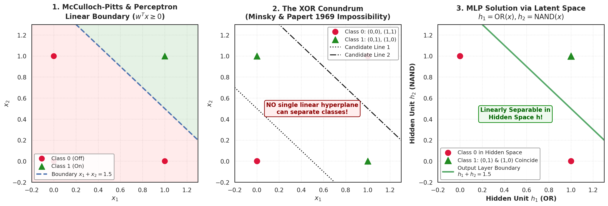
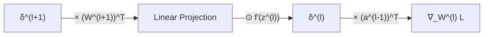
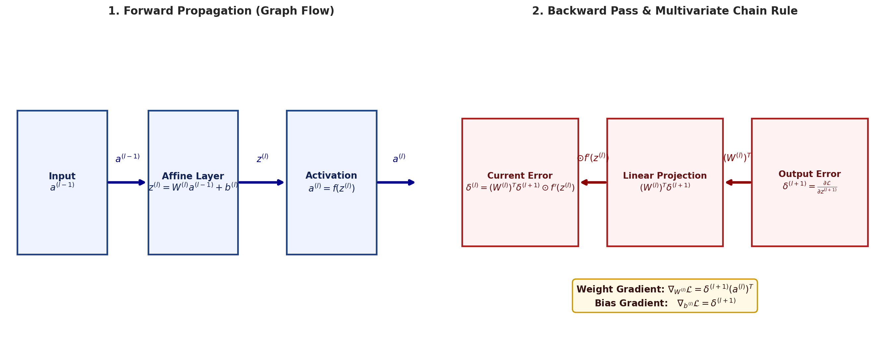
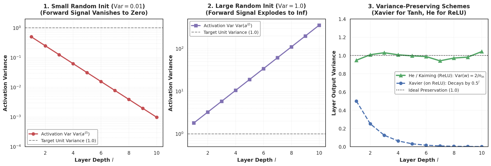
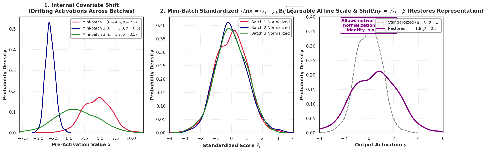

# Week 3 Exam Revision Notes: Neural Networks, Backprop, Optimizers & Regularization

> **Purpose:** Ultra-condensed, high-yield exam revision guide. Contains all essential mathematical derivations, governing formulas, complexity benchmarks, visual anchors, common exam traps, and high-probability test questions for rapid pre-exam mastery.

---

## 1. High-Yield Master Formula & Concept Cheat Sheet

| Topic / Method | Governing Formula / Update Rule | Computational Complexity | Key Invariance / Core Property | High-Yield Exam Trap |
| :--- | :--- | :--- | :--- | :--- |
| **MP Neuron (1943)** | $y = 1$ if $\sum_{i \in \mathcal{E}} x_i \ge \theta$ and $x_k = 0 \, \forall k \in \mathcal{I}$ | $\mathcal{O}(n)$ | Simulates any DFA & Boolean function | **No continuous weights**; inputs binary ($0, 1$); manual threshold $\theta$. |
| **Perceptron (1958)** | $\mathbf{w}_{t+1} = \mathbf{w}_t + y_k \mathbf{x}_k$ (if misclassified) | $\mathcal{O}(n)$ per update | Linear hyperplane $\mathbf{w}^T \mathbf{x} + b = 0$ | Guaranteed to converge **iff linearly separable**; oscillates forever on XOR. |
| **XOR Conundrum** | $w_1 + w_2 \ge 2\theta > \theta \iff w_1 + w_2 < \theta$ | Contradiction | Linear inseparability | Solved by stacking 2 layers: $h_1 = \operatorname{OR}, h_2 = \operatorname{NAND} \implies$ linearly separable. |
| **Universal Approx.** | $F(\mathbf{x}) = \sum_{i=1}^N v_i \sigma(\mathbf{w}_i^T \mathbf{x} + b_i)$ | $\sup |F(x) - f(x)| < \epsilon$ | 1 hidden layer with non-linear $\sigma$ | Sufficient for continuous functions, but width $N$ can grow **exponentially**. |
| **Sigmoid Activation** | $\sigma(z) = \frac{1}{1 + e^{-z}}, \quad \sigma'(z) \le 0.25$ | $\mathcal{O}(1)$ | Output $\in (0, 1)$ | **Vanishing gradient**: $\prod \sigma' \le (0.25)^L$; non-zero-centered ($z>0$ always). |
| **ReLU Activation** | $f(z) = \max(0, z), \quad f'(z) = 1 \, (z > 0)$ | $\mathcal{O}(1)$ (fast threshold) | Output $\in [0, \infty)$ | **Dying ReLU**: negative updates permanently kill neuron ($f'=0$ forever). |
| **Backprop Error $\boldsymbol{\delta}^{(l)}$** | $\boldsymbol{\delta}^{(l)} = \left((\mathbf{W}^{(l+1)})^T \boldsymbol{\delta}^{(l+1)}\right) \odot f'(\mathbf{z}^{(l)})$ | $\mathcal{O}(d_l \cdot d_{l+1})$ | Reverse chain rule | Weight gradient is **outer product**: $\nabla_{\mathbf{W}^{(l)}} \mathcal{L} = \boldsymbol{\delta}^{(l)} (\mathbf{a}^{(l-1)})^T$. |
| **Polyak Momentum** | $\mathbf{v}_t = \gamma \mathbf{v}_{t-1} + \eta \mathbf{g}_t, \quad \boldsymbol{\theta}_{t+1} = \boldsymbol{\theta}_t - \mathbf{v}_t$ | $\mathcal{O}(P)$ | Damps lateral oscillation in ravines | Terminal velocity scales by $\frac{1}{1 - \gamma}$. For $\gamma=0.9$, speedup is $10\times$. |
| **Nesterov (NAG)** | $\mathbf{g}_{\text{lookahead}} = \nabla \mathcal{L}(\boldsymbol{\theta}_t - \gamma \mathbf{v}_{t-1})$ | $\mathcal{O}(P)$ | "Look before you leap" | Computes gradient **after** momentum step, preventing overshoot. |
| **Adam Optimizer** | $\boldsymbol{\theta}_{t+1} = \boldsymbol{\theta}_t - \frac{\eta}{\sqrt{\hat{\mathbf{v}}_t} + \epsilon} \odot \hat{\mathbf{m}}_t$ | $\mathcal{O}(P)$ | Coordinate-wise adaptive step | **Must include bias corrections**: $\hat{\mathbf{m}} = \frac{\mathbf{m}}{1 - \beta_1^t}, \hat{\mathbf{v}} = \frac{\mathbf{v}}{1 - \beta_2^t}$. |
| **$L_1$ Regularization** | $\mathbf{w}_{t+1} = \mathbf{w}_t - \eta \nabla \mathcal{L} - \eta \alpha \operatorname{sign}(\mathbf{w}_t)$ | $\mathcal{O}(P)$ | **Induces weight sparsity** | Diamond unit ball hits loss contours at axis corners where $w_i = 0$. |
| **$L_2$ Regularization** | $\mathbf{w}_{t+1} = (1 - \eta \alpha)\mathbf{w}_t - \eta \nabla \mathcal{L}$ | $\mathcal{O}(P)$ | Smooth weight shrinkage | **Equivalent to adding zero-mean Gaussian noise** $\mathcal{N}(0, \sigma^2)$ to inputs. |
| **Dropout** | $\tilde{\mathbf{a}} = \frac{\mathbf{a} \odot \mathbf{m}}{1 - p}, \quad \mathbf{m} \sim \operatorname{Bernoulli}(1-p)$ | $\mathcal{O}(N)$ per forward pass | Implicit ensemble of $2^N$ nets | **Inverted dropout** scales by $\frac{1}{1-p}$ during training $\implies$ test time runs raw net! |
| **Symmetry Breaking** | Constant init $W_{ij} = c \implies \nabla W_{ij} \text{ identical}$ | Pathology | Neurons compute identical values | **Constant weights fail**; weights must be initialized randomly to break symmetry. |
| **Xavier Initialization** | $\operatorname{Var}(w) = \frac{2}{n_{\text{in}} + n_{\text{out}}}$ | $\mathcal{O}(1)$ | For Sigmoid / Tanh activations | On ReLU, variance contracts by $0.5$ per layer ($(0.5)^L \to 0$). |
| **He / Kaiming Init** | $\operatorname{Var}(w) = \frac{2}{n_{\text{in}}}$ | $\mathcal{O}(1)$ | Designed specifically for ReLU | Compensates for the $50\%$ variance loss caused by $\max(0, z)$. |
| **Batch Normalization** | $\hat{x} = \frac{x - \mu_{\mathcal{B}}}{\sqrt{\sigma_{\mathcal{B}}^2 + \epsilon}}, \quad y = \gamma \hat{x} + \beta$ | $\mathcal{O}(B)$ | Reduces internal covariate shift | At test time, uses **running averages** $\mu_{\text{run}}, \sigma_{\text{run}}^2$; folded into $W, b$ during inference. |

---

## 2. Core Concepts & "Must-Know" Derivations

### 2.1 The Perceptron Learning Update Rule Derivation
- Let sample $\mathbf{x}_k$ belong to the positive class ($y_k = +1$).
- If misclassified, $\mathbf{w}_t^T \mathbf{x}_k < 0$, which implies the angle $\alpha$ between weight vector $\mathbf{w}_t$ and data vector $\mathbf{x}_k$ is obtuse ($\alpha > 90^\circ$).
- Update rule: $\mathbf{w}_{t+1} = \mathbf{w}_t + \mathbf{x}_k$.
- Evaluating the new inner product:
  $$\mathbf{w}_{t+1}^T \mathbf{x}_k = (\mathbf{w}_t + \mathbf{x}_k)^T \mathbf{x}_k = \mathbf{w}_t^T \mathbf{x}_k + \|\mathbf{x}_k\|^2$$
- Since $\|\mathbf{x}_k\|^2 > 0$, the inner product strictly increases, increasing $\cos \alpha$ and reducing the angle $\alpha$.
- For negative class misclassification ($y_k = -1$), $\mathbf{w}_t^T \mathbf{x}_k \ge 0$. The update is $\mathbf{w}_{t+1} = \mathbf{w}_t - \mathbf{x}_k$:
  $$\mathbf{w}_{t+1}^T \mathbf{x}_k = \mathbf{w}_t^T \mathbf{x}_k - \|\mathbf{x}_k\|^2 < \mathbf{w}_t^T \mathbf{x}_k$$
- Unified update equation:
  $$\mathbf{w}_{t+1} = \mathbf{w}_t + y_k \mathbf{x}_k \quad (y_k \in \{-1, +1\}) \quad \blacksquare$$

---

### 2.2 Derivation of the Four Backpropagation Equations

Let $\boldsymbol{\delta}^{(l)} \triangleq \frac{\partial \mathcal{L}}{\partial \mathbf{z}^{(l)}}$.
1. **Output Layer Error:**
   $$\delta_i^{(n_l)} = \frac{\partial \mathcal{L}}{\partial a_i^{(n_l)}} \frac{\partial a_i^{(n_l)}}{\partial z_i^{(n_l)}} = \frac{\partial \mathcal{L}}{\partial a_i^{(n_l)}} f'(z_i^{(n_l)}) \implies \boldsymbol{\delta}^{(n_l)} = \nabla_{\mathbf{a}^{(n_l)}} \mathcal{L} \odot f'(\mathbf{z}^{(n_l)})$$
2. **Hidden Layer Error Propagation:**
   $$\delta_j^{(l)} = \sum_{k} \frac{\partial \mathcal{L}}{\partial z_k^{(l+1)}} \frac{\partial z_k^{(l+1)}}{\partial z_j^{(l)}} = \sum_k \delta_k^{(l+1)} \left( W_{kj}^{(l+1)} f'(z_j^{(l)}) \right) = \left( \sum_k W_{kj}^{(l+1)} \delta_k^{(l+1)} \right) f'(z_j^{(l)})$$
   $$\boldsymbol{\delta}^{(l)} = \left( (\mathbf{W}^{(l+1)})^T \boldsymbol{\delta}^{(l+1)} \right) \odot f'(\mathbf{z}^{(l)})$$
3. **Weight Matrix Gradient:**
   $$\frac{\partial \mathcal{L}}{\partial W_{ij}^{(l)}} = \frac{\partial \mathcal{L}}{\partial z_i^{(l)}} \frac{\partial z_i^{(l)}}{\partial W_{ij}^{(l)}} = \delta_i^{(l)} a_j^{(l-1)} \implies \frac{\partial \mathcal{L}}{\partial \mathbf{W}^{(l)}} = \boldsymbol{\delta}^{(l)} (\mathbf{a}^{(l-1)})^T$$
4. **Bias Vector Gradient:**
   $$\frac{\partial \mathcal{L}}{\partial b_i^{(l)}} = \frac{\partial \mathcal{L}}{\partial z_i^{(l)}} \frac{\partial z_i^{(l)}}{\partial b_i^{(l)}} = \delta_i^{(l)} \cdot 1 \implies \frac{\partial \mathcal{L}}{\partial \mathbf{b}^{(l)}} = \boldsymbol{\delta}^{(l)}$$

---

### 2.3 Mathematical Proof: Input Noise Equivalence to $L_2$ Regularization
- Linear model output: $y = \mathbf{w}^T \mathbf{x}$.
- Inject additive zero-mean independent Gaussian noise: $\boldsymbol{\epsilon} \sim \mathcal{N}(\mathbf{0}, \sigma^2 \mathbf{I})$.
- Noisy prediction: $y_{\text{noisy}} = \mathbf{w}^T (\mathbf{x} + \boldsymbol{\epsilon}) = y + \mathbf{w}^T \boldsymbol{\epsilon}$.
- Expected Mean Squared Error:
  $$\mathbb{E}_{\boldsymbol{\epsilon}} \left[ (y_{\text{noisy}} - t)^2 \right] = \mathbb{E}_{\boldsymbol{\epsilon}} \left[ \left( (y - t) + \mathbf{w}^T \boldsymbol{\epsilon} \right)^2 \right]$$
  $$= (y - t)^2 + 2(y - t) \mathbf{w}^T \underbrace{\mathbb{E}[\boldsymbol{\epsilon}]}_{=\mathbf{0}} + \mathbb{E}_{\boldsymbol{\epsilon}} \left[ (\mathbf{w}^T \boldsymbol{\epsilon})^2 \right]$$
- Expanding the noise variance term:
  $$\mathbb{E}_{\boldsymbol{\epsilon}} \left[ (\mathbf{w}^T \boldsymbol{\epsilon})^2 \right] = \mathbb{E}\left[ \sum_i \sum_j w_i w_j \epsilon_i \epsilon_j \right] = \sum_i w_i^2 \mathbb{E}[\epsilon_i^2] = \sigma^2 \sum_i w_i^2 = \sigma^2 \|\mathbf{w}\|_2^2$$
- Result:
  $$\mathbb{E}_{\boldsymbol{\epsilon}}[\mathcal{L}_{\text{noisy}}] = \mathcal{L}_{\text{clean}} + \sigma^2 \|\mathbf{w}\|_2^2 \quad \blacksquare$$

---

### 2.4 Derivation of He / Kaiming Initialization for ReLU
- Let single pre-activation be $z = \sum_{i=1}^{n_{\text{in}}} w_i x_i$, where $x_i = \operatorname{ReLU}(z_{\text{prev}})$.
- Since $w_i$ and $x_i$ are independent with $\mathbb{E}[w_i] = 0$:
  $$\operatorname{Var}(z) = n_{\text{in}} \operatorname{Var}(w) \, \mathbb{E}[x^2]$$
- For a symmetric distribution around zero before ReLU:
  $$\mathbb{E}[x^2] = \mathbb{E}[\operatorname{ReLU}(z_{\text{prev}})^2] = \frac{1}{2} \operatorname{Var}(z_{\text{prev}})$$
- Substituting:
  $$\operatorname{Var}(z) = n_{\text{in}} \operatorname{Var}(w) \cdot \frac{1}{2} \operatorname{Var}(z_{\text{prev}}) = \left( \frac{1}{2} n_{\text{in}} \operatorname{Var}(w) \right) \operatorname{Var}(z_{\text{prev}})$$
- To prevent forward signal growth or decay ($\operatorname{Var}(z) = \operatorname{Var}(z_{\text{prev}})$):
  $$\frac{1}{2} n_{\text{in}} \operatorname{Var}(w) = 1 \implies \operatorname{Var}(w) = \frac{2}{n_{\text{in}}} \quad \blacksquare$$

---

### 2.5 Batch Normalization: Training vs. Inference Formulation
1. **Training Mini-Batch Standardize:**
   $$\mu_{\mathcal{B}} = \frac{1}{m} \sum_{i=1}^m x_i, \quad \sigma_{\mathcal{B}}^2 = \frac{1}{m} \sum_{i=1}^m (x_i - \mu_{\mathcal{B}})^2$$
   $$\hat{x}_i = \frac{x_i - \mu_{\mathcal{B}}}{\sqrt{\sigma_{\mathcal{B}}^2 + \epsilon}}, \quad y_i = \gamma \hat{x}_i + \beta$$
2. **Inference Fusion (Single Sample Evaluation):**
   $$y = \gamma \left( \frac{x - \mu_{\text{run}}}{\sqrt{\sigma_{\text{run}}^2 + \epsilon}} \right) + \beta = \underbrace{\left( \frac{\gamma}{\sqrt{\sigma_{\text{run}}^2 + \epsilon}} \right)}_{w_{\text{fused}}} x + \underbrace{\left( \beta - \frac{\gamma \mu_{\text{run}}}{\sqrt{\sigma_{\text{run}}^2 + \epsilon}} \right)}_{b_{\text{fused}}}$$

---

## 3. High-Yield Exam Pitfalls & Concept Traps

> [!CAUTION]
> **Exam Pitfall 1: Why Xavier Init Fails on Deep ReLU Networks**
> - *Question:* "Can we initialize a 50-layer ResNet with Xavier initialization?"
> - *Answer:* **NO.** Xavier assumes linear or symmetric activations ($\operatorname{Var}(f(z)) = \operatorname{Var}(z)$). Because ReLU sets all negative values to zero, it halves the transmitted variance ($\mathbb{E}[\operatorname{ReLU}(z)^2] = \frac{1}{2}\operatorname{Var}(z)$). Using Xavier on ReLU causes activation variance to decay by $0.5$ at every layer: $\operatorname{Var}(a^{(L)}) = (0.5)^L \operatorname{Var}(a^{(0)})$. Across 50 layers, $(0.5)^{50} \approx 8.8 \times 10^{-16}$, collapsing forward signal completely. **He/Kaiming initialization ($\operatorname{Var}(w) = 2/n_{\text{in}}$) is mandatory for ReLU.**

> [!WARNING]
> **Exam Pitfall 2: Why Constant Weight Initialization Fails**
> - *Question:* "Why does initializing all weights to zero or a constant $c$ fail, while initializing all biases to zero is fine?"
> - *Answer:* If all weights are initialized to identical constant $c$, every hidden neuron in layer 1 computes identical forward activations ($a_1 = a_2$). In backprop, every neuron receives identical gradients ($\nabla W_{1j} = \nabla W_{2j}$). Neurons update identically and remain locked in symmetry forever. Biases, however, do not cause symmetry locking because distinct random weights ensure neurons compute different outputs even if biases are initially zero.

> [!TIP]
> **Exam Pitfall 3: The Adam Bias Correction Factor**
> - *Question:* "Why are the Adam moving averages divided by $(1 - \beta_1^t)$ and $(1 - \beta_2^t)$?"
> - *Answer:* The first and second moments are initialized to zero ($\mathbf{m}_0 = \mathbf{0}, \mathbf{v}_0 = \mathbf{0}$). Because $\beta_1, \beta_2$ are close to $1$ (e.g., $0.9, 0.999$), early estimates are heavily biased toward zero. The divisor $1 - \beta^t$ starts near zero at $t=1$ ($1 - 0.9^1 = 0.1$), scaling up the initial steps to match the true expectation, and asymptotes to $1$ as $t \to \infty$.

---

## 4. Rapid-Fire Exam Question Bank

### Q1: Numerical Perceptron Update Walkthrough
**Problem:** A Perceptron without bias has weight vector $\mathbf{w}_t = [2, -1]^T$. A training point $\mathbf{x} = [-1, 2]^T$ with true label $y = +1$ is presented. 
1. Determine if an update occurs.
2. If so, calculate the updated weight vector $\mathbf{w}_{t+1}$.
- **Solution:**
  1. Compute prediction: $\mathbf{w}_t^T \mathbf{x} = (2)(-1) + (-1)(2) = -2 - 2 = -4 < 0 \implies \hat{y} = -1$.
     Since $\hat{y} \ne y$, the point is misclassified; **an update occurs**.
  2. Compute update:
     $$\mathbf{w}_{t+1} = \mathbf{w}_t + y \mathbf{x} = \begin{bmatrix} 2 \\ -1 \end{bmatrix} + (+1)\begin{bmatrix} -1 \\ 2 \end{bmatrix} = \begin{bmatrix} 1 \\ 1 \end{bmatrix}$$
  - **Answer:** $\mathbf{w}_{t+1} = [1, 1]^T$.

### Q2: Backpropagation Scalar Delta Calculation
**Problem:** In a single hidden unit $a = \sigma(z)$ with incoming weight $w_{\text{in}} = 2.0$, input $x = 1.0$, and bias $b = -2.0$. The unit connects to output with weight $w_{\text{out}} = 3.0$. If output layer error is $\delta_{\text{out}} = 0.4$:
1. Compute pre-activation $z$ and post-activation $a$.
2. Compute local error $\delta = \frac{\partial \mathcal{L}}{\partial z}$.
3. Compute weight gradient $\frac{\partial \mathcal{L}}{\partial w_{\text{in}}}$.
- **Solution:**
  1. $z = w_{\text{in}} x + b = (2.0)(1.0) - 2.0 = 0.0$.
     $a = \sigma(0.0) = \frac{1}{1 + e^0} = 0.5$.
  2. Derivative of sigmoid at $z=0$: $\sigma'(0) = a(1 - a) = 0.5(1 - 0.5) = 0.25$.
     Hidden error:
     $$\delta = (w_{\text{out}} \delta_{\text{out}}) \cdot \sigma'(z) = (3.0 \times 0.4) \times 0.25 = 1.2 \times 0.25 = 0.30$$
  3. Weight gradient:
     $$\frac{\partial \mathcal{L}}{\partial w_{\text{in}}} = \delta \cdot x = 0.30 \times 1.0 = 0.30$$
  - **Answer:** $z = 0.0, a = 0.5, \delta = 0.30, \frac{\partial \mathcal{L}}{\partial w_{\text{in}}} = 0.30$.

### Q3: Batch Normalization Inference Parameter Folding
**Problem:** A batch-normalized layer has learned parameters $\gamma = 1.5, \beta = 0.2$. During training, the running mean and running variance converged to $\mu_{\text{run}} = 3.0, \sigma_{\text{run}}^2 = 4.0$. (Assume $\epsilon = 0$). The preceding linear unit computes $z = 2.0 x + 1.0$.
Find the fused inference weight $w_{\text{fused}}$ and bias $b_{\text{fused}}$ such that $y = w_{\text{fused}} x + b_{\text{fused}}$.
- **Solution:**
  1. Standard deviation: $\sqrt{\sigma_{\text{run}}^2} = \sqrt{4.0} = 2.0$.
  2. Fused weight:
     $$w_{\text{fused}} = \frac{\gamma \cdot w}{\sqrt{\sigma_{\text{run}}^2}} = \frac{1.5 \times 2.0}{2.0} = 1.5$$
  3. Fused bias:
     $$b_{\text{fused}} = \beta + \frac{\gamma (b - \mu_{\text{run}})}{\sqrt{\sigma_{\text{run}}^2}} = 0.2 + \frac{1.5 (1.0 - 3.0)}{2.0} = 0.2 + \frac{1.5(-2.0)}{2.0} = 0.2 - 1.5 = -1.3$$
  - **Answer:** $w_{\text{fused}} = 1.5, \quad b_{\text{fused}} = -1.3$.

## High-frequency exam traps (from PYQs)

- **Validation and test sets have different jobs.** Use the validation set for model or hyperparameter selection; keep the test set untouched until the final evaluation. Repeatedly selecting against test performance leaks information and makes the reported generalization estimate optimistic.
- **Tensor reductions change shape as well as value.** For a mean over a specified axis, determine whether that axis is removed or retained (`keepdim=True`) before comparing output shapes; a correct numeric mean with the wrong rank is still an incorrect tensor answer.
