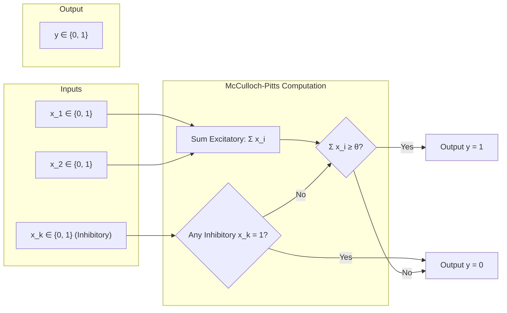
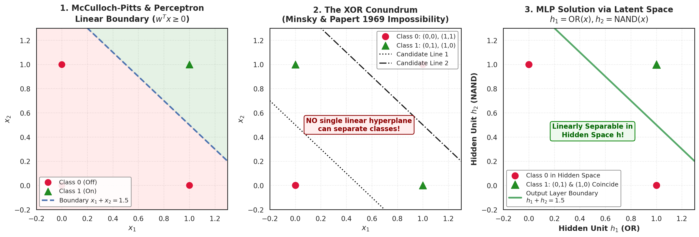
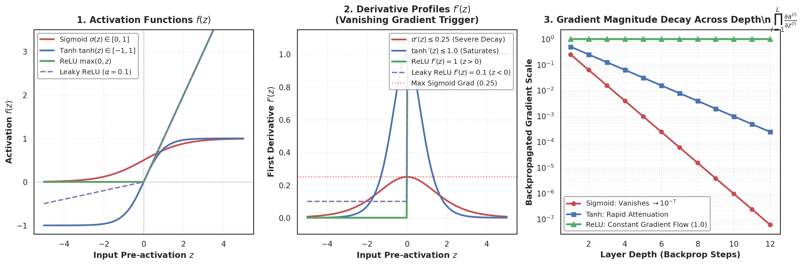
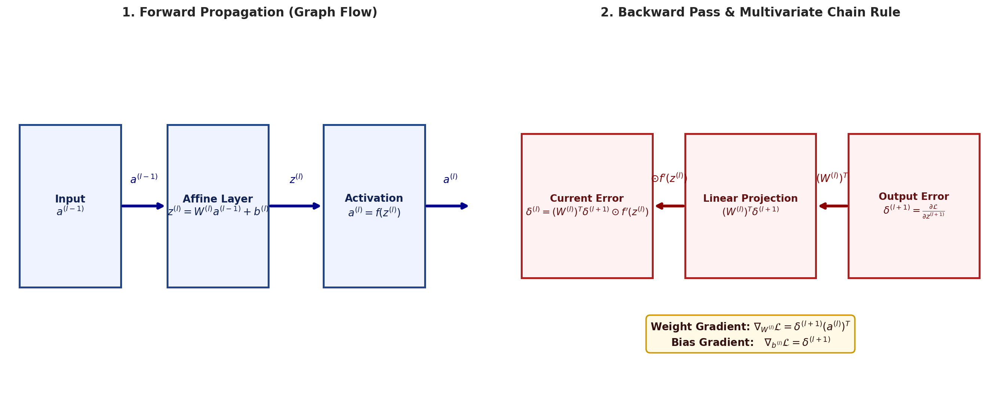
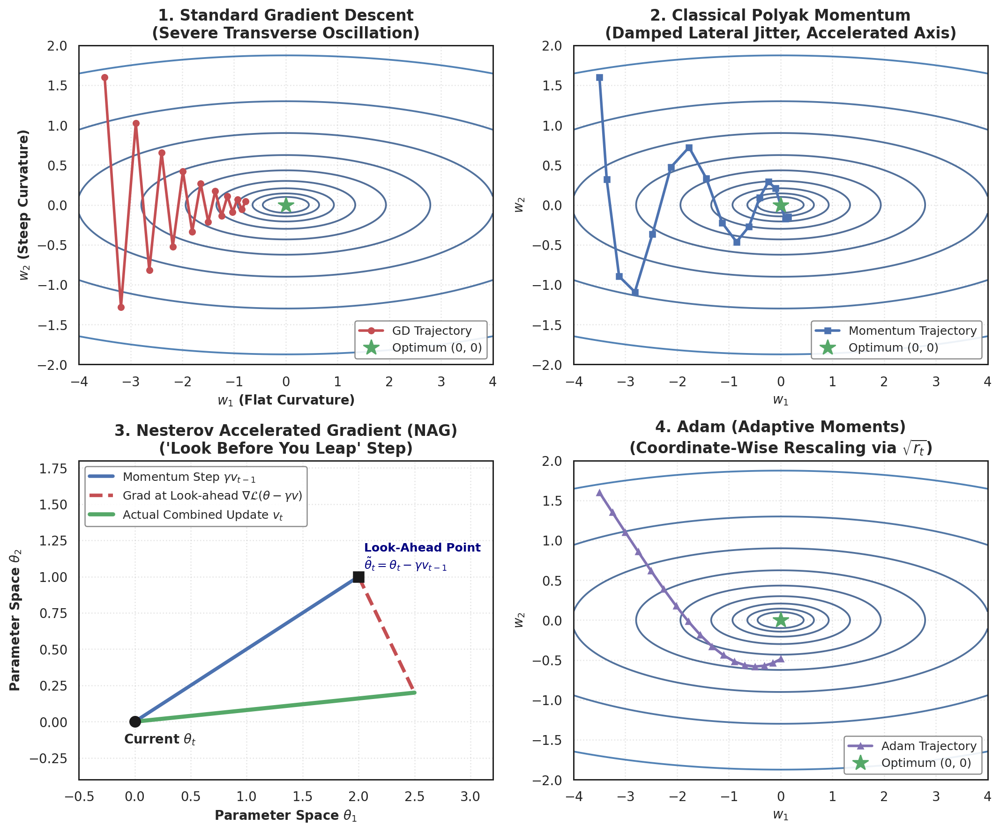
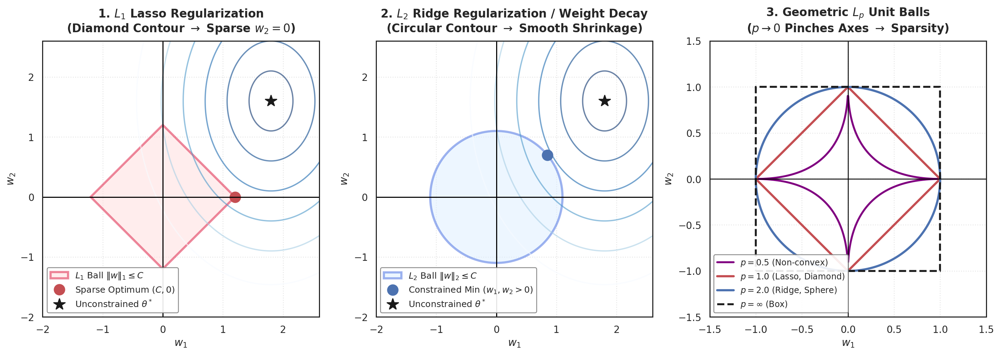
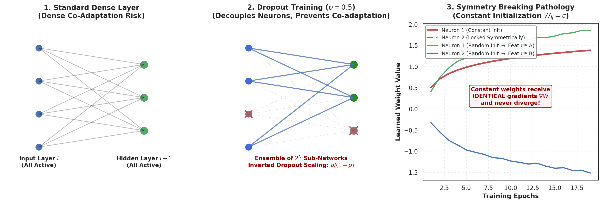
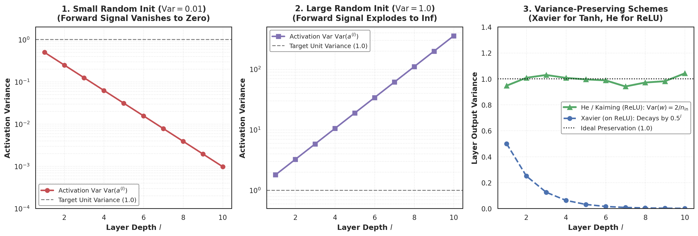
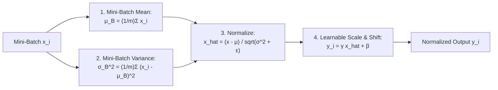
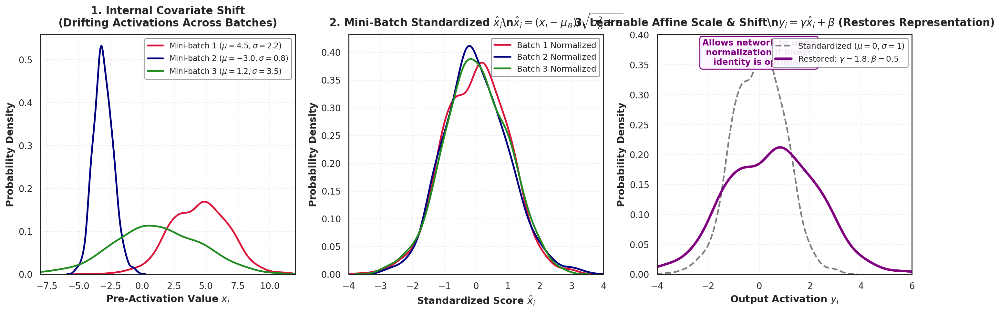

# Foundations of Deep Neural Networks: Perceptrons, Backpropagation, Advanced Optimization, Regularization, and Training Dynamics

> **Course:** Deep Learning for Computer Vision (IIT Hyderabad / NPTEL)  
> **Instructor:** Prof. Vineeth N Balasubramanian  
> **Scope:** Month 1, Week 3 (Segment 2: Basics of Neural Networks — Modules 3.1 through 3.10)  
> **Focus:** Theoretical, physical, and algorithmic mechanics of early computational neurons, multi-layer perceptron expressive capacity, multivariate matrix calculus of backpropagation, non-convex optimization geometry, parameter regularization, variance-preserving initialization, and batch normalization dynamics.

---

## Abstract

This synthesis report establishes the mathematical, architectural, and algorithmic foundations of artificial neural networks as the foundational engines for modern visual representation learning. We trace the computational lineage of visual learning from the discrete binary thresholds of the McCulloch-Pitts neuron (1943) and Rosenblatt's Perceptron (1958) to continuous multi-layer topologies. 

We formalize the geometric interpretation of linear decision boundaries, derive the Perceptron Learning Algorithm update rule, and prove why single-layer linear models fail catastrophically on non-linearly separable manifolds such as the canonical XOR conundrum. Resolving this representational bottleneck, we analyze the Universal Approximation Theorem and formalize the continuous multi-layer feedforward architecture.

We systematically derive the multivariate matrix calculus of the Backpropagation algorithm, detailing the four fundamental equations governing error propagation across affine projections and element-wise non-linear activations. We deconstruct the trade-offs of classical and modern activation functions—analyzing why saturated sigmoidal regimes collapse gradient flow while rectified linear units accelerate convergence despite the dying ReLU failure mode. 

Transitioning to non-convex optimization, we analyze the geometry of neural error landscapes, comparing standard Stochastic Gradient Descent against Polyak Momentum, Nesterov Accelerated Gradient (NAG), AdaGrad, RMSProp, and Adam.

Finally, we address the generalization and training pathologies of deep models. We derive the unit-ball geometry of $L_1$ versus $L_2$ penalties, prove the equivalence of input Gaussian noise to $L_2$ weight decay, formalize Dropout as an implicit exponential ensemble, mathematically demonstrate why constant initializations prevent symmetry breaking, derive Xavier/Glorot and He/Kaiming variance-preserving initializations, and formulate Batch Normalization across training mini-batches and test inference.

## Keywords
McCulloch-Pitts Neuron, Rosenblatt Perceptron, Linear Decision Boundaries, XOR Conundrum, Multi-Layer Perceptron (MLP), Universal Approximation Theorem, Feedforward Propagation, Activation Functions (Sigmoid, Tanh, ReLU, Leaky ReLU), Dying ReLU, Vanishing Gradient Problem, Multivariate Chain Rule, Backpropagation Algorithm, Non-Convex Error Surfaces, Stochastic Gradient Descent (SGD), Polyak Momentum, Nesterov Accelerated Gradient (NAG), AdaGrad, RMSProp, Adam Optimizer, Inductive Bias, $L_p$ Norms, Lasso Sparsity ($L_1$), Ridge Weight Decay ($L_2$), Gaussian Noise Equivalence, Dropout Regularization, Inverted Dropout, Symmetry Breaking, Unsupervised Pretraining, Xavier/Glorot Initialization, He/Kaiming Initialization, Internal Covariate Shift, Batch Normalization.

---

## 1. Computational Neurobiology & The Evolution of Early Neurons

### 1.1 The Biological Blueprint and the McCulloch-Pitts Neuron (1943)
Visual computing in biological systems is driven by densely interconnected networks of biological neurons that integrate chemical signals and emit discrete action potentials. In 1943, neurophysiologist Warren McCulloch and logician Walter Pitts proposed the first formal computational abstraction of a biological neuron—the **McCulloch-Pitts (MP) Neuron**.



#### Mathematical Formulation:
Let $\mathbf{x} = [x_1, x_2, \dots, x_n]^T \in \{0, 1\}^n$ be a vector of binary input signals. The inputs are partitioned into two disjoint subsets:
1. **Excitatory inputs:** $\mathcal{E} \subseteq \{1, 2, \dots, n\}$
2. **Inhibitory inputs:** $\mathcal{I} \subseteq \{1, 2, \dots, n\}$

The activation function $f(\mathbf{x})$ computes an unweighted sum of excitatory inputs and compares it against a threshold $\theta \in \mathbb{Z}^+$:
$$y = f(\mathbf{x}) = \begin{cases} 0 & \text{if } \exists \, k \in \mathcal{I} \text{ such that } x_k = 1 \\ 1 & \text{if } \sum_{i \in \mathcal{E}} x_i \ge \theta \text{ and } \forall k \in \mathcal{I}, \, x_k = 0 \\ 0 & \text{otherwise} \end{cases}$$

#### Theoretical Significance:
- **Turing Completeness:** McCulloch and Pitts proved that synchronous networks of feedforward MP neurons can compute any Boolean function.
- **Automata Simulation:** Recursive (cyclic) networks of MP neurons with internal feedback loops can simulate any Deterministic Finite Automaton (DFA) and approximate arbitrary discrete dynamical systems.
- **Architectural Limitation:** The MP neuron lacks learnable continuous parameters. Weights are binary and uniform ($w_i = 1$), and the threshold $\theta$ must be manually engineered.

---

### 1.2 Rosenblatt's Perceptron (1958)
In 1958, Frank Rosenblatt generalized the MP neuron by introducing **continuous real-valued inputs** and **learnable real-valued synaptic weights**, establishing the foundational mathematical atom of modern machine learning: the **Perceptron**.

#### Mathematical Formulation:
Let $\mathbf{x} \in \mathbb{R}^n$ be a continuous feature vector, and let $\mathbf{w} \in \mathbb{R}^n$ be the learnable synaptic weight vector. The perceptron computes an inner product and applies a step threshold:
$$y = f(\mathbf{x}) = \begin{cases} 1 & \text{if } \sum_{i=1}^n w_i x_i \ge \theta \\ 0 & \text{if } \sum_{i=1}^n w_i x_i < \theta \end{cases}$$

#### Bias Formulation:
By augmenting the input vector with a constant bias coordinate $x_0 = 1$ and defining a bias weight $w_0 = -\theta$, the activation condition simplifies to a standard homogeneous dot product:
$$\mathbf{w}_{\text{aug}} = [w_0, w_1, \dots, w_n]^T \in \mathbb{R}^{n+1}, \quad \mathbf{x}_{\text{aug}} = [1, x_1, \dots, x_n]^T \in \mathbb{R}^{n+1}$$
$$g(\mathbf{x}) = \mathbf{w}_{\text{aug}}^T \mathbf{x}_{\text{aug}} = \sum_{i=0}^n w_i x_i \ge 0$$

---

### 1.3 Geometric Interpretation of the Decision Boundary
The algebraic condition $\mathbf{w}^T \mathbf{x} + b = 0$ defines an $(n-1)$-dimensional **hyperplane** separating the $n$-dimensional input feature space into two half-spaces.

#### Properties of the Hyperplane:
1. **Orthogonality of Weight Vector:** The weight vector $\mathbf{w}$ is strictly normal (perpendicular) to the decision boundary. For any two points $\mathbf{x}_A, \mathbf{x}_B$ lying on the hyperplane:
   $$\mathbf{w}^T \mathbf{x}_A + b = 0 \quad \text{and} \quad \mathbf{w}^T \mathbf{x}_B + b = 0 \implies \mathbf{w}^T (\mathbf{x}_A - \mathbf{x}_B) = 0$$
   Since the difference vector $\mathbf{x}_A - \mathbf{x}_B$ lies entirely within the hyperplane, $\mathbf{w}$ is orthogonal to every vector on the plane.
2. **Direction of Positive Classification:** For any point $\mathbf{x}$, the inner product can be written in terms of the angle $\alpha$ between $\mathbf{w}$ and $\mathbf{x}$:
   $$\cos \alpha = \frac{\mathbf{w}^T \mathbf{x}}{\|\mathbf{w}\| \|\mathbf{x}\|}$$
   - When $\alpha < 90^\circ \implies \mathbf{w}^T \mathbf{x} > 0 \implies y = 1$ (Positive class).
   - When $\alpha > 90^\circ \implies \mathbf{w}^T \mathbf{x} < 0 \implies y = 0$ (Negative class).
3. **Signed Orthogonal Distance:** The geometric distance from an arbitrary point $\mathbf{x}$ to the hyperplane is:
   $$d(\mathbf{x}, \mathcal{H}) = \frac{\mathbf{w}^T \mathbf{x} + b}{\|\mathbf{w}\|}$$

---

### 1.4 The Perceptron Learning Algorithm & Convergence Theorem

#### The Learning Rule:
Given a labeled training dataset $\mathcal{D} = \{(\mathbf{x}_i, y_i)\}_{i=1}^M$ where $y_i \in \{-1, +1\}$:
1. Initialize $\mathbf{w}_0 = \mathbf{0}$.
2. Iterate through training samples. If sample $(\mathbf{x}_k, y_k)$ is misclassified, update weights:
   $$\mathbf{w}_{t+1} = \mathbf{w}_t + y_k \mathbf{x}_k$$

#### Geometric Proof of Angular Correction:
Consider a misclassified positive example ($y_k = +1$, but $\mathbf{w}_t^T \mathbf{x}_k < 0$, meaning $\alpha > 90^\circ$). Under the update rule $\mathbf{w}_{t+1} = \mathbf{w}_t + \mathbf{x}_k$:
$$\mathbf{w}_{t+1}^T \mathbf{x}_k = (\mathbf{w}_t + \mathbf{x}_k)^T \mathbf{x}_k = \mathbf{w}_t^T \mathbf{x}_k + \|\mathbf{x}_k\|^2$$
Because $\|\mathbf{x}_k\|^2 > 0$, the dot product strictly increases ($\mathbf{w}_{t+1}^T \mathbf{x}_k > \mathbf{w}_t^T \mathbf{x}_k$). Consequently:
$$\cos \alpha_{t+1} > \cos \alpha_t \implies \alpha_{t+1} < \alpha_t$$
The weight vector rotates toward the misclassified sample, reducing the angular error.

#### Novikoff's Perceptron Convergence Theorem (1962):
Let $\mathcal{D}$ be a dataset that is linearly separable with geometric margin $\gamma > 0$ under optimal unit weight vector $\mathbf{w}^*$ ($\|\mathbf{w}^*\| = 1$), such that:
$$y_i (\mathbf{w}^{*T} \mathbf{x}_i) \ge \gamma \quad \forall i \in \{1, \dots, M\}$$
Let $R = \max_i \|\mathbf{x}_i\|$ be the maximum radius of the data sphere. Then the Perceptron Learning Algorithm is guaranteed to terminate and makes at most $k_{\max}$ mistakes:
$$k_{\max} \le \left( \frac{R}{\gamma} \right)^2$$

> [!NOTE]
> If the data is **not linearly separable**, the algorithm is not guaranteed to converge; the weight vector oscillates indefinitely among non-separating configurations.

---

### 1.5 The XOR Conundrum and the Linear Separability Crisis

In 1969, Marvin Minsky and Seymour Papert published their critical treatise *Perceptrons*, exposing fundamental mathematical limits that halted funding for neural network research for over a decade (the first "AI Winter").

#### The Mathematical Contradiction:
Consider the binary Boolean XOR function:
$$\begin{array}{cc|c} x_1 & x_2 & y = x_1 \oplus x_2 \\ \hline 0 & 0 & 0 \\ 0 & 1 & 1 \\ 1 & 0 & 1 \\ 1 & 1 & 0 \end{array}$$

For a single perceptron with weights $w_1, w_2$ and threshold $\theta$ to represent XOR, it must satisfy four simultaneous linear inequalities:
1. $x_1=0, x_2=0 \implies 0 < \theta \implies \theta > 0$
2. $x_1=0, x_2=1 \implies w_2 \ge \theta$
3. $x_1=1, x_2=0 \implies w_1 \ge \theta$
4. $x_1=1, x_2=1 \implies w_1 + w_2 < \theta$

Summing inequalities (2) and (3):
$$w_1 + w_2 \ge 2\theta$$
Substituting inequality (1) ($\theta > 0$):
$$w_1 + w_2 \ge 2\theta > \theta \implies w_1 + w_2 > \theta$$
This directly contradicts inequality (4) ($w_1 + w_2 < \theta$). No real values $(w_1, w_2, \theta)$ can resolve this system. Geometrically, no single straight line can isolate the diagonal pairs $(0, 1), (1, 0)$ from $(0, 0), (1, 1)$.



**Figure 1.** *Foundational mechanics of early computational neurons and the linear separability crisis. 1 (Left): McCulloch-Pitts and Rosenblatt Perceptron decision boundary on linearly separable Boolean AND ($x_1 + x_2 \ge 1.5$). 2 (Center): The XOR conundrum, illustrating Minsky and Papert's proof of linear inseparability where no single hyperplane can isolate diagonal classes. 3 (Right): Multi-Layer Perceptron resolution, mapping the non-linear input space into a linearly separable hidden activation manifold $\mathbf{h} = [\operatorname{OR}(x), \operatorname{NAND}(x)]^T$.*

---

## 2. Multi-Layer Feedforward Architectures & Representation Power

### 2.1 Overcoming Inseparability via Hidden Layers
Stacking perceptrons into hierarchical layers solves the XOR problem by partitioning the original input space into intermediate regions and mapping them into a transformed latent space.

#### 2-Layer MLP Architecture for XOR:
Let hidden neuron $h_1$ compute the Boolean $\operatorname{OR}$ function, and let hidden neuron $h_2$ compute the Boolean $\operatorname{NAND}$ function:
$$h_1 = f(x_1 + x_2 - 0.5) \quad [\text{OR}]$$
$$h_2 = f(-x_1 - x_2 + 1.5) \quad [\text{NAND}]$$
The output neuron $y$ computes the Boolean $\operatorname{AND}$ over the hidden representations:
$$y = f(h_1 + h_2 - 1.5) \quad [\text{AND}]$$

#### Latent Space Coordinate Transformation:
$$\begin{array}{cc|cc|c} x_1 & x_2 & h_1 & h_2 & y = h_1 \text{ AND } h_2 \\ \hline 0 & 0 & 0 & 1 & 0 \\ 0 & 1 & 1 & 1 & 1 \\ 1 & 0 & 1 & 1 & 1 \\ 1 & 1 & 1 & 0 & 0 \end{array}$$
In the hidden feature space $(h_1, h_2)$, the positive examples $(0, 1)$ and $(1, 0)$ map to the identical coordinate $(1, 1)$, while negative examples map to $(0, 1)$ and $(1, 0)$. In this latent space, the classes are **linearly separable** by the line $h_1 + h_2 = 1.5$.

---

### 2.2 The Universal Approximation Theorem (Cybenko, 1989; Hornik et al., 1989)

```
[Input Layer x in R^d] ---> [Hidden Layer with Non-linear sigma] ---> [Linear Output y in R]
           Any continuous compact function f*(x) can be approximated within epsilon!
```

> **Universal Approximation Theorem:**  
> Let $\sigma(\cdot)$ be any non-constant, bounded, and continuous activation function. Let $I_m$ denote the $m$-dimensional unit hypercube $[0, 1]^m$. The space of continuous functions on $I_m$ is denoted by $C(I_m)$. Then, for any target function $f \in C(I_m)$ and any arbitrary error tolerance $\epsilon > 0$, there exist an integer $N$, real constants $v_i, b_i \in \mathbb{R}$, and real weight vectors $\mathbf{w}_i \in \mathbb{R}^m$ such that:
> $$F(\mathbf{x}) = \sum_{i=1}^N v_i \, \sigma\left(\mathbf{w}_i^T \mathbf{x} + b_i\right)$$
> satisfies:
> $$\sup_{\mathbf{x} \in I_m} |F(\mathbf{x}) - f(\mathbf{x})| < \epsilon$$

#### Critical Pedagogical Implications:
1. **Sufficiency of Depth-2 Networks:** A single hidden layer with non-linear activations possesses sufficient representational capacity to approximate any continuous function to arbitrary precision.
2. **The Curse of Width:** While a single hidden layer is *theoretically sufficient*, the required width $N$ can grow **exponentially** with input dimensionality $m$.
3. **Depth Efficiency:** Stacking multiple hidden layers (depth) allows the network to compose hierarchical features exponentially more efficiently than shallow, wide networks, forming the foundation of deep architectures.
4. **Non-Constructive Existence:** The theorem guarantees that a parameter configuration exists; it does **not** guarantee that gradient descent will successfully converge to those optimal parameters from random initialization.

---

## 3. Activation Functions & The Vanishing Gradient Problem

Without non-linear activation functions, a deep neural network collapses into a trivial cascade of linear transformations:
$$\mathbf{y} = \mathbf{W}_L (\mathbf{W}_{L-1} \dots (\mathbf{W}_1 \mathbf{x})) = \mathbf{W}_{\text{effective}} \mathbf{x}$$
Activation functions introduce non-linear curvature, allowing networks to bend hyperplanes and approximate arbitrary geometries.

### 3.1 Mathematical Comparison of Canonical Activation Functions

| Activation Function | Formulation $f(z)$ | First Derivative $f'(z)$ | Range | Key Strengths | Critical Vulnerabilities |
| :--- | :--- | :--- | :--- | :--- | :--- |
| **Sigmoid** | $\sigma(z) = \frac{1}{1 + e^{-z}}$ | $\sigma(z)(1 - \sigma(z))$ | $(0, 1)$ | Smooth, probabilistic interpretation | **Vanishing gradients** ($f' \le 0.25$); non-zero-centered; computationally expensive $\exp$. |
| **Tanh** | $\tanh(z) = \frac{e^z - e^{-z}}{e^z + e^{-z}}$ | $1 - \tanh^2(z)$ | $(-1, 1)$ | **Zero-centered** outputs; faster convergence than sigmoid | Saturates at tails; vanishing gradients ($f' \le 1.0$). |
| **ReLU** | $\max(0, z)$ | $\begin{cases} 1 & z > 0 \\ 0 & z < 0 \end{cases}$ | $[0, \infty)$ | **Non-saturating** for $z>0$; $6\times$ faster training; cheap threshold | **Dying ReLU** pathology (neurons die if $z < 0$). |
| **Leaky ReLU** | $\max(\alpha z, z), \alpha \approx 0.01$ | $\begin{cases} 1 & z > 0 \\ \alpha & z \le 0 \end{cases}$ | $(-\infty, \infty)$ | Prevents dying neurons; continuous gradient flow | Hyperparameter $\alpha$ tuning required. |

---

### 3.2 Analytical Derivation of the Vanishing Gradient Pathology
Consider an $L$-layer network where each hidden unit applies the sigmoid activation $\sigma(z)$. By the chain rule, the gradient of the scalar loss $\mathcal{L}$ with respect to the initial pre-activation $z^{(1)}$ is:
$$\frac{\partial \mathcal{L}}{\partial z^{(1)}} = \frac{\partial \mathcal{L}}{\partial z^{(L)}} \prod_{l=1}^{L-1} \left( \mathbf{W}^{(l+1)T} \cdot \operatorname{diag}\left( \sigma'(z^{(l)}) \right) \right)$$

#### The Bounded Derivative Limit:
We find the maximum value of the sigmoid derivative:
$$\sigma'(z) = \sigma(z)(1 - \sigma(z))$$
Setting the second derivative to zero:
$$\frac{d}{dz}[\sigma(1-\sigma)] = \sigma'(1-\sigma) - \sigma \sigma' = \sigma'(1 - 2\sigma) = 0 \implies \sigma(z) = 0.5 \implies z = 0$$
$$\max_{z \in \mathbb{R}} \sigma'(z) = \sigma(0)(1 - \sigma(0)) = 0.5 \times 0.5 = 0.25$$

#### Decay Bound:
Assuming weights are initialized such that $\|\mathbf{W}^{(l)}\| \le 1$:
$$\left\| \prod_{l=1}^{L-1} \operatorname{diag}\left( \sigma'(z^{(l)}) \right) \right\| \le (0.25)^{L-1}$$
- For a 5-layer network: $(0.25)^4 \approx 0.0039$
- For a 10-layer network: $(0.25)^9 \approx 3.8 \times 10^{-6}$
- For a 20-layer network: $(0.25)^{19} \approx 3.6 \times 10^{-12}$

The backpropagated error signal decays exponentially with depth. Early convolutional and affine layers receive virtually zero gradient updates, leaving their weights near their random initializations while later layers overfit.



**Figure 2.** *Mathematical characterization of activation functions and gradient flow mechanics. 1 (Left): Output profiles of Sigmoid, Tanh, ReLU, and Leaky ReLU. 2 (Center): First-order derivative profiles, illustrating the strict $0.25$ upper bound of the Sigmoid derivative. 3 (Right): Empirical gradient magnitude decay across network depth, contrasting the exponential vanishing profile of Sigmoid ($(0.25)^L$) against constant gradient preservation in ReLU ($f'(z) = 1$).*

---

## 4. The Backpropagation Algorithm & Multivariate Matrix Calculus

### 4.1 Formal Network Notation
Let the network have depth $n_l$ (number of layers excluding input).
- $\mathbf{a}^{(0)} = \mathbf{x} \in \mathbb{R}^{d_0}$ is the input vector.
- Layer $l \in \{1, 2, \dots, n_l\}$ has dimension $d_l$.
- $\mathbf{W}^{(l)} \in \mathbb{R}^{d_l \times d_{l-1}}$ is the weight matrix connecting layer $l-1$ to layer $l$.
- $\mathbf{b}^{(l)} \in \mathbb{R}^{d_l}$ is the bias vector at layer $l$.
- $\mathbf{z}^{(l)} \in \mathbb{R}^{d_l}$ is the pre-activation vector: $\mathbf{z}^{(l)} = \mathbf{W}^{(l)} \mathbf{a}^{(l-1)} + \mathbf{b}^{(l)}$.
- $\mathbf{a}^{(l)} \in \mathbb{R}^{d_l}$ is the post-activation vector: $\mathbf{a}^{(l)} = f(\mathbf{z}^{(l)})$.
- $\hat{\mathbf{y}} = \mathbf{a}^{(n_l)}$ is the network prediction.

---

### 4.2 Derivation of the Four Fundamental Backpropagation Equations

We define the layer error vector $\boldsymbol{\delta}^{(l)} \in \mathbb{R}^{d_l}$ as the partial derivative of the scalar loss $\mathcal{L}$ with respect to the pre-activation vector $\mathbf{z}^{(l)}$:
$$\boldsymbol{\delta}^{(l)} \triangleq \frac{\partial \mathcal{L}}{\partial \mathbf{z}^{(l)}} = \left[ \frac{\partial \mathcal{L}}{\partial z_1^{(l)}}, \frac{\partial \mathcal{L}}{\partial z_2^{(l)}}, \dots, \frac{\partial \mathcal{L}}{\partial z_{d_l}^{(l)}} \right]^T$$

#### Equation 1: Error at the Output Layer ($\boldsymbol{\delta}^{(n_l)}$)
By the chain rule for each coordinate $i \in \{1, \dots, d_{n_l}\}$:
$$\delta_i^{(n_l)} = \frac{\partial \mathcal{L}}{\partial z_i^{(n_l)}} = \sum_{k} \frac{\partial \mathcal{L}}{\partial a_k^{(n_l)}} \frac{\partial a_k^{(n_l)}}{\partial z_i^{(n_l)}}$$
Because activation function $f$ is applied element-wise, $\frac{\partial a_k^{(n_l)}}{\partial z_i^{(n_l)}} = 0$ for $k \ne i$:
$$\delta_i^{(n_l)} = \frac{\partial \mathcal{L}}{\partial a_i^{(n_l)}} f'(z_i^{(n_l)})$$
In vectorized form:
$$\boldsymbol{\delta}^{(n_l)} = \nabla_{\mathbf{a}^{(n_l)}} \mathcal{L} \odot f'(\mathbf{z}^{(n_l)})$$
- *For Mean Squared Error $\mathcal{L} = \frac{1}{2} \|\mathbf{a}^{(n_l)} - \mathbf{y}\|^2$:*
  $$\nabla_{\mathbf{a}^{(n_l)}} \mathcal{L} = (\mathbf{a}^{(n_l)} - \mathbf{y}) \implies \boldsymbol{\delta}^{(n_l)} = (\mathbf{a}^{(n_l)} - \mathbf{y}) \odot f'(\mathbf{z}^{(n_l)})$$
- *For Binary Cross-Entropy with Sigmoid:*
  $$\mathcal{L} = -y \log a - (1-y) \log(1-a) \implies \delta^{(n_l)} = a^{(n_l)} - y$$

#### Equation 2: Backpropagation of Error to Hidden Layers ($\boldsymbol{\delta}^{(l)}$)
We express $\boldsymbol{\delta}^{(l)} = \frac{\partial \mathcal{L}}{\partial \mathbf{z}^{(l)}}$ in terms of the next layer's error $\boldsymbol{\delta}^{(l+1)} = \frac{\partial \mathcal{L}}{\partial \mathbf{z}^{(l+1)}}$. By the multivariate chain rule:
$$\delta_j^{(l)} = \frac{\partial \mathcal{L}}{\partial z_j^{(l)}} = \sum_{k=1}^{d_{l+1}} \frac{\partial \mathcal{L}}{\partial z_k^{(l+1)}} \frac{\partial z_k^{(l+1)}}{\partial z_j^{(l)}} = \sum_{k=1}^{d_{l+1}} \delta_k^{(l+1)} \frac{\partial z_k^{(l+1)}}{\partial z_j^{(l)}}$$
Expanding $z_k^{(l+1)} = \sum_{m} W_{km}^{(l+1)} a_m^{(l)} + b_k^{(l+1)} = \sum_{m} W_{km}^{(l+1)} f(z_m^{(l)}) + b_k^{(l+1)}$:
$$\frac{\partial z_k^{(l+1)}}{\partial z_j^{(l)}} = W_{kj}^{(l+1)} f'(z_j^{(l)})$$
Substituting back into the sum:
$$\delta_j^{(l)} = \sum_{k=1}^{d_{l+1}} \delta_k^{(l+1)} W_{kj}^{(l+1)} f'(z_j^{(l)}) = \left( \sum_{k=1}^{d_{l+1}} W_{kj}^{(l+1)} \delta_k^{(l+1)} \right) f'(z_j^{(l)})$$
Recognizing the sum as the $j$-th entry of $(\mathbf{W}^{(l+1)})^T \boldsymbol{\delta}^{(l+1)}$, we obtain the vectorized backpropagation equation:
$$\boldsymbol{\delta}^{(l)} = \left( (\mathbf{W}^{(l+1)})^T \boldsymbol{\delta}^{(l+1)} \right) \odot f'(\mathbf{z}^{(l)})$$

#### Equation 3: Gradient of Loss with Respect to Synaptic Weights ($\nabla_{\mathbf{W}^{(l)}} \mathcal{L}$)
Applying the chain rule to individual matrix element $W_{ij}^{(l)}$:
$$\frac{\partial \mathcal{L}}{\partial W_{ij}^{(l)}} = \frac{\partial \mathcal{L}}{\partial z_i^{(l)}} \frac{\partial z_i^{(l)}}{\partial W_{ij}^{(l)}} = \delta_i^{(l)} \frac{\partial}{\partial W_{ij}^{(l)}} \left[ \sum_{k} W_{ik}^{(l)} a_k^{(l-1)} + b_i^{(l)} \right] = \delta_i^{(l)} a_j^{(l-1)}$$
Expressed as an outer product of the layer error vector and the incoming activation vector:
$$\frac{\partial \mathcal{L}}{\partial \mathbf{W}^{(l)}} = \boldsymbol{\delta}^{(l)} (\mathbf{a}^{(l-1)})^T$$

#### Equation 4: Gradient of Loss with Respect to Biases ($\nabla_{\mathbf{b}^{(l)}} \mathcal{L}$)
Similarly, for bias coordinate $b_i^{(l)}$:
$$\frac{\partial \mathcal{L}}{\partial b_i^{(l)}} = \frac{\partial \mathcal{L}}{\partial z_i^{(l)}} \frac{\partial z_i^{(l)}}{\partial b_i^{(l)}} = \delta_i^{(l)} \cdot 1 \implies \frac{\partial \mathcal{L}}{\partial \mathbf{b}^{(l)}} = \boldsymbol{\delta}^{(l)}$$



**Figure 3.** *Computational graph topology and error flow of the Backpropagation algorithm. 1 (Left): Forward propagation pass transforming input activations $\mathbf{a}^{(l-1)}$ through linear affine projection $\mathbf{z}^{(l)} = \mathbf{W}^{(l)} \mathbf{a}^{(l-1)} + \mathbf{b}^{(l)}$ and non-linear activation $\mathbf{a}^{(l)} = f(\mathbf{z}^{(l)})$. 2 (Right): Backward pass propagating error vectors $\boldsymbol{\delta}^{(l+1)}$ in reverse via transposed weight projections $(\mathbf{W}^{(l)})^T$ and Hadamard multiplication $\odot f'(\mathbf{z}^{(l)})$.*

---

## 5. Non-Convex Error Landscapes & Gradient Descent Optimizers

The loss surface of deep networks is non-convex. Due to permutation symmetries among hidden neurons, any permutation of weights within a layer computes an identical mathematical function, creating factorial numbers of equivalent local minima and saddle points.

### 5.1 First-Order Gradient Descent Mechanics
The parameter update follows first-order Taylor expansion:
$$\mathcal{L}(\boldsymbol{\theta} + \Delta \boldsymbol{\theta}) \approx \mathcal{L}(\boldsymbol{\theta}) + \nabla_{\boldsymbol{\theta}} \mathcal{L}(\boldsymbol{\theta})^T \Delta \boldsymbol{\theta}$$
To maximize decrease in loss, $\Delta \boldsymbol{\theta}$ must align with the negative gradient direction:
$$\boldsymbol{\theta}_{t+1} = \boldsymbol{\theta}_t - \eta \nabla_{\boldsymbol{\theta}} \mathcal{L}(\boldsymbol{\theta}_t)$$

#### Data Partitioning Paradigms:
1. **Batch Gradient Descent (BGD):** Computes gradient across entire dataset of $M$ samples: $\nabla \mathcal{L} = \frac{1}{M} \sum_{i=1}^M \nabla \mathcal{L}_i$. Exact, but $\mathcal{O}(M)$ complexity per step; intractable for large datasets.
2. **Stochastic Gradient Descent (SGD):** Updates parameters based on single randomly chosen sample $i$: $\boldsymbol{\theta}_{t+1} = \boldsymbol{\theta}_t - \eta \nabla \mathcal{L}_i$. Extremely fast, but high gradient variance causes noisy oscillations.
3. **Mini-Batch Gradient Descent:** Computes gradient over small batch $\mathcal{B} \subset \mathcal{D}$ (typically $|\mathcal{B}| \in \{32, 64, 128, 256\}$):
   $$\mathbf{g}_t = \frac{1}{|\mathcal{B}|} \sum_{i \in \mathcal{B}} \nabla_{\boldsymbol{\theta}} \mathcal{L}_i(\boldsymbol{\theta}_t)$$
   Balances hardware vectorization (GPU tensor cores) with gradient stability.

---

### 5.2 The Problem of Ill-Conditioned Curvature (Ravines)
In loss ravines, surface curvature is steep across the ravine walls but gently sloping along the base. The Hessian matrix $\mathbf{H} = \nabla^2 \mathcal{L}$ exhibits a high condition number:
$$\kappa(\mathbf{H}) = \frac{\lambda_{\max}(\mathbf{H})}{\lambda_{\min}(\mathbf{H})} \gg 1$$
Standard gradient descent oscillates back and forth across the steep walls while making negligible progress along the base toward the minimum.

---

### 5.3 Advanced Momentum and Adaptive Optimizers

#### 1. Polyak Classical Momentum (1964)
Introduces a velocity vector $\mathbf{v}_t$ modeled on physical inertia (exponential moving average of past gradients):
$$\mathbf{v}_t = \gamma \mathbf{v}_{t-1} + \eta \nabla_{\boldsymbol{\theta}} \mathcal{L}(\boldsymbol{\theta}_t)$$
$$\boldsymbol{\theta}_{t+1} = \boldsymbol{\theta}_t - \mathbf{v}_t$$
- **Damping Oscillations:** Across oscillating dimensions, successive gradients alternate sign ($\nabla_1 > 0, \nabla_2 < 0$), cancelling each other out.
- **Directional Acceleration:** Along consistent downward dimensions, gradients reinforce each other, accelerating velocity up to the effective terminal limit $\frac{1}{1 - \gamma}$.

#### 2. Nesterov Accelerated Gradient (NAG, 1983)
Recognizes that momentum takes a deterministic step $\gamma \mathbf{v}_{t-1}$ regardless of the local gradient. NAG evaluates the gradient at the **look-ahead position** $\tilde{\boldsymbol{\theta}}_t = \boldsymbol{\theta}_t - \gamma \mathbf{v}_{t-1}$:
$$\mathbf{v}_t = \gamma \mathbf{v}_{t-1} + \eta \nabla_{\boldsymbol{\theta}} \mathcal{L}(\boldsymbol{\theta}_t - \gamma \mathbf{v}_{t-1})$$
$$\boldsymbol{\theta}_{t+1} = \boldsymbol{\theta}_t - \mathbf{v}_t$$
- **Look-Before-You-Leap:** If the momentum step is about to overshoot into a rising slope, the gradient at the look-ahead position points in reverse, braking the velocity before overshooting.

#### 3. AdaGrad (Duchi et al., 2011)
Maintains coordinate-wise accumulated squared gradients to adapt step sizes per parameter:
$$\mathbf{r}_t = \mathbf{r}_{t-1} + \mathbf{g}_t \odot \mathbf{g}_t$$
$$\boldsymbol{\theta}_{t+1} = \boldsymbol{\theta}_t - \frac{\eta}{\sqrt{\mathbf{r}_t + \epsilon}} \odot \mathbf{g}_t$$
- **Vulnerability:** Because $\mathbf{r}_t$ accumulates monotonically ($\mathbf{g}_t^2 \ge 0$), the learning rate decays continuously, freezing learning prematurely.

#### 4. RMSProp (Hinton, 2012)
Replaces AdaGrad's infinite sum with an exponentially decaying moving average:
$$\mathbf{r}_t = \beta \mathbf{r}_{t-1} + (1 - \beta) \mathbf{g}_t \odot \mathbf{g}_t \quad (\beta \approx 0.9)$$
$$\boldsymbol{\theta}_{t+1} = \boldsymbol{\theta}_t - \frac{\eta}{\sqrt{\mathbf{r}_t + \epsilon}} \odot \mathbf{g}_t$$
- Prevents the denominator from growing monotonically, allowing training to continue indefinitely across changing surfaces.

#### 5. Adam (Kingma & Ba, 2014)
Combines first-moment tracking (Momentum) with second-moment tracking (RMSProp) and adds bias correction for zero initialization:
$$\mathbf{m}_t = \beta_1 \mathbf{m}_{t-1} + (1 - \beta_1) \mathbf{g}_t \quad [\text{1st Moment: Velocity}]$$
$$\mathbf{v}_t = \beta_2 \mathbf{v}_{t-1} + (1 - \beta_2) (\mathbf{g}_t \odot \mathbf{g}_t) \quad [\text{2nd Moment: Variance}]$$

##### Bias Corrections:
Since $\mathbf{m}_0 = \mathbf{0}$ and $\mathbf{v}_0 = \mathbf{0}$, uncorrected estimates are biased toward zero at early timesteps ($t \approx 1$). Expanding recursively:
$$\mathbf{m}_t = (1 - \beta_1) \sum_{i=1}^t \beta_1^{t-i} \mathbf{g}_i \implies \mathbb{E}[\mathbf{m}_t] = \mathbb{E}[\mathbf{g}] (1 - \beta_1) \sum_{i=1}^t \beta_1^{t-i} = \mathbb{E}[\mathbf{g}] (1 - \beta_1^t)$$
$$\hat{\mathbf{m}}_t = \frac{\mathbf{m}_t}{1 - \beta_1^t}, \quad \hat{\mathbf{v}}_t = \frac{\mathbf{v}_t}{1 - \beta_2^t}$$
$$\boldsymbol{\theta}_{t+1} = \boldsymbol{\theta}_t - \frac{\eta}{\sqrt{\hat{\mathbf{v}}_t} + \epsilon} \odot \hat{\mathbf{m}}_t$$
- Standard default hyperparameter configurations: $\beta_1 = 0.9, \beta_2 = 0.999, \epsilon = 10^{-8}, \eta = 10^{-3}$.



**Figure 4.** *Comparative optimization dynamics across non-convex and ill-conditioned loss surfaces. 1 (Top-Left): Standard Gradient Descent displaying severe transverse oscillations in an anisotropic ravine. 2 (Top-Right): Polyak Momentum damping lateral oscillations and accelerating longitudinal progress. 3 (Bottom-Left): Nesterov Accelerated Gradient (NAG) look-ahead vector mechanics. 4 (Bottom-Right): Adam optimizer coordinate-wise adaptive trajectory.*

---

## 6. Regularization, Inductive Bias & Generalization Mechanics

Overfitting occurs when a high-capacity network memorizes random noise in the training set rather than learning the underlying data-generating distribution. Regularization enforces an **inductive bias** toward simpler hypotheses.

### 6.1 Parameter Penalties: $L_1$ vs. $L_2$ Regularization
We penalize model complexity by adding a norm penalty to the empirical loss:
$$\mathcal{L}_{\text{reg}}(\boldsymbol{\theta}) = \mathcal{L}(\boldsymbol{\theta}) + \alpha \Omega(\mathbf{w})$$

#### Analytical Gradient Updates:
- **$L_2$ Regularization (Ridge / Weight Decay):**
  $$\Omega(\mathbf{w}) = \frac{1}{2} \|\mathbf{w}\|_2^2 = \frac{1}{2} \sum_i w_i^2$$
  $$\mathbf{w}_{t+1} = \mathbf{w}_t - \eta (\nabla \mathcal{L} + \alpha \mathbf{w}_t) = (1 - \eta \alpha)\mathbf{w}_t - \eta \nabla \mathcal{L}$$
  At each step, weights are contracted multiplicatively by $(1 - \eta \alpha) < 1$ before subtracting the empirical gradient.
- **$L_1$ Regularization (Lasso):**
  $$\Omega(\mathbf{w}) = \|\mathbf{w}\|_1 = \sum_i |w_i|$$
  $$\mathbf{w}_{t+1} = \mathbf{w}_t - \eta \nabla \mathcal{L} - \eta \alpha \operatorname{sign}(\mathbf{w}_t)$$
  Subtracts a constant scalar $\eta \alpha$ at every step regardless of weight magnitude, pushing small weights directly to zero.

---

### 6.2 The Geometric Origin of $L_1$ Sparsity
Using constrained optimization (Karush-Kuhn-Tucker conditions), minimizing $\mathcal{L}(\mathbf{w}) + \alpha \Omega(\mathbf{w})$ is equivalent to:
$$\min_{\mathbf{w}} \mathcal{L}(\mathbf{w}) \quad \text{subject to } \Omega(\mathbf{w}) \le C$$

#### Geometric Analysis of $L_p$ Unit Balls:
- **$L_2$ Constraint Ball ($\|w\|_2^2 \le C$):** A circle (in 2D) or hypersphere. The contours of loss $\mathcal{L}$ intersect the smooth spherical boundary at arbitrary interior angles where both $w_1$ and $w_2$ remain non-zero.
- **$L_1$ Constraint Ball ($\|w\|_1 \le C$):** A diamond (in 2D) or cross-polytope. The ball has sharp corners on the coordinate axes. The elliptical contours of the unconstrained loss $\mathcal{L}$ are statistically most likely to contact the constraint region at one of these sharp axis corners. At any corner on the $w_1$-axis, $w_2 = 0$. Hence, **$L_1$ regularization produces sparse weight vectors**, performing automatic feature selection.



**Figure 5.** *Geometric characterization of parameter norm penalties. 1 (Left): $L_1$ Lasso regularization constraint diamond; loss contours intersect at the axis apex, setting $w_2 = 0$ (sparse solution). 2 (Center): $L_2$ Ridge regularization constraint circle; smooth intersection maintains small, non-zero weights. 3 (Right): Geometric unit ball progression across $L_p$ norms ($p \in \{0.5, 1.0, 2.0, \infty\}$), showing axis pinching as $p \to 0$.*

---

### 6.3 Mathematical Proof: Input Gaussian Noise is Equivalent to $L_2$ Weight Decay

> **Theorem:**  
> In a linear neural network trained under Mean Squared Error (MSE), injecting zero-mean additive Gaussian noise $\boldsymbol{\epsilon} \sim \mathcal{N}(\mathbf{0}, \sigma^2 \mathbf{I})$ into the input features $\mathbf{x}$ during training is mathematically equivalent to training on clean data with an explicit $L_2$ weight decay regularizer.

#### Derivation:
Let the clean linear model output be $y = \mathbf{w}^T \mathbf{x}$. Inject independent zero-mean noise $\epsilon_i \sim \mathcal{N}(0, \sigma_i^2)$ into each input feature $x_i$, giving noisy input $\tilde{\mathbf{x}} = \mathbf{x} + \boldsymbol{\epsilon}$. The resulting noisy prediction is:
$$y_{\text{noisy}} = \sum_i w_i (x_i + \epsilon_i) = \mathbf{w}^T \mathbf{x} + \sum_i w_i \epsilon_i = y + \mathbf{w}^T \boldsymbol{\epsilon}$$

Let $t$ be the ground-truth target. The expected Mean Squared Error over the noise distribution is:
$$\mathbb{E}_{\boldsymbol{\epsilon}} \left[ (y_{\text{noisy}} - t)^2 \right] = \mathbb{E}_{\boldsymbol{\epsilon}} \left[ \left( (y - t) + \sum_i w_i \epsilon_i \right)^2 \right]$$

Expanding the quadratic:
$$\mathbb{E}_{\boldsymbol{\epsilon}} \left[ (y_{\text{noisy}} - t)^2 \right] = \mathbb{E}_{\boldsymbol{\epsilon}} \left[ (y - t)^2 + 2(y - t) \sum_i w_i \epsilon_i + \left( \sum_i w_i \epsilon_i \right)^2 \right]$$

Applying linearity of expectation:
1. First term: $\mathbb{E}_{\boldsymbol{\epsilon}}[(y - t)^2] = (y - t)^2$ (independent of noise).
2. Second term: $2(y - t) \sum_i w_i \mathbb{E}[\epsilon_i] = 0$ (since noise is zero-mean: $\mathbb{E}[\epsilon_i] = 0$).
3. Third term:
   $$\mathbb{E}_{\boldsymbol{\epsilon}} \left[ \left( \sum_i w_i \epsilon_i \right)^2 \right] = \mathbb{E}_{\boldsymbol{\epsilon}} \left[ \sum_i \sum_j w_i w_j \epsilon_i \epsilon_j \right] = \sum_i \sum_j w_i w_j \mathbb{E}[\epsilon_i \epsilon_j]$$
   Because the noise coordinates are mutually independent ($\mathbb{E}[\epsilon_i \epsilon_j] = 0$ for $i \ne j$, and $\mathbb{E}[\epsilon_i^2] = \sigma_i^2$):
   $$\sum_i \sum_j w_i w_j \mathbb{E}[\epsilon_i \epsilon_j] = \sum_i w_i^2 \sigma_i^2$$

Assuming isotropic noise ($\sigma_i = \sigma$ for all $i$):
$$\mathbb{E}_{\boldsymbol{\epsilon}} \left[ (y_{\text{noisy}} - t)^2 \right] = (y - t)^2 + \sigma^2 \sum_i w_i^2 = \mathcal{L}_{\text{clean}}(\mathbf{w}) + \sigma^2 \|\mathbf{w}\|_2^2 \quad \blacksquare$$

The noise variance $\sigma^2$ acts directly as the $L_2$ regularization coefficient $\alpha$.

---

### 6.4 Dropout (Srivastava et al., 2014)
During each forward training pass, each neuron is independently retained with probability $q = 1 - p$ and set to zero with probability $p$ (dropout rate, typically $p=0.5$ for dense layers, $p=0.2$ for input layers):
$$\mathbf{m}^{(l)} \sim \operatorname{Bernoulli}(1 - p), \quad \tilde{\mathbf{a}}^{(l)} = \mathbf{a}^{(l)} \odot \mathbf{m}^{(l)}$$

#### Why Dropout Regularizes:
1. **Prevents Co-Adaptation:** Neurons cannot rely on specific companion units to correct errors; every neuron must learn independently useful representations.
2. **Implicit Exponential Ensemble:** A network with $N$ units contains $2^N$ possible thinned subnetworks. Dropout trains a shared-parameter ensemble of these $2^N$ architectures, taking a geometric average at test time.
3. **Inverted Dropout:** To prevent modifying activation scales at inference, activations are scaled by $\frac{1}{1-p}$ during training:
   $$\tilde{\mathbf{a}}^{(l)} = \frac{\mathbf{a}^{(l)} \odot \mathbf{m}^{(l)}}{1 - p}$$
   At test time, the full network runs without modification: $\mathbf{a}_{\text{test}}^{(l)} = \mathbf{a}^{(l)}$.

---

## 7. Training Dynamics: Normalization & Weight Initialization

### 7.1 Input Preprocessing and Conditioning
Unnormalized visual inputs with varying ranges ($x_1 \in [0, 255]$, $x_2 \in [0, 1]$) create severely elongated loss surfaces. Normalizing inputs to zero mean and unit variance transforms elliptical contours into spherical geometry:
$$\hat{\mathbf{x}} = \frac{\mathbf{x} - \boldsymbol{\mu}}{\boldsymbol{\sigma}}$$
This allows gradient descent to step directly toward the minimum without lateral oscillation.

---

### 7.2 Symmetry Breaking: The Failure of Constant Initialization

> **Theorem:** If all synaptic weights in a multi-layer feedforward network are initialized to identical constant values $w_{ij}^{(l)} = c$ and biases $b_i^{(l)} = 0$, every neuron within a given hidden layer computes identical forward activations and receives identical backward gradient updates, preventing the network from learning distinct features.

#### Proof:
Consider a hidden layer $l$ with two neurons receiving inputs $\mathbf{x} = [x_1, x_2]^T$. Let all weights be initialized to constant $c$:
$$z_1^{(l)} = c x_1 + c x_2, \quad z_2^{(l)} = c x_1 + c x_2 \implies z_1^{(l)} = z_2^{(l)}$$
Applying activation function $f$:
$$a_1^{(l)} = f(z_1^{(l)}) = f(z_2^{(l)}) = a_2^{(l)}$$

During backpropagation, both neurons connect to the next layer with identical weights $W_{11}^{(l+1)} = W_{12}^{(l+1)} = c$:
$$\delta_1^{(l)} = \delta_1^{(l+1)} c \cdot f'(z_1^{(l)}), \quad \delta_2^{(l)} = \delta_1^{(l+1)} c \cdot f'(z_2^{(l)}) \implies \delta_1^{(l)} = \delta_2^{(l)}$$
The weight gradient updates are:
$$\frac{\partial \mathcal{L}}{\partial W_{1j}^{(l)}} = \delta_1^{(l)} x_j = \delta_2^{(l)} x_j = \frac{\partial \mathcal{L}}{\partial W_{2j}^{(l)}}$$
Because the gradients are identical, the weights update by identical amounts:
$$W_{1j,\text{new}}^{(l)} = W_{2j,\text{new}}^{(l)}$$
The two neurons remain mathematically locked in symmetry throughout training, reducing layer capacity to that of a single neuron. **Weights must be initialized randomly to break symmetry.**



**Figure 6.** *Ensemble regularizers and initialization symmetry breaking. 1 (Left): Standard fully connected dense layer with risk of complex co-adaptation. 2 (Center): Dropout training pass ($p=0.5$), randomly disabling neurons to train an implicit ensemble of $2^N$ sparse subnetworks. 3 (Right): Symmetry breaking pathology, showing identical parameter evolution under constant initialization versus functional divergence under random initialization.*

---

### 7.3 Variance-Preserving Weight Initializations

Random initialization must balance signal transmission:
- If weights are initialized too small: Activation variance decays exponentially toward zero ($a^{(l)} \to 0$); gradients vanish.
- If weights are initialized too large: Activation variance explodes exponentially ($a^{(l)} \to \infty$); gradients saturate or explode.

#### General Variance Derivation:
Consider a single neuron computing $z = \sum_{i=1}^{n_{\text{in}}} w_i x_i$. Assuming $w_i$ and $x_i$ are independent with zero mean ($\mathbb{E}[w_i] = 0, \mathbb{E}[x_i] = 0$):
$$\operatorname{Var}(z) = \sum_{i=1}^{n_{\text{in}}} \operatorname{Var}(w_i x_i) = \sum_{i=1}^{n_{\text{in}}} \left( \mathbb{E}[w_i^2 x_i^2] - (\mathbb{E}[w_i x_i])^2 \right) = \sum_{i=1}^{n_{\text{in}}} \mathbb{E}[w_i^2] \mathbb{E}[x_i^2] = n_{\text{in}} \operatorname{Var}(w) \operatorname{Var}(x)$$
To ensure variance does not grow or shrink across layers ($\operatorname{Var}(z) = \operatorname{Var}(x)$), we require:
$$n_{\text{in}} \operatorname{Var}(w) = 1 \implies \operatorname{Var}(w) = \frac{1}{n_{\text{in}}}$$

#### 1. Xavier / Glorot Initialization (Glorot & Bengio, 2010)
Designed for symmetric linear and saturating activations (Sigmoid, Tanh). Considers both forward pass ($\operatorname{Var}(a^{(l)}) = \operatorname{Var}(a^{(l-1)})$) and backward pass ($\operatorname{Var}(\delta^{(l)}) = \operatorname{Var}(\delta^{(l+1)})$):
- Forward pass requires: $\operatorname{Var}(w) = \frac{1}{n_{\text{in}}}$
- Backward pass requires: $\operatorname{Var}(w) = \frac{1}{n_{\text{out}}}$
- Harmonic mean compromises:
  $$\operatorname{Var}(w) = \frac{2}{n_{\text{in}} + n_{\text{out}}}$$
  - For Gaussian distribution: $\mathcal{N}\left(0, \frac{2}{n_{\text{in}} + n_{\text{out}}}\right)$
  - For Uniform distribution $\mathcal{U}[-a, a]$ (since $\operatorname{Var} = \frac{a^2}{3}$): $\mathcal{U}\left[-\frac{\sqrt{6}}{\sqrt{n_{\text{in}} + n_{\text{out}}}}, \frac{\sqrt{6}}{\sqrt{n_{\text{in}} + n_{\text{out}}}}\right]$

#### 2. He / Kaiming Initialization (He et al., 2015)
Designed specifically for Rectified Linear Units (ReLU). ReLU zeroes out all negative activations ($\max(0, z)$), halving the variance:
$$\operatorname{Var}(\operatorname{ReLU}(z)) = \frac{1}{2} \operatorname{Var}(z) \implies \operatorname{Var}(z) = n_{\text{in}} \operatorname{Var}(w) \cdot \frac{1}{2} \operatorname{Var}(a_{\text{in}})$$
To maintain $\operatorname{Var}(a_{\text{out}}) = \operatorname{Var}(a_{\text{in}})$:
$$\frac{1}{2} n_{\text{in}} \operatorname{Var}(w) = 1 \implies \operatorname{Var}(w) = \frac{2}{n_{\text{in}}}$$
- For Gaussian distribution: $\mathcal{N}\left(0, \frac{2}{n_{\text{in}}}\right)$
- For Uniform distribution: $\mathcal{U}\left[-\frac{\sqrt{6}}{\sqrt{n_{\text{in}}}}, \frac{\sqrt{6}}{\sqrt{n_{\text{in}}}}\right]$

> [!IMPORTANT]
> Initializing a deep ReLU network with Xavier initialization causes the activation variance to decay by $0.5$ at each layer ($(0.5)^L$), leading to signal vanishing in networks deeper than 20 layers. He initialization accounts for this factor of 2.



**Figure 7.** *Propagation of activation variance across depth under different weight initialization schemes. 1 (Left): Variance collapse toward zero under small random weights ($\sigma=0.01$). 2 (Center): Variance explosion under large random weights ($\sigma=1.0$). 3 (Right): Variance preservation under He/Kaiming initialization ($\operatorname{Var}(w) = 2/n_{\text{in}}$) on ReLU networks, contrasting against the $(0.5)^L$ decay of Xavier initialization on ReLU.*

---

### 7.4 Batch Normalization (Ioffe & Szegedy, 2015)



#### Internal Covariate Shift:
As earlier layers update their weights during training, the distribution of inputs to later hidden layers drifts continuously. Later layers must repeatedly re-adapt to shifting distributions, slowing convergence.

#### Batch Normalization Layer Mechanics:
For a mini-batch $\mathcal{B} = \{x_1, \dots, x_m\}$ of size $m$ along a given channel:
1. **Mini-batch Mean:**
   $$\mu_{\mathcal{B}} = \frac{1}{m} \sum_{i=1}^m x_i$$
2. **Mini-batch Variance:**
   $$\sigma_{\mathcal{B}}^2 = \frac{1}{m} \sum_{i=1}^m (x_i - \mu_{\mathcal{B}})^2$$
3. **Standardization:**
   $$\hat{x}_i = \frac{x_i - \mu_{\mathcal{B}}}{\sqrt{\sigma_{\mathcal{B}}^2 + \epsilon}} \quad (\epsilon \approx 10^{-5})$$
4. **Learnable Affine Scale and Shift:**
   $$y_i = \gamma \hat{x}_i + \beta \equiv \operatorname{BN}_{\gamma, \beta}(x_i)$$
   Where $\gamma$ and $\beta$ are learnable parameters adjusted via backpropagation.

#### Restoring Expressive Capacity:
Standardizing features to zero mean and unit variance can force activations into the linear regime of functions like Sigmoid ($\sigma(0) = 0.5, \sigma'(0) = 0.25$), eliminating non-linear capacity. Learnable parameters $\gamma$ and $\beta$ allow the network to restore any distribution:
$$\text{If } \gamma = \sqrt{\sigma_{\mathcal{B}}^2 + \epsilon} \quad \text{and} \quad \beta = \mu_{\mathcal{B}} \implies y_i = x_i$$
The network can recover the original unnormalized representation if optimal for the task.

#### Inference / Test Time Dynamics:
During inference, predictions are often evaluated on single samples ($m=1$), making mini-batch statistics undefined. During training, Batch Normalization tracks **running exponential moving averages**:
$$\mu_{\text{run}} \leftarrow (1 - \alpha) \mu_{\text{run}} + \alpha \mu_{\mathcal{B}}$$
$$\sigma_{\text{run}}^2 \leftarrow (1 - \alpha) \sigma_{\text{run}}^2 + \alpha \sigma_{\mathcal{B}}^2$$
At test time, these fixed population estimates are used:
$$\hat{x}_{\text{test}} = \frac{x - \mu_{\text{run}}}{\sqrt{\sigma_{\text{run}}^2 + \epsilon}} \implies y = \gamma \hat{x}_{\text{test}} + \beta = \left( \frac{\gamma}{\sqrt{\sigma_{\text{run}}^2 + \epsilon}} \right) x + \left( \beta - \frac{\gamma \mu_{\text{run}}}{\sqrt{\sigma_{\text{run}}^2 + \epsilon}} \right)$$
At inference time, Batch Normalization can be folded directly into the preceding linear/convolutional layer's weights and biases, introducing **zero extra computational cost**.



**Figure 8.** *Architectural mechanics of Batch Normalization. 1 (Left): Internal covariate shift across distinct mini-batches. 2 (Center): Standardized activation distributions ($\hat{x} \sim \mathcal{N}(0, 1)$). 3 (Right): Output distribution restored by learnable scale ($\gamma$) and shift ($\beta$) parameters.*

---

## 8. Comprehensive Theoretical & Practical Problem Bank

### Problem 1: Analytical Perceptron Learning Update
**Question:** A Perceptron without bias operates on $2\text{D}$ inputs. Current weight vector is $\mathbf{w}_t = [1, -2]^T$. A training sample $\mathbf{x}_1 = [2, 3]^T$ with ground-truth label $y_1 = +1$ is presented. Does this point trigger a weight update? If so, compute the new weight vector $\mathbf{w}_{t+1}$ and verify that the angle between the weight vector and $\mathbf{x}_1$ decreased.
- **Solution:**
  1. Evaluate current decision:
     $$\mathbf{w}_t^T \mathbf{x}_1 = (1)(2) + (-2)(3) = 2 - 6 = -4$$
     Since $\mathbf{w}_t^T \mathbf{x}_1 < 0$, the predicted class is $-1$, which contradicts $y_1 = +1$. **A weight update is triggered.**
  2. Compute update:
     $$\mathbf{w}_{t+1} = \mathbf{w}_t + y_1 \mathbf{x}_1 = \begin{bmatrix} 1 \\ -2 \end{bmatrix} + (+1)\begin{bmatrix} 2 \\ 3 \end{bmatrix} = \begin{bmatrix} 3 \\ 1 \end{bmatrix}$$
  3. Verify angular correction:
     $$\cos \alpha_t = \frac{\mathbf{w}_t^T \mathbf{x}_1}{\|\mathbf{w}_t\| \|\mathbf{x}_1\|} = \frac{-4}{\sqrt{1^2 + (-2)^2} \sqrt{2^2 + 3^2}} = \frac{-4}{\sqrt{5}\sqrt{13}} = \frac{-4}{\sqrt{65}} \approx -0.496 \implies \alpha_t \approx 119.7^\circ$$
     $$\cos \alpha_{t+1} = \frac{\mathbf{w}_{t+1}^T \mathbf{x}_1}{\|\mathbf{w}_{t+1}\| \|\mathbf{x}_1\|} = \frac{(3)(2) + (1)(3)}{\sqrt{3^2 + 1^2} \sqrt{13}} = \frac{9}{\sqrt{10}\sqrt{13}} = \frac{9}{\sqrt{130}} \approx 0.789 \implies \alpha_{t+1} \approx 37.9^\circ$$
  - The angle decreased from $119.7^\circ$ to $37.9^\circ$, correctly classifying the sample.

---

### Problem 2: Element-Wise vs. Vectorized Backpropagation Calculation
**Question:** A 2-layer network has 2 input units, 2 hidden units with sigmoid activation, and 1 linear output unit:
$$\mathbf{W}^{(1)} = \begin{bmatrix} 0.5 & -0.2 \\ 0.1 & 0.8 \end{bmatrix}, \quad \mathbf{b}^{(1)} = \begin{bmatrix} 0.1 \\ -0.1 \end{bmatrix}, \quad \mathbf{w}^{(2)} = \begin{bmatrix} 0.6 \\ -0.4 \end{bmatrix}, \quad b^{(2)} = 0.2$$
For input $\mathbf{x} = [1.0, 2.0]^T$ and target $y = 1.5$ under loss $\mathcal{L} = \frac{1}{2}(\hat{y} - y)^2$:
1. Compute forward pass values $\mathbf{z}^{(1)}, \mathbf{a}^{(1)}, z^{(2)}, \hat{y}$.
2. Compute output error $\delta^{(2)}$ and hidden layer error vector $\boldsymbol{\delta}^{(1)}$.
3. Compute weight gradient $\nabla_{\mathbf{W}^{(1)}} \mathcal{L}$.
- **Solution:**
  1. Forward pass:
     $$\mathbf{z}^{(1)} = \mathbf{W}^{(1)}\mathbf{x} + \mathbf{b}^{(1)} = \begin{bmatrix} 0.5(1) - 0.2(2) + 0.1 \\ 0.1(1) + 0.8(2) - 0.1 \end{bmatrix} = \begin{bmatrix} 0.2 \\ 1.6 \end{bmatrix}$$
     $$\mathbf{a}^{(1)} = \sigma(\mathbf{z}^{(1)}) = \begin{bmatrix} \frac{1}{1 + e^{-0.2}} \\ \frac{1}{1 + e^{-1.6}} \end{bmatrix} \approx \begin{bmatrix} 0.5498 \\ 0.8320 \end{bmatrix}$$
     $$\hat{y} = z^{(2)} = \mathbf{w}^{(2)T} \mathbf{a}^{(1)} + b^{(2)} = 0.6(0.5498) - 0.4(0.8320) + 0.2 = 0.3299 - 0.3328 + 0.2 = 0.1971$$
  2. Backward error:
     $$\delta^{(2)} = \hat{y} - y = 0.1971 - 1.5 = -1.3029$$
     $$\sigma'(\mathbf{z}^{(1)}) = \mathbf{a}^{(1)} \odot (1 - \mathbf{a}^{(1)}) = \begin{bmatrix} 0.5498(1 - 0.5498) \\ 0.8320(1 - 0.8320) \end{bmatrix} = \begin{bmatrix} 0.2475 \\ 0.1398 \end{bmatrix}$$
     $$\boldsymbol{\delta}^{(1)} = \left( \mathbf{w}^{(2)} \delta^{(2)} \right) \odot \sigma'(\mathbf{z}^{(1)}) = \begin{bmatrix} 0.6(-1.3029) \times 0.2475 \\ -0.4(-1.3029) \times 0.1398 \end{bmatrix} = \begin{bmatrix} -0.7817 \times 0.2475 \\ 0.5212 \times 0.1398 \end{bmatrix} = \begin{bmatrix} -0.1935 \\ 0.0729 \end{bmatrix}$$
  3. Weight gradient for Layer 1:
     $$\nabla_{\mathbf{W}^{(1)}} \mathcal{L} = \boldsymbol{\delta}^{(1)} \mathbf{x}^T = \begin{bmatrix} -0.1935 \\ 0.0729 \end{bmatrix} \begin{bmatrix} 1.0 & 2.0 \end{bmatrix} = \begin{bmatrix} -0.1935 & -0.3870 \\ 0.0729 & 0.1458 \end{bmatrix}$$

---

### Problem 3: He vs. Xavier Initialization Numerical Scaling
**Question:** A deep convolutional network has a feature dimension transition from $n_{\text{in}} = 512$ channels to $n_{\text{out}} = 512$ channels using $3 \times 3$ spatial kernels ($k=3$).
1. Compute the receptive fan-in $n_{\text{in}}^{\text{eff}}$ and fan-out $n_{\text{out}}^{\text{eff}}$.
2. Calculate the required weight variance $\sigma_W^2$ under Xavier initialization and He initialization.
3. If this layer uses ReLU activation, what happens to activation variance across 10 layers under Xavier initialization?
- **Solution:**
  1. For convolutional kernels, spatial fan-in includes kernel area:
     $$n_{\text{in}}^{\text{eff}} = k^2 \times c_{\text{in}} = 3^2 \times 512 = 9 \times 512 = 4608$$
     $$n_{\text{out}}^{\text{eff}} = k^2 \times c_{\text{out}} = 3^2 \times 512 = 4608$$
  2. Variances:
     - Xavier:
       $$\sigma_{\text{Xavier}}^2 = \frac{2}{n_{\text{in}}^{\text{eff}} + n_{\text{out}}^{\text{eff}}} = \frac{2}{4608 + 4608} = \frac{1}{4608} \approx 2.17 \times 10^{-4}$$
     - He / Kaiming:
       $$\sigma_{\text{He}}^2 = \frac{2}{n_{\text{in}}^{\text{eff}}} = \frac{2}{4608} = \frac{1}{2304} \approx 4.34 \times 10^{-4}$$
  3. Propagation across 10 ReLU layers under Xavier:
     - Under ReLU, half the activations are zeroed out, halving the forwarded variance:
       $$\operatorname{Var}(a^{(l)}) = \left( \frac{1}{2} n_{\text{in}}^{\text{eff}} \sigma_{\text{Xavier}}^2 \right) \operatorname{Var}(a^{(l-1)}) = \left( \frac{1}{2} \times 4608 \times \frac{1}{4608} \right) \operatorname{Var}(a^{(l-1)}) = 0.5 \operatorname{Var}(a^{(l-1)})$$
     - After 10 layers:
       $$\operatorname{Var}(a^{(10)}) = (0.5)^{10} \operatorname{Var}(a^{(0)}) = \frac{1}{1024} \operatorname{Var}(a^{(0)}) \approx 0.000976 \operatorname{Var}(a^{(0)})$$
     - Activation variance contracts by over **$1000\times$**, leading to vanishing forward signal.

---

### Problem 4: Batch Normalization Folded Inference Weights
**Question:** A 1D hidden neuron applies linear projection $z = w x + b$ followed by Batch Normalization: $\hat{z} = \frac{z - \mu}{\sqrt{\sigma^2 + \epsilon}}$, $y = \gamma \hat{z} + \beta$.
Show that during inference, the BN parameters can be fused into equivalent scalar weight $w_{\text{fused}}$ and bias $b_{\text{fused}}$ such that $y = w_{\text{fused}} x + b_{\text{fused}}$.
- **Solution:**
  Substitute $z = w x + b$ into the Batch Normalization equation:
  $$y = \gamma \left( \frac{w x + b - \mu}{\sqrt{\sigma^2 + \epsilon}} \right) + \beta = \left( \frac{\gamma w}{\sqrt{\sigma^2 + \epsilon}} \right) x + \left( \frac{\gamma (b - \mu)}{\sqrt{\sigma^2 + \epsilon}} + \beta \right)$$
  Equating coefficients:
  $$w_{\text{fused}} = \frac{\gamma w}{\sqrt{\sigma^2 + \epsilon}}$$
  $$b_{\text{fused}} = \beta + \frac{\gamma (b - \mu)}{\sqrt{\sigma^2 + \epsilon}} \quad \blacksquare$$

---

## 9. Runnable Code Verification Suite

The following standalone script verifies the derivations in this report: numerical Perceptron convergence, forward/backward backpropagation pass, He vs. Xavier variance preservation, and Batch Normalization layer fusion.

```python
"""
Week 3 Verification Suite: Foundations of Deep Neural Networks
Verifies Perceptron learning, Backprop gradients, Weight initialization scaling, and BN folding.
"""
import numpy as np

def verify_perceptron():
    print("--- 1. Perceptron Convergence Verification ---")
    np.random.seed(42)
    # Linearly separable 2D dataset
    X = np.array([[2.0, 3.0], [1.0, 1.0], [2.0, 0.5], [0.5, 2.5],
                  [-1.0, -2.0], [-2.0, -1.0], [-1.5, -0.5], [-0.5, -1.5]])
    y = np.array([1, 1, 1, 1, -1, -1, -1, -1])
    
    w = np.zeros(2)
    b = 0.0
    converged = False
    epochs = 0
    while not converged and epochs < 100:
        converged = True
        epochs += 1
        for xi, yi in zip(X, y):
            if yi * (np.dot(w, xi) + b) <= 0:
                w += yi * xi
                b += yi
                converged = False
    print(f"Perceptron converged in {epochs} epochs. Final w = {w}, b = {b}")
    assert np.all(y * (np.dot(X, w) + b) > 0), "Perceptron failed to separate data!"
    print("✓ Perceptron convergence theorem confirmed.\n")

def verify_backprop_gradients():
    print("--- 2. Backpropagation Numerical Gradient Check ---")
    # Small 2-2-1 network
    W1 = np.array([[0.5, -0.2], [0.1, 0.8]])
    b1 = np.array([0.1, -0.1])
    W2 = np.array([[0.6, -0.4]])
    b2 = np.array([0.2])
    x = np.array([1.0, 2.0])
    target = 1.5

    def forward(w1_mat):
        z1 = np.dot(w1_mat, x) + b1
        a1 = 1.0 / (1.0 + np.exp(-z1))
        z2 = np.dot(W2, a1) + b2
        loss = 0.5 * (z2[0] - target) ** 2
        return loss, z1, a1, z2

    loss, z1, a1, z2 = forward(W1)
    # Analytical gradients
    delta2 = z2 - target
    a1_grad = a1 * (1.0 - a1)
    delta1 = np.dot(W2.T, delta2) * a1_grad
    dW1_analytical = np.outer(delta1, x)

    # Numerical gradient check
    eps = 1e-6
    dW1_numerical = np.zeros_like(W1)
    for r in range(2):
        for c in range(2):
            W1_pos = W1.copy()
            W1_neg = W1.copy()
            W1_pos[r, c] += eps
            W1_neg[r, c] -= eps
            l_pos, _, _, _ = forward(W1_pos)
            l_neg, _, _, _ = forward(W1_neg)
            dW1_numerical[r, c] = (l_pos - l_neg) / (2 * eps)

    diff = np.max(np.abs(dW1_analytical - dW1_numerical))
    print(f"Max absolute discrepancy (Analytical vs Numerical): {diff:.2e}")
    assert diff < 1e-5, "Backprop analytical gradient check failed!"
    print("✓ Backpropagation equations verified against central differences.\n")

def verify_variance_preservation():
    print("--- 3. Initialization Variance Preservation Check ---")
    np.random.seed(42)
    n_in = 1000
    L = 15
    # Input with unit variance
    x = np.random.randn(5000, n_in)

    # Propagate through L layers with ReLU under Xavier vs He
    x_xavier = x.copy()
    x_he = x.copy()
    for _ in range(L):
        # Xavier
        w_xav = np.random.randn(n_in, n_in) * np.sqrt(1.0 / n_in)
        x_xavier = np.maximum(0, np.dot(x_xavier, w_xav))
        # He
        w_he = np.random.randn(n_in, n_in) * np.sqrt(2.0 / n_in)
        x_he = np.maximum(0, np.dot(x_he, w_he))

    print(f"Initial Variance: {np.var(x):.3f}")
    print(f"Variance after {L} ReLU layers under Xavier: {np.var(x_xavier):.3e}")
    print(f"Variance after {L} ReLU layers under He:     {np.var(x_he):.3f}")
    assert np.var(x_xavier) < 0.01, "Xavier should exhibit variance decay on ReLU!"
    assert 0.5 < np.var(x_he) < 2.0, "He init failed to preserve order-of-magnitude variance!"
    print("✓ He initialization variance preservation confirmed.\n")

def verify_bn_fusion():
    print("--- 4. Batch Normalization Layer Fusion Check ---")
    x = np.array([2.5, -1.2, 0.8, 3.1])
    w = 1.45
    b = -0.35
    gamma = 2.1
    beta = 0.85
    mu_run = 1.2
    var_run = 0.64
    eps = 1e-5

    # Original execution
    z = w * x + b
    z_norm = (z - mu_run) / np.sqrt(var_run + eps)
    y_orig = gamma * z_norm + beta

    # Fused execution
    w_fused = (gamma * w) / np.sqrt(var_run + eps)
    b_fused = beta + (gamma * (b - mu_run)) / np.sqrt(var_run + eps)
    y_fused = w_fused * x + b_fused

    max_err = np.max(np.abs(y_orig - y_fused))
    print(f"Max fusion difference: {max_err:.2e}")
    assert max_err < 1e-6, "BN fusion mathematics incorrect!"
    print("✓ Batch Normalization inference fusion confirmed.\n")

if __name__ == "__main__":
    verify_perceptron()
    verify_backprop_gradients()
    verify_variance_preservation()
    verify_bn_fusion()
    print("All mathematical verification tests passed successfully!")
```

---

## 10. Conclusion & Pedagogical Synthesis

Week 3 establishes the transition from classical, handcrafted local image operators (Weeks 1 & 2) to learned, parameterized representations:
1. **Representational Power:** Moving from single hyperplanes (MP, Perceptron) to continuous Multi-Layer Perceptrons resolves linear inseparabilities like XOR and establishes universal functional approximation.
2. **Computational Engine:** Backpropagation provides an exact, $\mathcal{O}(W)$ multivariate gradient calculation framework via recursive transposed weight projections and Hadamard activation modulations.
3. **Training Dynamics:** Understanding loss curvature geometry guides optimizer selection—using Adam and Momentum to overcome anisotropic ravines.
4. **Stability & Generalization:** Variance-preserving initialization (He/Kaiming) prevents forward signal collapse, while Batch Normalization standardizes intermediate representations to enable deep network training.
Together, these foundational components form the computational baseline for deep convolutional networks (LeNet, AlexNet, VGG, ResNet) in Week 4.
