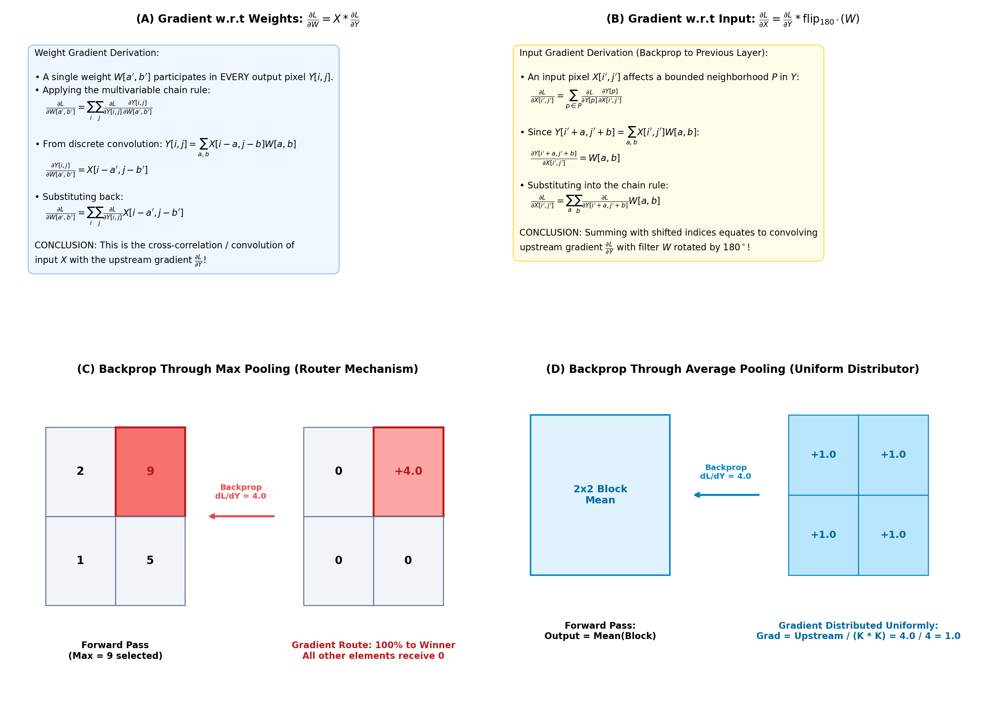
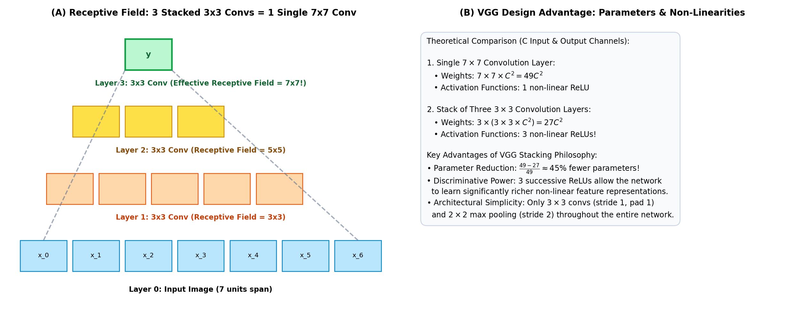
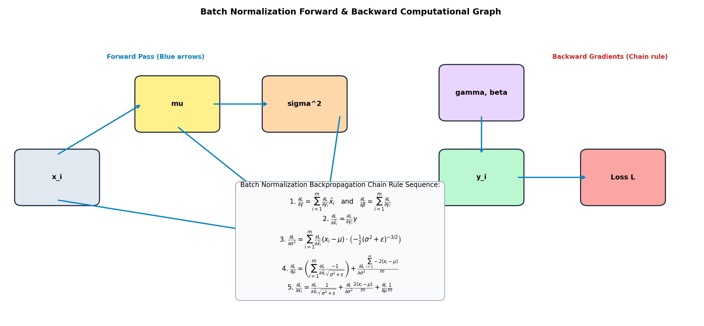

# Week 4 Exam Revision Notes: Convolutional Neural Networks (CNNs)

> **Purpose:** Ultra-condensed, high-yield exam revision guide for Week 4 of Deep Learning for Computer Vision (Prof. Vineeth N Balasubramanian, IIT Hyderabad). Contains all governing formulas, complexity benchmarks, visual anchors, core proofs, high-frequency traps, and solved review questions.

---

## 1. High-Yield Master Formula & Concept Cheat Sheet

| Topic / Method | Governing Formula / Update Rule | Computational Complexity | Key Invariance / Core Property | High-Yield Exam Trap |
| :--- | :--- | :--- | :--- | :--- |
| **Output Spatial Dimension** | $W_2 = \lfloor \frac{W_1 - F + 2P}{S} \rfloor + 1$ | $\mathcal{O}(1)$ | Preserves 2D tensor geometry | Subtraction gives valid span; divide by stride $S$; **always add $+1$** for initial position. |
| **Same Padding ($S=1$)** | $P = \frac{F - 1}{2}$ | $\mathcal{O}(1)$ | Invariant spatial dimensions | Requires **odd filter extent** ($3 \times 3, 5 \times 5$) for symmetric integer padding. |
| **3D Filter Tensor** | Shape: $F \times F \times D_{\text{in}}$ | $\mathcal{O}(F^2 D_{\text{in}})$ per dot product | **Depth MUST match input depth** | Filter slides only across $(H, W)$, **never along depth**; outputs a 2D scalar map. |
| **Output Volume Depth** | $D_{\text{out}} = K$ | $\mathcal{O}(K)$ | Independent of input depth | Depth of output tensor is strictly dictated by the **number of filters $K$**. |
| **Conv Parameter Count** | $K \cdot (F^2 \cdot D_{\text{in}}) + K \text{ (biases)}$ | Independent of $(H_{\text{in}}, W_{\text{in}})$ | Translation Equivariance | Independent of image spatial size; don't forget the **$+K$ scalar biases**. |
| **FNN Parameter Count** | $(H_{\text{in}} W_{\text{in}} D_{\text{in}}) \times N_{\text{neurons}}$ | $\mathcal{O}(H W D N)$ | Flattened vector (destroys 2D) | **Parameter explosion**: $10^6 \times 3 \times 20 = 60\text{M}$ weights for tiny 20-unit layer. |
| **Weight Gradient ($\frac{\partial \mathcal{L}}{\partial W}$)** | $\frac{\partial \mathcal{L}}{\partial W} = X * \frac{\partial \mathcal{L}}{\partial Y}$ | $\mathcal{O}(H_{\text{out}} W_{\text{out}} F^2)$ | Cross-correlation of $X$ and $\frac{\partial \mathcal{L}}{\partial Y}$ | $W$ participates in **every output pixel**; sum covers all $(i, j)$ spatial locations. |
| **Input Gradient ($\frac{\partial \mathcal{L}}{\partial X}$)** | $\frac{\partial \mathcal{L}}{\partial X} = \frac{\partial \mathcal{L}}{\partial Y} * \text{flip}_{180^\circ}(W)$ | $\mathcal{O}(H_{\text{in}} W_{\text{in}} F^2)$ | Convolution with flipped kernel | Differentiating w.r.t. input shifts indices forward $\implies$ requires **$180^\circ$ rotation**. |
| **Max Pool Backprop** | $\frac{\partial \mathcal{L}}{\partial X} = \frac{\partial \mathcal{L}}{\partial Y} \text{ at } \arg\max$, else $0$ | $\mathcal{O}(1)$ per window | **Sparse Router** | Winning index recorded in forward pass; all non-maximum elements get gradient $0$. |
| **Average Pool Backprop** | $\frac{\partial \mathcal{L}}{\partial X} = \frac{1}{K^2} \frac{\partial \mathcal{L}}{\partial Y}$ | $\mathcal{O}(K^2)$ per window | **Uniform Distributor** | Splits upstream error equally: gradient divided by window area $K^2$. |
| **Dilated Convolution** | $F' = d(F - 1) + 1$ | $\mathcal{O}(F^2)$ (no extra weights) | Exponential receptive field | Inserts $d-1$ spaces (zeros) between weights; avoids spatial resolution loss. |
| **Transposed Convolution** | $W_2 = S(W_1 - 1) + F - 2P$ | $\mathcal{O}(F^2)$ | Learnable upsampling | **NOT a matrix inverse** ($W^T W \neq I$); projects 1 pixel to $F \times F$ weighted patch. |
| **Receptive Field Stacking** | $\text{RF}_l = \text{RF}_{l-1} + (F_l - 1)\prod_{i=1}^{l-1} S_i$ | Recurrence formula | Two $3\times3$ = $5\times5$; Three $3\times3$ = $7\times7$ | Proves stacking small filters achieves wide context with fewer weights. |
| **VGG Parameter Savings** | $3(3^2 C^2) = 27 C^2$ vs $1(7^2 C^2) = 49 C^2$ | $44.9\%$ parameter reduction | 3 ReLUs vs 1 ReLU | Stacked $3 \times 3$ has **fewer weights AND greater non-linear capacity**. |
| **AlexNet Bottleneck** | Weights: 94% in FC; FLOPs: 90% in Conv | Asymmetry | FC6 alone has 37.7M parameters | Memory bottleneck is at FC layers; computational FLOP bottleneck is in Conv layers. |

---

## 2. Core Mathematical Derivations

### 2.1 Derivation: Why $\frac{\partial \mathcal{L}}{\partial W}$ is Cross-Correlation
1. Forward convolution at coordinate $(i, j)$:
   $$Y_{i, j} = \sum_{a=0}^{K_1-1} \sum_{b=0}^{K_2-1} X_{i-a, j-b} W_{a, b}$$
2. Weight $W_{a', b'}$ participates in the calculation of **every** output pixel $Y_{i, j}$. Applying the multivariable chain rule:
   $$\frac{\partial \mathcal{L}}{\partial W_{a', b'}} = \sum_{i=0}^{M_1-1} \sum_{j=0}^{M_2-1} \frac{\partial \mathcal{L}}{\partial Y_{i, j}} \frac{\partial Y_{i, j}}{\partial W_{a', b'}}$$
3. Differentiating $Y_{i, j}$ with respect to $W_{a', b'}$ isolates the corresponding input patch value:
   $$\frac{\partial Y_{i, j}}{\partial W_{a', b'}} = X_{i-a', j-b'}$$
4. Substituting back:
   $$\frac{\partial \mathcal{L}}{\partial W_{a', b'}} = \sum_{i=0}^{M_1-1} \sum_{j=0}^{M_2-1} \frac{\partial \mathcal{L}}{\partial Y_{i, j}} X_{i-a', j-b'} = X * \frac{\partial \mathcal{L}}{\partial Y} \quad \blacksquare$$

---

### 2.2 Derivation: Why $\frac{\partial \mathcal{L}}{\partial X}$ Requires a $180^\circ$ Flipped Kernel
1. An input pixel $X_{i', j'}$ affects only output pixels within an overlapping window of size $K_1 \times K_2$:
   $$\frac{\partial \mathcal{L}}{\partial X_{i', j'}} = \sum_{a=0}^{K_1-1} \sum_{b=0}^{K_2-1} \frac{\partial \mathcal{L}}{\partial Y_{i'+a, j'+b}} \frac{\partial Y_{i'+a, j'+b}}{\partial X_{i', j'}}$$
2. Since $Y_{i'+a, j'+b} = \sum_{u} \sum_{v} X_{(i'+a)-u, (j'+b)-v} W_{u, v}$, setting $(i'+a)-u = i'$ and $(j'+b)-v = j'$ isolates $u = a, v = b$:
   $$\frac{\partial Y_{i'+a, j'+b}}{\partial X_{i', j'}} = W_{a, b}$$
3. Substituting into the summation:
   $$\frac{\partial \mathcal{L}}{\partial X_{i', j'}} = \sum_{a=0}^{K_1-1} \sum_{b=0}^{K_2-1} \frac{\partial \mathcal{L}}{\partial Y_{i'+a, j'+b}} W_{a, b}$$
4. Notice that index shifts move in the positive direction ($i'+a$). In signal processing, convolving with positive shifts is mathematically identical to standard convolution with a kernel rotated by $180^\circ$:
   $$\frac{\partial \mathcal{L}}{\partial X} = \frac{\partial \mathcal{L}}{\partial Y} * \text{flip}_{180^\circ}(W) \quad \blacksquare$$

---

### 2.3 Derivation: VGG Receptive Field & Parameter Savings
1. **Receptive Field Recurrence**: For stride $S=1$, $\text{RF}_l = \text{RF}_{l-1} + (F_l - 1)$.
   - Layer 1 ($3 \times 3$): $\text{RF}_1 = 3$.
   - Layer 2 ($3 \times 3$): $\text{RF}_2 = 3 + (3 - 1) = 5$.
   - Layer 3 ($3 \times 3$): $\text{RF}_3 = 5 + (3 - 1) = 7$.
2. **Parameter Count Comparison** (with $C$ input and output channels):
   - Single $7 \times 7$ Conv:
     $$\text{Params}_{\text{single}} = 7 \times 7 \times C \times C = 49 C^2$$
   - Stack of Three $3 \times 3$ Convs:
     $$\text{Params}_{\text{stacked}} = 3 \times (3 \times 3 \times C \times C) = 3 \times 9 C^2 = 27 C^2$$
   - Exact Savings:
     $$\frac{49 C^2 - 27 C^2}{49 C^2} = \frac{22}{49} \approx \mathbf{44.9\% \text{ reduction in parameters!}} \quad \blacksquare$$

---

### 2.4 Derivation: Batch Normalization Backward Gradients
$$\frac{\partial \mathcal{L}}{\partial \gamma} = \sum_{i=1}^m \frac{\partial \mathcal{L}}{\partial y_i} \hat{x}_i, \qquad \frac{\partial \mathcal{L}}{\partial \beta} = \sum_{i=1}^m \frac{\partial \mathcal{L}}{\partial y_i}, \qquad \frac{\partial \mathcal{L}}{\partial \hat{x}_i} = \frac{\partial \mathcal{L}}{\partial y_i} \gamma$$
$$\frac{\partial \mathcal{L}}{\partial \sigma^2} = \sum_{i=1}^m \frac{\partial \mathcal{L}}{\partial \hat{x}_i} (x_i - \mu) \left( -\frac{1}{2}(\sigma^2 + \epsilon)^{-3/2} \right)$$
$$\frac{\partial \mathcal{L}}{\partial \mu} = \sum_{i=1}^m \frac{\partial \mathcal{L}}{\partial \hat{x}_i} \frac{-1}{\sqrt{\sigma^2 + \epsilon}} + \frac{\partial \mathcal{L}}{\partial \sigma^2} \frac{\sum_{i=1}^m -2(x_i - \mu)}{m}$$
$$\frac{\partial \mathcal{L}}{\partial x_i} = \frac{\partial \mathcal{L}}{\partial \hat{x}_i} \frac{1}{\sqrt{\sigma^2 + \epsilon}} + \frac{\partial \mathcal{L}}{\partial \sigma^2} \frac{2(x_i - \mu)}{m} + \frac{\partial \mathcal{L}}{\partial \mu} \frac{1}{m} \quad \blacksquare$$

---

## 3. High-Frequency Exam Traps & Failure Modes

> [!CAUTION]
> **Trap 1: The Filter Depth Fallacy**  
> **Wrong**: "A $3 \times 3$ filter applied to an RGB image has 9 weights."  
> **Right**: Filter depth **must match input depth**. A $3 \times 3$ filter on RGB has $3 \times 3 \times 3 = 27$ weights (+ 1 bias = 28 parameters).

> [!WARNING]
> **Trap 2: The "Deconvolution" Myth**  
> **Wrong**: "Transposed convolution is the mathematical inverse matrix $W^{-1}$ that recovers the original image."  
> **Right**: Transposed convolution only reverses the *spatial dimensions* ($H, W$). It is a *learnable projection*, not a matrix inverse ($W^T W \neq I$).

> [!IMPORTANT]
> **Trap 3: Where Do Parameters vs. FLOPs Reside?**  
> **AlexNet/VGG**:
> - **Parameters**: Stored in **Fully Connected (FC) layers** ($\sim 94\%$).
> - **FLOPs (Compute)**: Performed in **Convolutional layers** ($\sim 90\%$).

> [!NOTE]
> **Trap 4: Missing Bias Terms in Parameter Questions**  
> For $K$ convolutional filters, each filter has **one scalar bias**. Total parameters = $K \cdot (F^2 D_{\text{in}}) + K$.

---

## 4. Solved Numerical Review Questions (Q1 - Q8)

### Q1: Multi-Channel Dimension Calculus
**Problem**: Input $256 \times 256 \times 64$, applied $128$ filters of size $5 \times 5$, stride $S=3$, padding $P=2$. Find output dimensions.
- Step 1: $W_2 = \lfloor \frac{256 - 5 + 2(2)}{3} \rfloor + 1 = \lfloor \frac{255}{3} \rfloor + 1 = 85 + 1 = 86$.
- Step 2: $H_2 = 86$.
- Step 3: Depth $D_2 = K = 128$.
- **Answer**: $\mathbf{86 \times 86 \times 128}$.

### Q2: FNN vs. CNN Parameters
**Problem**: Image $200 \times 200 \times 3$. Compare FNN with 50 units vs. CNN with 50 filters ($5 \times 5 \times 3$).
- FNN: $(200 \times 200 \times 3) \times 50 = 120,000 \times 50 = \mathbf{6,000,000 \text{ weights}}$.
- CNN: $50 \times (5 \times 5 \times 3) = 50 \times 75 = \mathbf{3,750 \text{ weights}}$.
- **Compression**: $\frac{6,000,000}{3,750} = \mathbf{1,600\times \text{ fewer parameters in the CNN}}$.

### Q3: Backpropagation Mathematical Nature
**Problem**: Why is $\frac{\partial \mathcal{L}}{\partial W}$ a convolution?
- **Answer**: In the forward pass, a single filter weight participates at every spatial location $(i, j)$ in $Y$. Applying the multivariate chain rule sums across all $(i, j)$: $\sum_{i, j} \frac{\partial \mathcal{L}}{\partial Y_{i, j}} X_{i-a, j-b}$, which is the discrete cross-correlation of $X$ with upstream gradient $\frac{\partial \mathcal{L}}{\partial Y}$.

### Q4: VGG Receptive Field Equivalency & Savings
**Problem**: Prove 3 stacked $3 \times 3$ convs equal one $7 \times 7$ conv in RF and compute savings for $C$ channels.
- **Answer**: $\text{RF} = 1 + 2 + 2 + 2 = 7$. Single $7 \times 7$ has $49 C^2$ weights. Three $3 \times 3$ convs have $3 \times 9 C^2 = 27 C^2$ weights. Savings: $\frac{49 - 27}{49} = \mathbf{44.9\%}$ parameter savings plus 3 non-linear ReLUs.

### Q5: Max vs. Average Pooling Backpropagation
**Problem**: How do Max and Average Pooling route gradients?
- **Answer**:
  - Max Pooling: **Sparse router**. Routes 100% of upstream gradient to winning coordinate $(\arg\max)$, all other pixels get $0$.
  - Average Pooling: **Uniform distributor**. Distributes upstream gradient divided by window area ($\frac{1}{K^2} \frac{\partial \mathcal{L}}{\partial Y}$) equally to all pixels.

### Q6: Dilated Convolution Spatial Span
**Problem**: Kernel size $3 \times 3$, dilation rate $d=3$. What is the effective spatial receptive field?
- **Answer**: $F' = d(F - 1) + 1 = 3(3 - 1) + 1 = 3(2) + 1 = \mathbf{7 \times 7}$.

### Q7: AlexNet vs. VGGNet Architecture
**Problem**: Compare architectural philosophies.
- **Answer**: AlexNet used heterogeneous filter sizes ($11 \times 11, 5 \times 5, 3 \times 3$), overlapping pooling ($3 \times 3, S=2$), and LRN. VGGNet introduced extreme architectural homogeneity: exclusively $3 \times 3$ convs ($S=1, P=1$), $2 \times 2$ max pooling ($S=2$), and systematic channel doubling ($64 \to 128 \to 256 \to 512$).

### Q8: Translation Invariance via Weight Sharing
**Problem**: Define translation invariance and how weight sharing guarantees it.
- **Answer**: Translation invariance means $f(T(x)) = f(x)$. Weight sharing guarantees **translation equivariance** in convolutional layers ($T(f(x)) = f(T(x))$) because the same filter slides everywhere. Subsequent pooling layers aggregate local spatial responses, pooling out minor translations and producing translation-invariant representations.

## High-frequency exam traps (from PYQs)

1. **Apply the output-size floor at every layer.** For two successive convolutions, do not substitute the original input size into a combined expression and round only once. With $n=64$, $k=6$, $p=1$, and $s=2$, the first output is $\lfloor(64-6+2)/2\rfloor+1=31$; the second is $\lfloor(31-6+2)/2\rfloor+1=14$.
2. **Separate stored parameters from spatial work.** A standard convolution stores $k^2C_{in}C_{out}$ weights regardless of feature-map height and width, while its MAC count is $H_oW_ok^2C_{in}C_{out}$. For $14\times14\times128 \to 14\times14\times256$ with $3\times3$ kernels, that is 294,912 weights but 57,802,752 MACs; do not call MACs FLOPs unless the question defines one MAC as two FLOPs.
3. **Follow the bias instruction literally.** If bias is excluded, report only $k^2C_{in}C_{out}$. If there is one bias per output channel, add $C_{out}$; for 32 filters with $3\times3$ kernels and 16 input channels, the count is $3^2\cdot16\cdot32+32=4,640$.
