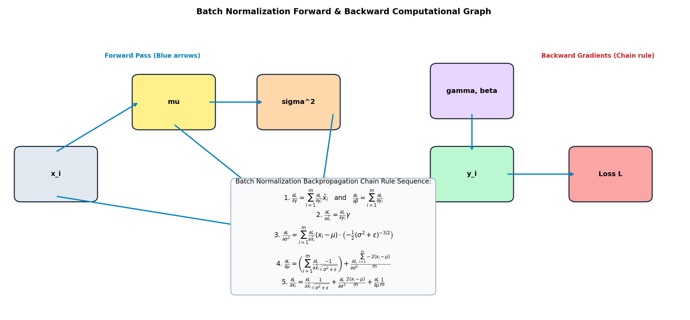
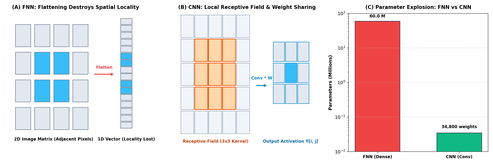
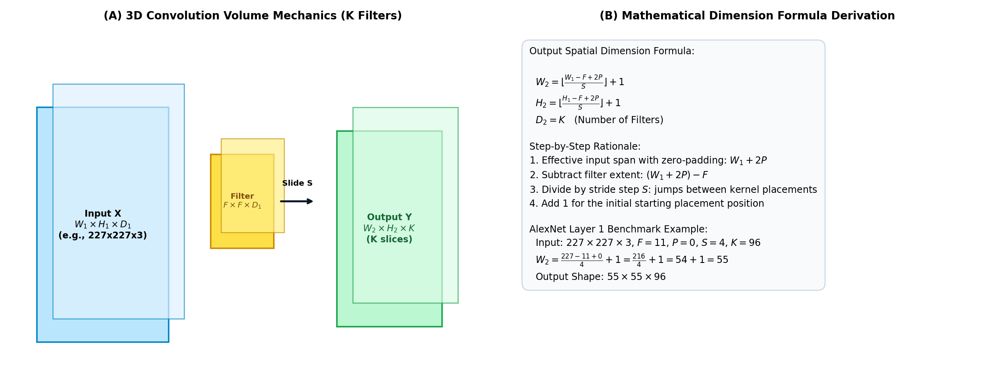
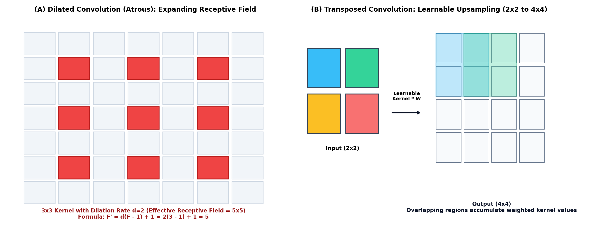
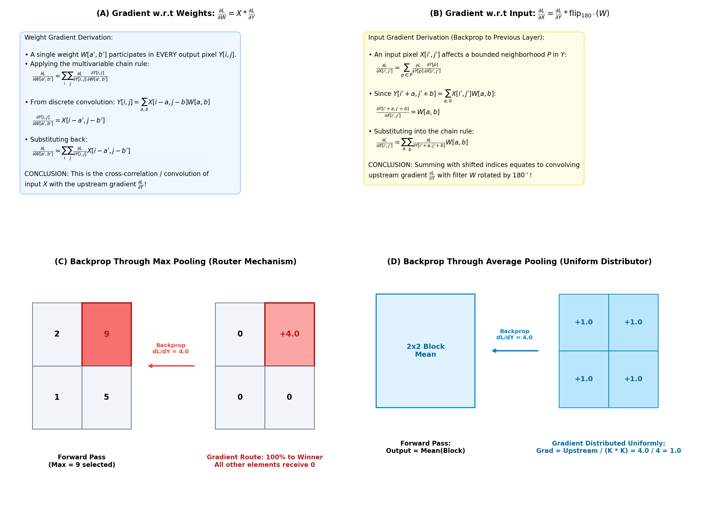
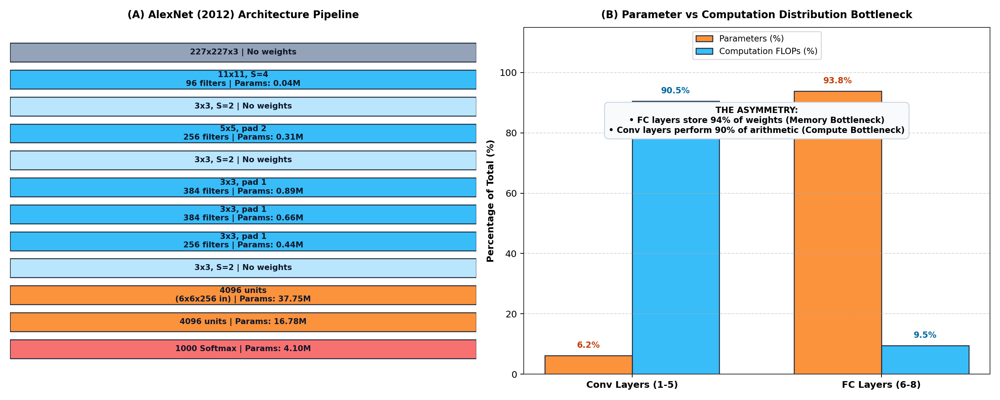
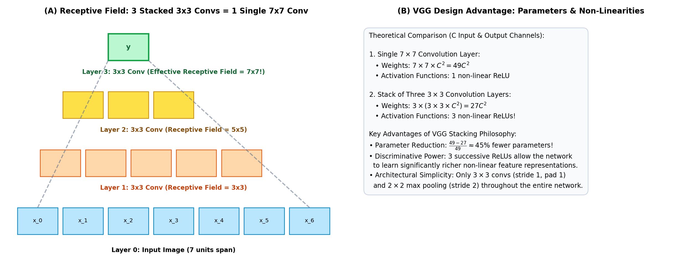
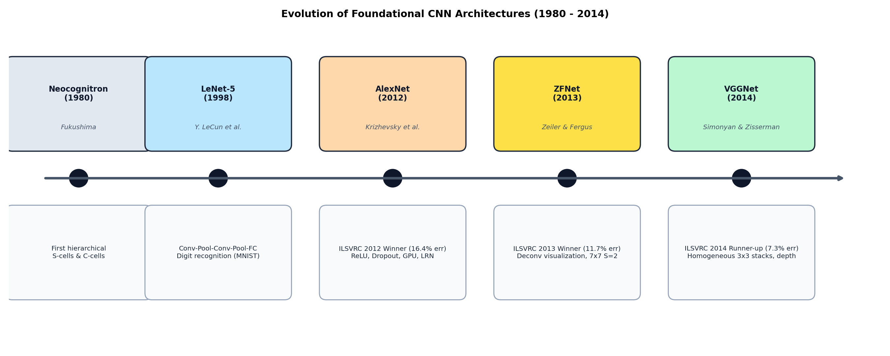

# Deep Learning for Computer Vision — Week 4: Convolutional Neural Networks (CNNs)

**Course**: Deep Learning for Computer Vision (NPTEL / IIT Hyderabad)  
**Instructor**: Prof. Vineeth N Balasubramanian  
**Segment**: 2 — Convolutional Neural Networks  
**Modules Covered**:
- Module 4.1: Introduction to Convolutional Neural Networks (Lectures 4.1 & 4.2)
- Module 4.2: Backpropagation in Convolutional Neural Networks (Lecture 4.3)
- Module 4.3: CNN Architectures for Image Classification: AlexNet, ZFNet, VGGNet (Lectures 4.4 & 4.5)

---

## Executive Summary & Conceptual Overview

Week 4 marks the critical transition from generic Multi-Layer Perceptrons (MLPs / FNNs) to specialized spatial architectures: **Convolutional Neural Networks (CNNs)**. In conventional feedforward networks, flattening high-dimensional image matrices into one-dimensional vectors destroys spatial topology and causes an intractable parameter explosion. CNNs overcome these fundamental limitations through three core structural principles:
1. **Local Receptive Fields**: Restricting connectivity to small spatial neighborhoods matching the natural statistics of visual imagery.
2. **Weight Sharing**: Sliding the same filter kernel across the entire spatial domain, which drastically reduces model parameters and enforces translation equivariance.
3. **Spatial Pooling**: Subsampling feature representations to condense information, expand downstream receptive fields, and inject translation invariance.

This report synthesizes the foundational mathematics, vector calculus of CNN backpropagation, 3D tensor convolution algebra, dilated and transposed convolution variants, and the evolutionary trajectory of landmark computer vision architectures from LeNet-5 to AlexNet, ZFNet, and VGGNet.

---

## Module 1: Introduction to Convolutional Neural Networks

### 1.1 Mathematical Recap: Backpropagation Through Batch Normalization

Before formalizing CNN backpropagation, we complete the analytical derivation of gradient flow through a **Batch Normalization (BN)** layer across a mini-batch $\mathcal{B} = \{x_1, x_2, \dots, x_m\}$.

```
Forward Flow:
x_i  ───>  μ_B = (1/m) Σ x_i  ───>  σ²_B = (1/m) Σ (x_i - μ_B)²  ───>  x̂_i = (x_i - μ_B) / √(σ²_B + ε)  ───>  y_i = γ x̂_i + β
```

Given an upstream gradient $\frac{\partial \mathcal{L}}{\partial y_i}$ propagated from deeper layers, the chain rule yields the exact analytical backward gradients:

1. **Affine Parameter Gradients ($\gamma, \beta$)**:
   $$\frac{\partial \mathcal{L}}{\partial \beta} = \sum_{i=1}^m \frac{\partial \mathcal{L}}{\partial y_i} \frac{\partial y_i}{\partial \beta} = \sum_{i=1}^m \frac{\partial \mathcal{L}}{\partial y_i}$$
   $$\frac{\partial \mathcal{L}}{\partial \gamma} = \sum_{i=1}^m \frac{\partial \mathcal{L}}{\partial y_i} \frac{\partial y_i}{\partial \gamma} = \sum_{i=1}^m \frac{\partial \mathcal{L}}{\partial y_i} \hat{x}_i$$

2. **Gradient w.r.t. Normalized Activations ($\hat{x}_i$)**:
   $$\frac{\partial \mathcal{L}}{\partial \hat{x}_i} = \frac{\partial \mathcal{L}}{\partial y_i} \frac{\partial y_i}{\partial \hat{x}_i} = \frac{\partial \mathcal{L}}{\partial y_i} \gamma$$

3. **Gradient w.r.t. Mini-Batch Variance ($\sigma_B^2$)**:
   Since $\hat{x}_i = (x_i - \mu_B)(\sigma_B^2 + \epsilon)^{-1/2}$, applying the multivariate chain rule across all $i \in \{1, \dots, m\}$:
   $$\frac{\partial \mathcal{L}}{\partial \sigma_B^2} = \sum_{i=1}^m \frac{\partial \mathcal{L}}{\partial \hat{x}_i} \frac{\partial \hat{x}_i}{\partial \sigma_B^2} = \sum_{i=1}^m \frac{\partial \mathcal{L}}{\partial \hat{x}_i} (x_i - \mu_B) \left( -\frac{1}{2}(\sigma_B^2 + \epsilon)^{-3/2} \right)$$

4. **Gradient w.r.t. Mini-Batch Mean ($\mu_B$)**:
   The mean affects the loss both directly through $\hat{x}_i$ and indirectly through $\sigma_B^2$:
   $$\frac{\partial \mathcal{L}}{\partial \mu_B} = \sum_{i=1}^m \frac{\partial \mathcal{L}}{\partial \hat{x}_i} \frac{\partial \hat{x}_i}{\partial \mu_B} + \frac{\partial \mathcal{L}}{\partial \sigma_B^2} \frac{\partial \sigma_B^2}{\partial \mu_B}$$
   $$\frac{\partial \mathcal{L}}{\partial \mu_B} = \left( \sum_{i=1}^m \frac{\partial \mathcal{L}}{\partial \hat{x}_i} \frac{-1}{\sqrt{\sigma_B^2 + \epsilon}} \right) + \frac{\partial \mathcal{L}}{\partial \sigma_B^2} \frac{\sum_{i=1}^m -2(x_i - \mu_B)}{m}$$
   *(Note: Because $\sum_{i=1}^m (x_i - \mu_B) = 0$, the second term evaluates to zero at the sample mean, but retaining it enforces computational consistency across numerical implementations).*

5. **Gradient w.r.t. Original Layer Input ($x_i$)**:
   Each input $x_i$ influences the loss directly via $\hat{x}_i$, and globally via $\mu_B$ and $\sigma_B^2$:
   $$\frac{\partial \mathcal{L}}{\partial x_i} = \frac{\partial \mathcal{L}}{\partial \hat{x}_i} \frac{\partial \hat{x}_i}{\partial x_i} + \frac{\partial \mathcal{L}}{\partial \sigma_B^2} \frac{\partial \sigma_B^2}{\partial x_i} + \frac{\partial \mathcal{L}}{\partial \mu_B} \frac{\partial \mu_B}{\partial x_i}$$
   $$\frac{\partial \mathcal{L}}{\partial x_i} = \frac{\partial \mathcal{L}}{\partial \hat{x}_i} \frac{1}{\sqrt{\sigma_B^2 + \epsilon}} + \frac{\partial \mathcal{L}}{\partial \sigma_B^2} \frac{2(x_i - \mu_B)}{m} + \frac{\partial \mathcal{L}}{\partial \mu_B} \frac{1}{m}$$



---

### 1.2 Limitations of Feedforward Neural Networks (FNNs) on Images

Standard fully connected architectures (MLPs) treat visual data as arbitrary vectors, creating severe theoretical and computational pathologies:

1. **Destruction of 2D Spatial Topology**:
   Images possess high spatial correlation; neighboring pixels exhibit strong mutual dependence. Flattening an image matrix $X \in \mathbb{R}^{H \times W \times C}$ into a 1D column vector $x \in \mathbb{R}^{HWC}$ scrambles 2D adjacency. Pixels separated vertically by one row are placed $W$ elements apart in the flattened vector, forcing the network to waste capacity rediscovering coordinate proximity.

2. **Blindness to Locality**:
   In a fully connected layer, every input pixel connects to every hidden neuron with an independent weight. The network has no structural inductive bias indicating that a relationship between pixel $(i, j)$ and $(i+1, j)$ is physically more meaningful than a relationship between pixel $(i, j)$ and pixel $(i+500, j+500)$.

3. **Absence of Translation Equivariance**:
   In an FNN, if an object (e.g., a cat's ear) shifts by 5 pixels, its activation maps shift to entirely different weights in the weight matrix. The network cannot reuse learned representations across different spatial locations and must independently relearn the same visual feature at every possible coordinate.

4. **Parameter Explosion**:
   Consider a modest 1-megapixel color photograph:
   $$\text{Dimensions} = 1000 \times 1000 \times 3 = 3 \times 10^6 \text{ values}$$
   Connecting this input to a tiny hidden layer of only $20$ neurons requires:
   $$\text{Weights} = (3 \times 10^6) \times 20 = 60,000,000 \text{ parameters}$$
   A network of 60 million parameters for a single 20-neuron layer overfits severely, requires prohibitive memory bandwidth, and cannot scale to realistic computer vision tasks.



---

### 1.3 Core Architectural Inductive Biases of CNNs

Convolutional Neural Networks solve these issues by introducing three structural constraints:

| Mechanism | Structural Implementation | Theoretical Benefit |
| :--- | :--- | :--- |
| **Local Receptive Fields** | Neurons connect only to localized spatial patches ($K_1 \times K_2$) of the input volume. | Exploits the natural spatial locality of visual scenes; cuts parameter count from $O(H W)$ to $O(K_1 K_2)$. |
| **Weight Sharing** | The identical parameter matrix $W$ slides across all spatial coordinates $(x, y)$. | Enforces **translation equivariance** ($f(g(x)) = g(f(x))$); dramatically compresses parameter storage. |
| **Spatial Pooling** | Aggregates local spatial statistics (e.g., Max, Average) with stride $S \ge 2$. | Injects local translation invariance, reduces spatial resolution, and progressively widens receptive fields. |

---

### 1.4 The 3D Convolution Operation & Tensor Algebra

In computer vision, images and intermediate feature activations are represented as 3D tensors of shape $\text{Width} \times \text{Height} \times \text{Depth}$ ($W \times H \times D$).

#### Fundamental Principle of Filter Depth
> **Rule**: The depth of a convolutional filter **must exactly equal** the depth of the input volume it operates upon.

When an input volume has shape $W_1 \times H_1 \times D_1$:
- A single filter $W$ has spatial extent $F \times F$ and depth $D_1$ (total kernel size: $F \times F \times D_1$).
- The filter slides strictly along the horizontal ($W$) and vertical ($H$) spatial axes. It **does not slide along the depth axis**; it spans the full depth $D_1$ simultaneously.
- At each spatial position $(i, j)$, an element-wise dot product is computed across all $F \times F \times D_1$ values and summed with a scalar bias $b$, yielding a **single scalar output** $Y_{i, j}$.
- Consequently, **one 3D filter produces a single 2D feature slice** of size $W_2 \times H_2$.
- Stacking $K$ distinct filters produces an output tensor of depth $D_2 = K$.



---

### 1.5 Rigorous Derivation of Output Spatial Dimensions

Let an input volume have width $W_1$, height $H_1$, and depth $D_1$. We convolve this input with $K$ filters of spatial size $F \times F$, utilizing padding $P$ and stride $S$.

#### Derivation:
1. **Zero-Padding Extension**: Adding $P$ zero-valued pixels to each side expands the effective input width to $W_1 + 2P$.
2. **Filter Placement Range**: The filter has spatial width $F$. The left edge of the filter can be placed starting at index $0$ up to the rightmost index where the filter's right edge does not exceed the padded boundary. The total valid distance over which the filter can shift is:
   $$\text{Valid Span} = (W_1 + 2P) - F$$
3. **Strided Discretization**: When the filter steps by stride $S > 1$, it skips intermediate pixels. The number of non-initial steps is $\lfloor \frac{W_1 + 2P - F}{S} \rfloor$.
4. **Initial Placement**: Adding $1$ for the initial position at the origin yields the total number of valid spatial placements:
   $$W_2 = \left\lfloor \frac{W_1 - F + 2P}{S} \right\rfloor + 1$$
   $$H_2 = \left\lfloor \frac{H_1 - F + 2P}{S} \right\rfloor + 1$$
   $$D_2 = K$$

#### Padding Terminology:
- **Valid Padding ($P=0$)**: No padding is applied. Output spatial dimensions shrink monotonically: $W_2 = \lfloor \frac{W_1 - F}{S} \rfloor + 1$.
- **Same Padding**: Zero-padding is chosen such that the output spatial dimensions exactly match the input spatial dimensions when $S=1$:
  $$W_2 = W_1 \implies W_1 - F + 2P + 1 = W_1 \implies P = \frac{F - 1}{2}$$
  *(Requires an odd filter size $F$, such as $3 \times 3$ or $5 \times 5$, ensuring symmetric padding).*

---

### 1.6 Modern Convolution Variants

#### A. Dilated Convolution (Atrous Convolution)
Dilated convolutions introduce a **dilation rate** $d \in \mathbb{N}^+$ that spaces out kernel elements by inserting $d - 1$ spaces (zeros) between consecutive filter weights:

$$\hat{W}_{a, b} = \begin{cases} W_{a/d, b/d} & \text{if } a \bmod d = 0 \text{ and } b \bmod d = 0 \\ 0 & \text{otherwise} \end{cases}$$

- **Effective Filter Size ($F'$)**:
  $$F' = d \cdot (F - 1) + 1$$
- **Primary Benefit**: For a $3 \times 3$ kernel with dilation rate $d=2$, the effective receptive field expands to $2(3 - 1) + 1 = 5 \times 5$ without adding any extra learnable weights (still exactly 9 parameters). This allows networks (e.g., DeepLab, WaveNet) to aggregate broad contextual information without losing spatial resolution through pooling.

#### B. Transposed Convolution (Fractionally Strided / Learnable Upsampling)
Often colloquially (and mathematically incorrectly) referred to as "deconvolution," transposed convolution reverses the forward spatial downsampling of standard convolution:
- Instead of mapping a large receptive field to a single activation, a single input activation scales an entire $F \times F$ filter kernel, which is placed onto an output canvas.
- Overlapping regions from adjacent input placements are summed together.
- For an input $W_1$, filter size $F$, stride $S$, and padding $P$, the output dimension is:
  $$W_2 = S \cdot (W_1 - 1) + F - 2P$$
- Transposed convolutions allow networks to learn data-driven upsampling filters for semantic segmentation, autoencoders, and generative adversarial networks (GANs).



---

## Module 2: Backpropagation in Convolutional Neural Networks

The backward pass of a convolutional layer computes two sets of gradients:
1. $\frac{\partial \mathcal{L}}{\partial W}$: The gradient w.r.t. the filter weights, used for optimization parameter updates.
2. $\frac{\partial \mathcal{L}}{\partial X}$: The gradient w.r.t. the input tensor, used to pass error signals backward to earlier layers.

Assume a 2D grayscale input $X \in \mathbb{R}^{N_1 \times N_2}$, filter $W \in \mathbb{R}^{K_1 \times K_2}$, and output $Y \in \mathbb{R}^{M_1 \times M_2}$, related by discrete convolution (assuming stride $S=1$, padding $P=0$):
$$Y_{i, j} = \sum_{a=0}^{K_1-1} \sum_{b=0}^{K_2-1} X_{i-a, j-b} W_{a, b}$$
*(where indices outside valid boundaries evaluate to zero).*

---

### 2.1 Gradient with Respect to Filter Weights ($\frac{\partial \mathcal{L}}{\partial W}$)

#### Conceptual Question:
> *Which output pixels $Y_{i, j}$ are affected by a single weight $W_{a', b'}$?*

**Answer**: Because the filter slides across every spatial location, the weight $W_{a', b'}$ is multiplied by a corresponding input patch at **every single output coordinate $(i, j)$**. Therefore, $W_{a', b'}$ participates in the computation of every pixel in $Y$.

#### Mathematical Derivation:
Applying the multivariable chain rule across all output locations $(i, j)$:
$$\frac{\partial \mathcal{L}}{\partial W_{a', b'}} = \sum_{i=0}^{M_1-1} \sum_{j=0}^{M_2-1} \frac{\partial \mathcal{L}}{\partial Y_{i, j}} \frac{\partial Y_{i, j}}{\partial W_{a', b'}}$$

Differentiating the convolution sum with respect to the specific weight $W_{a', b'}$:
$$\frac{\partial Y_{i, j}}{\partial W_{a', b'}} = \frac{\partial}{\partial W_{a', b'}} \left( \sum_{a=0}^{K_1-1} \sum_{b=0}^{K_2-1} X_{i-a, j-b} W_{a, b} \right) = X_{i-a', j-b'}$$

Substituting this partial derivative back into the chain rule summation:
$$\frac{\partial \mathcal{L}}{\partial W_{a', b'}} = \sum_{i=0}^{M_1-1} \sum_{j=0}^{M_2-1} \frac{\partial \mathcal{L}}{\partial Y_{i, j}} X_{i-a', j-b'}$$

#### Theoretical Significance:
> **Theorem**: The gradient of the loss with respect to filter weights is mathematically equivalent to the **convolution (or cross-correlation) of the input tensor $X$ with the upstream gradient tensor $\frac{\partial \mathcal{L}}{\partial Y}$**:
> $$\frac{\partial \mathcal{L}}{\partial W} = X * \frac{\partial \mathcal{L}}{\partial Y}$$

---

### 2.2 Gradient with Respect to Input Activations ($\frac{\partial \mathcal{L}}{\partial X}$)

To propagate gradients to preceding layers, we compute $\frac{\partial \mathcal{L}}{\partial X_{i', j'}}$ for a single input pixel $X_{i', j'}$.

#### Conceptual Question:
> *Which output pixels $Y_{i, j}$ are affected by a single input pixel $X_{i', j'}$?*

**Answer**: A single input pixel only affects the output pixels where the filter kernel overlaps it. This forms a bounded spatial neighborhood $P$ of dimensions $K_1 \times K_2$:
$$\{Y_{i'+a, j'+b} \mid 0 \le a < K_1, 0 \le b < K_2\}$$

#### Mathematical Derivation:
Applying the chain rule over region $P$:
$$\frac{\partial \mathcal{L}}{\partial X_{i', j'}} = \sum_{a=0}^{K_1-1} \sum_{b=0}^{K_2-1} \frac{\partial \mathcal{L}}{\partial Y_{i'+a, j'+b}} \frac{\partial Y_{i'+a, j'+b}}{\partial X_{i', j'}}$$

Since $Y_{i'+a, j'+b} = \sum_{u} \sum_{v} X_{(i'+a)-u, (j'+b)-v} W_{u, v}$, setting $(i'+a)-u = i'$ and $(j'+b)-v = j'$ isolates $u = a$ and $v = b$:
$$\frac{\partial Y_{i'+a, j'+b}}{\partial X_{i', j'}} = W_{a, b}$$

Substituting this into the summation:
$$\frac{\partial \mathcal{L}}{\partial X_{i', j'}} = \sum_{a=0}^{K_1-1} \sum_{b=0}^{K_2-1} \frac{\partial \mathcal{L}}{\partial Y_{i'+a, j'+b}} W_{a, b}$$

#### Theoretical Significance:
Notice the summation index: as $a$ and $b$ increase, the index of $Y$ increases ($i'+a, j'+b$), whereas standard convolution moves indices in opposing directions ($i-a, j-b$).
> **Theorem**: Calculating $\frac{\partial \mathcal{L}}{\partial X}$ corresponds mathematically to **convolving the upstream gradient $\frac{\partial \mathcal{L}}{\partial Y}$ with a 180°-rotated (spatially flipped) version of the weight filter kernel**:
> $$\frac{\partial \mathcal{L}}{\partial X} = \frac{\partial \mathcal{L}}{\partial Y} * \text{flip}_{180^\circ}(W)$$
> where $\text{flip}_{180^\circ}(W)_{a, b} = W_{K_1 - 1 - a, K_2 - 1 - b}$.

---

### 2.3 Backpropagation Through Spatial Pooling Layers

Pooling layers contain **zero learnable parameters**; their sole role during backpropagation is routing upstream error signals $\frac{\partial \mathcal{L}}{\partial Y}$ to the input tensor $X$.

```
Max Pooling Router (Argmax):            Average Pooling Distributor (Uniform):
Forward:                              Forward:
[ 2   9 ]  ──> [ 9 ]                  [ 2   6 ]  ──> Mean = [ 4.0 ]
[ 1   5 ]                             [ 3   5 ]

Backward (dL/dY = +4.0):              Backward (dL/dY = +4.0):
[ 0  +4.0 ]  <── [ +4.0 ]             [ +1.0  +1.0 ]  <── [ +4.0 ] (Divided by 4)
[ 0    0  ]                           [ +1.0  +1.0 ]
```

1. **Max Pooling (Argmax Router)**:
   - Forward Pass: Evaluates $Y_{i, j} = \max_{(p, q) \in \Omega_{i, j}} X_{p, q}$ and records the winning index switch:
     $$\text{switch}(i, j) = \arg\max_{(p, q) \in \Omega_{i, j}} X_{p, q}$$
   - Backward Pass: Routes 100% of the upstream gradient strictly to the winning coordinate. All non-maximal pixels receive a gradient of 0:
     $$\frac{\partial \mathcal{L}}{\partial X_{p, q}} = \begin{cases} \frac{\partial \mathcal{L}}{\partial Y_{i, j}} & \text{if } (p, q) = \text{switch}(i, j) \\ 0 & \text{otherwise} \end{cases}$$

2. **Average Pooling (Uniform Distributor)**:
   - Forward Pass: Computes the arithmetic mean over spatial block $\Omega$ of size $K \times K$:
     $$Y_{i, j} = \frac{1}{K^2} \sum_{(p, q) \in \Omega_{i, j}} X_{p, q}$$
   - Backward Pass: Distributes the upstream gradient uniformly divided by the pooling area to all elements in the window:
     $$\frac{\partial \mathcal{L}}{\partial X_{p, q}} = \frac{1}{K^2} \frac{\partial \mathcal{L}}{\partial Y_{i, j}}$$



---

## Module 3: CNN Architectures for Image Classification

### 3.1 Historical Milestones & ImageNet

```
1980: Neocognitron (Fukushima)  ──>  S-cells (Simple: Feature extract) & C-cells (Complex: Pooling)
1998: LeNet-5 (LeCun et al.)    ──>  [Conv-Pool-Conv-Pool-FC-FC], MNIST Digit Recognition (~1% error)
2012: AlexNet (Krizhevsky)      ──>  Deep 8-layer CNN, ReLU, Dropout, GPU, ILSVRC Winner (16.4% error)
2013: ZFNet (Zeiler & Fergus)   ──>  Deconvolutional visualization, smaller 7x7 filters (11.7% error)
2014: VGGNet (Simonyan et al.)   ──>  Homogeneous 3x3 filter stacking, depth 16-19 layers (7.3% error)
```

The **ImageNet Large Scale Visual Recognition Challenge (ILSVRC)** evaluated models on 1,000 object categories across 1.2 million training images. The standard benchmark metric was **Top-5 Error Rate** (the model is considered correct if the ground truth label is among its top 5 predicted classes).

#### Classification Loss & Output Layer
Models predict raw unnormalized class scores (logits) $z \in \mathbb{R}^C$. These are transformed into a normalized categorical probability distribution $\hat{y}$ via the **Softmax function**:
$$\hat{y}_c = \frac{e^{z_c}}{\sum_{j=1}^C e^{z_j}}$$
The network parameters are optimized by minimizing the **Multinomial Cross-Entropy Loss**:
$$\mathcal{L} = -\sum_{c=1}^C y_c \log \hat{y}_c = -\log \hat{y}_{c^*}$$
*(where $c^*$ is the true class label index).*

---

### 3.2 AlexNet (2012)

Designed by Alex Krizhevsky, Ilya Sutskever, and Geoffrey Hinton, AlexNet achieved an error rate of 16.4% on ILSVRC 2012, beating the runner-up classical computer vision pipeline (26.2%) by nearly 10 percentage points.

#### Layer-by-Layer Architectural Specifications:
- **Input**: $227 \times 227 \times 3$ RGB images.
- **Conv1**: 96 filters of size $11 \times 11$, Stride $S=4$, Padding $P=0$. Output: $55 \times 55 \times 96$.
- **Pool1**: Max pooling $3 \times 3$, Stride $S=2$. Output: $27 \times 27 \times 96$.
- **Conv2**: 256 filters of size $5 \times 5$, Stride $S=1$, Padding $P=2$. Output: $27 \times 27 \times 256$.
- **Pool2**: Max pooling $3 \times 3$, Stride $S=2$. Output: $13 \times 13 \times 256$.
- **Conv3**: 384 filters of size $3 \times 3$, Stride $S=1$, Padding $P=1$. Output: $13 \times 13 \times 384$.
- **Conv4**: 384 filters of size $3 \times 3$, Stride $S=1$, Padding $P=1$. Output: $13 \times 13 \times 384$.
- **Conv5**: 256 filters of size $3 \times 3$, Stride $S=1$, Padding $P=1$. Output: $13 \times 13 \times 256$.
- **Pool5**: Max pooling $3 \times 3$, Stride $S=2$. Output: $6 \times 6 \times 256$.
- **FC6**: Dense layer with 4,096 hidden units. Input: $6 \times 6 \times 256 = 9,216$ flattened features.
- **FC7**: Dense layer with 4,096 hidden units.
- **FC8**: Dense layer with 1,000 output units followed by Softmax.

#### Key Architectural Breakthroughs:
1. **Rectified Linear Units (ReLU)**: Replaced $\tanh(x)$ and $\sigma(x)$, preventing gradient saturation and training $6\times$ faster to reach 25% training error.
2. **Overlapping Pooling**: Filter size $3 \times 3$ with stride $S=2$ (since $S < F$), reducing top-1 and top-5 error rates by ~0.4–0.5% compared to non-overlapping pooling.
3. **Local Response Normalization (LRN)**: Modeled neurobiological lateral inhibition across adjacent channels:
   $$b_{x, y}^i = \frac{a_{x, y}^i}{\left( k + \alpha \sum_{j=\max(0, i-n/2)}^{\min(N-1, i+n/2)} (a_{x, y}^j)^2 \right)^\beta}$$
   *(Empirical constants: $k=2, n=5, \alpha=10^{-4}, \beta=0.75$). Modern networks replaced LRN with Batch Normalization.*
4. **Regularization**: Extensive Data Augmentation (random $224 \times 224$ crops from $256 \times 256$ images, horizontal flips, PCA color jittering) and **Dropout ($p=0.5$)** applied to FC6 and FC7.
5. **Dual-GPU Partitioning**: Trained across two 3GB NVIDIA GTX 580 GPUs with cross-GPU communication restricted to specific layers (e.g., Conv3).

#### The Computational & Parameter Asymmetry Bottleneck:
AlexNet contains approximately **60 million parameters** and requires **720 million FLOPs** per forward pass. A profound structural asymmetry exists between its layers:
- **Parameter Distribution**: Fully Connected layers (FC6, FC7, FC8) store **~94% of all weights** (FC6 alone contains $9,216 \times 4,096 = 37.75\text{M}$ weights!).
- **Compute Distribution**: Convolutional layers account for **~90% of all floating-point operations (FLOPs)**, while consuming only ~6% of parameter storage.



---

### 3.3 ZFNet (2013)

Developed by Matthew Zeiler and Rob Fergus (New York University), ZFNet won ILSVRC 2013 by reducing the top-5 error to 11.7%.

#### Diagnostic Insight via Deconvolutional Networks:
Using **DeconvNets** (unpooling, rectifying, and transposed filtering) to visualize feature activations from trained AlexNet layers, Zeiler and Fergus discovered two major flaws in AlexNet's design:
1. **First Layer Filters Were Too Coarse**: AlexNet's $11 \times 11$ filters with stride $S=4$ missed fine high-frequency structural details (lines, edges) and exhibited severe aliasing artifacts.
2. **Dead Channels & Grating Artifacts**: Higher convolutional layers suffered from dead filters due to the aggressive stride in Layer 1.

#### Architectural Adjustments:
- Reduced Conv1 filter size from $11 \times 11$ ($S=4$) to **$7 \times 7$ with stride $S=2$**.
- Expanded Conv3, Conv4, and Conv5 channel depths (e.g., 512, 1024 filters) to capture richer feature hierarchies.

---

### 3.4 VGGNet (2014)

Developed by Karen Simonyan and Andrew Zisserman at the Visual Geometry Group (University of Oxford), VGGNet finished as runner-up in ILSVRC 2014 with 7.3% error.

#### Core Design Philosophy: Extreme Homogeneity & Depth
VGGNet abandoned variable filter sizes ($11 \times 11, 7 \times 7, 5 \times 5$) in favor of an exceptionally simple, uniform design template:
- **All Convolution Layers**: Exclusively $3 \times 3$ filters with **Stride $S=1$** and **Padding $P=1$** (Same Padding).
- **All Pooling Layers**: Exclusively $2 \times 2$ Max Pooling with **Stride $S=2$**.
- **Channel Doubling**: Every max-pooling operation halves spatial resolution ($H/2, W/2$) and doubles channel depth ($C \to 2C$, progressing $64 \to 128 \to 256 \to 512$).

---

### 3.5 Receptive Field Equivalency: Stacked $3 \times 3$ vs. Single $7 \times 7$

Why did VGGNet choose to stack small $3 \times 3$ filters rather than using larger receptive kernels?

```
Stacking Receptive Field Geometry:
Layer 3 (3x3 Conv):                   [   y   ]
                                     /    |    \
Layer 2 (3x3 Conv):             [ h1 ]  [ h2 ]  [ h3 ]
                                /  |  \
Layer 1 (3x3 Conv):          [  3x3 local patch  ]
                             /                   \
Input Layer (Span):       [ x1   x2   x3   x4   x5   x6   x7 ]  ──> Effective RF = 7x7!
```

#### Receptive Field Recurrence Formula:
Let $\text{RF}_l$ denote the effective receptive field of layer $l$, $F_l$ denote its kernel size, and $S_i$ denote the stride of layer $i$:
$$\text{RF}_l = \text{RF}_{l-1} + (F_l - 1) \cdot \prod_{i=1}^{l-1} S_i$$

For stride $S=1$:
- Layer 1 ($3 \times 3$): $\text{RF}_1 = 3$.
- Layer 2 ($3 \times 3$): $\text{RF}_2 = 3 + (3 - 1) = 5$. (Two stacked $3 \times 3$ convs have an effective receptive field of $5 \times 5$).
- Layer 3 ($3 \times 3$): $\text{RF}_3 = 5 + (3 - 1) = 7$. (Three stacked $3 \times 3$ convs have an effective receptive field of $7 \times 7$).

#### Comparative Advantages of the Stacked $3 \times 3$ Approach:

1. **Drastic Parameter Reduction**:
   Consider an input volume with $C$ channels producing $C$ output channels:
   - Single $7 \times 7$ Convolution Layer:
     $$\text{Weights} = 7 \times 7 \times C \times C = 49 C^2$$
   - Stack of Three $3 \times 3$ Convolution Layers:
     $$\text{Weights} = 3 \times (3 \times 3 \times C \times C) = 3 \times 9 C^2 = 27 C^2$$
   - **Savings**:
     $$\frac{49 C^2 - 27 C^2}{49 C^2} = \frac{22}{49} \approx \mathbf{44.9\% \text{ reduction in parameters!}}$$

2. **Increased Non-Linear Discriminative Capacity**:
   A single $7 \times 7$ layer applies only one non-linear activation (e.g., ReLU). In contrast, the stack of three $3 \times 3$ layers incorporates **three successive ReLU activations**, enabling the network to learn significantly more complex and discriminative feature manifolds.

#### Limitations of VGG:
VGG-16 contains **138 million parameters** (over double AlexNet's 60M), requiring ~528 MB of memory just to store weights. During training, storing forward activation maps for backward passes requires over 2 GB of memory per image batch, creating a severe memory bottleneck.



---

### 3.6 Chronological Architecture Comparison

| Model | Year | Layers (Depth) | Input Size | Conv1 Filter | Top-5 Error | Total Parameters | Primary Contribution |
| :--- | :--- | :--- | :--- | :--- | :--- | :--- | :--- |
| **LeNet-5** | 1998 | 5 | $32 \times 32$ | $5 \times 5, S=1$ | N/A (MNIST) | ~60,000 | Established Conv-Pool-FC template. |
| **AlexNet** | 2012 | 8 | $227 \times 227$ | $11 \times 11, S=4$ | 16.4% | ~60 Million | ReLU, Overlapping Pool, Dropout, GPU. |
| **ZFNet** | 2013 | 8 | $224 \times 224$ | $7 \times 7, S=2$ | 11.7% | ~65 Million | Deconv visualization; fixed filter granularity. |
| **VGG-16** | 2014 | 16 | $224 \times 224$ | $3 \times 3, S=1$ | 7.3% | 138 Million | Homogeneous $3 \times 3$ stacks; deep networks. |
| **VGG-19** | 2014 | 19 | $224 \times 224$ | $3 \times 3, S=1$ | 7.1% | 144 Million | Proved additional depth improves accuracy. |



---

## Key Terminology Glossary

- **Local Receptive Field**: The specific spatial sub-window of an input tensor that directly feeds into a single neuron in a convolutional layer.
- **Weight Sharing**: The technique of convolving the exact same filter weight tensor across all spatial coordinates of an input feature map, drastically reducing parameters and enforcing translation equivariance.
- **Translation Equivariance**: The mathematical property where shifting an input leads to an identically shifted output feature map ($f(g(x)) = g(f(x))$).
- **Translation Invariance**: The property where the network's output prediction remains invariant to spatial shifts of an object within the image canvas ($f(g(x)) = f(x)$), typically conferred by spatial pooling operations.
- **Dilated Convolution (Atrous)**: A convolution variant that inserts spaces (dilation rate $d - 1$) between kernel weights, expanding the effective receptive field exponentially without increasing parameter counts.
- **Transposed Convolution**: A learnable upsampling operation that projects smaller feature maps onto larger spatial dimensions via overlapping kernel weighting.
- **Max Pooling**: A parameter-free spatial subsampling operation that extracts the maximum activation within a sliding window, routing 100% of the upstream gradient to the maximal index during backpropagation.
- **Average Pooling**: A downsampling operation that computes the local arithmetic mean, distributing upstream error signals uniformly divided by window area during backpropagation.
- **Local Response Normalization (LRN)**: A channel-wise normalization operation used in early CNNs (AlexNet) to simulate biological lateral inhibition across adjacent feature maps.
- **Effective Receptive Field (ERF)**: The total spatial span in the raw input image that causally influences the activation of a neuron in a deep layer.

---

## Worked Numerical Exam Problems

### Problem 1: Multi-Channel 3D Dimension & Parameter Calculus
**Question**: An input feature volume has shape $256 \times 256 \times 64$. We apply $128$ convolutional filters of spatial size $5 \times 5$, with a stride $S = 3$ and padding $P = 2$.
1. Compute the output tensor spatial dimensions ($W_2 \times H_2 \times D_2$).
2. Calculate the exact number of learnable parameters (weights and biases).

**Step-by-Step Solution**:
1. Output dimensions:
   $$W_2 = \left\lfloor \frac{W_1 - F + 2P}{S} \right\rfloor + 1 = \left\lfloor \frac{256 - 5 + 2(2)}{3} \right\rfloor + 1 = \left\lfloor \frac{256 - 5 + 4}{3} \right\rfloor + 1 = \left\lfloor \frac{255}{3} \right\rfloor + 1 = 85 + 1 = 86$$
   $$H_2 = \left\lfloor \frac{H_1 - F + 2P}{S} \right\rfloor + 1 = 86$$
   $$D_2 = K = 128$$
   **Output Dimensions**: $\mathbf{86 \times 86 \times 128}$.

2. Learnable Parameters:
   - Each filter has dimensions $F \times F \times D_1 = 5 \times 5 \times 64 = 1,600$ weights.
   - For $K = 128$ filters: $128 \times 1,600 = 204,800$ weights.
   - Each filter has 1 learnable bias term: $128$ biases.
   - Total Parameters = $204,800 + 128 = \mathbf{204,928 \text{ parameters}}$.

---

### Problem 2: Fully Connected vs. Convolutional Parameter Efficiency
**Question**: Consider an input image of size $200 \times 200 \times 3$.
1. Calculate the number of weights in a fully connected layer with $50$ hidden neurons.
2. Calculate the number of weights in a convolutional layer with $50$ filters of size $5 \times 5 \times 3$.
3. Compute the ratio of parameter reduction.

**Step-by-Step Solution**:
1. Fully Connected Layer:
   $$\text{Input Vector Length} = 200 \times 200 \times 3 = 120,000 \text{ values}$$
   $$\text{Weights} = 120,000 \times 50 = \mathbf{6,000,000 \text{ weights}}$$
2. Convolutional Layer:
   $$\text{Weights per filter} = 5 \times 5 \times 3 = 75 \text{ weights}$$
   $$\text{Total Weights} = 50 \times 75 = \mathbf{3,750 \text{ weights}}$$
3. Compression Ratio:
   $$\text{Ratio} = \frac{6,000,000}{3,750} = \mathbf{1,600\times \text{ fewer parameters in the CNN!}}$$

---

### Problem 3: Backpropagation Routing Through Max & Average Pooling
**Question**: An upstream gradient tensor arriving at a $2 \times 2$ pooling layer is $\frac{\partial \mathcal{L}}{\partial Y} = \begin{bmatrix} 6.0 \end{bmatrix}$. The forward pass received an input patch $X = \begin{bmatrix} 3.0 & 8.0 \\ 1.0 & 4.0 \end{bmatrix}$.
Compute $\frac{\partial \mathcal{L}}{\partial X}$ for:
1. Max Pooling.
2. Average Pooling.

**Step-by-Step Solution**:
1. **Max Pooling**:
   - In the forward pass, $\max(3.0, 8.0, 1.0, 4.0) = 8.0$ at coordinate $(0, 1)$.
   - All upstream gradient flows exclusively to the winning coordinate:
     $$\frac{\partial \mathcal{L}}{\partial X} = \begin{bmatrix} 0.0 & \mathbf{6.0} \\ 0.0 & 0.0 \end{bmatrix}$$
2. **Average Pooling**:
   - Area $K \times K = 2 \times 2 = 4$.
   - The upstream gradient is divided equally: $\frac{6.0}{4} = 1.5$.
     $$\frac{\partial \mathcal{L}}{\partial X} = \begin{bmatrix} \mathbf{1.5} & \mathbf{1.5} \\ \mathbf{1.5} & \mathbf{1.5} \end{bmatrix}$$

---

### Problem 4: Dilated Receptive Field Calculation
**Question**: A network stacks two dilated convolutional layers with $3 \times 3$ kernels. Layer 1 has dilation rate $d_1 = 2$, and Layer 2 has dilation rate $d_2 = 3$ (both stride $S=1$). Compute the effective spatial receptive field on the input image.

**Step-by-Step Solution**:
1. Effective kernel size for Layer 1:
   $$F_1' = d_1(F - 1) + 1 = 2(3 - 1) + 1 = 5$$
   Receptive field after Layer 1: $\text{RF}_1 = 5 \times 5$.
2. Effective kernel size for Layer 2:
   $$F_2' = d_2(F - 1) + 1 = 3(3 - 1) + 1 = 7$$
3. Total combined receptive field:
   $$\text{RF}_2 = \text{RF}_1 + (F_2' - 1) = 5 + (7 - 1) = 5 + 6 = \mathbf{11 \times 11}$$
*(A field of $11 \times 11$ is achieved using only $2 \times 9 = 18$ parameters!)*

---

## Executable Python Verification Test Suite

Below is a complete, self-contained Python script using NumPy to numerically verify 3D convolution dimensions, parameter counts, backpropagation gradients, and pooling routing.

```python
"""
Week 4: Numerical Verification Suite for CNN Operations & Backpropagation
"""
import numpy as np

def compute_conv_output_dim(w_in, h_in, f, p, s, k):
    w_out = int(np.floor((w_in - f + 2 * p) / s) + 1)
    h_out = int(np.floor((h_in - f + 2 * p) / s) + 1)
    return w_out, h_out, k

def conv2d_forward(x, w, b, stride=1, padding=0):
    """
    x: (H, W), w: (Kh, Kw), b: scalar
    """
    if padding > 0:
        x_pad = np.pad(x, ((padding, padding), (padding, padding)), mode='constant')
    else:
        x_pad = x
    h_in, w_in = x_pad.shape
    kh, kw = w.shape
    h_out = (h_in - kh) // stride + 1
    w_out = (w_in - kw) // stride + 1
    y = np.zeros((h_out, w_out))
    
    for i in range(h_out):
        for j in range(w_out):
            h_start = i * stride
            w_start = j * stride
            patch = x_pad[h_start:h_start+kh, w_start:w_start+kw]
            y[i, j] = np.sum(patch * w) + b
    return y

def conv2d_backward(dL_dy, x, w, stride=1, padding=0):
    """
    Computes dL_dw and dL_dx using analytical formulas derived in Module 2.
    """
    kh, kw = w.shape
    h_out, w_out = dL_dy.shape
    dL_dw = np.zeros_like(w)
    dL_dx = np.zeros_like(x)
    
    # 1. dL/dw = x * dL/dy (Cross-correlation of input with upstream gradient)
    for a in range(kh):
        for b in range(kw):
            for i in range(h_out):
                for j in range(w_out):
                    dL_dw[a, b] += dL_dy[i, j] * x[i + a, j + b]
                    
    # 2. dL/dx = dL/dy * flip180(w)
    w_flipped = np.flip(w)
    dL_dy_pad = np.pad(dL_dy, ((kh - 1, kh - 1), (kw - 1, kw - 1)), mode='constant')
    for i in range(x.shape[0]):
        for j in range(x.shape[1]):
            patch = dL_dy_pad[i:i+kh, j:j+kw]
            dL_dx[i, j] = np.sum(patch * w_flipped)
            
    return dL_dw, dL_dx

def test_cnn_suite():
    print("=== TEST 1: Dimension Formula Verification ===")
    w_out, h_out, d_out = compute_conv_output_dim(256, 256, f=5, p=2, s=3, k=128)
    assert (w_out, h_out, d_out) == (86, 86, 128), f"Expected (86, 86, 128), got {(w_out, h_out, d_out)}"
    print(f"PASS: Output shape = ({w_out}, {h_out}, {d_out})")
    
    print("\n=== TEST 2: Numerical vs Analytical Gradients (dL/dW) ===")
    np.random.seed(42)
    x = np.random.randn(4, 4)
    w = np.random.randn(2, 2)
    b = 0.5
    
    y = conv2d_forward(x, w, b)
    dL_dy = np.ones_like(y)  # Assume Loss = sum(Y)
    dL_dw_analytical, dL_dx_analytical = conv2d_backward(dL_dy, x, w)
    
    # Numerical gradient check for w[0, 0]
    eps = 1e-6
    w_plus = w.copy(); w_plus[0, 0] += eps
    w_minus = w.copy(); w_minus[0, 0] -= eps
    grad_num_w00 = (np.sum(conv2d_forward(x, w_plus, b)) - np.sum(conv2d_forward(x, w_minus, b))) / (2 * eps)
    
    assert np.isclose(dL_dw_analytical[0, 0], grad_num_w00, atol=1e-5), "dL/dW gradient mismatch!"
    print(f"PASS: Analytical dL/dW[0,0] = {dL_dw_analytical[0, 0]:.6f}, Numerical = {grad_num_w00:.6f}")
    
    print("\n=== TEST 3: Max Pooling Routing ===")
    x_pool = np.array([[3.0, 8.0], [1.0, 4.0]])
    dL_dy_pool = 6.0
    
    # Router logic
    max_idx = np.unravel_index(np.argmax(x_pool), x_pool.shape)
    dL_dx_pool = np.zeros_like(x_pool)
    dL_dx_pool[max_idx] = dL_dy_pool
    
    expected_grad = np.array([[0.0, 6.0], [0.0, 0.0]])
    assert np.allclose(dL_dx_pool, expected_grad), "Max pooling routing error!"
    print("PASS: Max Pooling correctly routed gradient strictly to winning coordinate (0, 1):")
    print(dL_dx_pool)

if __name__ == "__main__":
    test_cnn_suite()
```

---

## Assigned Homework Readings & Citations

1. **Illustrated 10 CNN Architectures Tutorial**:
   - Focus: LeNet-5, AlexNet, and VGG-16 structural templates.
2. **Krizhevsky, A., Sutskever, I., & Hinton, G. E. (2012)**:
   - *ImageNet Classification with Deep Convolutional Neural Networks*. Advances in Neural Information Processing Systems (NeurIPS 2012).
3. **Simonyan, K., & Zisserman, A. (2014)**:
   - *Very Deep Convolutional Networks for Large-Scale Image Recognition*. arXiv preprint arXiv:1409.1556 (ICLR 2015).
4. **Zeiler, M. D., & Fergus, R. (2014)**:
   - *Visualizing and Understanding Convolutional Networks*. European Conference on Computer Vision (ECCV 2014).
