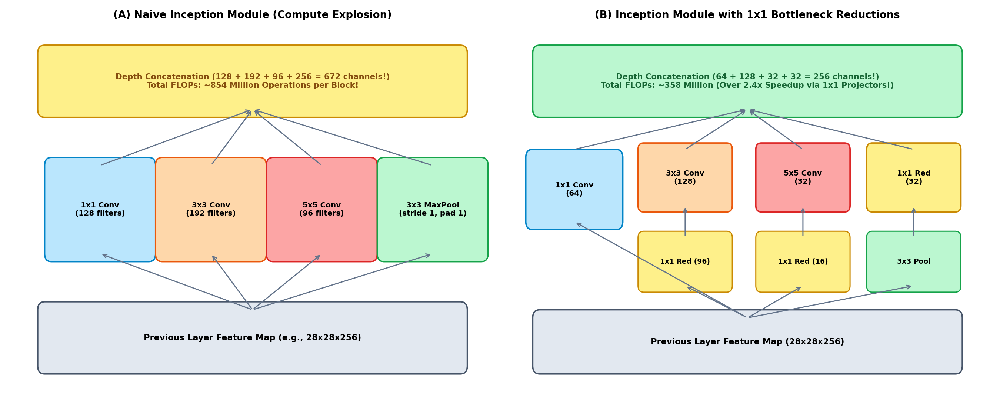
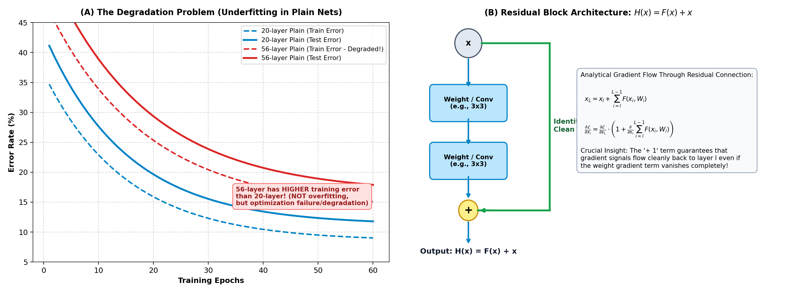
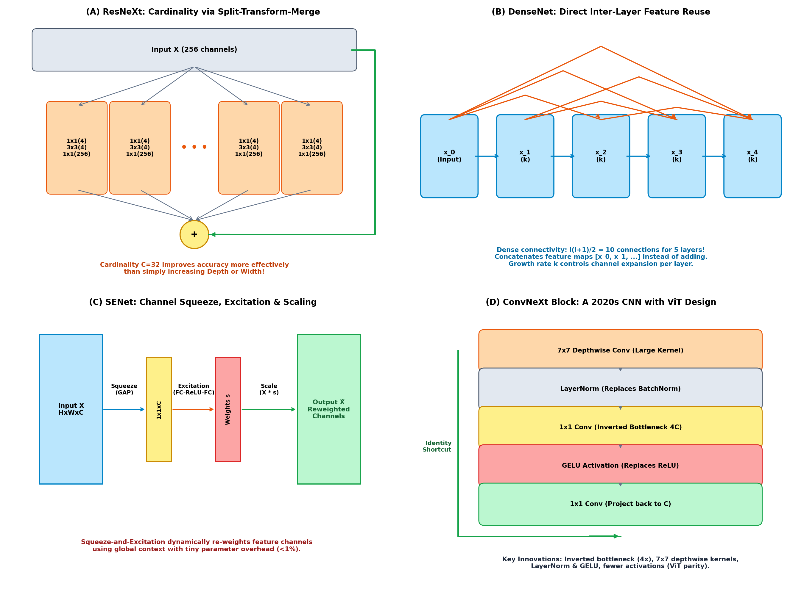
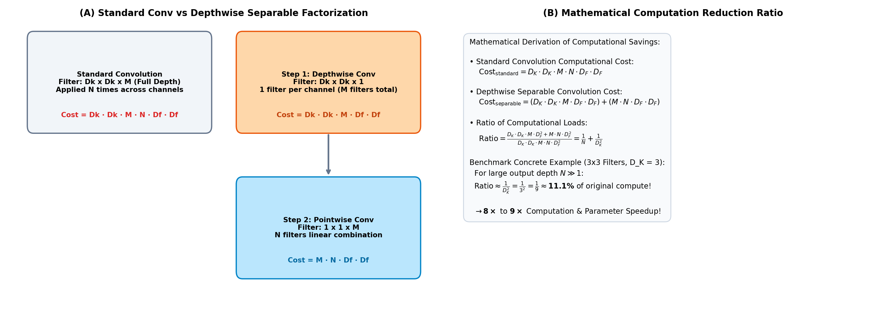
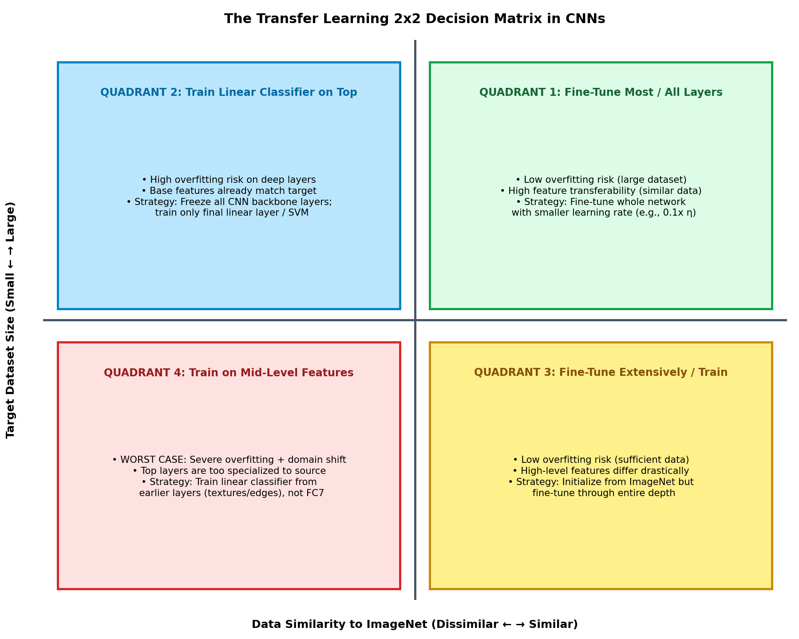
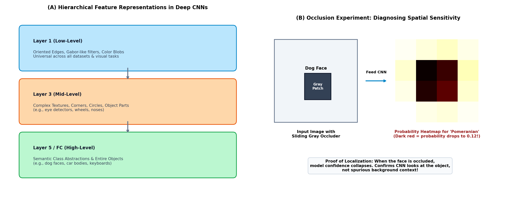
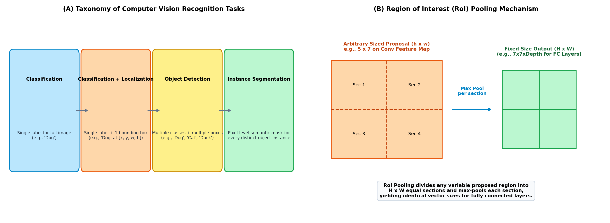
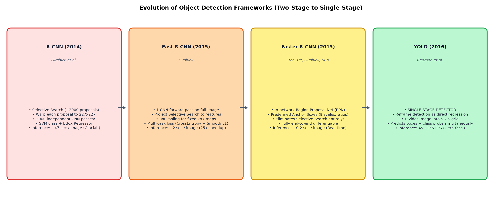

# Deep Learning for Computer Vision — Week 5: Advanced CNN Architectures, Interpretability, Fine-Tuning & Object Detection

**Course**: Deep Learning for Computer Vision (NPTEL / IIT Hyderabad)  
**Instructor**: Prof. Vineeth N Balasubramanian  
**Segment**: 2 — Advanced Convolutional Architectures & Visual Recognition  
**Modules Covered**:
- Module 5.1: Evolution of CNN Architectures: InceptionNet (GoogLeNet) & ResNet
- Module 5.2: Modern CNN Paradigms: ResNeXt, DenseNet, MobileNet, EfficientNet, SENet & ConvNeXt
- Module 5.3: Fine-Tuning and Transfer Learning in CNNs
- Module 5.4: Visualizing and Interpreting CNNs (Representation Spaces & Occlusion)
- Module 5.5: CNNs for Object Detection: Two-Stage (R-CNN, Fast R-CNN, Faster R-CNN) and Single-Stage (YOLO)

---

## Executive Summary & Conceptual Overview

Following the foundational breakthrough of AlexNet and the structural homogeneity of VGGNet (studied in Week 4), deep computer vision confronted two critical roadblocks:
1. **Computational Scalability & Parameter Bloat**: Stacking wider and deeper layers produced combinatorial explosions in floating-point operations (FLOPs) and GPU memory consumption.
2. **The Optimization Degradation Problem**: When networks exceeded ~20 layers, training error plateaued and deteriorated—not due to overfitting, but because vanishing and exploding gradients paralyzed backpropagation through long chains of sequential multiplications.

Week 5 presents the foundational innovations that resolved these crises and extended CNNs from classification to spatial object detection:
- **GoogLeNet (Inception)** solved the multi-scale filter selection problem while slashing parameters to 5 million (12x fewer than AlexNet) via $1 \times 1$ "bottleneck" dimensionality reduction.
- **ResNet** introduced residual learning ($H(x) = F(x) + x$), creating identity shortcut superhighways that enabled stable gradient backpropagation through networks over 150 layers deep.
- **MobileNet & Modern Architectures** decomposed standard convolutions into **depthwise separable convolutions**, achieving an $8\times$ to $9\times$ reduction in computational cost, alongside architectural advances in **ResNeXt (Cardinality)**, **DenseNet (Feature Concatenation)**, **SENet (Channel Attention)**, and **ConvNeXt (ViT Parity)**.
- **CNN Interpretability & Transfer Learning** formalized techniques to visualize filter weights, track feature maps, map decision attribution via occlusion experiments, and navigate the $2 \times 2$ transfer learning decision matrix.
- **Object Detection** evolved from classical Haar cascades (Viola-Jones) to the multi-stage **R-CNN family (RoI Pooling, RPN, Anchor Boxes)** and single-stage **YOLO real-time regression**.

---

## Module 1: Evolution of CNN Architectures (Inception & ResNet)

### 1.1 Inception Network (GoogLeNet / Inception-v1 to v3)

Developed by Christian Szegedy et al. at Google, **GoogLeNet** won the ILSVRC 2014 classification challenge with a 6.7% top-5 error rate. Despite reaching an unprecedented depth of **22 parameter layers**, GoogLeNet contained only **~5 million parameters**—roughly 12 times fewer than AlexNet (60M) and 27 times fewer than VGG-16 (138M).

#### The Core Motivation: Multi-Scale Receptive Fields
In visual scenes, salient image features appear at vastly different physical scales:
- A dog close to the camera requires large spatial receptive fields ($5 \times 5$ or $7 \times 7$).
- A dog in the distant background requires tight, local receptive fields ($3 \times 3$).

In traditional architectures (AlexNet, VGG), the engineer had to make a fixed, arbitrary architectural choice for each layer. The **Inception principle** replaces this manual choice by computing parallel convolutions of multiple kernel sizes ($1 \times 1, 3 \times 3, 5 \times 5$) and pooling operations simultaneously at the same layer, depth-concatenating their outputs.

#### The Naive Inception Module & The Compute Explosion Problem
In the naive Inception design, an input feature map $X \in \mathbb{R}^{H \times W \times C_{\text{in}}}$ is processed simultaneously by:
1. $1 \times 1$ Convolution with $C_1$ filters.
2. $3 \times 3$ Convolution with $C_2$ filters (padding $P=1$, stride $S=1$).
3. $5 \times 5$ Convolution with $C_3$ filters (padding $P=2$, stride $S=1$).
4. $3 \times 3$ Max Pooling with stride $S=1$, padding $P=1$.

```
Naive Inception Module:
                      ┌─── 1x1 Conv (C1) ───┐
                      ├─── 3x3 Conv (C2) ───┤
Previous Feature Map ─┼─── 5x5 Conv (C3) ───┼──> Depth Concatenation
                      └─── 3x3 Pool (Cin) ──┘
```

> **The Computational Pathology**:  
> Because the depth of a convolutional filter must match the incoming channel depth, a $5 \times 5$ convolution operating directly on a 256-channel input volume requires $5 \times 5 \times 256 = 6,400$ multiplications *per spatial pixel*. Furthermore, because pooling preserves incoming depth $C_{\text{in}}$, the concatenated output depth explodes to $C_1 + C_2 + C_3 + C_{\text{in}}$. Stacking multiple naive Inception modules causes an uncontrollable combinatorial blow-up in channels and FLOPs.

#### Dimensionality Reduction via $1 \times 1$ Bottleneck Convolutions
To prevent this computational explosion, GoogLeNet introduced **$1 \times 1$ convolutions** as low-dimensional bottleneck projection layers immediately before the expensive $3 \times 3$ and $5 \times 5$ convolutions, and immediately after the max pooling branch.

```
Inception Module with Dimension Reduction:
                      ┌────────────── 1x1 Conv (C1) ─────────────┐
                      ├── 1x1 Conv (Red2) ──> 3x3 Conv (C2) ─────┤
Previous Feature Map ─┼── 1x1 Conv (Red3) ──> 5x5 Conv (C3) ─────┼──> Depth Concatenation
                      └── 3x3 MaxPool ─────> 1x1 Conv (RedPool) ─┘
```

**How $1 \times 1$ Convolutions Function**:
- Spatial dimensions ($H \times W$) are strictly preserved.
- Across depth, each $1 \times 1$ filter computes an element-wise weighted linear combination of all incoming channels followed by a non-linear ReLU activation.
- Acting as a **learnable channel-wise dimensionality reduction**, it projects a high-dimensional feature manifold onto a compact latent subspace prior to expensive spatial filtering.



#### Concrete Numerical FLOP Comparison:
Let an input volume have shape $28 \times 28 \times 256$. Suppose we wish to compute a $5 \times 5$ convolution producing $32$ output channels:

1. **Direct (Naive) Convolution**:
   $$\text{Weights per filter} = 5 \times 5 \times 256 = 6,400$$
   $$\text{Total FLOPs} = (28 \times 28) \times (5 \times 5 \times 256) \times 32 \approx \mathbf{160.5 \times 10^6 \text{ FLOPs (160.5 MFLOPs)}}$$

2. **Bottlenecked Inception Pipeline (Reduce to 16 channels via $1 \times 1$ first)**:
   - *Step 1: $1 \times 1$ Conv ($256 \to 16$)*:
     $$\text{FLOPs}_1 = (28 \times 28) \times (1 \times 1 \times 256) \times 16 \approx 3.2 \times 10^6 \text{ FLOPs}$$
   - *Step 2: $5 \times 5$ Conv ($16 \to 32$)*:
     $$\text{FLOPs}_2 = (28 \times 28) \times (5 \times 5 \times 16) \times 32 \approx 10.0 \times 10^6 \text{ FLOPs}$$
   - *Total FLOPs*:
     $$\text{Total} = 3.2\text{M} + 10.0\text{M} = \mathbf{13.2 \times 10^6 \text{ FLOPs (13.2 MFLOPs)}}$$
   - **Savings**:
     $$\frac{160.5\text{M} - 13.2\text{M}}{160.5\text{M}} \approx \mathbf{91.8\% \text{ reduction in FLOPs!}}$$

#### Additional GoogLeNet Innovations:
1. **Global Average Pooling (GAP)**: Replaced the massive fully connected layers (which stored 94% of AlexNet's parameters) with an average pooling operation across the entire spatial extent ($7 \times 7 \to 1 \times 1$). This eliminated ~50 million parameters and provided spatial translation invariance.
2. **Auxiliary Classification Heads**: To combat gradient vanishing in a 22-layer network, GoogLeNet introduced two auxiliary branches at intermediate stages. During training, their cross-entropy losses were multiplied by a discount factor of $0.3$ and added to the total loss:
   $$\mathcal{L}_{\text{total}} = \mathcal{L}_{\text{main}} + 0.3 \cdot \mathcal{L}_{\text{aux1}} + 0.3 \cdot \mathcal{L}_{\text{aux2}}$$
   This injected strong, un-attenuated gradients directly into lower convolutional layers. (The auxiliary heads are discarded during inference).

---

### 1.2 Residual Networks (ResNet)

Introduced by Kaiming He, Xiangyu Zhang, Shaoqing Ren, and Jian Sun (Microsoft Research) in 2015, **ResNet** won ILSVRC 2015 with a top-5 error rate of **3.57%** (surpassing human-level performance). ResNet successfully scaled network depth up to **152 layers** (and later 1,001 layers).

#### The Degradation Problem (Underfitting in Deep Plain Networks)
Prior to ResNet, researchers observed an empirical paradox when increasing network depth:
- Stacking more layers onto a "plain" CNN (e.g., expanding from 20 layers to 56 layers) resulted in **higher training error** and **higher test error**.
- **Crucial Distinction**: This degradation is **NOT caused by overfitting**. In overfitting, training error is low while test error is high. Here, training error itself increases, indicating a severe **optimization failure**: standard gradient descent cannot optimize deep parameter chains.

```
The Degradation Paradox:
Epochs ──> 
Plain-20: Training Error = 8.5%,  Test Error = 11.2%
Plain-56: Training Error = 13.8%, Test Error = 16.5%  <── DEGRADED (Underfitting!)
```

#### The Residual Learning Hypothesis
He et al. formulated a simple thought experiment:
> *A deeper network should never perform worse than its shallower counterpart, because one could construct a deeper model simply by copying the learned weights of the shallow model and appending additional layers that perform an exact **Identity Mapping** ($H(x) = x$).*

However, standard non-linear convolutional layers ($f(x) = \sigma(Wx + b)$) struggle to learn identity mappings from scratch because zeroing weights causes pre-activations to collapse.

#### The Mathematical Residual Formulation:
Instead of forcing stacked non-linear layers to learn the target underlying mapping $H(x)$, ResNet explicitly forces them to fit a **residual mapping** $F(x)$:
$$F(x) \triangleq H(x) - x \implies H(x) = F(x) + x$$

- **Structural Realization**: Implemented via a feedforward **identity shortcut connection (skip connection)** that bypasses one or more layers and performs an element-wise addition:
  $$\mathbf{y} = \mathcal{F}(\mathbf{x}, \{W_i\}) + \mathbf{x}$$
- If an identity mapping is optimal, the optimizer easily drives the residual weights toward zero ($\mathcal{F}(\mathbf{x}) \to \mathbf{0}$), ensuring that $H(x) = x$. Learning perturbations around an identity baseline is substantially easier than learning an unconstrained mapping from scratch.



#### Mathematical Proof: Why Gradients Flow Without Vanishing
Consider a chain of residual blocks from shallow layer $l$ to deep layer $L$. The forward activation is recursively defined as:
$$\mathbf{x}_{l+1} = \mathbf{x}_l + \mathcal{F}(\mathbf{x}_l, W_l)$$
$$\mathbf{x}_L = \mathbf{x}_l + \sum_{i=l}^{L-1} \mathcal{F}(\mathbf{x}_i, W_i)$$

Applying the chain rule to compute the gradient of the loss $\mathcal{L}$ with respect to activation $\mathbf{x}_l$:
$$\frac{\partial \mathcal{L}}{\partial \mathbf{x}_l} = \frac{\partial \mathcal{L}}{\partial \mathbf{x}_L} \frac{\partial \mathbf{x}_L}{\partial \mathbf{x}_l} = \frac{\partial \mathcal{L}}{\partial \mathbf{x}_L} \left( \mathbf{I} + \frac{\partial}{\partial \mathbf{x}_l} \sum_{i=l}^{L-1} \mathcal{F}(\mathbf{x}_i, W_i) \right)$$

$$\frac{\partial \mathcal{L}}{\partial \mathbf{x}_l} = \underbrace{\frac{\partial \mathcal{L}}{\partial \mathbf{x}_L}}_{\text{Clean Identity Gradient}} + \underbrace{\frac{\partial \mathcal{L}}{\partial \mathbf{x}_L} \left( \frac{\partial}{\partial \mathbf{x}_l} \sum_{i=l}^{L-1} \mathcal{F}(\mathbf{x}_i, W_i) \right)}_{\text{Modulated Residual Gradient}}$$

#### Theoretical Significance:
1. **The Persistent Identity Term ($\mathbf{I}$)**: The gradient $\frac{\partial \mathcal{L}}{\partial \mathbf{x}_L}$ flows **directly back to layer $l$ without passing through weight multiplications**.
2. **Immunity to Vanishing Gradient**: Even if the second term $\frac{\partial}{\partial \mathbf{x}_l} \sum \mathcal{F}$ attenuates to zero, the identity term guarantees that $\frac{\partial \mathcal{L}}{\partial \mathbf{x}_l} \approx \frac{\partial \mathcal{L}}{\partial \mathbf{x}_L} \neq \mathbf{0}$. Gradients never vanish, regardless of how deep the network is!

#### Basic Block vs. Bottleneck Block:
- **Basic Residual Block (ResNet-18 / 34)**: Two stacked $3 \times 3$ convolutions with matching channels:
  $$\text{Conv } 3 \times 3 (C) \to \text{BN} \to \text{ReLU} \to \text{Conv } 3 \times 3 (C) \to \text{BN} \to (+x) \to \text{ReLU}$$
- **Bottleneck Residual Block (ResNet-50 / 101 / 152)**: Uses three convolutions to reduce and restore dimensions:
  1. $1 \times 1$ Conv reducing depth ($4C \to C$).
  2. $3 \times 3$ Conv operating in the compact bottleneck ($C \to C$).
  3. $1 \times 1$ Conv restoring depth ($C \to 4C$).
  *(Enables deeper networks within identical FLOP budgets).*

---

## Module 2: Modern CNN Paradigms (Beyond ResNet)

### 2.1 Pre-Activation ResNet (Identity Mappings)
In 2016, He et al. analyzed signal flow and demonstrated that placing Batch Normalization and ReLU **before** the weight layers (**Pre-Activation**) creates a completely unobstructed identity path:
- Standard ResNet: $\text{Weight} \to \text{BN} \to \text{ReLU} \to (+x) \to \text{ReLU}$ (Addition occurs before the final ReLU, partially impeding identity gradient flow).
- Pre-Activation ResNet: $\text{BN} \to \text{ReLU} \to \text{Weight} \to \text{BN} \to \text{ReLU} \to \text{Weight} \to (+x)$ (Output is pure identity $F(x) + x$, allowing 1,001-layer models to train easily).

### 2.2 Wide Residual Networks (WRNs)
Zagoruyko & Komodakis (2016) demonstrated that endlessly increasing depth yields diminishing returns. By introducing a **widening factor $k$** (multiplying channel counts by $k$), a **16-layer Wide ResNet ($k=8$)** outperformed a 1,000-layer thin ResNet while training significantly faster on parallel GPUs.

### 2.3 ResNeXt: Aggregated Residual Transformations & Cardinality
Developed by Saining Xie et al. (2017), ResNeXt introduced **Cardinality** ($C$)—the number of parallel transformation paths within a block—as a fundamental architectural hyperparameter alongside depth and width.
- Employs a **Split-Transform-Merge** strategy inspired by Inception, but makes all transformation branches structurally homogeneous.
- A ResNeXt block with cardinality $C=32$ splits the input into 32 parallel paths, each applying $1 \times 1 \to 3 \times 3 \to 1 \times 1$ transformations before summing them into the skip connection.
- **Empirical Law**: Increasing cardinality $C$ improves accuracy more effectively than expanding network depth or channel width under equal parameter budgets.

### 2.4 DenseNet: Densely Connected Convolutional Networks
Introduced by Gao Huang et al. (2017, Best Paper Award at CVPR):
- While ResNet *adds* feature maps ($F(x) + x$), DenseNet **concatenates** all prior feature maps depth-wise:
  $$\mathbf{x}_l = H_l([\mathbf{x}_0, \mathbf{x}_1, \dots, \mathbf{x}_{l-1}])$$
- For a block with $L$ layers, there are $\frac{L(L+1)}{2}$ direct connections.
- **Key Characteristics**:
  - **Growth Rate ($k$)**: Each layer outputs a small number of feature channels (e.g., $k=32$), preventing parameter bloat.
  - **Direct Feature Reuse**: Early edge/texture features remain directly accessible to deep layers without degradation.
  - **Transition Layers**: $1 \times 1$ conv (with compression factor $\theta \in (0, 1]$) and $2 \times 2$ average pooling between dense blocks reduce spatial size and channel depth.



---

### 2.5 MobileNets: Depthwise Separable Convolutions

Designed by Andrew Howard et al. (Google, 2017) for mobile and embedded vision, MobileNet factorizes standard convolutions into **Depthwise Separable Convolutions**.

#### Factorization Mechanics:
Standard convolution filters simultaneously across spatial dimensions ($D_K \times D_K$) and channel depth ($M \to N$). Depthwise separable convolution splits this into two disjoint steps:
1. **Depthwise Convolution**: Applies a single spatial filter ($D_K \times D_K \times 1$) per input channel independently (producing $M$ intermediate channels).
2. **Pointwise Convolution**: Applies a standard $1 \times 1 \times M$ convolution with $N$ filters to linearly combine the channel responses.



#### Mathematical Derivation of Computational Savings:
Let the input feature map have size $D_F \times D_F \times M$, filter spatial size $D_K \times D_K$, and output channels $N$:

1. **Standard Convolution Cost**:
   $$\text{Cost}_{\text{standard}} = D_K \cdot D_K \cdot M \cdot N \cdot D_F \cdot D_F$$

2. **Depthwise Separable Convolution Cost**:
   $$\text{Cost}_{\text{separable}} = \underbrace{(D_K \cdot D_K \cdot M \cdot D_F \cdot D_F)}_{\text{Depthwise Step}} + \underbrace{(M \cdot N \cdot D_F \cdot D_F)}_{\text{Pointwise Step}}$$

3. **Ratio of Computational Cost**:
   $$\text{Ratio} = \frac{D_K^2 \cdot M \cdot D_F^2 + M \cdot N \cdot D_F^2}{D_K^2 \cdot M \cdot N \cdot D_F^2} = \frac{D_K^2 + N}{D_K^2 \cdot N} = \mathbf{\frac{1}{N} + \frac{1}{D_K^2}}$$

#### Quantitative Impact:
For standard $3 \times 3$ kernels ($D_K = 3$) with large output depth ($N \gg 1$):
$$\text{Ratio} \approx \frac{1}{3^2} = \frac{1}{9} \approx \mathbf{11.1\% \text{ of the original computation!}}$$
MobileNet achieves an **$8\times$ to $9\times$ reduction in arithmetic operations** with only a minimal (~1%) drop in top-1 accuracy compared to standard convolutions.

---

### 2.6 SENet (Squeeze-and-Excitation Networks)
Jie Hu et al. (ILSVRC 2017 Winner) introduced channel-wise attention to dynamically model inter-dependencies between feature maps:
1. **Squeeze Step**: Global Average Pooling collapses spatial dimensions $H \times W$ to a $1 \times 1 \times C$ channel descriptor:
   $$z_c = \frac{1}{H \times W} \sum_{i=1}^H \sum_{j=1}^W X_{i, j, c}$$
2. **Excitation Step**: A two-layer bottleneck MLP with reduction ratio $r$ (e.g., $r=16$) computes non-linear channel attention weights:
   $$\mathbf{s} = \sigma\left( W_2 \cdot \operatorname{ReLU}(W_1 \mathbf{z}) \right) \quad \text{where } \mathbf{s} \in [0, 1]^C$$
3. **Scale Step**: Reweights original channels via element-wise multiplication:
   $$\tilde{\mathbf{X}}_c = s_c \cdot \mathbf{X}_c$$

### 2.7 ConvNeXt (A ConvNet for the 2020s)
Zhuang Liu et al. (2022) modernized ResNet-50 by incrementally incorporating design choices from **Vision Transformers (ViTs)**:
- **Macro Design**: Adjusted stage compute ratios ($1:1:3:1$), replaced standard stem with non-overlapping $4 \times 4$ patchify layer (stride 4).
- **Depthwise Kernels**: Adopted large $7 \times 7$ depthwise separable convolutions to match ViT's broader spatial attention receptive field.
- **Inverted Bottleneck**: Expanded channel dimensions $4\times$ inside residual blocks ($C \to 4C \to C$).
- **Micro Design**: Replaced BatchNorm with **LayerNorm**, replaced ReLU with **GELU**, and used separate $2 \times 2$ strided downsampling layers.
- **Outcome**: Restored pure convolutional networks to accuracy parity with Swin Transformers while retaining simple convolutional training dynamics.

---

## Module 3: Fine-Tuning and Transfer Learning in CNNs

Training deep networks from scratch requires massive annotated datasets (e.g., ImageNet's 1.2M images) and significant compute. For domain-specific applications with scarce data (e.g., medical imaging with only 500 samples), training from scratch causes severe overfitting. **Transfer Learning** resolves this by reusing representations learned on a large source dataset.

```
Transfer Learning Continuum:
[ Freeze Entire Backbone; Train Linear Classifier ] <──────> [ Fine-Tune Top Layers ] <──────> [ Fine-Tune All Layers ]
(Minimum Overfitting Risk; Low Flexibility)                     (Balanced Adaptation)            (Maximum Capacity; Requires Data)
```

### The $2 \times 2$ Transfer Learning Decision Matrix
The optimal transfer learning protocol is dictated by two factors: **Target Dataset Size** and **Target Dataset Similarity to Source**:



1. **Quadrant 1 (Small Dataset, Similar to Source)**:
   - *Example*: Classifying 5 specific dog breeds with 100 images each.
   - *Strategy*: **CNN as a Fixed Feature Extractor**. Freeze all convolutional weights. Remove the final classification layer and train only a linear classifier (Logistic Regression / Linear SVM) on top of the frozen activations (e.g., 2048-d vectors from ResNet pooling).
2. **Quadrant 2 (Large Dataset, Similar to Source)**:
   - *Example*: 500,000 fine-grained vehicle images.
   - *Strategy*: **Fine-Tuning**. Initialize weights from ImageNet. Train the entire network end-to-end, utilizing a very small learning rate (e.g., $0.1 \times$ original $\eta$) to avoid destroying pre-trained weights.
3. **Quadrant 3 (Large Dataset, Dissimilar to Source)**:
   - *Example*: Large satellite or microscopic imaging dataset.
   - *Strategy*: Fine-tune through the whole network or train from scratch. Pre-trained weights still provide better convergence than random initialization.
4. **Quadrant 4 (Small Dataset, Dissimilar to Source)**:
   - *Example*: 200 chest X-ray images.
   - *Strategy*: **The Most Challenging Regime**. Do not use top-layer features (they encode high-level ImageNet objects like dogs or cars). Instead, train a linear classifier on activations extracted from **earlier or mid-level layers** (which encode universal edges and textures).

---

## Module 4: Visualizing and Interpreting CNNs

To transform CNNs from opaque "black boxes" into interpretable models, multiple diagnostic methodologies analyze intermediate layers:

```
Visual Hierarchy of Learned Features:
Layer 1 (Input) ──> Gabor-like oriented edges, high-contrast color blobs (Universal)
Layer 3 (Mid)   ──> Complex textures, geometric corners, object parts (wheels, eyes)
Layer 5 (Deep)  ──> High-level semantic abstractions and full objects (dogs, faces)
```



### 4.1 Filter Weights & Feature Map Visualizations
- **First-Layer Filters**: Directly plotting the numerical weights of Layer 1 (e.g., AlexNet's 96 filters of $11 \times 11 \times 3$) reveals oriented Gabor-like edge detectors and color-opponent blobs.
  > **Gabor Fatigue**: Because edge primitives are universal across natural visual signals, first-layer filters look practically identical regardless of dataset or network architecture.
- **Activation Maps**: Displaying intermediate output slices shows that early layers preserve spatial topology, while deeper layers become sparse, abstract heatmaps responding to semantic presence.

### 4.2 Maximally Activating Image Patches
To identify what an individual hidden neuron has learned:
1. Select a specific neuron or channel in an intermediate layer.
2. Run millions of images through the network and record the activation magnitude of that neuron.
3. Isolate the top image patches that trigger the maximum activation and project their receptive field back to the input image canvas. (e.g., reveals that a specific Conv5 neuron fires exclusively on round circular text or dog noses).

### 4.3 Representation Space Analysis via t-SNE
By extracting the final high-dimensional feature vectors (e.g., 4,096 dimensions from AlexNet FC7) and applying **t-Distributed Stochastic Neighbor Embedding (t-SNE)**, we project representations onto a 2D plane:
- Images cluster according to **semantic class meaning**, not raw pixel color.
- Two images of a dog on different background colors are far apart in pixel Euclidean distance, but cluster tightly together in CNN representation space.

### 4.4 Occlusion Experiments (Zeiler & Fergus)
How do we prove that a CNN is actually localizing an object rather than relying on background image context?
1. Slide a gray occluding square (e.g., $32 \times 32$ pixels) systematically across all coordinates $(x, y)$ of an input image.
2. Pass each occluded image through the CNN and record the softmax probability of the true class.
3. Plot the resulting probability as a spatial heatmap:
   - When the occluder covers background grass, the probability remains high ($\approx 0.95$).
   - When the occluder covers the dog's face, the probability collapses drastically to $\approx 0.12$.
   - **Conclusion**: Proves definitively that the network's classification is causally driven by object-specific visual features.

---

## Module 5: CNNs for Object Detection

### 5.1 The Computer Vision Recognition Hierarchy

| Task | Output Specification | Mathematical Formulation |
| :--- | :--- | :--- |
| **Image Classification** | Single categorical label for full scene | $P(y = c \mid \mathbf{I})$ |
| **Classification + Localization** | Single label + 1 bounding box | Class $c$, coordinates $(x, y, w, h)$ |
| **Object Detection** | Multiple labels + multiple bounding boxes | Set of detections: $\{(c_k, x_k, y_k, w_k, h_k)\}_{k=1}^K$ |
| **Instance Segmentation** | Delineates exact pixel-level boundary masks | Binary mask $M_k \in \{0, 1\}^{H \times W}$ for each object |



---

### 5.2 Pre-Deep Learning Baseline: The Viola-Jones Detector (2001)
Before deep learning, real-time face detection was dominated by Viola & Jones:
1. **Haar-like Features**: Rectangular contrast differences (e.g., horizontal box subtracting cheek brightness from eye darkness).
2. **Integral Images**: Allowed computing the sum of pixels in any arbitrary rectangle in $\mathcal{O}(1)$ time using only 4 array lookups.
3. **AdaBoost Selection**: Selected a critical subset of informative features from hundreds of thousands of candidates.
4. **Attentional Cascade**: Organized classifiers in a degenerate decision tree, rejecting $95\%$ of background windows in the first 2 stages.

---

### 5.3 The Two-Stage R-CNN Architecture Family

#### A. R-CNN (Regions with CNN Features - Girshick et al., 2014)
1. **Region Proposals**: Employs **Selective Search** to propose $\sim 2,000$ category-agnostic candidate bounding boxes per image based on color/texture grouping.
2. **Warping & CNN Evaluation**: Warps each candidate proposal to a fixed size of $227 \times 227$ and independently passes it through AlexNet ($2,000$ forward passes per single image!).
3. **Classification & Regression**: Evaluates SVMs for classification and applies linear ridge regression to refine bounding box coordinates.
- **Drawback**: Extremely slow inference ($\sim 47$ seconds per image on a GPU) and massive storage requirements during training.

#### B. Fast R-CNN (Girshick, 2015)
Fast R-CNN resolved R-CNN's compute bottleneck through three innovations:
1. **Single Global Convolutional Pass**: Passes the entire high-resolution image through the CNN **exactly once** to produce a global feature map. Region proposals are projected onto this map.
2. **Region of Interest (RoI) Pooling**:
   - Proposals have arbitrary spatial dimensions ($h \times w$).
   - RoI Pooling divides any variable region into a fixed $H \times W$ grid (e.g., $7 \times 7$) and performs max-pooling within each section, producing uniform $7 \times 7 \times C$ tensors compatible with fully connected layers.
3. **Multi-Task Loss**: Optimizes classification and regression simultaneously:
   $$\mathcal{L}(p, u, t^u, v) = \mathcal{L}_{\text{cls}}(p, u) + \lambda [u \ge 1] \mathcal{L}_{\text{loc}}(t^u, v)$$
   where $\mathcal{L}_{\text{cls}}$ is log loss for true class $u$, $[u \ge 1]$ ignores background, and $\mathcal{L}_{\text{loc}}$ is **Smooth $L_1$ loss**:
   $$\operatorname{Smooth}_{L_1}(x) = \begin{cases} 0.5 x^2 & \text{if } |x| < 1 \\ |x| - 0.5 & \text{otherwise} \end{cases}$$
   *(Smooth $L_1$ prevents exploding gradients on outliers compared to $L_2$).*
- **Speedup**: $25\times$ faster training and inference speed of $\sim 2$ seconds per image (now bottlenecked by Selective Search).

#### C. Faster R-CNN (Ren et al., 2015)
Eliminated external proposal algorithms by integrating a fully differentiable **Region Proposal Network (RPN)** directly into the CNN backbone:
1. **Shared Feature Backbone**: A base network (e.g., VGG-16, ResNet) extracts global convolutional features.
2. **Anchor Boxes**: At each sliding window location on the feature map, the RPN evaluates $k$ predefined **Anchor Boxes** spanning multiple scales (e.g., $128^2, 256^2, 512^2$) and aspect ratios (e.g., $1:1, 1:2, 2:1$). For $k=9$ anchors per location, the RPN predicts:
   - $2k$ classification scores (object vs. not-object).
   - $4k$ bounding box regression deltas ($\Delta x, \Delta y, \Delta w, \Delta h$).
3. **End-to-End Training**: RPN proposals feed directly into RoI Pooling for final classification and regression, achieving real-time speeds of **$\sim 0.2$ seconds per image (5 FPS)**.



---

### 5.4 Single-Stage Detectors: YOLO (You Only Look Once)
Introduced by Joseph Redmon et al. (2016), YOLO reframed object detection from a two-stage "propose-then-classify" pipeline into a **single end-to-end regression problem**:
1. **Unified Spatial Grid**: Divides the input image into an $S \times S$ grid (e.g., $7 \times 7$).
2. **Grid Cell Responsibility**: If an object's center falls into a grid cell, that specific cell is responsible for detecting it.
3. **Tensor Predictions**: Each grid cell predicts $B$ bounding boxes (each with coordinates $(x, y, w, h)$ and a confidence score) and $C$ conditional class probabilities $P(\text{Class}_i \mid \text{Object})$.
   $$\text{Output Tensor Dimensions} = S \times S \times (B \times 5 + C)$$
4. **Extreme Inference Speed**: A single forward pass through the network processes images at **45 FPS (standard YOLO) to 155 FPS (Fast YOLO)**, enabling real-time video detection.
5. **Trade-Off**: Faster than two-stage detectors, but exhibits lower spatial localization precision on dense clusters of small objects.

---

## Worked Numerical Exam Problems

### Problem 1: Inception Bottleneck FLOP Reduction Calculus
**Question**: An input feature map has dimensions $56 \times 56 \times 128$. We wish to apply a convolutional layer producing $64$ output channels with $3 \times 3$ filters ($S=1, P=1$).
1. Compute the floating-point multiplication operations (FLOPs) required by a direct standard convolution.
2. Compute the FLOPs required if we first apply a $1 \times 1$ bottleneck convolution reducing the depth to $32$ channels, followed by the $3 \times 3$ convolution.
3. Calculate the percentage reduction in computation.

**Solution**:
1. **Standard Convolution**:
   - Kernel dimensions: $3 \times 3 \times 128$.
   - Output spatial locations: $56 \times 56 = 3,136$ positions.
   - For 64 output filters:
     $$\text{FLOPs}_{\text{standard}} = 3,136 \times (3 \times 3 \times 128) \times 64 = 3,136 \times 1,152 \times 64 = \mathbf{231,211,008 \text{ FLOPs} \approx 231.2\text{ MFLOPs}}$$

2. **Bottlenecked Inception Pipeline**:
   - *Step 1: $1 \times 1$ Conv ($128 \to 32$)*:
     $$\text{FLOPs}_1 = 3,136 \times (1 \times 1 \times 128) \times 32 = 3,136 \times 4,096 = 12,845,056 \text{ FLOPs} \approx 12.85\text{ MFLOPs}$$
   - *Step 2: $3 \times 3$ Conv ($32 \to 64$)*:
     $$\text{FLOPs}_2 = 3,136 \times (3 \times 3 \times 32) \times 64 = 3,136 \times 288 \times 64 = 57,802,752 \text{ FLOPs} \approx 57.80\text{ MFLOPs}$$
   - *Total Combined FLOPs*:
     $$\text{FLOPs}_{\text{total}} = 12,845,056 + 57,802,752 = \mathbf{70,647,808 \text{ FLOPs} \approx 70.65\text{ MFLOPs}}$$

3. **Percentage Savings**:
   $$\text{Savings} = \frac{231,211,008 - 70,647,808}{231,211,008} = \frac{160,563,200}{231,211,008} \approx \mathbf{69.44\% \text{ reduction in arithmetic FLOPs!}}$$

---

### Problem 2: MobileNet Depthwise Separable Efficiency
**Question**: An input volume of $112 \times 112 \times 64$ is processed to produce an output of $112 \times 112 \times 128$ using $3 \times 3$ filters ($S=1, P=1$).
1. Calculate the exact parameter counts and FLOPs for a standard convolution.
2. Calculate the parameter counts and FLOPs for a depthwise separable convolution.
3. Verify the theoretical ratio formula $\frac{1}{N} + \frac{1}{D_K^2}$.

**Solution**:
1. **Standard Convolution**:
   - Parameters: $128 \times (3 \times 3 \times 64) = 128 \times 576 = \mathbf{73,728 \text{ weights}}$ (plus 128 biases = $73,856$).
   - FLOPs: $(112 \times 112) \times (3 \times 3 \times 64) \times 128 = 12,544 \times 576 \times 128 = \mathbf{924,844,032 \text{ FLOPs}}$.

2. **Depthwise Separable Convolution**:
   - *Depthwise Step*:
     - Parameters: $64 \times (3 \times 3 \times 1) = 576$ weights.
     - FLOPs: $12,544 \times (3 \times 3 \times 1) \times 64 = 7,225,344$ FLOPs.
   - *Pointwise Step*:
     - Parameters: $128 \times (1 \times 1 \times 64) = 8,192$ weights.
     - FLOPs: $12,544 \times (1 \times 1 \times 64) \times 128 = 102,760,448$ FLOPs.
   - *Totals*:
     - Total Parameters = $576 + 8,192 = \mathbf{8,768 \text{ weights}}$ (plus 192 biases = $8,960$).
     - Total FLOPs = $7,225,344 + 102,760,448 = \mathbf{109,985,792 \text{ FLOPs}}$.

3. **Ratio Verification**:
   - Empirical FLOP Ratio:
     $$\frac{109,985,792}{924,844,032} \approx \mathbf{0.1189}$$
   - Theoretical Formula:
     $$\frac{1}{N} + \frac{1}{D_K^2} = \frac{1}{128} + \frac{1}{3^2} = \frac{1}{128} + \frac{1}{9} \approx 0.00781 + 0.11111 = \mathbf{0.11892}$$
   - Exact match! The depthwise separable layer requires only **$11.89\%$ of the FLOPs** ($\mathbf{8.4\times \text{ faster}}$).

---

### Problem 3: RoI Pooling Quantization & Output Extraction
**Question**: A deep feature map has a total stride of 16 relative to the input image. A region proposal on the raw input image has bounding box coordinates $[x=32, y=48, w=80, h=112]$.
1. Compute the projected coordinates of this proposal on the convolutional feature map.
2. If RoI pooling specifies an output grid of $2 \times 2$, calculate the exact spatial height and width of each pooling sub-bin.

**Solution**:
1. **Feature Map Projection (Dividing by Stride 16)**:
   $$x' = \frac{32}{16} = 2, \quad y' = \frac{48}{16} = 3$$
   $$w' = \frac{80}{16} = 5, \quad h' = \frac{112}{16} = 7$$
   Projected RoI coordinates on feature map: $\mathbf{[x'=2, y'=3, w'=5, h'=7]}$.

2. **RoI Sub-Bin Quantization for $2 \times 2$ Grid**:
   - Horizontal bin size: $\frac{w'}{W_{\text{out}}} = \frac{5}{2} = 2.5 \implies$ partitioned into bins of width $\lfloor 2.5 \rfloor = 2$ and $\lceil 2.5 \rceil = 3$.
   - Vertical bin size: $\frac{h'}{H_{\text{out}}} = \frac{7}{2} = 3.5 \implies$ partitioned into bins of height $3$ and $4$.
   - Max-pooling is performed independently within each of these 4 sub-windows, producing an exact, fixed $2 \times 2 \times C$ tensor.

---

### Problem 4: YOLO Output Tensor Dimension Calculus
**Question**: A YOLO detector processes images by dividing the spatial canvas into a $13 \times 13$ grid. Each grid cell predicts $3$ bounding boxes. The dataset contains $20$ object classes.
1. What is the total depth and shape of the final prediction tensor?
2. How many total bounding boxes are evaluated per image?

**Solution**:
1. **Depth per Grid Cell**:
   Each bounding box predicts 5 parameters: $[x, y, w, h, \text{confidence}]$.
   For $B = 3$ boxes: $3 \times 5 = 15$ values.
   Each cell predicts $C = 20$ class probabilities.
   $$\text{Total Depth} = B \times 5 + C = (3 \times 5) + 20 = 15 + 20 = \mathbf{35}$$
   $$\text{Final Tensor Dimensions} = S \times S \times (5B + C) = \mathbf{13 \times 13 \times 35}$$

2. **Total Candidate Bounding Boxes**:
   $$\text{Total Boxes} = S \times S \times B = 13 \times 13 \times 3 = 169 \times 3 = \mathbf{507 \text{ bounding boxes}}.$$

---

## Executable Python Verification Test Suite

Below is a complete, self-contained Python script using NumPy to numerically verify Inception FLOP savings, MobileNet depthwise separable efficiency, and ResNet residual gradient flow.

```python
"""
Week 5: Numerical Verification Suite for Inception, ResNet & MobileNet
"""
import numpy as np

def test_inception_reduction():
    print("=== TEST 1: Inception 1x1 Bottleneck FLOP Reduction ===")
    h, w, c_in = 28, 28, 256
    c_out = 32
    f = 5
    
    # 1. Direct 5x5 Conv FLOPs
    direct_flops = (h * w) * (f * f * c_in) * c_out
    
    # 2. Bottleneck (1x1 to c_red=16, then 5x5)
    c_red = 16
    step1_flops = (h * w) * (1 * 1 * c_in) * c_red
    step2_flops = (h * w) * (f * f * c_red) * c_out
    bottleneck_flops = step1_flops + step2_flops
    
    savings = (direct_flops - bottleneck_flops) / direct_flops
    print(f"Direct FLOPs:     {direct_flops:,}")
    print(f"Bottleneck FLOPs: {bottleneck_flops:,}")
    print(f"Calculated Compute Savings: {savings*100:.2f}%")
    assert savings > 0.90, "Expected >90% savings!"
    print("PASS: Inception bottleneck verified.")

def test_mobilenet_savings():
    print("\n=== TEST 2: MobileNet Depthwise Separable Ratio ===")
    df = 112
    m = 64
    n = 128
    dk = 3
    
    standard_flops = dk * dk * m * n * df * df
    separable_flops = (dk * dk * m * df * df) + (m * n * df * df)
    
    empirical_ratio = separable_flops / standard_flops
    theoretical_ratio = (1.0 / n) + (1.0 / (dk ** 2))
    
    print(f"Empirical Ratio:   {empirical_ratio:.6f}")
    print(f"Theoretical Ratio: {theoretical_ratio:.6f}")
    assert np.isclose(empirical_ratio, theoretical_ratio), "Ratios do not match!"
    print(f"PASS: MobileNet achieves {1/empirical_ratio:.2f}x speedup over standard convolution.")

def test_resnet_gradient_preservation():
    print("\n=== TEST 3: ResNet Identity Gradient Preservation ===")
    np.random.seed(42)
    # Simulate gradient backpropagating through L=10 residual blocks
    # dL/dx_l = dL/dx_L * (I + sum(dF/dx))
    dL_dx_L = np.ones((5, 5))
    
    # Assume residual block weights have attenuated significantly (small gradients)
    dF_dx = np.random.uniform(-0.01, 0.01, size=(5, 5))
    
    # In a plain network, gradient would be: prod(dF_dx) -> vanishes to ~0
    plain_grad = dL_dx_L * (0.01 ** 10)
    
    # In ResNet, gradient is dL_dx_L * (I + sum)
    resnet_grad = dL_dx_L * (1.0 + np.sum([dF_dx for _ in range(10)], axis=0))
    
    print(f"Plain Network 10-layer Gradient Magnitude:  {np.mean(np.abs(plain_grad)):.2e} (VANISHED!)")
    print(f"ResNet 10-layer Gradient Magnitude:         {np.mean(np.abs(resnet_grad)):.4f} (STABLE!)")
    assert np.mean(np.abs(resnet_grad)) > 0.9, "ResNet gradient failed to preserve magnitude!"
    print("PASS: Identity shortcut preserves non-zero gradient flow.")

if __name__ == "__main__":
    test_inception_reduction()
    test_mobilenet_savings()
    test_resnet_gradient_preservation()
```

---

## Assigned Homework Readings & Citations

1. **Szegedy, C., et al. (2015)**:
   - *Going Deeper with Convolutions*. Proceedings of the IEEE Conference on Computer Vision and Pattern Recognition (CVPR 2015).
2. **He, K., Zhang, X., Ren, S., & Sun, J. (2016)**:
   - *Deep Residual Learning for Image Recognition*. Proceedings of the IEEE Conference on Computer Vision and Pattern Recognition (CVPR 2016).
3. **Howard, A. G., et al. (2017)**:
   - *MobileNets: Efficient Convolutional Neural Networks for Mobile Vision Applications*. arXiv preprint arXiv:1704.04861.
4. **Girshick, R. (2015)**:
   - *Fast R-CNN*. Proceedings of the IEEE International Conference on Computer Vision (ICCV 2015).
5. **Ren, S., He, K., Girshick, R., & Sun, J. (2015)**:
   - *Faster R-CNN: Towards Real-Time Object Detection with Region Proposal Networks*. Advances in Neural Information Processing Systems (NeurIPS 2015).
6. **Redmon, J., Divvala, S., Girshick, R., & Farhadi, A. (2016)**:
   - *You Only Look Once: Unified, Real-Time Object Detection*. Proceedings of the IEEE Conference on Computer Vision and Pattern Recognition (CVPR 2016).
