# Week 1 Question Bank

**Exam notes:** [Week 1 exam notes](../month%201/week%201/week-1-exam-notes.md)

**Questions:** 79 · **Q1:** 54 · **Q2:** 4 · **ET:** 21 · **Total marks:** 146

Questions are grouped by their assigned primary topic. Stems, options, figures, and keyed answers are transcribed from the extracted paper files.

## Topic: Frequency-domain images

| Paper | Q# | Marks | Type |
| :--- | ---: | ---: | :--- |
| da5006_2024T2_Q1_NA | 86 | 2 | Q1 |

### da5006_2024T2_Q1_NA · Q86 · 2 marks · ID 640653829649

**PDF pages:** 4–6

Which of the following is the Fourier image of the given intensity image?

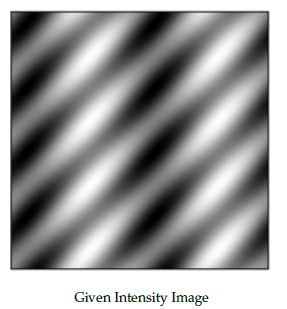

**Figure 15.** Given intensity image for Question 86.

**Options**

**A.** Fourier image candidate A:


**Figure 16.** Option A Fourier image for Question 86.

*Option ID:* `6406532786655`

**B.** Fourier image candidate B:


**Figure 17.** Option B Fourier image for Question 86.

*Option ID:* `6406532786656`

**C.** Fourier image candidate C:

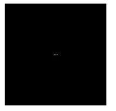

**Figure 18.** Option C Fourier image for Question 86.

*Option ID:* `6406532786657`

**D.** Fourier image candidate D:

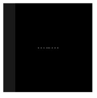

**Figure 19.** Option D Fourier image for Question 86.

*Option ID:* `6406532786658`

**Correct answer:** **B** — Fourier image candidate B (Option ID `6406532786656`).

**Worked explanation:** Convolution reverses the kernel by $180^\circ$ relative to cross-correlation; symmetric kernels make the two coincide.
The convolution theorem maps spatial convolution to frequency-domain multiplication, while linearity and associativity apply to the stated operators.

## Topic: Image representation and point operations

| Paper | Q# | Marks | Type |
| :--- | ---: | ---: | :--- |
| da5006_2024T1_ET_AN | 187 | 2 | ET |
| da5006_2024T1_Q1_NA | 169 | 2 | Q1 |
| da5006_2024T2_ET_AN | 261 | 2 | ET |
| da5006_2024T3_ET_AN | 217 | 2 | ET |
| da5006_2024T3_ET_AN | 219 | 2 | ET |
| da5006_2024T3_Q1_NA | 143 | 2 | Q1 |
| da5006_2024T3_Q1_NA | 144 | 2 | Q1 |
| da5006_2024T3_Q1_NA | 167 | 2 | Q1 |
| da5006_2024T3_Q1_NA | 168 | 2 | Q1 |
| da5006_2024T3_Q1_NA | 172 | 2 | Q1 |
| da5006_2025T1_Q1_NA | 154 | 2 | Q1 |
| da5006_2025T1_Q1_NA | 155 | 2 | Q1 |
| da5006_2025T1_Q1_NA | 161 | 2 | Q1 |
| da5006_2025T1_Q1_NA | 174 | 2 | Q1 |
| da5006_2025T2_ET_AN | 103 | 2 | ET |
| da5006_2025T2_ET_AN | 107 | 2 | ET |
| da5006_2025T2_ET_FN | 179 | 2 | ET |
| da5006_2025T2_Q1_NA | 157 | 2 | Q1 |
| da5006_2025T2_Q1_NA | 158 | 2 | Q1 |
| da5006_2025T2_Q1_NA | 183 | 3 | Q1 |
| da5006_2025T2_Q1_NA | 184 | 3 | Q1 |
| da5006_2025T3_ET_FN | 3 | 1 | ET |
| da5006_2026T1_ET_FN | 2 | 2 | ET |
| da5006_2026T1_Q1_NA | 8 | 1 | Q1 |
| da5006_2026T1_Q1_NA | 9 | 1 | Q1 |
| da5006_2026T1_Q1_NA | 10 | 1 | Q1 |
| da5006_2026T2_ET_FN | 2 | 2 | ET |
| da5006_2026T2_Q1_NA | 8 | 1 | Q1 |
| da5006_2026T2_Q1_NA | 9 | 1 | Q1 |

### da5006_2024T1_ET_AN · Q187 · 2 marks · ID 640653821613

**PDF pages:** 19

Consider a 3 x 3 grayscale image in terms of pixel intensities as shown in matrix form below.

$$\begin{bmatrix} 9 & 1 & 6 \\ 4 & 6 & 1 \\ 9 & 8 & 2 \end{bmatrix}$$

Assume that each pixel takes values from 1 to 9 (inclusive). After performing histogram equalization, the number of pixels with intensity value 6 are__?

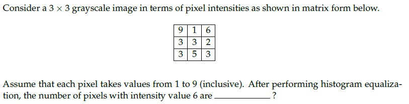

**Figure 20.** Source diagram for Question 187.

**Correct answer:** **4**

**Worked explanation:** Apply the stated definition to the data or proposition in the stem, then check the result against the source-keyed choice.
The deciding step is to preserve the question’s assumptions and distinguish the requested quantity from related transformations.

### da5006_2024T1_Q1_NA · Q169 · 2 marks · ID 640653739732

**PDF pages:** 8, 9

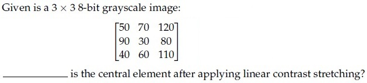

**Figure 9.** Source matrix and question text for Question 169.

Given is a 3 x 3 8-bit grayscale image:

$$\begin{bmatrix} 50 & 70 & 120 \\ 90 & 30 & 80 \\ 40 & 60 & 110 \end{bmatrix}$$

___________ is the central element after applying linear contrast stretching?

**Correct answer:** `0`

**Worked explanation:** For linear stretching, map each intensity with $s=(r-r_{\min})255/(r_{\max}-r_{\min})$; the image extrema set the scale.
Substitute the center pixel (or transform every pixel before averaging) and compare the result with the keyed value.

### da5006_2024T2_ET_AN · Q261 · 2 marks · ID 640653904324

**PDF pages:** 7, 8

For a 3-bit grayscale image, the integral image is given as follows:

$$\begin{bmatrix} 3 & 7 & 10 \\ 6 & 9 & 13 \\ 7 & 12 & 18 \end{bmatrix}$$

The sum of all the pixels for the corresponding grayscale image is

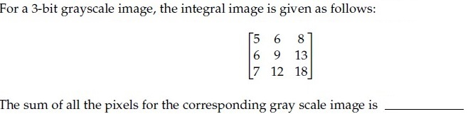

**Figure 19.** Source integral image matrix for Question 261.

**Correct answer:** `18`

**Worked explanation:** Recover a pixel or rectangle sum by inclusion–exclusion on the cumulative-sum table: $S=II(r_2,c_2)-II(r_1-1,c_2)-II(r_2,c_1-1)+II(r_1-1,c_1-1)$.
Use a zero-valued border when an index is zero; this avoids re-summing the enclosed pixels.

### da5006_2024T3_ET_AN · Q217 · 2 marks · ID 6406531046059

**PDF pages:** 11

For a 3-bit grayscale image, the integral image is given as follows:

$$\begin{bmatrix} 5 & 6 & 8 \\ 6 & 9 & 13 \\ 7 & 12 & 18 \end{bmatrix}$$

The pixel intensity that occurs the most for the given grayscale image is _____ (enter an integer value)

Response Type : Numeric

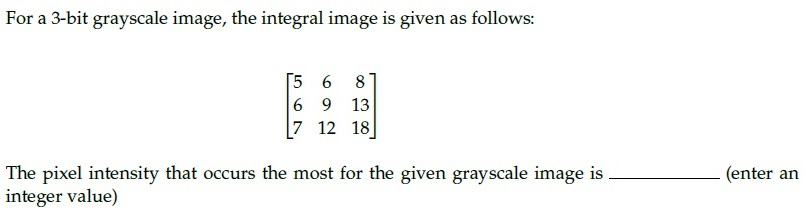
**Figure 26.** Source problem statement for Question 217.

**Correct answer:** **2**.

**Worked explanation:** Recover a pixel or rectangle sum by inclusion–exclusion on the cumulative-sum table: $S=II(r_2,c_2)-II(r_1-1,c_2)-II(r_2,c_1-1)+II(r_1-1,c_1-1)$.
Use a zero-valued border when an index is zero; this avoids re-summing the enclosed pixels.

### da5006_2024T3_ET_AN · Q219 · 2 marks · ID 6406531046075

**PDF pages:** 12

Given is a 3 x 3 8-bit grayscale image:

$$\begin{bmatrix} 50 & 70 & 120 \\ 90 & 30 & 80 \\ 40 & 60 & 110 \end{bmatrix}$$

_________ is the central element after applying linear contrast stretching?

Response Type : Numeric

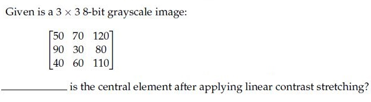
**Figure 27.** Source problem statement for Question 219.

**Correct answer:** **0**.

**Worked explanation:** For linear stretching, map each intensity with $s=(r-r_{\min})255/(r_{\max}-r_{\min})$; the image extrema set the scale.
Substitute the center pixel (or transform every pixel before averaging) and compare the result with the keyed value.

### da5006_2024T3_Q1_NA · Q143 · 2 marks · ID 640653994479

**PDF pages:** 1

Given is a 3 × 3 8-bit grayscale image:

$$\begin{bmatrix} 50 & 70 & 120 \\ 90 & 30 & 80 \\ 40 & 60 & 110 \end{bmatrix}$$

What is the central element after applying linear contrast stretching?

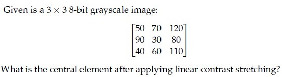

**Figure 1.** Source matrix and question for Question 143.

**Options**

**A.** 54  
*Option ID:* `6406533358191`

**B.** 10  
*Option ID:* `6406533358192`

**C.** 0  
*Option ID:* `6406533358193`

**D.** 18  
*Option ID:* `6406533358194`

**Correct answer:** **C** — 0.

**Worked explanation:** For linear stretching, map each intensity with $s=(r-r_{\min})255/(r_{\max}-r_{\min})$; the image extrema set the scale.
Substitute the center pixel (or transform every pixel before averaging) and compare the result with the keyed value.

### da5006_2024T3_Q1_NA · Q144 · 2 marks · ID 640653994480

**PDF pages:** 1–2

Which of the following statements is false?

**Options**

**A.** Linear contrast stretching is a point operation.  
*Option ID:* `6406533358195`

**B.** Moving average is an example of local operation.  
*Option ID:* `6406533358196`

**C.** Convolution in the spatial domain can be obtained through addition in the frequency domain.  
*Option ID:* `6406533358197`

**D.** All of these.  
*Option ID:* `6406533358198`

**Correct answer:** **C** — Convolution in the spatial domain can be obtained through addition in the frequency domain..

**Worked explanation:** For linear stretching, map each intensity with $s=(r-r_{\min})255/(r_{\max}-r_{\min})$; the image extrema set the scale.
Substitute the center pixel (or transform every pixel before averaging) and compare the result with the keyed value.

### da5006_2024T3_Q1_NA · Q167 · 2 marks · ID 640653994477

**PDF pages:** 11–12

Consider the following numpy array:

```python
arr = np.array([[0, 1], [2, 3], [4, 5]])
```

Now consider the following operations:

```python
flattened_arr = arr.flatten()
flattened_arr[0] = 10
```

Write the value of `arr[0]`

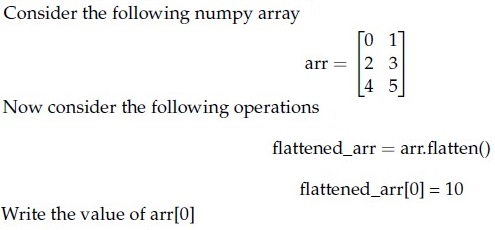

**Figure 25.** NumPy array operations snippet for Question 167.

Response Type : Numeric  
Answers Type : Equal

**Correct answer:** 0

**Worked explanation:** A direct assignment, `ravel()` when the layout permits, and `view()` share storage with the original array; modifying the shared buffer changes `arr`.
`flatten()` and `copy()` allocate independent data, so their edits do not propagate back.

### da5006_2024T3_Q1_NA · Q168 · 2 marks · ID 640653994478

**PDF pages:** 12

Consider the following numpy array:

```python
arr = np.array([[0, 1], [2, 3], [4, 5]])
```

Now consider the following operations:

```python
raveled_arr = arr.ravel()
raveled_arr[0] = 10
```

Write the value of `arr[0]`

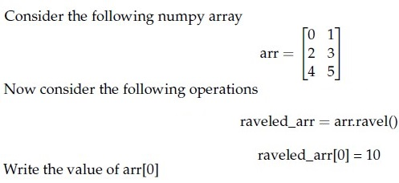

**Figure 26.** NumPy array operations snippet for Question 168.

Response Type : Numeric  
Answers Type : Equal

**Correct answer:** 10

**Worked explanation:** A direct assignment, `ravel()` when the layout permits, and `view()` share storage with the original array; modifying the shared buffer changes `arr`.
`flatten()` and `copy()` allocate independent data, so their edits do not propagate back.

### da5006_2024T3_Q1_NA · Q172 · 2 marks · ID 640653994508

**PDF pages:** 13

[Question stem truncated in source PDF: Question 172 header appears at the bottom of physical page 13 without question body or answer fields before PDF termination.]

> [!NOTE] Week assignment uncertain: Stem truncated; week and topic are provisional placeholders pending source recovery.

**Correct answer:** unavailable in source; no defensible derivation is possible from the truncated stem.

**Worked explanation:** The extracted source terminates before the question body and answer fields. The item is retained for traceability; its answer requires recovery of the original paper page.

### da5006_2025T1_Q1_NA · Q154 · 2 marks · ID 6406531130610

**PDF pages:** 2

Consider the following numpy array:

```python
arr = np.array([[0, 1], [2, 3], [4, 5]])
```

Now consider the following operations:

```python
flattened_arr = arr.flatten()
flattened_arr[2] = 10
```

Write the value of `arr[2]` (or the element at index 2).

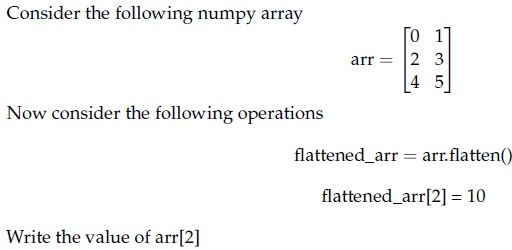

**Figure 1.** Source numpy array and operations for Question 154.

**Correct answer:** `2`

**Worked explanation:** A direct assignment, `ravel()` when the layout permits, and `view()` share storage with the original array; modifying the shared buffer changes `arr`.
`flatten()` and `copy()` allocate independent data, so their edits do not propagate back.

### da5006_2025T1_Q1_NA · Q155 · 2 marks · ID 6406531130611

**PDF pages:** 3

Consider the following numpy array:

```python
arr = np.array([[0, 1], [2, 3], [4, 5]])
```

Now consider the following operations:

```python
raveled_arr = arr.ravel()
raveled_arr[2] = 20
```

Write the value of `arr[2]` (or the element at index 2).

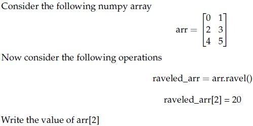

**Figure 2.** Source numpy array and operations for Question 155.

**Correct answer:** `20`

**Worked explanation:** A direct assignment, `ravel()` when the layout permits, and `view()` share storage with the original array; modifying the shared buffer changes `arr`.
`flatten()` and `copy()` allocate independent data, so their edits do not propagate back.

### da5006_2025T1_Q1_NA · Q161 · 2 marks · ID 6406531130612

**PDF pages:** 5

Given is a $3 \times 3$ 8-bit grayscale image:

$$\begin{bmatrix} 50 & 70 & 120 \\ 90 & 30 & 80 \\ 40 & 60 & 110 \end{bmatrix}$$

What is the mean of transformed pixels of after applying linear contrast stretching? Linear contrast stretching is an image enhancement technique used to improve the contrast in an image. This is achieved by linearly scaling the pixel values so that they span a desired range (0 to 255 for an 8-bit grayscale image).

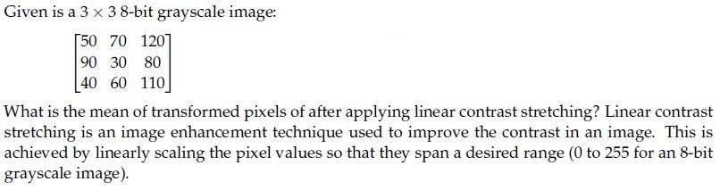

**Figure 6.** Grayscale pixel matrix and question statement for Question 161.

**Options**

**A.** 119.33  
*Option ID:* `6406533822672`

**B.** 110.5  
*Option ID:* `6406533822673`

**C.** 134.25  
*Option ID:* `6406533822674`

**D.** 0  
*Option ID:* `6406533822675`

**Correct answer:** **A** — 119.33.

**Worked explanation:** For linear stretching, map each intensity with $s=(r-r_{\min})255/(r_{\max}-r_{\min})$; the image extrema set the scale.
Substitute the center pixel (or transform every pixel before averaging) and compare the result with the keyed value.

### da5006_2025T1_Q1_NA · Q174 · 2 marks · ID 6406531130613

**PDF pages:** 10

Which of the following statements is false?

**Options**

**A.** Linear contrast stretching is a local operation.  
*Option ID:* `6406533822676`

**B.** Moving average is an example of local operation.  
*Option ID:* `6406533822677`

**C.** Convolution in the spatial domain can be obtained through addition in the frequency domain.  
*Option ID:* `6406533822678`

**D.** All of these.  
*Option ID:* `6406533822679`

**Correct answer:** **A**, **C** — Linear contrast stretching is a local operation. ; Convolution in the spatial domain can be obtained through addition in the frequency domain..

**Worked explanation:** For linear stretching, map each intensity with $s=(r-r_{\min})255/(r_{\max}-r_{\min})$; the image extrema set the scale.
Substitute the center pixel (or transform every pixel before averaging) and compare the result with the keyed value.

### da5006_2025T2_ET_AN · Q103 · 2 marks · ID 6406531431363

**PDF pages:** 9

Given is a 3 × 3 8-bit grayscale image:

$$\begin{bmatrix} 10 & 50 & 200 \\ 70 & 100 & 150 \\ 20 & 80 & 255 \end{bmatrix}$$

What is the central element after applying linear contrast stretching (from the range $[I_{min}, I_{max}]$ to $[0, 255]$) ?

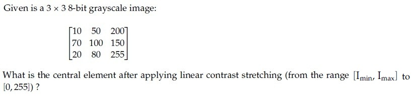

**Figure 12.** Source problem statement for Question 103.

**Correct answer:** 93 to 94

**Worked explanation:** For linear stretching, map each intensity with $s=(r-r_{\min})255/(r_{\max}-r_{\min})$; the image extrema set the scale.
Substitute the center pixel (or transform every pixel before averaging) and compare the result with the keyed value.

### da5006_2025T2_ET_AN · Q107 · 2 marks · ID 6406531431370

**PDF pages:** 11

For a 3-bit grayscale image, the integral image is given as follows:

$$\begin{bmatrix} 5 & 6 & 8 \\ 6 & 9 & 11 \\ 11 & 15 & 19 \end{bmatrix}$$

The pixel intensity that occurs the most for the given grayscale image is ______ (enter an integer value)

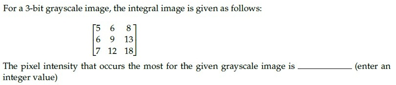

**Figure 16.** Source problem statement for Question 107.

**Correct answer:** 2

**Worked explanation:** Recover a pixel or rectangle sum by inclusion–exclusion on the cumulative-sum table: $S=II(r_2,c_2)-II(r_1-1,c_2)-II(r_2,c_1-1)+II(r_1-1,c_1-1)$.
Use a zero-valued border when an index is zero; this avoids re-summing the enclosed pixels.

### da5006_2025T2_ET_FN · Q179 · 2 marks · ID 6406531422558

**PDF pages:** 12, 13

Given is a 3 x 3 8-bit grayscale image:

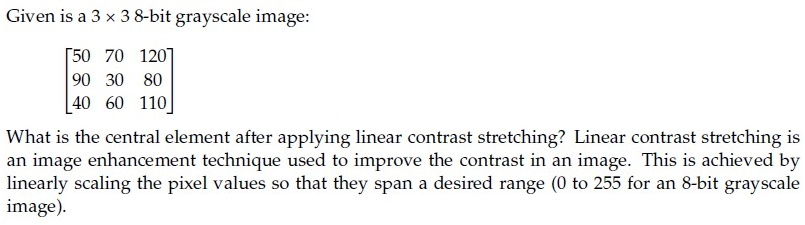

**Figure 30.** Question 179, source grayscale image matrix and problem statement.

$$\begin{bmatrix} 50 & 70 & 120 \\ 90 & 30 & 80 \\ 40 & 60 & 110 \end{bmatrix}$$

What is the central element after applying linear contrast stretching? Linear contrast stretching is an image enhancement technique used to improve the contrast in an image. This is achieved by linearly scaling the pixel values so that they span a desired range (0 to 255 for an 8-bit grayscale image).

**Correct answer:** `0`

**Worked explanation:** For linear stretching, map each intensity with $s=(r-r_{\min})255/(r_{\max}-r_{\min})$; the image extrema set the scale.
Substitute the center pixel (or transform every pixel before averaging) and compare the result with the keyed value.

### da5006_2025T2_Q1_NA · Q157 · 2 marks · ID 6406531279499

**PDF pages:** 2

What is the mean of transformed pixels after applying linear contrast stretching to the following 3x3 image?

$$\begin{bmatrix} 52 & 55 & 61 \\ 59 & 79 & 61 \\ 76 & 61 & 64 \end{bmatrix}$$

$$\text{Image} =$$

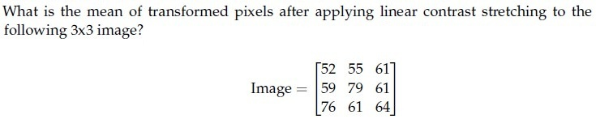

**Figure 1.** 3x3 pixel matrix and linear contrast stretching problem statement for Question 157.

**Options**

**A.** 104.94  
*Option ID:* `6406534313841`

**B.** 100.25  
*Option ID:* `6406534313842`

**C.** 110.56  
*Option ID:* `6406534313843`

**D.** 98.78  
*Option ID:* `6406534313844`

**Correct answer:** **A** — 104.94.

**Worked explanation:** For linear stretching, map each intensity with $s=(r-r_{\min})255/(r_{\max}-r_{\min})$; the image extrema set the scale.
Substitute the center pixel (or transform every pixel before averaging) and compare the result with the keyed value.

### da5006_2025T2_Q1_NA · Q158 · 2 marks · ID 6406531279500

**PDF pages:** 3

Which of the following statements is false?

**Options**

**A.** Histogram equalization is a global operation.  
*Option ID:* `6406534313845`

**B.** Gaussian filtering is a local operation.  
*Option ID:* `6406534313846`

**C.** Convolution in the spatial domain corresponds to multiplication in the frequency domain.  
*Option ID:* `6406534313847`

**D.** Median filtering is a global operation.  
*Option ID:* `6406534313848`

**Correct answer:** **D** — Median filtering is a global operation..

**Worked explanation:** A median filter sorts the values in the specified neighborhood and selects its middle order statistic; it is nonlinear and generally not separable.
Apply the stated window at the requested location, respecting whether the center is included, then read the median (or compare the stated property).

### da5006_2025T2_Q1_NA · Q183 · 3 marks · ID 6406531279534

**PDF pages:** 17

Consider the following numpy array:

```python
arr = np.array([[5, 6], [7, 8]])
```

Now consider the following operations:

```python
copied_arr = arr.copy()
copied_arr[0, 0] = 100
```

Write the value of `arr[0, 0]`.

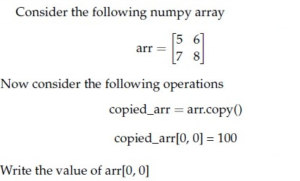

**Figure 65.** Numpy array copy operation for Question 183.

**Correct answer:** `5`

**Worked explanation:** A direct assignment, `ravel()` when the layout permits, and `view()` share storage with the original array; modifying the shared buffer changes `arr`.
`flatten()` and `copy()` allocate independent data, so their edits do not propagate back.

### da5006_2025T2_Q1_NA · Q184 · 3 marks · ID 6406531279535

**PDF pages:** 18

Consider the following numpy array:

```python
arr = np.array([[1, 2], [3, 4]])
```

Now consider the following operations:

```python
viewed_arr = arr.view()
viewed_arr[0, 1] = 99
```

Write the value of `arr[0, 1]`.

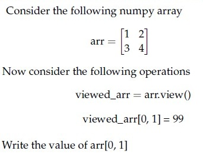

**Figure 66.** Numpy array view operation for Question 184.

**Correct answer:** `99`

**Worked explanation:** A direct assignment, `ravel()` when the layout permits, and `view()` share storage with the original array; modifying the shared buffer changes `arr`.
`flatten()` and `copy()` allocate independent data, so their edits do not propagate back.

### da5006_2025T3_ET_FN · Q3 · 1 marks · ID 6406531862817

**PDF pages:** 2

Given the $3 \times 3$ 8-bit grayscale image

$$\begin{bmatrix} 12 & 40 & 210 \\ 75 & 95 & 160 \\ 30 & 120 & 240 \end{bmatrix}$$

Apply linear contrast stretching from $[I_{min}, I_{max}]$ to $[0, 255]$. What is the central element after stretching?
(Round to the nearest integer.)

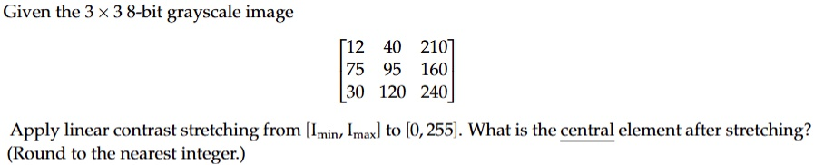

**Figure 2.** Source grayscale image matrix and linear contrast stretching task for Question 3.

**Correct answer:** `92 to 94`

**Worked explanation:** For linear stretching, map each intensity with $s=(r-r_{\min})255/(r_{\max}-r_{\min})$; the image extrema set the scale.
Substitute the center pixel (or transform every pixel before averaging) and compare the result with the keyed value.

### da5006_2026T1_ET_FN · Q2 · 2 marks · ID 6406532136817

**PDF pages:** 2

A standard RGB image of size 256×256 is stored as 8-bit unsigned integers per channel. What is the total memory (in bytes) to store the raw image (no compression)?

**Options**

**A.** 256×256 = 65,536 bytes  
*Option ID:* `6406536959477`

**B.** 256×256×2 = 131,072 bytes  
*Option ID:* `6406536959478`

**C.** 256×256×3 = 196,608 bytes  
*Option ID:* `6406536959479`

**D.** 256×256×3×8 = 1,572,864 bytes  
*Option ID:* `6406536959480`

**Correct answer:** **C** — 256×256×3 = 196,608 bytes.

**Worked explanation:** Raw storage is width $	imes$ height $	imes$ channel count $	imes$ bytes per channel.
Substituting the given dimensions and dtype yields the keyed byte count; no compression or metadata is included.

### da5006_2026T1_Q1_NA · Q8 · 1 marks · ID 6406531961518

**PDF pages:** 5, 6

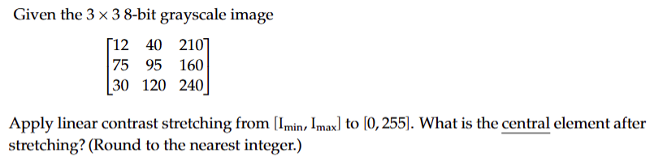

**Figure 7.** Grayscale image matrix and contrast stretching specification for Question 8.

Given the $3 \times 3$ 8-bit grayscale image

$$\begin{bmatrix} 12 & 40 & 210 \\ 75 & 95 & 160 \\ 30 & 120 & 240 \end{bmatrix}$$

Apply linear contrast stretching from $[I_{min}, I_{max}]$ to $[0, 255]$. What is the central element after stretching? (Round to the nearest integer.)

**Correct answer:** `92 to 94`

**Worked explanation:** For linear stretching, map each intensity with $s=(r-r_{\min})255/(r_{\max}-r_{\min})$; the image extrema set the scale.
Substitute the center pixel (or transform every pixel before averaging) and compare the result with the keyed value.

### da5006_2026T1_Q1_NA · Q9 · 1 marks · ID 6406531961519

**PDF pages:** 6

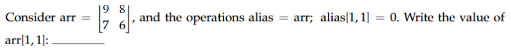

**Figure 8.** Array definition and aliasing operation for Question 9.

Consider $\text{arr} = \begin{bmatrix} 4 & 8 \\ 5 & 3 \end{bmatrix}$ and the operations $\text{alias} = \text{arr}; \text{alias}[1, 1] = 0$. Write the value of $\text{arr}[1, 1]$: ______

**Correct answer:** `0`

**Worked explanation:** A direct assignment, `ravel()` when the layout permits, and `view()` share storage with the original array; modifying the shared buffer changes `arr`.
`flatten()` and `copy()` allocate independent data, so their edits do not propagate back.

### da5006_2026T1_Q1_NA · Q10 · 1 marks · ID 6406531961520

**PDF pages:** 6, 7

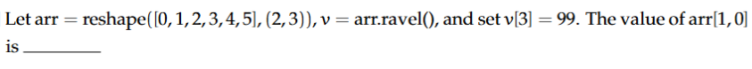

**Figure 9.** Array reshape and ravel operations for Question 10.

Let $\text{arr} = \text{reshape}([0, 1, 2, 3, 4, 5], (2, 3))$, $v = \text{arr.ravel}()$, and set $v[3] = 99$. The value of $\text{arr}[1, 0]$ is _____

**Correct answer:** `99`

**Worked explanation:** A direct assignment, `ravel()` when the layout permits, and `view()` share storage with the original array; modifying the shared buffer changes `arr`.
`flatten()` and `copy()` allocate independent data, so their edits do not propagate back.

### da5006_2026T2_ET_FN · Q2 · 2 marks · ID 6406532270041

**PDF pages:** 2

An RGB image of size $128 \times 96$ is stored with 32-bit floating-point values for every channel. Ignoring metadata, how many bytes are required?

**Options**

**A.** 36,864  
*Option ID:* `6406537379003`

**B.** 73,728  
*Option ID:* `6406537379004`

**C.** 147,456  
*Option ID:* `6406537379005`

**D.** 294,912  
*Option ID:* `6406537379006`

**Correct answer:** **C** — 147,456.

**Worked explanation:** Raw storage is width $	imes$ height $	imes$ channel count $	imes$ bytes per channel.
Substituting the given dimensions and dtype yields the keyed byte count; no compression or metadata is included.

### da5006_2026T2_Q1_NA · Q8 · 1 marks · ID 6406532166255

**PDF pages:** 4, 5

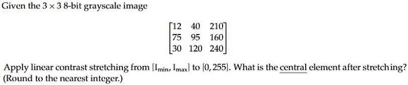

**Figure 7.** Grayscale image matrix and contrast stretching specification for Question 8.

Given the $3 \times 3$ 8-bit grayscale image

$$\begin{bmatrix} 12 & 40 & 210 \\ 75 & 95 & 160 \\ 30 & 120 & 240 \end{bmatrix}$$

Apply linear contrast stretching from $[I_{min}, I_{max}]$ to $[0, 255]$. What is the central element after stretching? (Round to the nearest integer.)

**Correct answer:** `92 to 94`

**Worked explanation:** For linear stretching, map each intensity with $s=(r-r_{\min})255/(r_{\max}-r_{\min})$; the image extrema set the scale.
Substitute the center pixel (or transform every pixel before averaging) and compare the result with the keyed value.

### da5006_2026T2_Q1_NA · Q9 · 1 marks · ID 6406532166256

**PDF pages:** 5

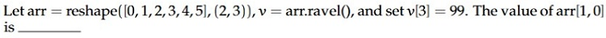

**Figure 8.** Array reshape and ravel operations for Question 9.

Let $\text{arr} = \text{reshape}([0, 1, 2, 3, 4, 5], (2, 3))$, $v = \text{arr.ravel}()$, and set $v[3] = 99$. The value of $\text{arr}[1, 0]$ is _____

**Correct answer:** `99`

**Worked explanation:** A direct assignment, `ravel()` when the layout permits, and `view()` share storage with the original array; modifying the shared buffer changes `arr`.
`flatten()` and `copy()` allocate independent data, so their edits do not propagate back.

## Topic: Spatial filtering and convolution

| Paper | Q# | Marks | Type |
| :--- | ---: | ---: | :--- |
| da5006_2024T1_Q1_NA | 159 | 2 | Q1 |
| da5006_2024T1_Q1_NA | 160 | 2 | Q1 |
| da5006_2024T1_Q1_NA | 167 | 2 | Q1 |
| da5006_2024T1_Q1_NA | 170 | 2 | Q1 |
| da5006_2024T1_Q1_NA | 174 | 1 | Q1 |
| da5006_2024T1_Q1_NA | 175 | 1 | Q1 |
| da5006_2024T2_ET_AN | 255 | 2 | ET |
| da5006_2024T2_ET_AN | 257 | 2 | ET |
| da5006_2024T2_Q1_NA | 81 | 2 | Q1 |
| da5006_2024T2_Q1_NA | 82 | 2 | Q1 |
| da5006_2024T2_Q1_NA | 84 | 2 | Q1 |
| da5006_2024T2_Q1_NA | 85 | 2 | Q1 |
| da5006_2024T2_Q1_NA | 95 | 2 | Q1 |
| da5006_2024T2_Q1_NA | 99 | 1 | Q1 |
| da5006_2024T2_Q1_NA | 100 | 1 | Q1 |
| da5006_2024T3_ET_AN | 208 | 2 | ET |
| da5006_2024T3_Q1_NA | 145 | 2 | Q1 |
| da5006_2024T3_Q1_NA | 154 | 2 | Q1 |
| da5006_2024T3_Q1_NA | 155 | 2 | Q1 |
| da5006_2024T3_Q1_NA | 169 | 2 | Q1 |
| da5006_2024T3_Q2_NA | 138 | 2 | Q2 |
| da5006_2025T1_Q1_NA | 156 | 2 | Q1 |
| da5006_2025T1_Q1_NA | 162 | 2 | Q1 |
| da5006_2025T1_Q1_NA | 170 | 2 | Q1 |
| da5006_2025T1_Q1_NA | 171 | 2 | Q1 |
| da5006_2025T1_Q1_NA | 176 | 2 | Q1 |
| da5006_2025T1_Q1_NA | 177 | 2 | Q1 |
| da5006_2025T1_Q2_NA | 242 | 2 | Q2 |
| da5006_2025T2_ET_AN | 85 | 2 | ET |
| da5006_2025T2_ET_AN | 92 | 2 | ET |
| da5006_2025T2_ET_FN | 166 | 2 | ET |
| da5006_2025T2_ET_FN | 180 | 2 | ET |
| da5006_2025T2_Q1_NA | 159 | 2 | Q1 |
| da5006_2025T2_Q1_NA | 160 | 2 | Q1 |
| da5006_2025T2_Q1_NA | 173 | 3 | Q1 |
| da5006_2025T2_Q1_NA | 174 | 3 | Q1 |
| da5006_2025T2_Q1_NA | 176 | 3 | Q1 |
| da5006_2025T2_Q2_NA | 234 | 2.0 | Q2 |
| da5006_2025T3_ET_FN | 13 | 1 | ET |
| da5006_2025T3_Q2_NA | 130 | 2.0 | Q2 |
| da5006_2026T1_ET_FN | 3 | 2 | ET |
| da5006_2026T1_ET_FN | 4 | 2 | ET |
| da5006_2026T1_Q1_NA | 5 | 1 | Q1 |
| da5006_2026T1_Q1_NA | 7 | 1 | Q1 |
| da5006_2026T1_Q1_NA | 13 | 1 | Q1 |
| da5006_2026T2_ET_FN | 3 | 2 | ET |
| da5006_2026T2_Q1_NA | 5 | 1 | Q1 |
| da5006_2026T2_Q1_NA | 7 | 1 | Q1 |
| da5006_2026T2_Q1_NA | 12 | 1 | Q1 |

### da5006_2024T1_Q1_NA · Q159 · 2 marks · ID 640653739731

**PDF pages:** 2, 3

Match the following:

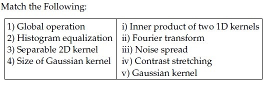

**Figure 1.** Source table for Question 159.

| Column 1 | Column 2 |
| :--- | :--- |
| 1) Global operation | i) Inner product of two 1D kernels |
| 2) Histogram equalization | ii) Fourier transform |
| 3) Separable 2D kernel | iii) Noise spread |
| 4) Size of Gaussian kernel | iv) Contrast stretching |
| | v) Gaussian kernel |

**Options**

**A.** 1→ ii, 2→ ii, 3 → iv, 4→ i  
*Option ID:* `6406532474450`

**B.** 1→ ii, 2→iv, 3 → i, 4→ iii  
*Option ID:* `6406532474451`

**C.** 1→ ii, 2→ ii, 3 → iv, 4→ iii  
*Option ID:* `6406532474452`

**D.** 1→ ii, 2→ iv, 3 → v, 4→ iii  
*Option ID:* `6406532474453`

**Correct answer:** **D** — 1→ ii, 2→ iv, 3 → v, 4→ iii.

**Worked explanation:** For linear stretching, map each intensity with $s=(r-r_{\min})255/(r_{\max}-r_{\min})$; the image extrema set the scale.
Substitute the center pixel (or transform every pixel before averaging) and compare the result with the keyed value.

### da5006_2024T1_Q1_NA · Q160 · 2 marks · ID 640653739735

**PDF pages:** 3

Which of the following statements is true regarding filtering operation?

**Options**

**A.** Gaussian filter is Separable filter because it is non linear.  
*Option ID:* `6406532474460`

**B.** Median filter is a non separable filter  
*Option ID:* `6406532474461`

**C.** Gaussian filter is a High Pass filter.  
*Option ID:* `6406532474462`

**D.** Mean filter is a non separable filter because it is non linear  
*Option ID:* `6406532474463`

**Correct answer:** **B** — Median filter is a non separable filter.

**Worked explanation:** A median filter sorts the values in the specified neighborhood and selects its middle order statistic; it is nonlinear and generally not separable.
Apply the stated window at the requested location, respecting whether the center is included, then read the median (or compare the stated property).

### da5006_2024T1_Q1_NA · Q167 · 2 marks · ID 640653739734

**PDF pages:** 7

Which of the following linear filters will leave the central value of the given matrix unchanged.

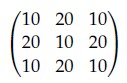

**Figure 4.** Source matrix for Question 167.

$$\begin{bmatrix} 10 & 20 & 10 \\ 20 & 10 & 20 \\ 10 & 20 & 10 \end{bmatrix}$$

**Options**

**A.** Linear filter kernel shown in Figure 5.

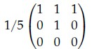

**Figure 5.** Filter matrix for Option A.

*Option ID:* `6406532474456`

**B.** Linear filter kernel shown in Figure 6.

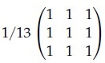

**Figure 6.** Filter matrix for Option B.

*Option ID:* `6406532474457`

**C.** Linear filter kernel shown in Figure 7.

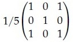

**Figure 7.** Filter matrix for Option C.

*Option ID:* `6406532474458`

**D.** Linear filter kernel shown in Figure 8.

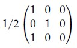

**Figure 8.** Filter matrix for Option D.

*Option ID:* `6406532474459`

**Correct answer:** **A**, **B**, **C** — A, B, C.

**Worked explanation:** The answer follows from the filter’s defining operation: linear filters combine neighborhood values with fixed weights, while median filtering is nonlinear.
Check whether the question asks about locality, separability, smoothing, or the center response before selecting among these properties.

### da5006_2024T1_Q1_NA · Q170 · 2 marks · ID 640653739733

**PDF pages:** 9

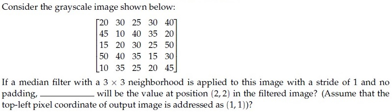

**Figure 10.** Source image and question text for Question 170.

Consider the grayscale image shown below:

$$\begin{bmatrix} 20 & 30 & 25 & 30 & 40 \\ 45 & 10 & 40 & 35 & 20 \\ 15 & 20 & 30 & 25 & 50 \\ 50 & 40 & 35 & 15 & 30 \\ 10 & 35 & 25 & 20 & 45 \end{bmatrix}$$

If a median filter with a 3 x 3 neighborhood is applied to this image with a stride of 1 and no padding, _____ will be the value at position (2, 2) in the filtered image? (Assume that the top-left pixel coordinate of output image is addressed as (1, 1))?

**Correct answer:** `30`

**Worked explanation:** A median filter sorts the values in the specified neighborhood and selects its middle order statistic; it is nonlinear and generally not separable.
Apply the stated window at the requested location, respecting whether the center is included, then read the median (or compare the stated property).

### da5006_2024T1_Q1_NA · Q174 · 1 marks · ID 640653739729

**PDF pages:** 11, 12

**Comprehension Context (Questions 174–175):**

> In case of template matching by using correlation, even if template is not identical to some subimage in the scene, match can be meaningful, if (a) _____________ , (b) _____________ and general appearance is right.
>
> Based on the above data, answer the given subquestions.

Enter the correct answer for Blank (a) ______________ .

**Correct answer:** `scale (or orientation)`

**Worked explanation:** Convolution reverses the kernel by $180^\circ$ relative to cross-correlation; symmetric kernels make the two coincide.
The convolution theorem maps spatial convolution to frequency-domain multiplication, while linearity and associativity apply to the stated operators.

### da5006_2024T1_Q1_NA · Q175 · 1 marks · ID 640653739730

**PDF pages:** 12

**Comprehension Context (Questions 174–175):**

> In case of template matching by using correlation, even if template is not identical to some subimage in the scene, match can be meaningful, if (a) _____________ , (b) _____________ and general appearance is right.
>
> Based on the above data, answer the given subquestions.

Enter the correct answer for Blank (b) ______________ .

**Correct answer:** `orientation (or scale)`

**Worked explanation:** Convolution reverses the kernel by $180^\circ$ relative to cross-correlation; symmetric kernels make the two coincide.
The convolution theorem maps spatial convolution to frequency-domain multiplication, while linearity and associativity apply to the stated operators.

### da5006_2024T2_ET_AN · Q255 · 2 marks · ID 640653904307

**PDF pages:** 5

For certain filters, we can speed up the convolution operation by separating convolution kernels from $k^2$ operations to $2k$ operations. Given the 2D Kernel below, what are the separated 1D kernels $v$ and $h$ for it?

$$\frac{1}{16} \begin{bmatrix} 1 & 2 & 1 \\ 2 & 4 & 2 \\ 1 & 2 & 1 \end{bmatrix}$$

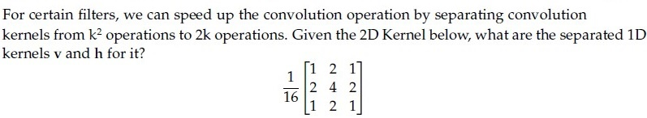

**Figure 7.** Source 2D convolution kernel for Question 255.

**Options**

**A.** $v = \frac{1}{4} \begin{bmatrix} 1 \\ 2 \\ 1 \end{bmatrix}, \quad h = \frac{1}{4} \begin{bmatrix} 1 \\ 2 \\ 1 \end{bmatrix}$  
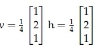

**Figure 8.** Option A image for Question 255.
*Option ID:* `6406533045039`

**B.** $v = \frac{1}{4} \begin{bmatrix} 1 \\ 2 \\ 1 \end{bmatrix}, \quad h = \frac{1}{4} \begin{bmatrix} 1 \\ 2 \\ 2 \end{bmatrix}$  
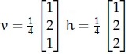

**Figure 9.** Option B image for Question 255.
*Option ID:* `6406533045040`

**C.** $v = \frac{1}{3} \begin{bmatrix} 4 \\ 2 \\ 3 \end{bmatrix}, \quad h = \frac{1}{2} \begin{bmatrix} 1 \\ 2 \\ 4 \end{bmatrix}$  
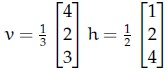

**Figure 10.** Option C image for Question 255.
*Option ID:* `6406533045041`

**D.** $v = \frac{1}{2} \begin{bmatrix} 1 \\ 1 \\ 1 \end{bmatrix}, \quad h = \frac{1}{2} \begin{bmatrix} 1 \\ 0 \\ 1 \end{bmatrix}$  
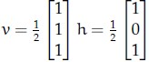

**Figure 11.** Option D image for Question 255.
*Option ID:* `6406533045042`

**Correct answer:** **A** — $v = \frac{1}{4} \begin{bmatrix} 1 \\ 2 \\ 1 \end{bmatrix}, \quad h = \frac{1}{4} \begin{bmatrix} 1 \\ 2 \\ 1 \end{bmatrix}$

**Worked explanation:** A kernel is separable exactly when it has rank one, so $K=vh^T$ and every $2	imes2$ minor vanishes.
Factoring it into vertical and horizontal 1D passes reduces per-pixel work from $k^2$ to about $2k$.

### da5006_2024T2_ET_AN · Q257 · 2 marks · ID 640653904321

**PDF pages:** 6

Which one of the following statements is false?

**Options**

**A.** Real-world RGB images can be thought of as matrices in continuous space on $\mathbb{R}^3$, but the images we store on a computer are discrete.  
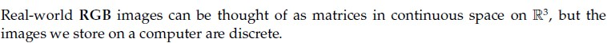

**Figure 12.** Option A image for Question 257.
*Option ID:* `6406533045064`

**B.** We can represent an RGB image as a function of the form $f : \mathbb{R}^3 \to \mathbb{R}$ where $\mathbb{R}^3$ represents image coordinates (channel, height, width) and $\mathbb{R}$ represents intensity.  
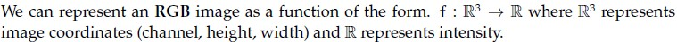

**Figure 13.** Option B image for Question 257.
*Option ID:* `6406533045065`

**C.** The transformation $I(x, y) = I(x, -y)$ flips the image $I$ upside down.  
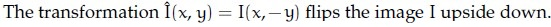

**Figure 14.** Option C image for Question 257.
*Option ID:* `6406533045066`

**D.** Denoising an image through the moving average filter is an example of a global operation as opposed to point or local operations.  
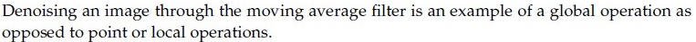

**Figure 15.** Option D image for Question 257.
*Option ID:* `6406533045067`

**Correct answer:** **D** — Denoising an image through the moving average filter is an example of a global operation as opposed to point or local operations.

**Worked explanation:** The answer follows from the filter’s defining operation: linear filters combine neighborhood values with fixed weights, while median filtering is nonlinear.
Check whether the question asks about locality, separability, smoothing, or the center response before selecting among these properties.

### da5006_2024T2_Q1_NA · Q81 · 2 marks · ID 640653829644

**PDF pages:** 2–3

Which of the following linear filters will leave the central value of the given matrix unchanged?

$$\begin{bmatrix} 10 & 20 & 10 \\ 20 & 10 & 20 \\ 10 & 20 & 10 \end{bmatrix}$$

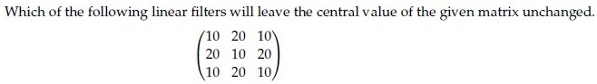

**Figure 1.** Source question stem matrix for Question 81.

**Options**

**A.** Filter kernel with central weight 1/5:

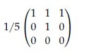

**Figure 2.** Option A filter kernel for Question 81.

*Option ID:* `6406532786640`

**B.** Filter kernel:

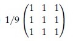

**Figure 3.** Option B filter kernel for Question 81.

*Option ID:* `6406532786641`

**C.** Filter kernel with central weight 1/5:

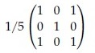

**Figure 4.** Option C filter kernel for Question 81.

*Option ID:* `6406532786642`

**D.** Filter kernel:

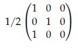

**Figure 5.** Option D filter kernel for Question 81.

*Option ID:* `6406532786643`

**Correct answer:** **A**, **C** — Filter kernels with option IDs `6406532786640` and `6406532786642`.

**Worked explanation:** The answer follows from the filter’s defining operation: linear filters combine neighborhood values with fixed weights, while median filtering is nonlinear.
Check whether the question asks about locality, separability, smoothing, or the center response before selecting among these properties.

### da5006_2024T2_Q1_NA · Q82 · 2 marks · ID 640653829647

**PDF pages:** 3

Certain 2D kernel $K$ can be decomposed into two 1D kernels ($v$ and $h$) to reduce the computation cost such as $K = vh^T$. The 2D kernel is called as Separable Kernel.  
Consider the following 2D kernels. Which of the given kernels are separable?

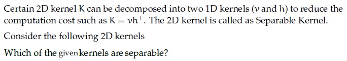

**Figure 6.** Source question stem for Question 82.

**Options**

**A.** 2D kernel:

$$\begin{bmatrix} 2 & 4 & 6 \\ 3 & 6 & 9 \\ 1 & 2 & 3 \end{bmatrix}$$

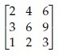

**Figure 7.** Option A 2D kernel for Question 82.

*Option ID:* `6406532786649`

**B.** 2D kernel:

$$\begin{bmatrix} 2 & 4 & 6 \\ 3 & 6 & 9 \\ 2 & 3 & 4 \end{bmatrix}$$

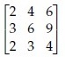

**Figure 8.** Option B 2D kernel for Question 82.

*Option ID:* `6406532786650`

**C.** 2D kernel:

$$\begin{bmatrix} 5 & 0 & -5 \\ 10 & 0 & 10 \\ 5 & 0 & 5 \end{bmatrix}$$


**Figure 9.** Option C 2D kernel for Question 82.

*Option ID:* `6406532786651`

**D.** 2D kernel:

$$\begin{bmatrix} 5 & 0 & -5 \\ 10 & 0 & -10 \\ 5 & 0 & -5 \end{bmatrix}$$


**Figure 10.** Option D 2D kernel for Question 82.

*Option ID:* `6406532786652`

**Correct answer:** **A**, **D** — Option A (rank-1 matrix) and Option D (rank-1 matrix).

**Worked explanation:** A kernel is separable exactly when it has rank one, so $K=vh^T$ and every $2	imes2$ minor vanishes.
Factoring it into vertical and horizontal 1D passes reduces per-pixel work from $k^2$ to about $2k$.

### da5006_2024T2_Q1_NA · Q84 · 2 marks · ID 640653829645

**PDF pages:** 4

Which of the following statements is True?

**Options**

**A.** Gaussian filter is Separable filter because it is non linear.  
*Option ID:* `6406532786644`

**B.** Median filter is a non separable filter  
*Option ID:* `6406532786645`

**C.** Gaussian filter is a High Pass filter.  
*Option ID:* `6406532786646`

**D.** Mean filter is a non separable filter because it is non linear  
*Option ID:* `6406532786647`

**Correct answer:** **B** — Median filter is a non separable filter.

**Worked explanation:** A median filter sorts the values in the specified neighborhood and selects its middle order statistic; it is nonlinear and generally not separable.
Apply the stated window at the requested location, respecting whether the center is included, then read the median (or compare the stated property).

### da5006_2024T2_Q1_NA · Q85 · 2 marks · ID 640653829648

**PDF pages:** 4

In Bilateral filtering, we do not reject the pixels whose values differ too much from the central pixel value.

**Options**

**A.** TRUE  
*Option ID:* `6406532786653`

**B.** FALSE  
*Option ID:* `6406532786654`

**Correct answer:** **B** — FALSE.

**Worked explanation:** Bilateral filtering weights neighbors by both spatial proximity and intensity similarity.
A large intensity difference suppresses the range weight, so cross-edge pixels are rejected and the edge is preserved.

### da5006_2024T2_Q1_NA · Q95 · 2 marks · ID 640653829646

**PDF pages:** 9

Consider the grayscale image shown below:

$$\begin{bmatrix} 0 & 30 & 25 & 30 & 40 \\ 45 & 10 & 40 & 35 & 20 \\ 15 & 20 & 30 & 25 & 50 \\ 50 & 40 & 35 & 15 & 30 \\ 10 & 35 & 25 & 20 & 45 \end{bmatrix}$$

If a median filter with a 3 × 3 neighborhood is applied to this image with a stride of 1 and no padding, ______ will be the value at position (2, 2) in the filtered image? (Assume that the top-left pixel coordinate of output image is addressed as (1,1))?


**Figure 24.** Source grayscale matrix for Question 95.

**Correct answer:** `30`

**Worked explanation:** A median filter sorts the values in the specified neighborhood and selects its middle order statistic; it is nonlinear and generally not separable.
Apply the stated window at the requested location, respecting whether the center is included, then read the median (or compare the stated property).

### da5006_2024T2_Q1_NA · Q99 · 1 marks · ID 640653829651

**PDF pages:** 10–11

**Context:** For a 3-bit grayscale image, the integral image is given as follows:

$$\begin{bmatrix} 5 & 6 & 8 \\ 6 & 9 & 13 \\ 7 & 12 & 18 \end{bmatrix}$$

The pixel intensity that occurs the most (a) ____ and least (b) ____ for the corresponding grayscale image. (Enter an integer value).  
Based on the above data, answer the given subquestions.


**Figure 26.** Source comprehension integral image for Questions 99–100.

**Subquestion:** Fill in the blank for (a)________________

**Correct answer:** `2`

**Worked explanation:** Recover a pixel or rectangle sum by inclusion–exclusion on the cumulative-sum table: $S=II(r_2,c_2)-II(r_1-1,c_2)-II(r_2,c_1-1)+II(r_1-1,c_1-1)$.
Use a zero-valued border when an index is zero; this avoids re-summing the enclosed pixels.

### da5006_2024T2_Q1_NA · Q100 · 1 marks · ID 640653829652

**PDF pages:** 10–11

**Context:** For a 3-bit grayscale image, the integral image is given as follows:

$$\begin{bmatrix} 5 & 6 & 8 \\ 6 & 9 & 13 \\ 7 & 12 & 18 \end{bmatrix}$$

The pixel intensity that occurs the most (a) ____ and least (b) ____ for the corresponding grayscale image. (Enter an integer value).  
Based on the above data, answer the given subquestions.

**Subquestion:** Fill in the blank for (b)_____________________

**Correct answer:** `5`

**Worked explanation:** Recover a pixel or rectangle sum by inclusion–exclusion on the cumulative-sum table: $S=II(r_2,c_2)-II(r_1-1,c_2)-II(r_2,c_1-1)+II(r_1-1,c_1-1)$.
Use a zero-valued border when an index is zero; this avoids re-summing the enclosed pixels.

### da5006_2024T3_ET_AN · Q208 · 2 marks · ID 6406531046071

**PDF pages:** 6

For certain filters, we can speed up the convolution operation by separating convolution kernels from $K^2$ operations to $2K$ operations. Given the 2D Kernel below, what are the separated 1D kernels $v$ and $h$ for it?

$$\frac{1}{16} \begin{bmatrix} 1 & 2 & 1 \\ 2 & 4 & 2 \\ 1 & 2 & 1 \end{bmatrix}$$


**Figure 9.** Source 2D convolution kernel for Question 208.

**Options**

**A.** $v = \frac{1}{4}\begin{bmatrix} 1 \\ 2 \\ 1 \end{bmatrix}, h = \frac{1}{4}\begin{bmatrix} 1 & 2 & 1 \end{bmatrix}$  
*Option ID:* `6406533531386`


**Figure 10.** Question 208 Option A diagram.

**B.** $v = \frac{1}{2}\begin{bmatrix} 1 \\ 2 \\ 1 \end{bmatrix}, h = \frac{1}{4}\begin{bmatrix} 1 & 2 & 1 \end{bmatrix}$  
*Option ID:* `6406533531387`


**Figure 11.** Question 208 Option B diagram.

**C.** $v = \frac{1}{4}\begin{bmatrix} 1 \\ 2 \\ 1 \end{bmatrix}, h = \frac{1}{2}\begin{bmatrix} 1 & 2 & 1 \end{bmatrix}$  
*Option ID:* `6406533531388`


**Figure 12.** Question 208 Option C diagram.

**D.** $v = \frac{1}{2}\begin{bmatrix} 1 \\ 2 \\ 1 \end{bmatrix}, h = \frac{1}{2}\begin{bmatrix} 1 & 2 & 1 \end{bmatrix}$  
*Option ID:* `6406533531389`


**Figure 13.** Question 208 Option D diagram.

**Correct answer:** **A** — $v = \frac{1}{4}\begin{bmatrix} 1 \\ 2 \\ 1 \end{bmatrix}, h = \frac{1}{4}\begin{bmatrix} 1 & 2 & 1 \end{bmatrix}$.

**Worked explanation:** A kernel is separable exactly when it has rank one, so $K=vh^T$ and every $2	imes2$ minor vanishes.
Factoring it into vertical and horizontal 1D passes reduces per-pixel work from $k^2$ to about $2k$.

### da5006_2024T3_Q1_NA · Q145 · 2 marks · ID 640653994483

**PDF pages:** 2

Which of the following statements is True

**Options**

**A.** Gaussian filter is Separable filter because it is non linear.  
*Option ID:* `6406533358207`

**B.** Median filter is a non separable filter  
*Option ID:* `6406533358208`

**C.** Gaussian filter is a High Pass filter.  
*Option ID:* `6406533358209`

**D.** Mean filter is a non separable filter because it is non linear  
*Option ID:* `6406533358210`

**Correct answer:** **B** — Median filter is a non separable filter.

**Worked explanation:** A median filter sorts the values in the specified neighborhood and selects its middle order statistic; it is nonlinear and generally not separable.
Apply the stated window at the requested location, respecting whether the center is included, then read the median (or compare the stated property).

### da5006_2024T3_Q1_NA · Q154 · 2 marks · ID 640653994482

**PDF pages:** 5

Which of the following linear filters will leave the central value of the given matrix unchanged.

$$\begin{bmatrix} 10 & 20 & 10 \\ 20 & 10 & 20 \\ 10 & 20 & 10 \end{bmatrix}$$


**Figure 6.** Source matrix for Question 154.

**Options**

**A.** 

**Figure 7.** Filter kernel for Option A of Question 154.  
*Option ID:* `6406533358203`

**B.** 

**Figure 8.** Filter kernel for Option B of Question 154.  
*Option ID:* `6406533358204`

**C.** 

**Figure 9.** Filter kernel for Option C of Question 154.  
*Option ID:* `6406533358205`

**D.** 

**Figure 10.** Filter kernel for Option D of Question 154.  
*Option ID:* `6406533358206`

**Correct answer:** **A**, **C** — A, C.

**Worked explanation:** The answer follows from the filter’s defining operation: linear filters combine neighborhood values with fixed weights, while median filtering is nonlinear.
Check whether the question asks about locality, separability, smoothing, or the center response before selecting among these properties.

### da5006_2024T3_Q1_NA · Q155 · 2 marks · ID 640653994485

**PDF pages:** 6

Certain 2D kernel $K$ can be decomposed into two 1D kernels ($v$ and $h$) to reduce the computation cost such as $K = vh^T$. The 2D kernel is called as Separable Kernel.

Consider the following 2D kernels

Which of the below kernels are separable?


**Figure 11.** Problem description for separable 2D kernels for Question 155.

**Options**

**A.** 

**Figure 12.** 2D kernel for Option A of Question 155.  
*Option ID:* `6406533358212`

**B.** 

**Figure 13.** 2D kernel for Option B of Question 155.  
*Option ID:* `6406533358213`

**C.** 

**Figure 14.** 2D kernel for Option C of Question 155.  
*Option ID:* `6406533358214`

**D.** 

**Figure 15.** 2D kernel for Option D of Question 155.  
*Option ID:* `6406533358215`

**Correct answer:** **A**, **D** — A, D.

**Worked explanation:** A kernel is separable exactly when it has rank one, so $K=vh^T$ and every $2	imes2$ minor vanishes.
Factoring it into vertical and horizontal 1D passes reduces per-pixel work from $k^2$ to about $2k$.

### da5006_2024T3_Q1_NA · Q169 · 2 marks · ID 640653994484

**PDF pages:** 12–13

Consider the grayscale image shown below:

$$\begin{bmatrix} 20 & 30 & 25 & 30 & 40 \\ 45 & 10 & 40 & 35 & 20 \\ 15 & 20 & 30 & 25 & 50 \\ 50 & 40 & 35 & 15 & 30 \\ 10 & 35 & 25 & 20 & 45 \end{bmatrix}$$

If a median filter with a 3 × 3 neighborhood is applied to this image with a stride of 1 and no padding, _____ will be the value at position (2, 2) in the filtered image? (Assume that the top-left pixel coordinate of output image is addressed as (1, 1))?


**Figure 27.** Grayscale pixel matrix and question for Question 169.

Response Type : Numeric  
Answers Type : Equal

**Correct answer:** 30

**Worked explanation:** A median filter sorts the values in the specified neighborhood and selects its middle order statistic; it is nonlinear and generally not separable.
Apply the stated window at the requested location, respecting whether the center is included, then read the median (or compare the stated property).

### da5006_2024T3_Q2_NA · Q138 · 2 marks · ID 6406531031072

**PDF pages:** 4, 5

The integral image of the image $\begin{bmatrix} 3 & 7 & 2 \\ 5 & 4 & 6 \\ 8 & 1 & 9 \end{bmatrix}$ is?


**Figure 3.** Source matrix specification for Question 138 integral image calculation.

**Options**

**A.** $\begin{bmatrix} 2 & 1 & 4 \\ 16 & 15 & 16 \\ 44 & 48 & 46 \end{bmatrix}$  
*Option ID:* `6406533487212`  
  
**Figure 4.** Option A integral image candidate matrix.

**B.** $\begin{bmatrix} 3 & 10 & 12 \\ 8 & 19 & 27 \\ 16 & 28 & 45 \end{bmatrix}$  
*Option ID:* `6406533487213`  
  
**Figure 5.** Option B integral image candidate matrix.

**C.** $\begin{bmatrix} 2 & 7 & 12 \\ 8 & 15 & 25 \\ 16 & 28 & 45 \end{bmatrix}$  
*Option ID:* `6406533487214`  
  
**Figure 6.** Option C integral image candidate matrix.

**D.** $\begin{bmatrix} 9 & 1 & 2 \\ 8 & 3 & 4 \\ 7 & 1 & 1 \end{bmatrix}$  
*Option ID:* `6406533487215`  
  
**Figure 7.** Option D integral image candidate matrix.

**Correct answer:** **B** — $\begin{bmatrix} 3 & 10 & 12 \\ 8 & 19 & 27 \\ 16 & 28 & 45 \end{bmatrix}$

**Worked explanation:** Recover a pixel or rectangle sum by inclusion–exclusion on the cumulative-sum table: $S=II(r_2,c_2)-II(r_1-1,c_2)-II(r_2,c_1-1)+II(r_1-1,c_1-1)$.
Use a zero-valued border when an index is zero; this avoids re-summing the enclosed pixels.

### da5006_2025T1_Q1_NA · Q156 · 2 marks · ID 6406531130617

**PDF pages:** 3

Consider the grayscale image shown below:

$$\begin{bmatrix} 20 & 30 & 25 & 30 & 40 \\ 45 & 10 & 40 & 35 & 20 \\ 15 & 20 & 30 & 25 & 50 \\ 50 & 40 & 35 & 15 & 30 \\ 10 & 35 & 25 & 20 & 45 \end{bmatrix}$$

If a median filter with a $3 \times 3$ neighborhood is applied to this image with a stride of 1 and no padding, _____ will be the value at position (2, 2) in the filtered image? (Assume that the top-left pixel coordinate of output image is addressed as (1, 1))?


**Figure 3.** Source grayscale pixel matrix for Question 156.

**Correct answer:** `30`

**Worked explanation:** A median filter sorts the values in the specified neighborhood and selects its middle order statistic; it is nonlinear and generally not separable.
Apply the stated window at the requested location, respecting whether the center is included, then read the median (or compare the stated property).

### da5006_2025T1_Q1_NA · Q162 · 2 marks · ID 6406531130616

**PDF pages:** 5, 6

Which of the following statements is True ?

**Options**

**A.** Gaussian filter is Separable filter because it is non linear.  
*Option ID:* `6406533822688`

**B.** Median filter is a non separable filter  
*Option ID:* `6406533822689`

**C.** Gaussian filter is a High Pass filter.  
*Option ID:* `6406533822690`

**D.** Mean filter is a non separable filter because it is non linear  
*Option ID:* `6406533822691`

**Correct answer:** **B** — Median filter is a non separable filter.

**Worked explanation:** A median filter sorts the values in the specified neighborhood and selects its middle order statistic; it is nonlinear and generally not separable.
Apply the stated window at the requested location, respecting whether the center is included, then read the median (or compare the stated property).

### da5006_2025T1_Q1_NA · Q170 · 2 marks · ID 6406531130642

**PDF pages:** 8, 9

Consider the following two statements. Which of the following statements are true?

(a) Convolution operator is both commutative and associative.
(b) Fourier transform of a convolved image FT (a * b), is not the product of the Fourier transform of the constituent images FT(a) x FT(b)

**Options**

**A.** a and b  
*Option ID:* `6406533822744`

**B.** not a but b  
*Option ID:* `6406533822745`

**C.** a but not b  
*Option ID:* `6406533822746`

**D.** Neither a nor b  
*Option ID:* `6406533822747`

**Correct answer:** **C** — a but not b.

**Worked explanation:** Convolution reverses the kernel by $180^\circ$ relative to cross-correlation; symmetric kernels make the two coincide.
The convolution theorem maps spatial convolution to frequency-domain multiplication, while linearity and associativity apply to the stated operators.

### da5006_2025T1_Q1_NA · Q171 · 2 marks · ID 6406531130643

**PDF pages:** 9

A 3x3 kernel generates an output image of dimension 20x20 after convolution. The (approximate) number of computations performed to obtain this output image is:

**Options**

**A.** 3600  
*Option ID:* `6406533822748`

**B.** 180  
*Option ID:* `6406533822749`

**C.** 400  
*Option ID:* `6406533822750`

**D.** 9  
*Option ID:* `6406533822751`

**Correct answer:** **A** — 3600.

**Worked explanation:** Convolution reverses the kernel by $180^\circ$ relative to cross-correlation; symmetric kernels make the two coincide.
The convolution theorem maps spatial convolution to frequency-domain multiplication, while linearity and associativity apply to the stated operators.

### da5006_2025T1_Q1_NA · Q176 · 2 marks · ID 6406531130615

**PDF pages:** 10, 11

Which of the following linear filters will leave the central value of the given matrix unchanged.

$$\begin{bmatrix} 20 & 10 & 20 \\ 10 & 20 & 10 \\ 5 & 5 & 5 \end{bmatrix}$$


**Figure 11.** Source matrix for Question 176.

**Options**

**A.** Linear filter kernel shown in Figure 12:


**Figure 12.** Filter kernel for Option A.

*Option ID:* `6406533822684`

**B.** Linear filter kernel shown in Figure 13:


**Figure 13.** Filter kernel for Option B.

*Option ID:* `6406533822685`

**C.** Linear filter kernel shown in Figure 14:


**Figure 14.** Filter kernel for Option C.

*Option ID:* `6406533822686`

**D.** Linear filter kernel shown in Figure 15:


**Figure 15.** Filter kernel for Option D.

*Option ID:* `6406533822687`

**Correct answer:** **A** — Linear filter kernel shown in Figure 12.

**Worked explanation:** The answer follows from the filter’s defining operation: linear filters combine neighborhood values with fixed weights, while median filtering is nonlinear.
Check whether the question asks about locality, separability, smoothing, or the center response before selecting among these properties.

### da5006_2025T1_Q1_NA · Q177 · 2 marks · ID 6406531130618

**PDF pages:** 11, 12

Certain 2D kernel $K$ can be decomposed into two 1D kernels ($v$ and $h$) to reduce the computation cost such as $K = vh^T$. The 2D kernel is called as Separable Kernel.

Consider the following 2D kernels:

$$\text{(a) } \begin{bmatrix} 2 & 4 & 6 \\ 3 & 6 & 9 \\ 1 & 2 & 3 \end{bmatrix} \quad \text{(b) } \begin{bmatrix} 2 & 4 & 6 \\ 3 & 6 & 9 \\ 2 & 3 & 4 \end{bmatrix}$$

$$\text{(c) } \begin{bmatrix} 5 & 0 & 5 \\ 10 & 0 & 10 \\ 5 & 0 & 5 \end{bmatrix} \quad \text{(d) } \begin{bmatrix} 5 & 0 & -5 \\ 10 & 0 & -10 \\ 5 & 0 & -5 \end{bmatrix}$$

Which of the above kernels are separable?


**Figure 16.** 2D kernels (a), (b), (c), and (d) for Question 177.

**Options**

**A.** (a)  
*Option ID:* `6406533822693`

**B.** (b)  
*Option ID:* `6406533822694`

**C.** (c)  
*Option ID:* `6406533822695`

**D.** (d)  
*Option ID:* `6406533822696`

**Correct answer:** **A**, **D** — (a) ; (d).

**Worked explanation:** A kernel is separable exactly when it has rank one, so $K=vh^T$ and every $2	imes2$ minor vanishes.
Factoring it into vertical and horizontal 1D passes reduces per-pixel work from $k^2$ to about $2k$.

### da5006_2025T1_Q2_NA · Q242 · 2 marks · ID 6406531168216

**PDF pages:** 1, 2

The integral image of the image

$$\begin{bmatrix} 3 & 7 & 2 \\ 5 & 4 & 6 \\ 8 & 1 & 9 \end{bmatrix}$$

is?


**Figure 1.** Source matrix for Question 242.

**Options**

**A.** $$\begin{bmatrix} 3 & 6 & 9 \\ 12 & 15 & 18 \\ 21 & 24 & 27 \end{bmatrix}$$


**Figure 2.** Option A candidate matrix for Question 242.  
*Option ID:* `6406533939944`

**B.** $$\begin{bmatrix} 3 & 10 & 12 \\ 8 & 19 & 27 \\ 16 & 28 & 45 \end{bmatrix}$$


**Figure 3.** Option B candidate matrix for Question 242.  
*Option ID:* `6406533939945`

**C.** $$\begin{bmatrix} 3 & 7 & 12 \\ 8 & 15 & 25 \\ 16 & 28 & 45 \end{bmatrix}$$


**Figure 4.** Option C candidate matrix for Question 242.  
*Option ID:* `6406533939946`

**D.** $$\begin{bmatrix} 9 & 6 & 3 \\ 8 & 5 & 2 \\ 7 & 4 & 1 \end{bmatrix}$$


**Figure 5.** Option D candidate matrix for Question 242.  
*Option ID:* `6406533939947`

**Correct answer:** **B** — $$\begin{bmatrix} 3 & 10 & 12 \\ 8 & 19 & 27 \\ 16 & 28 & 45 \end{bmatrix}$$.

**Worked explanation:** Recover a pixel or rectangle sum by inclusion–exclusion on the cumulative-sum table: $S=II(r_2,c_2)-II(r_1-1,c_2)-II(r_2,c_1-1)+II(r_1-1,c_1-1)$.
Use a zero-valued border when an index is zero; this avoids re-summing the enclosed pixels.

### da5006_2025T2_ET_AN · Q85 · 2 marks · ID 6406531431345

**PDF pages:** 2

Which one of the following statements is false?

**Options**

**A.** Linear contrast stretching is a point operation.  
*Option ID:* `6406534780252`

**B.** Moving average is an example of a local operation.  
*Option ID:* `6406534780253`

**C.** Convolution in the spatial domain cannot be obtained through addition in the frequency domain.  
*Option ID:* `6406534780254`

**D.** All of these.  
*Option ID:* `6406534780255`

> [!NOTE] Week assignment uncertain: Compares point operations, local filtering and the convolution theorem.

**Correct answer:** **D** — All of these..

**Worked explanation:** For linear stretching, map each intensity with $s=(r-r_{\min})255/(r_{\max}-r_{\min})$; the image extrema set the scale.
Substitute the center pixel (or transform every pixel before averaging) and compare the result with the keyed value.

### da5006_2025T2_ET_AN · Q92 · 2 marks · ID 6406531431352

**PDF pages:** 4, 5

For certain filters, we can speed up the convolution operation by separating convolution kernels from $k^2$ operations to $2k$ operations. Given the 2D Kernel below, what are the separated 1D kernels $v$ and $h$ for it?

$$\begin{bmatrix} 1 & 2 & 1 \\ 2 & 4 & 2 \\ 1 & 2 & 1 \end{bmatrix}$$


**Figure 1.** Source 2D kernel for Question 92.

**Options**

**A.** 

**Figure 2.** Option A separated 1D kernels for Question 92.  
*Option ID:* `6406534780281`

**B.** 

**Figure 3.** Option B separated 1D kernels for Question 92.  
*Option ID:* `6406534780282`

**C.** 

**Figure 4.** Option C separated 1D kernels for Question 92.  
*Option ID:* `6406534780283`

**D.** 

**Figure 5.** Option D separated 1D kernels for Question 92.  
*Option ID:* `6406534780284`

**Correct answer:** **A** — Option A ($v = [1, 2, 1]^T, h = [1, 2, 1]$).

**Worked explanation:** A kernel is separable exactly when it has rank one, so $K=vh^T$ and every $2	imes2$ minor vanishes.
Factoring it into vertical and horizontal 1D passes reduces per-pixel work from $k^2$ to about $2k$.

### da5006_2025T2_ET_FN · Q166 · 2 marks · ID 6406531422545

**PDF pages:** 7

For certain filters, we can speed up the convolution operation by separating convolution kernels from k² operations to 2k operations. Given the 2D Kernel below, what are the separated 1D kernels v and h for it?


**Figure 15.** Question 166, 2D convolution kernel.

**Options**

**A.** v = [1, 2, 1]ᵀ, h = [1, 2, 1]  

**Figure 16.** Option A image for Question 166.
*Option ID:* `6406534756396`

**B.** v = [1, 2, 1]ᵀ, h = [2, 1, 2]  

**Figure 17.** Option B image for Question 166.
*Option ID:* `6406534756397`

**C.** v = [1, 2, 1]ᵀ, h = [1, 4, 1]  

**Figure 18.** Option C image for Question 166.
*Option ID:* `6406534756398`

**D.** v = [2, 1, 2]ᵀ, h = [1, 2, 1]  

**Figure 19.** Option D image for Question 166.
*Option ID:* `6406534756399`

**Correct answer:** **A** — v = [1, 2, 1]ᵀ, h = [1, 2, 1].

**Worked explanation:** A kernel is separable exactly when it has rank one, so $K=vh^T$ and every $2	imes2$ minor vanishes.
Factoring it into vertical and horizontal 1D passes reduces per-pixel work from $k^2$ to about $2k$.

### da5006_2025T2_ET_FN · Q180 · 2 marks · ID 6406531422559

**PDF pages:** 13

Consider the grayscale image shown below as a 5 x 5 matrix:


**Figure 31.** Question 180, 5x5 matrix image.

$$\begin{bmatrix} 20 & 30 & 25 & 30 & 40 \\ 45 & 10 & 40 & 35 & 20 \\ 15 & 20 & 30 & 25 & 50 \\ 50 & 40 & 35 & 15 & 30 \\ 10 & 35 & 25 & 20 & 45 \end{bmatrix}$$

If a median filter with a 3 x 3 neighborhood is applied to this image with a stride of 1 and no padding, what will be the value at position (2, 2) in the filtered image? (Assume that the top-left pixel coordinate of output image is addressed as (1, 1))?

**Correct answer:** `30`

**Worked explanation:** A median filter sorts the values in the specified neighborhood and selects its middle order statistic; it is nonlinear and generally not separable.
Apply the stated window at the requested location, respecting whether the center is included, then read the median (or compare the stated property).

### da5006_2025T2_Q1_NA · Q159 · 2 marks · ID 6406531279501

**PDF pages:** 3

Which of the following statements is True?

**Options**

**A.** Gaussian filter is a separable filter because it is linear.  
*Option ID:* `6406534313849`

**B.** Median filter is a non-separable filter.  
*Option ID:* `6406534313850`

**C.** Gaussian filter is a high-pass filter.  
*Option ID:* `6406534313851`

**D.** Mean filter is a non-separable filter because it is non-linear.  
*Option ID:* `6406534313852`

**Correct answer:** **A** — Gaussian filter is a separable filter because it is linear..

**Worked explanation:** A median filter sorts the values in the specified neighborhood and selects its middle order statistic; it is nonlinear and generally not separable.
Apply the stated window at the requested location, respecting whether the center is included, then read the median (or compare the stated property).

### da5006_2025T2_Q1_NA · Q160 · 2 marks · ID 6406531279502

**PDF pages:** 4

Which of the following linear filters will leave the central value of the given matrix unchanged after convolution?

$$\begin{bmatrix} 12 & 15 & 14 \\ 9 & 8 & 7 \\ 5 & 6 & 4 \end{bmatrix}$$


**Figure 2.** Source matrix and convolution problem statement for Question 160.

**Options**

**A.** $$\frac{1}{7}\begin{bmatrix} 0 & 1 & 0 \\ 1 & 3 & 1 \\ 0 & 1 & 0 \end{bmatrix}$$


**Figure 3.** Option A filter matrix for Question 160.  
*Option ID:* `6406534313853`

**B.** $$\frac{1}{9}\begin{bmatrix} 1 & 1 & 1 \\ 1 & 1 & 1 \\ 1 & 1 & 1 \end{bmatrix}$$


**Figure 4.** Option B filter matrix for Question 160.  
*Option ID:* `6406534313854`

**C.** $$\frac{1}{5}\begin{bmatrix} 0 & 0 & 1 \\ 0 & 3 & 0 \\ 1 & 0 & 0 \end{bmatrix}$$


**Figure 5.** Option C filter matrix for Question 160.  
*Option ID:* `6406534313855`

**D.** $$\frac{1}{6}\begin{bmatrix} 0 & 1 & 0 \\ 1 & 2 & 1 \\ 0 & 1 & 0 \end{bmatrix}$$


**Figure 6.** Option D filter matrix for Question 160.  
*Option ID:* `6406534313856`

**Correct answer:** **A** — $$\frac{1}{7}\begin{bmatrix} 0 & 1 & 0 \\ 1 & 3 & 1 \\ 0 & 1 & 0 \end{bmatrix}$$.

**Worked explanation:** Convolution reverses the kernel by $180^\circ$ relative to cross-correlation; symmetric kernels make the two coincide.
The convolution theorem maps spatial convolution to frequency-domain multiplication, while linearity and associativity apply to the stated operators.

### da5006_2025T2_Q1_NA · Q173 · 3 marks · ID 6406531279515

**PDF pages:** 11

Consider the following statements. Which of the following statements are true?

**Options**

**A.** Convolution operator is both commutative and associative.


**Figure 47.** Option A candidate statement for Question 173.  
*Option ID:* `6406534313905`

**B.** Fourier transform of a convolved image $\mathcal{F}\{a * b\}$ is not the product of the Fourier transforms of the constituent images $\mathcal{F}\{a\} \times \mathcal{F}\{b\}$.


**Figure 48.** Option B candidate statement for Question 173.  
*Option ID:* `6406534313906`

**C.** Convolution in the spatial domain corresponds to multiplication in the frequency domain.


**Figure 49.** Option C candidate statement for Question 173.  
*Option ID:* `6406534313907`

**D.** The Fourier transform of a convolution is equal to the product of the individual Fourier transforms only for linear, time-invariant systems.


**Figure 50.** Option D candidate statement for Question 173.  
*Option ID:* `6406534313908`

**E.** Correlation and convolution are the same if one of the signals/images is symmetric.


**Figure 51.** Option E candidate statement for Question 173.  
*Option ID:* `6406534313909`

**F.** The Fourier transform is a linear operator.


**Figure 52.** Option F candidate statement for Question 173.  
*Option ID:* `6406534313910`

**Correct answer:** **A, C, E, F**

**Worked explanation:** Convolution reverses the kernel by $180^\circ$ relative to cross-correlation; symmetric kernels make the two coincide.
The convolution theorem maps spatial convolution to frequency-domain multiplication, while linearity and associativity apply to the stated operators.

### da5006_2025T2_Q1_NA · Q174 · 3 marks · ID 6406531279516

**PDF pages:** 12

Certain 2D kernel $K$ can be decomposed into two 1D kernels ($v$ and $h^T$) to reduce the computation cost such as $K = v h^T$. The 2D kernel is called as Separable Kernel.

Consider the following 2D kernels:

Which of the below kernels are separable?


**Figure 53.** Separable kernel problem statement for Question 174.

**Options**

**A.** $$\begin{bmatrix} 2 & 4 & 6 \\ 3 & 6 & 9 \\ 1 & 2 & 3 \end{bmatrix}$$


**Figure 54.** Option A kernel matrix for Question 174.  
*Option ID:* `6406534313911`

**B.** $$\begin{bmatrix} 2 & 4 & 6 \\ 3 & 6 & 9 \\ 2 & 3 & 4 \end{bmatrix}$$


**Figure 55.** Option B kernel matrix for Question 174.  
*Option ID:* `6406534313912`

**C.** $$\begin{bmatrix} 5 & 0 & 5 \\ 10 & 0 & 10 \\ -5 & 0 & 5 \end{bmatrix}$$


**Figure 56.** Option C kernel matrix for Question 174.  
*Option ID:* `6406534313913`

**D.** $$\begin{bmatrix} 5 & 0 & 5 \\ 10 & 0 & 10 \\ -5 & 0 & -5 \end{bmatrix}$$


**Figure 57.** Option D kernel matrix for Question 174.  
*Option ID:* `6406534313914`

**Correct answer:** **A, D**

**Worked explanation:** A kernel is separable exactly when it has rank one, so $K=vh^T$ and every $2	imes2$ minor vanishes.
Factoring it into vertical and horizontal 1D passes reduces per-pixel work from $k^2$ to about $2k$.

### da5006_2025T2_Q1_NA · Q176 · 3 marks · ID 6406531279518

**PDF pages:** 13

Consider the grayscale image shown below:

$$\begin{bmatrix} 12 & 18 & 22 & 25 & 30 \\ 20 & 15 & 17 & 21 & 23 \\ 25 & 19 & 20 & 24 & 28 \\ 27 & 22 & 23 & 18 & 20 \\ 30 & 24 & 21 & 19 & 25 \end{bmatrix}$$

If a median filter with a $3 \times 3$ neighborhood is applied to this image with a stride of 1 and no padding, _____ will be the value at position (3, 3) in the filtered image? (Assume that the top-left pixel coordinate of the output image is addressed as (1, 1)).


**Figure 58.** Grayscale pixel matrix for Question 176.

**Correct answer:** `20`

**Worked explanation:** A median filter sorts the values in the specified neighborhood and selects its middle order statistic; it is nonlinear and generally not separable.
Apply the stated window at the requested location, respecting whether the center is included, then read the median (or compare the stated property).

### da5006_2025T2_Q2_NA · Q234 · 2 marks · ID 6406531333785

**PDF pages:** 1, 2

The integral image of the image:

$$\begin{bmatrix} 4 & 5 & 2 & 1 \\ 0 & 9 & 3 & 2 \\ 5 & 6 & 8 & 1 \\ 2 & 3 & 0 & 0 \end{bmatrix}$$

is?


**Figure 1.** Source image matrix for Question 234.

**Options**

**A.** $$\begin{bmatrix} 4 & 9 & 11 & 12 \\ 4 & 18 & 23 & 26 \\ 9 & 29 & 42 & 46 \\ 11 & 34 & 47 & 51 \end{bmatrix}$$


**Figure 2.** Option A matrix for Question 234.  
*Option ID:* `6406534459585`

**B.** $$\begin{bmatrix} 4 & 5 & 11 & 12 \\ 4 & 18 & 23 & 26 \\ 5 & 24 & 42 & 46 \\ 11 & 34 & 47 & 51 \end{bmatrix}$$


**Figure 3.** Option B matrix for Question 234.  
*Option ID:* `6406534459586`

**C.** $$\begin{bmatrix} 4 & 9 & 11 & 12 \\ 4 & 18 & 23 & 26 \\ 9 & 29 & 42 & 40 \\ 11 & 34 & 47 & 51 \end{bmatrix}$$


**Figure 4.** Option C matrix for Question 234.  
*Option ID:* `6406534459587`

**D.** $$\begin{bmatrix} 4 & 9 & 11 & 12 \\ 4 & 18 & 23 & 26 \\ 9 & 29 & 42 & 46 \\ 11 & 34 & 34 & 47 \end{bmatrix}$$


**Figure 5.** Option D matrix for Question 234.  
*Option ID:* `6406534459588`

> [!NOTE] Week assignment uncertain: Integral images support efficient rectangular image sums; spatial filtering is the closest available topic.

**Correct answer:** **A** — Option A integral image matrix

**Worked explanation:** Recover a pixel or rectangle sum by inclusion–exclusion on the cumulative-sum table: $S=II(r_2,c_2)-II(r_1-1,c_2)-II(r_2,c_1-1)+II(r_1-1,c_1-1)$.
Use a zero-valued border when an index is zero; this avoids re-summing the enclosed pixels.

### da5006_2025T3_ET_FN · Q13 · 1 marks · ID 6406531862827

**PDF pages:** 6

Using the integral image $II$ below (1-indexed):

$$II = \begin{bmatrix} 4 & 9 & 12 \\ 10 & 20 & 30 \\ 15 & 33 & 50 \end{bmatrix}$$

Compute the sum of the original image over rectangle rows 2:3, cols 2:3.


**Figure 7.** Source integral image matrix and query for Question 13.

> [!NOTE] Week assignment uncertain: Computes a rectangle sum from an integral image.

**Correct answer:** `27`

**Worked explanation:** Recover a pixel or rectangle sum by inclusion–exclusion on the cumulative-sum table: $S=II(r_2,c_2)-II(r_1-1,c_2)-II(r_2,c_1-1)+II(r_1-1,c_1-1)$.
Use a zero-valued border when an index is zero; this avoids re-summing the enclosed pixels.

### da5006_2025T3_Q2_NA · Q130 · 2 marks · ID 6406531815722

**PDF pages:** 2

The integral image (summed area table) of $\begin{bmatrix} 1 & 2 & 3 \\ 4 & 5 & 6 \\ 7 & 8 & 9 \end{bmatrix}$ is:


**Figure 1.** Input 3x3 matrix for Question 130.

**Options**

**A.** $\begin{bmatrix} 1 & 3 & 6 \\ 5 & 12 & 21 \\ 12 & 27 & 45 \end{bmatrix}$  


**Figure 2.** Option A matrix for Question 130.

*Option ID:* `6406535903082`

**B.** $\begin{bmatrix} 1 & 2 & 3 \\ 5 & 7 & 9 \\ 12 & 15 & 18 \end{bmatrix}$  


**Figure 3.** Option B matrix for Question 130.

*Option ID:* `6406535903083`

**C.** $\begin{bmatrix} 1 & 3 & 6 \\ 4 & 9 & 15 \\ 7 & 15 & 24 \end{bmatrix}$  


**Figure 4.** Option C matrix for Question 130.

*Option ID:* `6406535903084`

**D.** $\begin{bmatrix} 9 & 8 & 7 \\ 6 & 5 & 4 \\ 3 & 2 & 1 \end{bmatrix}$  


**Figure 5.** Option D matrix for Question 130.

*Option ID:* `6406535903085`

> [!NOTE] Week assignment uncertain: Integral images support efficient rectangular image sums; spatial filtering is the closest available topic.

**Correct answer:** **A** — $\begin{bmatrix} 1 & 3 & 6 \\ 5 & 12 & 21 \\ 12 & 27 & 45 \end{bmatrix}$.

**Worked explanation:** Recover a pixel or rectangle sum by inclusion–exclusion on the cumulative-sum table: $S=II(r_2,c_2)-II(r_1-1,c_2)-II(r_2,c_1-1)+II(r_1-1,c_1-1)$.
Use a zero-valued border when an index is zero; this avoids re-summing the enclosed pixels.

### da5006_2026T1_ET_FN · Q3 · 2 marks · ID 6406532136818

**PDF pages:** 2

Which statement is correct?

**Options**

**A.** Convolution equals correlation for all filters.  
*Option ID:* `6406536959481`

**B.** Convolution flips the kernel spatially; correlation does not.  
*Option ID:* `6406536959482`

**C.** Correlation flips the kernel; convolution does not.  
*Option ID:* `6406536959483`

**D.** Both operations always preserve energy.  
*Option ID:* `6406536959484`

**Correct answer:** **B** — Convolution flips the kernel spatially; correlation does not..

**Worked explanation:** Convolution reverses the kernel by $180^\circ$ relative to cross-correlation; symmetric kernels make the two coincide.
The convolution theorem maps spatial convolution to frequency-domain multiplication, while linearity and associativity apply to the stated operators.

### da5006_2026T1_ET_FN · Q4 · 2 marks · ID 6406532136819

**PDF pages:** 2, 3

You apply a 5×5 filter with stride 1 and no padding on a 32×32 image. Output size is:

**Options**

**A.** 32×32  
*Option ID:* `6406536959485`

**B.** 28×28  
*Option ID:* `6406536959486`

**C.** 27×27  
*Option ID:* `6406536959487`

**D.** 26×26  
*Option ID:* `6406536959488`

**Correct answer:** **B** — 28×28.

**Worked explanation:** For a valid stride-one convolution, output width and height follow $n-k+1$; each output location uses the kernel footprint.
Multiply the number of output locations by the per-location kernel operations to obtain the stated count.

### da5006_2026T1_Q1_NA · Q5 · 1 marks · ID 6406531961524

**PDF pages:** 4

Which of the following $3 \times 3$ kernels is separable?

**Options**

**A.**


**Figure 1.** Option A kernel diagram for Question 5.

*Option ID:* `6406536373704`

**B.**


**Figure 2.** Option B kernel diagram for Question 5.

*Option ID:* `6406536373705`

**C.**


**Figure 3.** Option C kernel diagram for Question 5.

*Option ID:* `6406536373706`

**D.**


**Figure 4.** Option D kernel diagram for Question 5.

*Option ID:* `6406536373707`

**Correct answer:** **C** — Option C (separable Gaussian smoothing filter $\frac{1}{16} \begin{bmatrix} 1 & 2 & 1 \\ 2 & 4 & 2 \\ 1 & 2 & 1 \end{bmatrix}$)

**Worked explanation:** A kernel is separable exactly when it has rank one, so $K=vh^T$ and every $2	imes2$ minor vanishes.
Factoring it into vertical and horizontal 1D passes reduces per-pixel work from $k^2$ to about $2k$.

### da5006_2026T1_Q1_NA · Q7 · 1 marks · ID 6406531961517

**PDF pages:** 5


**Figure 6.** Integral image matrix and question stem for Question 7.

Using the integral image $II$ below (1-indexed):

$$II = \begin{bmatrix} 4 & 9 & 12 \\ 10 & 20 & 30 \\ 15 & 33 & 50 \end{bmatrix}$$

Compute the sum of the original image over rectangle rows 2:3, cols 2:3.

**Correct answer:** `27`

**Worked explanation:** Recover a pixel or rectangle sum by inclusion–exclusion on the cumulative-sum table: $S=II(r_2,c_2)-II(r_1-1,c_2)-II(r_2,c_1-1)+II(r_1-1,c_1-1)$.
Use a zero-valued border when an index is zero; this avoids re-summing the enclosed pixels.

### da5006_2026T1_Q1_NA · Q13 · 1 marks · ID 6406531961526

**PDF pages:** 7, 8


**Figure 11.** Grayscale image matrix and median filter specifications for Question 13.

Consider the $5 \times 5$ grayscale image

$$\begin{bmatrix} 14 & 18 & 22 & 25 & 31 \\ 19 & 16 & 20 & 23 & 24 \\ 27 & 21 & 19 & 26 & 28 \\ 29 & 23 & 22 & 17 & 18 \\ 33 & 26 & 24 & 20 & 27 \end{bmatrix}$$

After a median filter with $3 \times 3$ window, stride 1, no padding, the value at position (3, 3) of the output is ________.

**Correct answer:** `22`

**Worked explanation:** A median filter sorts the values in the specified neighborhood and selects its middle order statistic; it is nonlinear and generally not separable.
Apply the stated window at the requested location, respecting whether the center is included, then read the median (or compare the stated property).

### da5006_2026T2_ET_FN · Q3 · 2 marks · ID 6406532270042

**PDF pages:** 2

Let a 1-D filter be $h=[2,-1,3]$. A library routine performs cross-correlation. Which filter should be supplied to the routine to reproduce mathematical convolution with $h$, ignoring boundary effects?

**Options**

**A.** [2,-1,3]  
*Option ID:* `6406537379007`

**B.** [-2,1,-3]  
*Option ID:* `6406537379008`

**C.** [3,-1,2]  
*Option ID:* `6406537379009`

**D.** [3,1,2]  
*Option ID:* `6406537379010`

**Correct answer:** **C** — [3,-1,2].

**Worked explanation:** Convolution reverses the kernel by $180^\circ$ relative to cross-correlation; symmetric kernels make the two coincide.
The convolution theorem maps spatial convolution to frequency-domain multiplication, while linearity and associativity apply to the stated operators.

### da5006_2026T2_Q1_NA · Q5 · 1 marks · ID 6406532166260

**PDF pages:** 3

Which of the following $3 \times 3$ kernels is separable?

**Options**

**A.**


**Figure 1.** Option A kernel diagram for Question 5.

*Option ID:* `6406537043619`

**B.**


**Figure 2.** Option B kernel diagram for Question 5.

*Option ID:* `6406537043620`

**C.**


**Figure 3.** Option C kernel diagram for Question 5.

*Option ID:* `6406537043621`

**D.**


**Figure 4.** Option D kernel diagram for Question 5.

*Option ID:* `6406537043622`

**Correct answer:** **C** — Option C (separable Gaussian smoothing filter $\frac{1}{16} \begin{bmatrix} 1 & 2 & 1 \\ 2 & 4 & 2 \\ 1 & 2 & 1 \end{bmatrix}$)

**Worked explanation:** A kernel is separable exactly when it has rank one, so $K=vh^T$ and every $2	imes2$ minor vanishes.
Factoring it into vertical and horizontal 1D passes reduces per-pixel work from $k^2$ to about $2k$.

### da5006_2026T2_Q1_NA · Q7 · 1 marks · ID 6406532166254

**PDF pages:** 4


**Figure 6.** Integral image matrix and question stem for Question 7.

Using the integral image $II$ below (1-indexed):

$$II = \begin{bmatrix} 4 & 9 & 12 \\ 10 & 20 & 30 \\ 15 & 33 & 50 \end{bmatrix}$$

Compute the sum of the original image over rectangle rows 2:3, cols 2:3.

**Correct answer:** `27`

**Worked explanation:** Recover a pixel or rectangle sum by inclusion–exclusion on the cumulative-sum table: $S=II(r_2,c_2)-II(r_1-1,c_2)-II(r_2,c_1-1)+II(r_1-1,c_1-1)$.
Use a zero-valued border when an index is zero; this avoids re-summing the enclosed pixels.

### da5006_2026T2_Q1_NA · Q12 · 1 marks · ID 6406532166262

**PDF pages:** 6


**Figure 10.** Grayscale image matrix and median filter specifications for Question 12.

Consider the $5 \times 5$ grayscale image

$$\begin{bmatrix} 14 & 18 & 22 & 25 & 31 \\ 19 & 16 & 20 & 23 & 24 \\ 27 & 21 & 19 & 26 & 28 \\ 29 & 23 & 22 & 17 & 18 \\ 33 & 26 & 24 & 20 & 27 \end{bmatrix}$$

After a median filter with $3 \times 3$ window, stride 1, no padding, the value at position (3, 3) of the output is ________.

**Correct answer:** `22`

**Worked explanation:** A median filter sorts the values in the specified neighborhood and selects its middle order statistic; it is nonlinear and generally not separable.
Apply the stated window at the requested location, respecting whether the center is included, then read the median (or compare the stated property).
