# Week 2 past examination questions

[Week 2 exam notes](../month%201/week%202/week-2-exam-notes.md)

**Draft:** Source blocks extracted; explanations and independent answer verification remain incomplete.

**Counts:** Q1: 84; Q2: 1; ET: 33; total: 118 questions, 193 marks.

## Topic: Edges and differential operators

| Done | Paper | Q# | Marks | Type |
| :--- | :--- | :--- | ---: | :--- |
| [ ] | da5006_2024T1_ET_AN | 161 | 2 | ET |
| [ ] | da5006_2024T2_ET_AN | 249 | 2 | ET |
| [ ] | da5006_2024T2_ET_AN | 250 | 2 | ET |
| [ ] | da5006_2024T2_ET_AN | 251 | 2 | ET |
| [ ] | da5006_2024T3_ET_AN | 206 | 2 | ET |
| [ ] | da5006_2024T3_ET_AN | 210 | 2 | ET |
| [ ] | da5006_2025T2_ET_AN | 91 | 2 | ET |
| [ ] | da5006_2025T2_ET_AN | 102 | 2 | ET |
| [ ] | da5006_2025T2_ET_FN | 156 | 2 | ET |
| [ ] | da5006_2025T2_ET_FN | 157 | 2 | ET |
| [ ] | da5006_2025T2_ET_FN | 158 | 2 | ET |
| [ ] | da5006_2025T2_ET_FN | 176 | 2 | ET |
| [ ] | da5006_2026T1_ET_FN | 5 | 2 | ET |
| [ ] | da5006_2026T2_ET_FN | 4 | 2 | ET |
| [ ] | da5006_2024T1_Q1_NA | 162 | 2 | Q1 |
| [ ] | da5006_2024T1_Q1_NA | 168 | 2 | Q1 |
| [ ] | da5006_2024T1_Q1_NA | 172 | 2 | Q1 |
| [ ] | da5006_2024T1_Q1_NA | 173 | 2 | Q1 |
| [ ] | da5006_2024T2_Q1_NA | 96 | 2 | Q1 |
| [ ] | da5006_2024T2_Q1_NA | 101 | 2 | Q1 |
| [ ] | da5006_2024T2_Q1_NA | 102 | 1 | Q1 |
| [ ] | da5006_2024T2_Q1_NA | 103 | 1 | Q1 |
| [ ] | da5006_2024T2_Q1_NA | 104 | 2 | Q1 |
| [ ] | da5006_2024T2_Q1_NA | 105 | 2 | Q1 |
| [ ] | da5006_2024T3_Q1_NA | 147 | 2 | Q1 |
| [ ] | da5006_2024T3_Q1_NA | 158 | 0.5 | Q1 |
| [ ] | da5006_2024T3_Q1_NA | 159 | 0.5 | Q1 |
| [ ] | da5006_2024T3_Q1_NA | 160 | 1 | Q1 |
| [ ] | da5006_2024T3_Q1_NA | 161 | 1 | Q1 |
| [ ] | da5006_2024T3_Q1_NA | 162 | 1 | Q1 |
| [ ] | da5006_2024T3_Q1_NA | 170 | 2 | Q1 |
| [ ] | da5006_2025T1_Q1_NA | 157 | 2 | Q1 |
| [ ] | da5006_2025T1_Q1_NA | 164 | 2 | Q1 |
| [ ] | da5006_2025T1_Q1_NA | 173 | 2 | Q1 |
| [ ] | da5006_2025T1_Q1_NA | 180 | 1 | Q1 |
| [ ] | da5006_2025T1_Q1_NA | 181 | 1 | Q1 |
| [ ] | da5006_2025T1_Q1_NA | 182 | 1 | Q1 |
| [ ] | da5006_2025T1_Q1_NA | 183 | 1 | Q1 |
| [ ] | da5006_2025T2_Q1_NA | 162 | 2 | Q1 |
| [ ] | da5006_2025T2_Q1_NA | 164 | 2 | Q1 |
| [ ] | da5006_2025T2_Q1_NA | 168 | 2 | Q1 |
| [ ] | da5006_2025T2_Q1_NA | 169 | 2 | Q1 |
| [ ] | da5006_2025T2_Q1_NA | 177 | 3 | Q1 |
| [ ] | da5006_2025T2_Q1_NA | 178 | 3 | Q1 |
| [ ] | da5006_2025T2_Q1_NA | 185 | 1.5 | Q1 |
| [ ] | da5006_2025T2_Q1_NA | 186 | 1.5 | Q1 |
| [ ] | da5006_2025T2_Q1_NA | 187 | 1.5 | Q1 |
| [ ] | da5006_2025T2_Q1_NA | 188 | 1.5 | Q1 |
| [ ] | da5006_2026T1_Q1_NA | 2 | 1 | Q1 |
| [ ] | da5006_2026T1_Q1_NA | 14 | 1 | Q1 |
| [ ] | da5006_2026T1_Q1_NA | 15 | 1 | Q1 |
| [ ] | da5006_2026T2_Q1_NA | 2 | 1 | Q1 |
| [ ] | da5006_2026T2_Q1_NA | 13 | 1 | Q1 |
| [ ] | da5006_2026T2_Q1_NA | 14 | 1 | Q1 |

### da5006_2024T1_ET_AN · Q161 · 2 marks · ID 640653821587

What is the role of the Gaussian blur in the Canny edge detection algorithm, and how does the choice of the standard deviation parameter affect the performance of edge detection? Which option do you think best describes the role of the Gaussian blur and its relationship with the standard deviation parameter in the Canny edge detection algorithm?

**Options**

**A.** The Gaussian blur helps to reduce noise in the image and smooth out pixel intensity variations. The standard deviation parameter controls the amount of blurring applied, with higher values resulting in more aggressive smoothing, which may lead to loss of edge detail.  
*Option ID:* `6406532757292`

**B.** The Gaussian blur enhances edge contrast in the image and amplifies pixel intensity gradients. The standard deviation parameter determines the width of the blur kernel, with larger values resulting in sharper edges and finer details preserved.  
*Option ID:* `6406532757293`

**C.** The Gaussian blur serves to highlight high-frequency components in the image and accentuate edge boundaries. The standard deviation parameter dictates the level of detail preserved, with smaller values preserving finer details but potentially amplifying noise.  
*Option ID:* `6406532757294`

**D.** The Gaussian blur functions to dilate edge regions in the image and expand the edge boundaries. The standard deviation parameter controls the extent of dilation, with higher values resulting in broader edge regions but also increasing the risk of false edge detections.  
*Option ID:* `6406532757295`

**Correct answer:** **A** — The Gaussian blur helps to reduce noise in the image and smooth out pixel intensity variations. The standard deviation parameter controls the amount of blurring applied, with higher values resulting in more aggressive smoothing, which may lead to loss of edge detail..  

**Worked explanation:** Gaussian smoothing attenuates noise and high spatial frequencies; increasing $\sigma$ suppresses finer detail more strongly.
The competing claim that a larger $\sigma$ sharpens edges reverses this smoothing effect.

### da5006_2024T2_ET_AN · Q249 · 2 marks · ID 640653904300

What is the role of the Gaussian blur in the Canny edge detection algorithm, and how does the choice of the standard deviation parameter affect the performance of edge detection? Which option do you think best describes the role of the Gaussian blur and its relationship with the standard deviation parameter in the Canny edge detection algorithm?

**Options**

**A.** The Gaussian blur helps to reduce noise in the image and smooth out pixel intensity variations.The standard deviation parameter controls the amount of blurring applied, with higher values resulting in more aggressive smoothing, which may lead to loss of edge detail.  
*Option ID:* `6406533045014`

**B.** The Gaussian blur enhances edge contrast in the image and amplifies pixel intensity gradients. The standard deviation parameter determines the width of the blur kernel, with larger values resulting in sharper edges and finer details preserved.  
*Option ID:* `6406533045015`

**C.** The Gaussian blur serves to highlight high-frequency components in the image and accentuate edge boundaries. The standard deviation parameter dictates the level of detail preserved, with smaller values preserving finer details but potentially amplifying noise.  
*Option ID:* `6406533045016`

**D.** The Gaussian blur functions to dilate edge regions in the image and expand the edge boundaries.The standard deviation parameter controls the extent of dilation, with higher values resulting in broader edge regions but also increasing the risk of false edge detections.  
*Option ID:* `6406533045017`

**Correct answer:** **A** — The Gaussian blur helps to reduce noise in the image and smooth out pixel intensity variations.The standard deviation parameter controls the amount of blurring applied, with higher values resulting in more aggressive smoothing, which may lead to loss of edge detail.  

**Worked explanation:** Gaussian smoothing attenuates noise and high spatial frequencies; increasing $\sigma$ suppresses finer detail more strongly.
The competing claim that a larger $\sigma$ sharpens edges reverses this smoothing effect.

### da5006_2024T2_ET_AN · Q250 · 2 marks · ID 640653904302

Consider the following orientation of edges s:

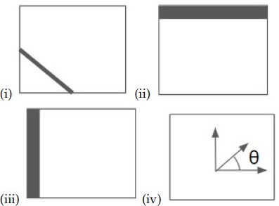

**Figure 1.** Source diagram of edge orientations for Question 250.

Choose the correct matching:

**Options**

**A.** (i) = tan⁻¹((∂f/∂y) / (∂f/∂x)), (ii) = (∂f/∂x, 0), (iii) = (0, ∂f/∂y), (iv) = (∂f/∂x, ∂f/∂y)  
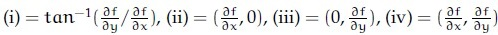

**Figure 2.** Option A image for Question 250.
*Option ID:* `6406533045019`

**B.** (i) = tan⁻¹((∂f/∂y) / (∂f/∂x)), (ii) = (0, ∂f/∂y), (iii) = (∂f/∂x, 0), (iv) = (∂f/∂x, ∂f/∂y)  
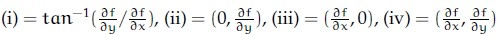

**Figure 3.** Option B image for Question 250.
*Option ID:* `6406533045020`

**C.** (i) = (∂f/∂x, ∂f/∂y), (ii) = (∂f/∂x, 0), (iii) = (0, ∂f/∂y), (iv) = tan⁻¹((∂f/∂y) / (∂f/∂x))  
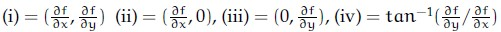

**Figure 4.** Option C image for Question 250.
*Option ID:* `6406533045021`

**D.** (i) = (∂f/∂x, ∂f/∂y), (ii) = (0, ∂f/∂y), (iii) = (∂f/∂x, 0), (iv) = tan⁻¹((∂f/∂y) / (∂f/∂x))  
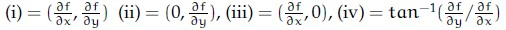

**Figure 5.** Option D image for Question 250.
*Option ID:* `6406533045022`

**Correct answer:** **D** — (i) = (∂f/∂x, ∂f/∂y), (ii) = (0, ∂f/∂y), (iii) = (∂f/∂x, 0), (iv) = tan⁻¹((∂f/∂y) / (∂f/∂x))  

**Worked explanation:** The gradient is $(I_x,I_y)$ and its direction is $\operatorname{atan2}(I_y,I_x)$; horizontal and vertical components occupy the corresponding axes.
The competing matching swaps the two component directions.

### da5006_2024T2_ET_AN · Q251 · 2 marks · ID 640653904303

Match the following:

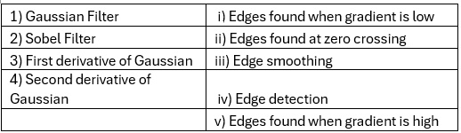

**Figure 6.** Source matching table of filters and edge properties for Question 251.

| Filter | Edge property |
| :--- | :--- |
| 1) Gaussian Filter | i) Edges found when gradient is low |
| 2) Sobel Filter | ii) Edges found at zero crossing |
| 3) First derivative of Gaussian | iii) Edge smoothing |
| 4) Second derivative of Gaussian | iv) Edge detection |
| | v) Edges found when gradient is high |

**Options**

**A.** 1→ iii, 2→ iv, 3 →i, 4 → ii  
*Option ID:* `6406533045023`

**B.** 1→ iii, 2→ i, 3 → ii, 4 → v  
*Option ID:* `6406533045024`

**C.** 1→ iii, 2→ iv, 3 →v, 4 → ii  
*Option ID:* `6406533045025`

**D.** 1→ iv, 2→ iii, 3 → i, 4→ ii  
*Option ID:* `6406533045026`

**Correct answer:** **C** — 1→ iii, 2→ iv, 3 →v, 4 → ii  

**Worked explanation:** A Gaussian smooths, Sobel estimates derivatives, a first derivative peaks at a step edge, and a second derivative crosses zero there.
The competing mapping to a low first derivative fails because the edge has a high gradient magnitude.

### da5006_2024T3_ET_AN · Q206 · 2 marks · ID 6406531046064

Match the following:

1) Gaussian Filter
2) Sobel Filter
3) First derivative of Gaussian
4) Second derivative of Gaussian

i) Edges found when gradient is low
ii) Edges found at zero crossing
iii) Edge smoothing
iv) Edge detection
v) Edges found when gradient is high

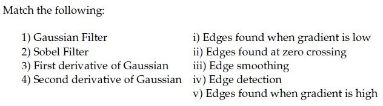
**Figure 8.** Source matching table for Question 206.

**Options**

**A.** 1→ iii, 2→ iv, 3→ i, 4 → ii  
*Option ID:* `6406533531374`

**B.** 1→ iii, 2→ i, 3 → ii, 4 →v  
*Option ID:* `6406533531375`

**C.** 1→ iii, 2→ iv, 3→ v, 4 → ii  
*Option ID:* `6406533531376`

**D.** 1→ iv, 2→ iii, 3→ i, 4 → ii  
*Option ID:* `6406533531377`

**Correct answer:** **C** — 1→ iii, 2→ iv, 3→ v, 4 → ii.  

**Worked explanation:** A Gaussian smooths, Sobel estimates derivatives, a first derivative peaks at a step edge, and a second derivative crosses zero there.
The competing mapping to a low first derivative fails because the edge has a high gradient magnitude.

### da5006_2024T3_ET_AN · Q210 · 2 marks · ID 6406531046073

Identify the correct sequence of steps in a Canny edge detection pipeline. Steps are listed below:

1. Compute gradient magnitude and direction
2. Connect individual components
3. Smoothen the image
4. Threshold into strong, weak, or no edge
5. Gaussian Filter and Hysteresis
6. Non-maximum suppression
7. Apply derivative to get edges

**Options**

**A.** 6→ 1→ 4→ 5 → 2  
*Option ID:* `6406533531394`

**B.** 3→ 1→ 6→ 4 → 2  
*Option ID:* `6406533531395`

**C.** 3→ 5→ 1→ 4 → 2  
*Option ID:* `6406533531396`

**D.** 6→ 8→ 5→ 7 → 2  
*Option ID:* `6406533531397`

**Correct answer:** **B** — 3→ 1→ 6→ 4 → 2.  

**Worked explanation:** Smooth first, calculate gradients, suppress nonmaxima, then threshold and connect weak edges to strong ones.
Starting with suppression is invalid because gradient magnitudes and directions are not yet available.

### da5006_2025T2_ET_AN · Q91 · 2 marks · ID 6406531431351

You are designing an edge detection pipeline for noisy grayscale images. For each of the following goals, choose the most appropriate filter or method: 1. Smooth out noise before any edge detection step 2. Detect edges by finding zero-crossings in the second derivative 3. Highlight regions with a strong intensity gradient 4. Perform basic edge detection with a simple directional gradient filter

**Options**

**A.** 1 → Gaussian filter, 2 → Laplacian of Gaussian, 3 → First derivative of Gaussian, 4 → Sobel operator  
*Option ID:* `6406534780277`

**B.** 1 → Sobel operator, 2 → Gaussian filter, 3 → Laplacian of Gaussian, 4 → First derivative of Gaussian  
*Option ID:* `6406534780278`

**C.** 1 → First derivative of Gaussian, 2 → Sobel operator, 3 → Gaussian filter, 4 → Laplacian of Gaussian  
*Option ID:* `6406534780279`

**D.** 1→Laplacian of Gaussian, 2→First derivative of Gaussian, 3→Sobel operator, 4→Gaussian filter  
*Option ID:* `6406534780280`

**Correct answer:** **A** — 1 → Gaussian filter, 2 → Laplacian of Gaussian, 3 → First derivative of Gaussian, 4 → Sobel operator.  

**Worked explanation:** Gaussian smoothing reduces noise, LoG zero crossings indicate edges, and first derivatives highlight gradient peaks; Sobel estimates a directional gradient.
The alternative that uses Sobel as the initial smoother confuses differentiation with low-pass filtering.

### da5006_2025T2_ET_AN · Q102 · 2 marks · ID 6406531431362

Which of the following are examples of a high-pass filter?

**Options**

**A.** 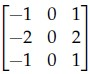

**Figure 8.** Option A filter kernel for Question 102.  
*Option ID:* `6406534780323`

**B.** 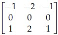

**Figure 9.** Option B filter kernel for Question 102.  
*Option ID:* `6406534780324`

**C.** 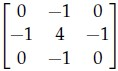

**Figure 10.** Option C filter kernel for Question 102.  
*Option ID:* `6406534780325`

**D.** 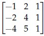

**Figure 11.** Option D filter kernel for Question 102.  
*Option ID:* `6406534780326`

**Correct answer:** **A, B, C** — Options A, B, and C.  

**Worked explanation:** Pending independent verification.

### da5006_2025T2_ET_FN · Q156 · 2 marks · ID 6406531422535

Consider the following orientation of edges:

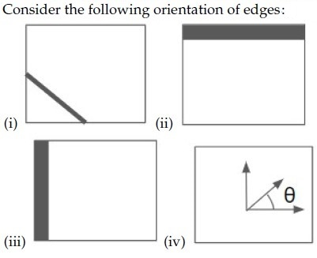

**Figure 1.** Question 156, source diagram of edge orientations.

Choose the correct matching:

**Options**

**A.** (i) = tan⁻¹(∂I/∂y / ∂I/∂x), (ii) = (∂I/∂x, 0), (iii) = (0, ∂I/∂y), (iv) = (∂I/∂x, ∂I/∂y)  
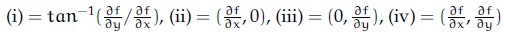
**Figure 2.** Option A image for Question 156.
*Option ID:* `6406534756356`

**B.** (i) = tan⁻¹(∂I/∂x / ∂I/∂y), (ii) = (0, ∂I/∂x), (iii) = (∂I/∂y, 0), (iv) = (∂I/∂x, ∂I/∂y)  
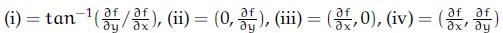
**Figure 3.** Option B image for Question 156.
*Option ID:* `6406534756357`

**C.** (i) = (∂I/∂x, ∂I/∂y), (ii) = (∂I/∂x, 0), (iii) = (0, ∂I/∂y), (iv) = tan⁻¹(∂I/∂y / ∂I/∂x)  
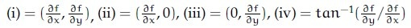
**Figure 4.** Option C image for Question 156.
*Option ID:* `6406534756358`

**D.** (i) = (∂I/∂x, ∂I/∂y), (ii) = (0, ∂I/∂y), (iii) = (∂I/∂x, 0), (iv) = tan⁻¹(∂I/∂y / ∂I/∂x)  
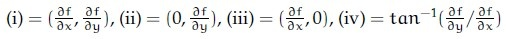
**Figure 5.** Option D image for Question 156.
*Option ID:* `6406534756359`

**Correct answer:** **D** — (i) = (∂I/∂x, ∂I/∂y), (ii) = (0, ∂I/∂y), (iii) = (∂I/∂x, 0), (iv) = tan⁻¹(∂I/∂y / ∂I/∂x).  

**Worked explanation:** The gradient is $(I_x,I_y)$ and its direction is $\operatorname{atan2}(I_y,I_x)$; horizontal and vertical components occupy the corresponding axes.
The competing matching swaps the two component directions.

### da5006_2025T2_ET_FN · Q157 · 2 marks · ID 6406531422536

Match the following:

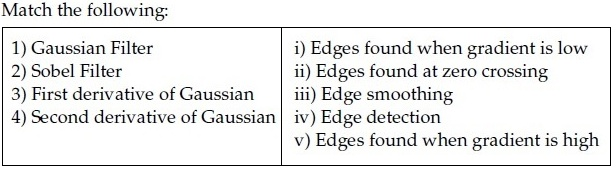

**Figure 6.** Question 157, source matching table.

**Options**

**A.** 1→ iii, 2→ iv, 3→ i, 4 → ii  
*Option ID:* `6406534756360`

**B.** 1→ iii, 2→ i, 3 → ii, 4 → v  
*Option ID:* `6406534756361`

**C.** 1→ iii, 2→ iv, 3→ v, 4 → ii  
*Option ID:* `6406534756362`

**D.** 1→ iv, 2→ iii, 3→ i, 4 → ii  
*Option ID:* `6406534756363`

**Correct answer:** **C** — 1→ iii, 2→ iv, 3→ v, 4 → ii.  

**Worked explanation:** A Gaussian smooths, Sobel estimates derivatives, a first derivative peaks at a step edge, and a second derivative crosses zero there.
The competing mapping to a low first derivative fails because the edge has a high gradient magnitude.

### da5006_2025T2_ET_FN · Q158 · 2 marks · ID 6406531422537

Identify the correct sequence of steps in a Canny edge detection pipeline. Steps are listed below:

1. Compute gradient magnitude and direction
2. Connect individual components
3. Smoothen the image
4. Threshold into strong, weak, or no edge
5. Gaussian Filter and Hysteresis
6. Non-maximum suppression
7. Apply derivative to get edges

**Options**

**A.** 6→ 1→ 4→ 5 → 2  
*Option ID:* `6406534756364`

**B.** 3→ 1→ 6→ 4 → 2  
*Option ID:* `6406534756365`

**C.** 3→ 5→ 1→ 4 → 2  
*Option ID:* `6406534756366`

**D.** 6→ 3→ 5→ 7 → 2  
*Option ID:* `6406534756367`

**Correct answer:** **B** — 3→ 1→ 6→ 4 → 2.  

**Worked explanation:** Smooth first, calculate gradients, suppress nonmaxima, then threshold and connect weak edges to strong ones.
Starting with suppression is invalid because gradient magnitudes and directions are not yet available.

### da5006_2025T2_ET_FN · Q176 · 2 marks · ID 6406531422555

Which of the following are examples of a high-pass filter?

**Options**

**A.** [-1 0 1; -2 0 2; -1 0 1]  
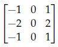
**Figure 22.** Option A image for Question 176.
*Option ID:* `6406534756440`

**B.** [-1 -2 -1; 0 0 0; 1 2 1]  
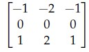
**Figure 23.** Option B image for Question 176.
*Option ID:* `6406534756441`

**C.** [0 -1 0; -1 4 -1; 0 -1 0]  
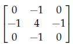
**Figure 24.** Option C image for Question 176.
*Option ID:* `6406534756442`

**D.** [-1 0 1; -1 0 1; -1 0 1]  
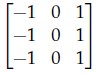
**Figure 25.** Option D image for Question 176.
*Option ID:* `6406534756443`

**Correct answer:** **A**, **B**, **C**, **D** — [-1 0 1; -2 0 2; -1 0 1]; [-1 -2 -1; 0 0 0; 1 2 1]; [0 -1 0; -1 4 -1; 0 -1 0]; [-1 0 1; -1 0 1; -1 0 1].  

**Worked explanation:** All four kernels sum to zero, eliminating constant images; A, B and D are directional derivatives, and C is a Laplacian.
A normalized averaging kernel, in contrast, retains the DC component and is low-pass.

### da5006_2026T1_ET_FN · Q5 · 2 marks · ID 6406532136820

The Sobel operator primarily estimates:

**Options**

**A.** Local intensity mean  
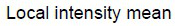  
**Figure 1.** Option A image for Question 5.  
*Option ID:* `6406536959489`

**B.** Image gradients (approx. $\partial I/\partial x$, $\partial I/\partial y$)  
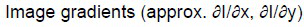  
**Figure 2.** Option B image for Question 5.  
*Option ID:* `6406536959490`

**C.** Laplacian of Gaussian only  
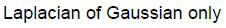  
**Figure 3.** Option C image for Question 5.  
*Option ID:* `6406536959491`

**D.** Harris corner response directly  
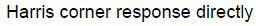  
**Figure 4.** Option D image for Question 5.  
*Option ID:* `6406536959492`

**Correct answer:** **B** — Image gradients (approx. $\partial I/\partial x$, $\partial I/\partial y$).  

**Worked explanation:** Sobel combines a finite-difference derivative in one direction with smoothing in the other to estimate image gradients.
It does not directly calculate a Harris response, which additionally uses local gradient products.

### da5006_2026T2_ET_FN · Q4 · 2 marks · ID 6406532270043

At a point on an ideal straight intensity edge, the local image-gradient vector is most naturally interpreted as pointing:

**Options**

**A.** Along the tangent direction of the edge  
*Option ID:* `6406537379011`

**B.** Approximately normal to the edge  
*Option ID:* `6406537379012`

**C.** Along the direction of maximum smoothing  
*Option ID:* `6406537379013`

**D.** Along the local isophote  
*Option ID:* `6406537379014`

**Correct answer:** **B** — Approximately normal to the edge.  

**Worked explanation:** The gradient points in the direction of steepest intensity increase, perpendicular to an ideal constant-intensity edge.
A tangent follows an isophote and has zero directional derivative in the ideal case.

### da5006_2024T1_Q1_NA · Q162 · 2 marks · ID 640653739737

Identify the correct sequence of steps in a Canny edge detection pipeline. Steps listed below:

1. Compute gradient magnitude and direction
2. Connect individual components
3. Smoothen the image
4. Non-maximum suppression along the edge
5. Threshold into strong, weak or no edge
6. Non-maximum suppression perpendicular to the edge

**Options**

**A.** 3→ 1→ 4→ 5 → 2  
*Option ID:* `6406532474468`

**B.** 3→ 5→ 1→ 4 → 2  
*Option ID:* `6406532474469`

**C.** 3→ 1→ 6→ 5 → 2  
*Option ID:* `6406532474470`

**D.** 3→ 1→ 5→ 6 → 2  
*Option ID:* `6406532474471`

**Correct answer:** **C** — 3→ 1→ 6→ 5 → 2.  

**Worked explanation:** Gaussian smoothing precedes gradients; non-maximum suppression compares magnitudes along the gradient, normal to the edge.
Suppressing along the edge instead does not thin the gradient ridge across its width.

### da5006_2024T1_Q1_NA · Q168 · 2 marks · ID 640653739741

Which of the following statements are True?

**Options**

**A.** LoG Filter is not appropriate to be used for blob detection.  
*Option ID:* `6406532474475`

**B.** Image patches with large contrast changes (gradients) are easier to localize.  
*Option ID:* `6406532474476`

**C.** Gradients in at least two (significantly) different orientations are the hardest (e.g., corners) to detect.  
*Option ID:* `6406532474477`

**D.** In case of ‘Hysteresis Thresholding’, if gradient at a pixel is greater than high threshold that means it is an edge pixel.  
*Option ID:* `6406532474478`

**Correct answer:** **B**, **D** — B, D.  

**Worked explanation:** Strong local gradients support localization, and values above the high hysteresis threshold seed edges.
LoG can detect blobs, and corners with gradients in two directions are generally well localized, not hardest to detect.

### da5006_2024T1_Q1_NA · Q172 · 2 marks · ID 640653739739

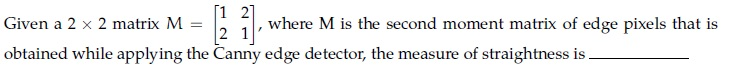

**Figure 12.** Source matrix equation and question text for Question 172.

Given a 2 x 2 matrix $M = \begin{bmatrix} 1 & 2 \\ 2 & 1 \end{bmatrix}$, where M is the second moment matrix of edge pixels that is obtained while applying the Canny edge detector, the measure of straightness is —___

**Correct answer:** `-0.4 to -0.3`  

**Worked explanation:** The eigenvalues are $3$ and $-1$, whose ratio $\lambda_{\min}/\lambda_{\max}=-1/3$ matches the key.
The question omits a precise straightness definition, and the matrix is not a valid positive-semidefinite second-moment matrix.

### da5006_2024T1_Q1_NA · Q173 · 2 marks · ID 640653739740

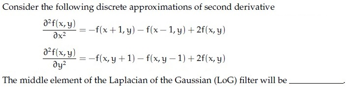

**Figure 13.** Discrete second derivative approximations and question text for Question 173.

Consider the following discrete approximations of second derivative:

$$\frac{\partial^2 F(x, y)}{\partial x^2} = F(x+1, y) - 2F(x, y) + F(x-1, y)$$

$$\frac{\partial^2 F(x, y)}{\partial y^2} = F(x, y+1) - 2F(x, y) + F(x, y-1)$$

The middle element of the Laplacian of the Gaussian (LoG) filter will be

**Correct answer:** `4`  

**Worked explanation:** Pending independent verification.

### da5006_2024T2_Q1_NA · Q96 · 2 marks · ID 640653829653

Given a 2 × 2 matrix $M = \begin{bmatrix} 1 & 2 \\ 2 & 1 \end{bmatrix}$ where $M$ is the second moment matrix of edge pixels that is obtained while applying the Canny edge detector, the measure of straightness is —____  

NOTE: Enter your answer in two decimal places.

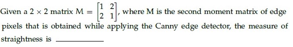

**Figure 25.** Source question stem for Question 96.

**Correct answer:** `-0.33`  

**Worked explanation:** The eigenvalues are $3$ and $-1$, whose ratio $\lambda_{\min}/\lambda_{\max}=-1/3$ matches the key.
The question omits a precise straightness definition, and the matrix is not a valid positive-semidefinite second-moment matrix.

### da5006_2024T2_Q1_NA · Q101 · 2 marks · ID 640653829657

**Context:** The gradient of an image I, points in the direction of most rapid change in intensity, taking image derivatives accentuates (a) ____ frequencies and hence amplifies noise, since the proportion of noise to signal is larger at (b) frequencies. The solution to this is (c) ______ the image prior to computing gradients.  
Based on the above data, answer the given subquestions.

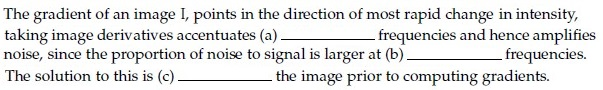

**Figure 27.** Source comprehension passage for Questions 101–103.

**Subquestion:** Fill in the blank for (a)_____________________

**Correct answer:** `high`  

**Worked explanation:** Differentiation multiplies a Fourier component by $i\omega$, increasing the relative weight of high frequencies.
The passage assumes noise has a larger relative contribution there, motivating smoothing before differentiation.

### da5006_2024T2_Q1_NA · Q102 · 1 marks · ID 640653829658

**Context:** The gradient of an image I, points in the direction of most rapid change in intensity, taking image derivatives accentuates (a) ____ frequencies and hence amplifies noise, since the proportion of noise to signal is larger at (b) frequencies. The solution to this is (c) ______ the image prior to computing gradients.  
Based on the above data, answer the given subquestions.

**Subquestion:** Fill in the blank for (b) _____________________

**Correct answer:** `high`  

**Worked explanation:** Differentiation multiplies a Fourier component by $i\omega$, increasing the relative weight of high frequencies.
The passage assumes noise has a larger relative contribution there, motivating smoothing before differentiation.

### da5006_2024T2_Q1_NA · Q103 · 1 marks · ID 640653829659

**Context:** The gradient of an image I, points in the direction of most rapid change in intensity, taking image derivatives accentuates (a) ____ frequencies and hence amplifies noise, since the proportion of noise to signal is larger at (b) frequencies. The solution to this is (c) ______ the image prior to computing gradients.  
Based on the above data, answer the given subquestions.

**Subquestion:** Fill in the blank for (c) _____________________

**Correct answer:** `smooth`  

**Worked explanation:** Smoothing suppresses high-frequency noise before the derivative magnifies it.
A Gaussian is a standard choice and sets the scale of the detected edges.

### da5006_2024T2_Q1_NA · Q104 · 2 marks · ID 640653829661

**Context:** In Canny edge detection, large value of the Gaussian kernel spread, $\sigma$ leads to (a) edges, and small value of $\sigma$ leads to (b) edges.  
Based on the above data, answer the given subquestions.

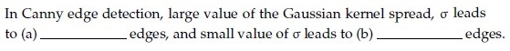

**Figure 28.** Source comprehension passage for Questions 104–105.

**Subquestion:** Fill in the blank for (a):

**Correct answer:** `thick` (accepted alternatives: `coarse`, `large scale`)  

**Worked explanation:** Increasing $\sigma$ suppresses fine details and produces a broader, coarse-scale gradient response.
After non-maximum suppression, retained contours may still be one pixel wide; coarse scale does not guarantee thick final edges.

### da5006_2024T2_Q1_NA · Q105 · 2 marks · ID 640653829662

**Context:** In Canny edge detection, large value of the Gaussian kernel spread, $\sigma$ leads to (a) edges, and small value of $\sigma$ leads to (b) edges.  
Based on the above data, answer the given subquestions.

**Subquestion:** Fill in the blank for (b):

**Correct answer:** `fine`  

**Worked explanation:** A smaller $\sigma$ retains finer-scale intensity changes, at the expense of greater noise sensitivity.
Final edge thickness also depends on non-maximum suppression, not solely on $\sigma$.

### da5006_2024T3_Q1_NA · Q147 · 2 marks · ID 640653994487

Identify the correct sequence of steps in a Canny edge detection pipeline. Steps are listed below:

1. Compute gradient magnitude and direction
2. Connect individual components
3. Smoothen the image
4. Threshold into strong, weak, or no edge
5. Gaussian Filter and Hysteresis
6. Non-maximum suppression
7. Apply derivative to get edges

**Options**

**A.** 6→ 1→ 4→ 5 → 2  
*Option ID:* `6406533358220`

**B.** 3→ 1→ 6→ 4 → 2  
*Option ID:* `6406533358221`

**C.** 3→ 5→ 1→ 4 → 2  
*Option ID:* `6406533358222`

**D.** 6→ 8→ 5→ 7 → 2  
*Option ID:* `6406533358223`

**Correct answer:** **B** — 3→ 1→ 6→ 4 → 2.  

**Worked explanation:** Smooth first, calculate gradients, suppress nonmaxima, then threshold and connect weak edges to strong ones.
Starting with suppression is invalid because gradient magnitudes and directions are not yet available.

### da5006_2024T3_Q1_NA · Q158 · 0.5 marks · ID 640653994492

**Comprehension Context (Questions 158 to 160):**

The gradient of an image I, points in the direction of most rapid change in intensity, taking image derivatives accentuates (a) ____________ frequencies and hence amplifies noise, since the proportion of noise to signal is larger at (b) __________ frequencies. The solution to this is (c) _________ the image prior to computing gradients.

Based on the above data, answer the given subquestions.

**Subquestion:**

Enter the correct answer for (a).

NOTE: Enter the exact answer without any space in the beginning or at the end.

Response Type : Alphanumeric  
Answers Type : Equal  
Answers Case Sensitive : No

**Correct answer:** high  

**Worked explanation:** Differentiation multiplies a Fourier component by $i\omega$, increasing the relative weight of high frequencies.
The passage assumes noise has a larger relative contribution there, motivating smoothing before differentiation.

### da5006_2024T3_Q1_NA · Q159 · 0.5 marks · ID 640653994493

*(Context: Refer to Comprehension passage above Question 158)*

Enter the correct answer for (b).

NOTE: Enter the exact answer without any space in the beginning or at the end.

Response Type : Alphanumeric  
Answers Type : Equal  
Answers Case Sensitive : No

**Correct answer:** high  

**Worked explanation:** Differentiation multiplies a Fourier component by $i\omega$, increasing the relative weight of high frequencies.
The passage assumes noise has a larger relative contribution there, motivating smoothing before differentiation.

### da5006_2024T3_Q1_NA · Q160 · 1 marks · ID 640653994494

*(Context: Refer to Comprehension passage above Question 158)*

Enter the correct answer for (c).

NOTE: Enter the exact answer without any space in the beginning or at the end.

Response Type : Alphanumeric  
Answers Type : Equal  
Answers Case Sensitive : No

**Correct answer:** smooth  

**Worked explanation:** Smoothing suppresses high-frequency noise before the derivative magnifies it.
A Gaussian is a standard choice and sets the scale of the detected edges.

### da5006_2024T3_Q1_NA · Q161 · 1 marks · ID 640653994496

**Comprehension Context (Questions 161 to 162):**

In Canny edge detection, large value of the Gaussian kernel spread, $\sigma$ leads to (a) __________ edges, and small value of $\sigma$ leads to (b) __________ edges.

Based on the above data, answer the given subquestions.

**Subquestion:**

Enter the correct answer for (a).

NOTE: Enter the exact answer without any space in the beginning or at the end.

Response Type : Alphanumeric  
Answers Type : Set  
Answers Case Sensitive : No

**Correct answer:** thick (Accepted alternatives: coarse, large scale)  

**Worked explanation:** Increasing $\sigma$ suppresses fine details and produces a broader, coarse-scale gradient response.
After non-maximum suppression, retained contours may still be one pixel wide; coarse scale does not guarantee thick final edges.

### da5006_2024T3_Q1_NA · Q162 · 1 marks · ID 640653994497

*(Context: Refer to Comprehension passage above Question 161)*

Enter the correct answer for (b) .

NOTE: Enter the exact answer without any space in the beginning or at the end.

Response Type : Alphanumeric  
Answers Type : Equal  
Answers Case Sensitive : No

**Correct answer:** fine  

**Worked explanation:** A smaller $\sigma$ retains finer-scale intensity changes, at the expense of greater noise sensitivity.
Final edge thickness also depends on non-maximum suppression, not solely on $\sigma$.

### da5006_2024T3_Q1_NA · Q170 · 2 marks · ID 640653994489

Given a 2 × 2 matrix $M = \begin{bmatrix} E & F \\ F & G \end{bmatrix}$ where $M$ is the second moment matrix of edge pixels that is obtained while applying the Canny edge detector, the measure of straightness is _________

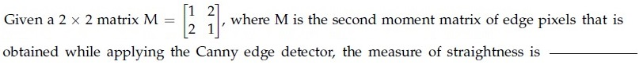

**Figure 28.** Second moment matrix definition for Question 170.

Response Type : Numeric  
Answers Type : Range

**Correct answer:** -0.34 to -0.29  

**Worked explanation:** Pending independent verification.

### da5006_2025T1_Q1_NA · Q157 · 2 marks · ID 6406531130622

Given a $2 \times 2$ matrix $M = \begin{bmatrix} 1 & 2 \\ 2 & 1 \end{bmatrix}$ where $M$ is the second moment matrix of edge pixels that is obtained while applying the Canny edge detector, the measure of straightness is _________

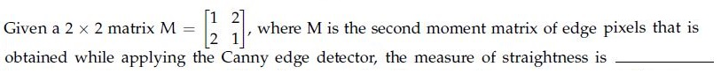

**Figure 4.** Second moment matrix equation for Question 157.

**Correct answer:** `-0.34 to -0.33`  

**Worked explanation:** The eigenvalues are $3$ and $-1$, whose ratio $\lambda_{\min}/\lambda_{\max}=-1/3$ matches the key.
The question omits a precise straightness definition, and the matrix is not a valid positive-semidefinite second-moment matrix.

### da5006_2025T1_Q1_NA · Q164 · 2 marks · ID 6406531130620

Identify the correct sequence of steps in a Canny edge detection pipeline. Steps are listed below:

1. Compute gradient magnitude and direction
2. Connect individual components
3. Smoothen the image
4. Threshold into strong, weak, or no edge
5. Gaussian Filter and Hysteresis
6. Non-maximum suppression
7. Apply derivative to get edges

**Options**

**A.** 6→ 1→ 4→ 5 → 2  
*Option ID:* `6406533822701`

**B.** 3→ 1→ 6→ 4 → 2  
*Option ID:* `6406533822702`

**C.** 3→ 5→ 1→ 4 → 2  
*Option ID:* `6406533822703`

**D.** 6→ 1→ 5→ 7 → 2  
*Option ID:* `6406533822704`

**Correct answer:** **B** — 3→ 1→ 6→ 4 → 2.  

**Worked explanation:** Smooth first, calculate gradients, suppress nonmaxima, then threshold and connect weak edges to strong ones.
Starting with suppression is invalid because gradient magnitudes and directions are not yet available.

### da5006_2025T1_Q1_NA · Q173 · 2 marks · ID 6406531130649

Match the following:

| Column 1 | Column 2 |
| :--- | :--- |
| 1) Gaussian Filter | i) Edges found when gradient is low |
| 2) Sobel Filter | ii) Edges found at zero crossing |
| 3) First derivative of Gaussian | iii) Edge smoothing |
| 4) Second derivative of Gaussian | iv) Edge detection |
| | v) Edges found when gradient is high |

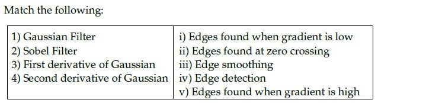

**Figure 10.** Filter and edge operation matching table for Question 173.

**Options**

**A.** 1→ iii, 2→ iv, 3→ i, 4 → ii  
*Option ID:* `6406533822759`

**B.** 1→ iii, 2→ i, 3 → ii, 4 →v  
*Option ID:* `6406533822760`

**C.** 1→ iii, 2→ iv, 3→ v, 4 → ii  
*Option ID:* `6406533822761`

**D.** 1→ iv, 2→ iii, 3→ i, 4 → ii  
*Option ID:* `6406533822762`

**Correct answer:** **C** — 1→ iii, 2→ iv, 3→ v, 4 → ii.  

**Worked explanation:** A Gaussian smooths, Sobel estimates derivatives, a first derivative peaks at a step edge, and a second derivative crosses zero there.
The competing mapping to a low first derivative fails because the edge has a high gradient magnitude.

### da5006_2025T1_Q1_NA · Q180 · 1 marks · ID 6406531130625

**Shared Comprehension Context (Question ID: `6406531130624`):**

> The gradient of an image I, points in the direction of most rapid change in intensity, taking image derivatives accentuates (a) _______ frequencies and hence amplifies noise, since the proportion of noise to signal is larger at (b) _______ frequencies. The solution to this is smooth the image prior to computing gradients.
>
> Based on the above data, answer the given subquestions.

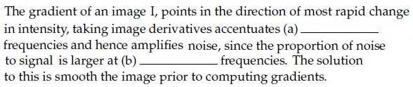

**Figure 25.** Source text passage for Comprehension Questions 180–181.

Enter the correct answer for blank (a) ____________

NOTE: Enter the exact answer without any extra space in the beginning or at the end.

**Correct answer:** `high`  

**Worked explanation:** Differentiation multiplies a Fourier component by $i\omega$, increasing the relative weight of high frequencies.
The passage assumes noise has a larger relative contribution there, motivating smoothing before differentiation.

### da5006_2025T1_Q1_NA · Q181 · 1 marks · ID 6406531130626

**Shared Comprehension Context (Question ID: `6406531130624`):**

> The gradient of an image I, points in the direction of most rapid change in intensity, taking image derivatives accentuates (a) _______ frequencies and hence amplifies noise, since the proportion of noise to signal is larger at (b) _______ frequencies. The solution to this is smooth the image prior to computing gradients.
>
> Based on the above data, answer the given subquestions.

Enter the correct answer for blank (b) ____________

NOTE: Enter the exact answer without any extra space in the beginning or at the end.

**Correct answer:** `high`  

**Worked explanation:** Differentiation multiplies a Fourier component by $i\omega$, increasing the relative weight of high frequencies.
The passage assumes noise has a larger relative contribution there, motivating smoothing before differentiation.

### da5006_2025T1_Q1_NA · Q182 · 1 marks · ID 6406531130628

**Shared Comprehension Context (Question ID: `6406531130627`):**

> In Canny edge detection, large value of the Gaussian kernel spread, $\sigma$ leads to (a) ____ edges, and small value of $\sigma$ leads to (b) ____ edges.
>
> Based on the above data, answer the given subquestions.

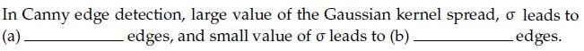

**Figure 26.** Source text passage for Comprehension Questions 182–183.

Enter the correct answer for blank (a) ____________

NOTE: Enter the exact answer without any extra space in the beginning or at the end.

**Correct answer:** `thick` / `coarse` / `large scale`  

**Worked explanation:** Increasing $\sigma$ suppresses fine details and produces a broader, coarse-scale gradient response.
After non-maximum suppression, retained contours may still be one pixel wide; coarse scale does not guarantee thick final edges.

### da5006_2025T1_Q1_NA · Q183 · 1 marks · ID 6406531130629

**Shared Comprehension Context (Question ID: `6406531130627`):**

> In Canny edge detection, large value of the Gaussian kernel spread, $\sigma$ leads to (a) ____ edges, and small value of $\sigma$ leads to (b) ____ edges.
>
> Based on the above data, answer the given subquestions.

Enter the correct answer for blank (b) ____________

NOTE: Enter the exact answer without any extra space in the beginning or at the end.

**Correct answer:** `fine`  

**Worked explanation:** A smaller $\sigma$ retains finer-scale intensity changes, at the expense of greater noise sensitivity.
Final edge thickness also depends on non-maximum suppression, not solely on $\sigma$.

### da5006_2025T2_Q1_NA · Q162 · 2 marks · ID 6406531279504

Identify the correct sequence of steps in a Canny edge detection pipeline. Steps are listed below:

1. Compute gradient magnitude and direction  
2. Connect individual components  
3. Smoothen the image  
4. Threshold into strong, weak, or no edge  
5. Gaussian Filter and Hysteresis  
6. Non-maximum suppression  
7. Apply derivative to get edges  

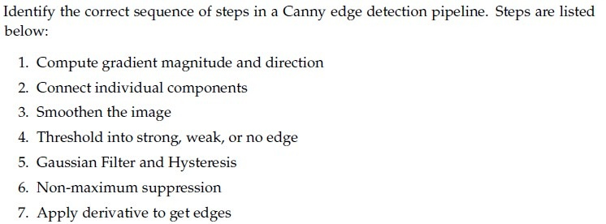

**Figure 8.** Canny edge detection pipeline steps for Question 162.

**Options**

**A.** 6 -> 1 -> 4 -> 5 -> 2

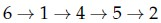

**Figure 9.** Option A candidate sequence for Question 162.  
*Option ID:* `6406534313861`

**B.** 3 -> 1 -> 6 -> 4 -> 2

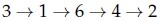

**Figure 10.** Option B candidate sequence for Question 162.  
*Option ID:* `6406534313862`

**C.** 3 -> 7 -> 6 -> 4 -> 2

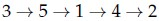

**Figure 11.** Option C candidate sequence for Question 162.  
*Option ID:* `6406534313863`

**D.** 6 -> 1 -> 5 -> 7 -> 2

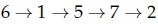

**Figure 12.** Option D candidate sequence for Question 162.  
*Option ID:* `6406534313864`

**Correct answer:** **B** — 3 -> 1 -> 6 -> 4 -> 2.  

**Worked explanation:** Smooth first, calculate gradients, suppress nonmaxima, then threshold and connect weak edges to strong ones.
Starting with suppression is invalid because gradient magnitudes and directions are not yet available.

### da5006_2025T2_Q1_NA · Q164 · 2 marks · ID 6406531279506

During the double thresholding step in Canny edge detection, the high threshold is set at 100 and the low threshold is 40. A pixel gradient magnitude of 65 will be classified as:

**Options**

**A.** Strong edge  
*Option ID:* `6406534313869`

**B.** Weak edge  
*Option ID:* `6406534313870`

**C.** Non-edge  
*Option ID:* `6406534313871`

**D.** Ambiguous edge  
*Option ID:* `6406534313872`

**Correct answer:** **B** — Weak edge.  

**Worked explanation:** The magnitude satisfies $40\le65<100$, so it is a weak edge candidate.
It is not strong because it does not reach 100; hysteresis retains it only if connected to a strong edge.

### da5006_2025T2_Q1_NA · Q168 · 2 marks · ID 6406531279510

In the Gaussian smoothing step of the Canny edge detector, a Gaussian kernel of size 5 x 5 with standard deviation $\sigma$ is used to reduce noise. If the standard deviation $\sigma = 1.0$, what is the approximate value of the center weight in the Gaussian kernel? [Use the formula for Gaussian kernel weight at the center: $G(0, 0) = \frac{1}{2\pi \sigma^2}$].

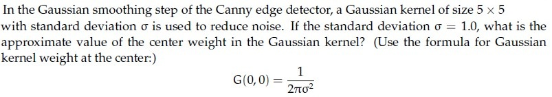

**Figure 28.** Gaussian kernel center weight problem statement for Question 168.

**Options**

**A.** 0.16  
*Option ID:* `6406534313885`

**B.** 0.08  
*Option ID:* `6406534313886`

**C.** 0.20  
*Option ID:* `6406534313887`

**D.** 0.12  
*Option ID:* `6406534313888`

**Correct answer:** **A** — 0.16.  

**Worked explanation:** The supplied formula gives $G(0,0)=1/(2\pi)\approx0.15915$, hence 0.16.
The 0.08 alternative is not the value obtained from the stated formula.

### da5006_2025T2_Q1_NA · Q169 · 2 marks · ID 6406531279511

Match the following.

1) Gaussian Filter  
2) Sobel Filter  
3) First derivative of Gaussian  
4) Second derivative of Gaussian  

Right column:

i) Edges found when gradient is low  
ii) Edges found at zero crossing  
iii) Edge smoothing  
iv) Edge detection  
v) Edges found when gradient is high  

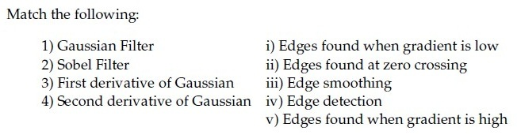

**Figure 29.** Filter type and property matching table for Question 169.

**Options**

**A.** 1 -> iii, 2 -> iv, 3 -> i, 4 -> ii

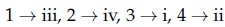

**Figure 30.** Option A candidate mapping for Question 169.  
*Option ID:* `6406534313889`

**B.** 1 -> iii, 2 -> i, 3 -> ii, 4 -> v

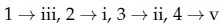

**Figure 31.** Option B candidate mapping for Question 169.  
*Option ID:* `6406534313890`

**C.** 1 -> iii, 2 -> iv, 3 -> v, 4 -> ii

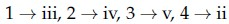

**Figure 32.** Option C candidate mapping for Question 169.  
*Option ID:* `6406534313891`

**D.** 1 -> iv, 2 -> iii, 3 -> i, 4 -> ii

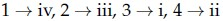

**Figure 33.** Option D candidate mapping for Question 169.  
*Option ID:* `6406534313892`

**Correct answer:** **C** — 1 -> iii, 2 -> iv, 3 -> v, 4 -> ii.  

**Worked explanation:** A Gaussian smooths, Sobel estimates derivatives, a first derivative peaks at a step edge, and a second derivative crosses zero there.
The competing mapping to a low first derivative fails because the edge has a high gradient magnitude.

### da5006_2025T2_Q1_NA · Q177 · 3 marks · ID 6406531279519

Consider the following discrete approximations of second derivative:

$$\frac{\partial^2 f(x, y)}{\partial x^2} = - f(x+1, y) - f(x-1, y) + 2 f(x, y)$$

$$\frac{\partial^2 f(x, y)}{\partial y^2} = - f(x, y+1) - f(x, y-1) + 2 f(x, y)$$

The middle element of the Laplacian of the Gaussian (LoG) filter will be _____?

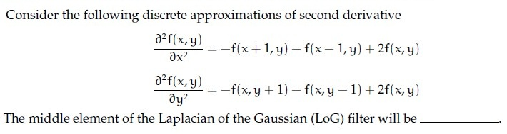

**Figure 59.** Second derivative discrete approximations for Question 177.

**Correct answer:** `4`  

**Worked explanation:** The two stated second-derivative stencils contribute $+2$ each at the center, giving $2+2=4$.
This sign convention is the negative of the usual discrete Laplacian; Gaussian convolution would alter the resulting center coefficient.

### da5006_2025T2_Q1_NA · Q178 · 3 marks · ID 6406531279520

Given a 2 x 2 second moment matrix of edge pixel $M = \begin{bmatrix} 1 & 2 \\ 2 & 1 \end{bmatrix}$ obtained during the Canny edge detection process, compute the measure of straightness defined as:

$$\text{Straightness} = \frac{\lambda_{\min} - \lambda_{\max}}{\lambda_{\max} + \lambda_{\min}}$$

where $\lambda_{\max}$ and $\lambda_{\min}$ are the maximum and minimum eigenvalues of $M$ respectively.

The value of the straightness is _____?

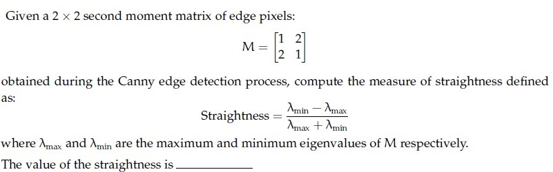

**Figure 60.** Second moment matrix and straightness formula for Question 178.

**Correct answer:** `-2`  

**Worked explanation:** The eigenvalues are $3$ and $-1$, so the stated expression is $(-1-3)/(3-1)=-2$.
The negative eigenvalue means this matrix cannot be a genuine positive-semidefinite second-moment matrix.

### da5006_2025T2_Q1_NA · Q185 · 1.5 marks · ID 6406531279522

**Shared Comprehension Context (Question ID: `6406531279521`):**

> The gradient of an image I points in the direction of the most rapid change in intensity. Taking image derivatives accentuates (a)_________________ frequencies and hence amplifies noise, since the proportion of noise to signal is larger at (b) _________________frequencies. The common solution is to smooth the image prior to computing gradients.
>
> Based on the above data, answer the given subquestions.

Enter the correct answer for Blank (a):

NOTE: Enter the exact answer without any extra space in the beginning or at the end.

**Correct answer:** `high, higher, large, largest` (accepted set; case-insensitive)  

**Worked explanation:** Differentiation multiplies a Fourier component by $i\omega$, increasing the relative weight of high frequencies.
The passage assumes noise has a larger relative contribution there, motivating smoothing before differentiation.

### da5006_2025T2_Q1_NA · Q186 · 1.5 marks · ID 6406531279523

**Shared Comprehension Context (Question ID: `6406531279521`):**

> The gradient of an image I points in the direction of the most rapid change in intensity. Taking image derivatives accentuates (a)_________________ frequencies and hence amplifies noise, since the proportion of noise to signal is larger at (b) _________________frequencies. The common solution is to smooth the image prior to computing gradients.
>
> Based on the above data, answer the given subquestions.

Enter the correct answer for Blank (b):

NOTE: Enter the exact answer without any extra space in the beginning or at the end.

**Correct answer:** `high, higher, large, largest` (accepted set; case-insensitive)  

**Worked explanation:** Differentiation multiplies a Fourier component by $i\omega$, increasing the relative weight of high frequencies.
The passage assumes noise has a larger relative contribution there, motivating smoothing before differentiation.

### da5006_2025T2_Q1_NA · Q187 · 1.5 marks · ID 6406531279525

**Shared Comprehension Context (Question ID: `6406531279524`):**

> In Canny edge detection, a large value of the Gaussian kernel spread $\sigma$ leads to (a)________________ edges, while a small value of $\sigma$ leads to (b)_________________ edges.
>
> Based on the above data, answer the given subquestions.

Enter the correct answer for Blank (a) :

NOTE: Enter the exact answer without any extra space in the beginning or at the end.

**Correct answer:** `thick, coarse, large-scale` (accepted set; case-insensitive)  

**Worked explanation:** Increasing $\sigma$ suppresses fine details and produces a broader, coarse-scale gradient response.
After non-maximum suppression, retained contours may still be one pixel wide; coarse scale does not guarantee thick final edges.

### da5006_2025T2_Q1_NA · Q188 · 1.5 marks · ID 6406531279526

**Shared Comprehension Context (Question ID: `6406531279524`):**

> In Canny edge detection, a large value of the Gaussian kernel spread $\sigma$ leads to (a)________________ edges, while a small value of $\sigma$ leads to (b)_________________ edges.
>
> Based on the above data, answer the given subquestions.

Enter the correct answer for Blank (b) :

NOTE: Enter the exact answer without any extra space in the beginning or at the end.

**Correct answer:** `fine, thin` (accepted set; case-insensitive)  

**Worked explanation:** A smaller $\sigma$ retains finer-scale intensity changes, at the expense of greater noise sensitivity.
Final edge thickness also depends on non-maximum suppression, not solely on $\sigma$.

### da5006_2026T1_Q1_NA · Q2 · 1 marks · ID 6406531961516

In the Canny edge detector, which is the correct order of major steps?

**Options**

**A.** Non-maximum suppression → Gaussian smoothing → gradient computation → hysteresis thresholding  
*Option ID:* `6406536373687`

**B.** Gaussian smoothing → gradient computation → non-maximum suppression → hysteresis thresholding  
*Option ID:* `6406536373688`

**C.** Gradient computation → Gaussian smoothing → hysteresis thresholding → non-maximum suppression  
*Option ID:* `6406536373689`

**D.** Gaussian smoothing → hysteresis thresholding → non-maximum suppression → gradient computation  
*Option ID:* `6406536373690`

**Correct answer:** **B** — Gaussian smoothing → gradient computation → non-maximum suppression → hysteresis thresholding  

**Worked explanation:** Smooth first, calculate gradients, suppress nonmaxima, then threshold and connect weak edges to strong ones.
Starting with suppression is invalid because gradient magnitudes and directions are not yet available.

### da5006_2026T1_Q1_NA · Q14 · 1 marks · ID 6406531961527

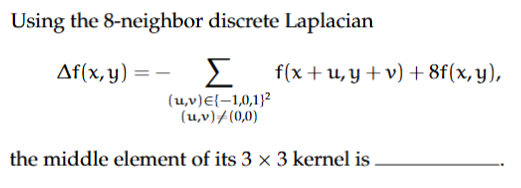

**Figure 12.** Discrete Laplacian definition and formula for Question 14.

Using the 8-neighbor discrete Laplacian

$$\Delta f(x, y) = - \sum_{\substack{(u, v) \in \{-1, 0, 1\}^2 \\ (u, v) \neq (0, 0)}} f(x+u, y+v) + 8 f(x, y),$$

the middle element of its $3 \times 3$ kernel is _____.

**Correct answer:** `8`  

**Worked explanation:** The given formula has coefficient $+8$ on the center pixel and $-1$ on each of its eight neighbors.
Thus the center entry is 8; the coefficients sum to zero on a constant image.

### da5006_2026T1_Q1_NA · Q15 · 1 marks · ID 6406531961528

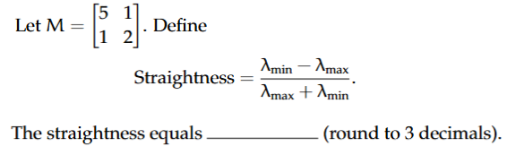

**Figure 13.** Matrix $M$ and straightness definition for Question 15.

Let $M = \begin{bmatrix} 5 & 1 \\ 1 & 2 \end{bmatrix}$. Define

$$\text{Straightness} = \frac{\lambda_{max} - \lambda_{min}}{\lambda_{max} + \lambda_{min}}$$

The straightness equals _______ (round to 3 decimals).

**Correct answer:** `-6 to -5`  

> [!WARNING] The eigenvalues are $(7\pm\sqrt{13})/2$ and their normalized difference has magnitude about 0.515, inconsistent with the source range.

**Worked explanation:** The eigenvalues of $M$ are $(7+\sqrt{13})/2$ and $(7-\sqrt{13})/2$.
Their normalized signed difference is $-\sqrt{13}/7\approx-0.5151$, outside the stated source range.

### da5006_2026T2_Q1_NA · Q2 · 1 marks · ID 6406532166253

In the Canny edge detector, which is the correct order of major steps?

**Options**

**A.** Non-maximum suppression → Gaussian smoothing → gradient computation → hysteresis thresholding  
*Option ID:* `6406537043603`

**B.** Gaussian smoothing → gradient computation → non-maximum suppression → hysteresis thresholding  
*Option ID:* `6406537043604`

**C.** Gradient computation → Gaussian smoothing → hysteresis thresholding → non-maximum suppression  
*Option ID:* `6406537043605`

**D.** Gaussian smoothing → hysteresis thresholding → non-maximum suppression → gradient computation  
*Option ID:* `6406537043606`

**Correct answer:** **B** — Gaussian smoothing → gradient computation → non-maximum suppression → hysteresis thresholding  

**Worked explanation:** Smooth first, calculate gradients, suppress nonmaxima, then threshold and connect weak edges to strong ones.
Starting with suppression is invalid because gradient magnitudes and directions are not yet available.

### da5006_2026T2_Q1_NA · Q13 · 1 marks · ID 6406532166263

**Figure 11.** Discrete Laplacian definition and formula for Question 13.

Using the 8-neighbor discrete Laplacian

$$\Delta f(x, y) = - \sum_{\substack{(u, v) \in \{-1, 0, 1\}^2 \\ (u, v) \neq (0, 0)}} f(x+u, y+v) + 8 f(x, y),$$

the middle element of its $3 \times 3$ kernel is _____.

**Correct answer:** `8`  

**Worked explanation:** The given formula has coefficient $+8$ on the center pixel and $-1$ on each of its eight neighbors.
Thus the center entry is 8; the coefficients sum to zero on a constant image.

### da5006_2026T2_Q1_NA · Q14 · 1 marks · ID 6406532166264

**Figure 12.** Matrix $M$ and straightness definition for Question 14.

Let $M = \begin{bmatrix} 5 & 1 \\ 1 & 2 \end{bmatrix}$. Define

$$\text{Straightness} = \frac{\lambda_{max} - \lambda_{min}}{\lambda_{max} + \lambda_{min}}$$

The straightness equals _______ (round to 3 decimals).

**Correct answer:** `-0.6 to -0.5`  

**Worked explanation:** Pending independent verification.

## Topic: Corners and blobs

| Done | Paper | Q# | Marks | Type |
| :--- | :--- | :--- | ---: | :--- |
| [ ] | da5006_2024T1_ET_AN | 186 | 2 | ET |
| [ ] | da5006_2026T1_ET_FN | 16 | 3 | ET |
| [ ] | da5006_2024T1_Q1_NA | 163 | 2 | Q1 |
| [ ] | da5006_2024T2_Q1_NA | 89 | 2 | Q1 |
| [ ] | da5006_2024T3_Q1_NA | 149 | 2 | Q1 |
| [ ] | da5006_2025T1_Q1_NA | 166 | 2 | Q1 |
| [ ] | da5006_2025T2_Q1_NA | 170 | 2 | Q1 |

### da5006_2024T1_ET_AN · Q186 · 2 marks · ID 640653821608

The cornerness score of the center pixel for the image represented by the matrix below is ___

$$\begin{bmatrix} 1 & 0 & 0 & 0 & 1 \\ 0 & 1 & 0 & 1 & 0 \\ 0 & 0 & 1 & 0 & 0 \\ 0 & 1 & 0 & 1 & 0 \\ 1 & 0 & 0 & 0 & 1 \end{bmatrix}$$

NOTE: Enter your answer in two decimal places.

**Figure 19.** Source diagram for Question 186.

**Correct answer:** **6.56**  

**Worked explanation:** Pending independent verification.

### da5006_2026T1_ET_FN · Q16 · 3 marks · ID 6406532136831

Select all correct statements:

**Options**

**A.** Harris corner detector responds strongly where gradient changes in two orthogonal directions.  
*Option ID:* `6406536959533`

**B.** Difference-of-Gaussians approximates Laplacian-of-Gaussian for blob detection.  
*Option ID:* `6406536959534`

**C.** SIFT descriptors are computed from raw pixel intensities without gradients.  
*Option ID:* `6406536959535`

**D.** Canny edge detector is a data driven method to calculate edges in an image.  
*Option ID:* `6406536959536`

**Correct answer:** **A**, **B** — Harris corner detector responds strongly where gradient changes in two orthogonal directions.; Difference-of-Gaussians approximates Laplacian-of-Gaussian for blob detection..  

**Worked explanation:** Harris responds to two strong local gradient directions, and a DoG approximates a scale-normalized LoG.
SIFT uses gradient histograms rather than raw pixels, while Canny is a designed algorithm rather than data-driven.

### da5006_2024T1_Q1_NA · Q163 · 2 marks · ID 640653739742

Match the following with the corresponding eigenvalues (assume that $\lambda_1$ measures change across a row of the image or the x — axis, and $\lambda_2$ measures change across a column or y — axis):

**Figure 2.** Source table for Question 163.

| Feature | Eigenvalue condition |
| :--- | :--- |
| 1) Vertical edge | i) $\lambda_1$ and $\lambda_2 \ll \infty$ |
| 2) Flat | ii) $\lambda_2 \gg \lambda_1$ |
| 3) Horizontal edge | iii) $\lambda_1$ and $\lambda_2 \gg 0$ |
| 4) Corner | iv) $\lambda_1 \gg \lambda_2$ |
| | v) $\lambda_1$ and $\lambda_2 \approx 0$ |

**Options**

**A.** 1→iii, 2 → iv, 3→ i,4→ v  
*Option ID:* `6406532474479`

**B.** 1→ii, 2→i, 3→iv,4→iii  
*Option ID:* `6406532474480`

**C.** 1→iii, 2→i, 3→iv,4→ii  
*Option ID:* `6406532474481`

**D.** 1→iv, 2→i, 3→iii,4→ii  
*Option ID:* `6406532474482`

**Correct answer:** **D** — 1→iv, 2→i, 3→iii,4→ii.  

**Worked explanation:** Pending independent verification.

### da5006_2024T2_Q1_NA · Q89 · 2 marks · ID 640653829663

Match the Following:  

| Left Column | Right Column |
| :--- | :--- |
| 1) Flat region in the image | i) No Change along the edge direction |
| 2) Edge pixel | ii) Significant change in all directions |
| 3) Corner pixel | iii) No Change in all directions |

**Figure 21.** Source matching table for Question 89.

**Options**

**A.** 1→ iii, 2→ i, 3 → ii  
*Option ID:* `6406532786675`

**B.** 1→ iii, 2→ ii, 3 → i  
*Option ID:* `6406532786676`

**C.** 1→ ii, 2→ iii, 3 → i  
*Option ID:* `6406532786677`

**D.** None of these  
*Option ID:* `6406532786678`

**Correct answer:** **A** — 1→ iii, 2→ i, 3 → ii.  

**Worked explanation:** A flat region changes little in either direction; an edge changes across its normal but little along its tangent; a corner changes in both directions.
The alternative swapping edge and corner confuses one strong eigenvalue with two.

### da5006_2024T3_Q1_NA · Q149 · 2 marks · ID 640653994498

Match the Following:

1) Flat region in the image — i) No Change along the edge direction  
2) Edge pixel — ii) Significant change in all directions  
3) Corner pixel — iii) No Change in all directions

**Figure 3.** Matching table for Question 149.

**Options**

**A.** 1→ iii, 2→ i, 3 → ii  
*Option ID:* `6406533358238`

**B.** 1→ iii, 2→ ii, 3 → i  
*Option ID:* `6406533358239`

**C.** 1→ ii, 2→ iii, 3 → i  
*Option ID:* `6406533358240`

**D.** None of these.  
*Option ID:* `6406533358241`

**Correct answer:** **A** — 1→ iii, 2→ i, 3 → ii.  

**Worked explanation:** A flat region changes little in either direction; an edge changes across its normal but little along its tangent; a corner changes in both directions.
The alternative swapping edge and corner confuses one strong eigenvalue with two.

### da5006_2025T1_Q1_NA · Q166 · 2 marks · ID 6406531130630

Match the Following:

| Column 1 | Column 2 |
| :--- | :--- |
| 1) Flat region in the image | i) No Change along the edge direction |
| 2) Edge pixel | ii) Significant change in all directions |
| 3) Corner pixel | iii) No Change in all directions |

**Figure 8.** Source table for Question 166.

**Options**

**A.** 1→ iii, 2→ i, 3 → ii  
*Option ID:* `6406533822718`

**B.** 1→ iii, 2→ ii, 3 → i  
*Option ID:* `6406533822719`

**C.** 1→ ii, 2→ iii, 3 → ii  
*Option ID:* `6406533822720`

**D.** None of these  
*Option ID:* `6406533822721`

**Correct answer:** **A** — 1→ iii, 2→ i, 3 → ii.  

**Worked explanation:** A flat region changes little in either direction; an edge changes across its normal but little along its tangent; a corner changes in both directions.
The alternative swapping edge and corner confuses one strong eigenvalue with two.

### da5006_2025T2_Q1_NA · Q170 · 2 marks · ID 6406531279512

Match the Following.

1) Flat region in the image  
2) Edge pixel  
3) Corner pixel  

Right column:

i) No Change along the edge direction  
ii) Significant change in all directions  
iii) No Change in all directions  

**Figure 34.** Image region feature matching table for Question 170.

**Options**

**A.** 1 -> iii, 2 -> i, 3 -> ii

**Figure 35.** Option A candidate mapping for Question 170.  
*Option ID:* `6406534313893`

**B.** 1 -> iii, 2 -> ii, 3 -> i

**Figure 36.** Option B candidate mapping for Question 170.  
*Option ID:* `6406534313894`

**C.** 1 -> ii, 2 -> iii, 3 -> ii

**Figure 37.** Option C candidate mapping for Question 170.  
*Option ID:* `6406534313895`

**D.** None of these.

**Figure 38.** Option D statement for Question 170.  
*Option ID:* `6406534313896`

**Correct answer:** **A** — 1 -> iii, 2 -> i, 3 -> ii.  

**Worked explanation:** A flat region changes little in either direction; an edge changes across its normal but little along its tangent; a corner changes in both directions.
The alternative swapping edge and corner confuses one strong eigenvalue with two.

## Topic: Scale space, pyramids and filter banks

| Done | Paper | Q# | Marks | Type |
| :--- | :--- | :--- | ---: | :--- |
| [ ] | da5006_2024T1_ET_AN | 188 | 2 | ET |
| [ ] | da5006_2024T2_ET_AN | 260 | 2 | ET |
| [ ] | da5006_2025T2_ET_AN | 93 | 2 | ET |
| [ ] | da5006_2025T2_ET_FN | 167 | 2 | ET |
| [ ] | da5006_2026T1_ET_FN | 7 | 2 | ET |
| [ ] | da5006_2026T2_ET_FN | 5 | 2 | ET |
| [ ] | da5006_2026T2_ET_FN | 22 | 3 | ET |
| [ ] | da5006_2026T2_ET_FN | 31 | 4 | ET |

### da5006_2024T1_ET_AN · Q188 · 2 marks · ID 640653821614

Assume that you have been given an octave of scale-space representation of an image of size N x N that has been formed by convolving it with a Gaussian filter at different scales of $\sigma$, where $\sigma$ is varied from $k^0\sigma$ to $k^{s+2}\sigma$ and $k = 2^{1/s}$. The number of DoG (Difference-of-Gaussian) outputs obtained from the above octave is __.

**Figure 21.** Source diagram for Question 188.

**Correct answer:** **4**  

**Worked explanation:** The octave contains $s+3$ Gaussian levels, so adjacent differences produce $s+2$ DoG images.
The source answer 4 requires $s=2$, which is not specified in this version of the question.

### da5006_2024T2_ET_AN · Q260 · 2 marks · ID 640653904301

Assume that you have been given an octave of scale-space representation of an image of size $N \times N$ that has been formed by convolving it with a Gaussian filter at different scales of $\sigma$, where $\sigma$ is varied from $k^0 \sigma_0$ to $k^4 \sigma_0$ and $k = \sqrt{2}$. The number of DoG (Difference-of-Gaussian) outputs obtained from the above octave is

**Figure 18.** Source problem statement for Question 260.

**Correct answer:** `4`  

**Worked explanation:** The five levels $k^0\sigma_0,\ldots,k^4\sigma_0$ produce one DoG per adjacent pair.
Therefore $5-1=4$ DoG images are available.

### da5006_2025T2_ET_AN · Q93 · 2 marks · ID 6406531431353

Match the following:

**Figure 6.** Source matching table for Question 93.

| List 1 | List 2 |
| :--- | :--- |
| 1) Laplacian of Gaussian | i) Image Pyramid |
| 2) Scale-invariant interest point detection uses | ii) Filter banks |
| 3) Texture can be obtained by using | iii) Difference of Gaussian |
| 4) Gabor Filter | iv) Feature pyramid |
| | v) Gaussian + Sinusoid |

**Options**

**A.** 1→ iii, 2→ iv, 3→ ii, 4 → i  
*Option ID:* `6406534780285`

**B.** 1→ i, 2→ iv, 3 → iii, 4→ ii  
*Option ID:* `6406534780286`

**C.** 1→ iv, 2→ iii, 3→ ii, 4 → i  
*Option ID:* `6406534780287`

**D.** 1→ iii, 2→ i, 3 → ii, 4 →v  
*Option ID:* `6406534780288`

**Correct answer:** **D** — 1→ iii, 2→ i, 3 → ii, 4 →v.  

**Worked explanation:** DoG approximates scale-normalized LoG, scale selection uses a pyramid, filter banks characterize texture, and a Gabor filter combines a Gaussian envelope with a sinusoid.
The competing mapping of Gabor to a pyramid confuses the filter with a multiscale representation.

### da5006_2025T2_ET_FN · Q167 · 2 marks · ID 6406531422546

Match the following:

**Figure 20.** Question 167, source matching table.

**Options**

**A.** 1→ iii, 2→ iv, 3→ ii, 4 → i  
*Option ID:* `6406534756400`

**B.** 1→ i, 2→ iv, 3 → iii, 4→ ii  
*Option ID:* `6406534756401`

**C.** 1→ iv, 2→ iii, 3→ ii, 4 → i  
*Option ID:* `6406534756402`

**D.** 1→ iii, 2→ i, 3 → ii, 4 →v  
*Option ID:* `6406534756403`

**Correct answer:** **D** — 1→ iii, 2→ i, 3 → ii, 4 →v.  

**Worked explanation:** DoG approximates scale-normalized LoG, scale selection uses a pyramid, filter banks characterize texture, and a Gabor filter combines a Gaussian envelope with a sinusoid.
The competing mapping of Gabor to a pyramid confuses the filter with a multiscale representation.

### da5006_2026T1_ET_FN · Q7 · 2 marks · ID 6406532136822

In classical scale-space theory, increasing $\sigma$ in Gaussian smoothing generally:

**Options**

**A.** Enhances high-frequency details  
*Option ID:* `6406536959497`

**B.** Suppresses high-frequency details and removes fine structures  
*Option ID:* `6406536959498`

**C.** Has no effect on edges  
*Option ID:* `6406536959499`

**D.** Increases noise  
*Option ID:* `6406536959500`

**Correct answer:** **B** — Suppresses high-frequency details and removes fine structures.  

**Worked explanation:** The Gaussian frequency response $e^{-\sigma^2\|\omega\|^2/2}$ decreases faster at nonzero frequency as $\sigma$ grows.
Thus fine structure is suppressed; the alternative claiming high-frequency enhancement reverses the effect.

### da5006_2026T2_ET_FN · Q5 · 2 marks · ID 6406532270044

An image is smoothed successively with Gaussian kernels of standard deviations 2 and 3. Ignoring discretization, the equivalent single Gaussian has standard deviation:

**Options**

**A.** $2.5$  
  
**Figure 1.** Option A image for Question 5.  
*Option ID:* `6406537379015`

**B.** $5$  
  
**Figure 2.** Option B image for Question 5.  
*Option ID:* `6406537379016`

**C.** $\sqrt{13}$  
  
**Figure 3.** Option C image for Question 5.  
*Option ID:* `6406537379017`

**D.** $6$  
  
**Figure 4.** Option D image for Question 5.  
*Option ID:* `6406537379018`

**Correct answer:** **C** — $\sqrt{13}$.  

**Worked explanation:** Convolving Gaussians adds variances: $\sigma^2=2^2+3^2=13$, so $\sigma=\sqrt{13}$.
Adding standard deviations to obtain 5 is incorrect.

### da5006_2026T2_ET_FN · Q22 · 3 marks · ID 6406532270061

> [!NOTE] Week assignment uncertain: Tests Gaussian scales and pyramids alongside averaging filters.

Select all correct statements

**Options**

**A.** A normalized averaging filter preserves a constant-valued region away from boundary effects.  
*Option ID:* `6406537379083`

**B.** Increasing Gaussian scale suppresses progressively finer image structure.  
*Option ID:* `6406537379084`

**C.** Image pyramids represent image information at multiple spatial scales.  
*Option ID:* `6406537379085`

**D.** Cross-correlation always flips the filter before applying it.  
*Option ID:* `6406537379086`

**Correct answer:** **A**, **B**, **C** — A normalized averaging filter preserves a constant-valued region away from boundary effects.; Increasing Gaussian scale suppresses progressively finer image structure.; Image pyramids represent image information at multiple spatial scales..  

**Worked explanation:** A normalized averaging kernel sums to one, a larger Gaussian scale removes fine detail, and pyramids provide multiscale representations.
Cross-correlation does not flip the kernel; convolution does.

### da5006_2026T2_ET_FN · Q31 · 4 marks · ID 6406532270070

An image is smoothed successively by Gaussian kernels with $\sigma_1=1.2$ and $\sigma_2=1.6$. Ignoring discretization, compute the equivalent single Gaussian standard deviation.

**Correct answer:** `2.0`  

**Worked explanation:** Gaussian variances add under convolution: $1.2^2+1.6^2=1.44+2.56=4$.
Taking the square root gives the equivalent standard deviation $2.0$.

## Topic: Invariant features and geometric descriptors

| Done | Paper | Q# | Marks | Type |
| :--- | :--- | :--- | ---: | :--- |
| [ ] | da5006_2024T1_ET_AN | 162 | 2 | ET |
| [ ] | da5006_2024T1_ET_AN | 163 | 2 | ET |
| [ ] | da5006_2024T1_ET_AN | 164 | 2 | ET |
| [ ] | da5006_2024T1_ET_AN | 165 | 2 | ET |
| [ ] | da5006_2024T1_ET_AN | 166 | 2 | ET |
| [ ] | da5006_2024T2_ET_AN | 254 | 2 | ET |
| [ ] | da5006_2025T2_ET_FN | 161 | 2 | ET |
| [ ] | da5006_2026T1_ET_FN | 6 | 2 | ET |
| [ ] | da5006_2026T2_ET_FN | 6 | 2 | ET |
| [ ] | da5006_2024T1_Q1_NA | 161 | 2 | Q1 |
| [ ] | da5006_2024T1_Q1_NA | 164 | 2 | Q1 |
| [ ] | da5006_2024T1_Q1_NA | 165 | 2 | Q1 |
| [ ] | da5006_2024T1_Q1_NA | 166 | 2 | Q1 |
| [ ] | da5006_2024T1_Q1_NA | 171 | 2 | Q1 |
| [ ] | da5006_2024T1_Q1_NA | 176 | 0.5 | Q1 |
| [ ] | da5006_2024T1_Q1_NA | 177 | 0.5 | Q1 |
| [ ] | da5006_2024T1_Q1_NA | 178 | 0.5 | Q1 |
| [ ] | da5006_2024T1_Q1_NA | 179 | 0.5 | Q1 |
| [ ] | da5006_2024T1_Q1_NA | 180 | 1 | Q1 |
| [ ] | da5006_2024T1_Q1_NA | 181 | 1 | Q1 |
| [ ] | da5006_2024T2_Q1_NA | 87 | 2 | Q1 |
| [ ] | da5006_2024T2_Q1_NA | 88 | 2 | Q1 |
| [ ] | da5006_2024T2_Q1_NA | 90 | 2 | Q1 |
| [ ] | da5006_2024T2_Q1_NA | 91 | 2 | Q1 |
| [ ] | da5006_2024T2_Q1_NA | 92 | 2 | Q1 |
| [ ] | da5006_2024T2_Q1_NA | 106 | 1 | Q1 |
| [ ] | da5006_2024T2_Q1_NA | 107 | 1 | Q1 |
| [ ] | da5006_2024T2_Q1_NA | 108 | 1 | Q1 |
| [ ] | da5006_2024T2_Q1_NA | 109 | 1 | Q1 |
| [ ] | da5006_2024T3_Q1_NA | 148 | 2 | Q1 |
| [ ] | da5006_2024T3_Q1_NA | 150 | 2 | Q1 |
| [ ] | da5006_2024T3_Q1_NA | 163 | 0.5 | Q1 |
| [ ] | da5006_2024T3_Q1_NA | 164 | 0.5 | Q1 |
| [ ] | da5006_2024T3_Q1_NA | 165 | 0.5 | Q1 |
| [ ] | da5006_2024T3_Q1_NA | 166 | 0.5 | Q1 |
| [ ] | da5006_2025T1_Q1_NA | 165 | 2 | Q1 |
| [ ] | da5006_2025T1_Q1_NA | 167 | 2 | Q1 |
| [ ] | da5006_2025T1_Q1_NA | 184 | 0.5 | Q1 |
| [ ] | da5006_2025T1_Q1_NA | 185 | 0.5 | Q1 |
| [ ] | da5006_2025T1_Q1_NA | 186 | 0.5 | Q1 |
| [ ] | da5006_2025T1_Q1_NA | 187 | 0.5 | Q1 |
| [ ] | da5006_2025T2_Q1_NA | 163 | 2 | Q1 |
| [ ] | da5006_2025T2_Q1_NA | 189 | 1.5 | Q1 |
| [ ] | da5006_2025T2_Q1_NA | 190 | 1.5 | Q1 |
| [ ] | da5006_2026T1_Q1_NA | 4 | 1 | Q1 |
| [ ] | da5006_2026T1_Q1_NA | 12 | 1 | Q1 |
| [ ] | da5006_2026T2_Q1_NA | 4 | 1 | Q1 |
| [ ] | da5006_2026T2_Q1_NA | 11 | 1 | Q1 |
| [ ] | da5006_2024T1_Q2_NA | 162 | 2 | Q2 |

### da5006_2024T1_ET_AN · Q162 · 2 marks · ID 640653821588

Which property of the SIFT descriptor is primarily responsible for its resilience to changes in scale, viewpoint, and illumination?

**Options**

**A.** Scale space representation  
*Option ID:* `6406532757296`

**B.** Histogram of gradients  
*Option ID:* `6406532757297`

**C.** Keypoint detection  
*Option ID:* `6406532757298`

**D.** Orientation assignment  
*Option ID:* `6406532757299`

**Correct answer:** **A** — Scale space representation.  

**Worked explanation:** Scale-space detection supports scale invariance, but orientation assignment and normalized gradient histograms contribute rotation and illumination robustness.
The question attributes several different invariances to one property; scale-space alone does not establish general viewpoint invariance.

### da5006_2024T1_ET_AN · Q163 · 2 marks · ID 640653821589

In the Maximally Stable External Regions (MSER) algorithm, how does the tree structure contribute to the efficiency of region stability analysis?

**Options**

**A.** By enabling quick access to all regions in constant time.  
*Option ID:* `6406532757300`

**B.** By allowing for parallel computation of stability measures across regions.  
*Option ID:* `6406532757301`

**C.** By organizing regions hierarchically based on stability, facilitating efficient stability analysis.  
*Option ID:* `6406532757302`

**D.** By providing a compact representation of pixel intensities within each region, reducing computational overhead.  
*Option ID:* `6406532757303`

**Correct answer:** **C** — By organizing regions hierarchically based on stability, facilitating efficient stability analysis..  

**Worked explanation:** Thresholded connected regions nest as the intensity threshold changes, so a component tree organizes inclusion and allows stability to be compared across thresholds.
The tree does not give constant-time access to every region, as the competing option claims.

### da5006_2024T1_ET_AN · Q164 · 2 marks · ID 640653821590

In which scenarios is the Random Sample Consensus (RANSAC) algorithm more suitable compared to least squares?

**Options**

**A.** When the dataset contains a high percentage of outliers or erroneous data points.  
*Option ID:* `6406532757304`

**B.** When the dataset consists of noise-free and well-behaved data with minimal outliers.  
*Option ID:* `6406532757305`

**C.** When the computational resources are limited, and quick solutions are required.  
*Option ID:* `6406532757306`

**D.** When the dataset is small, and exact solutions are necessary without considering outliers.  
*Option ID:* `6406532757307`

**Correct answer:** **A** — When the dataset contains a high percentage of outliers or erroneous data points..  

**Worked explanation:** RANSAC samples minimal sets and scores consensus, so outliers need not dominate a fit when an all-inlier sample is found.
Ordinary least squares instead squares residuals and can be pulled strongly by outliers.

### da5006_2024T1_ET_AN · Q165 · 2 marks · ID 640653821591

In what way does VLAD (Vector of Locally Aggregated Descriptors) differ from Bag of Words (BoW) in representing visual features in images?

**Options**

**A.** VLAD captures spatial relationships between local descriptors, while BoW does not.  
*Option ID:* `6406532757308`

**B.** BoW captures spatial relationships between local descriptors, while VLAD does not.  
*Option ID:* `6406532757309`

**C.** VLAD and BoW both capture spatial relationships between local descriptors.  
*Option ID:* `6406532757310`

**D.** Neither VLAD nor BoW capture spatial relationships between local descriptors.  
*Option ID:* `6406532757311`

**Correct answer:** **A** — VLAD captures spatial relationships between local descriptors, while BoW does not..  

> [!WARNING] Standard VLAD aggregates residuals by visual word without encoding spatial relationships; D is the better answer, whereas the source key marks A.

**Worked explanation:** VLAD sums residuals between descriptors and their assigned visual-word centers.
Neither ordinary VLAD nor ordinary bag-of-words records the positions of those descriptors.

### da5006_2024T1_ET_AN · Q166 · 2 marks · ID 640653821592

How does pyramid matching differ from Speeded-Up Robust Features (SURF) in image matching?

**Options**

**A.** Pyramid matching matches images at multiple resolutions using multi-resolution representations, while SURF focuses on detecting and describing local features invariant to scale and rotation.  
*Option ID:* `6406532757312`

**B.** SURF relies on gradient-based descriptors for feature matching, whereas pyramid matching utilizes histogram-based representations.  
*Option ID:* `6406532757313`

**C.** Pyramid matching is computationally more efficient compared to SURF, which requires extensive feature extraction and matching procedures.  
*Option ID:* `6406532757314`

**D.** SURF is more suitable for matching images with complex patterns and cluttered backgrounds, while pyramid matching excels in scenarios where multi-scale matching is critical, such as image registration across different resolutions.  
*Option ID:* `6406532757315`

**Correct answer:** **A** — Pyramid matching matches images at multiple resolutions using multi-resolution representations, while SURF focuses on detecting and describing local features invariant to scale and rotation..  

**Worked explanation:** Pyramid matching compares representations at several resolutions; SURF detects and describes local features using scale-space and orientation information.
A claim of universally greater computational efficiency cannot follow from the methods alone.

### da5006_2024T2_ET_AN · Q254 · 2 marks · ID 640653904306

Which of the following is the correct sequence of steps of the SIFT algorithm? 
1. Using the Taylor series expansion of the scale-space function, localize the key points. 
2. Estimate the orientation of keypoints using the local image gradients. 
3. Find the edge points using the eigenvalues of the Hessian and reject these points. 
4. Find a raw SIFT descriptor vector using the gradient orientations of the neighborhood around the key points. 
5. Detect extreme points in scale space using an approximation of the Laplacian of Gaussian.

**Options**

**A.** 5, 2, 1, 3, 4  
*Option ID:* `6406533045035`

**B.** 5, 1, 3, 2, 4  
*Option ID:* `6406533045036`

**C.** 1, 3, 2, 4, 5  
*Option ID:* `6406533045037`

**D.** 1, 5, 3, 2, 4  
*Option ID:* `6406533045038`

**Correct answer:** **B** — 5, 1, 3, 2, 4  

**Worked explanation:** Detect scale-space extrema, refine their position, reject edge-like candidates, assign orientation, and build the descriptor.
Orientation assignment before localization, as in the competing sequence, lacks the refined keypoint.

### da5006_2025T2_ET_FN · Q161 · 2 marks · ID 6406531422540

Which of the following is the correct sequence of steps of the SIFT algorithm?

1. Using the Taylor series expansion of the scale-space function, lo-calize the key points.
2. Estimate the orientation of keypoints using the local image gra-dients.
3. Find the edge points using the eigenvalues of the Hessian and reject these points.
4. Find a raw SIFT descriptor vector using the gradient orientations of the neighborhood around the key points.
5. Detect extreme points in scale space using an approximation of the Laplacian of Gaussian.

**Options**

**A.** 5, 2, 1, 3, 4  
*Option ID:* `6406534756376`

**B.** 5, 1, 3, 2, 4  
*Option ID:* `6406534756377`

**C.** 1, 3, 2, 4, 5  
*Option ID:* `6406534756378`

**D.** 1, 5, 3, 2, 4  
*Option ID:* `6406534756379`

**Correct answer:** **B** — 5, 1, 3, 2, 4.  

**Worked explanation:** Detect scale-space extrema, refine their position, reject edge-like candidates, assign orientation, and build the descriptor.
Orientation assignment before localization, as in the competing sequence, lacks the refined keypoint.

### da5006_2026T1_ET_FN · Q6 · 2 marks · ID 6406532136821

SIFT is designed to be robust mainly to:

**Options**

**A.** Scale and rotation changes  
*Option ID:* `6406536959493`

**B.** Only translation (shifts)  
*Option ID:* `6406536959494`

**C.** Only illumination changes  
*Option ID:* `6406536959495`

**D.** Only affine viewpoint changes with no residual error  
*Option ID:* `6406536959496`

**Correct answer:** **A** — Scale and rotation changes.  

**Worked explanation:** SIFT selects a characteristic scale and expresses descriptor orientations relative to a keypoint orientation.
It is therefore robust to scale and in-plane rotation, but not perfectly invariant to arbitrary affine viewpoint changes.

### da5006_2026T2_ET_FN · Q6 · 2 marks · ID 6406532270045

Which design choice is most directly responsible for the rotation robustness of a SIFT descriptor?

**Options**

**A.** Detecting candidate keypoints across multiple image scales  
*Option ID:* `6406537379019`

**B.** Expressing local gradient orientations relative to an assigned keypoint orientation  
*Option ID:* `6406537379020`

**C.** Normalizing the descriptor vector after histogram construction  
*Option ID:* `6406537379021`

**D.** Building an image pyramid without assigning an orientation  
*Option ID:* `6406537379022`

**Correct answer:** **B** — Expressing local gradient orientations relative to an assigned keypoint orientation.  

**Worked explanation:** Subtracting the assigned dominant keypoint orientation puts gradient directions in a local reference frame.
A scale pyramid alone handles scale selection and does not compensate for image rotation.

### da5006_2024T1_Q1_NA · Q161 · 2 marks · ID 640653739736

Which of the following statements is false regarding SIFT and SURF?

**Options**

**A.** SIFT and SURF are two most useful approaches to detect and match features because they are invariant to scale, rotation, translation, illumination, and blur  
*Option ID:* `6406532474464`

**B.** SURF is better than SIFT in rotation invariance, blur and warp transform  
*Option ID:* `6406532474465`

**C.** SURF is 3 times faster than SIFT because of its use of integral image and box filter  
*Option ID:* `6406532474466`

**D.** descriptors with dimensions lower than 128 perform pretty well across a range of matching tasks  
*Option ID:* `6406532474467`

**Correct answer:** **D** — descriptors with dimensions lower than 128 perform pretty well across a range of matching tasks.  

**Worked explanation:** Pending independent verification.

### da5006_2024T1_Q1_NA · Q164 · 2 marks · ID 640653739748

In RANSAC, what is the probability that the algorithm never selects a whole set of inliers from 20 data points (which has 5 inliers in total) for k = 2 time steps? Here, n = 2 is the minimum number of samples to fit a model.

**Options**

**A.** 0.2  
*Option ID:* `6406532474487`

**B.** 0.93  
*Option ID:* `6406532474488`

**C.** 0.87  
*Option ID:* `6406532474489`

**D.** 0  
*Option ID:* `6406532474490`

**Correct answer:** **C** — 0.87.  

**Worked explanation:** Pending independent verification.

### da5006_2024T1_Q1_NA · Q165 · 2 marks · ID 640653739749

Suppose we have a codebook of 2048 SIFT visual words. We extract 1000 SIFT descriptors (SIFT is a 128-dimensional feature) from a new image. What is the dimensionality of the BoW (Bag-of-Words) descriptor?

**Options**

**A.** 1000  
*Option ID:* `6406532474491`

**B.** 128  
*Option ID:* `6406532474492`

**C.** 128 × 2048  
*Option ID:* `6406532474493`

**D.** 2048  
*Option ID:* `6406532474494`

**Correct answer:** **D** — 2048.  

**Worked explanation:** A bag-of-visual-words histogram has one bin for each of the 2048 codebook entries.
The 128 descriptor coordinates and 1000 extracted features do not determine the histogram length.

### da5006_2024T1_Q1_NA · Q166 · 2 marks · ID 640653739750

Match the following:

**Figure 3.** Source table for Question 166.

| Column 1 | Column 2 |
| :--- | :--- |
| 1) RANSAC | i) Used for image segmentation |
| 2) VLAD | ii) Performance depends on number of inliers |
| 3) Image retrieval | iii) Assumes nearby pixels have similar motion |
| 4) Optical flow | iv) Inverted file index |
| | v) Vector representation of visual word |

**Options**

**A.** 1→ iii, 2→ ii, 3 → iv, 4→ i  
*Option ID:* `6406532474495`

**B.** 1→ v, 2→i, 3 → iv, 4→ iii  
*Option ID:* `6406532474496`

**C.** 1→ iii, 2→ i, 3 → ii, 4 →v  
*Option ID:* `6406532474497`

**D.** 1→ ii, 2→ v, 3 → iv, 4→ iii  
*Option ID:* `6406532474498`

**Correct answer:** **D** — 1→ ii, 2→ v, 3 → iv, 4→ iii.  

**Worked explanation:** RANSAC depends on inlier sampling, VLAD aggregates visual-word residuals, inverted indices support retrieval, and optical flow often assumes local motion coherence.
The competing assignment of optical flow to segmentation does not capture its role of estimating motion.

### da5006_2024T1_Q1_NA · Q171 · 2 marks · ID 640653739738

**Figure 11.** Source matrix and question text for Question 171.

For a 3 x 3 gray scale image represented by the matrix below, the LBP descriptor (computed clockwise, from the top left corner) is __

| | | |
| :---: | :---: | :---: |
| 200 | 100 | 2 |
| 334 | 125 | 54 |
| 126 | 534 | 363 |

**Correct answer:** `143`  

**Worked explanation:** Pending independent verification.

### da5006_2024T1_Q1_NA · Q176 · 0.5 marks · ID 640653739744

**Figure 14.** Shear transformation diagram and transformation matrix for Questions 176–179.

**Comprehension Context (Questions 176–179):**

> For the given figure, complete the transformation matrix with x — shear = 0.5 :
>
> $$\begin{bmatrix} x' \\ y' \\ 1 \end{bmatrix} = \begin{bmatrix} a_{11} & a_{12} & 0 \\ a_{21} & a_{22} & 0 \\ 0 & 0 & 1 \end{bmatrix} \begin{bmatrix} x \\ y \\ 1 \end{bmatrix}$$
>
> Based on the above data, answer the given subquestions.

$a_{11}$ = ____________

**Correct answer:** `1`  

**Worked explanation:** An $x$-shear of 0.5 has linear matrix $\begin{bmatrix}1&0.5\\0&1\end{bmatrix}$.
Its upper-left entry is $a_{11}=1$; any translation column does not change this linear coefficient.

### da5006_2024T1_Q1_NA · Q177 · 0.5 marks · ID 640653739745

**Comprehension Context (Questions 176–179):**

> For the given figure, complete the transformation matrix with x — shear = 0.5 :
>
> $$\begin{bmatrix} x' \\ y' \\ 1 \end{bmatrix} = \begin{bmatrix} a_{11} & a_{12} & 0 \\ a_{21} & a_{22} & 0 \\ 0 & 0 & 1 \end{bmatrix} \begin{bmatrix} x \\ y \\ 1 \end{bmatrix}$$
>
> Based on the above data, answer the given subquestions.

$a_{12}$ = ____________

**Correct answer:** `0.5`  

**Worked explanation:** An $x$-shear obeys $x′=x+0.5y$ and $y′=y$.
The coefficient multiplying $y$ in the first row is $a_{12}=0.5$.

### da5006_2024T1_Q1_NA · Q178 · 0.5 marks · ID 640653739746

**Comprehension Context (Questions 176–179):**

> For the given figure, complete the transformation matrix with x — shear = 0.5 :
>
> $$\begin{bmatrix} x' \\ y' \\ 1 \end{bmatrix} = \begin{bmatrix} a_{11} & a_{12} & 0 \\ a_{21} & a_{22} & 0 \\ 0 & 0 & 1 \end{bmatrix} \begin{bmatrix} x \\ y \\ 1 \end{bmatrix}$$
>
> Based on the above data, answer the given subquestions.

$a_{21}$ = ____________

**Correct answer:** `0`  

**Worked explanation:** An $x$-shear leaves $y$ unchanged: $y′=y$ apart from any specified translation.
Therefore the coefficient of $x$ in the second row is $a_{21}=0$.

### da5006_2024T1_Q1_NA · Q179 · 0.5 marks · ID 640653739747

**Comprehension Context (Questions 176–179):**

> For the given figure, complete the transformation matrix with x — shear = 0.5 :
>
> $$\begin{bmatrix} x' \\ y' \\ 1 \end{bmatrix} = \begin{bmatrix} a_{11} & a_{12} & 0 \\ a_{21} & a_{22} & 0 \\ 0 & 0 & 1 \end{bmatrix} \begin{bmatrix} x \\ y \\ 1 \end{bmatrix}$$
>
> Based on the above data, answer the given subquestions.

$a_{22}$ = ____________

**Correct answer:** `1`  

**Worked explanation:** For an $x$-shear, $y′=y$ apart from any specified translation.
Thus the coefficient of $y$ in the second row is $a_{22}=1$.

### da5006_2024T1_Q1_NA · Q180 · 1 marks · ID 640653739752

**Comprehension Context (Questions 180–181):**

> The degrees of freedom for translation and affine transformations are (a) __________ and (b) ___________ respectively.
>
> Based on the above data, answer the given subquestions.

Enter the correct answer for blank (a) __________.

**Correct answer:** `2`  

**Worked explanation:** A 2D translation is $(x′,y′)=(x+t_x,y+t_y)$.
Its two independent displacement components give 2 degrees of freedom.

### da5006_2024T1_Q1_NA · Q181 · 1 marks · ID 640653739753

**Comprehension Context (Questions 180–181):**

> The degrees of freedom for translation and affine transformations are (a) __________ and (b) ___________ respectively.
>
> Based on the above data, answer the given subquestions.

Enter the correct answer for blank (b) __________.

**Correct answer:** `6`  

**Worked explanation:** A 2D affine map has four independent entries in its $2\times2$ linear part and two translation components.
The total number of degrees of freedom is $4+2=6$.

### da5006_2024T2_Q1_NA · Q87 · 2 marks · ID 640653829654

Identify the correct sequence of steps in Scale Invariant Feature Transform (SIFT) method. Steps listed below:  

1. Keypoint Descriptor  
2. Keypoint Localization  
3. Scale-space Extrema Detection  
4. Orientation Estimation

**Options**

**A.** 4→ 2→ 1→ 3  
*Option ID:* `6406532786662`

**B.** 3→ 2→ 4→ 1  
*Option ID:* `6406532786663`

**C.** 3→ 1→ 2→ 4  
*Option ID:* `6406532786664`

**D.** None of these  
*Option ID:* `6406532786665`

**Correct answer:** **B** — 3→ 2→ 4→ 1.  

**Worked explanation:** SIFT detects extrema, localizes and filters candidates, assigns orientations, then forms descriptors.
A descriptor before localization and orientation lacks the stable reference frame it requires.

### da5006_2024T2_Q1_NA · Q88 · 2 marks · ID 640653829655

Match the Following:  

| Left Column | Right Column |
| :--- | :--- |
| 1) Keypoint Descriptor | i) Assign orientation to each local keypoint using image gradients |
| 2) Keypoint Localization | ii) Extract local image gradients at selected scale around keypoint |
| 3) Scale-space Extrema Detection | iii) Determine location and scale at each candidate location |
| 4) Orientation Estimation | iv) Detect interesting points using DOG. |

**Figure 20.** Source matching table for Question 88.

**Options**

**A.** 1→iii, 2 → ii , 3→ i , 4 → iv  
*Option ID:* `6406532786666`

**B.** 1→iv, 2→ i , 3 → ii , 4→ iii  
*Option ID:* `6406532786667`

**C.** 1→ii, 2 → iii , 3→ iv , 4→ i  
*Option ID:* `6406532786668`

**D.** None of these  
*Option ID:* `6406532786669`

**Correct answer:** **C** — 1→ii, 2 → iii , 3→ iv , 4→ i.  

**Worked explanation:** A descriptor summarizes local gradients, localization refines position and scale, extrema are detected using DoG, and orientation comes from local gradients.
Swapping detection and description confuses candidate selection with representation.

### da5006_2024T2_Q1_NA · Q90 · 2 marks · ID 640653829669

In RANSAC, what is the probability that the algorithm never selects a whole set of inliers from 20 data points (which has 5 inliers in total) for k = 2 time steps? Here, n = 2 is the minimum number of samples to fit a model.

**Options**

**A.** 0.2  
*Option ID:* `6406532786683`

**B.** 0.93  
*Option ID:* `6406532786684`

**C.** 0.87  
*Option ID:* `6406532786685`

**D.** 0  
*Option ID:* `6406532786686`

**Correct answer:** **C** — 0.87.  

**Worked explanation:** Pending independent verification.

### da5006_2024T2_Q1_NA · Q91 · 2 marks · ID 640653829670

Suppose we have a codebook of 2048 SIFT visual words. We extract 1000 SIFT descriptors (SIFT is a 128-dimensional feature) from a new image. What is the dimensionality of the BoW (Bag-of-Words) descriptor?

**Options**

**A.** 1000  
*Option ID:* `6406532786687`

**B.** 128  
*Option ID:* `6406532786688`

**C.** 128 × 2048  
*Option ID:* `6406532786689`

**D.** 2048  
*Option ID:* `6406532786690`

**Correct answer:** **D** — 2048.  

**Worked explanation:** A bag-of-visual-words histogram has one bin for each of the 2048 codebook entries.
The 128 descriptor coordinates and 1000 extracted features do not determine the histogram length.

### da5006_2024T2_Q1_NA · Q92 · 2 marks · ID 640653829671

Match the Following:  

| Left Column | Right Column |
| :--- | :--- |
| 1) RANSAC | i) Used for image segmentation |
| 2) VLAD | ii) Performance depends on number of inliers |
| 3) Image retrieval | iii) Assumes nearby pixels have similar motion |
| 4) Optical flow | iv) Inverted file index |
| | v) Vector representation of visual word |

**Figure 22.** Source matching table for Question 92.

**Options**

**A.** 1→ iii, 2→ ii, 3 → vi, 4→ i  
*Option ID:* `6406532786691`

**B.** 1→ v, 2→i, 3 → vi, 4→ iii  
*Option ID:* `6406532786692`

**C.** 1→ iii, 2→ i, 3 → ii, 4 → v  
*Option ID:* `6406532786693`

**D.** 1→ ii, 2→ v, 3 → iv, 4→ iii  
*Option ID:* `6406532786694`

**Correct answer:** **D** — 1→ ii, 2→ v, 3 → iv, 4→ iii.  

**Worked explanation:** RANSAC depends on inlier sampling, VLAD aggregates visual-word residuals, inverted indices support retrieval, and optical flow often assumes local motion coherence.
The competing assignment of optical flow to segmentation does not capture its role of estimating motion.

### da5006_2024T2_Q1_NA · Q106 · 1 marks · ID 640653829665

**Context:** For the given figure, complete the transformation matrix with x — shear = 0.5:

$$\begin{bmatrix} x' \\ y' \\ 1 \end{bmatrix} = \begin{bmatrix} a_{11} & a_{12} & 0 \\ a_{21} & a_{22} & 0 \\ 0 & 0 & 1 \end{bmatrix} \begin{bmatrix} x \\ y \\ 1 \end{bmatrix}$$

Based on the above data, answer the given subquestions.

**Figure 29.** Source comprehension transformation diagram for Questions 106–109.

**Subquestion:** $a_{11} =$ ________

**Figure 30.** Source subquestion expression for Question 106.

**Correct answer:** `1`  

**Worked explanation:** An $x$-shear of 0.5 has linear matrix $\begin{bmatrix}1&0.5\\0&1\end{bmatrix}$.
Its upper-left entry is $a_{11}=1$; any translation column does not change this linear coefficient.

### da5006_2024T2_Q1_NA · Q107 · 1 marks · ID 640653829666

**Context:** For the given figure, complete the transformation matrix with x — shear = 0.5:

$$\begin{bmatrix} x' \\ y' \\ 1 \end{bmatrix} = \begin{bmatrix} a_{11} & a_{12} & 0 \\ a_{21} & a_{22} & 0 \\ 0 & 0 & 1 \end{bmatrix} \begin{bmatrix} x \\ y \\ 1 \end{bmatrix}$$

Based on the above data, answer the given subquestions.

**Subquestion:** $a_{12} =$ ________

**Figure 31.** Source subquestion expression for Question 107.

**Correct answer:** `0.5`  

**Worked explanation:** An $x$-shear obeys $x′=x+0.5y$ and $y′=y$.
The coefficient multiplying $y$ in the first row is $a_{12}=0.5$.

### da5006_2024T2_Q1_NA · Q108 · 1 marks · ID 640653829667

**Context:** For the given figure, complete the transformation matrix with x — shear = 0.5:

$$\begin{bmatrix} x' \\ y' \\ 1 \end{bmatrix} = \begin{bmatrix} a_{11} & a_{12} & 0 \\ a_{21} & a_{22} & 0 \\ 0 & 0 & 1 \end{bmatrix} \begin{bmatrix} x \\ y \\ 1 \end{bmatrix}$$

Based on the above data, answer the given subquestions.

**Subquestion:** $a_{21} =$ ________

**Figure 32.** Source subquestion expression for Question 108.

**Correct answer:** `0`  

**Worked explanation:** An $x$-shear leaves $y$ unchanged: $y′=y$ apart from any specified translation.
Therefore the coefficient of $x$ in the second row is $a_{21}=0$.

### da5006_2024T2_Q1_NA · Q109 · 1 marks · ID 640653829668

**Context:** For the given figure, complete the transformation matrix with x — shear = 0.5:

$$\begin{bmatrix} x' \\ y' \\ 1 \end{bmatrix} = \begin{bmatrix} a_{11} & a_{12} & 0 \\ a_{21} & a_{22} & 0 \\ 0 & 0 & 1 \end{bmatrix} \begin{bmatrix} x \\ y \\ 1 \end{bmatrix}$$

Based on the above data, answer the given subquestions.

**Subquestion:** $a_{22} =$ ________

**Figure 33.** Source subquestion expression for Question 109.

**Correct answer:** `1`  

**Worked explanation:** For an $x$-shear, $y′=y$ apart from any specified translation.
Thus the coefficient of $y$ in the second row is $a_{22}=1$.

### da5006_2024T3_Q1_NA · Q148 · 2 marks · ID 640653994490

Identify the correct sequence of steps in Scale Invariant Feature Transform (SIFT) method. Steps listed below:

1. Keypoint Descriptor
2. Keypoint Localization
3. Scale-space Extrema Detection
4. Orientation Estimation

**Options**

**A.** 4→ 2→ 1→ 3  
*Option ID:* `6406533358229`

**B.** 3→ 2→ 4→ 1  
*Option ID:* `6406533358230`

**C.** 3→ 1→ 2→ 4  
*Option ID:* `6406533358231`

**D.** None of these.  
*Option ID:* `6406533358232`

**Correct answer:** **B** — 3→ 2→ 4→ 1.  

**Worked explanation:** SIFT detects extrema, localizes and filters candidates, assigns orientations, then forms descriptors.
A descriptor before localization and orientation lacks the stable reference frame it requires.

### da5006_2024T3_Q1_NA · Q150 · 2 marks · ID 640653994504

Suppose we have a codebook of 2048 SIFT visual words. We extract 1000 SIFT descriptors (SIFT is a 128-dimensional feature) from a new image. What is the dimensionality of the BoW (Bag-of-Words) descriptor?

**Options**

**A.** 1000  
*Option ID:* `6406533358246`

**B.** 128  
*Option ID:* `6406533358247`

**C.** 128 × 2048  
*Option ID:* `6406533358248`

**D.** 2048  
*Option ID:* `6406533358249`

**Correct answer:** **D** — 2048.  

**Worked explanation:** A bag-of-visual-words histogram has one bin for each of the 2048 codebook entries.
The 128 descriptor coordinates and 1000 extracted features do not determine the histogram length.

### da5006_2024T3_Q1_NA · Q163 · 0.5 marks · ID 640653994500

**Comprehension Context (Questions 163 to 166):**

For the given figure, complete the transformation matrix with $x$-shear = 0.5:

$$\begin{bmatrix} x' \\ y' \\ 1 \end{bmatrix} = \begin{bmatrix} a_{11} & a_{12} & 0 \\ a_{21} & a_{22} & 0 \\ 0 & 0 & 1 \end{bmatrix} \begin{bmatrix} x \\ y \\ 1 \end{bmatrix}$$

**Figure 24.** Shear transformation diagram and coordinate mapping matrix for Questions 163–166.

Based on the above data, answer the given subquestions.

**Subquestion:**

Enter the correct answer for $a_{11}$

Response Type : Numeric  
Answers Type : Equal

**Correct answer:** 1  

**Worked explanation:** An $x$-shear of 0.5 has linear matrix $\begin{bmatrix}1&0.5\\0&1\end{bmatrix}$.
Its upper-left entry is $a_{11}=1$; any translation column does not change this linear coefficient.

### da5006_2024T3_Q1_NA · Q164 · 0.5 marks · ID 640653994501

*(Context: Refer to Comprehension passage and Figure 24 above Question 163)*

Enter the correct answer for $a_{12}$

Response Type : Numeric  
Answers Type : Equal

**Correct answer:** 0.5  

**Worked explanation:** An $x$-shear obeys $x′=x+0.5y$ and $y′=y$.
The coefficient multiplying $y$ in the first row is $a_{12}=0.5$.

### da5006_2024T3_Q1_NA · Q165 · 0.5 marks · ID 640653994502

*(Context: Refer to Comprehension passage and Figure 24 above Question 163)*

Enter the correct answer for $a_{21}$

Response Type : Numeric  
Answers Type : Equal

**Correct answer:** 0  

**Worked explanation:** An $x$-shear leaves $y$ unchanged: $y′=y$ apart from any specified translation.
Therefore the coefficient of $x$ in the second row is $a_{21}=0$.

### da5006_2024T3_Q1_NA · Q166 · 0.5 marks · ID 640653994503

*(Context: Refer to Comprehension passage and Figure 24 above Question 163)*

Enter the correct answer for $a_{22}$

Response Type : Numeric  
Answers Type : Equal

**Correct answer:** 1  

**Worked explanation:** For an $x$-shear, $y′=y$ apart from any specified translation.
Thus the coefficient of $y$ in the second row is $a_{22}=1$.

### da5006_2025T1_Q1_NA · Q165 · 2 marks · ID 6406531130623

Identify the correct sequence of steps in Scale Invariant Feature Transform (SIFT) method. Steps listed below:

1. Keypoint Descriptor
2. Keypoint Localization
3. Scale-space Extrema Detection
4. Orientation Estimation

**Options**

**A.** 4→ 2→ 1→ 3  
*Option ID:* `6406533822710`

**B.** 3→ 2→ 4→ 1  
*Option ID:* `6406533822711`

**C.** 3→ 1→ 2→ 4  
*Option ID:* `6406533822712`

**D.** None of these.  
*Option ID:* `6406533822713`

**Correct answer:** **B** — 3→ 2→ 4→ 1.  

**Worked explanation:** SIFT detects extrema, localizes and filters candidates, assigns orientations, then forms descriptors.
A descriptor before localization and orientation lacks the stable reference frame it requires.

### da5006_2025T1_Q1_NA · Q167 · 2 marks · ID 6406531130636

Suppose we have a codebook of 2048 SIFT visual words. We extract 1000 SIFT descriptors (SIFT is a 128-dimensional feature) from a new image. What is the dimensionality of the BoW (Bag-of-Words) descriptor?

**Options**

**A.** 1000  
*Option ID:* `6406533822726`

**B.** 128  
*Option ID:* `6406533822727`

**C.** 128 × 2048  
*Option ID:* `6406533822728`

**D.** 2048  
*Option ID:* `6406533822729`

**Correct answer:** **D** — 2048.  

**Worked explanation:** A bag-of-visual-words histogram has one bin for each of the 2048 codebook entries.
The 128 descriptor coordinates and 1000 extracted features do not determine the histogram length.

### da5006_2025T1_Q1_NA · Q184 · 0.5 marks · ID 6406531130632

**Shared Comprehension Context (Question ID: `6406531130631`):**

> For the given figure, complete the transformation matrix with x — shear = 0.5 :
>
> $$\begin{bmatrix} x' \\ y' \\ 1 \end{bmatrix} = \begin{bmatrix} a_{11} & a_{12} & 1 \\ a_{21} & a_{22} & 1 \\ 0 & 0 & 1 \end{bmatrix} \begin{bmatrix} x \\ y \\ 1 \end{bmatrix}$$
>
> Based on the above data, answer the given subquestions.

**Figure 27.** Shear transformation diagram and transformation matrix for Questions 184–187.

a11= ____________

**Correct answer:** `1`  

**Worked explanation:** An $x$-shear of 0.5 has linear matrix $\begin{bmatrix}1&0.5\\0&1\end{bmatrix}$.
Its upper-left entry is $a_{11}=1$; any translation column does not change this linear coefficient.

### da5006_2025T1_Q1_NA · Q185 · 0.5 marks · ID 6406531130633

**Shared Comprehension Context (Question ID: `6406531130631`):**

> For the given figure, complete the transformation matrix with x — shear = 0.5 :
>
> $$\begin{bmatrix} x' \\ y' \\ 1 \end{bmatrix} = \begin{bmatrix} a_{11} & a_{12} & 1 \\ a_{21} & a_{22} & 1 \\ 0 & 0 & 1 \end{bmatrix} \begin{bmatrix} x \\ y \\ 1 \end{bmatrix}$$
>
> Based on the above data, answer the given subquestions.

a12= ____________

**Correct answer:** `0.5`  

**Worked explanation:** An $x$-shear obeys $x′=x+0.5y$ and $y′=y$.
The coefficient multiplying $y$ in the first row is $a_{12}=0.5$.

### da5006_2025T1_Q1_NA · Q186 · 0.5 marks · ID 6406531130634

**Shared Comprehension Context (Question ID: `6406531130631`):**

> For the given figure, complete the transformation matrix with x — shear = 0.5 :
>
> $$\begin{bmatrix} x' \\ y' \\ 1 \end{bmatrix} = \begin{bmatrix} a_{11} & a_{12} & 1 \\ a_{21} & a_{22} & 1 \\ 0 & 0 & 1 \end{bmatrix} \begin{bmatrix} x \\ y \\ 1 \end{bmatrix}$$
>
> Based on the above data, answer the given subquestions.

a21= ____________

**Correct answer:** `0`  

**Worked explanation:** An $x$-shear leaves $y$ unchanged: $y′=y$ apart from any specified translation.
Therefore the coefficient of $x$ in the second row is $a_{21}=0$.

### da5006_2025T1_Q1_NA · Q187 · 0.5 marks · ID 6406531130635

**Shared Comprehension Context (Question ID: `6406531130631`):**

> For the given figure, complete the transformation matrix with x — shear = 0.5 :
>
> $$\begin{bmatrix} x' \\ y' \\ 1 \end{bmatrix} = \begin{bmatrix} a_{11} & a_{12} & 1 \\ a_{21} & a_{22} & 1 \\ 0 & 0 & 1 \end{bmatrix} \begin{bmatrix} x \\ y \\ 1 \end{bmatrix}$$
>
> Based on the above data, answer the given subquestions.

a22= ____________

**Correct answer:** `1`  

**Worked explanation:** For an $x$-shear, $y′=y$ apart from any specified translation.
Thus the coefficient of $y$ in the second row is $a_{22}=1$.

### da5006_2025T2_Q1_NA · Q163 · 2 marks · ID 6406531279505

Identify the correct sequence of steps in Scale Invariant Feature Transform (SIFT) method. Steps listed below:

1. Keypoint Descriptor  
2. Keypoint Localization  
3. Scale-space Extrema Detection  
4. Orientation Estimation  

**Figure 13.** SIFT pipeline steps for Question 163.

**Options**

**A.** 4 -> 2 -> 1 -> 3

**Figure 14.** Option A candidate sequence for Question 163.  
*Option ID:* `6406534313865`

**B.** 3 -> 2 -> 4 -> 1

**Figure 15.** Option B candidate sequence for Question 163.  
*Option ID:* `6406534313866`

**C.** 3 -> 1 -> 2 -> 4

**Figure 16.** Option C candidate sequence for Question 163.  
*Option ID:* `6406534313867`

**D.** None of these.

**Figure 17.** Option D statement for Question 163.  
*Option ID:* `6406534313868`

**Correct answer:** **B** — 3 -> 2 -> 4 -> 1.  

**Worked explanation:** SIFT detects extrema, localizes and filters candidates, assigns orientations, then forms descriptors.
A descriptor before localization and orientation lacks the stable reference frame it requires.

### da5006_2025T2_Q1_NA · Q189 · 1.5 marks · ID 6406531279528

**Shared Comprehension Context (Question ID: `6406531279527`):**

> You have a visual codebook with 1500 visual words. From a test image, you extract 1200 SIFT descriptors, each of 128 dimensions. After assigning each descriptor to its nearest visual word, you compute the Bag-of-Words histogram by counting descriptor assignments.
>
> Based on the above data, answer the given subquestions.

What is the dimensionality of the Bag-of-Words (BoW) feature vector for this image?________________

**Correct answer:** `1500`  

**Worked explanation:** A bag-of-words vector has one histogram bin per visual word.
A codebook of 1500 words therefore yields 1500 dimensions, independent of the number of descriptors.

### da5006_2025T2_Q1_NA · Q190 · 1.5 marks · ID 6406531279529

**Shared Comprehension Context (Question ID: `6406531279527`):**

> You have a visual codebook with 1500 visual words. From a test image, you extract 1200 SIFT descriptors, each of 128 dimensions. After assigning each descriptor to its nearest visual word, you compute the Bag-of-Words histogram by counting descriptor assignments.
>
> Based on the above data, answer the given subquestions.

If instead, you concatenate all the 1200 descriptors into a single vector (without using BoW), what will be the dimensionality of that vector?__________________

**Correct answer:** `153600`  

**Worked explanation:** Concatenation retains every coordinate of every local descriptor.
The dimension is $1200\times128=153600$.

### da5006_2026T1_Q1_NA · Q4 · 1 marks · ID 6406531961523

Correct order of SIFT stages is:

**Options**

**A.** Orientation → Descriptor → Localization → Extrema Detection  
*Option ID:* `6406536373700`

**B.** Extrema Detection → Localization → Orientation → Descriptor  
*Option ID:* `6406536373701`

**C.** Extrema Detection → Descriptor → Localization → Orientation  
*Option ID:* `6406536373702`

**D.** None of these.  
*Option ID:* `6406536373703`

**Correct answer:** **B** — Extrema Detection → Localization → Orientation → Descriptor  

**Worked explanation:** SIFT detects extrema, localizes and filters candidates, assigns orientations, then forms descriptors.
A descriptor before localization and orientation lacks the stable reference frame it requires.

### da5006_2026T1_Q1_NA · Q12 · 1 marks · ID 6406531961525

The sum of the degrees of freedom for translation and affine transformations in 3D is __

**Correct answer:** `12`  

> [!WARNING] Taken as the sum requested, translation has 3 degrees of freedom and a 3D affine transformation has 12, for a sum of 15; the source key gives 12.

**Worked explanation:** A 3D translation uses 3 parameters. A 3D affine map has a 3 × 3 linear part and a 3-vector translation, giving 12 parameters.
The requested sum is $3+12=15$; 12 counts the affine map alone.

### da5006_2026T2_Q1_NA · Q4 · 1 marks · ID 6406532166259

Correct order of SIFT stages is:

**Options**

**A.** Orientation → Descriptor → Localization → Extrema Detection  
*Option ID:* `6406537043615`

**B.** Extrema Detection → Localization → Orientation → Descriptor  
*Option ID:* `6406537043616`

**C.** Extrema Detection → Descriptor → Localization → Orientation  
*Option ID:* `6406537043617`

**D.** None of these  
*Option ID:* `6406537043618`

**Correct answer:** **B** — Extrema Detection → Localization → Orientation → Descriptor  

**Worked explanation:** SIFT detects extrema, localizes and filters candidates, assigns orientations, then forms descriptors.
A descriptor before localization and orientation lacks the stable reference frame it requires.

### da5006_2026T2_Q1_NA · Q11 · 1 marks · ID 6406532166261

The degrees of freedom for affine transformations in 3D is __

**Correct answer:** `12`  

**Worked explanation:** A 3D affine transformation has a $3\times3$ linear matrix and a 3-vector translation.
Thus it has $9+3=12$ independent coefficients.

### da5006_2024T1_Q2_NA · Q162 · 2 marks · ID 640653766158

What are Haar-like features primarily used for in computer vision?

**Options**

**A.** Object detection  
*Option ID:* `6406532564207`

**B.** Image segmentation  
*Option ID:* `6406532564208`

**C.** Texture analysis  
*Option ID:* `6406532564209`

**D.** Image denoising  
*Option ID:* `6406532564210`

**Correct answer:** **A** — Object detection  

**Worked explanation:** Haar-like features compare sums of intensities in adjacent rectangles and are widely used in cascaded object detectors.
Denoising estimates a cleaner image and is not their primary function in this setting.
