# Week 3 Question Bank

**Week 3 exam notes:** [Week 3 Exam Revision Notes](../month%201/week%203/week-3-exam-notes.md)

**Counts:** Q1 23 · Q2 6 · ET 51 · **Total: 80 questions, 135 marks**

## Topic: Perceptrons and feedforward networks

| Paper | Q# | Marks | Type |
| :--- | ---: | ---: | :--- |
| da5006_2024T1_Q2_NA | 149 | 2 | Q2 |
| da5006_2024T1_Q2_NA | 157 | 2 | Q2 |
| da5006_2024T1_Q2_NA | 168 | 2 | Q2 |
| da5006_2024T1_Q2_NA | 169 | 2 | Q2 |
| da5006_2024T1_Q2_NA | 170 | 1 | Q2 |
| da5006_2024T2_Q2_NA | 129 | 2 | Q2 |
| da5006_2024T3_ET_AN | 209 | 2 | ET |
| da5006_2024T3_Q1_NA | 146 | 2 | Q1 |
| da5006_2024T3_Q1_NA | 156 | 2 | Q1 |
| da5006_2025T1_Q1_NA | 163 | 2 | Q1 |
| da5006_2025T1_Q1_NA | 178 | 2 | Q1 |
| da5006_2025T2_ET_AN | 84 | 2 | ET |
| da5006_2025T2_ET_AN | 126 | 1 | ET |
| da5006_2025T2_ET_AN | 127 | 1 | ET |
| da5006_2025T2_ET_AN | 128 | 1 | ET |
| da5006_2025T2_ET_AN | 129 | 1 | ET |
| da5006_2025T2_ET_AN | 130 | 1 | ET |
| da5006_2025T2_ET_AN | 131 | 1 | ET |
| da5006_2025T2_ET_FN | 177 | 2 | ET |
| da5006_2025T2_ET_FN | 191 | 1 | ET |
| da5006_2025T2_ET_FN | 192 | 1 | ET |
| da5006_2025T2_ET_FN | 193 | 1 | ET |
| da5006_2025T2_ET_FN | 194 | 1 | ET |
| da5006_2025T2_ET_FN | 195 | 1 | ET |
| da5006_2025T2_ET_FN | 196 | 1 | ET |
| da5006_2025T2_Q1_NA | 161 | 2 | Q1 |
| da5006_2025T2_Q1_NA | 171 | 3 | Q1 |
| da5006_2026T1_ET_FN | 22 | 4 | ET |

### da5006_2024T1_Q2_NA · Q149 · 2 marks · ID 640653766144

### Question 149

**Question ID:** `640653766144` · **Type:** MSQ · **Marks:** 2
**PDF pages:** 2, 3

Which of the following statements are true?

**Options**

**A.** Tanh activation function can be represented as below in terms of sigmoid activation function: $\tanh(x) = 2\sigma(2x) - 1$, where $\sigma$ = sigmoid activation function
*Option ID:* `6406532564170`

**B.** The derivative of the Sigmoid activation function is symmetric around the origin.
*Option ID:* `6406532564171`

**C.** Gradient of sigmoid neuron at saturation explodes
*Option ID:* `6406532564172`

**D.** sigmoid activation is centered around 0.5 whereas tanh activation is centered around 0.
*Option ID:* `6406532564173`

**Correct answer:** **A**, **D** — Tanh activation function can be represented as below in terms of sigmoid activation function: $\tanh(x) = 2\sigma(2x) - 1$, where $\sigma$ = sigmoid activation function; sigmoid activation is centered around 0.5 whereas tanh activation is centered around 0.

**Worked explanation:** A neuron first forms the affine pre-activation $z=\mathbf{w}^{\mathsf T}\mathbf{x}+b$ and then applies its activation. Check the sign and scale of $z$ before applying threshold, saturation, or piecewise-linear behavior; this also distinguishes the activation value from the pre-activation.

### da5006_2024T1_Q2_NA · Q157 · 2 marks · ID 640653766147

### Question 157

**Question ID:** `640653766147` · **Type:** MCQ · **Marks:** 2
**PDF pages:** 7

Match the derivative of activation functions $f(x)$ with their counterparts on the right column accordingly.

| Left Column | Right Column |
| :--- | :--- |
| 1) Leaky ReLU | i) $f(x)(1 - f(x))$ |
| 2) Tanh | ii) $0 \text{ if } x < 0 \text{ and } 1 \text{ if } x > 0$ |
| 3) ReLU | iii) $1 - f(x)^2$ |
| 4) Sigmoid | iv) $0.01 \text{ if } x < 0 \text{ and } 1 \text{ if } x > 0$ |
| | v) $0 \text{ if } x > 0 \text{ and } 1 \text{ if } x < 0$ |
| | vi) $0.01 \text{ if } x > 0 \text{ and } 1 \text{ if } x < 0$ |

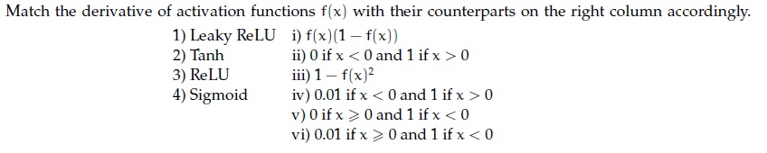

**Figure 2.** Source matching table for Question 157.

**Options**

**A.** 1→ vi, 2→ iii, 3→ v, 4 → i
*Option ID:* `6406532564176`

**B.** 1→ i, 2→ iv, 3 → iii, 4→ ii
*Option ID:* `6406532564177`

**C.** 1→ i, 2→ v, 3 → iii, 4→ iv
*Option ID:* `6406532564178`

**D.** 1→ iv, 2→ iii, 3→ ii, 4 → i
*Option ID:* `6406532564179`

**Correct answer:** **D** — 1→ iv, 2→ iii, 3→ ii, 4 → i

**Worked explanation:** A neuron first forms the affine pre-activation $z=\mathbf{w}^{\mathsf T}\mathbf{x}+b$ and then applies its activation. Check the sign and scale of $z$ before applying threshold, saturation, or piecewise-linear behavior; this also distinguishes the activation value from the pre-activation.

### da5006_2024T1_Q2_NA · Q168 · 2 marks · ID 640653766149

### Question 168

**Question ID:** `640653766149` · **Type:** SA · **Marks:** 2
**PDF pages:** 13, 14

**Shared Comprehension Context (Questions 168–170):**
A four-dimensional input $x = [3, 4, 1, 2]$ is passed to a hidden layer with a single neuron and an activation function $a(\cdot)$ to obtain $z$. Assume that the corresponding weights (from input to hidden layer) are $[0.3, 0, -0.4, 0.5]$ and bias is $0.2$.
Consider the corresponding activation functions and give the corresponding value of $z$.
Based on the above data, answer the given subquestions.

**Subquestion 168:**
Linear______________

**Correct answer:** `1.7`

**Worked explanation:** A neuron first forms the affine pre-activation $z=\mathbf{w}^{\mathsf T}\mathbf{x}+b$ and then applies its activation. Check the sign and scale of $z$ before applying threshold, saturation, or piecewise-linear behavior; this also distinguishes the activation value from the pre-activation.

### da5006_2024T1_Q2_NA · Q169 · 2 marks · ID 640653766150

### Question 169

**Question ID:** `640653766150` · **Type:** SA · **Marks:** 2
**PDF pages:** 14

**Shared Comprehension Context (Questions 168–170):**
A four-dimensional input $x = [3, 4, 1, 2]$ is passed to a hidden layer with a single neuron and an activation function $a(\cdot)$ to obtain $z$. Assume that the corresponding weights (from input to hidden layer) are $[0.3, 0, -0.4, 0.5]$ and bias is $0.2$.
Consider the corresponding activation functions and give the corresponding value of $z$.
Based on the above data, answer the given subquestions.

**Subquestion 169:**
Indicator function____________

**Correct answer:** `1`

**Worked explanation:** A neuron first forms the affine pre-activation $z=\mathbf{w}^{\mathsf T}\mathbf{x}+b$ and then applies its activation. Check the sign and scale of $z$ before applying threshold, saturation, or piecewise-linear behavior; this also distinguishes the activation value from the pre-activation.

### da5006_2024T1_Q2_NA · Q170 · 1 marks · ID 640653766151

### Question 170

**Question ID:** `640653766151` · **Type:** SA · **Marks:** 1
**PDF pages:** 14, 15

**Shared Comprehension Context (Questions 168–170):**
A four-dimensional input $x = [3, 4, 1, 2]$ is passed to a hidden layer with a single neuron and an activation function $a(\cdot)$ to obtain $z$. Assume that the corresponding weights (from input to hidden layer) are $[0.3, 0, -0.4, 0.5]$ and bias is $0.2$.
Consider the corresponding activation functions and give the corresponding value of $z$.
Based on the above data, answer the given subquestions.

**Subquestion 170:**
Leaky-ReLU_____________

**Correct answer:** `1.7`

**Worked explanation:** A neuron first forms the affine pre-activation $z=\mathbf{w}^{\mathsf T}\mathbf{x}+b$ and then applies its activation. Check the sign and scale of $z$ before applying threshold, saturation, or piecewise-linear behavior; this also distinguishes the activation value from the pre-activation.

### da5006_2024T2_Q2_NA · Q129 · 2 marks · ID 640653856604

### Question 129

**Question ID:** `640653856604` · **Type:** MCQ · **Marks:** 2
**PDF pages:** 7

A four-dimensional input vector $x = [5, 3, -1, 2]$ is passed to a hidden layer with a single neuron and an activation function $a(.)$ to obtain $z$. Assume that the corresponding weights (from input to hidden layer) are $[0.4, 0.6, 0.8, -0.2]$ and bias is $0.4$. If the activation function $a(.)$ is Sigmoid, Linear, Indicator function, Softplus, ReLU and Leaky-ReLU, what are the corresponding values of $z$? (Note that Indicator function returns 1 for a positive input, and 0 otherwise. Softplus is defined as: $\ln(1 + \exp(z))$).

**Options**

**A.** 0.95, 3, 1, 0.35, 3, 3
*Option ID:* `6406532878525`

**B.** 0.95, 3, 0, 3.05, 3, 3
*Option ID:* `6406532878526`

**C.** 0.92, 3, 1, 3.5, 3, 3
*Option ID:* `6406532878527`

**D.** 0.95, 3, 1, 3.05, 3, 3
*Option ID:* `6406532878528`

**Correct answer:** **D** — 0.95, 3, 1, 3.05, 3, 3.

**Worked explanation:** A neuron first forms the affine pre-activation $z=\mathbf{w}^{\mathsf T}\mathbf{x}+b$ and then applies its activation. Check the sign and scale of $z$ before applying threshold, saturation, or piecewise-linear behavior; this also distinguishes the activation value from the pre-activation.

### da5006_2024T3_ET_AN · Q209 · 2 marks · ID 6406531046072

### Question 209

**Question ID:** `6406531046072` · **Type:** Multiple Choice Question (MCQ) · **Marks:** 2
**PDF pages:** 6, 7

A four-dimensional input vector $x = [1, -2, 3, -4]$ is passed to a hidden layer with a single neuron and an activation function $a(\cdot)$ to obtain $z$. Assume that the corresponding weights (from input to hidden layer) are $[0.5, -0.3, 0.8, 1.2]$ and bias is $-0.2$. If the activation function $a(\cdot)$ is Sigmoid, Linear, Indicator function, Softplus, ReLU and Leaky-ReLU, what are the corresponding values of $z$? (Note that Indicator function returns 1 for a positive input, and 0 otherwise. Softplus is defined as: $\ln(1 + \exp(z))$).

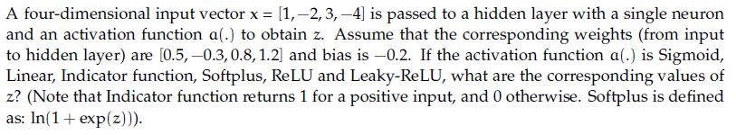
**Figure 14.** Source problem statement for Question 209.

**Options**

**A.** 0.18, 1.5, 1.5, 0.20,−1.5,−0.015
*Option ID:* `6406533531390`

**B.** 0.92, 2.5, 1, 2.5, 2.5, 1
*Option ID:* `6406533531391`

**C.** 0.18,−1.5, 0, 0.20, 0,−0.015
*Option ID:* `6406533531392`

**D.** 0.91, 1, 0, 0.2, 1, 1.7
*Option ID:* `6406533531393`

**Correct answer:** **C** — 0.18,−1.5, 0, 0.20, 0,−0.015.

**Worked explanation:** A neuron first forms the affine pre-activation $z=\mathbf{w}^{\mathsf T}\mathbf{x}+b$ and then applies its activation. Check the sign and scale of $z$ before applying threshold, saturation, or piecewise-linear behavior; this also distinguishes the activation value from the pre-activation.

### da5006_2024T3_Q1_NA · Q146 · 2 marks · ID 640653994486

### Question 146

**Question ID:** `640653994486` · **Type:** MCQ · **Marks:** 2
**PDF pages:** 2

A four-dimensional input vector $\mathbf{x} = [1, -2, 3, -4]$ is passed to a hidden layer with a single neuron and an activation function $a(\cdot)$ to obtain $z$. Assume that the corresponding weights (from input to hidden layer) are $[0.5, -0.3, 0.8, 1.2]$ and bias is $-0.2$. If the activation function $a(\cdot)$ is Sigmoid, Linear, Indicator function, Softplus, ReLU and Leaky-ReLU, what are the corresponding values of $z$? (Note that Indicator function returns 1 for a positive input, and 0 otherwise. Softplus is defined as: $\ln(1 + \exp(z)))$.

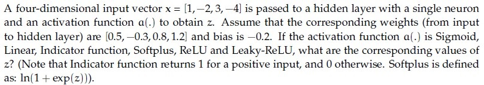

**Figure 2.** Source problem statement and parameters for Question 146.

**Options**

**A.** 0.18, 1.5, 1.5, 0.20,−1.5,−0.015
*Option ID:* `6406533358216`

**B.** 0.92, 2.5, 1, 2.5, 2.5, 1
*Option ID:* `6406533358217`

**C.** 0.18,−1.5, 0, 0.20, 0,−0.015
*Option ID:* `6406533358218`

**D.** 0.91, 1, 0, 0.2, 1, 1.7
*Option ID:* `6406533358219`

**Correct answer:** **C** — 0.18,−1.5, 0, 0.20, 0,−0.015.

**Worked explanation:** A neuron first forms the affine pre-activation $z=\mathbf{w}^{\mathsf T}\mathbf{x}+b$ and then applies its activation. Check the sign and scale of $z$ before applying threshold, saturation, or piecewise-linear behavior; this also distinguishes the activation value from the pre-activation.

### da5006_2024T3_Q1_NA · Q156 · 2 marks · ID 640653994488

### Question 156

**Question ID:** `640653994488` · **Type:** MSQ · **Marks:** 2
**PDF pages:** 6–7

Which of the following statements are true? (Select all that apply)

**Options**

**A.** tanh activation function can be represented as below in terms of sigmoid activation function:

$$\tanh(x) = 2\sigma(2x) - 1, \text{ where } \sigma = \text{sigmoid activation function}$$

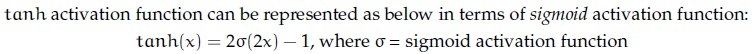

**Figure 16.** Mathematical statement for Option A of Question 156.
*Option ID:* `6406533358224`

**B.** The derivative of the Sigmoid activation function is symmetric around the origin.

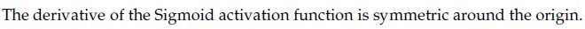

**Figure 17.** Statement for Option B of Question 156.
*Option ID:* `6406533358225`

**C.** Gradient of sigmoid neuron at saturation explodes

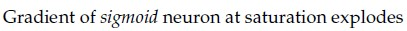

**Figure 18.** Statement for Option C of Question 156.
*Option ID:* `6406533358226`

**D.** sigmoid activation is centered around 0.5 whereas tanh activation is centered around 0.

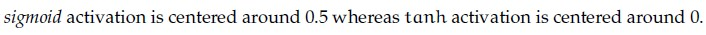

**Figure 19.** Statement for Option D of Question 156.
*Option ID:* `6406533358227`

**Correct answer:** **A**, **D** — A: tanh(x) = 2σ(2x) - 1; D: sigmoid activation is centered around 0.5 whereas tanh activation is centered around 0..

**Worked explanation:** A neuron first forms the affine pre-activation $z=\mathbf{w}^{\mathsf T}\mathbf{x}+b$ and then applies its activation. Check the sign and scale of $z$ before applying threshold, saturation, or piecewise-linear behavior; this also distinguishes the activation value from the pre-activation.

### da5006_2025T1_Q1_NA · Q163 · 2 marks · ID 6406531130619

### Question 163

**Question ID:** `6406531130619` · **Type:** MCQ · **Marks:** 2
**PDF pages:** 6

A four-dimensional input vector $\mathbf{x} = [1, -2, 3, -4]$ is passed to a hidden layer with a single neuron and an activation function $a(\cdot)$ to obtain $z$. Assume that the corresponding weights (from input to hidden layer) are $[0.5, -0.3, 0.8, 1.2]$ and bias is $-0.2$. If the activation function $a(\cdot)$ is Sigmoid, Linear, Indicator function, Softplus, ReLU and Leaky-ReLU, what are the corresponding values of $z$? (Note that Indicator function returns 1 for a positive input, and 0 otherwise. Softplus is defined as: $\ln(1 + \exp(z)))$.

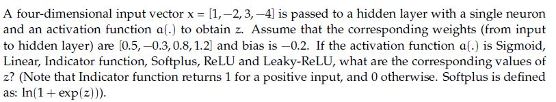

**Figure 7.** Input vector and activation function problem statement for Question 163.

**Options**

**A.** 0.18, 1.5, 1.5, 0.20,−1.5,−0.015
*Option ID:* `6406533822697`

**B.** 0.92, 2.5, 1, 2.5, 2.5, 1
*Option ID:* `6406533822698`

**C.** 0.18,−1.5, 0, 0.20, 0,−0.015
*Option ID:* `6406533822699`

**D.** 0.91, 1, 0, 0.2, 1, 1.7
*Option ID:* `6406533822700`

**Correct answer:** **C** — 0.18,−1.5, 0, 0.20, 0,−0.015.

**Worked explanation:** A neuron first forms the affine pre-activation $z=\mathbf{w}^{\mathsf T}\mathbf{x}+b$ and then applies its activation. Check the sign and scale of $z$ before applying threshold, saturation, or piecewise-linear behavior; this also distinguishes the activation value from the pre-activation.

### da5006_2025T1_Q1_NA · Q178 · 2 marks · ID 6406531130621

### Question 178

**Question ID:** `6406531130621` · **Type:** MSQ · **Marks:** 2
**PDF pages:** 12

Which of the following statements are true ? (Select all that apply)

**Options**

**A.** tanh activation function can be represented as below in terms of sigmoid activation function: $\tanh(x) = 2\sigma(2x) - 1$, where $\sigma$ = sigmoid activation function

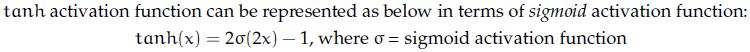

**Figure 17.** Statement for Option A.

*Option ID:* `6406533822705`

**B.** The derivative of the Sigmoid activation function is symmetric around the origin.

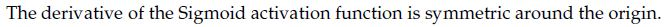

**Figure 18.** Statement for Option B.

*Option ID:* `6406533822706`

**C.** Gradient of sigmoid neuron at saturation explodes

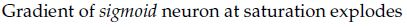

**Figure 19.** Statement for Option C.

*Option ID:* `6406533822707`

**D.** sigmoid activation is centered around 0.5 whereas tanh activation is centered around 0.

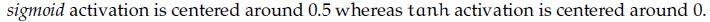

**Figure 20.** Statement for Option D.

*Option ID:* `6406533822708`

**Correct answer:** **A**, **D** — tanh activation function can be represented as below in terms of sigmoid activation function: tanh(x) = 2sigma(2x) - 1, where sigma = sigmoid activation function ; sigmoid activation is centered around 0.5 whereas tanh activation is centered around 0..

**Worked explanation:** A neuron first forms the affine pre-activation $z=\mathbf{w}^{\mathsf T}\mathbf{x}+b$ and then applies its activation. Check the sign and scale of $z$ before applying threshold, saturation, or piecewise-linear behavior; this also distinguishes the activation value from the pre-activation.

### da5006_2025T2_ET_AN · Q84 · 2 marks · ID 6406531431344

> [!NOTE] Week assignment uncertain: Tests tensor mean reduction and retained dimensions; taxonomy lacks a tensor-programming topic.

### Question 84

**Question ID:** `6406531431344` · **Type:** MCQ · **Marks:** 2
**PDF pages:** 2

Consider the following Pytorch code:

```python
1. x = torch.tensor([[-3., 2., 3.], [4., -5., 7.], [20., 3., 2.]])
2. print(torch.mean(x, dim=0, keepdim=True))
```

The output of the code is:

**Options**

**A.** tensor([ 7., 0., 4.])
*Option ID:* `6406534780246`

**B.** tensor([[ -7., 10., -4.]])
*Option ID:* `6406534780247`

**C.** tensor([[ -7.],[7.],[4.]])
*Option ID:* `6406534780248`

**D.** tensor([ -7., 7., 3.])
*Option ID:* `6406534780249`

**E.** tensor([[7., 0., 4.]])
*Option ID:* `6406534780250`

**F.** tensor([[ 0.],[7.],[4.]])
*Option ID:* `6406534780251`

**Correct answer:** **E** — tensor([[7., 0., 4.]]).

**Worked explanation:** A neuron first forms the affine pre-activation $z=\mathbf{w}^{\mathsf T}\mathbf{x}+b$ and then applies its activation. Check the sign and scale of $z$ before applying threshold, saturation, or piecewise-linear behavior; this also distinguishes the activation value from the pre-activation.

### da5006_2025T2_ET_AN · Q126 · 1 marks · ID 6406531431390

### Question 126

**Question ID:** `6406531431390` · **Type:** SA · **Marks:** 1
**PDF pages:** 18, 19

**Shared Comprehension Context (Question ID: `6406531431389`):**

A four-dimensional input vector $x = [4, -5, -7, 10]$ is passed to a hidden layer with a single neuron and an activation function $a(z)$. The weights and bias for this neuron are $w = [2, 1, -3, 1]^T$ and $b = 1$, respectively. The output is calculated as $\hat{y} = a(z)$, where $z = w^T x + b$. Calculate the output $\hat{y}$ (enter the value in blank) for the following activation functions.

[Note: Enter round-off values till 2 decimal places]

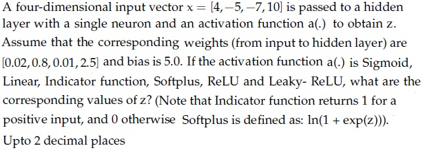

**Figure 25.** Source activation function problem statement for Comprehension Questions 126–131.

**Subquestion:**

Sigmoid ______________

**Correct answer:** 0.99

**Worked explanation:** A neuron first forms the affine pre-activation $z=\mathbf{w}^{\mathsf T}\mathbf{x}+b$ and then applies its activation. Check the sign and scale of $z$ before applying threshold, saturation, or piecewise-linear behavior; this also distinguishes the activation value from the pre-activation.

### da5006_2025T2_ET_AN · Q127 · 1 marks · ID 6406531431391

### Question 127

**Question ID:** `6406531431391` · **Type:** SA · **Marks:** 1
**PDF pages:** 19

**Shared Comprehension Context (Question ID: `6406531431389`):**

A four-dimensional input vector $x = [4, -5, -7, 10]$ is passed to a hidden layer with a single neuron and an activation function $a(z)$. The weights and bias for this neuron are $w = [2, 1, -3, 1]^T$ and $b = 1$, respectively. The output is calculated as $\hat{y} = a(z)$, where $z = w^T x + b$. Calculate the output $\hat{y}$ (enter the value in blank) for the following activation functions.

[Note: Enter round-off values till 2 decimal places]

Refer to Figure 25 (Source activation function problem statement for Comprehension Questions 126–131).

**Subquestion:**

Linear ______________

**Correct answer:** 26.01

**Worked explanation:** A neuron first forms the affine pre-activation $z=\mathbf{w}^{\mathsf T}\mathbf{x}+b$ and then applies its activation. Check the sign and scale of $z$ before applying threshold, saturation, or piecewise-linear behavior; this also distinguishes the activation value from the pre-activation.

### da5006_2025T2_ET_AN · Q128 · 1 marks · ID 6406531431392

### Question 128

**Question ID:** `6406531431392` · **Type:** SA · **Marks:** 1
**PDF pages:** 19

**Shared Comprehension Context (Question ID: `6406531431389`):**

A four-dimensional input vector $x = [4, -5, -7, 10]$ is passed to a hidden layer with a single neuron and an activation function $a(z)$. The weights and bias for this neuron are $w = [2, 1, -3, 1]^T$ and $b = 1$, respectively. The output is calculated as $\hat{y} = a(z)$, where $z = w^T x + b$. Calculate the output $\hat{y}$ (enter the value in blank) for the following activation functions.

[Note: Enter round-off values till 2 decimal places]

Refer to Figure 25 (Source activation function problem statement for Comprehension Questions 126–131).

**Subquestion:**

Indicator Function ______________

**Correct answer:** 1

**Worked explanation:** A neuron first forms the affine pre-activation $z=\mathbf{w}^{\mathsf T}\mathbf{x}+b$ and then applies its activation. Check the sign and scale of $z$ before applying threshold, saturation, or piecewise-linear behavior; this also distinguishes the activation value from the pre-activation.

### da5006_2025T2_ET_AN · Q129 · 1 marks · ID 6406531431393

### Question 129

**Question ID:** `6406531431393` · **Type:** SA · **Marks:** 1
**PDF pages:** 19, 20

**Shared Comprehension Context (Question ID: `6406531431389`):**

A four-dimensional input vector $x = [4, -5, -7, 10]$ is passed to a hidden layer with a single neuron and an activation function $a(z)$. The weights and bias for this neuron are $w = [2, 1, -3, 1]^T$ and $b = 1$, respectively. The output is calculated as $\hat{y} = a(z)$, where $z = w^T x + b$. Calculate the output $\hat{y}$ (enter the value in blank) for the following activation functions.

[Note: Enter round-off values till 2 decimal places]

Refer to Figure 25 (Source activation function problem statement for Comprehension Questions 126–131).

**Subquestion:**

Softplus _____________

**Correct answer:** 26.01

**Worked explanation:** A neuron first forms the affine pre-activation $z=\mathbf{w}^{\mathsf T}\mathbf{x}+b$ and then applies its activation. Check the sign and scale of $z$ before applying threshold, saturation, or piecewise-linear behavior; this also distinguishes the activation value from the pre-activation.

### da5006_2025T2_ET_AN · Q130 · 1 marks · ID 6406531431394

### Question 130

**Question ID:** `6406531431394` · **Type:** SA · **Marks:** 1
**PDF pages:** 20

**Shared Comprehension Context (Question ID: `6406531431389`):**

A four-dimensional input vector $x = [4, -5, -7, 10]$ is passed to a hidden layer with a single neuron and an activation function $a(z)$. The weights and bias for this neuron are $w = [2, 1, -3, 1]^T$ and $b = 1$, respectively. The output is calculated as $\hat{y} = a(z)$, where $z = w^T x + b$. Calculate the output $\hat{y}$ (enter the value in blank) for the following activation functions.

[Note: Enter round-off values till 2 decimal places]

Refer to Figure 25 (Source activation function problem statement for Comprehension Questions 126–131).

**Subquestion:**

ReLU _______________

**Correct answer:** 26.01

**Worked explanation:** A neuron first forms the affine pre-activation $z=\mathbf{w}^{\mathsf T}\mathbf{x}+b$ and then applies its activation. Check the sign and scale of $z$ before applying threshold, saturation, or piecewise-linear behavior; this also distinguishes the activation value from the pre-activation.

### da5006_2025T2_ET_AN · Q131 · 1 marks · ID 6406531431395

### Question 131

**Question ID:** `6406531431395` · **Type:** SA · **Marks:** 1
**PDF pages:** 20

**Shared Comprehension Context (Question ID: `6406531431389`):**

A four-dimensional input vector $x = [4, -5, -7, 10]$ is passed to a hidden layer with a single neuron and an activation function $a(z)$. The weights and bias for this neuron are $w = [2, 1, -3, 1]^T$ and $b = 1$, respectively. The output is calculated as $\hat{y} = a(z)$, where $z = w^T x + b$. Calculate the output $\hat{y}$ (enter the value in blank) for the following activation functions.

[Note: Enter round-off values till 2 decimal places]

Refer to Figure 25 (Source activation function problem statement for Comprehension Questions 126–131).

**Subquestion:**

Leaky-ReLU _____________

**Correct answer:** 26.01

**Worked explanation:** A neuron first forms the affine pre-activation $z=\mathbf{w}^{\mathsf T}\mathbf{x}+b$ and then applies its activation. Check the sign and scale of $z$ before applying threshold, saturation, or piecewise-linear behavior; this also distinguishes the activation value from the pre-activation.

### da5006_2025T2_ET_FN · Q177 · 2 marks · ID 6406531422556

### Question 177

**Question ID:** `6406531422556` · **Type:** MSQ · **Marks:** 2
**PDF pages:** 11, 12

Which of the following statements are true? (Select all that apply)

**Options**

**A.** Sigmoid activation function σ(.) can be represented in terms of tanh activation function as below: σ(x) = (tanh(x/2) - 1)/2
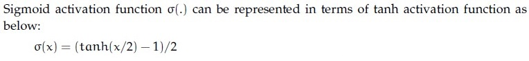
**Figure 26.** Option A image for Question 177.
*Option ID:* `6406534756444`

**B.** The derivative of the sigmoid activation function is symmetric around the y-axis.
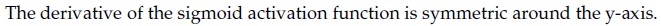
**Figure 27.** Option B image for Question 177.
*Option ID:* `6406534756445`

**C.** Gradient of a sigmoid neuron vanishes at saturation.
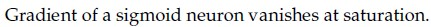
**Figure 28.** Option C image for Question 177.
*Option ID:* `6406534756446`

**D.** Sigmoid activation is centered around 0 whereas tanh activation is centered around 0.5
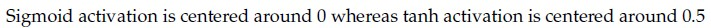
**Figure 29.** Option D image for Question 177.
*Option ID:* `6406534756447`

**Correct answer:** **B**, **C** — The derivative of the sigmoid activation function is symmetric around the y-axis.; Gradient of a sigmoid neuron vanishes at saturation..

**Worked explanation:** A neuron first forms the affine pre-activation $z=\mathbf{w}^{\mathsf T}\mathbf{x}+b$ and then applies its activation. Check the sign and scale of $z$ before applying threshold, saturation, or piecewise-linear behavior; this also distinguishes the activation value from the pre-activation.

### da5006_2025T2_ET_FN · Q191 · 1 marks · ID 6406531422567

### Question 191

**Question ID:** `6406531422567` · **Type:** SA · **Marks:** 1
**PDF pages:** 17, 18

**Shared context (Comprehension Question ID: `6406531422566`, Subquestions: 191 to 196):**

A 4-dimensional input vector x = [5, 3, 1, 2] is passed to a hidden layer with a single neuron and an activation function a(.) to obtain z. Assume that the corresponding weights (from input to hidden layer) are [0.4, 0.6, 0.8, -0.2] and bias is 0.4. If the activation function a(.) is Sigmoid, Linear, Indicator function, Softplus, ReLU and Leaky-ReLU, what are the corresponding values of z? (Note that Indicator function returns 1 for a positive input, and 0 otherwise. Softplus is defined as: ln(1 + exp(z)).

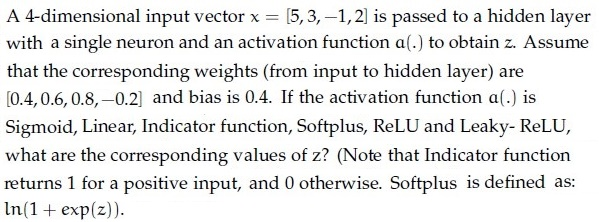

**Figure 40.** Comprehension 6406531422566, single-neuron activation problem statement.

Based on the above data, answer the given subquestions.

Sigmoid _______________

**Correct answer:** `0.95`

**Worked explanation:** A neuron first forms the affine pre-activation $z=\mathbf{w}^{\mathsf T}\mathbf{x}+b$ and then applies its activation. Check the sign and scale of $z$ before applying threshold, saturation, or piecewise-linear behavior; this also distinguishes the activation value from the pre-activation.

### da5006_2025T2_ET_FN · Q192 · 1 marks · ID 6406531422568

### Question 192

**Question ID:** `6406531422568` · **Type:** SA · **Marks:** 1
**PDF pages:** 18

**Shared context (Comprehension Question ID: `6406531422566`, Subquestions: 191 to 196):**

Single-neuron activation values with pre-activation u = 3 (from Figure 40).

Based on the above data, answer the given subquestions.

Linear _______________

**Correct answer:** `3`

> [!WARNING] The source key gives 3, but the stated linear neuron computes $0.4(5)+0.6(3)+0.8(1)-0.2(2)+0.4=4.6$. The source key is retained pending source correction.

**Worked explanation:** For a linear activation, the output equals the affine pre-activation. Substitution gives $2+1.8+0.8-0.4+0.4=4.6$; the source key instead states 3, so the discrepancy is recorded below.

### da5006_2025T2_ET_FN · Q193 · 1 marks · ID 6406531422569

### Question 193

**Question ID:** `6406531422569` · **Type:** SA · **Marks:** 1
**PDF pages:** 18, 19

**Shared context (Comprehension Question ID: `6406531422566`, Subquestions: 191 to 196):**

Single-neuron activation values with pre-activation u = 3 (from Figure 40).

Based on the above data, answer the given subquestions.

Indicator Function _______________

**Correct answer:** `1`

**Worked explanation:** A neuron first forms the affine pre-activation $z=\mathbf{w}^{\mathsf T}\mathbf{x}+b$ and then applies its activation. Check the sign and scale of $z$ before applying threshold, saturation, or piecewise-linear behavior; this also distinguishes the activation value from the pre-activation.

### da5006_2025T2_ET_FN · Q194 · 1 marks · ID 6406531422570

### Question 194

**Question ID:** `6406531422570` · **Type:** SA · **Marks:** 1
**PDF pages:** 19

**Shared context (Comprehension Question ID: `6406531422566`, Subquestions: 191 to 196):**

Single-neuron activation values with pre-activation u = 3 (from Figure 40).

Based on the above data, answer the given subquestions.

Softplus _______________

**Correct answer:** `3.05`

**Worked explanation:** A neuron first forms the affine pre-activation $z=\mathbf{w}^{\mathsf T}\mathbf{x}+b$ and then applies its activation. Check the sign and scale of $z$ before applying threshold, saturation, or piecewise-linear behavior; this also distinguishes the activation value from the pre-activation.

### da5006_2025T2_ET_FN · Q195 · 1 marks · ID 6406531422571

### Question 195

**Question ID:** `6406531422571` · **Type:** SA · **Marks:** 1
**PDF pages:** 19

**Shared context (Comprehension Question ID: `6406531422566`, Subquestions: 191 to 196):**

Single-neuron activation values with pre-activation u = 3 (from Figure 40).

Based on the above data, answer the given subquestions.

ReLu _______________

**Correct answer:** `3`

**Worked explanation:** A neuron first forms the affine pre-activation $z=\mathbf{w}^{\mathsf T}\mathbf{x}+b$ and then applies its activation. Check the sign and scale of $z$ before applying threshold, saturation, or piecewise-linear behavior; this also distinguishes the activation value from the pre-activation.

### da5006_2025T2_ET_FN · Q196 · 1 marks · ID 6406531422572

### Question 196

**Question ID:** `6406531422572` · **Type:** SA · **Marks:** 1
**PDF pages:** 19, 20

**Shared context (Comprehension Question ID: `6406531422566`, Subquestions: 191 to 196):**

Single-neuron activation values with pre-activation u = 3 (from Figure 40).

Based on the above data, answer the given subquestions.

Leaky-ReLu _______________

**Correct answer:** `3`

**Worked explanation:** A neuron first forms the affine pre-activation $z=\mathbf{w}^{\mathsf T}\mathbf{x}+b$ and then applies its activation. Check the sign and scale of $z$ before applying threshold, saturation, or piecewise-linear behavior; this also distinguishes the activation value from the pre-activation.

### da5006_2025T2_Q1_NA · Q161 · 2 marks · ID 6406531279503

### Question 161

**Question ID:** `6406531279503` · **Type:** MCQ · **Marks:** 2
**PDF pages:** 5

A four-dimensional input vector $x = [2, -1, 0, 3]^T$ is passed to a hidden layer with a single neuron and an activation function $\sigma(\cdot)$ to obtain $z$. Assume the corresponding weights are $[0.4, -0.6, 0.3, 0.9]$ and the bias is $-0.1$. If the activation function $\sigma(\cdot)$ is Sigmoid, Linear, Indicator, Softplus, ReLU, and Leaky-ReLU (with leak coefficient 0.01), what are the corresponding values of $z$? [Note: Indicator function returns 1 for positive input, 0 otherwise; Softplus is defined as $\ln(1 + e^x)$].

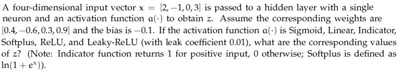

**Figure 7.** Input vector and activation function problem statement for Question 161.

**Options**

**A.** 0.9820, 4.00, 1, 4.02, 4.00, 4.00
*Option ID:* `6406534313857`

**B.** 0.8808, 3.50, 1, 3.54, 3.50, 3.50
*Option ID:* `6406534313858`

**C.** 0.7311, 2.00, 1, 2.13, 2.00, 2.00
*Option ID:* `6406534313859`

**D.** 0.5000, 0.00, 0, 0.69, 0.00, 0.00
*Option ID:* `6406534313860`

**Correct answer:** **A** — 0.9820, 4.00, 1, 4.02, 4.00, 4.00.

**Worked explanation:** A neuron first forms the affine pre-activation $z=\mathbf{w}^{\mathsf T}\mathbf{x}+b$ and then applies its activation. Check the sign and scale of $z$ before applying threshold, saturation, or piecewise-linear behavior; this also distinguishes the activation value from the pre-activation.

### da5006_2025T2_Q1_NA · Q171 · 3 marks · ID 6406531279513

### Question 171

**Question ID:** `6406531279513` · **Type:** MSQ · **Marks:** 3
**PDF pages:** 10

Which of the following statements are true?(Select all that apply)

**Options**

**A.** tanh activation function can be expressed in terms of the sigmoid activation function as: $\tanh(x) = 2\sigma(2x) - 1$, where $\sigma$ is the sigmoid activation function.

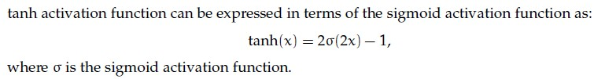

**Figure 39.** Option A candidate statement for Question 171.
*Option ID:* `6406534313897`

**B.** The derivative of the sigmoid activation function is symmetric around the origin.

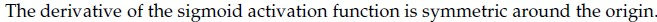

**Figure 40.** Option B candidate statement for Question 171.
*Option ID:* `6406534313898`

**C.** The gradient of a sigmoid neuron at saturation tends to explode.

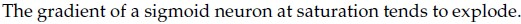

**Figure 41.** Option C candidate statement for Question 171.
*Option ID:* `6406534313899`

**D.** The sigmoid activation function is centered around 0.5, whereas the tanh activation function is centered around 0.

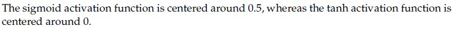

**Figure 42.** Option D candidate statement for Question 171.
*Option ID:* `6406534313900`

**Correct answer:** **A, D**

**Worked explanation:** A neuron first forms the affine pre-activation $z=\mathbf{w}^{\mathsf T}\mathbf{x}+b$ and then applies its activation. Check the sign and scale of $z$ before applying threshold, saturation, or piecewise-linear behavior; this also distinguishes the activation value from the pre-activation.

### da5006_2026T1_ET_FN · Q22 · 4 marks · ID 6406532136837

### Question 22

**Question ID:** `6406532136837` · **Type:** SA · **Marks:** 4
**PDF pages:** 8

A fully connected network maps input 100 → hidden 50 → output 10. Ignore bias. What is the total number of weights?

**Correct answer:** `5500`

**Worked explanation:** A neuron first forms the affine pre-activation $z=\mathbf{w}^{\mathsf T}\mathbf{x}+b$ and then applies its activation. Check the sign and scale of $z$ before applying threshold, saturation, or piecewise-linear behavior; this also distinguishes the activation value from the pre-activation.

## Topic: Backpropagation and losses

| Paper | Q# | Marks | Type |
| :--- | ---: | ---: | :--- |
| da5006_2024T1_ET_AN | 197 | 0.7 | ET |
| da5006_2024T1_ET_AN | 198 | 0.7 | ET |
| da5006_2024T1_ET_AN | 199 | 0.6 | ET |
| da5006_2024T2_Q1_NA | 93 | 2 | Q1 |
| da5006_2024T3_ET_AN | 212 | 2 | ET |
| da5006_2024T3_ET_AN | 215 | 2 | ET |
| da5006_2024T3_ET_AN | 216 | 2 | ET |
| da5006_2024T3_Q1_NA | 151 | 2 | Q1 |
| da5006_2025T1_Q1_NA | 168 | 2 | Q1 |
| da5006_2025T1_Q1_NA | 188 | 1 | Q1 |
| da5006_2025T1_Q1_NA | 189 | 1 | Q1 |
| da5006_2025T2_ET_AN | 109 | 1 | ET |
| da5006_2025T2_ET_AN | 110 | 1 | ET |
| da5006_2025T2_ET_FN | 160 | 2 | ET |
| da5006_2025T2_ET_FN | 185 | 1 | ET |
| da5006_2025T2_ET_FN | 186 | 1 | ET |
| da5006_2025T2_Q1_NA | 165 | 2 | Q1 |
| da5006_2025T3_ET_FN | 7 | 1 | ET |
| da5006_2025T3_ET_FN | 17 | 1 | ET |
| da5006_2025T3_ET_FN | 20 | 1 | ET |
| da5006_2026T1_ET_FN | 8 | 2 | ET |
| da5006_2026T1_Q1_NA | 6 | 1 | Q1 |
| da5006_2026T2_ET_FN | 7 | 2 | ET |
| da5006_2026T2_ET_FN | 23 | 3 | ET |
| da5006_2026T2_ET_FN | 32 | 4 | ET |
| da5006_2026T2_Q1_NA | 6 | 1 | Q1 |

### da5006_2024T1_ET_AN · Q197 · 0.7 marks · ID 640653821610

### Question 197

**Question ID:** `640653821610` · **Type:** SA · **Marks:** 0.7
**PDF pages:** 26, 27

Consider the equation represented by the following circuit:

Circuit: inputs $x, y$ go into addition $(+)$ giving $q = x + y$; $q$ and $z$ go into multiplication $(*)$ giving $f = q \cdot z$.
where $+$ and $*$ represent addition and multiplication.
If $x = -2, y = 5$ and $z = -4$,

Based on the above data, answer the given subquestion:

$$\frac{\partial f}{\partial x} = \text{__________}$$

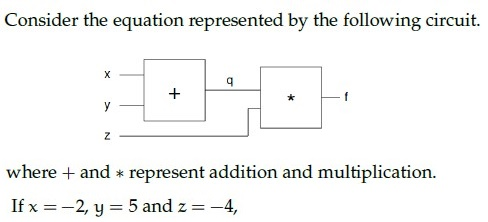

**Figure 27.** Shared context diagram for Questions 197–199.

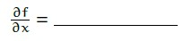

**Figure 28.** Source diagram for Question 197.

**Correct answer:** **-4**

**Worked explanation:** Apply the chain rule from the loss toward the requested parameter: multiply the downstream derivative by each local derivative along the computational path. For a weight entering a unit, the local factor is its input activation; for a bias, it is 1.

### da5006_2024T1_ET_AN · Q198 · 0.7 marks · ID 640653821611

### Question 198

**Question ID:** `640653821611` · **Type:** SA · **Marks:** 0.7
**PDF pages:** 27

Consider the equation represented by the following circuit:

Circuit: inputs $x, y$ go into addition $(+)$ giving $q = x + y$; $q$ and $z$ go into multiplication $(*)$ giving $f = q \cdot z$.
where $+$ and $*$ represent addition and multiplication.
If $x = -2, y = 5$ and $z = -4$,

Based on the above data, answer the given subquestion:

$$\frac{\partial f}{\partial y} = \text{__________}$$

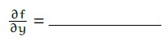

**Figure 29.** Source diagram for Question 198.

**Correct answer:** **-4**

**Worked explanation:** Apply the chain rule from the loss toward the requested parameter: multiply the downstream derivative by each local derivative along the computational path. For a weight entering a unit, the local factor is its input activation; for a bias, it is 1.

### da5006_2024T1_ET_AN · Q199 · 0.6 marks · ID 640653821612

### Question 199

**Question ID:** `640653821612` · **Type:** SA · **Marks:** 0.6
**PDF pages:** 27, 28

Consider the equation represented by the following circuit:

Circuit: inputs $x, y$ go into addition $(+)$ giving $q = x + y$; $q$ and $z$ go into multiplication $(*)$ giving $f = q \cdot z$.
where $+$ and $*$ represent addition and multiplication.
If $x = -2, y = 5$ and $z = -4$,

Based on the above data, answer the given subquestion:

$$\frac{\partial f}{\partial q} = \text{__________}$$

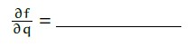

**Figure 30.** Source diagram for Question 199.

**Correct answer:** **-4**

**Worked explanation:** Apply the chain rule from the loss toward the requested parameter: multiply the downstream derivative by each local derivative along the computational path. For a weight entering a unit, the local factor is its input activation; for a bias, it is 1.

### da5006_2024T2_Q1_NA · Q93 · 2 marks · ID 640653829672

### Question 93

**Question ID:** `640653829672` · **Type:** MCQ · **Marks:** 2
**PDF pages:** 8

Match the derivative of activation functions $f(x)$ with their counterparts on the right column accordingly.

| Left Column | Right Column |
| :--- | :--- |
| 1) Leaky ReLU | i) $f(x)(1 - f(x))$ |
| 2) Tanh | ii) $0$ if $x < 0$ and $1$ if $x > 0$ |
| 3) ReLU | iii) $1 - f(x)^2$ |
| 4) Sigmoid | iv) $0.01$ if $x < 0$ and $1$ if $x > 0$ |
| | v) $0$ if $x > 0$ and $1$ if $x < 0$ |
| | vi) $0.01$ if $x > 0$ and $1$ if $x < 0$ |

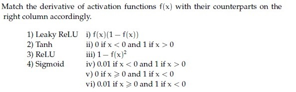

**Figure 23.** Source matching table for Question 93.

**Options**

**A.** 1→ vi, 2→ iii, 3→ v, 4 → i
*Option ID:* `6406532786695`

**B.** 1→ i, 2→ iv, 3 → iii, 4→ ii
*Option ID:* `6406532786696`

**C.** 1→ i, 2→ v, 3 → iii, 4→ iv
*Option ID:* `6406532786697`

**D.** 1→ iv, 2→ iii, 3→ ii, 4 → i
*Option ID:* `6406532786698`

**Correct answer:** **D** — 1→ iv, 2→ iii, 3→ ii, 4 → i.

**Worked explanation:** Apply the chain rule from the loss toward the requested parameter: multiply the downstream derivative by each local derivative along the computational path. For a weight entering a unit, the local factor is its input activation; for a bias, it is 1.

### da5006_2024T3_ET_AN · Q212 · 2 marks · ID 6406531046076

### Question 212

**Question ID:** `6406531046076` · **Type:** Multiple Choice Question (MCQ) · **Marks:** 2
**PDF pages:** 8, 9

Match the derivative of activation functions $f(x)$ with their counterparts on the right column accordingly.

1) Leaky ReLU
2) Tanh
3) ReLU
4) Sigmoid

i) $f(x)(1 - f(x))$
ii) 0 if $x < 0$ and 1 if $x > 0$
iii) $1 - f(x)^2$
iv) 0.01 if $x < 0$ and 1 if $x > 0$
v) 0 if $x > 0$ and 1 if $x < 0$
vi) 0.01 if $x > 0$ and 1 if $x < 0$

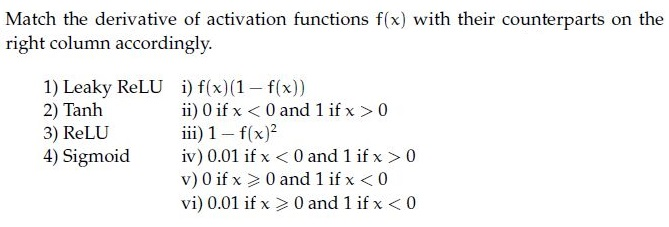
**Figure 16.** Source activation function derivatives matching table for Question 212.

**Options**

**A.** 1→ vi, 2→ iii, 3→ v, 4 → i
*Option ID:* `6406533531403`

**B.** 1→ i, 2 →iv, 3 → iii, 4→ ii
*Option ID:* `6406533531404`

**C.** 1→ i, 2 →v, 3 → iii, 4→ iv
*Option ID:* `6406533531405`

**D.** 1→ iv, 2→ iii, 3→ ii, 4 → i
*Option ID:* `6406533531406`

**Correct answer:** **D** — 1→ iv, 2→ iii, 3→ ii, 4 → i.

**Worked explanation:** Apply the chain rule from the loss toward the requested parameter: multiply the downstream derivative by each local derivative along the computational path. For a weight entering a unit, the local factor is its input activation; for a bias, it is 1.

### da5006_2024T3_ET_AN · Q215 · 2 marks · ID 6406531046057

### Question 215

**Question ID:** `6406531046057` · **Type:** Short Answer Question (SA) · **Marks:** 2
**PDF pages:** 10

**Shared Comprehension Context (Question ID: `6406531046056`):**

Consider the computation graph given below:

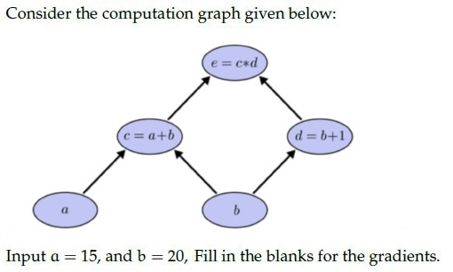
**Figure 22.** Computation graph diagram for Comprehension Questions 215–216.

Input $a = 15$, and $b = 20$, Fill in the blanks for the gradients.

Based on the above data, answer the given subquestions.

**Subquestion:**

The value for $\frac{\partial e}{\partial a} = $ _____

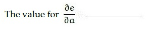
**Figure 23.** Source formula for Question 215.

Response Type : Numeric

**Correct answer:** **21**.

**Worked explanation:** Apply the chain rule from the loss toward the requested parameter: multiply the downstream derivative by each local derivative along the computational path. For a weight entering a unit, the local factor is its input activation; for a bias, it is 1.

### da5006_2024T3_ET_AN · Q216 · 2 marks · ID 6406531046058

### Question 216

**Question ID:** `6406531046058` · **Type:** Short Answer Question (SA) · **Marks:** 2
**PDF pages:** 10, 11

**Shared Comprehension Context (Question ID: `6406531046056`):**

Consider the computation graph given below:


**Figure 24.** Computation graph diagram for Comprehension Questions 215–216.

Input $a = 15$, and $b = 20$, Fill in the blanks for the gradients.

Based on the above data, answer the given subquestions.

**Subquestion:**

The value for $\frac{\partial e}{\partial b} = $ _____

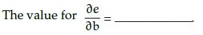
**Figure 25.** Source formula for Question 216.

Response Type : Numeric

**Correct answer:** **56**.

**Worked explanation:** Apply the chain rule from the loss toward the requested parameter: multiply the downstream derivative by each local derivative along the computational path. For a weight entering a unit, the local factor is its input activation; for a bias, it is 1.

### da5006_2024T3_Q1_NA · Q151 · 2 marks · ID 640653994505

### Question 151

**Question ID:** `640653994505` · **Type:** MCQ · **Marks:** 2
**PDF pages:** 4

Match the derivative of activation functions $f(x)$ with their counterparts on the right column accordingly.

1) Leaky ReLU — i) $f(x)(1 - f(x))$
2) Tanh — ii) $0\text{ if } x < 0\text{ and } 1\text{ if } x > 0$
3) ReLU — iii) $1 - f(x)^2$
4) Sigmoid — iv) $0.01\text{ if } x < 0\text{ and } 1\text{ if } x > 0$
v) $0\text{ if } x > 0\text{ and } 1\text{ if } x < 0$
vi) $0.01\text{ if } x > 0\text{ and } 1\text{ if } x < 0$

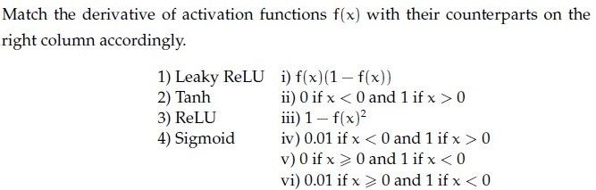

**Figure 4.** Matching table for activation functions and derivatives for Question 151.

**Options**

**A.** 1→ vi, 2→ iii, 3→ v, 4 → i
*Option ID:* `6406533358250`

**B.** 1→ i, 2 →iv, 3 → iii, 4→ ii
*Option ID:* `6406533358251`

**C.** 1→ i, 2 →v, 3 → iii, 4→ iv
*Option ID:* `6406533358252`

**D.** 1→ iv, 2→ iii, 3→ ii, 4 → i
*Option ID:* `6406533358253`

**Correct answer:** **D** — 1→ iv, 2→ iii, 3→ ii, 4 → i.

**Worked explanation:** Apply the chain rule from the loss toward the requested parameter: multiply the downstream derivative by each local derivative along the computational path. For a weight entering a unit, the local factor is its input activation; for a bias, it is 1.

### da5006_2025T1_Q1_NA · Q168 · 2 marks · ID 6406531130637

### Question 168

**Question ID:** `6406531130637` · **Type:** MCQ · **Marks:** 2
**PDF pages:** 8

Match the derivative of activation functions $f(x)$ with their counterparts on the right column accordingly.

| Column 1 | Column 2 |
| :--- | :--- |
| 1) Leaky ReLU | i) $f(x)(1 - f(x))$ |
| 2) Tanh | ii) 0 if $x < 0$ and 1 if $x > 0$ |
| 3) ReLU | iii) $1 - f(x)^2$ |
| 4) Sigmoid | iv) 0.01 if $x < 0$ and 1 if $x > 0$ |
| | v) 0 if $x > 0$ and 1 if $x < 0$ |
| | vi) 0.01 if $x > 0$ and 1 if $x < 0$ |

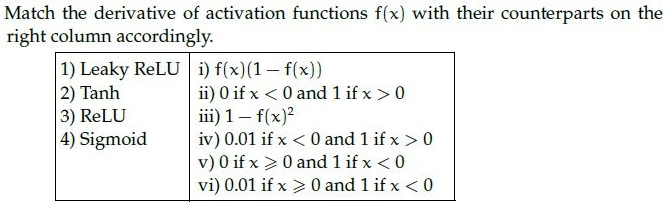

**Figure 9.** Activation function derivatives matching table for Question 168.

**Options**

**A.** 1→ vi, 2→ iii, 3→ v, 4 → i
*Option ID:* `6406533822730`

**B.** 1→ i, 2→ iv, 3 → iii, 4→ ii
*Option ID:* `6406533822731`

**C.** 1→ i, 2→ v, 3 → iii, 4→ iv
*Option ID:* `6406533822732`

**D.** 1→ iv, 2→ iii, 3→ ii, 4 → i
*Option ID:* `6406533822733`

**Correct answer:** **D** — 1→ iv, 2→ iii, 3→ ii, 4 → i.

**Worked explanation:** Apply the chain rule from the loss toward the requested parameter: multiply the downstream derivative by each local derivative along the computational path. For a weight entering a unit, the local factor is its input activation; for a bias, it is 1.

### da5006_2025T1_Q1_NA · Q188 · 1 marks · ID 6406531130647

### Question 188

**Question ID:** `6406531130647` · **Type:** SA · **Marks:** 1
**PDF pages:** 16, 17

**Shared Comprehension Context (Question ID: `6406531130646`):**

> Consider the computation graph and given answer the subquestions.
>
> Based on the above data, answer the given subquestions.

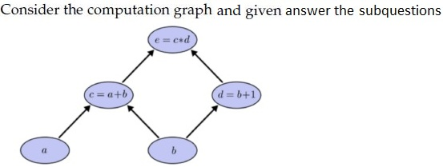

**Figure 28.** Computation graph diagram for Comprehension Questions 188–189.

Input $a = 50$, and $b = 2$, The value for $\frac{\partial e}{\partial a} = $ _____
Fill in the blank for the gradients.

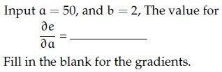

**Figure 29.** Partial derivative formula for Question 188.

**Correct answer:** `3`

**Worked explanation:** Apply the chain rule from the loss toward the requested parameter: multiply the downstream derivative by each local derivative along the computational path. For a weight entering a unit, the local factor is its input activation; for a bias, it is 1.

### da5006_2025T1_Q1_NA · Q189 · 1 marks · ID 6406531130648

### Question 189

**Question ID:** `6406531130648` · **Type:** SA · **Marks:** 1
**PDF pages:** 17

**Shared Comprehension Context (Question ID: `6406531130646`):**

> Consider the computation graph and given answer the subquestions.
>
> Based on the above data, answer the given subquestions.

Input $a = 50$, and $b = 2$, The value for $\frac{\partial e}{\partial b} = $ _____
Fill in the blank for the gradients.

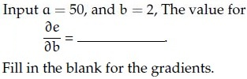

**Figure 30.** Partial derivative formula for Question 189.

**Correct answer:** `55`

**Worked explanation:** Apply the chain rule from the loss toward the requested parameter: multiply the downstream derivative by each local derivative along the computational path. For a weight entering a unit, the local factor is its input activation; for a bias, it is 1.

### da5006_2025T2_ET_AN · Q109 · 1 marks · ID 6406531431368

### Question 109

**Question ID:** `6406531431368` · **Type:** SA · **Marks:** 1
**PDF pages:** 12

**Shared Comprehension Context (Question ID: `6406531431367`):**

Consider the computation graph given below:
Input $a = 10$, and $b = -3$,
Fill in the blanks for the gradients.

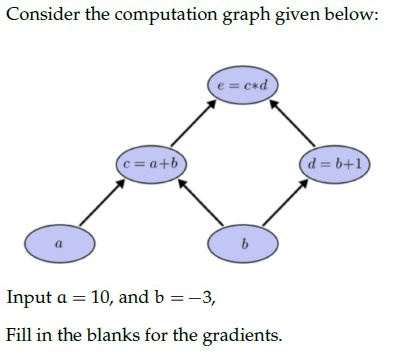

**Figure 17.** Source computation graph for Comprehension Questions 109–110.

**Subquestion:**

The value for $\frac{\partial e}{\partial a}$

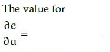

**Figure 18.** Source gradient query for Question 109.

**Correct answer:** -2

**Worked explanation:** Apply the chain rule from the loss toward the requested parameter: multiply the downstream derivative by each local derivative along the computational path. For a weight entering a unit, the local factor is its input activation; for a bias, it is 1.

### da5006_2025T2_ET_AN · Q110 · 1 marks · ID 6406531431369

### Question 110

**Question ID:** `6406531431369` · **Type:** SA · **Marks:** 1
**PDF pages:** 12, 13

**Shared Comprehension Context (Question ID: `6406531431367`):**

Consider the computation graph given below:
Input $a = 10$, and $b = -3$,
Fill in the blanks for the gradients.

Refer to Figure 17 (Source computation graph for Comprehension Questions 109–110).

**Subquestion:**

The value for $\frac{\partial e}{\partial b}$

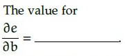

**Figure 19.** Source gradient query for Question 110.

**Correct answer:** 5

**Worked explanation:** Apply the chain rule from the loss toward the requested parameter: multiply the downstream derivative by each local derivative along the computational path. For a weight entering a unit, the local factor is its input activation; for a bias, it is 1.

### da5006_2025T2_ET_FN · Q160 · 2 marks · ID 6406531422539

### Question 160

**Question ID:** `6406531422539` · **Type:** MCQ · **Marks:** 2
**PDF pages:** 4

Match the derivative of activation functions f(x) with their counterparts on the right column accordingly.

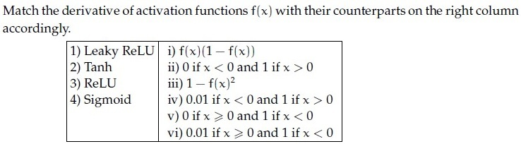

**Figure 8.** Question 160, matching table of activation function derivatives.

**Options**

**A.** 1→ vi, 2→ iii, 3 →v, 4 → i
*Option ID:* `6406534756372`

**B.** 1→ i, 2→ iv, 3 → iii, 4→ ii
*Option ID:* `6406534756373`

**C.** 1→ i, 2→ v, 3 → iii, 4→ iv
*Option ID:* `6406534756374`

**D.** 1→ iv, 2→ iii, 3→ ii, 4 → i
*Option ID:* `6406534756375`

**Correct answer:** **D** — 1→ iv, 2→ iii, 3→ ii, 4 → i.

**Worked explanation:** Apply the chain rule from the loss toward the requested parameter: multiply the downstream derivative by each local derivative along the computational path. For a weight entering a unit, the local factor is its input activation; for a bias, it is 1.

### da5006_2025T2_ET_FN · Q185 · 1 marks · ID 6406531422564

### Question 185

**Question ID:** `6406531422564` · **Type:** SA · **Marks:** 1
**PDF pages:** 15

**Shared context (Comprehension Question ID: `6406531422563`, Subquestions: 185 to 186):**

Consider the computation graph given below:
Input a = 10, and b = -3.
Fill in the blanks for the gradients, given in the subquestions.

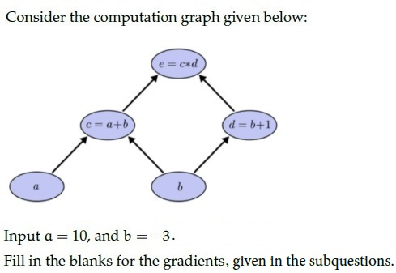

**Figure 36.** Comprehension 6406531422563, computation graph diagram.

Based on the above data, answer the given subquestion:

The value of ∂e/∂a = ______

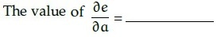

**Figure 37.** Question 185, gradient ∂e/∂a equation.

**Correct answer:** `-2`

**Worked explanation:** Apply the chain rule from the loss toward the requested parameter: multiply the downstream derivative by each local derivative along the computational path. For a weight entering a unit, the local factor is its input activation; for a bias, it is 1.

### da5006_2025T2_ET_FN · Q186 · 1 marks · ID 6406531422565

### Question 186

**Question ID:** `6406531422565` · **Type:** SA · **Marks:** 1
**PDF pages:** 16

**Shared context (Comprehension Question ID: `6406531422563`, Subquestions: 185 to 186):**

Consider the computation graph given in Figure 36 (Input a = 10, b = -3).

Based on the above data, answer the given subquestion:

The value of ∂e/∂b = ______

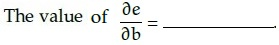

**Figure 38.** Question 186, gradient ∂e/∂b equation.

**Correct answer:** `5`

**Worked explanation:** Apply the chain rule from the loss toward the requested parameter: multiply the downstream derivative by each local derivative along the computational path. For a weight entering a unit, the local factor is its input activation; for a bias, it is 1.

### da5006_2025T2_Q1_NA · Q165 · 2 marks · ID 6406531279507

### Question 165

**Question ID:** `6406531279507` · **Type:** MCQ · **Marks:** 2
**PDF pages:** 7

Match the derivative of activation functions $f(x)$ with their counterparts on the right column accordingly.

1) Leaky ReLU
2) Tanh
3) ReLU
4) Sigmoid

Right column:

i) $f(x)(1 - f(x))$
ii) $0 \text{ if } x < 0 \text{ and } 1 \text{ if } x > 0$
iii) $1 - f(x)^2$
iv) $0.01 \text{ if } x < 0 \text{ and } 1 \text{ if } x > 0$
v) $0 \text{ if } x > 0 \text{ and } 1 \text{ if } x < 0$
vi) $0.01 \text{ if } x > 0 \text{ and } 1 \text{ if } x < 0$

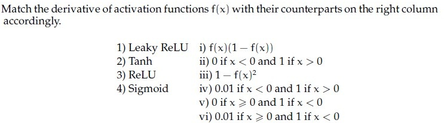

**Figure 18.** Activation function derivative matching problem statement for Question 165.

**Options**

**A.** 1 -> vi, 2 -> iii, 3 -> v, 4 -> i

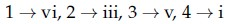

**Figure 19.** Option A candidate mapping for Question 165.
*Option ID:* `6406534313873`

**B.** 1 -> i, 2 -> iv, 3 -> iii, 4 -> ii

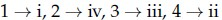

**Figure 20.** Option B candidate mapping for Question 165.
*Option ID:* `6406534313874`

**C.** 1 -> i, 2 -> v, 3 -> iii, 4 -> iv

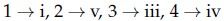

**Figure 21.** Option C candidate mapping for Question 165.
*Option ID:* `6406534313875`

**D.** 1 -> iv, 2 -> iii, 3 -> ii, 4 -> i

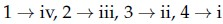

**Figure 22.** Option D candidate mapping for Question 165.
*Option ID:* `6406534313876`

**Correct answer:** **D** — 1 -> iv, 2 -> iii, 3 -> ii, 4 -> i.

**Worked explanation:** Apply the chain rule from the loss toward the requested parameter: multiply the downstream derivative by each local derivative along the computational path. For a weight entering a unit, the local factor is its input activation; for a bias, it is 1.

### da5006_2025T3_ET_FN · Q7 · 1 marks · ID 6406531862821

### Question 7

**Question ID:** `6406531862821` · **Type:** MCQ · **Marks:** 1
**PDF pages:** 4

Consider the following pyTorch code:

```python
x = torch.tensor([[1., 2., 3.], [4., 5., 6.]])
y = torch.softmax(x, dim=1)
print(torch.round(y[0], decimals=2))
```

The printed tensor is:

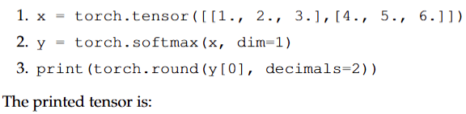

**Figure 5.** Source PyTorch code snippet for Question 7.

**Options**

**A.** tensor([0.09, 0.24, 0.67])
*Option ID:* `6406536034937`

**B.** tensor([0.09, 0.24, 0.66])
*Option ID:* `6406536034938`

**C.** tensor([0.09, 0.23, 0.68])
*Option ID:* `6406536034939`

**D.** tensor([0.10, 0.27, 0.63])
*Option ID:* `6406536034940`

**Correct answer:** **A** — tensor([0.09, 0.24, 0.67]).

**Worked explanation:** Apply the chain rule from the loss toward the requested parameter: multiply the downstream derivative by each local derivative along the computational path. For a weight entering a unit, the local factor is its input activation; for a bias, it is 1.

### da5006_2025T3_ET_FN · Q17 · 1 marks · ID 6406531862831

### Question 17

**Question ID:** `6406531862831` · **Type:** SA · **Marks:** 1
**PDF pages:** 8

In a classification problem with 3 classes, the logits are vector $\mathbf{z} = [2.0, 1.0, 0.1]$. Calculate the probability of the first class after applying Softmax. (Round to 2 decimal places).


**Figure 10.** Source logits vector and softmax probability query for Question 17.

**Correct answer:** `0.6 to 0.69`

**Worked explanation:** Apply the chain rule from the loss toward the requested parameter: multiply the downstream derivative by each local derivative along the computational path. For a weight entering a unit, the local factor is its input activation; for a bias, it is 1.

### da5006_2025T3_ET_FN · Q20 · 1 marks · ID 6406531862834

### Question 20

**Question ID:** `6406531862834` · **Type:** SA · **Marks:** 1
**PDF pages:** 9

Consider a scalar loss $l = \frac{1}{2}(\hat{y} - y)^2$ with $\hat{y} = wx + b$. For $x = 3, y = 5, w = 2, b = 1$, compute $\frac{\partial l}{\partial w}$.


**Figure 11.** Source scalar loss and gradient query for Question 20.

**Correct answer:** `6`

**Worked explanation:** Apply the chain rule from the loss toward the requested parameter: multiply the downstream derivative by each local derivative along the computational path. For a weight entering a unit, the local factor is its input activation; for a bias, it is 1.

### da5006_2026T1_ET_FN · Q8 · 2 marks · ID 6406532136823

### Question 8

**Question ID:** `6406532136823` · **Type:** MCQ · **Marks:** 2
**PDF pages:** 3, 4

Backpropagation is best described as:

**Options**

**A.** A method to avoid overfitting
*Option ID:* `6406536959501`

**B.** Efficient computation of gradients using the chain rule through computation graphs
*Option ID:* `6406536959502`

**C.** A method that works only for linear models
*Option ID:* `6406536959503`

**D.** An optimizer like Adam
*Option ID:* `6406536959504`

**Correct answer:** **B** — Efficient computation of gradients using the chain rule through computation graphs.

**Worked explanation:** Apply the chain rule from the loss toward the requested parameter: multiply the downstream derivative by each local derivative along the computational path. For a weight entering a unit, the local factor is its input activation; for a bias, it is 1.

### da5006_2026T1_Q1_NA · Q6 · 1 marks · ID 6406531961529

### Question 6

**Question ID:** `6406531961529` · **Type:** Multiple Choice Question · **Marks:** 1
**PDF pages:** 4, 5

Consider the following pyTorch code:


**Figure 5.** PyTorch code snippet for Question 6.

```python
1. x = torch.tensor([[1., 2., 3.], [4., 5., 6.]])
2. y = torch.softmax(x, dim=1)
3. print (torch.round(y[0], decimals=2))
```

The printed tensor is:

**Options**

**A.** `tensor([0.09, 0.24, 0.67])`
*Option ID:* `6406536373712`

**B.** `tensor([0.09, 0.24, 0.66])`
*Option ID:* `6406536373713`

**C.** `tensor([0.09, 0.23, 0.68])`
*Option ID:* `6406536373714`

**D.** `tensor([0.10, 0.27, 0.63])`
*Option ID:* `6406536373715`

**Correct answer:** **A** — `tensor([0.09, 0.24, 0.67])`

**Worked explanation:** Apply the chain rule from the loss toward the requested parameter: multiply the downstream derivative by each local derivative along the computational path. For a weight entering a unit, the local factor is its input activation; for a bias, it is 1.

### da5006_2026T2_ET_FN · Q7 · 2 marks · ID 6406532270046

### Question 7

**Question ID:** `6406532270046` · **Type:** MCQ · **Marks:** 2
**PDF pages:** 3, 4

A hidden activation $h$ is used by two downstream branches, and both branches affect the same scalar loss $L$. During backpropagation, the gradient with respect to $h$ is obtained by:

**Options**

**A.** Taking the larger of the two branch gradients
*Option ID:* `6406537379023`

**B.** Summing the gradient contributions from the two branches
*Option ID:* `6406537379024`

**C.** Multiplying the two branch gradients
*Option ID:* `6406537379025`

**D.** Averaging the two branch gradients regardless of the graph
*Option ID:* `6406537379026`

**Correct answer:** **B** — Summing the gradient contributions from the two branches.

**Worked explanation:** Apply the chain rule from the loss toward the requested parameter: multiply the downstream derivative by each local derivative along the computational path. For a weight entering a unit, the local factor is its input activation; for a bias, it is 1.

### da5006_2026T2_ET_FN · Q23 · 3 marks · ID 6406532270062

> [!NOTE] Week assignment uncertain: Tests backpropagation, regularization, and gradient-based optimization.

### Question 23

**Question ID:** `6406532270062` · **Type:** MSQ · **Marks:** 3
**PDF pages:** 8

Select all correct statements .

**Options**

**A.** Backpropagation applies the chain rule efficiently through a computation graph.
*Option ID:* `6406537379087`

**B.** Regularization can change the learned solution even when the network architecture is unchanged.
*Option ID:* `6406537379088`

**C.** Gradient-descent variants can modify how current and past gradient information is used to update parameters.
*Option ID:* `6406537379089`

**D.** Improving training means validation performance must increase after every individual parameter update.
*Option ID:* `6406537379090`

**Correct answer:** **A**, **B**, **C** — Backpropagation applies the chain rule efficiently through a computation graph.; Regularization can change the learned solution even when the network architecture is unchanged.; Gradient-descent variants can modify how current and past gradient information is used to update parameters..

**Worked explanation:** Apply the chain rule from the loss toward the requested parameter: multiply the downstream derivative by each local derivative along the computational path. For a weight entering a unit, the local factor is its input activation; for a bias, it is 1.

### da5006_2026T2_ET_FN · Q32 · 4 marks · ID 6406532270071

### Question 32

**Question ID:** `6406532270071` · **Type:** SA · **Marks:** 4
**PDF pages:** 11


**Figure 6.** Source formulation for Question 32.

Let
$$a = wx + b, \quad y = \text{ReLU}(a), \quad L = (y - 4)^2.$$
For $x = 2$, $w = 3$, $b = -1$, compute $\partial L/\partial w$.

**Correct answer:** `4`

**Worked explanation:** Apply the chain rule from the loss toward the requested parameter: multiply the downstream derivative by each local derivative along the computational path. For a weight entering a unit, the local factor is its input activation; for a bias, it is 1.

### da5006_2026T2_Q1_NA · Q6 · 1 marks · ID 6406532166265

### Question 6

**Question ID:** `6406532166265` · **Type:** Multiple Choice Question · **Marks:** 1
**PDF pages:** 3, 4

Consider the following pyTorch code:


**Figure 5.** PyTorch code snippet for Question 6.

```python
1. x = torch.tensor([[1., 2., 3.], [4., 5., 6.]])
2. y = torch.softmax(x, dim=1)
3. print (torch.round(y[0], decimals=2))
```

The printed tensor is:

**Options**

**A.** `tensor([0.09, 0.24, 0.67])`
*Option ID:* `6406537043627`

**B.** `tensor([0.09, 0.24, 0.66])`
*Option ID:* `6406537043628`

**C.** `tensor([0.09, 0.23, 0.68])`
*Option ID:* `6406537043629`

**D.** `tensor([0.10, 0.27, 0.63])`
*Option ID:* `6406537043630`

**Correct answer:** **A** — `tensor([0.09, 0.24, 0.67])`

**Worked explanation:** Apply the chain rule from the loss toward the requested parameter: multiply the downstream derivative by each local derivative along the computational path. For a weight entering a unit, the local factor is its input activation; for a bias, it is 1.

## Topic: Gradient descent and variants

| Paper | Q# | Marks | Type |
| :--- | ---: | ---: | :--- |
| da5006_2024T3_Q1_NA | 153 | 2 | Q1 |
| da5006_2025T1_Q1_NA | 160 | 2 | Q1 |
| da5006_2025T1_Q1_NA | 172 | 2 | Q1 |
| da5006_2025T1_Q1_NA | 175 | 2 | Q1 |
| da5006_2025T2_ET_AN | 104 | 2 | ET |
| da5006_2025T2_ET_FN | 181 | 2 | ET |
| da5006_2025T2_Q1_NA | 167 | 2 | Q1 |
| da5006_2025T2_Q1_NA | 175 | 3 | Q1 |
| da5006_2025T2_Q1_NA | 182 | 3 | Q1 |
| da5006_2025T3_ET_FN | 15 | 1 | ET |
| da5006_2026T1_ET_FN | 9 | 2 | ET |
| da5006_2026T1_Q1_NA | 3 | 1 | Q1 |
| da5006_2026T2_ET_FN | 8 | 2 | ET |
| da5006_2026T2_Q1_NA | 3 | 1 | Q1 |

### da5006_2024T3_Q1_NA · Q153 · 2 marks · ID 640653994481

### Question 153

**Question ID:** `640653994481` · **Type:** MSQ · **Marks:** 2
**PDF pages:** 5

Which of the following statements are false?

**Options**

**A.** Momentum in optimization can cause oscillations around minima when encountering flat regions or saddle points due to the dominance of the momentum term over the small gradient.
*Option ID:* `6406533358199`

**B.** Stochastic Gradient Descent (SGD) with its inherent noise can be beneficial in escaping local minima and saddle points, provided that there is enough gradient information in the neighborhood.
*Option ID:* `6406533358200`

**C.** Adagrad is an optimization algorithm introduced to overcome the diminishing learning rate problem in techniques like RMSProp.
*Option ID:* `6406533358201`

**D.** ADAM is introduced to solve problems in RMSProp by combining RMSProp and Adagrad techniques.
*Option ID:* `6406533358202`

**Correct answer:** **C**, **D** — C: Adagrad is an optimization algorithm introduced to overcome the diminishing learning rate problem in techniques like RMSProp.; D: ADAM is introduced to solve problems in RMSProp by combining RMSProp and Adagrad techniques..

**Worked explanation:** An optimizer update uses the negative gradient, with the learning rate setting the step scale. Momentum and adaptive methods additionally use gradient history, so compare their stated update equations rather than treating them as plain gradient descent.

### da5006_2025T1_Q1_NA · Q160 · 2 marks · ID 6406531130645

### Question 160

**Question ID:** `6406531130645` · **Type:** SA · **Marks:** 2
**PDF pages:** 5

Using momentum-based gradient descent, find the new value of the parameter $\theta_{t+1}$, given that the old value $\theta_t = 0.5$, gradient of loss function $\nabla_{\theta_t} L(\theta_t) = 0.2$, velocity term $V_{t-1} = 0.7$, learning rate $\alpha = 0.75$ and momentum term $\gamma = 0.8$ (Round decimal point till 3 places) [Note: Assume that there is no bias].


**Figure 5.** Momentum-based gradient descent parameter statement for Question 160.

**Correct answer:** `-0.260 to -0.210`

**Worked explanation:** An optimizer update uses the negative gradient, with the learning rate setting the step scale. Momentum and adaptive methods additionally use gradient history, so compare their stated update equations rather than treating them as plain gradient descent.

### da5006_2025T1_Q1_NA · Q172 · 2 marks · ID 6406531130644

### Question 172

**Question ID:** `6406531130644` · **Type:** MCQ · **Marks:** 2
**PDF pages:** 9

Which of the following statements are True?

**Options**

**A.** Vanilla Gradient Descent converges faster than Momentum-based GD.
*Option ID:* `6406533822752`

**B.** Momentum based GD oscillates around minima before convergence.
*Option ID:* `6406533822753`

**C.** Noise in Stochastic Gradient descent weight updates – can lead to faster convergence.
*Option ID:* `6406533822754`

**D.** None of these
*Option ID:* `6406533822755`

**Correct answer:** **B** — Momentum based GD oscillates around minima before convergence..

**Worked explanation:** An optimizer update uses the negative gradient, with the learning rate setting the step scale. Momentum and adaptive methods additionally use gradient history, so compare their stated update equations rather than treating them as plain gradient descent.

### da5006_2025T1_Q1_NA · Q175 · 2 marks · ID 6406531130614

### Question 175

**Question ID:** `6406531130614` · **Type:** MSQ · **Marks:** 2
**PDF pages:** 10

Which of the following statements are false?

**Options**

**A.** Momentum in optimization can cause oscillations around minima when encountering flat regions or saddle points due to the dominance of the momentum term over the small gradient.
*Option ID:* `6406533822680`

**B.** Stochastic Gradient Descent (SGD) with its inherent noise can be beneficial in escaping local minima and saddle points, provided that there is enough gradient information in the neighborhood.
*Option ID:* `6406533822681`

**C.** Adagrad is an optimization algorithm introduced to overcome the diminishing learning rate problem in techniques like RMSProp.
*Option ID:* `6406533822682`

**D.** ADAM is introduced to solve problems in RMSProp by combining RMSProp and Adagrad techniques.
*Option ID:* `6406533822683`

**Correct answer:** **C**, **D** — Adagrad is an optimization algorithm introduced to overcome the diminishing learning rate problem in techniques like RMSProp. ; ADAM is introduced to solve problems in RMSProp by combining RMSProp and Adagrad techniques..

**Worked explanation:** An optimizer update uses the negative gradient, with the learning rate setting the step scale. Momentum and adaptive methods additionally use gradient history, so compare their stated update equations rather than treating them as plain gradient descent.

### da5006_2025T2_ET_AN · Q104 · 2 marks · ID 6406531431364

### Question 104

**Question ID:** `6406531431364` · **Type:** SA · **Marks:** 2
**PDF pages:** 9, 10

Using momentum-based gradient descent, find the new value of the parameter $\theta_{t+1}$, given that the old value $\theta_t = 1.20$, gradient of loss function $\nabla_{\theta_t} L(\theta_t) = -0.05$, velocity term $V_{t-1} = 0.30$, learning rate $\alpha = 0.10$ and momentum term $\gamma = 0.90$. (Round decimal point till 3 places) [Note: Assume that there is no bias].


**Figure 13.** Source problem statement for Question 104.

**Correct answer:** 0.930 to 0.940

**Worked explanation:** An optimizer update uses the negative gradient, with the learning rate setting the step scale. Momentum and adaptive methods additionally use gradient history, so compare their stated update equations rather than treating them as plain gradient descent.

### da5006_2025T2_ET_FN · Q181 · 2 marks · ID 6406531422560

### Question 181

**Question ID:** `6406531422560` · **Type:** SA · **Marks:** 2
**PDF pages:** 13

Using momentum-based gradient descent, find the new value of the parameter θ_{t+1}, given that the old value θ_t = 0.5, gradient of loss function ∇_{θ_t} L(θ_t) = 0.2, velocity term V_{t-1} = 0.7, learning rate α = 0.75 and momentum term γ = 0.8 (Round decimal point till 3 places) [Note: Assume that there is no bias].


**Figure 32.** Question 181, momentum-based gradient descent statement.

**Correct answer:** `-0.215 to -0.205`

**Worked explanation:** An optimizer update uses the negative gradient, with the learning rate setting the step scale. Momentum and adaptive methods additionally use gradient history, so compare their stated update equations rather than treating them as plain gradient descent.

### da5006_2025T2_Q1_NA · Q167 · 2 marks · ID 6406531279509

### Question 167

**Question ID:** `6406531279509` · **Type:** MCQ · **Marks:** 2
**PDF pages:** 8

Which of the following statements are True?

**Options**

**A.** Vanilla Gradient Descent converges faster than Momentum-based GD.
*Option ID:* `6406534313881`

**B.** Momentum based GD oscillates around minima before convergence.
*Option ID:* `6406534313882`

**C.** Noise in Stochastic Gradient descent weight updates – can lead to faster convergence.
*Option ID:* `6406534313883`

**D.** None of these
*Option ID:* `6406534313884`

**Correct answer:** **B** — Momentum based GD oscillates around minima before convergence..

**Worked explanation:** An optimizer update uses the negative gradient, with the learning rate setting the step scale. Momentum and adaptive methods additionally use gradient history, so compare their stated update equations rather than treating them as plain gradient descent.

### da5006_2025T2_Q1_NA · Q175 · 3 marks · ID 6406531279517

### Question 175

**Question ID:** `6406531279517` · **Type:** MSQ · **Marks:** 3
**PDF pages:** 12

Which of the following statements are false?

**Options**

**A.** Momentum in optimization can cause oscillations around minima when encountering flat regions or saddle points due to the dominance of the momentum term over the small gradient.
*Option ID:* `6406534313915`

**B.** Stochastic Gradient Descent (SGD) with its inherent noise can be beneficial in escaping local minima and saddle points, provided that there is enough gradient information in the neighborhood.
*Option ID:* `6406534313916`

**C.** Adagrad is an optimization algorithm introduced to overcome the diminishing learning rate problem in techniques like RMSProp.
*Option ID:* `6406534313917`

**D.** ADAM is introduced to solve problems in RMSProp by combining RMSProp and Adagrad techniques.
*Option ID:* `6406534313918`

**Correct answer:** **C, D**

**Worked explanation:** An optimizer update uses the negative gradient, with the learning rate setting the step scale. Momentum and adaptive methods additionally use gradient history, so compare their stated update equations rather than treating them as plain gradient descent.

### da5006_2025T2_Q1_NA · Q182 · 3 marks · ID 6406531279533

### Question 182

**Question ID:** `6406531279533` · **Type:** SA · **Marks:** 3
**PDF pages:** 16

Using momentum-based gradient descent, find the new value of the parameter $\theta_{t+1}$, given that the old value $\theta_t = 0.5$, gradient of loss function $\nabla_{\theta_t} L(\theta_t) = 0.2$, velocity term $V_{t-1} = 0.7$, learning rate $\alpha = 0.75$ and momentum term $\gamma = 0.8$ (Round decimal point till 3 places) [Note: Assume that there is no bias].


**Figure 64.** Momentum-based gradient descent parameter update for Question 182.

**Correct answer:** `-0.260 to -0.210`

**Worked explanation:** An optimizer update uses the negative gradient, with the learning rate setting the step scale. Momentum and adaptive methods additionally use gradient history, so compare their stated update equations rather than treating them as plain gradient descent.

### da5006_2025T3_ET_FN · Q15 · 1 marks · ID 6406531862829

### Question 15

**Question ID:** `6406531862829` · **Type:** SA · **Marks:** 1
**PDF pages:** 7

You are training a model with a batch size of 64 on a dataset of 10,000 images. How many iterations (parameter updates) happen in exactly one epoch? (Assume the final incomplete batch is dropped).


**Figure 9.** Source training dataset and batch size parameters for Question 15.

**Correct answer:** `156`

**Worked explanation:** An optimizer update uses the negative gradient, with the learning rate setting the step scale. Momentum and adaptive methods additionally use gradient history, so compare their stated update equations rather than treating them as plain gradient descent.

### da5006_2026T1_ET_FN · Q9 · 2 marks · ID 6406532136824

### Question 9

**Question ID:** `6406532136824` · **Type:** MCQ · **Marks:** 2
**PDF pages:** 4

Which is a key effect of momentum?

**Options**

**A.** Makes gradients unbiased
*Option ID:* `6406536959505`

**B.** Accumulates a velocity term
*Option ID:* `6406536959506`

**C.** Gurantees to converge unlike vanilla Gradient Descent
*Option ID:* `6406536959507`

**D.** Eliminates need for setting learning rate by adpatly calculaitng it on the fly.
*Option ID:* `6406536959508`

**Correct answer:** **B** — Accumulates a velocity term.

**Worked explanation:** An optimizer update uses the negative gradient, with the learning rate setting the step scale. Momentum and adaptive methods additionally use gradient history, so compare their stated update equations rather than treating them as plain gradient descent.

### da5006_2026T1_Q1_NA · Q3 · 1 marks · ID 6406531961522

### Question 3

**Question ID:** `6406531961522` · **Type:** Multiple Choice Question · **Marks:** 1
**PDF pages:** 3

Which is True?

**Options**

**A.** Nesterov momentum looks ahead and often converges faster than classical momentum.
*Option ID:* `6406536373696`

**B.** large fixed learning rate always speeds convergence.
*Option ID:* `6406536373697`

**C.** Adam uses only a first-moment estimate of gradients.
*Option ID:* `6406536373698`

**D.** None of these.
*Option ID:* `6406536373699`

**Correct answer:** **A** — Nesterov momentum looks ahead and often converges faster than classical momentum.

**Worked explanation:** An optimizer update uses the negative gradient, with the learning rate setting the step scale. Momentum and adaptive methods additionally use gradient history, so compare their stated update equations rather than treating them as plain gradient descent.

### da5006_2026T2_ET_FN · Q8 · 2 marks · ID 6406532270047

### Question 8

**Question ID:** `6406532270047` · **Type:** MCQ · **Marks:** 2
**PDF pages:** 4

Suppose successive gradients keep pointing in a similar direction over several updates. Compared with plain gradient descent using the same nominal learning rate, momentum tends to:

**Options**

**A.** Cancel updates in that direction
*Option ID:* `6406537379027`

**B.** Build velocity in that direction while smoothing short-term gradient fluctuations
*Option ID:* `6406537379028`

**C.** Make the gradient exactly unbiased
*Option ID:* `6406537379029`

**D.** Force every parameter to use the same accumulated gradient
*Option ID:* `6406537379030`

**Correct answer:** **B** — Build velocity in that direction while smoothing short-term gradient fluctuations.

**Worked explanation:** An optimizer update uses the negative gradient, with the learning rate setting the step scale. Momentum and adaptive methods additionally use gradient history, so compare their stated update equations rather than treating them as plain gradient descent.

### da5006_2026T2_Q1_NA · Q3 · 1 marks · ID 6406532166258

### Question 3

**Question ID:** `6406532166258` · **Type:** Multiple Choice Question · **Marks:** 1
**PDF pages:** 2

Which is True?

**Options**

**A.** Nesterov momentum looks ahead and often converges faster than classical momentum.
*Option ID:* `6406537043611`

**B.** large fixed learning rate always speeds convergence.
*Option ID:* `6406537043612`

**C.** Adam uses only a first-moment estimate of gradients.
*Option ID:* `6406537043613`

**D.** None of these.
*Option ID:* `6406537043614`

**Correct answer:** **A** — Nesterov momentum looks ahead and often converges faster than classical momentum.

**Worked explanation:** An optimizer update uses the negative gradient, with the learning rate setting the step scale. Momentum and adaptive methods additionally use gradient history, so compare their stated update equations rather than treating them as plain gradient descent.

## Topic: Regularization and generalization

| Paper | Q# | Marks | Type |
| :--- | ---: | ---: | :--- |
| da5006_2024T1_ET_AN | 169 | 2 | ET |
| da5006_2024T2_ET_AN | 253 | 2 | ET |
| da5006_2025T2_ET_AN | 89 | 2 | ET |
| da5006_2025T2_ET_AN | 101 | 2 | ET |
| da5006_2025T2_ET_FN | 165 | 2 | ET |
| da5006_2025T2_ET_FN | 175 | 2 | ET |
| da5006_2025T3_ET_FN | 8 | 1 | ET |
| da5006_2025T3_ET_FN | 16 | 1 | ET |
| da5006_2026T1_ET_FN | 10 | 2 | ET |
| da5006_2026T1_ET_FN | 17 | 3 | ET |
| da5006_2026T2_ET_FN | 9 | 2 | ET |

### da5006_2024T1_ET_AN · Q169 · 2 marks · ID 640653821595

### Question 169

**Question ID:** `640653821595` · **Type:** MCQ · **Marks:** 2
**PDF pages:** 8, 9

Which of the following strategies can help mitigate the risk of overfitting when fine-tuning pretrained models on a small dataset?

**Options**

**A.** Increasing the depth and width of the neural network architecture to capture more complex patterns in the data.
*Option ID:* `6406532757324`

**B.** Applying dropout regularization to randomly deactivate neurons during training to prevent co-adaptation of features.
*Option ID:* `6406532757325`

**C.** Decreasing the learning rate during fine-tuning to ensure more stable convergence and smoother optimization.
*Option ID:* `6406532757326`

**D.** Increasing the batch size during fine-tuning to improve the stability of gradient estimation and accelerate convergence.
*Option ID:* `6406532757327`

**Correct answer:** **B** — Applying dropout regularization to randomly deactivate neurons during training to prevent co-adaptation of features..

**Worked explanation:** Regularization modifies the training objective or the training procedure to reduce overfitting. Distinguish explicit penalties (which alter the objective/parameter update) from stochastic methods such as dropout, and keep the convention for penalty scaling consistent.

### da5006_2024T2_ET_AN · Q253 · 2 marks · ID 640653904305

### Question 253

**Question ID:** `640653904305` · **Type:** MCQ · **Marks:** 2
**PDF pages:** 4

Which one of the following statements regarding hyperparameter tuning is True?

**Options**

**A.** Test set performance, with hyperparameters tuned on the validation set, would be a realistic measure of how the model will generalize to new data.
*Option ID:* `6406533045031`

**B.** Train set is the best choice for tuning hyperparameters
*Option ID:* `6406533045032`

**C.** Picking hyperparameters that perform the best on the validation set leads to overfitting
*Option ID:* `6406533045033`

**D.** Tuning hyperparameters on the test set is an acceptable approach to find the most powerful model for generalization performance
*Option ID:* `6406533045034`

**Correct answer:** **A** — Test set performance, with hyperparameters tuned on the validation set, would be a realistic measure of how the model will generalize to new data.

**Worked explanation:** Regularization modifies the training objective or the training procedure to reduce overfitting. Distinguish explicit penalties (which alter the objective/parameter update) from stochastic methods such as dropout, and keep the convention for penalty scaling consistent.

### da5006_2025T2_ET_AN · Q89 · 2 marks · ID 6406531431349

### Question 89

**Question ID:** `6406531431349` · **Type:** MCQ · **Marks:** 2
**PDF pages:** 3, 4

Which one of the following statements regarding hyperparameter tuning is false?

**Options**

**A.** Validation set is the best choice for tuning hyperparameters
*Option ID:* `6406534780269`

**B.** Picking hyperparameters that perform the best on the training set leads to overfitting
*Option ID:* `6406534780270`

**C.** Tuning hyperparameters on the test set is an acceptable approach to find the most powerful model for generalization performance
*Option ID:* `6406534780271`

**D.** Test set performance, with hyperparameters tuned on the validation set, would be a realistic measure of how the model will generalize to new data.
*Option ID:* `6406534780272`

**Correct answer:** **C** — Tuning hyperparameters on the test set is an acceptable approach to find the most powerful model for generalization performance.

**Worked explanation:** Regularization modifies the training objective or the training procedure to reduce overfitting. Distinguish explicit penalties (which alter the objective/parameter update) from stochastic methods such as dropout, and keep the convention for penalty scaling consistent.

### da5006_2025T2_ET_AN · Q101 · 2 marks · ID 6406531431361

### Question 101

**Question ID:** `6406531431361` · **Type:** MSQ · **Marks:** 2
**PDF pages:** 8

Which one of the following statements is true:

**Options**

**A.** Weight change criterion is a method of ‘early stopping’ that checks whether or not the error is dropping over epochs to decide whether to continue training or stop.
*Option ID:* `6406534780319`

**B.** L1 norm tends to create more sparse weights than L2 norm.
*Option ID:* `6406534780320`

**C.** During the training phase, for each iteration, Dropout ignores a random fraction, p, of nodes, and accounts for it in the test phase by scaling down the activations by a factor of p.
*Option ID:* `6406534780321`

**D.** A single McCulloch-Pitts neuron is capable of modeling AND, OR, XOR, NOR, and NAND functions.
*Option ID:* `6406534780322`

**Correct answer:** **B, C** — L1 norm tends to create more sparse weights than L2 norm.; During the training phase, for each iteration, Dropout ignores a random fraction, p, of nodes, and accounts for it in the test phase by scaling down the activations by a factor of p..

**Worked explanation:** Regularization modifies the training objective or the training procedure to reduce overfitting. Distinguish explicit penalties (which alter the objective/parameter update) from stochastic methods such as dropout, and keep the convention for penalty scaling consistent.

### da5006_2025T2_ET_FN · Q165 · 2 marks · ID 6406531422544

> [!NOTE] Week assignment uncertain: Tests validation and test splits for model selection.

### Question 165

**Question ID:** `6406531422544` · **Type:** MCQ · **Marks:** 2
**PDF pages:** 6, 7

Which one of the following statements regarding hyperparameter tuning is false?

**Options**

**A.** Validation set is the best choice for tuning hyperparameters
*Option ID:* `6406534756392`

**B.** Picking hyperparameters that perform the best on the training set leads to overfitting
*Option ID:* `6406534756393`

**C.** Tuning hyperparameters on the test set is an acceptable approach to find the most powerful model for generalization performance
*Option ID:* `6406534756394`

**D.** Test set performance, with hyperparameters tuned on the validation set, would be a realistic measure of how the model will generalize to new data.
*Option ID:* `6406534756395`

**Correct answer:** **C** — Tuning hyperparameters on the test set is an acceptable approach to find the most powerful model for generalization performance.

**Worked explanation:** Regularization modifies the training objective or the training procedure to reduce overfitting. Distinguish explicit penalties (which alter the objective/parameter update) from stochastic methods such as dropout, and keep the convention for penalty scaling consistent.

### da5006_2025T2_ET_FN · Q175 · 2 marks · ID 6406531422554

### Question 175

**Question ID:** `6406531422554` · **Type:** MSQ · **Marks:** 2
**PDF pages:** 10, 11

Which one of the following statements is true:

**Options**

**A.** Weight change criterion is a method of ‘early stopping’ that checks whether or not the error is dropping over epochs to decide whether to continue training or stop.
*Option ID:* `6406534756436`

**B.** L1 norm tends to create more sparse weights than L2 norm.
*Option ID:* `6406534756437`

**C.** During the training phase, for each iteration, Dropout ignores a random fraction, p, of nodes, and accounts for it in the test phase by scaling down the activations by a factor of p.
*Option ID:* `6406534756438`

**D.** A single McCulloch-Pitts neuron is capable of modeling AND, OR, XOR, NOR, and NAND functions.
*Option ID:* `6406534756439`

**Correct answer:** **B**, **C** — L1 norm tends to create more sparse weights than L2 norm.; During the training phase, for each iteration, Dropout ignores a random fraction, p, of nodes, and accounts for it in the test phase by scaling down the activations by a factor of p..

**Worked explanation:** Regularization modifies the training objective or the training procedure to reduce overfitting. Distinguish explicit penalties (which alter the objective/parameter update) from stochastic methods such as dropout, and keep the convention for penalty scaling consistent.

### da5006_2025T3_ET_FN · Q8 · 1 marks · ID 6406531862822

> [!NOTE] Week assignment uncertain: Tests cross-validation and held-out test data for hyperparameter selection.

### Question 8

**Question ID:** `6406531862822` · **Type:** MCQ · **Marks:** 1
**PDF pages:** 4

Which of the following is the most appropriate way to tune hyperparameters when the dataset is small?


**Figure 6.** Source question text for Question 8.

**Options**

**A.** Use the test set to select the best hyperparameters
*Option ID:* `6406536034941`

**B.** Use k-fold cross-validation on the training data and keep the test set untouched for final re-porting
*Option ID:* `6406536034942`

**C.** Tune on the training loss only; validation is unnecessary
*Option ID:* `6406536034943`

**D.** Pick hyperparameters from a prior paper without checking performance
*Option ID:* `6406536034944`

**Correct answer:** **B** — Use k-fold cross-validation on the training data and keep the test set untouched for final re-porting.

**Worked explanation:** Regularization modifies the training objective or the training procedure to reduce overfitting. Distinguish explicit penalties (which alter the objective/parameter update) from stochastic methods such as dropout, and keep the convention for penalty scaling consistent.

### da5006_2025T3_ET_FN · Q16 · 1 marks · ID 6406531862830

### Question 16

**Question ID:** `6406531862830` · **Type:** MCQ · **Marks:** 1
**PDF pages:** 7

Mixup data augmentation primarily:

**Options**

**A.** reduces label noise by hardening labels
*Option ID:* `6406536034964`

**B.** creates convex combinations of inputs and labels to encourage linear behavior between classes
*Option ID:* `6406536034965`

**C.** prunes redundant training samples
*Option ID:* `6406536034966`

**D.** increases input resolution without changing model capacity
*Option ID:* `6406536034967`

**Correct answer:** **B** — creates convex combinations of inputs and labels to encourage linear behavior between classes.

**Worked explanation:** Regularization modifies the training objective or the training procedure to reduce overfitting. Distinguish explicit penalties (which alter the objective/parameter update) from stochastic methods such as dropout, and keep the convention for penalty scaling consistent.

### da5006_2026T1_ET_FN · Q10 · 2 marks · ID 6406532136825

### Question 10

**Question ID:** `6406532136825` · **Type:** MCQ · **Marks:** 2
**PDF pages:** 4

L2 regularization on weights most directly encourages:

**Options**

**A.** Sparse weights with many exact zeros
*Option ID:* `6406536959509`

**B.** Smaller-magnitude weights
*Option ID:* `6406536959510`

**C.** Larger-magnitude weights
*Option ID:* `6406536959511`

**D.** Larger learning rates
*Option ID:* `6406536959512`

**Correct answer:** **B** — Smaller-magnitude weights.

**Worked explanation:** Regularization modifies the training objective or the training procedure to reduce overfitting. Distinguish explicit penalties (which alter the objective/parameter update) from stochastic methods such as dropout, and keep the convention for penalty scaling consistent.

### da5006_2026T1_ET_FN · Q17 · 3 marks · ID 6406532136832

### Question 17

**Question ID:** `6406532136832` · **Type:** MSQ · **Marks:** 3
**PDF pages:** 6

Select all correct statements :

**Options**

**A.** Adam adapts per-parameter learning rates using estimates of first and second moments.
*Option ID:* `6406536959537`

**B.** Early stopping can act as a form of regularization.
*Option ID:* `6406536959538`

**C.** Dropout increases training accuracy by removing bad training data samples .
*Option ID:* `6406536959539`

**D.** Data augmentation typically improves generalization in vision tasks.
*Option ID:* `6406536959540`

**Correct answer:** **A**, **B**, **D** — Adam adapts per-parameter learning rates using estimates of first and second moments.; Early stopping can act as a form of regularization.; Data augmentation typically improves generalization in vision tasks..

**Worked explanation:** Regularization modifies the training objective or the training procedure to reduce overfitting. Distinguish explicit penalties (which alter the objective/parameter update) from stochastic methods such as dropout, and keep the convention for penalty scaling consistent.

### da5006_2026T2_ET_FN · Q9 · 2 marks · ID 6406532270048

### Question 9

**Question ID:** `6406532270048` · **Type:** MCQ · **Marks:** 2
**PDF pages:** 4

Training loss continues to decrease, but validation loss has begun to increase consistently. Which interpretation is most appropriate?

**Options**

**A.** The model is necessarily underfitting
*Option ID:* `6406537379031`

**B.** Generalization is worsening even though optimization on the training set is improving
*Option ID:* `6406537379032`

**C.** The training objective is necessarily non-differentiable
*Option ID:* `6406537379033`

**D.** The model has reached the global optimum on unseen data
*Option ID:* `6406537379034`

**Correct answer:** **B** — Generalization is worsening even though optimization on the training set is improving.

**Worked explanation:** Regularization modifies the training objective or the training procedure to reduce overfitting. Distinguish explicit penalties (which alter the objective/parameter update) from stochastic methods such as dropout, and keep the convention for penalty scaling consistent.

## Topic: Initialization and normalization

| Paper | Q# | Marks | Type |
| :--- | ---: | ---: | :--- |
| da5006_2025T3_ET_FN | 18 | 1 | ET |

### da5006_2025T3_ET_FN · Q18 · 1 marks · ID 6406531862832

### Question 18

**Question ID:** `6406531862832` · **Type:** MCQ · **Marks:** 1
**PDF pages:** 8

During training, Batch Normalization uses:

**Options**

**A.** Running (population) statistics only
*Option ID:* `6406536034969`

**B.** batch statistics for normalization and updates running estimates for inference
*Option ID:* `6406536034970`

**C.** neither batch nor running statistics
*Option ID:* `6406536034971`

**D.** group-wise normalization identical to GroupNorm
*Option ID:* `6406536034972`

**Correct answer:** **B** — batch statistics for normalization and updates running estimates for inference.

**Worked explanation:** Initialization and normalization control activation and gradient scales during learning. Match the initialization to the nonlinearity, and distinguish batch statistics used in training from running statistics used for inference.
