# Week 4 Question Bank

**Exam notes:** [Week 4 exam notes](../month%201/week%204/week-4-exam-notes.md)

**Coverage:** Q1: 18 questions, 38 marks · Q2: 16 questions, 36 marks · ET: 15 questions, 34 marks · Total: 49 questions, 108 marks.

## Topic: CNN backpropagation

| Paper | Q# | Marks | Type |
| :--- | ---: | ---: | :--- |
| 2024T1 ET AN | 167 | 2 | ET |
| 2026T2 ET FN | 11 | 2 | ET |
| 2024T2 Q1 NA | 83 | 2 | Q1 |
| 2024T3 Q1 NA | 157 | 2 | Q1 |
| 2025T1 Q1 NA | 179 | 2 | Q1 |
| 2025T2 Q1 NA | 172 | 3 | Q1 |
| 2025T2 Q1 NA | 179 | 3 | Q1 |

### da5006_2024T1_ET_AN · Q167 · 2 marks · ID 640653821593

In the context of Convolutional Neural Networks (CNNs), what is the primary challenge associated with backpropagation compared to traditional feedforward neural networks?

**Options**

**A.** The increased number of parameters and layers in CNNs make backpropagation computationally intensive and prone to overfitting.  
*Option ID:* `6406532757316`

**B.** The presence of convolutional and pooling layers in CNNs requires the development of specialized backpropagation algorithms for efficient gradient computation.  
*Option ID:* `6406532757317`

**C.** The non-linear activation functions used in CNNs introduce discontinuities in the error surface, making it difficult to find the global minimum during backpropagation.  
*Option ID:* `6406532757318`

**D.** The spatial structure of CNNs results in weight sharing and local connectivity, requiring careful consideration of the error propagation process during backpropagation.  
*Option ID:* `6406532757319`

**Correct answer:** **D** — The spatial structure of CNNs results in weight sharing and local connectivity, requiring careful consideration of the error propagation process during backpropagation..

**Worked explanation:**
A shared filter coefficient affects many output positions, so its derivative is the sum of each local contribution weighted by that position's upstream gradient. Pooling routes gradients by its local forward rule, while convolution gradients respect local connectivity and shared weights.

---

### da5006_2026T2_ET_FN · Q11 · 2 marks · ID 6406532270050

A convolution kernel is reused at many spatial locations. The gradient of the loss with respect to one kernel coefficient therefore contains:

**Options**

**A.** A contribution from only the central output location  
*Option ID:* `6406537379039`

**B.** Contributions accumulated from all output locations where that coefficient was used  
*Option ID:* `6406537379040`

**C.** Only the gradient of the bias corresponding to that output channel  
*Option ID:* `6406537379041`

**D.** A contribution from exactly one spatial location chosen during the forward pass  
*Option ID:* `6406537379042`

**Correct answer:** **B** — Contributions accumulated from all output locations where that coefficient was used.

**Worked explanation:**
A shared filter coefficient affects many output positions, so its derivative is the sum of each local contribution weighted by that position's upstream gradient. Pooling routes gradients by its local forward rule, while convolution gradients respect local connectivity and shared weights.

---

### da5006_2024T2_Q1_NA · Q83 · 2 marks · ID 640653829673

Which of the following are true? (Select all that apply)

**Options**

**A.** To get the output with the same size as that of the input after a convolution with kernel size $k \times k$ ($k$ is odd) and stride 1, padding used is $\frac{k-1}{2}$.

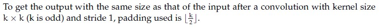

**Figure 1.** Option A statement for Question 83.

*Option ID:* `6406532786699`

**B.** Derivative of loss w.r.t. input image $X$, where $Y = X * W$ is $\frac{\partial L}{\partial X} = \frac{\partial L}{\partial Y} \star W$, where $*$ represents convolution and $\star$ represents correlation.

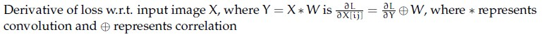

**Figure 2.** Option B statement for Question 83.

*Option ID:* `6406532786700`

**C.** The number of learnable parameters in a pooling layer is not 0.

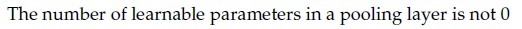

**Figure 3.** Option C statement for Question 83.

*Option ID:* `6406532786701`

**D.** The number of feature maps obtained after a convolution operation depends on the depth of the input but not on the number of filters.

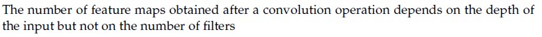

**Figure 4.** Option D statement for Question 83.

*Option ID:* `6406532786702`

**Correct answer:** **A**, **B**

**Worked explanation:**
For stride 1, the output side is $n+2p-k+1$; setting it equal to $n$ gives $p=(k-1)/2$. The stated odd kernel therefore preserves the input size with symmetric integer padding.

---

### da5006_2024T3_Q1_NA · Q157 · 2 marks · ID 640653994506

Which of the following are true? (Select all that apply)

**Options**

**A.** To get the output with the same size as that of the input after a convolution with kernel size $k \times k$ ($k$ is odd) and stride 1, padding used is $\lfloor \frac{k}{2} \rfloor$.

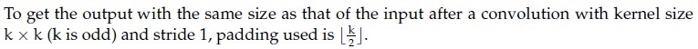

**Figure 1.** Statement and formula for Option A of Question 157.  
*Option ID:* `6406533358254`

**B.** Derivative of loss w.r.t. input image $X$, where $Y = X * W$ is $\frac{\partial L}{\partial X} = \frac{\partial L}{\partial Y} \odot W$, where $*$ represents convolution and $\odot$ represents correlation

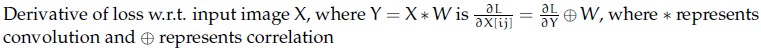

**Figure 2.** Statement and formula for Option B of Question 157.  
*Option ID:* `6406533358255`

**C.** The number of learnable parameters in a pooling layer is not 0

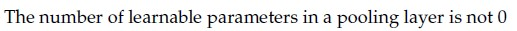

**Figure 3.** Statement for Option C of Question 157.  
*Option ID:* `6406533358256`

**D.** The number of feature maps obtained after a convolution operation depends on the depth of the input but not on the number of filters

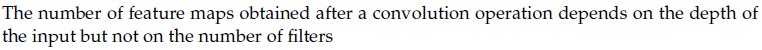

**Figure 4.** Statement for Option D of Question 157.  
*Option ID:* `6406533358257`

**Correct answer:** **A**, **B** — A, B.

**Worked explanation:**
For stride 1, the output side is $n+2p-k+1$; setting it equal to $n$ gives $p=(k-1)/2$. The stated odd kernel therefore preserves the input size with symmetric integer padding.

---

### da5006_2025T1_Q1_NA · Q179 · 2 marks · ID 6406531130638

Which of the following are true ? (Select all that apply)

**Options**

**A.** To get the output with the same size as that of the input after a convolution with kernel size $k \times k$ ($k$ is odd) and stride 1, padding used is $\lfloor \frac{k}{2} \rfloor$.

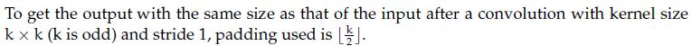

**Figure 1.** Statement for Option A.

*Option ID:* `6406533822734`

**B.** Derivative of loss w.r.t. input image X, where $Y = X * W$ is convolution and $\otimes$ represents correlation: $\frac{\partial L}{\partial X} = \frac{\partial L}{\partial Y} \otimes W$, where $*$ represents convolution and $\otimes$ represents correlation

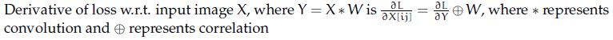

**Figure 2.** Statement for Option B.

*Option ID:* `6406533822735`

**C.** The number of learnable parameters in a pooling layer is not 0

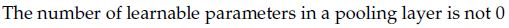

**Figure 3.** Statement for Option C.

*Option ID:* `6406533822736`

**D.** The number of feature maps obtained after a convolution operation depends on the depth of the input but not on the number of filters

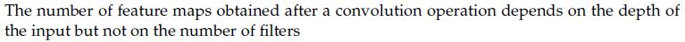

**Figure 4.** Statement for Option D.

*Option ID:* `6406533822737`

**Correct answer:** **A**, **B** — To get the output with the same size as that of the input after a convolution with kernel size k x k (k is odd) and stride 1, padding used is floor(k/2). ; Derivative of loss w.r.t. input image X, where Y = X * W is convolution and correlation represents correlation: dL/dX = dL/dY corr W.

**Worked explanation:**
For stride 1, the output side is $n+2p-k+1$; setting it equal to $n$ gives $p=(k-1)/2$. The stated odd kernel therefore preserves the input size with symmetric integer padding.

---

### da5006_2025T2_Q1_NA · Q172 · 3 marks · ID 6406531279514

Which of the following statements are true ?(Select all that apply)

**Options**

**A.** To obtain an output of the same spatial size as the input after a convolution with kernel size $k \times k$ (where $k$ is odd) and stride 1, the padding used should be $\frac{k-1}{2}$.

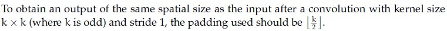

**Figure 1.** Option A candidate statement for Question 172.  
*Option ID:* `6406534313901`

**B.** The derivative of the loss $L$ with respect to the input image $X$, where $Y = X * W$, is given by $\frac{\partial L}{\partial X}[i, j] = \frac{\partial L}{\partial Y} \star W$, where $*$ denotes convolution and $\star$ denotes correlation.

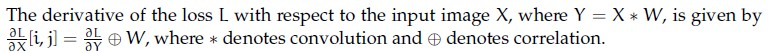

**Figure 2.** Option B candidate statement for Question 172.  
*Option ID:* `6406534313902`

**C.** The number of learnable parameters in a pooling layer is not zero.

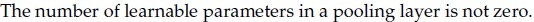

**Figure 3.** Option C candidate statement for Question 172.  
*Option ID:* `6406534313903`

**D.** The number of feature maps obtained after a convolution operation depends on the depth of the input but not on the number of filters.

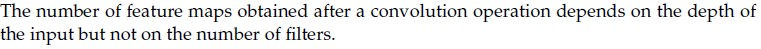

**Figure 4.** Option D candidate statement for Question 172.  
*Option ID:* `6406534313904`

**Correct answer:** **A, B**

**Worked explanation:**
For stride 1, the output side is $n+2p-k+1$; setting it equal to $n$ gives $p=(k-1)/2$. The stated odd kernel therefore preserves the input size with symmetric integer padding.

---

### da5006_2025T2_Q1_NA · Q179 · 3 marks · ID 6406531279530

In backpropagation through a convolutional layer, if the gradient of the loss with respect to the output feature map $\frac{\partial L}{\partial Y}$ is known, and the filter weights $W$ have size $3 \times 3$, stride 1, and no padding, what is the size of the gradient with respect to the input $\frac{\partial L}{\partial X}$, given that $\frac{\partial L}{\partial Y}$ has dimensions $26 \times 26 \times 5$?

Assume if the size of gradient is $F \times F \times d$, then give the value of $F$.

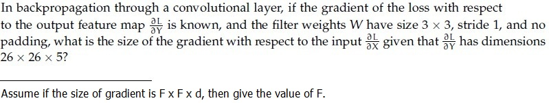

**Figure 1.** Convolution backpropagation gradient dimension problem statement for Question 179.

**Correct answer:** `28`

**Worked explanation:**
The input gradient sums upstream derivatives from every output whose receptive field contains that input value. For a valid 3×3, stride-1 convolution, the input-side gradient map is larger by two positions per axis: 26+3−1=28.

---

## Topic: CNN operations and spatial dimensions

| Paper | Q# | Marks | Type |
| :--- | ---: | ---: | :--- |
| 2024T2 ET AN | 262 | 2 | ET |
| 2024T3 ET AN | 218 | 2 | ET |
| 2025T2 ET AN | 108 | 2 | ET |
| 2025T2 ET FN | 184 | 2 | ET |
| 2025T3 ET FN | 2 | 1 | ET |
| 2025T3 ET FN | 14 | 1 | ET |
| 2026T1 ET FN | 11 | 2 | ET |
| 2026T1 ET FN | 21 | 4 | ET |
| 2026T2 ET FN | 10 | 2 | ET |
| 2026T2 ET FN | 30 | 4 | ET |
| 2026T2 ET FN | 33 | 4 | ET |
| 2024T2 Q1 NA | 97 | 2 | Q1 |
| 2024T2 Q1 NA | 98 | 2 | Q1 |
| 2024T3 Q1 NA | 171 | 2 | Q1 |
| 2025T1 Q1 NA | 158 | 2 | Q1 |
| 2025T1 Q1 NA | 159 | 2 | Q1 |
| 2025T2 Q1 NA | 180 | 3 | Q1 |
| 2025T2 Q1 NA | 181 | 3 | Q1 |
| 2026T1 Q1 NA | 11 | 1 | Q1 |
| 2026T2 Q1 NA | 10 | 1 | Q1 |
| 2024T1 Q2 NA | 155 | 2 | Q2 |
| 2024T1 Q2 NA | 156 | 2 | Q2 |
| 2024T3 Q2 NA | 132 | 2 | Q2 |
| 2024T3 Q2 NA | 133 | 2 | Q2 |
| 2025T1 Q2 NA | 268 | 3 | Q2 |
| 2025T1 Q2 NA | 269 | 3 | Q2 |
| 2025T2 Q2 NA | 259 | 2 | Q2 |
| 2025T2 Q2 NA | 260 | 2 | Q2 |
| 2025T3 Q2 NA | 154 | 2 | Q2 |
| 2025T3 Q2 NA | 155 | 2 | Q2 |
| 2026T1 Q2 NA | 19 | 1 | Q2 |
| 2026T1 Q2 NA | 20 | 1 | Q2 |
| 2026T2 Q2 NA | 18 | 4 | Q2 |
| 2026T2 Q2 NA | 19 | 4 | Q2 |

### da5006_2024T2_ET_AN · Q262 · 2 marks · ID 640653904325

What is the size of the feature map after applying two successive convolution operations with given parameters? Image size = $64 \times 64$, Kernel size = $6 \times 6$, Padding = 1 and Stride = 2. (In calculation, take $\lfloor x \rfloor$ whenever $x$ is non-integer. If the answer is $F \times F$, write $F$ in the blank).

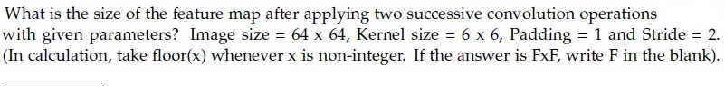

**Figure 1.** Source convolution parameters for Question 262.

**Correct answer:** `14`

**Worked explanation:**
For each layer, $n_{out}=\lfloor(n_{in}-k+2p)/s\rfloor+1$: first 64→31. Applying the same operation again gives $\lfloor(31-6+2\cdot1)/2\rfloor+1=14$; this is the side length.

---

### da5006_2024T3_ET_AN · Q218 · 2 marks · ID 6406531046065

What is the size of the feature map after applying two successive convolution operations with given parameters? Image size = 64 x 64, Kernel size = 6 x 6, Padding = 1 and Stride = 2. (In calculation, take floor(x) whenever x is non-integer. If the answer is FxF, write F in the blank).
______________________

Response Type : Numeric

**Correct answer:** **14**.

**Worked explanation:**
For each layer, $n_{out}=\lfloor(n_{in}-k+2p)/s\rfloor+1$: first 64→31. Applying the same operation again gives $\lfloor(31-6+2\cdot1)/2\rfloor+1=14$; this is the side length.

---

### da5006_2025T2_ET_AN · Q108 · 2 marks · ID 6406531431371

What is the size of the feature map after applying two successive convolution operations with given parameters? Image size = 72×72, Kernel size = 5×5, Padding = 2 and Stride = 3. (In calculation, take floor(x) whenever x is non-integer.If the answer is N × N, write just one value N in the blank) __________________ .

**Correct answer:** 8

**Worked explanation:**
For each layer, $n_{out}=\lfloor(n_{in}-k+2p)/s\rfloor+1$: first 72→24. Applying the same operation again gives $\lfloor(24-5+2\cdot2)/3\rfloor+1=8$; this is the side length.

---

### da5006_2025T2_ET_FN · Q184 · 2 marks · ID 6406531422573

What is the size of the feature map after applying two successive convolution operations with given parameters? Image size = 64 x 64, Kernel size = 6 x 6, Padding = 1 and Stride = 2.(In calculation, take floor(x) whenever x is non-integer. If the answer is N x N, enter just one value N in the blank)

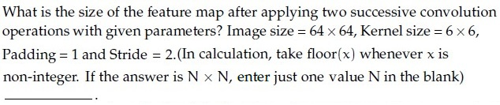

**Figure 1.** Question 184, convolution feature map size problem.

**Correct answer:** `100`

**Worked explanation:**
> [!WARNING] Numerical derivation gives **14**, but the source key states **100**. The source key is retained above.

For each layer, $n_{out}=\lfloor(n_{in}-k+2p)/s\rfloor+1$: first 64→31. Applying the same operation again gives $\lfloor(31-6+2\cdot1)/2\rfloor+1=14$; this is the side length. The derivation gives 14, which conflicts with the preserved source key 100.

---

### da5006_2025T3_ET_FN · Q2 · 1 marks · ID 6406531862816

A single 2D convolution (no dilation). Input size $128 \times 128$, kernel $7 \times 7$, stride $2$, padding $1$.
What is the output spatial size $N \times N$? (Enter $N$.)

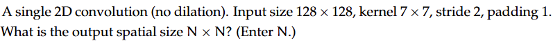

**Figure 1.** Source 2D convolution parameters for Question 2.

**Correct answer:** `62`

**Worked explanation:**
For each layer, $n_{out}=\lfloor(n_{in}-k+2p)/s\rfloor+1$: first 128→62. Thus $\lfloor(128-7+2\cdot1)/2\rfloor+1=62$ output positions.

---

### da5006_2025T3_ET_FN · Q14 · 1 marks · ID 6406531862828

Calculate the output size ($W_{out}$) of a 1D convolution layer. Input width $W_{in} = 100$, Kernel size $K = 3$, Stride $S = 2$, Padding $P = 1$.

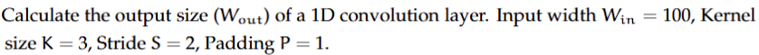

**Figure 1.** Source 1D convolution parameters for Question 14.

**Correct answer:** `50`

**Worked explanation:**
For each layer, $n_{out}=\lfloor(n_{in}-k+2p)/s\rfloor+1$: first 100→50. Thus $\lfloor(100-3+2\cdot1)/2\rfloor+1=50$ output positions.

---

### da5006_2026T1_ET_FN · Q11 · 2 marks · ID 6406532136826

A key reason CNNs are parameter-efficient compared to fully connected nets for images is:

**Options**

**A.** Weight sharing and local receptive fields  
*Option ID:* `6406536959513`

**B.** They never use nonlinearities thus easier to train  
*Option ID:* `6406536959514`

**C.** They always use pooling  
*Option ID:* `6406536959515`

**D.** Compared to vanilla neural network and RNN, they are robust to gradient explosion and vanishing gradient.  
*Option ID:* `6406536959516`

**Correct answer:** **A** — Weight sharing and local receptive fields.

**Worked explanation:**
Local connectivity restricts each output to a small input neighborhood, while weight sharing reuses that same kernel at every spatial position. Therefore the parameter count depends on kernel size and channel counts, not image height or width.

---

### da5006_2026T1_ET_FN · Q21 · 4 marks · ID 6406532136836

Input image: 64×64. Convolution: kernel 7×7, stride 2, padding 3. Compute output spatial size.

**Correct answer:** `32`

**Worked explanation:**
For each layer, $n_{out}=\lfloor(n_{in}-k+2p)/s\rfloor+1$: first 64→32. Thus $\lfloor(64-7+2\cdot3)/2\rfloor+1=32$ output positions.

---

### da5006_2026T2_ET_FN · Q10 · 2 marks · ID 6406532270049

A $3 \times 3$ convolution maps 16 input channels to 32 output channels. If the input spatial size changes from $64 \times 64$ to $128 \times 128$ while the layer configuration is unchanged, the number of trainable convolution weights:

**Options**

**A.** Doubles  
*Option ID:* `6406537379035`

**B.** Quadruples  
*Option ID:* `6406537379036`

**C.** Remains unchanged  
*Option ID:* `6406537379037`

**D.** Is halved  
*Option ID:* `6406537379038`

**Correct answer:** **C** — Remains unchanged.

**Worked explanation:**
A standard convolution stores one shared kernel bank, with $k^2C_{in}C_{out}$ weights (plus optional biases). Changing the feature map’s height and width changes the number of applications and MACs, but leaves this parameter count unchanged.

---

### da5006_2026T2_ET_FN · Q30 · 4 marks · ID 6406532270069

An input feature map has spatial size $63 \times 63$. A $5 \times 5$ convolution is applied with stride 2 and padding 1. Compute the output size along one spatial dimension.

**Correct answer:** `31`

**Worked explanation:**
For each layer, $n_{out}=\lfloor(n_{in}-k+2p)/s\rfloor+1$: first 63→31. Thus $\lfloor(63-5+2\cdot1)/2\rfloor+1=31$ output positions.

---

### da5006_2026T2_ET_FN · Q33 · 4 marks · ID 6406532270072

A convolutional layer uses $3 \times 3$ kernels, 16 input channels and 32 output channels. The layer has one bias per output channel. Compute the total number of trainable parameters.

**Correct answer:** `4640`

**Worked explanation:**
Each of the 32 output filters has $k^2M=3^2\cdot16=144$ weights; sharing gives $k^2MN=4,608$. One bias per output channel adds 32, for 4,640 trainable parameters.

---

### da5006_2024T2_Q1_NA · Q97 · 2 marks · ID 640653829674

What is the size of the feature map after applying two successive convolution operations with given parameters? Image size = 64 x 64, Kernel size = 6 x 6, Padding = 1 and Stride = 2. (In calculation, take floor(x) whenever x is non-integer. If the answer is FxF, write F in the blank). ___________

**Correct answer:** `14`

**Worked explanation:**
For each layer, $n_{out}=\lfloor(n_{in}-k+2p)/s\rfloor+1$: first 64→31. Applying the same operation again gives $\lfloor(31-6+2\cdot1)/2\rfloor+1=14$; this is the side length.

---

### da5006_2024T2_Q1_NA · Q98 · 2 marks · ID 640653829675

Let an input to a convolutional layer in a CNN have size Df × Df × M where Df = 64 and M = 16, and output feature map (after passing input through conv layer) has Df × Df × N size where N = 8. Let the kernel in the conv layer be k × k where k = 3. Calculate the number of parameters for this convolution layer. (Assume appropriate padding is applied for all convolutions so the input and output sizes are equal. Ignore the bias term in the calculation).

**Correct answer:** `1152`

**Worked explanation:**
Each of the 8 output filters has $k^2M=3^2\cdot16=144$ weights; sharing gives $k^2MN=1,152$. The prompt excludes bias, so no bias terms are added.

---

### da5006_2024T3_Q1_NA · Q171 · 2 marks · ID 640653994507

What is the size of the feature map after applying two successive convolution operations with given parameters? Image size = 64 × 64, Kernel size = 6 × 6, Padding = 1 and Stride = 2. (In calculation, take $\text{floor}(x)$ whenever $x$ is non-integer. If the answer is $F \times F$, write $F$ in the blank).

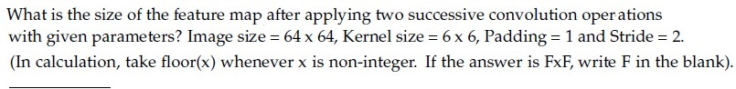

**Figure 1.** Feature map size question and parameters for Question 171.

Response Type : Numeric  
Answers Type : Equal

**Correct answer:** 14

**Worked explanation:**
For each layer, $n_{out}=\lfloor(n_{in}-k+2p)/s\rfloor+1$: first 64→31. Applying the same operation again gives $\lfloor(31-6+2\cdot1)/2\rfloor+1=14$; this is the side length.

---

### da5006_2025T1_Q1_NA · Q158 · 2 marks · ID 6406531130639

What is the size of the feature map after applying two successive convolution operations with given parameters? Image size = 64 x 64, Kernel size = 3 x 3, Padding = 2 and Stride = 3. (In calculation, take floor(x) whenever x is non-integer. If the answer is FxF, write F in the blank).

**Correct answer:** `8`

**Worked explanation:**
For each layer, $n_{out}=\lfloor(n_{in}-k+2p)/s\rfloor+1$: first 64→22. Applying the same operation again gives $\lfloor(22-3+2\cdot2)/3\rfloor+1=8$; this is the side length.

---

### da5006_2025T1_Q1_NA · Q159 · 2 marks · ID 6406531130640

Let an input to a convolutional layer in a CNN have size $D_f \times D_f \times M$ where $D_f = 32$ and $M = 100$, and output feature map (after passing input through conv layer) has $D_f \times D_f \times N$ size where $N = 64$. Let the kernel in the conv layer be $k \times k$ where $k = 5$. Calculate the number of parameters for this convolution layer. (Assume appropriate padding is applied for all convolutions so the input and output sizes are equal. Ignore the bias term in the calculation)._________________

**Correct answer:** `160000`

**Worked explanation:**
Each of the 64 output filters has $k^2M=5^2\cdot100=2,500$ weights; sharing gives $k^2MN=160,000$. The prompt excludes bias, so no bias terms are added.

---

### da5006_2025T2_Q1_NA · Q180 · 3 marks · ID 6406531279531

What is the size of the feature map after applying two successive convolution operations with the following parameters? Input image size = $128 \times 128$, Kernel size = $5 \times 5$, Padding = 1, Stride = 4. (In calculation, take $\lfloor x \rfloor$ whenever $x$ is non-integer. If the answer is $F \times F$, write only $F$ in the blank.)

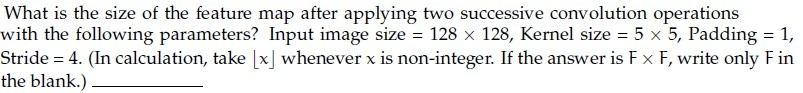

**Figure 1.** Successive convolution feature map size problem statement for Question 180.

**Correct answer:** `8`

**Worked explanation:**
For each layer, $n_{out}=\lfloor(n_{in}-k+2p)/s\rfloor+1$: first 128→32. Applying the same operation again gives $\lfloor(32-5+2\cdot1)/4\rfloor+1=8$; this is the side length.

---

### da5006_2025T2_Q1_NA · Q181 · 3 marks · ID 6406531279532

Let an input to a convolutional layer in a CNN have size $D_f \times D_f \times M$, where $D_f = 28$ and $M = 120$. The output feature map after the convolution has size $D_f \times D_f \times N$, where $N = 80$. The kernel size of the convolution layer is $k \times k$, with $k = 3$.

Calculate the number of parameters for this convolution layer. (Assume appropriate padding is applied so that input and output spatial sizes remain the same. Ignore bias terms.)

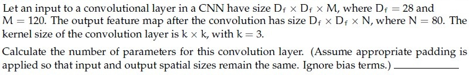

**Figure 1.** CNN convolution layer parameter calculation problem statement for Question 181.

**Correct answer:** `86400`

**Worked explanation:**
Each of the 80 output filters has $k^2M=3^2\cdot120=1,080$ weights; sharing gives $k^2MN=86,400$. The prompt excludes bias, so no bias terms are added.

---

### da5006_2026T1_Q1_NA · Q11 · 1 marks · ID 6406531961521

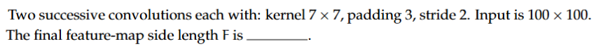

**Figure 1.** Successive convolution layer specifications for Question 11.

Two successive convolutions each with: kernel $7 \times 7$, padding 3, stride 2. Input is $100 \times 100$. The final feature-map side length $F$ is _____.

**Correct answer:** `25`

**Worked explanation:**
For each layer, $n_{out}=\lfloor(n_{in}-k+2p)/s\rfloor+1$: first 100→50. Applying the same operation again gives $\lfloor(50-7+2\cdot3)/2\rfloor+1=25$; this is the side length.

---

### da5006_2026T2_Q1_NA · Q10 · 1 marks · ID 6406532166257

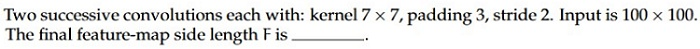

**Figure 1.** Successive convolution layer specifications for Question 10.

Two successive convolutions each with: kernel $7 \times 7$, padding 3, stride 2. Input is $100 \times 100$. The final feature-map side length $F$ is _____.

**Correct answer:** `25`

**Worked explanation:**
For each layer, $n_{out}=\lfloor(n_{in}-k+2p)/s\rfloor+1$: first 100→50. Applying the same operation again gives $\lfloor(50-7+2\cdot3)/2\rfloor+1=25$; this is the side length.

---

### da5006_2024T1_Q2_NA · Q155 · 2 marks · ID 640653766145

What is the size of the feature map after applying two successive convolution operations with given parameters? Image size = 64 x 64, Kernel size = 6 x 6, Padding = 1 and Stride = 2. (In calculation, take floor(x) whenever x is non-integer. If the answer is FxF, write F in the answer).

**Correct answer:** `14`

**Worked explanation:**
For each layer, $n_{out}=\lfloor(n_{in}-k+2p)/s\rfloor+1$: first 64→31. Applying the same operation again gives $\lfloor(31-6+2\cdot1)/2\rfloor+1=14$; this is the side length.

---

### da5006_2024T1_Q2_NA · Q156 · 2 marks · ID 640653766146

Let an input to a convolutional layer in a CNN have size $D_I \times D_I \times M$ where $D_I = 64$ and $M = 16$, and output feature map (after passing input through conv layer) has $D_I \times D_I \times N$ size where $N = 8$. Let the kernel in the conv layer be $k \times k$ where $k = 3$. Calculate the number of parameters for this convolution layer. (Assume appropriate padding is applied for all convolutions so the input and output sizes are equal. Ignore the bias term in the calculation).

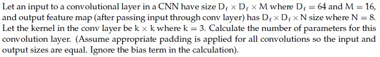

**Figure 1.** Source diagram for Question 156.

**Correct answer:** `1152`

**Worked explanation:**
Each of the 8 output filters has $k^2M=3^2\cdot16=144$ weights; sharing gives $k^2MN=1,152$. The prompt excludes bias, so no bias terms are added.

---

### da5006_2024T3_Q2_NA · Q132 · 2 marks · ID 6406531031065

**Context:** Let input have size $D_I \times D_I \times M$ where $D_I = 128$ and $M = 16$ and output feature map (after passing input through conv layer) has $D_I \times D_I \times N$ size where $N = 32$. Assume padded convolution. Let width of the square kernel in conv layer be $k$ where $k = 5$ (Ignore the bias term in the calculation). Calculate the number of parameters and computational cost for this convolution layer.

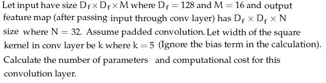

**Figure 1.** Convolutional layer specifications for Questions 132 and 133.

Based on the above data, answer the given subquestion.

Number of Parameters: ______________

**Correct answer:** `12800`

**Worked explanation:**
Each of the 32 output filters has $k^2M=5^2\cdot16=400$ weights; sharing gives $k^2MN=12,800$. The prompt excludes bias, so no bias terms are added.

---

### da5006_2024T3_Q2_NA · Q133 · 2 marks · ID 6406531031066

**Context:** Refer to the specifications in Question 132.

Based on the above data, answer the given subquestion.

Computational Cost: ______________

**Correct answer:** `209715200`

**Worked explanation:**
With shared weights, parameters are $k^2MN=5^2\cdot16\cdot32=12,800$; for a 128×128 output, MACs are $H_oW_ok^2MN=128^2\cdot5^2\cdot16\cdot32=209,715,200$.

---

### da5006_2025T1_Q2_NA · Q268 · 3 marks · ID 6406531168244

**Comprehension Context (Questions 268–269):**

> Let input have size $D_f \times D_f \times M$ where $D_f = 128$ and $M = 16$ and output feature map (after passing input through conv layer) has $D_f \times D_f \times N$ size where $N = 32$. Assume padded convolution. Let width of the square kernel in conv layer be $k$ where $k = 5$ (Ignore the bias term in the calculation).
> Calculate the number of parameters and computational cost for this convolution layer.
>
> 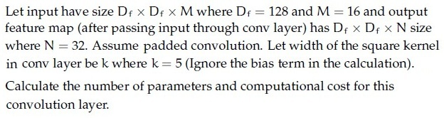
>
> **Figure 1.** Standard convolution specification for Comprehension Context 2 (Questions 268–269).
>
> Based on the above data, answer the given subquestions.

Number of Parameters: __________________

**Correct answer:** `12800`

**Worked explanation:**
Each of the 32 output filters has $k^2M=5^2\cdot16=400$ weights; sharing gives $k^2MN=12,800$. The prompt excludes bias, so no bias terms are added.

---

### da5006_2025T1_Q2_NA · Q269 · 3 marks · ID 6406531168245

Computational Cost: __________________

**Correct answer:** `209715200`

**Worked explanation:**
With shared weights, parameters are $k^2MN=5^2\cdot16\cdot32=12,800$; for a 128×128 output, MACs are $H_oW_ok^2MN=128^2\cdot5^2\cdot16\cdot32=209,715,200$.

---

### da5006_2025T2_Q2_NA · Q259 · 2 marks · ID 6406531333813

**Comprehension:**

Let input have size $D_f \times D_f \times M$ where $D_f = 10$ and $M = 256$ and output feature map (after passing input through conv layer) has $D_f \times D_f \times N$ size where $N = 512$. Assume padded convolution. Let width of the square kernel in conv layer be $k$ where $k = 7$ (Ignore the bias term in the calculation). Calculate the number of parameters and computational cost for this convolution layer.

Based on the above data, answer the given subquestions.

Number of Parameters:_____________

**Correct answer:** `6422528`

**Worked explanation:**
Each of the 512 output filters has $k^2M=7^2\cdot256=12,544$ weights; sharing gives $k^2MN=6,422,528$. The prompt excludes bias, so no bias terms are added.

---

### da5006_2025T2_Q2_NA · Q260 · 2 marks · ID 6406531333814

**Comprehension:**

Let input have size $D_f \times D_f \times M$ where $D_f = 10$ and $M = 256$ and output feature map (after passing input through conv layer) has $D_f \times D_f \times N$ size where $N = 512$. Assume padded convolution. Let width of the square kernel in conv layer be $k$ where $k = 7$ (Ignore the bias term in the calculation). Calculate the number of parameters and computational cost for this convolution layer.

Based on the above data, answer the given subquestions.

Computational Cost:___________________

**Correct answer:** `642252800`

**Worked explanation:**
With shared weights, parameters are $k^2MN=7^2\cdot256\cdot512=6,422,528$; for a 10×10 output, MACs are $H_oW_ok^2MN=10^2\cdot7^2\cdot256\cdot512=642,252,800$.

---

### da5006_2025T3_Q2_NA · Q154 · 2 marks · ID 6406531815748

Let input have size $D_I \times D_I \times M$ where $D_I = 10$ and $M = 256$ and output feature map (after passing input through conv layer) has $D_I \times D_I \times N$ size where $N = 512$. Assume padded convolution. Let width of the square kernel in conv layer be $k$ where $k = 7$ (Ignore the bias term in the calculation). Calculate the number of parameters and computational cost for this convolution layer.

Based on the above data, answer the given subquestion.

Number of Parameters: ______________

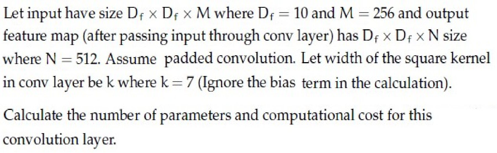

**Figure 1.** Convolutional layer specifications for Questions 154 and 155.

**Correct answer:** `6422528`

**Worked explanation:**
Each of the 512 output filters has $k^2M=7^2\cdot256=12,544$ weights; sharing gives $k^2MN=6,422,528$. The prompt excludes bias, so no bias terms are added.

---

### da5006_2025T3_Q2_NA · Q155 · 2 marks · ID 6406531815749

Refer to the convolutional layer specifications in Question 154.

Based on the above data, answer the given subquestion.

Computational Cost: ________________

**Correct answer:** `642252800`

**Worked explanation:**
With shared weights, parameters are $k^2MN=7^2\cdot256\cdot512=6,422,528$; for a 10×10 output, MACs are $H_oW_ok^2MN=10^2\cdot7^2\cdot256\cdot512=642,252,800$.

---

### da5006_2026T1_Q2_NA · Q19 · 1 marks · ID 6406532040106

Input feature map: 14×14×128, output: 14×14×256, kernel: 3×3, stride 1, same padding, ignore bias.  
Compute number of parameters for a standard convolution layer.

**Correct answer:** 294912

**Worked explanation:**
Each of the 256 output filters has $k^2M=3^2\cdot128=1,152$ weights; sharing gives $k^2MN=294,912$. The prompt excludes bias, so no bias terms are added.

---

### da5006_2026T1_Q2_NA · Q20 · 1 marks · ID 6406532040107

Using the same setup (Input feature map: 14×14×128, output: 14×14×256, kernel: 3×3, stride 1, same padding, ignore bias), compute total MACs operation (multiply-accumulates). A single MAC operation multiplies two numbers and adds the result to an accumulator.

**Correct answer:** 57802752

**Worked explanation:**
With shared weights, parameters are $k^2MN=3^2\cdot128\cdot256=294,912$; for a 14×14 output, MACs are $H_oW_ok^2MN=14^2\cdot3^2\cdot128\cdot256=57,802,752$.

---

### da5006_2026T2_Q2_NA · Q18 · 4 marks · ID 6406532194398

Input feature map: 14×14×128, output: 14×14×256, kernel: 3×3, stride 1, same padding, ignore bias. 

Compute number of parameters for a standard convolution layer.

**Response type:** Numeric  
**Evaluation required:** Yes  
**Answers type:** Equal

**Correct answer:** 294912

**Worked explanation:**
Each of the 256 output filters has $k^2M=3^2\cdot128=1,152$ weights; sharing gives $k^2MN=294,912$. The prompt excludes bias, so no bias terms are added.

---

### da5006_2026T2_Q2_NA · Q19 · 4 marks · ID 6406532194399

Input feature map: 14×14×128, output: 14×14×256, kernel: 3×3, stride 1, same padding, ignore bias, compute total MACs (multiply-accumulates).

**Response type:** Numeric  
**Evaluation required:** Yes  
**Answers type:** Equal

**Correct answer:** 57802752

**Worked explanation:**
With shared weights, parameters are $k^2MN=3^2\cdot128\cdot256=294,912$; for a 14×14 output, MACs are $H_oW_ok^2MN=14^2\cdot3^2\cdot128\cdot256=57,802,752$.

---

## Topic: AlexNet and early CNN classifiers

| Paper | Q# | Marks | Type |
| :--- | ---: | ---: | :--- |
| 2025T2 ET FN | 159 | 2 | ET |
| 2025T2 Q2 NA | 239 | 2 | Q2 |
| 2025T3 Q2 NA | 135 | 2 | Q2 |

### da5006_2025T2_ET_FN · Q159 · 2 marks · ID 6406531422538

Consider the following statements P and Q regarding AlexNet and choose the correct option:

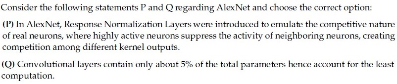

**Figure 1.** Question 159, statements P and Q.

(P) In AlexNet, Response Normalization Layers were introduced to emulate the competitive nature of real neurons, where highly active neurons suppress the activity of neighboring neurons, creating competition among different kernel outputs.

(Q) Convolutional layers contain only about 5% of the total parameters hence account for the least computation.

**Options**

**A.** Only statement P is true  
*Option ID:* `6406534756368`

**B.** Only statement Q is true  
*Option ID:* `6406534756369`

**C.** Both statements are true  
*Option ID:* `6406534756370`

**D.** None of these statements is true  
*Option ID:* `6406534756371`

**Correct answer:** **A** — Only statement P is true.

**Worked explanation:**
Local response normalization implements competition across neighboring channel responses and has no learned scale/shift parameters in the original AlexNet formulation. AlexNet's fully connected layers hold most parameters, while convolutional layers account for much of the arithmetic; evaluate the two statements independently.

---

### da5006_2025T2_Q2_NA · Q239 · 2 marks · ID 6406531333790

Consider the following statements P and Q regarding AlexNet and choose the correct option:

(P) In AlexNet, a trainable Local Response Normalization Layers were introduced to emulate the competitive nature of real neurons, where highly active neurons suppress the activity of neighboring neurons, creating competition among different kernel outputs.

(Q) In AlexNet, a total of 8 Convolutional layers contain only about 6-7% of the total parameters hence account for the least computation.

**Options**

**A.** Only statement P is true  
*Option ID:* `6406534459605`

**B.** Only statement Q is true  
*Option ID:* `6406534459606`

**C.** Both statements are true  
*Option ID:* `6406534459607`

**D.** None of these statements is true  
*Option ID:* `6406534459608`

**Correct answer:** **D** — None of these statements is true

**Worked explanation:**
Local response normalization implements competition across neighboring channel responses and has no learned scale/shift parameters in the original AlexNet formulation. AlexNet's fully connected layers hold most parameters, while convolutional layers account for much of the arithmetic; evaluate the two statements independently.

---

### da5006_2025T3_Q2_NA · Q135 · 2 marks · ID 6406531815727

Consider the following statements P and Q regarding AlexNet and choose the correct option: (P) In AlexNet, a trainable Local Response Normalization Layers were introduced to emulate the competitive nature of real neurons, where highly active neurons suppress the activity of neighboring neurons, creating competition among different kernel outputs. (Q) In AlexNet, a total of 8 Convolutional layers contain only about 6-7% of the total parameters hence account for the least computation.

**Options**

**A.** Only statement P is true  
*Option ID:* `6406535903102`

**B.** Only statement Q is true  
*Option ID:* `6406535903103`

**C.** Both statements are true  
*Option ID:* `6406535903104`

**D.** None of the statements is true  
*Option ID:* `6406535903105`

**Correct answer:** **D** — None of the statements is true.

**Worked explanation:**
Local response normalization implements competition across neighboring channel responses and has no learned scale/shift parameters in the original AlexNet formulation. AlexNet's fully connected layers hold most parameters, while convolutional layers account for much of the arithmetic; evaluate the two statements independently.

---

## Topic: Pooling and receptive fields

| Paper | Q# | Marks | Type |
| :--- | ---: | ---: | :--- |
| 2026T1 ET FN | 12 | 2 | ET |
| 2024T2 Q1 NA | 94 | 2 | Q1 |
| 2024T3 Q1 NA | 152 | 2 | Q1 |
| 2025T1 Q1 NA | 169 | 2 | Q1 |
| 2025T2 Q1 NA | 166 | 2 | Q1 |

### da5006_2026T1_ET_FN · Q12 · 2 marks · ID 6406532136827

Stacking multiple 3×3 convolutions (stride 1) increases receptive field because:

**Options**

**A.** Each layer composes local neighborhoods into larger effective context  
*Option ID:* `6406536959517`

**B.** Each layer reduces spatial resolution  
*Option ID:* `6406536959518`

**C.** It removes nonlinearities thereby increasing the effective context  
*Option ID:* `6406536959519`

**D.** It forces global averaging thereby increasing the contribution of input pixels  
*Option ID:* `6406536959520`

**Correct answer:** **A** — Each layer composes local neighborhoods into larger effective context.

**Worked explanation:**
Each stride-1 3×3 layer adds two input positions to the receptive field; composing three yields 7×7 context. The growth comes from overlapping neighborhoods, not from a change in spatial resolution.

---

### da5006_2024T2_Q1_NA · Q94 · 2 marks · ID 640653829676

Consider a Convolutional Neural Network which processes an RGB image. It has 128 kernels each of spatial dimension 5 × 5 in the first layer. They are convolved with a stride 1. This is followed by a max-pooling layer with stride 2 and kernel size 5 × 5. What would be the receptive field size of a single neuron in the pooling layer? (Recap: A receptive field is the size of the region in the input image, which influences the activation of that specific neuron.)

**Options**

**A.** 5 × 5  
*Option ID:* `6406532786705`

**B.** 7 × 7  
*Option ID:* `6406532786706`

**C.** 9 × 9  
*Option ID:* `6406532786707`

**D.** 3 × 3  
*Option ID:* `6406532786708`

**Correct answer:** **C** — 9 × 9.

**Worked explanation:**
A pooling window spans 5 positions in the preceding feature map, whose adjacent units' receptive fields shift by one input pixel (conv stride 1). The combined field is $k+(q-1)= 5+(5-1)=9$ pixels per side.

---

### da5006_2024T3_Q1_NA · Q152 · 2 marks · ID 640653994509

Consider a Convolutional Neural Network which processes an RGB image. It has 128 kernels each of spatial dimension 5 × 5 in the first layer. They are convolved with a stride 1. This is followed by a max-pooling layer with stride 2 and kernel size 5 × 5. What would be the receptive field size of a single neuron in the pooling layer? (Recap: A receptive field is the size of the region in the input image, which influences the activation of that specific neuron.)

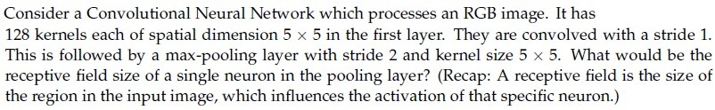

**Figure 1.** Source problem statement for Question 152.

**Options**

**A.** 5 × 5  
*Option ID:* `6406533358260`

**B.** 7 × 7  
*Option ID:* `6406533358261`

**C.** 9 × 9  
*Option ID:* `6406533358262`

**D.** 3 × 3  
*Option ID:* `6406533358263`

**Correct answer:** **C** — 9 × 9.

**Worked explanation:**
A pooling window spans 5 positions in the preceding feature map, whose adjacent units' receptive fields shift by one input pixel (conv stride 1). The combined field is $k+(q-1)= 5+(5-1)=9$ pixels per side.

---

### da5006_2025T1_Q1_NA · Q169 · 2 marks · ID 6406531130641

Consider a Convolutional Neural Network which processes an RGB image. It has 128 kernels each of spatial dimension 5 × 5 in the first layer. They are convolved with a stride 1. This is followed by a max-pooling layer with stride 2 and kernel size 5 × 5. What would be the receptive field size of a single neuron in the pooling layer? (Recap: A receptive field is the size of the region in the input image, which influences the activation of that specific neuron.)

**Options**

**A.** 5 × 5  
*Option ID:* `6406533822740`

**B.** 7 × 7  
*Option ID:* `6406533822741`

**C.** 9 × 9  
*Option ID:* `6406533822742`

**D.** 3 × 3  
*Option ID:* `6406533822743`

**Correct answer:** **C** — 9 × 9.

**Worked explanation:**
A pooling window spans 5 positions in the preceding feature map, whose adjacent units' receptive fields shift by one input pixel (conv stride 1). The combined field is $k+(q-1)= 5+(5-1)=9$ pixels per side.

---

### da5006_2025T2_Q1_NA · Q166 · 2 marks · ID 6406531279508

Consider a Convolutional Neural Network which processes an RGB image. It has 128 kernels each of spatial dimension 5 x 5 in the first layer. They are convolved with a stride 1. This is followed by a max-pooling layer with stride 2 and kernel size 5 x 5. What would be the receptive field size of a single neuron in the pooling layer? (Recap: A receptive field is the size of the region in the input image, which influences the activation of that specific neuron.)

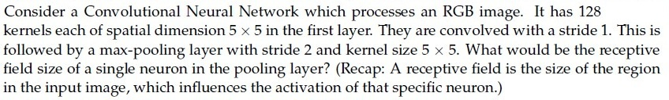

**Figure 1.** CNN receptive field problem statement for Question 166.

**Options**

**A.** 5x5

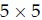

**Figure 2.** Option A receptive field size for Question 166.  
*Option ID:* `6406534313877`

**B.** 7x7

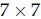

**Figure 3.** Option B receptive field size for Question 166.  
*Option ID:* `6406534313878`

**C.** 9x9

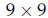

**Figure 4.** Option C receptive field size for Question 166.  
*Option ID:* `6406534313879`

**D.** 3x3

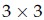

**Figure 5.** Option D receptive field size for Question 166.  
*Option ID:* `6406534313880`

**Correct answer:** **C** — 9x9.

**Worked explanation:**
A pooling window spans 5 positions in the preceding feature map, whose adjacent units' receptive fields shift by one input pixel (conv stride 1). The combined field is $k+(q-1)= 5+(5-1)=9$ pixels per side.

---
