# Week 5 Question Bank

**Exam notes:** [Week 5 exam notes](../month%202/week%205/week-5-exam-notes.md)

**Counts:** Q1 0 · Q2 69 · ET 16 · Total 85 questions · 153 marks

## Topic: CNN visualization and interpretability

| Paper | Q# | Marks | Type |
|---|---:|---:|---|
| da5006_2024T1_ET_AN | 170 | 2 | ET |
| da5006_2024T1_ET_AN | 171 | 2 | ET |
| da5006_2024T1_ET_AN | 172 | 2 | ET |
| da5006_2024T2_ET_AN | 252 | 2 | ET |
| da5006_2024T1_Q2_NA | 150 | 2 | Q2 |
| da5006_2024T1_Q2_NA | 151 | 2 | Q2 |
| da5006_2024T1_Q2_NA | 158 | 2 | Q2 |
| da5006_2024T2_Q2_NA | 117 | 2 | Q2 |
| da5006_2024T2_Q2_NA | 118 | 2 | Q2 |
| da5006_2024T2_Q2_NA | 119 | 2 | Q2 |
| da5006_2024T2_Q2_NA | 144 | 2 | Q2 |
| da5006_2024T3_Q2_NA | 142 | 2 | Q2 |
| da5006_2024T3_Q2_NA | 150 | 2 | Q2 |
| da5006_2025T1_Q2_NA | 245 | 2 | Q2 |
| da5006_2025T1_Q2_NA | 255 | 2 | Q2 |
| da5006_2025T1_Q2_NA | 260 | 2 | Q2 |
| da5006_2025T2_Q2_NA | 249 | 3.0 | Q2 |
| da5006_2025T3_Q2_NA | 146 | 3.0 | Q2 |
| da5006_2026T1_Q2_NA | 9 | 1.0 | Q2 |
| da5006_2026T2_Q2_NA | 6 | 1.0 | Q2 |

### da5006_2024T1_ET_AN · Q170 · 2 marks · ID 640653821596

What is the primary advantage of visualizing patches of maximally activating neurons in neural network interpretation?

**Options**

**A.** It helps identify the specific input features that contribute most strongly to the model’s predictions.  
*Option ID:* `6406532757328`

**B.** It provides insights into the architectural design choices made in the neural network.  
*Option ID:* `6406532757329`

**C.** It quantifies the uncertainty associated with the model’s predictions.  
*Option ID:* `6406532757330`

**D.** It measures the computational resources required to activate the neurons.  
*Option ID:* `6406532757331`

---

**Correct answer:** **A** — It helps identify the specific input features that contribute most strongly to the model’s predictions..

**Worked explanation:** Interpretability methods probe feature sensitivity or spatial evidence; distinguish input perturbation, activation visualization, and gradient attribution by what is measured. The source key is retained as the answer; compare the defining property against each distractor.

### da5006_2024T1_ET_AN · Q171 · 2 marks · ID 640653821597

Which layer of the neural network does Grad-CAM typically operate on?

**Options**

**A.** The input layer.  
*Option ID:* `6406532757332`

**B.** The output layer.  
*Option ID:* `6406532757333`

**C.** The convolutional layers.  
*Option ID:* `6406532757334`

**D.** The fully connected layers.  
*Option ID:* `6406532757335`

---

**Correct answer:** **C** — The convolutional layers..

**Worked explanation:** Interpretability methods probe feature sensitivity or spatial evidence; distinguish input perturbation, activation visualization, and gradient attribution by what is measured. The source key is retained as the answer; compare the defining property against each distractor.

### da5006_2024T1_ET_AN · Q172 · 2 marks · ID 640653821598

Which component of Grad-CAM is responsible for weighting the importance of each feature map?

**Options**

**A.** The class activation map (CAM).  
*Option ID:* `6406532757336`

**B.** The global average pooling layer.  
*Option ID:* `6406532757337`

**C.** The guided backpropagation algorithm.  
*Option ID:* `6406532757338`

**D.** The gradient of the target class score with respect to the feature maps.  
*Option ID:* `6406532757339`

---

**Correct answer:** **B** — The global average pooling layer..

**Worked explanation:** Interpretability methods probe feature sensitivity or spatial evidence; distinguish input perturbation, activation visualization, and gradient attribution by what is measured. The source key is retained as the answer; compare the defining property against each distractor.

### da5006_2024T1_Q2_NA · Q150 · 2 marks · ID 640653766152

Which of the below properties are not exhibited by the gradient-based explanation generation method, Grad-CAM? (Select all that apply)

**Options**

**A.** Grad-CAM saliency map only computes gradients for important pixels while calculating weights, so pixels that contribute more to a specific class are considered  
*Option ID:* `6406532564183`

**B.** Grad-CAM can’t generate explanation directly from the given CNN and needs additional retraining  
*Option ID:* `6406532564184`

**C.** Grad-CAM is very reliable at identifying multiple instances of objects with occlusions  
*Option ID:* `6406532564185`

**D.** Grad-CAM can help localize objects without positional supervision  
*Option ID:* `6406532564186`

---

**Correct answer:** **A** — Grad-CAM saliency map only computes gradients for important pixels while calculating weights, so pixels that contribute more to a specific class are considered

**Worked explanation:** Interpretability methods probe feature sensitivity or spatial evidence; distinguish input perturbation, activation visualization, and gradient attribution by what is measured. The source key is retained as the answer; compare the defining property against each distractor.

### da5006_2024T1_Q2_NA · Q151 · 2 marks · ID 640653766153

Which of the following statements accurately describes the visualization techniques used in Convolutional Neural Networks (CNNs)? (Select all that apply)

**Options**

**A.** Activation maximization methods identify input image region that maximally activates specific neurons in the network.  
*Option ID:* `6406532564187`

**B.** Filter visualization techniques display the learned weights of convolutional filters in the network.  
*Option ID:* `6406532564188`

**C.** Kernel visualization involves directly observing the values of convolutional filters during network training.  
*Option ID:* `6406532564189`

**D.** Principal Component Analysis (PCA) is commonly employed to reduce the dimensionality of feature maps for visualization purposes.  
*Option ID:* `6406532564190`

---

**Correct answer:** **A**, **B** — Activation maximization methods identify input image region that maximally activates specific neurons in the network.; Filter visualization techniques display the learned weights of convolutional filters in the network.

**Worked explanation:** Interpretability methods probe feature sensitivity or spatial evidence; distinguish input perturbation, activation visualization, and gradient attribution by what is measured. The source key is retained as the answer; compare the defining property against each distractor.

### da5006_2024T1_Q2_NA · Q158 · 2 marks · ID 640653766154

Which method is commonly used to explain Convolutional Neural Networks (CNNs) through visualization?

**Options**

**A.** Feature Concatenation  
*Option ID:* `6406532564191`

**B.** Dimension Reduction  
*Option ID:* `6406532564192`

**C.** Gradient-weighted Class Activation Mapping (Grad-CAM)  
*Option ID:* `6406532564193`

**D.** Random Initialization  
*Option ID:* `6406532564194`

---

**Correct answer:** **C** — Gradient-weighted Class Activation Mapping (Grad-CAM)

**Worked explanation:** Pointwise weights are $MN=256\cdot512=131{,}072$, matching the key.

### da5006_2024T2_ET_AN · Q252 · 2 marks · ID 640653904304

Consider the following statements and choose the correct option:

(i) Grad-CAM overcame the problems of previous works to work better in images with occlusion and multiple instances of objects.

(ii) Grad-CAM ++ uses a weighted average of pixels to solve the problem of activation maps with lesser spatial footprint getting suppressed.

**Options**

**A.** Only statement (i) is True  
*Option ID:* `6406533045027`

**B.** Only statement (ii) is True  
*Option ID:* `6406533045028`

**C.** Both the statements are True  
*Option ID:* `6406533045029`

**D.** None of the statements is True  
*Option ID:* `6406533045030`

---

**Correct answer:** **D** — None of the statements is True

**Worked explanation:** Interpretability methods probe feature sensitivity or spatial evidence; distinguish input perturbation, activation visualization, and gradient attribution by what is measured. The source key is retained as the answer; compare the defining property against each distractor.

### da5006_2024T2_Q2_NA · Q117 · 2 marks · ID 640653856578

Which one of the below statements is incorrect?

**Options**

**A.** Global Average Pooling (GAP) technique is used in both CAM and Grad-CAM.  
*Option ID:* `6406532878458`

**B.** The purpose of GAP is to find an importance score for every feature map, which represents how much that feature map contributes to generate the explanation.  
*Option ID:* `6406532878459`

**C.** For both CAM and Grad-CAM, explanation can be generated with respect to any layer of a CNN.  
*Option ID:* `6406532878460`

**D.** For every pixel in the feature map, Grad-CAM++ assigns different weightage, whereas Grad-CAM gives the same weightage.  
*Option ID:* `6406532878461`

---

**Correct answer:** **C** — For both CAM and Grad-CAM, explanation can be generated with respect to any layer of a CNN..

**Worked explanation:** Interpretability methods probe feature sensitivity or spatial evidence; distinguish input perturbation, activation visualization, and gradient attribution by what is measured. The source key is retained as the answer; compare the defining property against each distractor.

### da5006_2024T2_Q2_NA · Q118 · 2 marks · ID 640653856579

Which one of the following statements is false?

**Options**

**A.** In a max pooling layer, the unit that gets selected (maximum entry) in forward propagation gets all the gradient during backpropagation.  
*Option ID:* `6406532878462`

**B.** Residual blocks are used in ResNets to avoid the vanishing gradient problem.  
*Option ID:* `6406532878463`

**C.** Feature maps of initial layers of a CNN capture more abstract concepts than the feature maps of final layers.  
*Option ID:* `6406532878464`

**D.** Dilated convolution increases the receptive field size when compared to the standard convolution operator.  
*Option ID:* `6406532878465`

---

**Correct answer:** **C** — Feature maps of initial layers of a CNN capture more abstract concepts than the feature maps of final layers..

**Worked explanation:** Interpretability methods probe feature sensitivity or spatial evidence; distinguish input perturbation, activation visualization, and gradient attribution by what is measured. The source key is retained as the answer; compare the defining property against each distractor.

### da5006_2024T2_Q2_NA · Q119 · 2 marks · ID 640653856580

Match the following:

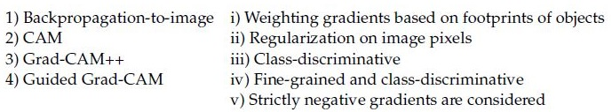

**Figure 1.** Source matching table for Question 119.

| Column 1 | Column 2 |
| :--- | :--- |
| 1) Backpropagation-to-image | i) Weighting gradients based on footprints of objects |
| 2) CAM | ii) Regularization on image pixels |
| 3) Grad-CAM++ | iii) Class-discriminative |
| 4) Guided Grad-CAM | iv) Fine-grained and class-discriminative |
| | v) Strictly negative gradients are considered |

**Options**

**A.** 1→ v, 2→ iv, 3→ ii, 4 → i  
*Option ID:* `6406532878466`

**B.** 1→ i, 2→ iv, 3 → iii, 4→ ii  
*Option ID:* `6406532878467`

**C.** 1→ i, 2→ v, 3 → iii, 4→ iv  
*Option ID:* `6406532878468`

**D.** 1→ ii, 2→ iii, 3 → i, 4 →iv  
*Option ID:* `6406532878469`

---

**Correct answer:** **D** — 1→ ii, 2→ iii, 3 → i, 4 →iv.

**Worked explanation:** Interpretability methods probe feature sensitivity or spatial evidence; distinguish input perturbation, activation visualization, and gradient attribution by what is measured. The source key is retained as the answer; compare the defining property against each distractor.

### da5006_2024T2_Q2_NA · Q144 · 2 marks · ID 640653856602

Which of the following are true:

**Options**

**A.** 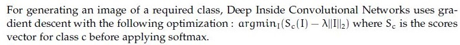

**Figure 22.** Option A statement for Question 144.

For generating an image of a required class, Deep Inside Convolutional Networks uses gradient descent with the following optimization : $\arg\min_I (S_c(I) - \lambda \|I\|_2^2)$ where $S_c$ is the scores vector for class $c$ before applying softmax.  
*Option ID:* `6406532878517`

**B.** 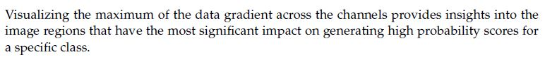

**Figure 23.** Option B statement for Question 144.

Visualizing the maximum of the data gradient across the channels provides insights into the image regions that have the most significant impact on generating high probability scores for a specific class.  
*Option ID:* `6406532878518`

**C.** 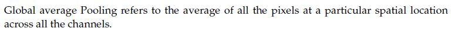

**Figure 24.** Option C statement for Question 144.

Global average Pooling refers to the average of all the pixels at a particular spatial location across all the channels.  
*Option ID:* `6406532878519`

**D.** 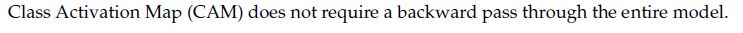

**Figure 25.** Option D statement for Question 144.

Class Activation Map (CAM) does not require a backward pass through the entire model.  
*Option ID:* `6406532878520`

---

**Correct answer:** **B**, **D** — Visualizing the maximum of the data gradient across the channels provides insights into the image regions that have the most significant impact on generating high probability scores for a specific class.; Class Activation Map (CAM) does not require a backward pass through the entire model..

**Worked explanation:** Interpretability methods probe feature sensitivity or spatial evidence; distinguish input perturbation, activation visualization, and gradient attribution by what is measured. The source key is retained as the answer; compare the defining property against each distractor.

### da5006_2024T3_Q2_NA · Q142 · 2 marks · ID 6406531031076

Which one of the following statements is False?

**Options**

**A.** In a max pooling layer, the unit that gets selected (maximum entry) in forward propagation gets all the gradient during backpropagation.  
*Option ID:* `6406533487228`

**B.** Residual blocks are used in ResNets to avoid the vanishing gradient problem.  
*Option ID:* `6406533487229`

**C.** Feature maps of initial layers of a CNN capture more abstract concepts than the feature maps of final layers.  
*Option ID:* `6406533487230`

**D.** Dilated convolution increases the receptive field size when compared to the standard convolution operator.  
*Option ID:* `6406533487231`

---

**Correct answer:** **C** — Feature maps of initial layers of a CNN capture more abstract concepts than the feature maps of final layers.

**Worked explanation:** Interpretability methods probe feature sensitivity or spatial evidence; distinguish input perturbation, activation visualization, and gradient attribution by what is measured. The source key is retained as the answer; compare the defining property against each distractor.

### da5006_2024T3_Q2_NA · Q150 · 2 marks · ID 6406531031080

Which of the following are true:

**Options**

**A.** For generating an image of a required class, Deep Inside Convolutional Networks uses gradient descent with the following optimization : $\text{argmin}_I (S_c(I) - \lambda \|I\|_2^2)$ where $S_c$ is the scores vector for class $c$ before applying softmax.  
*Option ID:* `6406533487241`  
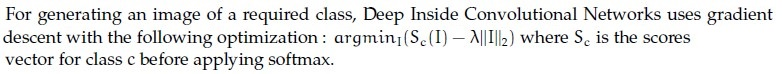  
**Figure 14.** Option A statement on class image generation optimization.

**B.** Visualizing the maximum of the data gradient across the channels provides insights into the image regions that have the most significant impact on generating high probability scores for a specific class.  
*Option ID:* `6406533487242`  
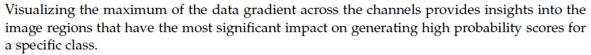  
**Figure 15.** Option B statement on data gradient visualization.

**C.** Global average Pooling refers to the average of all the pixels at a particular spatial location across all the channels.  
*Option ID:* `6406533487243`  
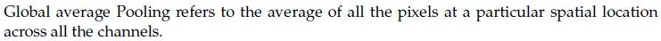  
**Figure 16.** Option C statement on global average pooling definition.

**D.** Class Activation Map (CAM) does not require a backward pass through the entire model.  
*Option ID:* `6406533487244`  
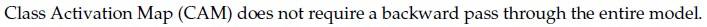  
**Figure 17.** Option D statement on Class Activation Map backward pass.

---

**Correct answer:** **B**, **D**

**Worked explanation:** Interpretability methods probe feature sensitivity or spatial evidence; distinguish input perturbation, activation visualization, and gradient attribution by what is measured. The source key is retained as the answer; compare the defining property against each distractor.

### da5006_2025T1_Q2_NA · Q245 · 2 marks · ID 6406531168219

Which one of the following statements is False?

**Options**

**A.** In a max pooling layer, the unit that gets selected (maximum entry) in forward propagation gets all the gradient during backpropagation.  
*Option ID:* `6406533939956`

**B.** Residual blocks are used in ResNets to avoid the vanishing gradient problem.  
*Option ID:* `6406533939957`

**C.** Feature maps of initial layers of a CNN capture more abstract concepts than the feature maps of final layers.  
*Option ID:* `6406533939958`

**D.** Dilated convolution increases the receptive field size when compared to the standard convolution operator.  
*Option ID:* `6406533939959`

---

**Correct answer:** **C** — Feature maps of initial layers of a CNN capture more abstract concepts than the feature maps of final layers..

**Worked explanation:** Interpretability methods probe feature sensitivity or spatial evidence; distinguish input perturbation, activation visualization, and gradient attribution by what is measured. The source key is retained as the answer; compare the defining property against each distractor.

### da5006_2025T1_Q2_NA · Q255 · 2 marks · ID 6406531168230

How are saliency maps generated in the context of Convolutional Neural Networks (CNNs)?

**Options**

**A.** By applying a convolutional filter to the input image  
*Option ID:* `6406533939998`

**B.** By computing the gradient of the model’s output with respect to the input image  
*Option ID:* `6406533939999`

**C.** By randomly sampling regions of the image and assessing their importance  
*Option ID:* `6406533940000`

**D.** By measuring the similarity between the input image and pre-trained feature maps  
*Option ID:* `6406533940001`

---

**Correct answer:** **B** — By computing the gradient of the model’s output with respect to the input image.

**Worked explanation:** Interpretability methods probe feature sensitivity or spatial evidence; distinguish input perturbation, activation visualization, and gradient attribution by what is measured. The source key is retained as the answer; compare the defining property against each distractor.

### da5006_2025T1_Q2_NA · Q260 · 2 marks · ID 6406531168234

Which of the following are true?

**Options**

**A.** For generating an image of a required class, Deep Inside Convolutional Networks uses gradient descent with the following optimization: $\arg\min_I (S_c(I) - \lambda \|I\|_2^2)$ where $S_c$ is the scores vector for class $c$ before applying softmax.

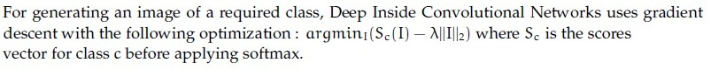

**Figure 12.** Option A statement for Question 260.  
*Option ID:* `6406533940014`

**B.** Visualizing the maximum of the data gradient across the channels provides insights into the image regions that have the most significant impact on generating high probability scores for a specific class.

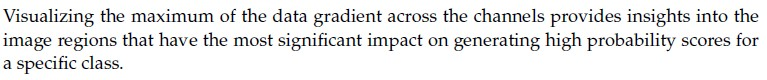

**Figure 13.** Option B statement for Question 260.  
*Option ID:* `6406533940015`

**C.** Global average Pooling refers to the average of all the pixels at a particular spatial location across all the channels.

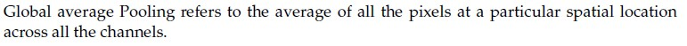

**Figure 14.** Option C statement for Question 260.  
*Option ID:* `6406533940016`

**D.** Class Activation Map (CAM) does not require a backward pass through the entire model.

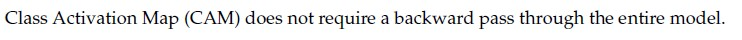

**Figure 15.** Option D statement for Question 260.  
*Option ID:* `6406533940017`

---

**Correct answer:** **B**, **D**

**Worked explanation:** Interpretability methods probe feature sensitivity or spatial evidence; distinguish input perturbation, activation visualization, and gradient attribution by what is measured. The source key is retained as the answer; compare the defining property against each distractor.

### da5006_2025T2_Q2_NA · Q249 · 3.0 marks · ID 6406531333800

Which of the following are true:

**Options**

**A.** For generating an image of a required class, Deep Inside Convolutional Networks uses gradient descent with the following optimization : $\text{argmin}_I (S_c(I) - \lambda \|I\|_2^2)$ where $S_c$ is the scores vector for class $c$ before applying softmax.

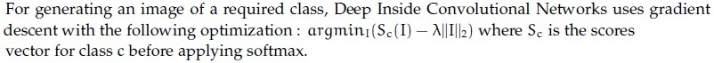

**Figure 26.** Option A for Question 249.  
*Option ID:* `6406534459642`

**B.** Visualizing the maximum of the data gradient across the channels provides insights into the image regions that have the most significant impact on generating high probability scores for a specific class.

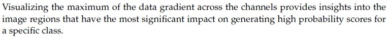

**Figure 27.** Option B for Question 249.  
*Option ID:* `6406534459643`

**C.** Global average Pooling refers to the average of all the pixels at a particular spatial location across all the channels.

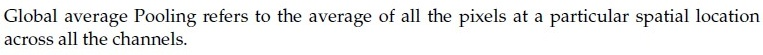

**Figure 28.** Option C for Question 249.  
*Option ID:* `6406534459644`

**D.** Class Activation Map (CAM) does not require a backward pass through the entire model.

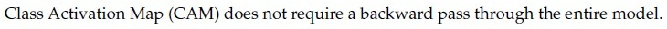

**Figure 29.** Option D for Question 249.  
*Option ID:* `6406534459645`

---

**Correct answer:** **B, D** — Visualizing the maximum of the data gradient across the channels provides insights into the image regions that have the most significant impact on generating high probability scores for a specific class; Class Activation Map (CAM) does not require a backward pass through the entire model.

**Worked explanation:** Interpretability methods probe feature sensitivity or spatial evidence; distinguish input perturbation, activation visualization, and gradient attribution by what is measured. The source key is retained as the answer; compare the defining property against each distractor.

### da5006_2025T3_Q2_NA · Q146 · 3.0 marks · ID 6406531815737

Which of the following statements are correct regarding deep convolutional network interpretability and visualization?

**Options**

**A.** For generating an image of a required class, Deep Inside Convolutional Networks uses gradient descent with the following optimization : $\arg\min_I (S_c(I) - \lambda \|I\|_2^2)$ where $S_c$ is the scores vector for class $c$ before applying softmax.  
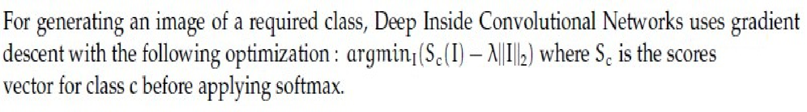

**Figure 11.** Option A optimization formula for Question 146.

*Option ID:* `6406535903143`

**B.** Visualizing the maximum of the data gradient across the channels provides insights into the image regions that have the most significant impact on generating high probability scores for a specific class.  
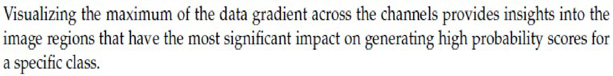

**Figure 12.** Option B data gradient visualization statement for Question 146.

*Option ID:* `6406535903144`

**C.** Global average Pooling refers to the average of all the pixels at a particular spatial location across all the channels.  
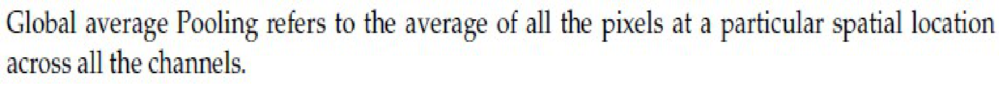

**Figure 13.** Option C Global Average Pooling statement for Question 146.

*Option ID:* `6406535903145`

**D.** Class Activation Map (CAM) does not require a backward pass through the entire model.  
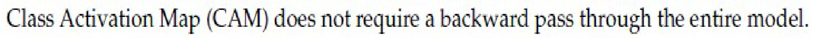

**Figure 14.** Option D Class Activation Map statement for Question 146.

*Option ID:* `6406535903146`

---

**Correct answer:** **A**, **C** — For generating an image of a required class, Deep Inside Convolutional Networks uses gradient descent with the following optimization : $\arg\min_I (S_c(I) - \lambda \|I\|_2^2)$ where $S_c$ is the scores vector for class $c$ before applying softmax.; Global average Pooling refers to the average of all the pixels at a particular spatial location across all the channels..

**Worked explanation:** Interpretability methods probe feature sensitivity or spatial evidence; distinguish input perturbation, activation visualization, and gradient attribution by what is measured. The source key is retained as the answer; compare the defining property against each distractor.

### da5006_2026T1_Q2_NA · Q9 · 1.0 marks · ID 6406532040096

Which method produces a heatmap by weighting convolutional feature maps using gradients of a target class score?

**Options**

**A.** Guided Backpropagation  
*Option ID:* `6406536642513`

**B.** Grad-CAM  
*Option ID:* `6406536642514`

**C.** SmoothGrad  
*Option ID:* `6406536642515`

**D.** Integrated Gradients  
*Option ID:* `6406536642516`

---

**Correct answer:** **B** — Grad-CAM.

**Worked explanation:** Interpretability methods probe feature sensitivity or spatial evidence; distinguish input perturbation, activation visualization, and gradient attribution by what is measured. The source key is retained as the answer; compare the defining property against each distractor.

### da5006_2026T2_Q2_NA · Q6 · 1.0 marks · ID 6406532194388

Which method produces a heatmap by weighting convolutional feature maps using gradients of a target class score?

**Options**

**A.** PCA  
*Option ID:* `6406537126046`

**B.** Grad-CAM  
*Option ID:* `6406537126047`

**C.** Histogram equalization  
*Option ID:* `6406537126048`

**D.** t-SNE  
*Option ID:* `6406537126049`

---

**Correct answer:** **B** — Grad-CAM.

**Worked explanation:** Interpretability methods probe feature sensitivity or spatial evidence; distinguish input perturbation, activation visualization, and gradient attribution by what is measured. The source key is retained as the answer; compare the defining property against each distractor.

## Topic: Efficient convolutional networks

| Paper | Q# | Marks | Type |
|---|---:|---:|---|
| da5006_2024T1_ET_AN | 168 | 2 | ET |
| da5006_2026T1_ET_FN | 23 | 4 | ET |
| da5006_2026T2_ET_FN | 13 | 2 | ET |
| da5006_2026T2_ET_FN | 34 | 4 | ET |
| da5006_2024T3_Q2_NA | 134 | 2 | Q2 |
| da5006_2024T3_Q2_NA | 135 | 2 | Q2 |
| da5006_2024T3_Q2_NA | 136 | 2 | Q2 |
| da5006_2024T3_Q2_NA | 137 | 2 | Q2 |
| da5006_2024T3_Q2_NA | 141 | 2 | Q2 |
| da5006_2025T1_Q2_NA | 244 | 2 | Q2 |
| da5006_2025T1_Q2_NA | 270 | 1.5 | Q2 |
| da5006_2025T1_Q2_NA | 271 | 1.5 | Q2 |
| da5006_2025T1_Q2_NA | 272 | 1.5 | Q2 |
| da5006_2025T1_Q2_NA | 273 | 1.5 | Q2 |
| da5006_2025T2_Q2_NA | 261 | 1.0 | Q2 |
| da5006_2025T2_Q2_NA | 262 | 1.0 | Q2 |
| da5006_2025T2_Q2_NA | 263 | 1.0 | Q2 |
| da5006_2025T2_Q2_NA | 264 | 1.0 | Q2 |
| da5006_2025T3_Q2_NA | 156 | 1.0 | Q2 |
| da5006_2025T3_Q2_NA | 157 | 1.0 | Q2 |
| da5006_2025T3_Q2_NA | 158 | 1.0 | Q2 |
| da5006_2025T3_Q2_NA | 159 | 1.0 | Q2 |
| da5006_2026T1_Q2_NA | 5 | 1.0 | Q2 |
| da5006_2026T1_Q2_NA | 6 | 1.0 | Q2 |
| da5006_2026T2_Q2_NA | 3 | 1.0 | Q2 |
| da5006_2026T2_Q2_NA | 4 | 1.0 | Q2 |

### da5006_2024T1_ET_AN · Q168 · 2 marks · ID 640653821594

What is the primary advantage of Depthwise Separable Convolutions compared to standard Convolutional Neural Network (CNN) convolutions?

**Options**

**A.** Depthwise Separable Convolutions reduce computational complexity and memory footprint by separating the spatial and channel-wise convolutions.  
*Option ID:* `6406532757320`

**B.** Depthwise Separable Convolutions introduce additional parameters to capture complex spatial relationships within feature maps.  
*Option ID:* `6406532757321`

**C.** Depthwise Separable Convolutions increase model capacity by performing convolutions across multiple layers of the network.  
*Option ID:* `6406532757322`

**D.** Depthwise Separable Convolutions enhance feature representation by incorporating multiscale convolutions within the same layer.  
*Option ID:* `6406532757323`

---

**Correct answer:** **A** — Depthwise Separable Convolutions reduce computational complexity and memory footprint by separating the spatial and channel-wise convolutions..

**Worked explanation:** Depthwise separable convolution factorizes spatial filtering and channel mixing, reducing multiply-accumulate cost while retaining the intended receptive field. The source key is retained as the answer; compare the defining property against each distractor.

### da5006_2024T3_Q2_NA · Q134 · 2 marks · ID 6406531031068

**Context:** Let input have size $D_I \times D_I \times M$ where $D_I = 128$ and $M = 16$ and output feature map (after passing input through conv layer) has $D_I \times D_I \times N$ size where $N = 32$. Assume padded convolution. Let width of the square kernel in conv layer be $k$ where $k = 5$.

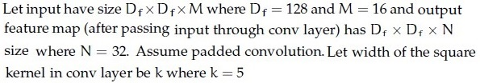

**Figure 2.** Depthwise separable convolution specifications for Questions 134 to 137.

Calculate the number of parameters and computational cost, but make use of Depthwise Seperable convolution and pointwise convolution instead of standard convolution.

Based on the above data, answer the given subquestion.

Number of parameters for depthwise convolution: ______________

---

**Correct answer:** `400`

**Worked explanation:** A depthwise filter has $k^2$ weights per input channel: $5^2\cdot16=400$.

### da5006_2024T3_Q2_NA · Q135 · 2 marks · ID 6406531031069

**Context:** Refer to the depthwise separable convolution specifications in Question 134.

Based on the above data, answer the given subquestion.

Computational Cost for depthwise convolution: ______________

---

**Correct answer:** `6553600`

**Worked explanation:** $128^2\cdot16\cdot5^2=6{,}553{,}600$ multiply-accumulates (MACs).

### da5006_2024T3_Q2_NA · Q136 · 2 marks · ID 6406531031070

**Context:** Refer to the depthwise separable convolution specifications in Question 134.

Based on the above data, answer the given subquestion.

Number of parameters for pointwise convolution: ______________

---

**Correct answer:** `512`

**Worked explanation:** A pointwise filter has $M N$ weights: $16\cdot32=512$.

### da5006_2024T3_Q2_NA · Q137 · 2 marks · ID 6406531031071

**Context:** Refer to the depthwise separable convolution specifications in Question 134.

Based on the above data, answer the given subquestion.

Computational cost for pointwise convolution: ______________

---

**Correct answer:** `8388608`

**Worked explanation:** $128^2\cdot16\cdot32=8{,}388{,}608$ MACs.

### da5006_2024T3_Q2_NA · Q141 · 2 marks · ID 6406531031075

Match the following:

| Network | Feature / Layer |
| :--- | :--- |
| 1) VGGNet | i) $1 \times 1$ convolution |
| 2) EfficientNet | ii) identity mapping |
| 3) GoogleNet | iii) $3 \times 3$ convolution |
| 4) ResNet | iv) $7 \times 7$ convolution |
| | v) depth-wise separable convolutions |

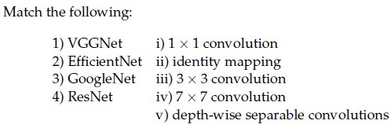

**Figure 9.** Architecture matching items for Question 141.

**Options**

**A.** 1→iv, 2→ii, 3→v, 4→i  
*Option ID:* `6406533487224`

**B.** 1→iv, 2→iii, 3→v, 4→ii  
*Option ID:* `6406533487225`

**C.** 1→iv, 2→v, 3→ii, 4→iii  
*Option ID:* `6406533487226`

**D.** 1→iii, 2→v, 3→i, 4→ii  
*Option ID:* `6406533487227`

---

**Correct answer:** **D** — 1→iii, 2→v, 3→i, 4→ii

**Worked explanation:** Depthwise separable convolution factorizes spatial filtering and channel mixing, reducing multiply-accumulate cost while retaining the intended receptive field. The source key is retained as the answer; compare the defining property against each distractor.

### da5006_2025T1_Q2_NA · Q244 · 2 marks · ID 6406531168218

Match the following:

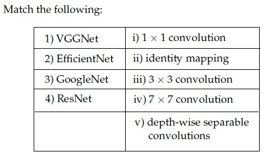

**Figure 6.** Source table for Question 244.

| Column 1 | Column 2 |
| :--- | :--- |
| 1) VGGNet | i) $1 \times 1$ convolution |
| 2) EfficientNet | ii) identity mapping |
| 3) GoogleNet | iii) $3 \times 3$ convolution |
| 4) ResNet | iv) $7 \times 7$ convolution |
| | v) depth-wise separable convolutions |

**Options**

**A.** 1→iv, 2→ii, 3→v, 4→i  
*Option ID:* `6406533939952`

**B.** 1→iv, 2→iii, 3→v, 4→ii  
*Option ID:* `6406533939953`

**C.** 1→iv, 2→v, 3→ii, 4→iii  
*Option ID:* `6406533939954`

**D.** 1→iii, 2→v, 3→i, 4→ii  
*Option ID:* `6406533939955`

---

**Correct answer:** **D** — 1→iii, 2→v, 3→i, 4→ii.

**Worked explanation:** Depthwise separable convolution factorizes spatial filtering and channel mixing, reducing multiply-accumulate cost while retaining the intended receptive field. The source key is retained as the answer; compare the defining property against each distractor.

### da5006_2025T1_Q2_NA · Q270 · 1.5 marks · ID 6406531168247

**Comprehension Context (Questions 270–273):**

> Let input have size $D_f \times D_f \times M$ where $D_f = 128$ and $M = 16$ and output feature map (after passing input through conv layer) has $D_f \times D_f \times N$ size where $N = 32$. Assume padded convolution. Let width of the square kernel in conv layer be $k$ where $k = 5$ (Ignore the bias term in the calculation).
> Calculate the number of parameters and computational cost, but make use of Depthwise Seperable convolution and pointwise convolution instead of standard convolution.
>
> 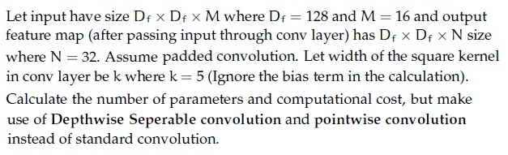
>
> **Figure 24.** Depthwise separable convolution specification for Comprehension Context 3 (Questions 270–273).
>
> Based on the above data, answer the given subquestions.

Number of parameters for depthwise convolution: __________________

---

**Correct answer:** `400`

**Worked explanation:** The depthwise stage has $k^2M=25\cdot16=400$ weights, matching the source key.

### da5006_2025T1_Q2_NA · Q271 · 1.5 marks · ID 6406531168248

Computational Cost for depthwise convolution: ________________

---

**Correct answer:** `6553600`

**Worked explanation:** Depthwise-stage cost is $D_f^2k^2M=128^2\cdot25\cdot16=6{,}553{,}600$ MACs.

### da5006_2025T1_Q2_NA · Q272 · 1.5 marks · ID 6406531168249

Number of parameters for pointwise convolution: _________________

---

**Correct answer:** `512`

**Worked explanation:** The pointwise stage has $MN=16\cdot32=512$ weights.

### da5006_2025T1_Q2_NA · Q273 · 1.5 marks · ID 6406531168250

Computational cost for pointwise convolution: ___________________

---

**Correct answer:** `8388608`

**Worked explanation:** Pointwise-stage cost is $D_f^2MN=128^2\cdot16\cdot32=8{,}388{,}608$ MACs.

### da5006_2025T2_Q2_NA · Q261 · 1.0 marks · ID 6406531333816

**Comprehension:**

Let input have size $D_f \times D_f \times M$ where $D_f = 10$ and $M = 256$ and output feature map (after passing input through conv layer) has $D_f \times D_f \times N$ size where $N = 512$. Assume padded convolution. Let width of the square kernel in conv layer be $k$ where $k = 7$ (Ignore the bias term in the calculation), calculate the number of parameters and computational cost, but make use of Depthwise Seperable convolution and pointwise convolution instead of standard convolution.

Based on the above data, answer the given subquestions.

Number of parameters for depthwise seperable convolution:_______________

---

**Correct answer:** `12544`

> [!WARNING] The source key `12544` counts only the depthwise stage, while the stem asks for the depthwise-separable total. The source key is retained; the derived total is 143,616 parameters.

**Worked explanation:** Depthwise alone gives $7^2\cdot256=12{,}544$ weights; adding pointwise weights gives $12{,}544+256\cdot512=143{,}616$.

### da5006_2025T2_Q2_NA · Q262 · 1.0 marks · ID 6406531333817

**Comprehension:**

Let input have size $D_f \times D_f \times M$ where $D_f = 10$ and $M = 256$ and output feature map (after passing input through conv layer) has $D_f \times D_f \times N$ size where $N = 512$. Assume padded convolution. Let width of the square kernel in conv layer be $k$ where $k = 7$ (Ignore the bias term in the calculation), calculate the number of parameters and computational cost, but make use of Depthwise Seperable convolution and pointwise convolution instead of standard convolution.

Based on the above data, answer the given subquestions.

Computational Cost for depthwise seperable convolution:____________________

---

**Correct answer:** `1254400`

> [!WARNING] The source key `1254400` counts only the depthwise stage, while the stem asks for depthwise-separable total cost. The source key is retained; the derived total is 14,361,600 MACs.

**Worked explanation:** Depthwise alone costs $10^2\cdot7^2\cdot256=1{,}254{,}400$ MACs; both stages total $1{,}254{,}400+10^2\cdot256\cdot512=14{,}361{,}600$.

### da5006_2025T2_Q2_NA · Q263 · 1.0 marks · ID 6406531333818

**Comprehension:**

Let input have size $D_f \times D_f \times M$ where $D_f = 10$ and $M = 256$ and output feature map (after passing input through conv layer) has $D_f \times D_f \times N$ size where $N = 512$. Assume padded convolution. Let width of the square kernel in conv layer be $k$ where $k = 7$ (Ignore the bias term in the calculation), calculate the number of parameters and computational cost, but make use of Depthwise Seperable convolution and pointwise convolution instead of standard convolution.

Based on the above data, answer the given subquestions.

Number of parameters for pointwise convolution:____________________

---

**Correct answer:** `131072`

**Worked explanation:** Pointwise weights are $MN=256\cdot512=131{,}072$, matching the key.

### da5006_2025T2_Q2_NA · Q264 · 1.0 marks · ID 6406531333819

**Comprehension:**

Let input have size $D_f \times D_f \times M$ where $D_f = 10$ and $M = 256$ and output feature map (after passing input through conv layer) has $D_f \times D_f \times N$ size where $N = 512$. Assume padded convolution. Let width of the square kernel in conv layer be $k$ where $k = 7$ (Ignore the bias term in the calculation), calculate the number of parameters and computational cost, but make use of Depthwise Seperable convolution and pointwise convolution instead of standard convolution.

Based on the above data, answer the given subquestions.

Computational cost for pointwise convolution:____________________

---

**Correct answer:** `13107200`

**Worked explanation:** Pointwise cost is $D_f^2MN=10^2\cdot256\cdot512=13{,}107{,}200$ MACs, matching the key.

### da5006_2025T3_Q2_NA · Q156 · 1.0 marks · ID 6406531815751

Using the same dimensions specified in the previous question main data ($D_I = 10, M = 256, N = 512, k = 7$), calculate the number of parameters and computational cost, but make use of Depthwise Seperable convolution and pointwise convolution instead of standard convolution.

Based on the above data, answer the given subquestion.

Number of parameters for depthwise seperable convolution: __________

---

**Correct answer:** `12544`

> [!WARNING] The source key `12544` counts only the depthwise stage, while the stem asks for the depthwise-separable total. The source key is retained; the derived total is 143,616 parameters.

**Worked explanation:** Depthwise alone gives $7^2\cdot256=12{,}544$ weights; adding pointwise weights gives $12{,}544+256\cdot512=143{,}616$.

### da5006_2025T3_Q2_NA · Q157 · 1.0 marks · ID 6406531815752

Refer to the specifications in Question 156.

Based on the above data, answer the given subquestion.

Computational Cost for depthwise seperable convolution: ____________

---

**Correct answer:** `1254400`

> [!WARNING] The source key `1254400` counts only the depthwise stage, while the stem asks for depthwise-separable total cost. The source key is retained; the derived total is 14,361,600 MACs.

**Worked explanation:** Depthwise alone costs $10^2\cdot7^2\cdot256=1{,}254{,}400$ MACs; both stages total $1{,}254{,}400+10^2\cdot256\cdot512=14{,}361{,}600$.

### da5006_2025T3_Q2_NA · Q158 · 1.0 marks · ID 6406531815753

Refer to the specifications in Question 156.

Based on the above data, answer the given subquestion.

Number of parameters for pointwise convolution: _____________

---

**Correct answer:** `131072`

**Worked explanation:** Depthwise separable convolution factorizes spatial filtering and channel mixing, reducing multiply-accumulate cost while retaining the intended receptive field. The source key is retained as the answer; compare the defining property against each distractor.

### da5006_2025T3_Q2_NA · Q159 · 1.0 marks · ID 6406531815754

Refer to the specifications in Question 156.

Based on the above data, answer the given subquestion.

Computational cost for pointwise convolution: ____________

---

**Correct answer:** `13107200`

**Worked explanation:** Pointwise cost is $D_f^2MN=10^2\cdot256\cdot512=13{,}107{,}200$ MACs, matching the key.

### da5006_2026T1_ET_FN · Q23 · 4 marks · ID 6406532136838

Input feature map has $M=64$ channels. You apply depthwise 3×3 followed by pointwise 1×1 to produce $N=128$ channels. Ignore bias. What is the Total parameters?

**Correct answer:** `8768`

**Worked explanation:** The depthwise stage has $3^2\cdot64=576$ weights and the pointwise stage has $64\cdot128=8192$. Their sum is $576+8192=8768$ parameters, matching the source key.

### da5006_2026T1_Q2_NA · Q5 · 1.0 marks · ID 6406532040092

MobileNetV1 reduces computation primarily by using:

**Options**

**A.** Grouped convolutions followed by spatial pyramid pooling  
*Option ID:* `6406536642497`

**B.** Depthwise separable convolutions (depthwise + pointwise)  
*Option ID:* `6406536642498`

**C.** Asymmetric convolutions (e.g., factorizing a 3×3 into 3×1 followed by 1×3)  
*Option ID:* `6406536642499`

**D.** Low-rank matrix factorization of dense classification layers  
*Option ID:* `6406536642500`

---

**Correct answer:** **B** — Depthwise separable convolutions (depthwise + pointwise).

**Worked explanation:** Depthwise separable convolution factorizes spatial filtering and channel mixing, reducing multiply-accumulate cost while retaining the intended receptive field. The source key is retained as the answer; compare the defining property against each distractor.

### da5006_2026T1_Q2_NA · Q6 · 1.0 marks · ID 6406532040093

EfficientNet’s key scaling idea is:

**Options**

**A.** Scaling the network depth logarithmically while linearly increasing the input resolution  
*Option ID:* `6406536642501`

**B.** Utilizing neural architecture search (NAS) to independently optimize depth, width, and resolution for each block  
*Option ID:* `6406536642502`

**C.** Compound scaling of depth, width, and resolution using a single coefficient  
*Option ID:* `6406536642503`

**D.** Adjusting the channel multiplier dynamically based on the target device's hardware constraints  
*Option ID:* `6406536642504`

---

**Correct answer:** **C** — Compound scaling of depth, width, and resolution using a single coefficient.

**Worked explanation:** Depthwise separable convolution factorizes spatial filtering and channel mixing, reducing multiply-accumulate cost while retaining the intended receptive field. The source key is retained as the answer; compare the defining property against each distractor.

### da5006_2026T2_ET_FN · Q13 · 2 marks · ID 6406532270052

A depthwise-separable convolution first applies a spatial filter independently to each input channel and then uses a $1 \times 1$ convolution across channels. Its main computational advantage over a dense spatial convolution is that it:

**Options**

**A.** Eliminates channel mixing from the layer  
*Option ID:* `6406537379047`

**B.** Factorizes spatial filtering and channel mixing into cheaper operations  
*Option ID:* `6406537379048`

**C.** Uses a larger spatial kernel with the same parameter count  
*Option ID:* `6406537379049`

**D.** Forces the number of output channels to equal the number of input channels  
*Option ID:* `6406537379050`

---

**Correct answer:** **B** — Factorizes spatial filtering and channel mixing into cheaper operations.

**Worked explanation:** Depthwise separable convolution factorizes spatial filtering and channel mixing, reducing multiply-accumulate cost while retaining the intended receptive field. The source key is retained as the answer; compare the defining property against each distractor.

### da5006_2026T2_ET_FN · Q34 · 4 marks · ID 6406532270073

A depthwise-separable convolution receives 32 channels. It uses a $3 \times 3$ depthwise convolution followed by a $1 \times 1$ pointwise convolution producing 64 output channels. Ignore biases. Compute the total number of weights.

---

**Correct answer:** `2336`

**Worked explanation:** Depthwise separable convolution factorizes spatial filtering and channel mixing, reducing multiply-accumulate cost while retaining the intended receptive field. The source key is retained as the answer; compare the defining property against each distractor.

### da5006_2026T2_Q2_NA · Q3 · 1.0 marks · ID 6406532194385

MobileNetV1 reduces computation primarily by using:

**Options**

**A.** Dilated convolutions everywhere  
*Option ID:* `6406537126034`

**B.** Depthwise separable convolutions (depthwise + pointwise)  
*Option ID:* `6406537126035`

**C.** ROI pooling  
*Option ID:* `6406537126036`

**D.** Fully-connected layers instead of convolutions  
*Option ID:* `6406537126037`

---

**Correct answer:** **B** — Depthwise separable convolutions (depthwise + pointwise).

**Worked explanation:** Depthwise separable convolution factorizes spatial filtering and channel mixing, reducing multiply-accumulate cost while retaining the intended receptive field. The source key is retained as the answer; compare the defining property against each distractor.

### da5006_2026T2_Q2_NA · Q4 · 1.0 marks · ID 6406532194386

EfficientNet’s key scaling idea is:

**Options**

**A.** Only scale depth while keeping width and resolution fixed  
*Option ID:* `6406537126038`

**B.** Only scale resolution while keeping depth and width fixed  
*Option ID:* `6406537126039`

**C.** Compound scaling of depth, width, and resolution using a single coefficient  
*Option ID:* `6406537126040`

**D.** Scale width but reduce depth to keep parameters constant  
*Option ID:* `6406537126041`

---

**Correct answer:** **C** — Compound scaling of depth, width, and resolution using a single coefficient.

**Worked explanation:** Depthwise separable convolution factorizes spatial filtering and channel mixing, reducing multiply-accumulate cost while retaining the intended receptive field. The source key is retained as the answer; compare the defining property against each distractor.

## Topic: Inception and bottleneck convolutions

| Paper | Q# | Marks | Type |
|---|---:|---:|---|
| da5006_2026T1_Q2_NA | 4 | 1.0 | Q2 |
| da5006_2026T2_Q2_NA | 12 | 2.0 | Q2 |

### da5006_2026T1_Q2_NA · Q4 · 1.0 marks · ID 6406532040091

In Inception/GoogLeNet modules, the main purpose of 1×1 convolutions is to:

**Options**

**A.** Increase the receptive field of subsequent convolutional layers without downsampling.  
*Option ID:* `6406536642493`

**B.** Reduce channel dimensionality (bottleneck) and add non-linearity  
*Option ID:* `6406536642494`

**C.** Act as a differentiable substitute for max-pooling operations to preserve exact spatial hierarchies.  
*Option ID:* `6406536642495`

**D.** Project the feature maps into a higher-dimensional space to separate entangled features.  
*Option ID:* `6406536642496`

---

**Correct answer:** **B** — Reduce channel dimensionality (bottleneck) and add non-linearity.

**Worked explanation:** Inception processes multiple receptive-field scales in parallel; 1×1 bottlenecks reduce channel dimensionality before expensive spatial convolutions. The source key is retained as the answer; compare the defining property against each distractor.

### da5006_2026T2_Q2_NA · Q12 · 2.0 marks · ID 6406532194384

In Inception/GoogLeNet modules, the main purpose of 1×1 convolutions is to:

**Options**

**A.** Increase spatial resolution  
*Option ID:* `6406537126030`

**B.** Reduce channel dimensionality (bottleneck) and add non-linearity  
*Option ID:* `6406537126031`

**C.** Replace pooling  
*Option ID:* `6406537126032`

**D.** Implement residual learning  
*Option ID:* `6406537126033`

---

**Correct answer:** **B** — Reduce channel dimensionality (bottleneck) and add non-linearity.

**Worked explanation:** Inception processes multiple receptive-field scales in parallel; 1×1 bottlenecks reduce channel dimensionality before expensive spatial convolutions. The source key is retained as the answer; compare the defining property against each distractor.

## Topic: Residual and connected CNN architectures

| Paper | Q# | Marks | Type |
|---|---:|---:|---|
| da5006_2026T2_ET_FN | 12 | 2 | ET |
| da5006_2026T2_ET_FN | 24 | 3 | ET |
| da5006_2025T2_Q2_NA | 238 | 2.0 | Q2 |
| da5006_2025T3_Q2_NA | 134 | 2.0 | Q2 |
| da5006_2026T1_Q2_NA | 2 | 1.0 | Q2 |
| da5006_2026T1_Q2_NA | 3 | 1.0 | Q2 |
| da5006_2026T1_Q2_NA | 21 | 1.0 | Q2 |
| da5006_2026T2_Q2_NA | 2 | 1.0 | Q2 |
| da5006_2026T2_Q2_NA | 11 | 2.0 | Q2 |
| da5006_2026T2_Q2_NA | 20 | 4.0 | Q2 |

### da5006_2025T2_Q2_NA · Q238 · 2.0 marks · ID 6406531333789

Match the following:

| Left Column | Right Column |
| :--- | :--- |
| 1) VGGNet | i) $1 \times 1$ convolution |
| 2) EfficientNet | ii) Skip-Connections |
| 3) GoogleNet | iii) $3 \times 3$ convolution |
| 4) ResNet | iv) $7 \times 7$ convolution |
| | v) depth-wise separable convolutions |

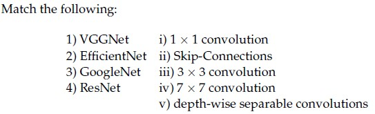

**Figure 6.** Matching table for Question 238.

**Options**

**A.** 1-v, 2-iii, 3-iv, 4-ii

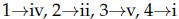

**Figure 7.** Option A for Question 238.  
*Option ID:* `6406534459601`

**B.** 1-iv, 2-iii, 3-i, 4-ii

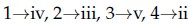

**Figure 8.** Option B for Question 238.  
*Option ID:* `6406534459602`

**C.** 1-iv, 2-v, 3-ii, 4-iii

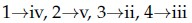

**Figure 9.** Option C for Question 238.  
*Option ID:* `6406534459603`

**D.** 1-iii, 2-v, 3-i, 4-ii

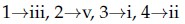

**Figure 10.** Option D for Question 238.  
*Option ID:* `6406534459604`

---

**Correct answer:** **D** — 1-iii, 2-v, 3-i, 4-ii

**Worked explanation:** Residual blocks learn a correction to an identity path, improving optimization and gradient propagation in deep networks. The source key is retained as the answer; compare the defining property against each distractor.

### da5006_2025T3_Q2_NA · Q134 · 2.0 marks · ID 6406531815726

Match architectures to their characteristic ideas:

| Architecture | Characteristic idea |
| :--- | :--- |
| 1) AlexNet | i) Dense connections |
| 2) MobileNet | ii) Depthwise separable conv |
| 3) DenseNet | iii) Skip connection |
| 4) ResNet | iv) ReLU + Dropout + LRN |

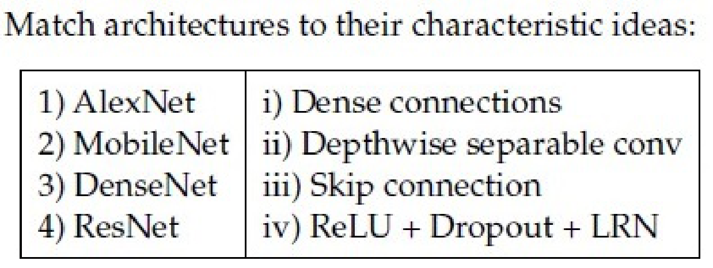

**Figure 6.** Architecture matching table for Question 134.

**Options**

**A.** 1→iv, 2→ii, 3→i, 4→iii  
*Option ID:* `6406535903098`

**B.** 1→ii, 2→iv, 3→i, 4→iii  
*Option ID:* `6406535903099`

**C.** 1→iv, 2→i, 3→ii, 4→iii  
*Option ID:* `6406535903100`

**D.** 1→iii, 2→ii, 3→iv, 4→i  
*Option ID:* `6406535903101`

---

**Correct answer:** **A** — 1→iv, 2→ii, 3→i, 4→iii.

**Worked explanation:** Residual blocks learn a correction to an identity path, improving optimization and gradient propagation in deep networks. The source key is retained as the answer; compare the defining property against each distractor.

### da5006_2026T1_Q2_NA · Q2 · 1.0 marks · ID 6406532040089

Why do very deep plain CNNs (without skip connections) sometimes show higher training error than shallower CNNs?

**Options**

**A.** The increased capacity leads to severe overfitting on the training set before convergence can be reached.  
*Option ID:* `6406536642485`

**B.** Optimization becomes harder; skip connections make learning identity mappings easier and improve gradient flow.  
*Option ID:* `6406536642486`

**C.** The receptive field becomes excessively large, causing the network to lose fine-grained spatial information.  
*Option ID:* `6406536642487`

**D.** Saturated activations cause exploding gradients that cannot be mitigated by standard initialization techniques.  
*Option ID:* `6406536642488`

---

**Correct answer:** **B** — Optimization becomes harder; skip connections make learning identity mappings easier and improve gradient flow..

**Worked explanation:** Residual blocks learn a correction to an identity path, improving optimization and gradient propagation in deep networks. The source key is retained as the answer; compare the defining property against each distractor.

### da5006_2026T1_Q2_NA · Q3 · 1.0 marks · ID 6406532040090

In a standard ResNet-50 bottleneck block, the three convolutions are typically:

**Options**

**A.** 3×3, 1×1, 3×3  
*Option ID:* `6406536642489`

**B.** 1×1, 3×3, 1×1  
*Option ID:* `6406536642490`

**C.** 1×1, 5×5, 1×1  
*Option ID:* `6406536642491`

**D.** 3×3, 3×3, 3×3  
*Option ID:* `6406536642492`

---

**Correct answer:** **B** — 1×1, 3×3, 1×1.

**Worked explanation:** Residual blocks learn a correction to an identity path, improving optimization and gradient propagation in deep networks. The source key is retained as the answer; compare the defining property against each distractor.

### da5006_2026T1_Q2_NA · Q21 · 1.0 marks · ID 6406532040108

A ResNet bottleneck block takes 256 channels in and uses:  
1×1 conv to 256 channels → 3×3 conv at 256 → 1×1 conv to 1024 channels. Ignore bias.  
Compute total parameters in these three convolutions (exclude projection shortcut).

---

**Correct answer:** 917504

**Worked explanation:** Residual blocks learn a correction to an identity path, improving optimization and gradient propagation in deep networks. The source key is retained as the answer; compare the defining property against each distractor.

### da5006_2026T2_ET_FN · Q12 · 2 marks · ID 6406532270051

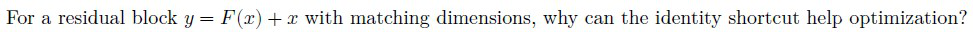

**Figure 5.** Source diagram for Question 12.

For a residual block $y = \mathcal{F}(x) + x$ with matching dimensions, why can the identity shortcut help optimization?

**Options**

**A.** It forces $\mathcal{F}(x)$ to be constant  
*Option ID:* `6406537379043`

**B.** The block can approach an identity mapping when the residual $\mathcal{F}(x)$ approaches zero  
*Option ID:* `6406537379044`

**C.** It prevents gradients from entering the residual branch  
*Option ID:* `6406537379045`

**D.** It makes every convolution invertible  
*Option ID:* `6406537379046`

---

**Correct answer:** **B** — The block can approach an identity mapping when the residual $\mathcal{F}(x)$ approaches zero.

**Worked explanation:** Residual blocks learn a correction to an identity path, improving optimization and gradient propagation in deep networks. The source key is retained as the answer; compare the defining property against each distractor.

### da5006_2026T2_ET_FN · Q24 · 3 marks · ID 6406532270063

Select all correct statements.

**Options**

**A.** Weight sharing allows the same convolution kernel parameters to be used at multiple spatial locations.  
*Option ID:* `6406537379091`

**B.** Inception-style designs can use multiple processing branches.  
*Option ID:* `6406537379092`

**C.** Residual connections create shortcut paths across learned transformations.  
*Option ID:* `6406537379093`

**D.** Finetuning requires discarding all pretrained weights before optimization starts.  
*Option ID:* `6406537379094`

---

**Correct answer:** **A**, **B**, **C** — Weight sharing allows the same convolution kernel parameters to be used at multiple spatial locations.; Inception-style designs can use multiple processing branches.; Residual connections create shortcut paths across learned transformations..

> [!NOTE] Week assignment uncertain: Tests residual and Inception architectures alongside convolution weight sharing.

**Worked explanation:** Residual blocks learn a correction to an identity path, improving optimization and gradient propagation in deep networks. The source key is retained as the answer; compare the defining property against each distractor.

### da5006_2026T2_Q2_NA · Q2 · 1.0 marks · ID 6406532194382

Why do very deep plain CNNs (without skip connections) sometimes show higher training error than shallower CNNs?

**Options**

**A.** They always overfit because parameter count increases.  
*Option ID:* `6406537126022`

**B.** Optimization becomes harder; skip connections make learning identity mappings easier and improve gradient flow.  
*Option ID:* `6406537126023`

**C.** BatchNorm guarantees this never happens.  
*Option ID:* `6406537126024`

**D.** Using sigmoid activations instead of ReLU always fixes it.  
*Option ID:* `6406537126025`

---

**Correct answer:** **B** — Optimization becomes harder; skip connections make learning identity mappings easier and improve gradient flow..

**Worked explanation:** Residual blocks learn a correction to an identity path, improving optimization and gradient propagation in deep networks. The source key is retained as the answer; compare the defining property against each distractor.

### da5006_2026T2_Q2_NA · Q11 · 2.0 marks · ID 6406532194383

In a standard ResNet-50 bottleneck block, the three convolutions are typically:

**Options**

**A.** 3×3, 3×3, 3×3  
*Option ID:* `6406537126026`

**B.** 1×1, 3×3, 1×1  
*Option ID:* `6406537126027`

**C.** 5×5, 3×3, 1×1  
*Option ID:* `6406537126028`

**D.** 1×1, 1×1, 3×3  
*Option ID:* `6406537126029`

---

**Correct answer:** **B** — 1×1, 3×3, 1×1.

**Worked explanation:** Residual blocks learn a correction to an identity path, improving optimization and gradient propagation in deep networks. The source key is retained as the answer; compare the defining property against each distractor.

### da5006_2026T2_Q2_NA · Q20 · 4.0 marks · ID 6406532194400

A ResNet bottleneck block takes 256 channels in and uses: 

1×1 conv to 256 channels → 3×3 conv at 256 → 1×1 conv to 1024 channels. Ignore bias. 

Compute total parameters in these three convolutions (exclude projection shortcut).

**Response type:** Numeric  
**Evaluation required:** Yes  
**Answers type:** Equal  

---

**Correct answer:** 917504

**Worked explanation:** Residual blocks learn a correction to an identity path, improving optimization and gradient propagation in deep networks. The source key is retained as the answer; compare the defining property against each distractor.

## Topic: Single-stage detection and YOLO

| Paper | Q# | Marks | Type |
|---|---:|---:|---|
| da5006_2024T1_ET_AN | 174 | 2 | ET |
| da5006_2024T3_ET_AN | 211 | 2 | ET |
| da5006_2024T3_Q2_NA | 140 | 2 | Q2 |
| da5006_2025T1_Q2_NA | 249 | 2 | Q2 |
| da5006_2025T1_Q2_NA | 254 | 2 | Q2 |
| da5006_2025T1_Q2_NA | 256 | 2 | Q2 |
| da5006_2025T2_Q2_NA | 237 | 2.0 | Q2 |
| da5006_2025T3_Q2_NA | 133 | 2.0 | Q2 |

### da5006_2024T1_ET_AN · Q174 · 2 marks · ID 640653821600

What is a potential limitation of non-maximum suppression (NMS) algorithms in object detection?

**Options**

**A.** They are computationally expensive and can significantly increase inference time.  
*Option ID:* `6406532757344`

**B.** They may fail to suppress redundant bounding boxes in cluttered scenes with multiple overlapping objects.  
*Option ID:* `6406532757345`

**C.** They require extensive hyperparameter tuning to achieve optimal performance across different datasets.  
*Option ID:* `6406532757346`

**D.** They are highly sensitive to variations in lighting conditions and viewpoints in the input images.  
*Option ID:* `6406532757347`

---

**Correct answer:** **B** — They may fail to suppress redundant bounding boxes in cluttered scenes with multiple overlapping objects..

**Worked explanation:** YOLO predicts detection outputs in a single forward pass, trading proposal-based refinement for dense, unified inference. The source key is retained as the answer; compare the defining property against each distractor.

### da5006_2024T3_ET_AN · Q211 · 2 marks · ID 6406531046074

Consider an object detection system evaluated on a dataset consisting of 1000 images. The system makes 1500 predictions across these images, and for each image, there are annotated ground truth bounding boxes.

The system’s precision-recall curve is calculated, and the precision at different recall levels for one of the classes is as follows:

| Recall | Precision |
| :--- | :--- |
| 0.1 | 0.90 |
| 0.2 | 0.85 |
| 0.3 | 0.80 |
| 0.4 | 0.75 |
| 0.5 | 0.70 |
| 0.6 | 0.65 |
| 0.7 | 0.60 |
| 0.8 | 0.55 |
| 0.9 | 0.50 |
| 1.0 | 0.45 |

Calculate the Average Precision (AP) for this class using the 11-point interpolation method, which averages the precision values at recall levels {0.0, 0.1, 0.2, ..., 1.0}. The precision at recall 0.0 can be assumed to be 1.0.

Additionally, the system’s AP values for the other two classes are as follows:

- AP for class 2: 0.78
- AP for class 3: 0.72

Based on these AP values, what is the mean Average Precision (mAP) across all three classes?

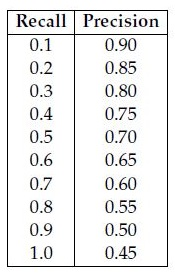
**Figure 15.** Source precision-recall table for Question 211.

**Options**

**A.** 0.70  
*Option ID:* `6406533531398`

**B.** 0.69  
*Option ID:* `6406533531399`

**C.** 0.73  
*Option ID:* `6406533531400`

**D.** 0.76  
*Option ID:* `6406533531401`

---

**Correct answer:** **C** — 0.73.

**Worked explanation:** YOLO predicts detection outputs in a single forward pass, trading proposal-based refinement for dense, unified inference. The source key is retained as the answer; compare the defining property against each distractor.

### da5006_2024T3_Q2_NA · Q140 · 2 marks · ID 6406531031074

Consider an object detection system evaluated on a dataset consisting of 1000 images. The system makes 1500 predictions across these images, and for each image, there are annotated ground truth bounding boxes.

The system’s precision-recall curve is calculated, and the precision at different recall levels for one of the classes is as follows:

| Recall | Precision |
| :--- | :--- |
| 0.1 | 0.90 |
| 0.2 | 0.85 |
| 0.3 | 0.80 |
| 0.4 | 0.75 |
| 0.5 | 0.70 |
| 0.6 | 0.65 |
| 0.7 | 0.60 |
| 0.8 | 0.55 |
| 0.9 | 0.50 |
| 1.0 | 0.45 |

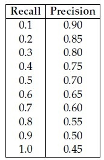

**Figure 8.** Precision-recall values for Question 140.

Calculate the Average Precision (AP) for this class using the 11-point interpolation method, which averages the precision values at recall levels {0.0, 0.1, 0.2, ..., 1.0}. The precision at recall 0.0 can be assumed to be 1.0.

Additionally, the system’s AP values for the other two classes are as follows:
- AP for class 2: 0.78
- AP for class 3: 0.72

Based on these AP values, what is the mean Average Precision (mAP) across all three classes?

**Options**

**A.** 0.70  
*Option ID:* `6406533487220`

**B.** 0.69  
*Option ID:* `6406533487221`

**C.** 0.73  
*Option ID:* `6406533487222`

**D.** 0.76  
*Option ID:* `6406533487223`

---

**Correct answer:** **C** — 0.73

**Worked explanation:** YOLO predicts detection outputs in a single forward pass, trading proposal-based refinement for dense, unified inference. The source key is retained as the answer; compare the defining property against each distractor.

### da5006_2025T1_Q2_NA · Q249 · 2 marks · ID 6406531168223

In object detection using CNNs, what is the challenge addressed by the non-maximum suppression (NMS) technique?

**Options**

**A.** Handling variations in object scale and aspect ratio  
*Option ID:* `6406533939972`

**B.** Improving the localization accuracy of detected objects  
*Option ID:* `6406533939973`

**C.** Reducing the computational complexity of the detection process  
*Option ID:* `6406533939974`

**D.** Removing redundant bounding box predictions for the same object  
*Option ID:* `6406533939975`

---

**Correct answer:** **D** — Removing redundant bounding box predictions for the same object.

**Worked explanation:** YOLO predicts detection outputs in a single forward pass, trading proposal-based refinement for dense, unified inference. The source key is retained as the answer; compare the defining property against each distractor.

### da5006_2025T1_Q2_NA · Q254 · 2 marks · ID 6406531168229

State whether the given statement is True or False:

While training an object detection algorithm, you need a training set that contains many pictures of the objects you want to detect. However, bounding boxes are not typically provided in the training set, since architectures like Faster-RCNN and YOLO can learn to detect the object by themselves.

**Options**

**A.** True  
*Option ID:* `6406533939996`

**B.** False  
*Option ID:* `6406533939997`

---

**Correct answer:** **B** — False.

**Worked explanation:** YOLO predicts detection outputs in a single forward pass, trading proposal-based refinement for dense, unified inference. The source key is retained as the answer; compare the defining property against each distractor.

### da5006_2025T1_Q2_NA · Q256 · 2 marks · ID 6406531168231

Consider an object detection system evaluated on a dataset consisting of 1000 images. The system makes 1500 predictions across these images, and for each image, there are annotated ground truth bounding boxes.

The system’s precision-recall curve is calculated, and the precision at different recall levels for one of the classes is as follows:

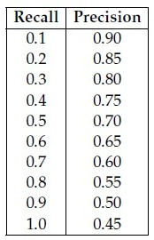

**Figure 11.** Source precision-recall table for Question 256.

| Recall | Precision |
| :--- | :--- |
| 0.1 | 0.90 |
| 0.2 | 0.85 |
| 0.3 | 0.80 |
| 0.4 | 0.75 |
| 0.5 | 0.70 |
| 0.6 | 0.65 |
| 0.7 | 0.60 |
| 0.8 | 0.55 |
| 0.9 | 0.50 |
| 1.0 | 0.45 |

Calculate the mean Average Precision (mAP) for this class using the 11-point interpolation method, which averages the precision values at recall levels {0.0, 0.1, 0.2, ..., 1.0}. The precision at recall 0.0 can be assumed to be 1.0.

Additionally, the system’s AP values for the other two classes are as follows:

- AP for class 2: 0.78
- AP for class 3: 0.72

Based on these AP values, what is the mean Average Precision (mAP) across all three classes?

**Options**

**A.** 0.70  
*Option ID:* `6406533940002`

**B.** 0.69  
*Option ID:* `6406533940003`

**C.** 0.73  
*Option ID:* `6406533940004`

**D.** 0.76  
*Option ID:* `6406533940005`

---

**Correct answer:** **C** — 0.73.

**Worked explanation:** YOLO predicts detection outputs in a single forward pass, trading proposal-based refinement for dense, unified inference. The source key is retained as the answer; compare the defining property against each distractor.

### da5006_2025T2_Q2_NA · Q237 · 2.0 marks · ID 6406531333788

Which architecture performs object detection as a single regression problem from image pixels to bounding boxes and class probabilities?

**Options**

**A.** R-CNN  
*Option ID:* `6406534459597`

**B.** Fast R-CNN  
*Option ID:* `6406534459598`

**C.** Faster R-CNN  
*Option ID:* `6406534459599`

**D.** YOLO  
*Option ID:* `6406534459600`

---

**Correct answer:** **D** — YOLO

**Worked explanation:** YOLO predicts detection outputs in a single forward pass, trading proposal-based refinement for dense, unified inference. The source key is retained as the answer; compare the defining property against each distractor.

### da5006_2025T3_Q2_NA · Q133 · 2.0 marks · ID 6406531815725

Which architecture performs object detection as a single regression problem from image pixels to bounding boxes and class probabilities?

**Options**

**A.** R-CNN  
*Option ID:* `6406535903094`

**B.** Fast R-CNN  
*Option ID:* `6406535903095`

**C.** Faster R-CNN  
*Option ID:* `6406535903096`

**D.** YOLO  
*Option ID:* `6406535903097`

---

**Correct answer:** **D** — YOLO.

**Worked explanation:** YOLO predicts detection outputs in a single forward pass, trading proposal-based refinement for dense, unified inference. The source key is retained as the answer; compare the defining property against each distractor.

## Topic: Transfer learning and fine-tuning

| Paper | Q# | Marks | Type |
|---|---:|---:|---|
| da5006_2026T2_ET_FN | 14 | 2 | ET |
| da5006_2026T1_Q2_NA | 7 | 1.0 | Q2 |
| da5006_2026T1_Q2_NA | 8 | 1.0 | Q2 |
| da5006_2026T1_Q2_NA | 16 | 1.0 | Q2 |
| da5006_2026T2_Q2_NA | 5 | 1.0 | Q2 |
| da5006_2026T2_Q2_NA | 15 | 3.0 | Q2 |

### da5006_2026T1_Q2_NA · Q7 · 1.0 marks · ID 6406532040094

You have a pretrained CNN backbone and only 500 labeled images for a new task. A strong first baseline is:

**Options**

**A.** Fine-tune the entire network immediately using a very small learning rate to preserve pre-trained features  
*Option ID:* `6406536642505`

**B.** Freeze backbone, train a new classifier head; optionally unfreeze later with smaller LR  
*Option ID:* `6406536642506`

**C.** Train a completely new architecture from scratch using heavy data augmentation to compensate for the lack of data  
*Option ID:* `6406536642507`

**D.** Unfreeze the backbone from the bottom layers upwards, gradually increasing the learning rate  
*Option ID:* `6406536642508`

---

**Correct answer:** **B** — Freeze backbone, train a new classifier head; optionally unfreeze later with smaller LR.

**Worked explanation:** Transfer learning reuses representations learned on a source task; freezing or fine-tuning depends on dataset size and source-target similarity. The source key is retained as the answer; compare the defining property against each distractor.

### da5006_2026T1_Q2_NA · Q8 · 1.0 marks · ID 6406532040095

When fine-tuning a model, what is a common way to prevent the new training from "overwriting" or destroying the useful features already learned during pre-training?

**Options**

**A.** Applying a high dropout rate exclusively to the newly initialized classification head  
*Option ID:* `6406536642509`

**B.** Use differential learning rates (small LR for the pre-trained backbone, larger LR for the new head)  
*Option ID:* `6406536642510`

**C.** Re-initializing the weights of the last convolutional block before training  
*Option ID:* `6406536642511`

**D.** Freezing the classification head and only fine-tuning the backbone features  
*Option ID:* `6406536642512`

---

**Correct answer:** **B** — Use differential learning rates (small LR for the pre-trained backbone, larger LR for the new head).

**Worked explanation:** Transfer learning reuses representations learned on a source task; freezing or fine-tuning depends on dataset size and source-target similarity. The source key is retained as the answer; compare the defining property against each distractor.

### da5006_2026T1_Q2_NA · Q16 · 1.0 marks · ID 6406532040103

Which statements can be true in practice when fine-tuning with small batch sizes?

**Options**

**A.** Freezing BatchNorm running statistics can improve stability.  
*Option ID:* `6406536642541`

**B.** If the new dataset distribution differs, re-estimating BN stats may help.  
*Option ID:* `6406536642542`

**C.** Setting BatchNorm to training mode with a batch size of 1 provides an unbiased estimate of the population variance.  
*Option ID:* `6406536642543`

**D.** Calling .eval() on a BatchNorm layer disables the application of the learned affine parameters (γ, β).  
*Option ID:* `6406536642544`

---

**Correct answer:** **A**, **B** — Freezing BatchNorm running statistics can improve stability; If the new dataset distribution differs, re-estimating BN stats may help..

**Worked explanation:** Transfer learning reuses representations learned on a source task; freezing or fine-tuning depends on dataset size and source-target similarity. The source key is retained as the answer; compare the defining property against each distractor.

### da5006_2026T2_ET_FN · Q14 · 2 marks · ID 6406532270053

When adapting a pretrained CNN to a related task with a relatively small labeled dataset, which training choice is generally the more conservative starting point?

**Options**

**A.** Reinitialize the entire network and use a very large learning rate  
*Option ID:* `6406537379051`

**B.** Retain pretrained features and update them cautiously, often with a smaller learning rate than newly initialized layers  
*Option ID:* `6406537379052`

**C.** Freeze the newly added prediction head and update only the old classifier  
*Option ID:* `6406537379053`

**D.** Randomly permute pretrained channels before optimization  
*Option ID:* `6406537379054`

---

**Correct answer:** **B** — Retain pretrained features and update them cautiously, often with a smaller learning rate than newly initialized layers.

**Worked explanation:** Transfer learning reuses representations learned on a source task; freezing or fine-tuning depends on dataset size and source-target similarity. The source key is retained as the answer; compare the defining property against each distractor.

### da5006_2026T2_Q2_NA · Q5 · 1.0 marks · ID 6406532194387

Which technique most directly helps reduce catastrophic forgetting early in fine-tuning?

**Options**

**A.** Use very high weight decay on the backbone  
*Option ID:* `6406537126042`

**B.** Use differential learning rates (small LR for backbone, larger LR for head)  
*Option ID:* `6406537126043`

**C.** Replace ReLU with sigmoid  
*Option ID:* `6406537126044`

**D.** Remove skip connections  
*Option ID:* `6406537126045`

---

**Correct answer:** **B** — Use differential learning rates (small LR for backbone, larger LR for head).

**Worked explanation:** Transfer learning reuses representations learned on a source task; freezing or fine-tuning depends on dataset size and source-target similarity. The source key is retained as the answer; compare the defining property against each distractor.

### da5006_2026T2_Q2_NA · Q15 · 3.0 marks · ID 6406532194395

Which statements can be true in practice when fine-tuning with small batch sizes?

**Options**

**A.** Freezing BatchNorm running statistics can improve stability.  
*Option ID:* `6406537126074`

**B.** If the new dataset distribution differs, re-estimating BN stats may help.  
*Option ID:* `6406537126075`

**C.** BN always improves performance even with batch size 1.  
*Option ID:* `6406537126076`

**D.** Setting BN to eval disables learned affine parameters (γ, β).  
*Option ID:* `6406537126077`

---

**Correct answer:** **A, B** — Freezing BatchNorm running statistics can improve stability. / If the new dataset distribution differs, re-estimating BN stats may help..

**Worked explanation:** Transfer learning reuses representations learned on a source task; freezing or fine-tuning depends on dataset size and source-target similarity. The source key is retained as the answer; compare the defining property against each distractor.

## Topic: Two-stage detection and R-CNN

| Paper | Q# | Marks | Type |
|---|---:|---:|---|
| da5006_2026T1_ET_FN | 13 | 2 | ET |
| da5006_2026T2_ET_FN | 15 | 2 | ET |
| da5006_2026T2_ET_FN | 25 | 3 | ET |
| da5006_2024T3_Q2_NA | 139 | 2 | Q2 |
| da5006_2025T1_Q2_NA | 243 | 2 | Q2 |
| da5006_2025T2_Q2_NA | 235 | 2.0 | Q2 |
| da5006_2025T2_Q2_NA | 236 | 2.0 | Q2 |
| da5006_2025T3_Q2_NA | 131 | 2.0 | Q2 |
| da5006_2025T3_Q2_NA | 132 | 2.0 | Q2 |
| da5006_2026T1_Q2_NA | 10 | 1.0 | Q2 |
| da5006_2026T1_Q2_NA | 11 | 1.0 | Q2 |
| da5006_2026T2_Q2_NA | 7 | 1.0 | Q2 |
| da5006_2026T2_Q2_NA | 13 | 2.0 | Q2 |

### da5006_2024T3_Q2_NA · Q139 · 2 marks · ID 6406531031073

Which one of the following object detection networks uses an ROI pooling layer?

**Options**

**A.** Fast R-CNN  
*Option ID:* `6406533487216`

**B.** R-CNN  
*Option ID:* `6406533487217`

**C.** YOLO  
*Option ID:* `6406533487218`

**D.** All of these  
*Option ID:* `6406533487219`

---

**Correct answer:** **A** — Fast R-CNN

**Worked explanation:** Two-stage detectors first generate candidate regions and then classify/refine them; shared feature computation and proposal mechanisms address earlier R-CNN bottlenecks. The source key is retained as the answer; compare the defining property against each distractor.

### da5006_2025T1_Q2_NA · Q243 · 2 marks · ID 6406531168217

Which one of the following object detection networks uses an ROI pooling layer?

**Options**

**A.** Fast R-CNN  
*Option ID:* `6406533939948`

**B.** R-CNN  
*Option ID:* `6406533939949`

**C.** YOLO  
*Option ID:* `6406533939950`

**D.** All of these  
*Option ID:* `6406533939951`

---

**Correct answer:** **A** — Fast R-CNN.

**Worked explanation:** Two-stage detectors first generate candidate regions and then classify/refine them; shared feature computation and proposal mechanisms address earlier R-CNN bottlenecks. The source key is retained as the answer; compare the defining property against each distractor.

### da5006_2025T2_Q2_NA · Q235 · 2.0 marks · ID 6406531333786

Which of the following architectures introduced the ROI pooling layer for extracting fixed-size feature maps from variable-size region proposals?

**Options**

**A.** R-CNN  
*Option ID:* `6406534459589`

**B.** Fast R-CNN  
*Option ID:* `6406534459590`

**C.** Faster R-CNN  
*Option ID:* `6406534459591`

**D.** YOLO  
*Option ID:* `6406534459592`

---

**Correct answer:** **B** — Fast R-CNN

**Worked explanation:** Two-stage detectors first generate candidate regions and then classify/refine them; shared feature computation and proposal mechanisms address earlier R-CNN bottlenecks. The source key is retained as the answer; compare the defining property against each distractor.

### da5006_2025T2_Q2_NA · Q236 · 2.0 marks · ID 6406531333787

Which object detection method first integrated a Region Proposal Network (RPN) to generate region proposals within the detection model?

**Options**

**A.** R-CNN  
*Option ID:* `6406534459593`

**B.** Fast R-CNN  
*Option ID:* `6406534459594`

**C.** Faster R-CNN  
*Option ID:* `6406534459595`

**D.** YOLO  
*Option ID:* `6406534459596`

---

**Correct answer:** **C** — Faster R-CNN

**Worked explanation:** Two-stage detectors first generate candidate regions and then classify/refine them; shared feature computation and proposal mechanisms address earlier R-CNN bottlenecks. The source key is retained as the answer; compare the defining property against each distractor.

### da5006_2025T3_Q2_NA · Q131 · 2.0 marks · ID 6406531815723

Which of the following architectures introduced the ROI pooling layer for extracting fixed-size feature maps from variable-size region proposals?

**Options**

**A.** R-CNN  
*Option ID:* `6406535903086`

**B.** Fast R-CNN  
*Option ID:* `6406535903087`

**C.** Faster R-CNN  
*Option ID:* `6406535903088`

**D.** YOLO  
*Option ID:* `6406535903089`

---

**Correct answer:** **B** — Fast R-CNN.

**Worked explanation:** Two-stage detectors first generate candidate regions and then classify/refine them; shared feature computation and proposal mechanisms address earlier R-CNN bottlenecks. The source key is retained as the answer; compare the defining property against each distractor.

### da5006_2025T3_Q2_NA · Q132 · 2.0 marks · ID 6406531815724

Which object detection method first integrated a Region Proposal Network (RPN) to generate region proposals within the detection model?

**Options**

**A.** R-CNN  
*Option ID:* `6406535903090`

**B.** Fast R-CNN  
*Option ID:* `6406535903091`

**C.** Faster R-CNN  
*Option ID:* `6406535903092`

**D.** YOLO  
*Option ID:* `6406535903093`

---

**Correct answer:** **C** — Faster R-CNN.

**Worked explanation:** Two-stage detectors first generate candidate regions and then classify/refine them; shared feature computation and proposal mechanisms address earlier R-CNN bottlenecks. The source key is retained as the answer; compare the defining property against each distractor.

### da5006_2026T1_ET_FN · Q13 · 2 marks · ID 6406532136828

In Faster R-CNN, the Region Proposal Network (RPN) outputs:

**Options**

**A.** Only class probabilities + pixel-wise masks  
*Option ID:* `6406536959521`

**B.** Objectness scores + bounding box proposals  
*Option ID:* `6406536959522`

**C.** Pixel-wise masks  
*Option ID:* `6406536959523`

**D.** Optical flow  
*Option ID:* `6406536959524`

---

**Correct answer:** **B** — Objectness scores + bounding box proposals.

**Worked explanation:** Two-stage detectors first generate candidate regions and then classify/refine them; shared feature computation and proposal mechanisms address earlier R-CNN bottlenecks. The source key is retained as the answer; compare the defining property against each distractor.

### da5006_2026T1_Q2_NA · Q10 · 1.0 marks · ID 6406532040097

Which detector is a classic two-stage detector with an RPN + ROI feature extraction?

**Options**

**A.** SSD  
*Option ID:* `6406536642517`

**B.** YOLO  
*Option ID:* `6406536642518`

**C.** Faster R-CNN  
*Option ID:* `6406536642519`

**D.** DETR  
*Option ID:* `6406536642520`

---

**Correct answer:** **C** — Faster R-CNN.

**Worked explanation:** Two-stage detectors first generate candidate regions and then classify/refine them; shared feature computation and proposal mechanisms address earlier R-CNN bottlenecks. The source key is retained as the answer; compare the defining property against each distractor.

### da5006_2026T1_Q2_NA · Q11 · 1.0 marks · ID 6406532040098

Which statement is most accurate?

**Options**

**A.** Two-stage detectors optimize a single joint loss function for classification and localization, whereas single-stage uses decoupled losses.  
*Option ID:* `6406536642521`

**B.** Single-stage detectors rely on selective search for region generation, whereas two-stage detectors use a dedicated sub-network.  
*Option ID:* `6406536642522`

**C.** Two-stage detectors typically generate proposals then classify/refine; single-stage predicts boxes/classes densely.  
*Option ID:* `6406536642523`

**D.** Two-stage detectors process the entire image in one pass, while single-stage detectors evaluate crops sequentially.  
*Option ID:* `6406536642524`

---

**Correct answer:** **C** — Two-stage detectors typically generate proposals then classify/refine; single-stage predicts boxes/classes densely..

**Worked explanation:** Two-stage detectors first generate candidate regions and then classify/refine them; shared feature computation and proposal mechanisms address earlier R-CNN bottlenecks. The source key is retained as the answer; compare the defining property against each distractor.

### da5006_2026T2_ET_FN · Q15 · 2 marks · ID 6406532270054

Which processing pattern is characteristic of a two-stage object detector?

**Options**

**A.** Dense prediction of final detections in one stage with no proposal-processing step  
*Option ID:* `6406537379055`

**B.** Generation of candidate regions followed by prediction on those candidate regions  
*Option ID:* `6406537379056`

**C.** Pixel-wise class prediction without object localization  
*Option ID:* `6406537379057`

**D.** Sequence-level prediction using recurrent hidden states  
*Option ID:* `6406537379058`

---

**Correct answer:** **B** — Generation of candidate regions followed by prediction on those candidate regions.

**Worked explanation:** Two-stage detectors first generate candidate regions and then classify/refine them; shared feature computation and proposal mechanisms address earlier R-CNN bottlenecks. The source key is retained as the answer; compare the defining property against each distractor.

### da5006_2026T2_ET_FN · Q25 · 3 marks · ID 6406532270064

Select all correct statements.

**Options**

**A.** Two-stage detectors separate candidate-region generation from later prediction on candidates.  
*Option ID:* `6406537379095`

**B.** Single-stage detectors can produce final detection predictions without a separate proposal-processing stage.  
*Option ID:* `6406537379096`

**C.** Segmentation is a dense prediction task with spatially resolved outputs.  
*Option ID:* `6406537379097`

**D.** Object detection and segmentation necessarily produce identical output representations.  
*Option ID:* `6406537379098`

---

**Correct answer:** **A**, **B**, **C** — Two-stage detectors separate candidate-region generation from later prediction on candidates.; Single-stage detectors can produce final detection predictions without a separate proposal-processing stage.; Segmentation is a dense prediction task with spatially resolved outputs..

> [!NOTE] Week assignment uncertain: Compares two-stage and single-stage detection with segmentation.

**Worked explanation:** Two-stage detectors first generate candidate regions and then classify/refine them; shared feature computation and proposal mechanisms address earlier R-CNN bottlenecks. The source key is retained as the answer; compare the defining property against each distractor.

### da5006_2026T2_Q2_NA · Q7 · 1.0 marks · ID 6406532194389

Which detector is a classic two-stage detector with an RPN + ROI feature extraction?

**Options**

**A.** SSD  
*Option ID:* `6406537126050`

**B.** YOLO  
*Option ID:* `6406537126051`

**C.** Faster R-CNN  
*Option ID:* `6406537126052`

**D.** RetinaNet  
*Option ID:* `6406537126053`

---

**Correct answer:** **C** — Faster R-CNN.

**Worked explanation:** Two-stage detectors first generate candidate regions and then classify/refine them; shared feature computation and proposal mechanisms address earlier R-CNN bottlenecks. The source key is retained as the answer; compare the defining property against each distractor.

### da5006_2026T2_Q2_NA · Q13 · 2.0 marks · ID 6406532194390

Which statement is most accurate?

**Options**

**A.** Two-stage detectors do not use CNN backbones.  
*Option ID:* `6406537126054`

**B.** Single-stage detectors cannot regress bounding boxes.  
*Option ID:* `6406537126055`

**C.** Two-stage detectors typically generate proposals then classify/refine  
*Option ID:* `6406537126056`

**D.** Single-stage detectors require ROI pooling.  
*Option ID:* `6406537126057`

---

**Correct answer:** **C** — Two-stage detectors typically generate proposals then classify/refine.

**Worked explanation:** Two-stage detectors first generate candidate regions and then classify/refine them; shared feature computation and proposal mechanisms address earlier R-CNN bottlenecks. The source key is retained as the answer; compare the defining property against each distractor.
