# Week 6 Past-Paper Question Bank

> Topics inferred from past papers; replace when the official syllabus is available.

**Counts:** Q1: 0 questions / 0 marks, Q2: 28 questions / 55 marks, ET: 15 questions / 29 marks; total: 43 questions / 84 marks.

## Topic: Dense detectors and focal loss

| Done | Paper | Q# | Marks | Type |
| :---: | :--- | ---: | ---: | :--- |
| [ ] | da5006_2024T1_ET_AN | 175 | 2 | MCQ |
| [ ] | da5006_2025T2_ET_AN | 94 | 2 | MCQ |
| [ ] | da5006_2025T2_ET_FN | 168 | 2 | MCQ |
| [ ] | da5006_2025T1_Q2_NA | 247 | 2 | MCQ |
| [ ] | da5006_2026T1_Q2_NA | 12 | 1 | MCQ |
| [ ] | da5006_2026T2_Q2_NA | 8 | 1 | MCQ |

### da5006_2024T1_ET_AN · Q175 · 2 marks · ID 640653821601

What is a key feature of focal loss that distinguishes it from traditional loss functions in object detection?

**Options**

**A.** Focal loss introduces additional regularization terms to penalize large weights in the neural network.  
*Option ID:* `6406532757348`

**B.** Focal loss dynamically adjusts the loss weights based on the difficulty of each training example.  
*Option ID:* `6406532757349`

**C.** Focal loss computes the loss based on the Euclidean distance between predicted and groundtruth bounding boxes.  
*Option ID:* `6406532757350`

**D.** Focal loss prioritizes minimizing the overall loss across all classes equally.  
*Option ID:* `6406532757351`

**Correct answer:** **B** — Focal loss dynamically adjusts the loss weights based on the difficulty of each training example..

**Worked explanation:** Focal loss multiplies cross-entropy by $(1-p_t)^\gamma$, reducing the contribution of easy correctly classified examples. RetinaNet uses this to address foreground–background imbalance in dense detection.

### da5006_2025T2_ET_AN · Q94 · 2 marks · ID 6406531431354

> [!NOTE] Week assignment uncertain: Matches detection models and segmentation architectures to their methods.

Match the following:

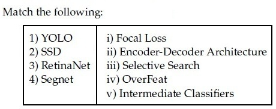

**Figure 1.** Source matching table for Question 94.

| List 1 | List 2 |
| :--- | :--- |
| 1) YOLO | i) Focal Loss |
| 2) SSD | ii) Encoder-Decoder Architecture |
| 3) RetinaNet | iii) Selective Search |
| 4) Segnet | iv) OverFeat |
| | v) Intermediate Classifiers |

**Options**

**A.** 1→ iv, 2→ v, 3→ i, 4 → ii  
*Option ID:* `6406534780289`

**B.** 1→ iii, 2→ i, 3 → v, 4→ ii  
*Option ID:* `6406534780290`

**C.** 1→ iv, 2→ iii, 3→ ii, 4 → i  
*Option ID:* `6406534780291`

**D.** 1→ iii, 2→ i, 3 → ii, 4→ v  
*Option ID:* `6406534780292`

**Correct answer:** **A** — 1→ iv, 2→ v, 3→ i, 4 → ii.

**Worked explanation:** RetinaNet is associated with focal loss and SegNet with an encoder–decoder. SSD predicts on multiple feature maps, and YOLO is a single-stage detector; the paper’s remaining matching labels are exam-specific.

### da5006_2025T2_ET_FN · Q168 · 2 marks · ID 6406531422547

> [!NOTE] Week assignment uncertain: Matches YOLO, SSD, RetinaNet, and SegNet to architectural characteristics.

Match the following:

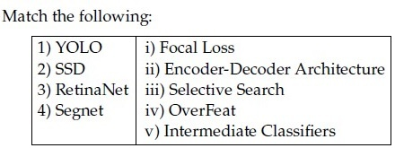

**Figure 2.** Question 168, source matching table.

**Options**

**A.** 1→ iv, 2→ v, 3→ i, 4 → ii  
*Option ID:* `6406534756404`

**B.** 1→ iii, 2→ i, 3 → v, 4→ ii  
*Option ID:* `6406534756405`

**C.** 1→ iv, 2→ iii, 3→ ii, 4 → i  
*Option ID:* `6406534756406`

**D.** 1→ iii, 2→ i, 3 → ii, 4→ v  
*Option ID:* `6406534756407`

**Correct answer:** **A** — 1→ iv, 2→ v, 3→ i, 4 → ii.

**Worked explanation:** RetinaNet is associated with focal loss and SegNet with an encoder–decoder. SSD predicts on multiple feature maps, and YOLO is a single-stage detector; the paper’s remaining matching labels are exam-specific.

### da5006_2025T1_Q2_NA · Q247 · 2 marks · ID 6406531168221

In object detection using CNNs, which loss function is typically used to optimize the confidence scores assigned to predicted bounding boxes, aiming to ensure high confidence for correct detections and penalize false positives?

**Options**

**A.** Focal Loss  
*Option ID:* `6406533939964`

**B.** Smooth Ll Loss  
*Option ID:* `6406533939965`

**C.** Binary Cross-Entropy Loss  
*Option ID:* `6406533939966`

**D.** Mean Squared Error (MSE)  
*Option ID:* `6406533939967`

**Correct answer:** **C** — Binary Cross-Entropy Loss.

**Worked explanation:** Binary cross-entropy penalizes mismatches between objectness probability and its binary target. Focal loss is a modified cross-entropy that additionally downweights easy examples.

### da5006_2026T1_Q2_NA · Q12 · 1 marks · ID 6406532040099

RetinaNet is notable primarily because it introduced:

**Options**

**A.** A novel feature pyramid network (FPN) architecture that eliminates the need for anchor boxes  
*Option ID:* `6406536642525`

**B.** Focal loss to address class imbalance  
*Option ID:* `6406536642526`

**C.** The concept of Region of Interest (RoI) pooling to align features extracted from different scales  
*Option ID:* `6406536642527`

**D.** A dynamic routing mechanism that directly assigns bounding box predictions to ground truth objects  
*Option ID:* `6406536642528`

**Correct answer:** **B** — Focal loss to address class imbalance.

**Worked explanation:** Focal loss multiplies cross-entropy by $(1-p_t)^\gamma$, reducing the contribution of easy correctly classified examples. RetinaNet uses this to address foreground–background imbalance in dense detection.

### da5006_2026T2_Q2_NA · Q8 · 1 marks · ID 6406532194391

RetinaNet is notable primarily because it introduced:

**Options**

**A.** ROI Align  
*Option ID:* `6406537126058`

**B.** Focal loss to address class imbalance  
*Option ID:* `6406537126059`

**C.** Depthwise separable convolutions  
*Option ID:* `6406537126060`

**D.** Self-attention  
*Option ID:* `6406537126061`

**Correct answer:** **B** — Focal loss to address class imbalance.

**Worked explanation:** Focal loss multiplies cross-entropy by $(1-p_t)^\gamma$, reducing the contribution of easy correctly classified examples. RetinaNet uses this to address foreground–background imbalance in dense detection.

## Topic: Detection losses, boxes and matching

| Done | Paper | Q# | Marks | Type |
| :---: | :--- | ---: | ---: | :--- |
| [ ] | da5006_2024T1_ET_AN | 189 | 2 | SA |
| [ ] | da5006_2024T2_ET_AN | 259 | 2 | MCQ |
| [ ] | da5006_2024T2_ET_AN | 278 | 1 | SA |
| [ ] | da5006_2024T3_ET_AN | 205 | 2 | Multiple Choice Question (MCQ) |
| [ ] | da5006_2024T3_ET_AN | 207 | 2 | Multiple Choice Question (MCQ) |
| [ ] | da5006_2026T1_ET_FN | 19 | 4 | SA |
| [ ] | da5006_2024T1_Q2_NA | 160 | 2 | MCQ |
| [ ] | da5006_2024T2_Q2_NA | 128 | 2 | MCQ |
| [ ] | da5006_2024T2_Q2_NA | 133 | 2 | SA |
| [ ] | da5006_2024T3_Q2_NA | 145 | 2 | MCQ |
| [ ] | da5006_2024T3_Q2_NA | 152 | 2 | Short Answer |
| [ ] | da5006_2025T1_Q2_NA | 248 | 2 | MCQ |
| [ ] | da5006_2025T1_Q2_NA | 261 | 3 | SA |
| [ ] | da5006_2025T2_Q2_NA | 240 | 2 | SA |
| [ ] | da5006_2025T2_Q2_NA | 250 | 2 | SA |
| [ ] | da5006_2025T3_Q2_NA | 136 | 2 | Multiple Choice Question |
| [ ] | da5006_2025T3_Q2_NA | 144 | 2 | Short Answer |
| [ ] | da5006_2026T1_Q2_NA | 17 | 1 | MSQ |
| [ ] | da5006_2026T1_Q2_NA | 23 | 1 | SA |
| [ ] | da5006_2026T2_Q2_NA | 16 | 3 | MSQ |
| [ ] | da5006_2026T2_Q2_NA | 22 | 4 | SA |

### da5006_2024T1_ET_AN · Q189 · 2 marks · ID 640653821615

Consider a Faster R-CNN object detection framework, which is being trained with a mini-batch size of 2. The RPN produces 512 proposals, out of which 10 and 12 of them are foreground proposals, corresponding to each image in the mini-batch. For a single mini-batch update, the bounding box regression loss will be computed _____________ times.

**Correct answer:** **22**

**Worked explanation:** Only foreground proposals have a matched object for box regression. The count is $10+12=22$; the total proposal count is not the regression count.

### da5006_2024T2_ET_AN · Q259 · 2 marks · ID 640653904330

Consider two $10 \times 10$ bounding boxes (one on the upper left and one on the lower right) in an image with an overlapping region of $4 \times 4$. The Intersection over Union (IoU) between the two boxes is (choose the closest value):

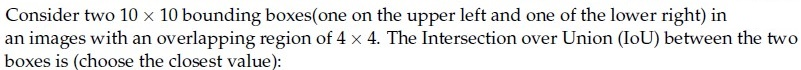

**Figure 3.** Source problem statement for Question 259.

**Options**

**A.** 21.3%  
*Option ID:* `6406533045082`

**B.** 12.8%  
*Option ID:* `6406533045083`

**C.** 11.5%  
*Option ID:* `6406533045084`

**D.** 8.7%  
*Option ID:* `6406533045085`

**Correct answer:** **D** — 8.7%

**Worked explanation:** The intersection area is $16$ and each box has area $100$. Thus $\mathrm{IoU}=16/(100+100-16)=0.08696$; use the requested rounding or closest option.

### da5006_2024T2_ET_AN · Q278 · 1 marks · ID 640653904332

Consider a Faster R-CNN object detection framework, which is being trained with a minibatch size of 2. The RPN produces 512 proposals, out of which 5 and 8 of them are foreground proposals, corresponding to each image in the mini-batch. For a single mini-batch update, the bounding box regression loss will be computed ______________________ times.

**Correct answer:** `13`

**Worked explanation:** Only foreground proposals have a matched object for box regression. The count is $5+8=13$; the total proposal count is not the regression count.

### da5006_2024T3_ET_AN · Q205 · 2 marks · ID 6406531046063

State whether the given statement is True or False: While training an object detection algorithm, you need a training set that contains many pictures of the objects you want to detect. However, bounding boxes are not typically provided in the training set, since architectures like Faster-RCNN and YOLO can learn to detect the object by themselves.

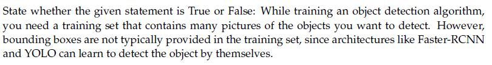
**Figure 4.** Source statement for Question 205.

**Options**

**A.** True  
*Option ID:* `6406533531372`

**B.** False  
*Option ID:* `6406533531373`

**Correct answer:** **B** — False.

**Worked explanation:** Ordinary supervised Faster R-CNN and YOLO training uses box annotations as localization targets. Proposal generation does not remove the need for such supervision.

### da5006_2024T3_ET_AN · Q207 · 2 marks · ID 6406531046070

Consider two 10×10 bounding boxes(one on the upper left and one of the lower right) in an images with an overlapping region of 6 × 6. The Intersection over Union (IoU) between the two boxes is (choose the closest value):

**Options**

**A.** 21%  
*Option ID:* `6406533531382`

**B.** 25%  
*Option ID:* `6406533531383`

**C.** 33%  
*Option ID:* `6406533531384`

**D.** 37%  
*Option ID:* `6406533531385`

**Correct answer:** **A** — 21%.

**Worked explanation:** The intersection area is $36$ and each box has area $100$. Thus $\mathrm{IoU}=36/(100+100-36)=0.21951$; use the requested rounding or closest option.

### da5006_2026T1_ET_FN · Q19 · 4 marks · ID 6406532136834

Box A: top-left (0,0), bottom-right (8,8).
Box B: top-left (4,4), bottom-right (12,12).
Compute IoU as a decimal.

**Correct answer:** `0.142 to 0.144`

**Worked explanation:** The intersection area is $16$ and each box has area $64$. Thus $\mathrm{IoU}=16/(64+64-16)=0.14286$; use the requested rounding or closest option.

### da5006_2024T1_Q2_NA · Q160 · 2 marks · ID 640653766156

Consider two 10×10 bounding boxes (one on the upper left and one of the lower right) in an image with an overlapping region of 7×7. The Intersection over Union (IoU) score between the two boxes is (choose the closest value):

**Options**

**A.** 21%  
*Option ID:* `6406532564199`

**B.** 25%  
*Option ID:* `6406532564200`

**C.** 33%  
*Option ID:* `6406532564201`

**D.** 37%  
*Option ID:* `6406532564202`

**Correct answer:** **C** — 33%

**Worked explanation:** The intersection area is $49$ and each box has area $100$. Thus $\mathrm{IoU}=49/(100+100-49)=0.32450$; use the requested rounding or closest option.

### da5006_2024T2_Q2_NA · Q128 · 2 marks · ID 640653856603

Consider two 10×10 bounding boxes(one on the upper left and one of the lower right) in an images with an overlapping region of 6 × 6. The Intersection over Union (IoU) between the two boxes is (choose the closest value):

**Options**

**A.** 21%  
*Option ID:* `6406532878521`

**B.** 25%  
*Option ID:* `6406532878522`

**C.** 33%  
*Option ID:* `6406532878523`

**D.** 37%  
*Option ID:* `6406532878524`

**Correct answer:** **A** — 21%.

**Worked explanation:** The intersection area is $36$ and each box has area $100$. Thus $\mathrm{IoU}=36/(100+100-36)=0.21951$; use the requested rounding or closest option.

### da5006_2024T2_Q2_NA · Q133 · 2 marks · ID 640653856581

Consider a Faster R-CNN object detection framework, which is being trained with a mini-batch size of 2. The RPN produces 512 proposals, out of which 12 and 14 of them are foreground proposals,corresponding to each image in the mini-batch. For a single mini-batch update, the bounding box regression loss will be computed_____________________ times.

**Correct answer:** `26`.

**Worked explanation:** Only foreground proposals have a matched object for box regression. The count is $12+14=26$; the total proposal count is not the regression count.

### da5006_2024T3_Q2_NA · Q145 · 2 marks · ID 6406531031081

Consider two 12×12 bounding boxes(one on the upper left and one of the lower right) in an images with an overlapping region of 8 × 8. The Intersection over Union (IoU) between the two boxes is (choose the closest value):

**Options**

**A.** 21%  
*Option ID:* `6406533487245`

**B.** 25%  
*Option ID:* `6406533487246`

**C.** 28%  
*Option ID:* `6406533487247`

**D.** 37%  
*Option ID:* `6406533487248`

**Correct answer:** **C** — 28%

**Worked explanation:** The intersection area is $64$ and each box has area $144$. Thus $\mathrm{IoU}=64/(144+144-64)=0.28571$; use the requested rounding or closest option.

### da5006_2024T3_Q2_NA · Q152 · 2 marks · ID 6406531031077

Consider a Faster R-CNN object detection framework, which is being trained with a mini-batch size of 2. The RPN produces 512 proposals, out of which 5 and 95 of them are foreground proposals, corresponding to each image in the mini-batch. For a single mini-batch update, the bounding box regression loss will be computed _____________ times.

**Correct answer:** `100`

**Worked explanation:** Only foreground proposals have a matched object for box regression. The count is $5+95=100$; the total proposal count is not the regression count.

### da5006_2025T1_Q2_NA · Q248 · 2 marks · ID 6406531168222

Consider two 12 × 12 bounding boxes(one on the upper left and one of the lower right) in an images with an overlapping region of 8 × 8. The Intersection over Union (IoU) between the two boxes is (choose the closest value):

**Options**

**A.** 21%  
*Option ID:* `6406533939968`

**B.** 25%  
*Option ID:* `6406533939969`

**C.** 28%  
*Option ID:* `6406533939970`

**D.** 37%  
*Option ID:* `6406533939971`

**Correct answer:** **C** — 28%.

**Worked explanation:** The intersection area is $64$ and each box has area $144$. Thus $\mathrm{IoU}=64/(144+144-64)=0.28571$; use the requested rounding or closest option.

### da5006_2025T1_Q2_NA · Q261 · 3 marks · ID 6406531168235

Consider a Faster R-CNN object detection framework, which is being trained with a minibatch size of 2. The RPN produces 512 proposals, out of which 256 and 128 of them are foreground proposals, corresponding to each image in the mini-batch. For a single mini-batch update, the bounding box regression loss will be computed _______________ times.

**Correct answer:** `384`

**Worked explanation:** Only foreground proposals have a matched object for box regression. The count is $256+128=384$; the total proposal count is not the regression count.

### da5006_2025T2_Q2_NA · Q240 · 2 marks · ID 6406531333791

Consider two bounding boxes in an image:
- Box A: top-left at (0, 0), bottom-right at (12, 12)
- Box B: top-left at (4, 4), bottom-right at (16, 16)

What is the Intersection over Union (IoU) between these two boxes ____________(in %)

**Correct answer:** `28`

> [!WARNING] The source key gives 28%, but the continuous-coordinate calculation is approximately 28.571%; rounding to the nearest whole percent gives 29%.

**Worked explanation:** The intersection area is $64$ and each box has area $144$. Thus $\mathrm{IoU}=64/(144+144-64)=0.28571$; use the requested rounding or closest option.

### da5006_2025T2_Q2_NA · Q250 · 2 marks · ID 6406531333801

Consider a Faster R-CNN object detection framework, which is being trained with a mini-batch size of 2. The RPN produces 512 proposals, out of which 256 and 128 of them are foreground proposals, corresponding to each image in the mini-batch. For a single mini-batch update, the bounding box regression loss will be computed_____________ times.

**Correct answer:** `384`

**Worked explanation:** Only foreground proposals have a matched object for box regression. The count is $256+128=384$; the total proposal count is not the regression count.

### da5006_2025T3_Q2_NA · Q136 · 2 marks · ID 6406531815728

Consider two bounding boxes in an image:

- Box A: top-left at (0, 0), bottom-right at (12, 12)
- Box B: top-left at (4, 4), bottom-right at (16, 16)

What is the Intersection over Union (IoU) between these two boxes ______________

**Options**

**A.** 21%  
*Option ID:* `6406535903106`

**B.** 28%  
*Option ID:* `6406535903107`

**C.** 36%  
*Option ID:* `6406535903108`

**D.** 44%  
*Option ID:* `6406535903109`

**Correct answer:** **B** — 28%.

**Worked explanation:** The intersection area is $64$ and each box has area $144$. Thus $\mathrm{IoU}=64/(144+144-64)=0.28571$; use the requested rounding or closest option.

### da5006_2025T3_Q2_NA · Q144 · 2 marks · ID 6406531815739

Consider a Faster R-CNN object detection framework, which is being trained with a mini-batch size of 2. The RPN produces 512 proposals, out of which 256 and 128 of them are foreground proposals, corresponding to each image in the mini-batch. For a single mini-batch update, the bounding box regression loss will be computed ____ times.

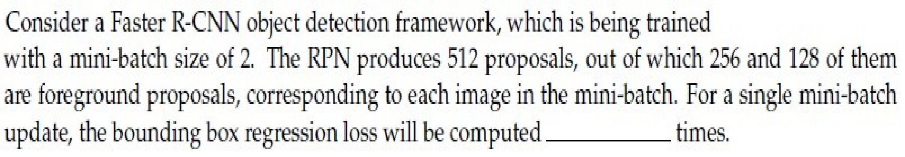

**Figure 5.** Faster R-CNN question specification for Question 144.

**Correct answer:** `384`

**Worked explanation:** Only foreground proposals have a matched object for box regression. The count is $256+128=384$; the total proposal count is not the regression count.

### da5006_2026T1_Q2_NA · Q17 · 1 marks · ID 6406532040104

Which statements are true?

**Options**

**A.** Smooth L1 (Huber) is often used for box regression due to robustness to outliers.  
*Option ID:* `6406536642545`

**B.** Focal loss primarily addresses foreground/background (class) imbalance.  
*Option ID:* `6406536642546`

**C.** Standard Cross-Entropy loss scales the loss of easy examples to zero more aggressively than Focal Loss.  
*Option ID:* `6406536642547`

**D.** In two-stage detectors, the RPN has its own objectness + box regression losses.  
*Option ID:* `6406536642548`

**Correct answer:** **A**, **B**, **D** — Smooth L1 (Huber) is often used for box regression due to robustness to outliers; Focal loss primarily addresses foreground/background (class) imbalance; In two-stage detectors, the RPN has its own objectness + box regression losses..

**Worked explanation:** Smooth L1 is quadratic near zero and linear for large residuals; focal loss downweights easy examples. The RPN learns objectness and box offsets, and IoU-based regression losses are possible.

### da5006_2026T1_Q2_NA · Q23 · 1 marks · ID 6406532040110

Box A: top-left (2,2), bottom-right (10,12)  
Box B: top-left (6,5), bottom-right (14,15)  
Compute IoU rounded to 3 decimals.

**Correct answer:** 0.211 to 0.213

**Worked explanation:** The intersection area is $28$ and each box has area $80$. Thus $\mathrm{IoU}=28/(80+80-28)=0.21212$; use the requested rounding or closest option.

### da5006_2026T2_Q2_NA · Q16 · 3 marks · ID 6406532194396

Which statements are true ?

**Options**

**A.** Smooth L1 (Huber) is often used for box regression due to robustness to outliers.  
*Option ID:* `6406537126078`

**B.** Focal loss primarily addresses foreground/background (class) imbalance.  
*Option ID:* `6406537126079`

**C.** IoU loss cannot be used for box regression.  
*Option ID:* `6406537126080`

**D.** In two-stage detectors, the RPN has its own objectness + box regression losses.  
*Option ID:* `6406537126081`

**Correct answer:** **A, B, D** — Smooth L1 (Huber) is often used for box regression due to robustness to outliers. / Focal loss primarily addresses foreground/background (class) imbalance. / In two-stage detectors, the RPN has its own objectness + box regression losses..

**Worked explanation:** Smooth L1 is quadratic near zero and linear for large residuals; focal loss downweights easy examples. The RPN learns objectness and box offsets, and IoU-based regression losses are possible.

### da5006_2026T2_Q2_NA · Q22 · 4 marks · ID 6406532194402

Box A: top-left (2,2), bottom-right (10,12) Box B: top-left (6,5), bottom-right (14,15) Compute IoU rounded to 3 decimals.

**Response type:** Numeric  
**Evaluation required:** Yes  
**Answers type:** Range  

**Correct answer:** 0.211 to 0.213

**Worked explanation:** The intersection area is $28$ and each box has area $80$. Thus $\mathrm{IoU}=28/(80+80-28)=0.21212$; use the requested rounding or closest option.

## Topic: Multiscale feature pyramids

| Done | Paper | Q# | Marks | Type |
| :---: | :--- | ---: | ---: | :--- |
| [ ] | da5006_2025T3_ET_FN | 6 | 1 | MCQ |
| [ ] | da5006_2026T1_Q2_NA | 22 | 1 | SA |
| [ ] | da5006_2026T2_Q2_NA | 21 | 4 | SA |

### da5006_2025T3_ET_FN · Q6 · 1 marks · ID 6406531862820

In a Feature Pyramid Network (FPN), the primary purpose of the top-down pathway with lateral connections is to:

**Options**

**A.** increase the receptive field at the lowest-resolution level  
*Option ID:* `6406536034933`

**B.** enrich high-resolution feature maps with strong semantics from deeper layers  
*Option ID:* `6406536034934`

**C.** perform non-maximum suppression at multiple scales  
*Option ID:* `6406536034935`

**D.** reduce the number of anchors required per level  
*Option ID:* `6406536034936`

**Correct answer:** **B** — enrich high-resolution feature maps with strong semantics from deeper layers.

**Worked explanation:** The top-down path upsamples semantically strong deep features and combines them with lateral higher-resolution features. This produces semantically rich maps at multiple scales.

### da5006_2026T1_Q2_NA · Q22 · 1 marks · ID 6406532040109

A detector uses three pyramid levels: P3 = 80×80, P4 = 40×40, P5 = 20×20.  
At each location, it uses 9 anchors (3 scales × 3 aspect ratios).  
Compute total anchors per image.

**Correct answer:** 75600

**Worked explanation:** The spatial grids contain $80^2+40^2+20^2=8400$ locations. Nine anchors per location gives $8400\times9=75600$ anchors per image.

### da5006_2026T2_Q2_NA · Q21 · 4 marks · ID 6406532194401

A detector uses three pyramid levels: P3 = 80×80, P4 = 40×40, P5 = 20×20. 

At each location, it uses 9 anchors (3 scales × 3 aspect ratios). 

Compute total anchors per image.

**Response type:** Numeric  
**Evaluation required:** Yes  
**Answers type:** Equal  

**Correct answer:** 75600

**Worked explanation:** The spatial grids contain $80^2+40^2+20^2=8400$ locations. Nine anchors per location gives $8400\times9=75600$ anchors per image.

## Topic: Semantic and instance segmentation

| Done | Paper | Q# | Marks | Type |
| :---: | :--- | ---: | ---: | :--- |
| [ ] | da5006_2024T2_ET_AN | 279 | 1 | MCQ |
| [ ] | da5006_2026T1_ET_FN | 14 | 2 | MCQ |
| [ ] | da5006_2026T2_ET_FN | 16 | 2 | MCQ |
| [ ] | da5006_2024T1_Q2_NA | 159 | 2 | MCQ |
| [ ] | da5006_2024T2_Q2_NA | 130 | 2 | MCQ |
| [ ] | da5006_2024T3_Q2_NA | 147 | 2 | MCQ |
| [ ] | da5006_2025T1_Q2_NA | 250 | 2 | MCQ |
| [ ] | da5006_2025T2_Q2_NA | 242 | 2 | MCQ |
| [ ] | da5006_2025T3_Q2_NA | 138 | 2 | Multiple Choice Question |
| [ ] | da5006_2026T1_Q2_NA | 13 | 1 | MCQ |
| [ ] | da5006_2026T2_Q2_NA | 9 | 1 | MCQ |

### da5006_2024T2_ET_AN · Q279 · 1 marks · ID 640653904331

Match the following computer vision tasks to situations:

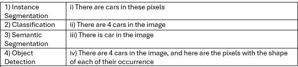

**Figure 6.** Source matching table for Question 279.

| Computer Vision Task | Situation |
| :--- | :--- |
| 1) Instance Segmentation | i) There are cars in these pixels |
| 2) Classification | ii) There are 4 cars in the image |
| 3) Semantic Segmentation | iii) There is car in the image |
| 4) Object Detection | iv) There are 4 cars in the image, and here are the pixels with the shape of each of their occurrence |

**Options**

**A.** 1→ iv, 2→ iii, 3→ ii, 4 → i  
*Option ID:* `6406533045086`

**B.** 1→ ii, 2→ iii, 3 → i, 4 →iv  
*Option ID:* `6406533045087`

**C.** 1→ iv, 2→ iii, 3→ i, 4 → ii  
*Option ID:* `6406533045088`

**D.** 1→ ii, 2→ iv, 3 → iii, 4→ i  
*Option ID:* `6406533045089`

**Correct answer:** **C** — 1→ iv, 2→ iii, 3→ i, 4 → ii

**Worked explanation:** Classification assigns an image-level label; detection localizes distinct objects. Semantic segmentation assigns a class per pixel, while instance segmentation also separates objects of the same class.

### da5006_2026T1_ET_FN · Q14 · 2 marks · ID 6406532136829

Which statement is correct ?

**Options**

**A.** Semantic segmentation separates individual object instances.  
*Option ID:* `6406536959525`

**B.** Instance segmentation distinguishes different object instances of the same class.  
*Option ID:* `6406536959526`

**C.** Both are identical tasks.  
*Option ID:* `6406536959527`

**D.** Neither predicts labels per pixel.  
*Option ID:* `6406536959528`

**Correct answer:** **B** — Instance segmentation distinguishes different object instances of the same class..

**Worked explanation:** Classification assigns an image-level label; detection localizes distinct objects. Semantic segmentation assigns a class per pixel, while instance segmentation also separates objects of the same class.

### da5006_2026T2_ET_FN · Q16 · 2 marks · ID 6406532270055

For semantic image segmentation with $C$ classes, the model output before the final class decision is naturally organized as:

**Options**

**A.** One $C$-dimensional vector for the entire image only  
*Option ID:* `6406537379059`

**B.** A spatial grid with $C$ class scores at each output location  
*Option ID:* `6406537379060`

**C.** One bounding box for each of the $C$ classes  
*Option ID:* `6406537379061`

**D.** A sequence with one recurrent state per class and no spatial layout  
*Option ID:* `6406537379062`

**Correct answer:** **B** — A spatial grid with $C$ class scores at each output location.

**Worked explanation:** Classification assigns an image-level label; detection localizes distinct objects. Semantic segmentation assigns a class per pixel, while instance segmentation also separates objects of the same class.

### da5006_2024T1_Q2_NA · Q159 · 2 marks · ID 640653766155

Match the following computer vision tasks to situations:

| Computer Vision Task | Situation |
| :--- | :--- |
| 1) Instance Segmentation | i) There are cars in these pixels |
| 2) Classification | ii) There are 4 cars in the image |
| 3) Semantic Segmentation | iii) There is car in the image |
| 4) Object Detection | iv) There are 4 cars in the image, and here are the pixels with the shape of each of their occurrence |

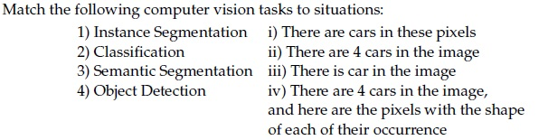

**Figure 7.** Source matching table for Question 159.

**Options**

**A.** 1→ iv, 2→ iii, 3→ ii, 4 → i  
*Option ID:* `6406532564195`

**B.** 1→ ii, 2→ iii, 3 → i, 4 →iv  
*Option ID:* `6406532564196`

**C.** 1→ iv, 2→ iii, 3→ i, 4 → ii  
*Option ID:* `6406532564197`

**D.** 1→ ii, 2→ iv, 3 → iii, 4→ i  
*Option ID:* `6406532564198`

**Correct answer:** **C** — 1→ iv, 2→ iii, 3→ i, 4 → ii

**Worked explanation:** Classification assigns an image-level label; detection localizes distinct objects. Semantic segmentation assigns a class per pixel, while instance segmentation also separates objects of the same class.

### da5006_2024T2_Q2_NA · Q130 · 2 marks · ID 640653856605

Match the following computer vision tasks to situations:

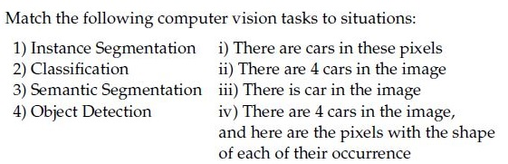

**Figure 8.** Matching table for Question 130.

| Computer vision task | Situation |
| :--- | :--- |
| 1) Instance Segmentation | i) There are cars in these pixels |
| 2) Classification | ii) There are 4 cars in the image |
| 3) Semantic Segmentation | iii) There is car in the image |
| 4) Object Detection | iv) There are 4 cars in the image, and here are the pixels with the shape of each of their occurrence |

**Options**

**A.** 1→ iv, 2→ iii, 3→ ii, 4 → i  
*Option ID:* `6406532878529`

**B.** 1→ ii, 2→ iii, 3 → i, 4 →iv  
*Option ID:* `6406532878530`

**C.** 1→ iv, 2→ iii, 3→ i, 4 → ii  
*Option ID:* `6406532878531`

**D.** 1→ ii, 2→ iv, 3 → iii, 4→ i  
*Option ID:* `6406532878532`

**Correct answer:** **C** — 1→ iv, 2→ iii, 3→ i, 4 → ii.

**Worked explanation:** Classification assigns an image-level label; detection localizes distinct objects. Semantic segmentation assigns a class per pixel, while instance segmentation also separates objects of the same class.

### da5006_2024T3_Q2_NA · Q147 · 2 marks · ID 6406531031083

Match the following computer vision tasks to situations:

| Task | Situation |
| :--- | :--- |
| 1) Instance Segmentation | i) There are cars in these pixels |
| 2) Classification | ii) There are 4 cars in the image |
| 3) Semantic Segmentation | iii) There is car in the image |
| 4) Object Detection | iv) There are 4 cars in the image, and here are the pixels with the shape of each of their occurrence |

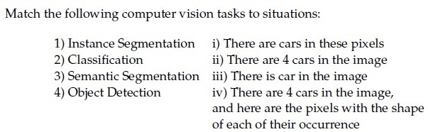

**Figure 9.** Computer vision tasks and situations matching table for Question 147.

**Options**

**A.** 1→ iv, 2→ iii, 3→ ii, 4 → i  
*Option ID:* `6406533487253`

**B.** 1→ ii, 2→ iii, 3 → i, 4 →iv  
*Option ID:* `6406533487254`

**C.** 1→ iv, 2→ iii, 3→ i, 4 → ii  
*Option ID:* `6406533487255`

**D.** 1→ ii, 2→ iv, 3 → iii, 4→ i  
*Option ID:* `6406533487256`

**Correct answer:** **C** — 1→ iv, 2→ iii, 3→ i, 4 → ii

**Worked explanation:** Classification assigns an image-level label; detection localizes distinct objects. Semantic segmentation assigns a class per pixel, while instance segmentation also separates objects of the same class.

### da5006_2025T1_Q2_NA · Q250 · 2 marks · ID 6406531168224

Match the following computer vision tasks to situations:

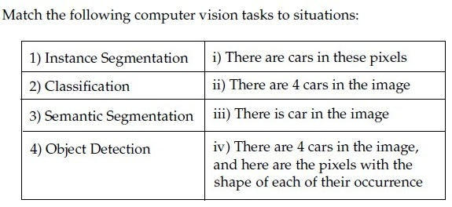

**Figure 10.** Source table for Question 250.

| Column 1 | Column 2 |
| :--- | :--- |
| 1) Instance Segmentation | i) There are cars in these pixels |
| 2) Classification | ii) There are 4 cars in the image |
| 3) Semantic Segmentation | iii) There is car in the image |
| 4) Object Detection | iv) There are 4 cars in the image, and here are the pixels with the shape of each of their occurrence |

**Options**

**A.** 1→ iv, 2→ iii, 3→ ii, 4 → i  
*Option ID:* `6406533939976`

**B.** 1→ ii, 2→ iii, 3 → i, 4 →iv  
*Option ID:* `6406533939977`

**C.** 1→ iv, 2→ iii, 3→ i, 4 → ii  
*Option ID:* `6406533939978`

**D.** 1→ ii, 2→ iv, 3 → iii, 4→ i  
*Option ID:* `6406533939979`

**Correct answer:** **C** — 1→ iv, 2→ iii, 3→ i, 4 → ii.

**Worked explanation:** Classification assigns an image-level label; detection localizes distinct objects. Semantic segmentation assigns a class per pixel, while instance segmentation also separates objects of the same class.

### da5006_2025T2_Q2_NA · Q242 · 2 marks · ID 6406531333793

Match the following computer vision tasks to situations:

| Tasks | Situations |
| :--- | :--- |
| 1) Instance Segmentation | i) There are cars in these pixels |
| 2) Classification | ii) There are 4 cars in the image |
| 3) Semantic Segmentation | iii) There is car in the image |
| 4) Object Detection | iv) There are 4 cars in the image, and here are the pixels with the shape of each of their occurrence |

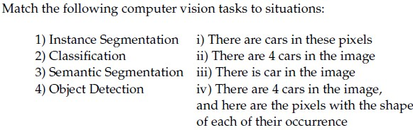

**Figure 11.** Matching table for Question 242.

**Options**

**A.** 1 -> iv, 2 -> iii, 3 -> ii, 4 -> i

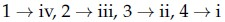

**Figure 12.** Option A for Question 242.  
*Option ID:* `6406534459614`

**B.** 1 -> ii, 2 -> iii, 3 -> i, 4 -> iv

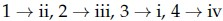

**Figure 13.** Option B for Question 242.  
*Option ID:* `6406534459615`

**C.** 1 -> iv, 2 -> iii, 3 -> i, 4 -> ii

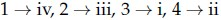

**Figure 14.** Option C for Question 242.  
*Option ID:* `6406534459616`

**D.** 1 -> i, 2 -> iii, 3 -> iv, 4 -> ii

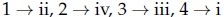

**Figure 15.** Option D for Question 242.  
*Option ID:* `6406534459617`

**Correct answer:** **C** — 1 -> iv, 2 -> iii, 3 -> i, 4 -> ii

**Worked explanation:** Classification assigns an image-level label; detection localizes distinct objects. Semantic segmentation assigns a class per pixel, while instance segmentation also separates objects of the same class.

### da5006_2025T3_Q2_NA · Q138 · 2 marks · ID 6406531815730

Match the following computer vision tasks to situations:

| Task | Situation |
| :--- | :--- |
| 1) Instance Segmentation | i) There are cars in these pixels |
| 2) Classification | ii) There are 4 cars in the image |
| 3) Semantic Segmentation | iii) There is car in the image |
| 4) Object Detection | iv) There are 4 cars in the image, and here are the pixels with the shape of each of their occurrence |

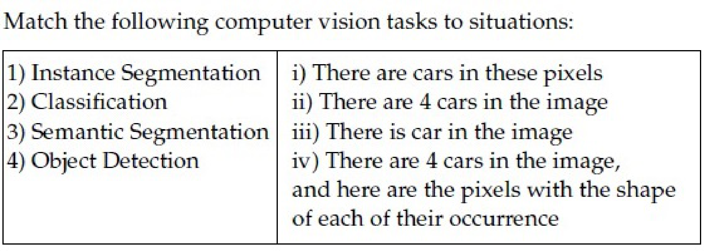

**Figure 16.** Computer vision tasks matching table for Question 138.

**Options**

**A.** 1 → iv, 2 → iii, 3 → ii, 4 → i  
*Option ID:* `6406535903115`

**B.** 1 → ii, 2 → iii, 3 → i, 4 →iv  
*Option ID:* `6406535903116`

**C.** 1 → iv, 2→ iii, 3 → i, 4 → ii  
*Option ID:* `6406535903117`

**D.** 1 → ii, 2 → iv, 3 → iii, 4 → i  
*Option ID:* `6406535903118`

**Correct answer:** **C** — 1 → iv, 2→ iii, 3 → i, 4 → ii.

**Worked explanation:** Classification assigns an image-level label; detection localizes distinct objects. Semantic segmentation assigns a class per pixel, while instance segmentation also separates objects of the same class.

### da5006_2026T1_Q2_NA · Q13 · 1 marks · ID 6406532040100

A model that predicts a class label for every pixel without separating object instances is:

**Options**

**A.** Panoptic segmentation  
*Option ID:* `6406536642529`

**B.** Instance segmentation  
*Option ID:* `6406536642530`

**C.** Semantic segmentation  
*Option ID:* `6406536642531`

**D.** Image matting  
*Option ID:* `6406536642532`

**Correct answer:** **C** — Semantic segmentation.

**Worked explanation:** Classification assigns an image-level label; detection localizes distinct objects. Semantic segmentation assigns a class per pixel, while instance segmentation also separates objects of the same class.

### da5006_2026T2_Q2_NA · Q9 · 1 marks · ID 6406532194392

A model that predicts a class label for every pixel without separating object instances is:

**Options**

**A.** Object detection  
*Option ID:* `6406537126062`

**B.** Instance segmentation  
*Option ID:* `6406537126063`

**C.** Semantic segmentation  
*Option ID:* `6406537126064`

**D.** Captioning  
*Option ID:* `6406537126065`

**Correct answer:** **C** — Semantic segmentation.

**Worked explanation:** Classification assigns an image-level label; detection localizes distinct objects. Semantic segmentation assigns a class per pixel, while instance segmentation also separates objects of the same class.

## Topic: SegNet encoder-decoder segmentation

| Done | Paper | Q# | Marks | Type |
| :---: | :--- | ---: | ---: | :--- |
| [ ] | da5006_2025T2_ET_FN | 164 | 2 | MCQ |

### da5006_2025T2_ET_FN · Q164 · 2 marks · ID 6406531422543

Consider the Upsampling stage in Segnet architecture given below:

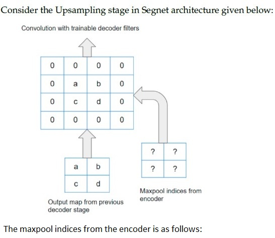

**Figure 17.** Question 164, source diagram of SegNet upsampling stage.

The maxpool indices from the encoder is as follows:

**Options**

**A.** 11 10
01 11  
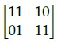
**Figure 18.** Option A image for Question 164.
*Option ID:* `6406534756388`

**B.** 11 01
10 00  
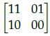
**Figure 19.** Option B image for Question 164.
*Option ID:* `6406534756389`

**C.** 11 01
10 11  
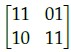
**Figure 20.** Option C image for Question 164.
*Option ID:* `6406534756390`

**D.** 11 10
01 00  
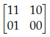
**Figure 21.** Option D image for Question 164.
*Option ID:* `6406534756391`

**Correct answer:** **D** — 11 10
01 00.

**Worked explanation:** Max pooling records the location of each maximum in its pooling window. The decoder places each pooled value at that saved location and fills the remaining positions with zeros before convolution.

## Topic: Optical flow and image registration

| Done | Paper | Q# | Marks | Type |
| :---: | :--- | ---: | ---: | :--- |
| [ ] | da5006_2024T2_ET_AN | 256 | 2 | MCQ |

### da5006_2024T2_ET_AN · Q256 · 2 marks · ID 640653904310

Which one of the following distance measures is used to compare two images in dense registration through optical flow?

**Options**

**A.** Weighted squared difference  
*Option ID:* `6406533045051`

**B.** Weighted absolute difference  
*Option ID:* `6406533045052`

**C.** KL divergence  
*Option ID:* `6406533045053`

**D.** Cosine similarity  
*Option ID:* `6406533045054`

**Correct answer:** **A** — Weighted squared difference

**Worked explanation:** A registration objective can sum spatially weighted squared intensity differences after warping the second image. The weighting and brightness assumptions define this particular objective; other distances are possible.
