# Week 7 question bank

> [!WARNING] Incomplete working extraction: worked explanations and independent answer checks have not yet been completed. Do not treat this file as a verified answer guide.

Topics inferred from past papers; replace when the official syllabus is available.

**Questions:** 133 · **Quiz 2:** 117 · **End term:** 16 · **Total marks:** 184.5

## Topic: Recurrent networks and sequence architectures

| Done | Paper | Q# | Marks | Type |
| :---: | :--- | ---: | ---: | :--- |
| ☐ | da5006_2024T3_ET_AN | 203 | 2 | Multiple Choice Question (MCQ) |
| ☐ | da5006_2025T2_ET_AN | 95 | 2 | MCQ |
| ☐ | da5006_2026T2_ET_FN | 35 | 4 | SA |
| ☐ | da5006_2024T3_Q2_NA | 148 | 2 | MCQ |
| ☐ | da5006_2024T3_Q2_NA | 153 | 2 | Short Answer |
| ☐ | da5006_2024T3_Q2_NA | 154 | 2 | Short Answer |
| ☐ | da5006_2024T3_Q2_NA | 155 | 2 | Short Answer |
| ☐ | da5006_2024T3_Q2_NA | 156 | 2 | Short Answer |
| ☐ | da5006_2024T3_Q2_NA | 157 | 2 | Short Answer |
| ☐ | da5006_2025T1_Q2_NA | 251 | 2 | MCQ |
| ☐ | da5006_2025T1_Q2_NA | 258 | 2 | MSQ |
| ☐ | da5006_2025T1_Q2_NA | 274 | 1.2 | SA |
| ☐ | da5006_2025T1_Q2_NA | 275 | 1.2 | SA |
| ☐ | da5006_2025T1_Q2_NA | 276 | 1.2 | SA |
| ☐ | da5006_2025T1_Q2_NA | 277 | 1.2 | SA |
| ☐ | da5006_2025T1_Q2_NA | 278 | 1.2 | SA |
| ☐ | da5006_2025T2_Q2_NA | 243 | 2 | MCQ |
| ☐ | da5006_2025T2_Q2_NA | 265 | 0.8 | SA |
| ☐ | da5006_2025T2_Q2_NA | 266 | 0.8 | SA |
| ☐ | da5006_2025T2_Q2_NA | 267 | 0.8 | SA |
| ☐ | da5006_2025T2_Q2_NA | 268 | 0.8 | SA |
| ☐ | da5006_2025T2_Q2_NA | 269 | 0.8 | SA |
| ☐ | da5006_2025T3_Q2_NA | 139 | 2 | Multiple Choice Question |
| ☐ | da5006_2025T3_Q2_NA | 160 | 1 | Short Answer |
| ☐ | da5006_2025T3_Q2_NA | 161 | 1 | Short Answer |
| ☐ | da5006_2025T3_Q2_NA | 162 | 1 | Short Answer |
| ☐ | da5006_2025T3_Q2_NA | 163 | 0.5 | Short Answer |
| ☐ | da5006_2025T3_Q2_NA | 164 | 0.5 | Short Answer |

### da5006_2024T3_ET_AN · Q203 · 2 marks · ID 6406531046060

**Question ID:** `6406531046060` · **Type:** Multiple Choice Question (MCQ) · **Marks:** 2  
**PDF pages:** 4

Consider the following unrolled RNN:

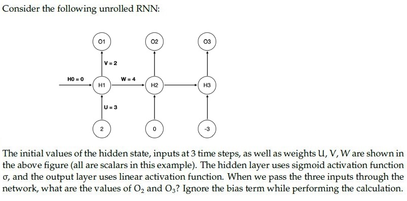
**Figure 1.** Unrolled recurrent neural network architecture for Question 203.

The initial values of the hidden state, inputs at 3 time steps, as well as weights $U, V, W$ are shown in the above figure (all are scalars in this example). The hidden layer uses sigmoid activation function $\sigma$, and the output layer uses linear activation function. When we pass the three inputs through the network, what are the values of $O_2$ and $O_3$? Ignore the bias term while performing the calculation.

**Options**

**A.** $8 \times \sigma(6), 2\sigma(4 \times \sigma(6) - 9)$  
*Option ID:* `6406533531359`

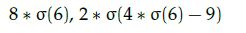
**Figure 2.** Question 203 Option A diagram.

**B.** $2\sigma(4 \times \sigma(6)), 2 \times \sigma(4 \times \sigma(4 \times \sigma(6)) - 9)$  
*Option ID:* `6406533531360`

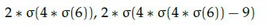
**Figure 3.** Question 203 Option B diagram.

**C.** $2 \times \sigma(6), 2 \times \sigma(4 \times \sigma(6) - 9)$  
*Option ID:* `6406533531361`

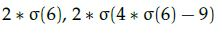
**Figure 4.** Question 203 Option C diagram.

**D.** $8 \times \sigma(6), \sigma(4 \times \sigma(6) - 9)$  
*Option ID:* `6406533531362`

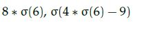
**Figure 5.** Question 203 Option D diagram.

**Correct answer:** **B** — $2\sigma(4 \times \sigma(6)), 2 \times \sigma(4 \times \sigma(4 \times \sigma(6)) - 9)$.  
**Source evidence:** Option ID 6406533531360 is highlighted in green with a checkmark icon.

**Worked explanation:** The recurrence is $h_t=\sigma(3x_t+4h_{t-1})$ and $O_t=2h_t$, so $h_1=\sigma(6)$ and $h_2=\sigma(4\sigma(6))$.  
The third input gives $h_3=\sigma(4h_2-9)$, yielding B; C omits a recurrent step.

### da5006_2025T2_ET_AN · Q95 · 2 marks · ID 6406531431355

**Question ID:** `6406531431355` · **Type:** MCQ · **Marks:** 2  
**PDF pages:** 6

In which one of the following applications would you use a many- to-one RNN architecture? Choose the most appropriate answer.

**Options**

**A.** Input is a review of a movie and output is the sentiment of the given review  
*Option ID:* `6406534780293`

**B.** Input is an image and output is the textual description of the given image  
*Option ID:* `6406534780294`

**C.** Input is an image and output is the class to which the given image belongs  
*Option ID:* `6406534780295`

**D.** Input is a sentence in English language and output is the same sentence translated to Hindi language  
*Option ID:* `6406534780296`

**Correct answer:** **A** — Input is a review of a movie and output is the sentiment of the given review.  
**Source evidence:** Option A (6406534780293) rendered in green font (#008000) indicating the officially accepted answer in the source key. (PDF page 6).

**Worked explanation:** A review is a sequence of words mapped to one sentiment label, so A is many-to-one.  
Captioning in B instead generates a sequence from an image.

### da5006_2026T2_ET_FN · Q35 · 4 marks · ID 6406532270074

**Question ID:** `6406532270074` · **Type:** SA · **Marks:** 4  
**PDF pages:** 12

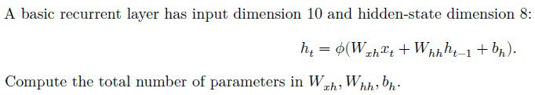

**Figure 6.** Source recurrent layer formulation for Question 35.

A basic recurrent layer has input dimension 10 and hidden-state dimension 8:
$$h_t = \sigma(W_{xh} x_t + W_{hh} h_{t-1} + b_h).$$
Compute the total number of parameters in $W_{xh}$, $W_{hh}$, $b_h$.

**Correct answer:** `152`  
**Source evidence:** Official text specification: 'Possible Answers : 152' on PDF page 12.

**Worked explanation:** $W_{xh}$ has $8\times10=80$ entries, $W_{hh}$ has $8\times8=64$, and $b_h$ has 8.  
The total is $80+64+8=152$; shared weights are counted once.

### da5006_2024T3_Q2_NA · Q148 · 2 marks · ID 6406531031085

**Question ID:** `6406531031085` · **Type:** MCQ · **Marks:** 2  
**PDF pages:** 8

Match the following:

| Architecture | Application |
| :--- | :--- |
| 1) One-to-many RNN architecture | i) Sentiment analysis of Netflix reviews |
| 2) Many-to-one RNN architecture | ii) Convert English sentence to Hindi |
| 3) Many-to-many RNN architecture with equal number of inputs and outputs | iii) Named entity recognition |
| 4) Many-to-many RNN architecture with unequal number of inputs and outputs (Encoder and Decoder model) | iv) Music generation |

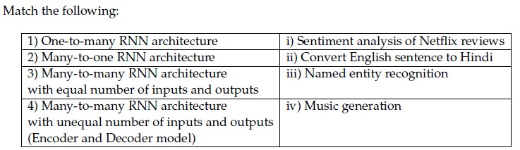

**Figure 7.** Recurrent neural network architectures matching table for Question 148.

**Options**

**A.** 1→ iii, 2→ iv, 3→ ii, 4 → i  
*Option ID:* `6406533487261`

**B.** 1→ iv, 2→ i, 3 → iii, 4→ ii  
*Option ID:* `6406533487262`

**C.** 1→ i, 2→ ii, 3 → iii, 4→ iv  
*Option ID:* `6406533487263`

**D.** 1→ i, 2→ iii, 3 → ii, 4→ iv  
*Option ID:* `6406533487264`

**Correct answer:** **B** — 1→ iv, 2→ i, 3 → iii, 4→ ii  
**Source evidence:** Green check icon and green text on Option ID `6406533487262`, PDF page 8.

**Worked explanation:** One-to-many can generate music, many-to-one predicts sentiment, aligned many-to-many labels each token, and encoder–decoder translation can change length.  
Hence B gives iv, i, iii, ii; A incorrectly assigns named-entity recognition to one-to-many.

### da5006_2024T3_Q2_NA · Q153 · 2 marks · ID 6406531031088

**Question ID:** `6406531031088` · **Type:** Short Answer · **Marks:** 2  
**PDF pages:** 10, 11, 12

**Context:** The RNN given below is used for classification:

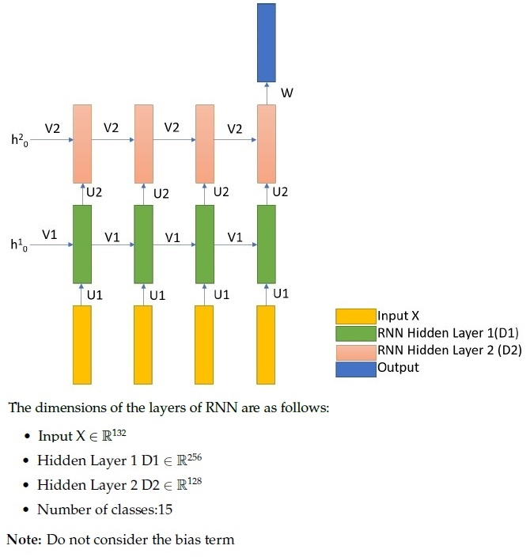

**Figure 8.** Two-layer RNN architecture diagram and layer dimensions for Questions 153 to 157.

The dimensions of the layers of RNN are as follows:
- Input $X \in \mathbb{R}^{132}$
- Hidden Layer 1 $D1 \in \mathbb{R}^{256}$
- Hidden Layer 2 $D2 \in \mathbb{R}^{128}$
- Number of classes: 15
Note: Do not consider the bias term.

Based on the above data, answer the given subquestion.

Number of weights in Weight Matrix U1 is: ______________

**Correct answer:** `33792`  
**Source evidence:** Green text `33792` under Possible Answers, PDF page 12.

**Worked explanation:** The input to first hidden layer matrix $U_1$ has shape `[256, 132]`.  
With biases excluded, its entry count is $256\times 132=33792$; shared copies across time are not counted again.

### da5006_2024T3_Q2_NA · Q154 · 2 marks · ID 6406531031089

**Question ID:** `6406531031089` · **Type:** Short Answer · **Marks:** 2  
**PDF pages:** 10, 11, 12

**Context:** Refer to the RNN specifications and diagram in Question 153.

Based on the above data, answer the given subquestion.

Number of weights in Weight Matrix V1 is: ______________

**Correct answer:** `65536`  
**Source evidence:** Green text `65536` under Possible Answers, PDF page 12.

**Worked explanation:** The first hidden state to itself matrix $V_1$ has shape `[256, 256]`.  
With biases excluded, its entry count is $256\times 256=65536$; shared copies across time are not counted again.

### da5006_2024T3_Q2_NA · Q155 · 2 marks · ID 6406531031090

**Question ID:** `6406531031090` · **Type:** Short Answer · **Marks:** 2  
**PDF pages:** 10, 11, 12

**Context:** Refer to the RNN specifications and diagram in Question 153.

Based on the above data, answer the given subquestion.

Number of weights in Weight Matrix U2 is: ______________

**Correct answer:** `32768`  
**Source evidence:** Green text `32768` under Possible Answers, PDF page 12.

**Worked explanation:** The first to second hidden layer matrix $U_2$ has shape `[128, 256]`.  
With biases excluded, its entry count is $128\times 256=32768$; shared copies across time are not counted again.

### da5006_2024T3_Q2_NA · Q156 · 2 marks · ID 6406531031091

**Question ID:** `6406531031091` · **Type:** Short Answer · **Marks:** 2  
**PDF pages:** 10, 11, 12

**Context:** Refer to the RNN specifications and diagram in Question 153.

Based on the above data, answer the given subquestion.

Number of weights in Weight Matrix V2 is: ______________

**Correct answer:** `16384`  
**Source evidence:** Green text `16384` under Possible Answers, PDF page 12.

**Worked explanation:** The second hidden state to itself matrix $V_2$ has shape `[128, 128]`.  
With biases excluded, its entry count is $128\times 128=16384$; shared copies across time are not counted again.

### da5006_2024T3_Q2_NA · Q157 · 2 marks · ID 6406531031092

> [!NOTE] Week assignment uncertain: The stem and answer are truncated; the shared context concerns RNN weight matrices.

**Question ID:** `6406531031092` · **Type:** Short Answer · **Marks:** 2  
**PDF pages:** 10, 11, 12

**Context:** Refer to the RNN specifications and diagram in Question 153.

Based on the above data, answer the given subquestion.

[Question text truncated in source PDF: The source exam export terminates at the bottom of physical page 12 directly after 'Correct Marks : 2'. Stem text, question label, text areas, and official possible answers are cut off in the source document.]

**Correct answer:** **Answer not verifiable from the source PDF**  
**Source evidence:** Physical page 12 bottom margin terminates at y=814.03 immediately after `Correct Marks : 2`. Stem and possible answers are truncated in source document.

**Worked explanation:** The actual subquestion and its official answer were truncated in the source.  
Even though adjacent items concern weight matrices, the requested matrix cannot be determined reliably; no derived answer is possible.

### da5006_2025T1_Q2_NA · Q251 · 2 marks · ID 6406531168225

**Question ID:** `6406531168225` · **Type:** MCQ · **Marks:** 2  
**PDF pages:** 4, 5

Match the following:

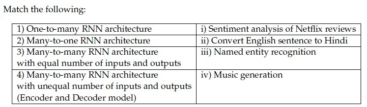

**Figure 9.** Source table for Question 251.

| Column 1 | Column 2 |
| :--- | :--- |
| 1) One-to-many RNN architecture | i) Sentiment analysis of Netflix reviews |
| 2) Many-to-one RNN architecture | ii) Convert English sentence to Hindi |
| 3) Many-to-many RNN architecture with equal number of inputs and outputs | iii) Named entity recognition |
| 4) Many-to-many RNN architecture with unequal number of inputs and outputs (Encoder and Decoder model) | iv) Music generation |

**Options**

**A.** 1→ iii, 2→ iv, 3→ ii, 4 → i  
*Option ID:* `6406533939980`

**B.** 1→ iv, 2→ i, 3 → iii, 4→ ii  
*Option ID:* `6406533939981`

**C.** 1→ i, 2→ ii, 3 → iii, 4→ iv  
*Option ID:* `6406533939982`

**D.** 1→ i, 2→ iii, 3 → ii, 4→ iv  
*Option ID:* `6406533939983`

**Correct answer:** **B** — 1→ iv, 2→ i, 3 → iii, 4→ ii.  
**Source evidence:** Option 6406533939981 marked with green checkmark icon and green text (color 0x8000), PDF page 5.

**Worked explanation:** One-to-many can generate music, many-to-one predicts sentiment, aligned many-to-many labels each token, and encoder–decoder translation can change length.  
Hence B gives iv, i, iii, ii; A incorrectly assigns named-entity recognition to one-to-many.

### da5006_2025T1_Q2_NA · Q258 · 2 marks · ID 6406531168228

**Question ID:** `6406531168228` · **Type:** MSQ · **Marks:** 2  
**PDF pages:** 8

Which of the following statements is True (select all that apply):

**Options**

**A.** The number of learnable parameters in an RNN grows exponentially with input sequence length considered  
*Option ID:* `6406533939992`

**B.** Long sentences give rise to the vanishing gradient problem  
*Option ID:* `6406533939993`

**C.** Electrocardiogram signal classification is a sequence learning problem  
*Option ID:* `6406533939994`

**D.** RNNs can have more than one hidden layer  
*Option ID:* `6406533939995`

**Correct answer:** **B**, **C**, **D**  
**Source evidence:** Options 6406533939993, 6406533939994, and 6406533939995 marked with green checkmark icons and green text (color 0x8000), PDF page 8.

**Worked explanation:** Long recurrent paths can produce vanishing gradients; an ECG is a time series and RNN layers can be stacked.  
Thus B, C and D are true; A is false because recurrent weights are shared across time.

### da5006_2025T1_Q2_NA · Q274 · 1.2 marks · ID 6406531168252

**Question ID:** `6406531168252` · **Type:** SA · **Marks:** 1.2  
**PDF pages:** 15, 16

**Comprehension Context (Questions 274–278):**

> The RNN given below is used for classification:
>
> 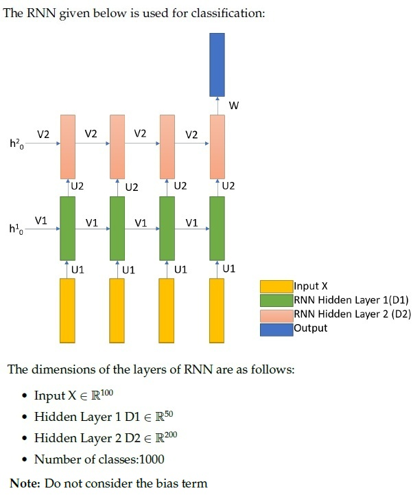
>
> **Figure 10.** Multi-layer RNN architecture diagram for Comprehension Context 4 (Questions 274–278).
>
> The dimensions of the layers of RNN are as follows:
> - Input $x \in \mathbb{R}^{100}$
> - Hidden Layer 1 $D_1 \in \mathbb{R}^{50}$
> - Hidden Layer 2 $D_2 \in \mathbb{R}^{200}$
> - Number of classes: 1000
>
> Note: Do not consider the bias term
>
> Based on the above data, answer the given subquestions.

Number of weights in Weight Matrix U1 is: ______________

**Correct answer:** `5000`  
**Source evidence:** Official answer '5000' in Possible Answers field with green text (color 0x8000), PDF page 16.

**Worked explanation:** The input to first hidden layer matrix $U_1$ has shape `[50, 100]`.  
With biases excluded, its entry count is $50\times 100=5000$; shared copies across time are not counted again.

### da5006_2025T1_Q2_NA · Q275 · 1.2 marks · ID 6406531168253

**Question ID:** `6406531168253` · **Type:** SA · **Marks:** 1.2  
**PDF pages:** 16

Number of weights in Weight Matrix V1 is: _______________

**Correct answer:** `2500`  
**Source evidence:** Official answer '2500' in Possible Answers field with green text (color 0x8000), PDF page 16.

**Worked explanation:** The first hidden state to itself matrix $V_1$ has shape `[50, 50]`.  
With biases excluded, its entry count is $50\times 50=2500$; shared copies across time are not counted again.

### da5006_2025T1_Q2_NA · Q276 · 1.2 marks · ID 6406531168254

**Question ID:** `6406531168254` · **Type:** SA · **Marks:** 1.2  
**PDF pages:** 16

Number of weights in Weight Matrix U2 is: ________________

**Correct answer:** `10000`  
**Source evidence:** Official answer '10000' in Possible Answers field with green text (color 0x8000), PDF page 16.

**Worked explanation:** The first to second hidden layer matrix $U_2$ has shape `[200, 50]`.  
With biases excluded, its entry count is $200\times 50=10000$; shared copies across time are not counted again.

### da5006_2025T1_Q2_NA · Q277 · 1.2 marks · ID 6406531168255

**Question ID:** `6406531168255` · **Type:** SA · **Marks:** 1.2  
**PDF pages:** 16

Number of weights in Weight Matrix V2 is: ______________

**Correct answer:** `40000`  
**Source evidence:** Official answer '40000' in Possible Answers field with green text (color 0x8000), PDF page 16.

**Worked explanation:** The second hidden state to itself matrix $V_2$ has shape `[200, 200]`.  
With biases excluded, its entry count is $200\times 200=40000$; shared copies across time are not counted again.

### da5006_2025T1_Q2_NA · Q278 · 1.2 marks · ID 6406531168256

**Question ID:** `6406531168256` · **Type:** SA · **Marks:** 1.2  
**PDF pages:** 16, 17

Number of weights in Weight Matrix W is: ________________

**Correct answer:** `200000`  
**Source evidence:** Official answer '200000' in Possible Answers field with green text (color 0x8000), PDF page 17.

**Worked explanation:** The second hidden state to class scores matrix $W$ has shape `[1000, 200]`.  
With biases excluded, its entry count is $1000\times 200=200000$; shared copies across time are not counted again.

### da5006_2025T2_Q2_NA · Q243 · 2 marks · ID 6406531333794

**Question ID:** `6406531333794` · **Type:** MCQ · **Marks:** 2  
**PDF pages:** 5

Match the following:

| Architectures | Applications |
| :--- | :--- |
| 1) One-to-many RNN architecture | i) Sentiment analysis |
| 2) Many-to-one RNN architecture | ii) Machine translation |
| 3) Many-to-many RNN architecture with equal number of inputs and outputs | iii) Named entity recognition |
| 4) Many-to-many RNN architecture with unequal number of inputs and outputs (Encoder and Decoder model) | iv) Music generation / Image captioning |

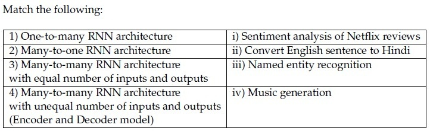

**Figure 11.** Matching table for Question 243.

**Options**

**A.** 1 -> iii, 2 -> iv, 3 -> ii, 4 -> i

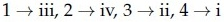

**Figure 12.** Option A for Question 243.  
*Option ID:* `6406534459618`

**B.** 1 -> iv, 2 -> i, 3 -> iii, 4 -> ii

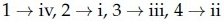

**Figure 13.** Option B for Question 243.  
*Option ID:* `6406534459619`

**C.** 1 -> i, 2 -> ii, 3 -> iii, 4 -> iv

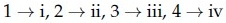

**Figure 14.** Option C for Question 243.  
*Option ID:* `6406534459620`

**D.** 1 -> ii, 2 -> iv, 3 -> i, 4 -> iii

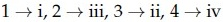

**Figure 15.** Option D for Question 243.  
*Option ID:* `6406534459621`

**Correct answer:** **B** — 1 -> iv, 2 -> i, 3 -> iii, 4 -> ii  
**Source evidence:** Green option ID text 6406534459619 on PDF page 5 with green check icon at [119.02, 432.71, 131.02, 444.71].

**Worked explanation:** One-to-many can generate music, many-to-one predicts sentiment, aligned many-to-many labels each token, and encoder–decoder translation can change length.  
Hence B gives iv, i, iii, ii; A incorrectly assigns named-entity recognition to one-to-many.

### da5006_2025T2_Q2_NA · Q265 · 0.8 marks · ID 6406531333821

**Question ID:** `6406531333821` · **Type:** SA · **Marks:** 0.8  
**PDF pages:** 14, 15

**Comprehension:**

The RNN given below is used for classification:

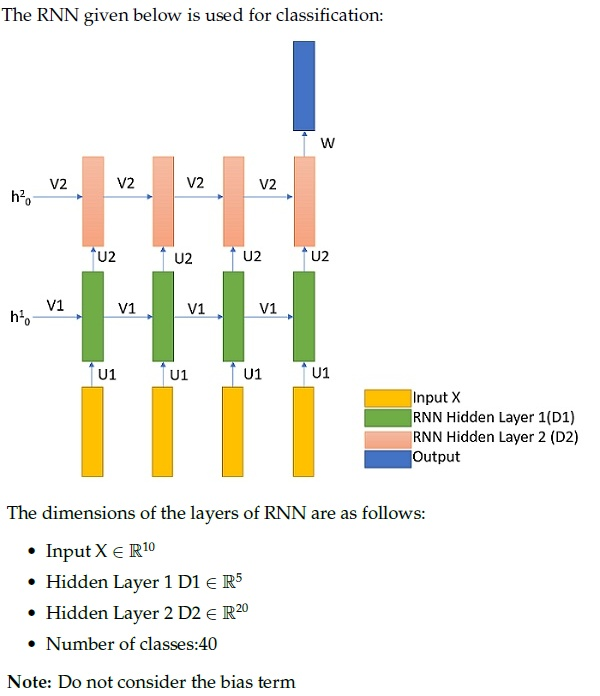

**Figure 16.** 2-layer RNN classification architecture for Passage 5 (Questions 265–269).

The dimensions of the layers of RNN are as follows:
- Input $X \in \mathbb{R}^{10}$
- Hidden Layer 1 $D_1 \in \mathbb{R}^5$
- Hidden Layer 2 $D_2 \in \mathbb{R}^{20}$
- Number of classes: 40

Note: Do not consider the bias term.

Based on the above data, answer the given subquestions.

Number of weights in Weight Matrix U1 is:_______________

**Correct answer:** `50`  
**Source evidence:** Official answer '50' in Possible Answers field on PDF page 15 with green text.

**Worked explanation:** The input to first hidden layer matrix $U_1$ has shape `[5, 10]`.  
With biases excluded, its entry count is $5\times 10=50$; shared copies across time are not counted again.

### da5006_2025T2_Q2_NA · Q266 · 0.8 marks · ID 6406531333822

**Question ID:** `6406531333822` · **Type:** SA · **Marks:** 0.8  
**PDF pages:** 15

**Comprehension:**

The RNN given below is used for classification:
The dimensions of the layers of RNN are as follows:
- Input $X \in \mathbb{R}^{10}$
- Hidden Layer 1 $D_1 \in \mathbb{R}^5$
- Hidden Layer 2 $D_2 \in \mathbb{R}^{20}$
- Number of classes: 40
Note: Do not consider the bias term. *(Refer to Figure 32 in Question 265).*

Based on the above data, answer the given subquestions.

Number of weights in Weight Matrix V1 is:_______________

**Correct answer:** `25`  
**Source evidence:** Official answer '25' in Possible Answers field on PDF page 15 with green text.

**Worked explanation:** The first hidden state to itself matrix $V_1$ has shape `[5, 5]`.  
With biases excluded, its entry count is $5\times 5=25$; shared copies across time are not counted again.

### da5006_2025T2_Q2_NA · Q267 · 0.8 marks · ID 6406531333823

**Question ID:** `6406531333823` · **Type:** SA · **Marks:** 0.8  
**PDF pages:** 15

**Comprehension:**

The RNN given below is used for classification:
The dimensions of the layers of RNN are as follows:
- Input $X \in \mathbb{R}^{10}$
- Hidden Layer 1 $D_1 \in \mathbb{R}^5$
- Hidden Layer 2 $D_2 \in \mathbb{R}^{20}$
- Number of classes: 40
Note: Do not consider the bias term. *(Refer to Figure 32 in Question 265).*

Based on the above data, answer the given subquestions.

Number of weights in Weight Matrix U2 is:_______________

**Correct answer:** `100`  
**Source evidence:** Official answer '100' in Possible Answers field on PDF page 15 with green text.

**Worked explanation:** The first to second hidden layer matrix $U_2$ has shape `[20, 5]`.  
With biases excluded, its entry count is $20\times 5=100$; shared copies across time are not counted again.

### da5006_2025T2_Q2_NA · Q268 · 0.8 marks · ID 6406531333824

**Question ID:** `6406531333824` · **Type:** SA · **Marks:** 0.8  
**PDF pages:** 15, 16

**Comprehension:**

The RNN given below is used for classification:
The dimensions of the layers of RNN are as follows:
- Input $X \in \mathbb{R}^{10}$
- Hidden Layer 1 $D_1 \in \mathbb{R}^5$
- Hidden Layer 2 $D_2 \in \mathbb{R}^{20}$
- Number of classes: 40
Note: Do not consider the bias term. *(Refer to Figure 32 in Question 265).*

Based on the above data, answer the given subquestions.

Number of weights in Weight Matrix V2 is:_______________

**Correct answer:** `400`  
**Source evidence:** Official answer '400' in Possible Answers field on PDF page 16 with green text.

**Worked explanation:** The second hidden state to itself matrix $V_2$ has shape `[20, 20]`.  
With biases excluded, its entry count is $20\times 20=400$; shared copies across time are not counted again.

### da5006_2025T2_Q2_NA · Q269 · 0.8 marks · ID 6406531333825

**Question ID:** `6406531333825` · **Type:** SA · **Marks:** 0.8  
**PDF pages:** 16

**Comprehension:**

The RNN given below is used for classification:
The dimensions of the layers of RNN are as follows:
- Input $X \in \mathbb{R}^{10}$
- Hidden Layer 1 $D_1 \in \mathbb{R}^5$
- Hidden Layer 2 $D_2 \in \mathbb{R}^{20}$
- Number of classes: 40
Note: Do not consider the bias term. *(Refer to Figure 32 in Question 265).*

Based on the above data, answer the given subquestions.

Number of weights in Weight Matrix W is:_______________

**Correct answer:** `800`  
**Source evidence:** Official answer '800' in Possible Answers field on PDF page 16 with green text.

**Worked explanation:** The second hidden state to class scores matrix $W$ has shape `[40, 20]`.  
With biases excluded, its entry count is $40\times 20=800$; shared copies across time are not counted again.

### da5006_2025T3_Q2_NA · Q139 · 2 marks · ID 6406531815731

**Question ID:** `6406531815731` · **Type:** Multiple Choice Question · **Marks:** 2  
**PDF pages:** 5

Match the following:

| RNN Architecture | Application |
| :--- | :--- |
| 1) One-to-many RNN architecture | i) Sentiment analysis of Netflix reviews |
| 2) Many-to-one RNN architecture | ii) Convert English sentence to Hindi |
| 3) Many-to-many RNN architecture with equal number of inputs and outputs | iii) Named entity recognition |
| 4) Many-to-many RNN architecture with unequal number of inputs and outputs (Encoder and Decoder model) | iv) Music generation |

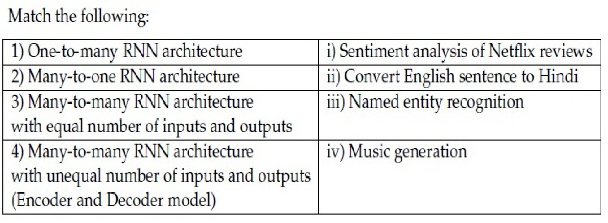

**Figure 17.** RNN architecture matching table for Question 139.

**Options**

**A.** 1 → iii, 2 → iv, 3 → ii, 4 → i  
*Option ID:* `6406535903119`

**B.** 1 → iv, 2→ i, 3 → iii, 4 →ii  
*Option ID:* `6406535903120`

**C.** 1 → i, 2 → ii, 3 → iii, 4 → iv  
*Option ID:* `6406535903121`

**D.** 1 → i, 2 → iii, 3→ ii, 4 → iv  
*Option ID:* `6406535903122`

**Correct answer:** **B** — 1 → iv, 2→ i, 3 → iii, 4 →ii.  
**Source evidence:** Option B (6406535903120) in green text (0x8000) with check icon, PDF page 5.

**Worked explanation:** One-to-many can generate music, many-to-one predicts sentiment, aligned many-to-many labels each token, and encoder–decoder translation can change length.  
Hence B gives iv, i, iii, ii; A incorrectly assigns named-entity recognition to one-to-many.

### da5006_2025T3_Q2_NA · Q160 · 1 marks · ID 6406531815756

**Question ID:** `6406531815756` · **Type:** Short Answer · **Marks:** 1  
**PDF pages:** 13, 14, 15

The RNN given below is used for classification:

Based on the above data, answer the given subquestion.

Number of weights in Weight Matrix U1 is: _____________

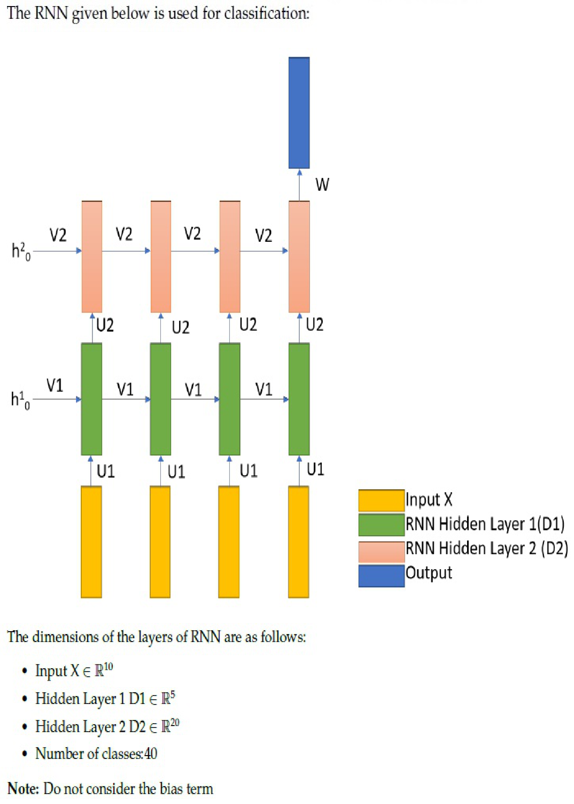

**Figure 18.** Recurrent neural network classification architecture for Questions 160 to 164.

**Correct answer:** `50`  
**Source evidence:** Green text (0x8000) under Possible Answers : 50, PDF page 15.

**Worked explanation:** The input to first hidden layer matrix $U_1$ has shape `[5, 10]`.  
With biases excluded, its entry count is $5\times 10=50$; shared copies across time are not counted again.

### da5006_2025T3_Q2_NA · Q161 · 1 marks · ID 6406531815757

**Question ID:** `6406531815757` · **Type:** Short Answer · **Marks:** 1  
**PDF pages:** 15

Refer to the RNN classification architecture in Question 160.

Based on the above data, answer the given subquestion.

Number of weights in Weight Matrix V1 is: _____________

**Correct answer:** `25`  
**Source evidence:** Green text (0x8000) under Possible Answers : 25, PDF page 15.

**Worked explanation:** The first hidden state to itself matrix $V_1$ has shape `[5, 5]`.  
With biases excluded, its entry count is $5\times 5=25$; shared copies across time are not counted again.

### da5006_2025T3_Q2_NA · Q162 · 1 marks · ID 6406531815758

**Question ID:** `6406531815758` · **Type:** Short Answer · **Marks:** 1  
**PDF pages:** 15

Refer to the RNN classification architecture in Question 160.

Based on the above data, answer the given subquestion.

Number of weights in Weight Matrix U2 is: _____________

**Correct answer:** `100`  
**Source evidence:** Green text (0x8000) under Possible Answers : 100, PDF page 15.

**Worked explanation:** The first to second hidden layer matrix $U_2$ has shape `[20, 5]`.  
With biases excluded, its entry count is $20\times 5=100$; shared copies across time are not counted again.

### da5006_2025T3_Q2_NA · Q163 · 0.5 marks · ID 6406531815759

**Question ID:** `6406531815759` · **Type:** Short Answer · **Marks:** 0.5  
**PDF pages:** 15

Refer to the RNN classification architecture in Question 160.

Based on the above data, answer the given subquestion.

Number of weights in Weight Matrix V2 is: _____________

**Correct answer:** `400`  
**Source evidence:** Green text (0x8000) under Possible Answers : 400, PDF page 15.

**Worked explanation:** The second hidden state to itself matrix $V_2$ has shape `[20, 20]`.  
With biases excluded, its entry count is $20\times 20=400$; shared copies across time are not counted again.

### da5006_2025T3_Q2_NA · Q164 · 0.5 marks · ID 6406531815760

**Question ID:** `6406531815760` · **Type:** Short Answer · **Marks:** 0.5  
**PDF pages:** 16

Refer to the RNN classification architecture in Question 160.

Based on the above data, answer the given subquestion.

Number of weights in Weight Matrix W is: _____________

**Correct answer:** `800`  
**Source evidence:** Green text (0x8000) under Possible Answers : 800, PDF page 16.

**Worked explanation:** The second hidden state to class scores matrix $W$ has shape `[40, 20]`.  
With biases excluded, its entry count is $40\times 20=800$; shared copies across time are not counted again.

## Topic: Recurrent training and gradient dynamics

| Done | Paper | Q# | Marks | Type |
| :---: | :--- | ---: | ---: | :--- |
| ☐ | da5006_2025T2_ET_FN | 178 | 2 | MSQ |
| ☐ | da5006_2025T3_ET_FN | 19 | 1 | MSQ |
| ☐ | da5006_2026T1_ET_FN | 15 | 2 | MCQ |
| ☐ | da5006_2026T2_ET_FN | 26 | 3 | MSQ |
| ☐ | da5006_2025T1_Q2_NA | 253 | 2 | MCQ |
| ☐ | da5006_2025T2_Q2_NA | 245 | 2 | MCQ |
| ☐ | da5006_2025T2_Q2_NA | 246 | 2 | MCQ |
| ☐ | da5006_2025T3_Q2_NA | 141 | 2 | Multiple Choice Question |
| ☐ | da5006_2025T3_Q2_NA | 142 | 2 | Multiple Choice Question |
| ☐ | da5006_2025T3_Q2_NA | 147 | 3 | Multiple Select Question |
| ☐ | da5006_2026T1_Q2_NA | 14 | 1 | MCQ |
| ☐ | da5006_2026T2_Q2_NA | 14 | 2 | MCQ |

### da5006_2025T2_ET_FN · Q178 · 2 marks · ID 6406531422557

**Question ID:** `6406531422557` · **Type:** MSQ · **Marks:** 2  
**PDF pages:** 12

Which of the following techniques help control the exploding or vanishing gradient problem in recurrent neural networks?

**Options**

**A.** Gradient clipping  
*Option ID:* `6406534756448`

**B.** Use ReLU activation funtion to control exploding gradient and sigmoid activation to control vanishing gradients  
*Option ID:* `6406534756449`

**C.** Use Long Short-Term Memory (LSTM)  
*Option ID:* `6406534756450`

**D.** Use data augmentation methods (for example, reversing the input sequence)  
*Option ID:* `6406534756451`

**Correct answer:** **A**, **C**, **D** — Gradient clipping; Use Long Short-Term Memory (LSTM); Use data augmentation methods (for example, reversing the input sequence).  
**Source evidence:** Option 6406534756448 is rendered in green text (#008000) with a checkmark icon. Option 6406534756450 is rendered in green text (#008000) with a checkmark icon. Option 6406534756451 is rendered in green text (#008000) with a checkmark icon. (PDF page 12).

**Worked explanation:** Pending independent analysis.

### da5006_2025T3_ET_FN · Q19 · 1 marks · ID 6406531862833

**Question ID:** `6406531862833` · **Type:** MSQ · **Marks:** 1  
**PDF pages:** 8

Which techniques help mitigate exploding/vanishing gradients in RNNs? (Select all that apply.)

**Options**

**A.** Gradient clipping  
*Option ID:* `6406536034973`

**B.** Orthogonal or identity initialization of recurrent weights  
*Option ID:* `6406536034974`

**C.** Using LSTM/GRU cells  
*Option ID:* `6406536034975`

**D.** Randomly reversing input sequences as augmentation  
*Option ID:* `6406536034976`

**Correct answer:** **A**, **B**, **C** — Gradient clipping ; Orthogonal or identity initialization of recurrent weights ; Using LSTM/GRU cells.  
**Source evidence:** Option A (6406536034973) rendered in green font (color 0x008000) with green checkmark icon (xref 1374 at y=618.07..630.07) in source PDF; Option B (6406536034974) rendered in green font (color 0x008000) with green checkmark icon (xref 1374 at y=638.89..650.89) in source PDF; Option C (6406536034975) rendered in green font (color 0x008000) with green checkmark icon (xref 1374 at y=659.71..671.71) in source PDF.

**Worked explanation:** Pending independent analysis.

### da5006_2026T1_ET_FN · Q15 · 2 marks · ID 6406532136830

**Question ID:** `6406532136830` · **Type:** MCQ · **Marks:** 2  
**PDF pages:** 5, 6

Vanishing gradients in vanilla RNNs occur mainly due to:

**Options**

**A.** High deapth of the RNN layers  
*Option ID:* `6406536959529`

**B.** Repeated multiplication by Jacobians across timesteps  
*Option ID:* `6406536959530`

**C.** Too many convolution layers before RNN  
*Option ID:* `6406536959531`

**D.** Use of softmax  
*Option ID:* `6406536959532`

**Correct answer:** **B** — Repeated multiplication by Jacobians across timesteps.  
**Source evidence:** Option ID 6406536959530 rendered in green text (#008000) with checkmark icon (xref 1692) on PDF page 5.

**Worked explanation:** Pending independent analysis.

### da5006_2026T2_ET_FN · Q26 · 3 marks · ID 6406532270065

> [!NOTE] Week assignment uncertain: Tests recurrent sequences, backpropagation through time, and gating.

**Question ID:** `6406532270065` · **Type:** MSQ · **Marks:** 3  
**PDF pages:** 9

Select all correct statements .

**Options**

**A.** Recurrent models can process ordered sequences of visual features.  
*Option ID:* `6406537379099`

**B.** Backpropagation through a recurrent model propagates gradient information across unrolled timesteps.  
*Option ID:* `6406537379100`

**C.** LSTMs and GRUs use gating mechanisms.  
*Option ID:* `6406537379101`

**D.** Randomly permuting all video frames leaves every temporal model output unchanged by definition.  
*Option ID:* `6406537379102`

**Correct answer:** **A**, **B**, **C** — Recurrent models can process ordered sequences of visual features.; Backpropagation through a recurrent model propagates gradient information across unrolled timesteps.; LSTMs and GRUs use gating mechanisms..  
**Source evidence:** Option ID 6406537379099 rendered in green text (#008000) with checkmark icon (xref 2581) on PDF page 9.; Option ID 6406537379100 rendered in green text (#008000) with checkmark icon (xref 2581) on PDF page 9.; Option ID 6406537379101 rendered in green text (#008000) with checkmark icon (xref 2581) on PDF page 9.

**Worked explanation:** Pending independent analysis.

### da5006_2025T1_Q2_NA · Q253 · 2 marks · ID 6406531168227

**Question ID:** `6406531168227` · **Type:** MCQ · **Marks:** 2  
**PDF pages:** 5, 6

Which of the following techniques help control the exploding or vanishing gradient problem in recurrent neural networks?

1. Gradient clipping
2. Use ReLU activation funtion to control exploding gradient and sigmoid activation to control vanishing gradients
3. Use Long Short-Term Memory (LSTM)
4. Use data augmentation methods (for example, reversing the input sequence)

**Options**

**A.** 1, 2, and 3; but not 4  
*Option ID:* `6406533939988`

**B.** 1, 3, and 4; but not 2  
*Option ID:* `6406533939989`

**C.** All of these  
*Option ID:* `6406533939990`

**D.** Only 1 and 3  
*Option ID:* `6406533939991`

**Correct answer:** **B** — 1, 3, and 4; but not 2.  
**Source evidence:** Option 6406533939989 marked with green checkmark icon and green text (color 0x8000), PDF page 6.

**Worked explanation:** Pending independent analysis.

### da5006_2025T2_Q2_NA · Q245 · 2 marks · ID 6406531333796

**Question ID:** `6406531333796` · **Type:** MCQ · **Marks:** 2  
**PDF pages:** 6

Which of the following techniques help mitigate the vanishing gradient problem in recurrent neural networks?
1. Gradient clipping
2. Use of ReLU activation to preserve gradient flow
3. Use of LSTM units
4. Data augmentation (e.g., reversing input sequence)

**Options**

**A.** 1 and 2 only  
*Option ID:* `6406534459626`

**B.** 2 and 3 only  
*Option ID:* `6406534459627`

**C.** 3 and 4 only  
*Option ID:* `6406534459628`

**D.** 1, 2, and 3 only  
*Option ID:* `6406534459629`

**Correct answer:** **B** — 2 and 3 only  
**Source evidence:** Green option ID text 6406534459627 and text '2 and 3 only' with green check icon at [119.02, 363.63, 131.02, 375.63].

**Worked explanation:** Pending independent analysis.

### da5006_2025T2_Q2_NA · Q246 · 2 marks · ID 6406531333797

**Question ID:** `6406531333797` · **Type:** MCQ · **Marks:** 2  
**PDF pages:** 6

Which of the following techniques help mitigate the exploding gradient problem in recurrent neural networks?
1. Gradient clipping
2. Use of Sigmoid activation to prevent gradient growth
3. Use of LSTM units
4. Data augmentation (e.g., reversing input sequence)

**Options**

**A.** 1 and 2 only  
*Option ID:* `6406534459630`

**B.** 1 and 3 only  
*Option ID:* `6406534459631`

**C.** 1, 2, and 3  
*Option ID:* `6406534459632`

**D.** All of these  
*Option ID:* `6406534459633`

**Correct answer:** **B** — 1 and 3 only  
**Source evidence:** Green option ID text 6406534459631 and text '1 and 3 only' with green check icon at [119.02, 648.93, 131.02, 660.93].

**Worked explanation:** Pending independent analysis.

### da5006_2025T3_Q2_NA · Q141 · 2 marks · ID 6406531815733

**Question ID:** `6406531815733` · **Type:** Multiple Choice Question · **Marks:** 2  
**PDF pages:** 6

Which of the following techniques help mitigate the vanishing gradient problem in recurrent neural networks?

1. Gradient clipping
2. Use of ReLU activation to preserve gradient flow
3. Use of LSTM units
4. Data augmentation (e.g., reversing input sequence)

**Options**

**A.** 1 and 2 only  
*Option ID:* `6406535903127`

**B.** 2 and 3 only  
*Option ID:* `6406535903128`

**C.** 3 and 4 only  
*Option ID:* `6406535903129`

**D.** 1, 2, and 3 only  
*Option ID:* `6406535903130`

**Correct answer:** **B** — 2 and 3 only.  
**Source evidence:** Option B (6406535903128) in green text (0x8000) with check icon, PDF page 6.

**Worked explanation:** Pending independent analysis.

### da5006_2025T3_Q2_NA · Q142 · 2 marks · ID 6406531815734

**Question ID:** `6406531815734` · **Type:** Multiple Choice Question · **Marks:** 2  
**PDF pages:** 6, 7

Which of the following techniques help mitigate the exploding gradient problem in recurrent neural networks?

1. Gradient clipping
2. Use of Sigmoid activation to prevent gradient growth
3. Use of LSTM units
4. Data augmentation (e.g., reversing input sequence)

**Options**

**A.** 1 and 2 only  
*Option ID:* `6406535903131`

**B.** 1 and 3 only  
*Option ID:* `6406535903132`

**C.** 1, 2, and 3  
*Option ID:* `6406535903133`

**D.** All of these  
*Option ID:* `6406535903134`

**Correct answer:** **B** — 1 and 3 only.  
**Source evidence:** Option B (6406535903132) in green text (0x8000) with check icon, PDF page 6.

**Worked explanation:** Pending independent analysis.

### da5006_2025T3_Q2_NA · Q147 · 3 marks · ID 6406531815738

**Question ID:** `6406531815738` · **Type:** Multiple Select Question · **Marks:** 3  
**PDF pages:** 8

Which techniques help mitigate exploding/vanishing gradients in RNNs? (Select all that apply.)

**Options**

**A.** Gradient clipping  
*Option ID:* `6406535903147`

**B.** Orthogonal or identity initialization of recurrent weights  
*Option ID:* `6406535903148`

**C.** Using LSTM/GRU cells  
*Option ID:* `6406535903149`

**D.** Randomly reversing input sequences as augmentation  
*Option ID:* `6406535903150`

**Correct answer:** **A**, **B**, **C** — Gradient clipping; Orthogonal or identity initialization of recurrent weights; Using LSTM/GRU cells.  
**Source evidence:** Option A (6406535903147) in green text (0x8000) with check icon, PDF page 8.

**Worked explanation:** Pending independent analysis.

### da5006_2026T1_Q2_NA · Q14 · 1 marks · ID 6406532040101

**Question ID:** `6406532040101` · **Type:** MCQ · **Marks:** 1  
**PDF pages:** 5, 6

Vanishing gradients in vanilla RNNs are largely caused by:

**Options**

**A.** The continuous addition of bias terms at each timestep which suppresses the gradient signal  
*Option ID:* `6406536642533`

**B.** Repeated multiplication by Jacobians whose spectral norm is often < 1  
*Option ID:* `6406536642534`

**C.** The use of unbounded activation functions like ReLU that cause activations to decay over time  
*Option ID:* `6406536642535`

**D.** The inability of the standard cross-entropy loss function to distinguish between short-term and long-term dependencies  
*Option ID:* `6406536642536`

**Correct answer:** **B** — Repeated multiplication by Jacobians whose spectral norm is often < 1.  
**Source evidence:** Green option text (0x8000) and check icon (xref 1768) for Option ID 6406536642534, PDF page 6.

**Worked explanation:** Pending independent analysis.

### da5006_2026T2_Q2_NA · Q14 · 2 marks · ID 6406532194393

**Question ID:** `6406532194393` · **Type:** MCQ · **Marks:** 2  
**PDF pages:** 5

Vanishing gradients in vanilla RNNs are largely caused by:

**Options**

**A.** Too much data augmentation  
*Option ID:* `6406537126066`

**B.** Repeated multiplication by Jacobians whose spectral norm is often < 1  
*Option ID:* `6406537126067`

**C.** Using convolutions before the RNN  
*Option ID:* `6406537126068`

**D.** Using attention layers  
*Option ID:* `6406537126069`

**Correct answer:** **B** — Repeated multiplication by Jacobians whose spectral norm is often < 1.  
**Source evidence:** Option B (6406537126067) is rendered in green font (#008000) with a checkmark icon (xref 1714).

**Worked explanation:** Pending independent analysis.

## Topic: LSTM and GRU gating

| Done | Paper | Q# | Marks | Type |
| :---: | :--- | ---: | ---: | :--- |
| ☐ | da5006_2026T2_ET_FN | 17 | 2 | MCQ |
| ☐ | da5006_2025T1_Q2_NA | 262 | 1 | SA |
| ☐ | da5006_2025T1_Q2_NA | 263 | 1 | SA |
| ☐ | da5006_2025T1_Q2_NA | 264 | 1 | SA |
| ☐ | da5006_2025T1_Q2_NA | 265 | 1 | SA |
| ☐ | da5006_2025T1_Q2_NA | 266 | 1 | SA |
| ☐ | da5006_2025T1_Q2_NA | 267 | 1 | SA |
| ☐ | da5006_2025T2_Q2_NA | 253 | 0.66 | SA |
| ☐ | da5006_2025T2_Q2_NA | 254 | 0.66 | SA |
| ☐ | da5006_2025T2_Q2_NA | 255 | 0.67 | SA |
| ☐ | da5006_2025T2_Q2_NA | 256 | 0.67 | SA |
| ☐ | da5006_2025T2_Q2_NA | 257 | 0.67 | SA |
| ☐ | da5006_2025T2_Q2_NA | 258 | 0.67 | SA |
| ☐ | da5006_2025T3_Q2_NA | 148 | 0.5 | Short Answer |
| ☐ | da5006_2025T3_Q2_NA | 149 | 0.5 | Short Answer |
| ☐ | da5006_2025T3_Q2_NA | 150 | 0.5 | Short Answer |
| ☐ | da5006_2025T3_Q2_NA | 151 | 0.5 | Short Answer |
| ☐ | da5006_2025T3_Q2_NA | 152 | 1 | Short Answer |
| ☐ | da5006_2025T3_Q2_NA | 153 | 1 | Short Answer |

### da5006_2026T2_ET_FN · Q17 · 2 marks · ID 6406532270056

**Question ID:** `6406532270056` · **Type:** MCQ · **Marks:** 2  
**PDF pages:** 6

Compared with a basic recurrent update, the gating mechanisms in LSTMs and GRUs are primarily intended to:

**Options**

**A.** Remove nonlinearities from the recurrent computation  
*Option ID:* `6406537379063`

**B.** Regulate information retention and update across timesteps  
*Option ID:* `6406537379064`

**C.** Make the model invariant to permutation of the sequence  
*Option ID:* `6406537379065`

**D.** Replace recurrent state with a fixed convolution kernel  
*Option ID:* `6406537379066`

**Correct answer:** **B** — Regulate information retention and update across timesteps.  
**Source evidence:** Option ID 6406537379064 rendered in green text (#008000) with checkmark icon (xref 2581) on PDF page 6.

**Worked explanation:** Pending independent analysis.

### da5006_2025T1_Q2_NA · Q262 · 1 marks · ID 6406531168237

**Question ID:** `6406531168237` · **Type:** SA · **Marks:** 1  
**PDF pages:** 10

**Comprehension Context (Questions 262–267):**

> Consider a Gated Recurrent Unit (GRU) cell at time step $t$.
> For each of the entities given in the subquestions, enter the appropriate number from the figure that corresponds to it:
>
> 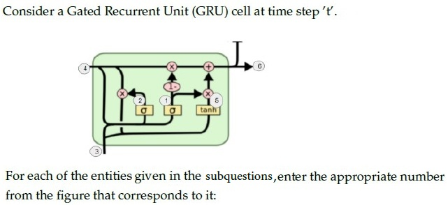
>
> **Figure 19.** GRU cell schematic diagram for Comprehension Context 1 (Questions 262–267).
>
> Based on the above data, answer the given subquestions.

Hidden state $h_{t-1}$ —

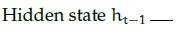

**Figure 20.** Entity label for Question 262.

**Correct answer:** `4`  
**Source evidence:** Official answer '4' in Possible Answers field with green text (color 0x8000), PDF page 10.

**Worked explanation:** Pending independent analysis.

### da5006_2025T1_Q2_NA · Q263 · 1 marks · ID 6406531168238

**Question ID:** `6406531168238` · **Type:** SA · **Marks:** 1  
**PDF pages:** 10

Hidden state $h_t$ —

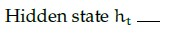

**Figure 21.** Entity label for Question 263.

**Correct answer:** `6`  
**Source evidence:** Official answer '6' in Possible Answers field with green text (color 0x8000), PDF page 10.

**Worked explanation:** Pending independent analysis.

### da5006_2025T1_Q2_NA · Q264 · 1 marks · ID 6406531168239

**Question ID:** `6406531168239` · **Type:** SA · **Marks:** 1  
**PDF pages:** 10, 11

Current Input $x_t$ —

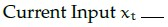

**Figure 22.** Entity label for Question 264.

**Correct answer:** `3`  
**Source evidence:** Official answer '3' in Possible Answers field with green text (color 0x8000), PDF page 11.

**Worked explanation:** Pending independent analysis.

### da5006_2025T1_Q2_NA · Q265 · 1 marks · ID 6406531168240

**Question ID:** `6406531168240` · **Type:** SA · **Marks:** 1  
**PDF pages:** 11

Update gate $z_t$ —

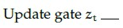

**Figure 23.** Entity label for Question 265.

**Correct answer:** `1`  
**Source evidence:** Official answer '1' in Possible Answers field with green text (color 0x8000), PDF page 11.

**Worked explanation:** Pending independent analysis.

### da5006_2025T1_Q2_NA · Q266 · 1 marks · ID 6406531168241

**Question ID:** `6406531168241` · **Type:** SA · **Marks:** 1  
**PDF pages:** 11

Reset gate $r_t$ —

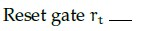

**Figure 24.** Entity label for Question 266.

**Correct answer:** `2`  
**Source evidence:** Official answer '2' in Possible Answers field with green text (color 0x8000), PDF page 11.

**Worked explanation:** Pending independent analysis.

### da5006_2025T1_Q2_NA · Q267 · 1 marks · ID 6406531168242

**Question ID:** `6406531168242` · **Type:** SA · **Marks:** 1  
**PDF pages:** 11, 12

New hidden state content $\tilde{h}_t$ —

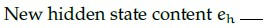

**Figure 25.** Entity label for Question 267.

**Correct answer:** `5`  
**Source evidence:** Official answer '5' in Possible Answers field with green text (color 0x8000), PDF page 12.

**Worked explanation:** Pending independent analysis.

### da5006_2025T2_Q2_NA · Q253 · 0.66 marks · ID 6406531333806

**Question ID:** `6406531333806` · **Type:** SA · **Marks:** 0.66  
**PDF pages:** 10

**Comprehension:**

Consider a Gated Recurrent Unit (GRU) cell at time step '$t$'.

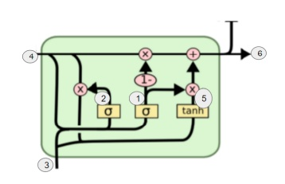

**Figure 26.** Gated Recurrent Unit (GRU) cell diagram for Passage 2 (Questions 253–258).

For each of the entities in the given subquestions, enter the appropriate number from the figure that corresponds to it:

Hidden state ht−1______________

**Correct answer:** `4`  
**Source evidence:** Official answer '4' in Possible Answers field on PDF page 10 with green text.

**Worked explanation:** Pending independent analysis.

### da5006_2025T2_Q2_NA · Q254 · 0.66 marks · ID 6406531333807

**Question ID:** `6406531333807` · **Type:** SA · **Marks:** 0.66  
**PDF pages:** 10

**Comprehension:**

Consider a Gated Recurrent Unit (GRU) cell at time step '$t$'. *(Refer to Figure 31 in Question 253).*

For each of the entities in the given subquestions, enter the appropriate number from the figure that corresponds to it:

Hidden state ht_____________

**Correct answer:** `6`  
**Source evidence:** Official answer '6' in Possible Answers field on PDF page 10 with green text.

**Worked explanation:** Pending independent analysis.

### da5006_2025T2_Q2_NA · Q255 · 0.67 marks · ID 6406531333808

**Question ID:** `6406531333808` · **Type:** SA · **Marks:** 0.67  
**PDF pages:** 10

**Comprehension:**

Consider a Gated Recurrent Unit (GRU) cell at time step '$t$'. *(Refer to Figure 31 in Question 253).*

For each of the entities in the given subquestions, enter the appropriate number from the figure that corresponds to it:

Current Input xt________________

**Correct answer:** `3`  
**Source evidence:** Official answer '3' in Possible Answers field on PDF page 10 with green text.

**Worked explanation:** Pending independent analysis.

### da5006_2025T2_Q2_NA · Q256 · 0.67 marks · ID 6406531333809

**Question ID:** `6406531333809` · **Type:** SA · **Marks:** 0.67  
**PDF pages:** 10, 11

**Comprehension:**

Consider a Gated Recurrent Unit (GRU) cell at time step '$t$'. *(Refer to Figure 31 in Question 253).*

For each of the entities in the given subquestions, enter the appropriate number from the figure that corresponds to it:

Update gate zt_______________

**Correct answer:** `1`  
**Source evidence:** Official answer '1' in Possible Answers field on PDF page 11 with green text.

**Worked explanation:** Pending independent analysis.

### da5006_2025T2_Q2_NA · Q257 · 0.67 marks · ID 6406531333810

**Question ID:** `6406531333810` · **Type:** SA · **Marks:** 0.67  
**PDF pages:** 11

**Comprehension:**

Consider a Gated Recurrent Unit (GRU) cell at time step '$t$'. *(Refer to Figure 31 in Question 253).*

For each of the entities in the given subquestions, enter the appropriate number from the figure that corresponds to it:

Reset gate rt ______________

**Correct answer:** `2`  
**Source evidence:** Official answer '2' in Possible Answers field on PDF page 11 with green text.

**Worked explanation:** Pending independent analysis.

### da5006_2025T2_Q2_NA · Q258 · 0.67 marks · ID 6406531333811

**Question ID:** `6406531333811` · **Type:** SA · **Marks:** 0.67  
**PDF pages:** 11

**Comprehension:**

Consider a Gated Recurrent Unit (GRU) cell at time step '$t$'. *(Refer to Figure 31 in Question 253).*

For each of the entities in the given subquestions, enter the appropriate number from the figure that corresponds to it:

New hidden state content eh____________

**Correct answer:** `5`  
**Source evidence:** Official answer '5' in Possible Answers field on PDF page 11 with green text.

**Worked explanation:** Pending independent analysis.

### da5006_2025T3_Q2_NA · Q148 · 0.5 marks · ID 6406531815741

**Question ID:** `6406531815741` · **Type:** Short Answer · **Marks:** 0.5  
**PDF pages:** 9

Consider a Gated Recurrent Unit (GRU) cell at time step 't'. For each of the entities given, enter the appropriate number from the figure that corresponds to it:

Based on the above data, answer the given subquestion:

Hidden state $h_{t-1} = \text{___}$

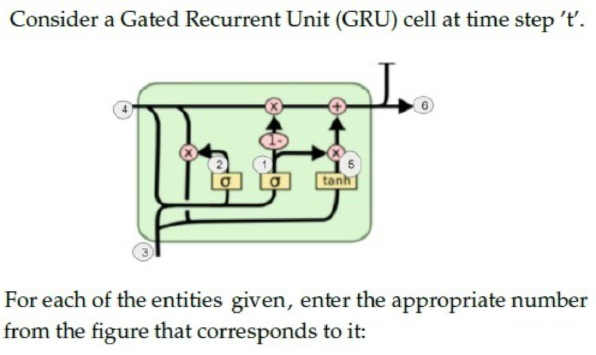

**Figure 27.** Gated Recurrent Unit (GRU) cell architecture for Questions 148 to 153.

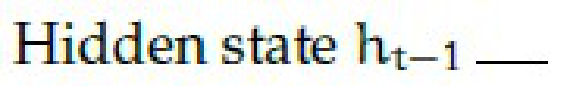

**Figure 28.** Subquestion stem for Question 148.

**Correct answer:** `4`  
**Source evidence:** Green text (0x8000) under Possible Answers : 4, PDF page 9.

**Worked explanation:** Pending independent analysis.

### da5006_2025T3_Q2_NA · Q149 · 0.5 marks · ID 6406531815742

**Question ID:** `6406531815742` · **Type:** Short Answer · **Marks:** 0.5  
**PDF pages:** 9, 10

Refer to the specifications and GRU architecture diagram in Question 148.

Based on the above data, answer the given subquestion:

Hidden state $h_t = \text{___}$

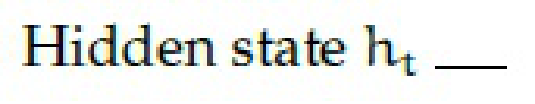

**Figure 29.** Subquestion stem for Question 149.

**Correct answer:** `6`  
**Source evidence:** Green text (0x8000) under Possible Answers : 6, PDF page 10.

**Worked explanation:** Pending independent analysis.

### da5006_2025T3_Q2_NA · Q150 · 0.5 marks · ID 6406531815743

**Question ID:** `6406531815743` · **Type:** Short Answer · **Marks:** 0.5  
**PDF pages:** 10

Refer to the specifications and GRU architecture diagram in Question 148.

Based on the above data, answer the given subquestion:

Current Input $x_t = \text{___}$

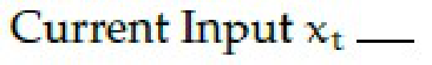

**Figure 30.** Subquestion stem for Question 150.

**Correct answer:** `3`  
**Source evidence:** Green text (0x8000) under Possible Answers : 3, PDF page 10.

**Worked explanation:** Pending independent analysis.

### da5006_2025T3_Q2_NA · Q151 · 0.5 marks · ID 6406531815744

**Question ID:** `6406531815744` · **Type:** Short Answer · **Marks:** 0.5  
**PDF pages:** 10

Refer to the specifications and GRU architecture diagram in Question 148.

Based on the above data, answer the given subquestion:

Update gate $z_t = \text{___}$

**Figure 31.** Subquestion stem for Question 151.

**Correct answer:** `1`  
**Source evidence:** Green text (0x8000) under Possible Answers : 1, PDF page 10.

**Worked explanation:** Pending independent analysis.

### da5006_2025T3_Q2_NA · Q152 · 1 marks · ID 6406531815745

**Question ID:** `6406531815745` · **Type:** Short Answer · **Marks:** 1  
**PDF pages:** 10

Refer to the specifications and GRU architecture diagram in Question 148.

Based on the above data, answer the given subquestion:

Reset gate $r_t = \text{___}$

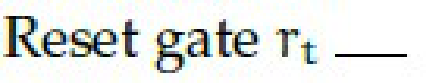

**Figure 32.** Subquestion stem for Question 152.

**Correct answer:** `2`  
**Source evidence:** Green text (0x8000) under Possible Answers : 2, PDF page 10.

**Worked explanation:** Pending independent analysis.

### da5006_2025T3_Q2_NA · Q153 · 1 marks · ID 6406531815746

**Question ID:** `6406531815746` · **Type:** Short Answer · **Marks:** 1  
**PDF pages:** 10, 11

Refer to the specifications and GRU architecture diagram in Question 148.

Based on the above data, answer the given subquestion:

New hidden state content $\tilde{h}_t = \text{___}$

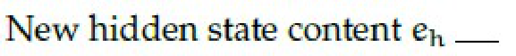

**Figure 33.** Subquestion stem for Question 153.

**Correct answer:** `5`  
**Source evidence:** Green text (0x8000) under Possible Answers : 5, PDF page 11.

**Worked explanation:** Pending independent analysis.

## Topic: Encoder-decoder attention

| Done | Paper | Q# | Marks | Type |
| :---: | :--- | ---: | ---: | :--- |
| ☐ | da5006_2024T3_ET_AN | 214 | 2 | Multiple Select Question (MSQ) |
| ☐ | da5006_2025T2_ET_FN | 162 | 2 | MCQ |
| ☐ | da5006_2026T2_ET_FN | 36 | 4 | SA |
| ☐ | da5006_2024T1_Q2_NA | 164 | 2 | MCQ |
| ☐ | da5006_2024T1_Q2_NA | 165 | 2 | MCQ |
| ☐ | da5006_2024T2_Q2_NA | 125 | 2 | MCQ |
| ☐ | da5006_2024T3_Q2_NA | 143 | 2 | MCQ |
| ☐ | da5006_2024T3_Q2_NA | 149 | 2 | MCQ |
| ☐ | da5006_2025T1_Q2_NA | 246 | 2 | MCQ |
| ☐ | da5006_2025T1_Q2_NA | 252 | 2 | MCQ |
| ☐ | da5006_2025T2_Q2_NA | 241 | 2 | MCQ |
| ☐ | da5006_2025T2_Q2_NA | 244 | 2 | MCQ |
| ☐ | da5006_2025T2_Q2_NA | 247 | 2 | MCQ |
| ☐ | da5006_2025T2_Q2_NA | 251 | 1 | SA |
| ☐ | da5006_2025T2_Q2_NA | 252 | 1 | SA |
| ☐ | da5006_2025T2_Q2_NA | 270 | 0.5 | SA |
| ☐ | da5006_2025T2_Q2_NA | 271 | 0.5 | SA |
| ☐ | da5006_2025T2_Q2_NA | 272 | 0.5 | SA |
| ☐ | da5006_2025T2_Q2_NA | 273 | 0.5 | SA |
| ☐ | da5006_2025T2_Q2_NA | 274 | 0.5 | SA |
| ☐ | da5006_2025T2_Q2_NA | 275 | 0.5 | SA |
| ☐ | da5006_2025T2_Q2_NA | 276 | 0.5 | SA |
| ☐ | da5006_2025T2_Q2_NA | 277 | 0.5 | SA |
| ☐ | da5006_2025T2_Q2_NA | 278 | 0.5 | SA |
| ☐ | da5006_2025T2_Q2_NA | 279 | 0.5 | SA |
| ☐ | da5006_2025T2_Q2_NA | 280 | 0.5 | SA |
| ☐ | da5006_2025T2_Q2_NA | 281 | 0.5 | SA |
| ☐ | da5006_2025T2_Q2_NA | 282 | 0.5 | SA |
| ☐ | da5006_2025T2_Q2_NA | 283 | 0.5 | SA |
| ☐ | da5006_2025T2_Q2_NA | 284 | 0.5 | SA |
| ☐ | da5006_2025T2_Q2_NA | 285 | 0.5 | SA |
| ☐ | da5006_2025T3_Q2_NA | 137 | 2 | Multiple Choice Question |
| ☐ | da5006_2025T3_Q2_NA | 140 | 2 | Multiple Choice Question |
| ☐ | da5006_2025T3_Q2_NA | 143 | 2 | Multiple Choice Question |
| ☐ | da5006_2025T3_Q2_NA | 165 | 0.5 | Short Answer |
| ☐ | da5006_2025T3_Q2_NA | 166 | 0.5 | Short Answer |
| ☐ | da5006_2025T3_Q2_NA | 167 | 0.5 | Short Answer |
| ☐ | da5006_2025T3_Q2_NA | 168 | 0.5 | Short Answer |
| ☐ | da5006_2025T3_Q2_NA | 169 | 0.5 | Short Answer |
| ☐ | da5006_2025T3_Q2_NA | 170 | 0.5 | Short Answer |
| ☐ | da5006_2025T3_Q2_NA | 171 | 0.5 | Short Answer |
| ☐ | da5006_2025T3_Q2_NA | 172 | 0.5 | Short Answer |
| ☐ | da5006_2025T3_Q2_NA | 173 | 0.5 | Short Answer |
| ☐ | da5006_2025T3_Q2_NA | 174 | 0.5 | Short Answer |
| ☐ | da5006_2025T3_Q2_NA | 175 | 0.5 | Short Answer |
| ☐ | da5006_2025T3_Q2_NA | 176 | 0.5 | Short Answer |
| ☐ | da5006_2025T3_Q2_NA | 177 | 0.5 | Short Answer |
| ☐ | da5006_2025T3_Q2_NA | 178 | 0.5 | Short Answer |
| ☐ | da5006_2025T3_Q2_NA | 179 | 0.5 | Short Answer |
| ☐ | da5006_2026T1_Q2_NA | 15 | 1 | MCQ |
| ☐ | da5006_2026T1_Q2_NA | 24 | 1 | SA |
| ☐ | da5006_2026T2_Q2_NA | 10 | 1 | MCQ |
| ☐ | da5006_2026T2_Q2_NA | 23 | 4 | SA |

### da5006_2024T3_ET_AN · Q214 · 2 marks · ID 6406531046062

> [!NOTE] Week assignment uncertain: Tests temporal attention alongside positional encoding and autoencoders.

**Question ID:** `6406531046062` · **Type:** Multiple Select Question (MSQ) · **Marks:** 2  
**PDF pages:** 9, 10

Which of the following statements are true? (Select all possible correct options)

**Options**

**A.** Autoencoder can be equivalent to Principal Component Analysis (PCA) provided we make use of non-linear activation functions  
*Option ID:* `6406533531367`

**B.** When using global attention on temporal data, alignment weights are learnt for encoder hidden representations for all time steps  
*Option ID:* `6406533531368`

**C.** Positional encoding is an important component of the trans-former architecture as it conveys information about order in a given sequence  
*Option ID:* `6406533531369`

**D.** It is not possible to generate different captions for the same image that have similar meaning but different tone/style  
*Option ID:* `6406533531370`

**E.** Autoencoders can not be used for data compression as its input and output dimensions are different  
*Option ID:* `6406533531371`

**Correct answer:** **B**, **C** — B — When using global attention on temporal data, alignment weights are learnt for encoder hidden representations for all time steps; C — Positional encoding is an important component of the trans-former architecture as it conveys information about order in a given sequence..  
**Source evidence:** Option ID 6406533531368 is rendered in green (color #008000) with a checkmark icon.; Option ID 6406533531369 is rendered in green (color #008000) with a checkmark icon.

**Worked explanation:** Pending independent analysis.

### da5006_2025T2_ET_FN · Q162 · 2 marks · ID 6406531422541

**Question ID:** `6406531422541` · **Type:** MCQ · **Marks:** 2  
**PDF pages:** 5

Let us suppose that you want to build an encoder-decoder recurrent model with attention. We know that the context vector for the model is given by $c_i = \sum_j \alpha_{ij} h_j$, where $\alpha_{ij}$ refers to the degree of alignment between decoder state $s_{i-1}$ and encoder state $h_j$. Then $\alpha_{ij}$ is computed as:

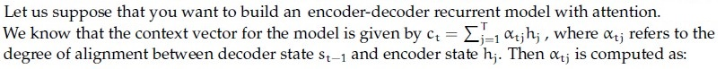

**Figure 34.** Question 162, attention context vector equation.

**Options**

**A.** Sigmoid of alignment scores  
*Option ID:* `6406534756380`

**B.** ReLU of alignment scores  
*Option ID:* `6406534756381`

**C.** Softmax of alignment scores  
*Option ID:* `6406534756382`

**D.** Linear projections of alignment scores  
*Option ID:* `6406534756383`

**Correct answer:** **C** — Softmax of alignment scores.  
**Source evidence:** Option 6406534756382 is rendered in green text (#008000) with a checkmark icon. (PDF page 5).

**Worked explanation:** Pending independent analysis.

### da5006_2026T2_ET_FN · Q36 · 4 marks · ID 6406532270075

> [!NOTE] Week assignment uncertain: Computes softmax weights for an attention step.

**Question ID:** `6406532270075` · **Type:** SA · **Marks:** 4  
**PDF pages:** 12, 13

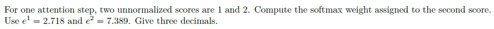

**Figure 35.** Source attention formulation for Question 36.

For one attention step, two unnormalized scores are 1 and 2. Compute the softmax weight assigned to the second score.
Use $e^1 = 2.718$ and $e^2 = 7.389$. Give three decimals.

**Correct answer:** `0.730 to 0.732`  
**Source evidence:** Official text specification: 'Possible Answers : 0.730 to 0.732' on PDF page 13.

**Worked explanation:** Pending independent analysis.

### da5006_2024T1_Q2_NA · Q164 · 2 marks · ID 640653766161

**Question ID:** `640653766161` · **Type:** MCQ · **Marks:** 2  
**PDF pages:** 11

Let us suppose that you want to build an encoder-decoder recurrent model with attention. We know that the context vector for the model is given by $c_t = \sum_{j=1}^T \alpha_{tj} h_j$, where $\alpha_{tj}$ refers to the degree of alignment between decoder state $s_{t-1}$ and encoder state $h_j$. Then, $\alpha_{tj}$ is computed as:

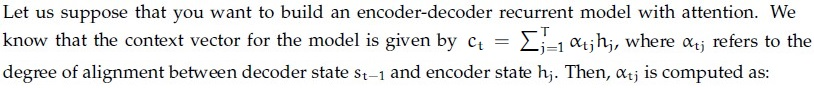

**Figure 36.** Source formulation for Question 164.

**Options**

**A.** Sigmoid of alignment scores  
*Option ID:* `6406532564219`

**B.** Softmax of alignment scores  
*Option ID:* `6406532564220`

**C.** ReLU of alignment scores  
*Option ID:* `6406532564221`

**D.** None of these  
*Option ID:* `6406532564222`

**Correct answer:** **B** — Softmax of alignment scores  
**Source evidence:** Green option text (0x8000) and check icon (xref 18) for Option ID 6406532564220, PDF page 11.

**Worked explanation:** Pending independent analysis.

### da5006_2024T1_Q2_NA · Q165 · 2 marks · ID 640653766162

> [!NOTE] Week assignment uncertain: Transformer components are mapped to the closest in-scope attention cluster; the fit is provisional.

**Question ID:** `640653766162` · **Type:** MCQ · **Marks:** 2  
**PDF pages:** 11, 12

Which of the following is not a component of a Transformer network?

**Options**

**A.** Encoder  
*Option ID:* `6406532564223`

**B.** Decoder  
*Option ID:* `6406532564224`

**C.** Positional Encoding  
*Option ID:* `6406532564225`

**D.** Recurrent Connections  
*Option ID:* `6406532564226`

**Correct answer:** **D** — Recurrent Connections  
**Source evidence:** Green option text (0x8000) and check icon (xref 18) for Option ID 6406532564226, PDF page 12.

**Worked explanation:** Pending independent analysis.

### da5006_2024T2_Q2_NA · Q125 · 2 marks · ID 640653856599

**Question ID:** `640653856599` · **Type:** MCQ · **Marks:** 2  
**PDF pages:** 5

Let us suppose that you want to build an encoder-decoder recurrent model with attention. We know that the context vector for the model is given by $c_i = \sum_{j=1}^{T_x} \alpha_{ij} h_j$, where $\alpha_{ij}$ refers to the degree of alignment between decoder state $s_{i-1}$ and encoder state $h_j$. Then, $\alpha_{ij}$ is computed as:

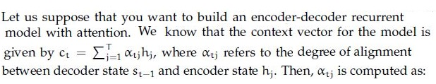

**Figure 37.** Source mathematical context for Question 125.

**Options**

**A.** Sigmoid of alignment scores  
*Option ID:* `6406532878505`

**B.** Softmax of alignment scores  
*Option ID:* `6406532878506`

**C.** ReLU of alignment scores  
*Option ID:* `6406532878507`

**D.** None of these  
*Option ID:* `6406532878508`

**Correct answer:** **B** — Softmax of alignment scores.  
**Source evidence:** Green check icon beside option ID 6406532878506 on page 5.

**Worked explanation:** Pending independent analysis.

### da5006_2024T3_Q2_NA · Q143 · 2 marks · ID 6406531031078

**Question ID:** `6406531031078` · **Type:** MCQ · **Marks:** 2  
**PDF pages:** 6, 7

Let us suppose that you want to build an encoder-decoder recurrent model with attention. We know that the context vector for the model is given by $c_i = \sum_{j=1}^T \alpha_{ij} h_j$, where $\alpha_{ij}$ refers to the degree of alignment between decoder state $s_{i-1}$ and encoder state $h_j$. Then, $\alpha_{ij}$ is computed as:

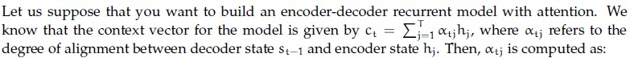

**Figure 38.** Attention model formulation for Question 143.

**Options**

**A.** Sigmoid of alignment scores  
*Option ID:* `6406533487233`

**B.** Softmax of alignment scores  
*Option ID:* `6406533487234`

**C.** ReLU of alignment scores  
*Option ID:* `6406533487235`

**D.** None of these  
*Option ID:* `6406533487236`

**Correct answer:** **B** — Softmax of alignment scores  
**Source evidence:** Green check icon and green text on Option ID `6406533487234`, PDF page 7.

**Worked explanation:** Pending independent analysis.

### da5006_2024T3_Q2_NA · Q149 · 2 marks · ID 6406531031086

**Question ID:** `6406531031086` · **Type:** MCQ · **Marks:** 2  
**PDF pages:** 8, 9

Match the following attention mechanisms to their corresponding alignment score functions:

| Attention Mechanism | Alignment Score Function |
| :--- | :--- |
| (1) General Attention | (i) $v_a^T \tanh(W_a [s_t; h_i])$ |
| (2) Content-Based Attention | (ii) $\alpha_{t,i} = \text{softmax}(W_a s_t)$ |
| (3) Dot-Product Attention | (iii) $s_t^T h_i$ |
| (4) Additive Attention | (iv) $\cos(s_t, h_i)$ |
| (5) Location-Based Attention | (v) $s_t^T W_a h_i$ |

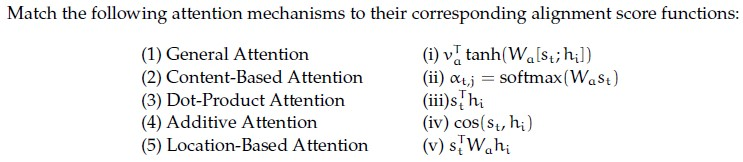

**Figure 39.** Attention mechanisms and alignment score functions for Question 149.

**Options**

**A.** 1→iii, 2→ii, 3→v, 4→iv, 5→i  
*Option ID:* `6406533487265`

**B.** 1→iii, 2→iv, 3→i, 4→ii, 5→v  
*Option ID:* `6406533487266`

**C.** 1→i, 2→iii, 3→iv, 4→ii, 5→v  
*Option ID:* `6406533487267`

**D.** 1→v, 2→iv, 3→iii, 4→i, 5→ii  
*Option ID:* `6406533487268`

**Correct answer:** **D** — 1→v, 2→iv, 3→iii, 4→i, 5→ii  
**Source evidence:** Green check icon and green text on Option ID `6406533487268`, PDF page 9.

**Worked explanation:** Pending independent analysis.

### da5006_2025T1_Q2_NA · Q246 · 2 marks · ID 6406531168220

**Question ID:** `6406531168220` · **Type:** MCQ · **Marks:** 2  
**PDF pages:** 3

Let us suppose that you want to build an encoder-decoder recurrent model with attention. We know that the context vector for the model is given by $c_t = \sum_{j=1}^{T} \alpha_{tj} h_j$, where $\alpha_{tj}$ refers to the degree of alignment between decoder state $s_{t-1}$ and encoder state $h_j$. Then, $\alpha_{tj}$ is computed as:

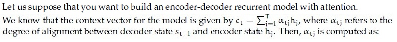

**Figure 40.** Source equation for Question 246.

**Options**

**A.** Sigmoid of alignment scores  
*Option ID:* `6406533939960`

**B.** Softmax of alignment scores  
*Option ID:* `6406533939961`

**C.** ReLU of alignment scores  
*Option ID:* `6406533939962`

**D.** None of these  
*Option ID:* `6406533939963`

**Correct answer:** **B** — Softmax of alignment scores.  
**Source evidence:** Option 6406533939961 marked with green checkmark icon and green text (color 0x8000), PDF page 3.

**Worked explanation:** Pending independent analysis.

### da5006_2025T1_Q2_NA · Q252 · 2 marks · ID 6406531168226

**Question ID:** `6406531168226` · **Type:** MCQ · **Marks:** 2  
**PDF pages:** 5

Match the following attention mechanisms to their corresponding alignment score functions:

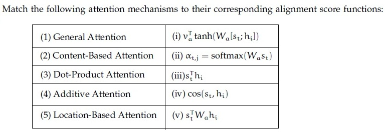

**Figure 41.** Source table for Question 252.

| Column 1 | Column 2 |
| :--- | :--- |
| (1) General Attention | (i) $v_a^T \tanh(W_a [s_t; h_i])$ |
| (2) Content-Based Attention | (ii) $\alpha_{t,j} = \text{softmax}(W_a s_t)$ |
| (3) Dot-Product Attention | (iii) $s_t^T h_i$ |
| (4) Additive Attention | (iv) $\cos(s_t, h_i)$ |
| (5) Location-Based Attention | (v) $s_t^T W_a h_i$ |

**Options**

**A.** 1→iii, 2→ii, 3→v, 4→iv, 5→i  
*Option ID:* `6406533939984`

**B.** 1→iii, 2→iv, 3→i, 4→ii, 5→v  
*Option ID:* `6406533939985`

**C.** 1→i, 2→iii, 3→iv, 4→ii, 5→v  
*Option ID:* `6406533939986`

**D.** 1→v, 2→iv, 3→iii, 4→i, 5→ii  
*Option ID:* `6406533939987`

**Correct answer:** **D** — 1→v, 2→iv, 3→iii, 4→i, 5→ii.  
**Source evidence:** Option 6406533939987 marked with green checkmark icon and green text (color 0x8000), PDF page 5.

**Worked explanation:** Pending independent analysis.

### da5006_2025T2_Q2_NA · Q241 · 2 marks · ID 6406531333792

**Question ID:** `6406531333792` · **Type:** MCQ · **Marks:** 2  
**PDF pages:** 4

Which one of the following statements is True?

**Options**

**A.** Attention mechanisms can be applied to the bidirectional RNN model  
*Option ID:* `6406534459610`

**B.** An image captioning network cannot be trained end-to-end even though we are using 2 different modalities to train the network  
*Option ID:* `6406534459611`

**C.** One of the key components in the vanilla transformer are the recurrent connections that help them to deal with variable input length.  
*Option ID:* `6406534459612`

**D.** All of these.  
*Option ID:* `6406534459613`

**Correct answer:** **A** — Attention mechanisms can be applied to the bidirectional RNN model  
**Source evidence:** Green option ID text 6406534459610 and text 'Attention mechanisms can be applied to the bidirectional RNN model' with green check icon at [119.02, 405.26, 131.02, 417.26].

**Worked explanation:** Pending independent analysis.

### da5006_2025T2_Q2_NA · Q244 · 2 marks · ID 6406531333795

**Question ID:** `6406531333795` · **Type:** MCQ · **Marks:** 2  
**PDF pages:** 5, 6

Match the following attention mechanisms to their corresponding alignment score functions:

| Attention Mechanism | Alignment Score Function |
| :--- | :--- |
| (1) General Attention | (i) $v_a^T \tanh(W_a [s_t; h_i])$ |
| (2) Content-Based Attention | (ii) $a_{ti} = \text{softmax}(W_a s_t)$ |
| (3) Dot-Product Attention | (iii) $s_t^T h_i$ |
| (4) Additive Attention | (iv) $\cos(s_t, h_i)$ |
| (5) Location-Based Attention | (v) $s_t^T W_a h_i$ |

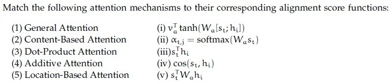

**Figure 42.** Matching table for Question 244.

**Options**

**A.** 1-iii, 2-ii, 3-i, 4-iv, 5-v

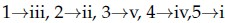

**Figure 43.** Option A for Question 244.  
*Option ID:* `6406534459622`

**B.** 1-iii, 2-iv, 3-i, 4-ii, 5-v

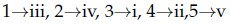

**Figure 44.** Option B for Question 244.  
*Option ID:* `6406534459623`

**C.** 1-i, 2-iii, 3-iv, 4-ii, 5-v

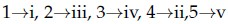

**Figure 45.** Option C for Question 244.  
*Option ID:* `6406534459624`

**D.** 1-v, 2-iv, 3-iii, 4-i, 5-ii

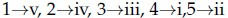

**Figure 46.** Option D for Question 244.  
*Option ID:* `6406534459625`

**Correct answer:** **D** — 1-v, 2-iv, 3-iii, 4-i, 5-ii  
**Source evidence:** Green option ID text 6406534459625 on PDF page 6 with green check icon at [119.02, 103.65, 131.02, 115.65].

**Worked explanation:** Pending independent analysis.

### da5006_2025T2_Q2_NA · Q247 · 2 marks · ID 6406531333798

**Question ID:** `6406531333798` · **Type:** MCQ · **Marks:** 2  
**PDF pages:** 6, 7

Which one of the following statements is false? (Pick the most appropriate one.)

**Options**

**A.** Attention mechanisms cannot be applied to the bidirectional RNN model  
*Option ID:* `6406534459634`

**B.** An image captioning network cannot be trained end-to-end even though we are using 2 different modalities to train the network  
*Option ID:* `6406534459635`

**C.** One of the key components in the vanilla transformer is the recurrent connection that help them to deal with variable input length.  
*Option ID:* `6406534459636`

**D.** All of these  
*Option ID:* `6406534459637`

**Correct answer:** **D** — All of these  
**Source evidence:** Green option ID text 6406534459637 and text 'All of these' with green check icon at [119.02, 132.74, 131.02, 144.74].

**Worked explanation:** Pending independent analysis.

### da5006_2025T2_Q2_NA · Q251 · 1 marks · ID 6406531333803

**Question ID:** `6406531333803` · **Type:** SA · **Marks:** 1  
**PDF pages:** 8, 9

**Comprehension:**

Suppose you want to build an encoder-decoder recurrent model with attention. The context vector at time step $t$ is given by:

$$c_t = \sum_{j=1}^{T_x} \alpha_{tj} h_j$$

where $\alpha_{tj}$ refers to the alignment score between the decoder state at time $t$ _____________ and the encoder state at time _____________. Note: Please write your answer using variables.

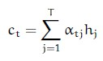

**Figure 47.** Context vector equation for Passage 1 (Questions 251–252).

Based on the above data, answer the given subquestions.

Decoder state at time t : _______________

**Correct answer:** `-1`  
**Source evidence:** Official answer '-1' in Possible Answers field on PDF page 9 with green text.

**Worked explanation:** Pending independent analysis.

### da5006_2025T2_Q2_NA · Q252 · 1 marks · ID 6406531333804

**Question ID:** `6406531333804` · **Type:** SA · **Marks:** 1  
**PDF pages:** 9

**Comprehension:**

Suppose you want to build an encoder-decoder recurrent model with attention. The context vector at time step $t$ is given by:

$$c_t = \sum_{j=1}^{T_x} \alpha_{tj} h_j$$

where $\alpha_{tj}$ refers to the alignment score between the decoder state at time $t$ _____________ and the encoder state at time _____________. Note: Please write your answer using variables. *(Refer to Figure 30 in Question 251).*

Based on the above data, answer the given subquestions.

Encoder state at time: _______________

**Correct answer:** `j`  
**Source evidence:** Official answer 'j' in Possible Answers field on PDF page 9 with green text.

**Worked explanation:** Pending independent analysis.

### da5006_2025T2_Q2_NA · Q270 · 0.5 marks · ID 6406531333827

**Question ID:** `6406531333827` · **Type:** SA · **Marks:** 0.5  
**PDF pages:** 16, 17

**Comprehension:**

You are given the encoder hidden states $h_1, h_2, h_3 \in \mathbb{R}^2$ and the decoder hidden state $s_2 \in \mathbb{R}^2$ at time step $t = 2$.

Use **dot-product attention**, where the attention score is computed as:

$$e_{tj} = s_t^T h_j \quad \text{and} \quad \alpha_{tj} = \frac{\exp(e_{tj})}{\sum_{k=1}^3 \exp(e_{tk})}$$

The context vector is then computed as:

$$c_t = \sum_{j=1}^3 \alpha_{tj} h_j$$

Use the following values:

$$s_2 = \begin{bmatrix} 1 \\ 0 \end{bmatrix}, \quad h_1 = \begin{bmatrix} 1 \\ 2 \end{bmatrix}, \quad h_2 = \begin{bmatrix} 0 \\ 1 \end{bmatrix}, \quad h_3 = \begin{bmatrix} 2 \\ 3 \end{bmatrix}$$

Note: Use approximate values of exponential $\exp(1) \approx 2.72$, $\exp(2) \approx 7.39$, etc.

Answer the given subquestions:

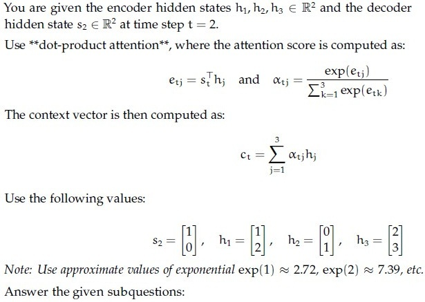

**Figure 48.** Dot-product attention formulation and values for Passage 6 (Questions 270–277).

e21: _________________

**Correct answer:** `1`  
**Source evidence:** Official accepted answer/range '1' in Possible Answers field on PDF page 17 with green text.

**Worked explanation:** Pending independent analysis.

### da5006_2025T2_Q2_NA · Q271 · 0.5 marks · ID 6406531333828

**Question ID:** `6406531333828` · **Type:** SA · **Marks:** 0.5  
**PDF pages:** 17

**Comprehension:**

You are given the encoder hidden states $h_1, h_2, h_3 \in \mathbb{R}^2$ and the decoder hidden state $s_2 \in \mathbb{R}^2$ at time step $t = 2$.
Use **dot-product attention**, where $e_{tj} = s_t^T h_j$ and context vector $c_t = \sum_{j=1}^3 \alpha_{tj} h_j$.
*(Refer to Figure 33 in Question 270 for values and formulation).*

Answer the given subquestions:

e22: _________________

**Correct answer:** `0`  
**Source evidence:** Official accepted answer/range '0' in Possible Answers field on PDF page 17 with green text.

**Worked explanation:** Pending independent analysis.

### da5006_2025T2_Q2_NA · Q272 · 0.5 marks · ID 6406531333829

**Question ID:** `6406531333829` · **Type:** SA · **Marks:** 0.5  
**PDF pages:** 17

**Comprehension:**

You are given the encoder hidden states $h_1, h_2, h_3 \in \mathbb{R}^2$ and the decoder hidden state $s_2 \in \mathbb{R}^2$ at time step $t = 2$.
Use **dot-product attention**, where $e_{tj} = s_t^T h_j$ and context vector $c_t = \sum_{j=1}^3 \alpha_{tj} h_j$.
*(Refer to Figure 33 in Question 270 for values and formulation).*

Answer the given subquestions:

e23: _________________

**Correct answer:** `2`  
**Source evidence:** Official accepted answer/range '2' in Possible Answers field on PDF page 17 with green text.

**Worked explanation:** Pending independent analysis.

### da5006_2025T2_Q2_NA · Q273 · 0.5 marks · ID 6406531333830

**Question ID:** `6406531333830` · **Type:** SA · **Marks:** 0.5  
**PDF pages:** 17, 18

**Comprehension:**

You are given the encoder hidden states $h_1, h_2, h_3 \in \mathbb{R}^2$ and the decoder hidden state $s_2 \in \mathbb{R}^2$ at time step $t = 2$.
Use **dot-product attention**, where $e_{tj} = s_t^T h_j$ and context vector $c_t = \sum_{j=1}^3 \alpha_{tj} h_j$.
*(Refer to Figure 33 in Question 270 for values and formulation).*

Answer the given subquestions:

α21: _________________

**Correct answer:** `0.24 to 0.25`  
**Source evidence:** Official accepted answer/range '0.24 to 0.25' in Possible Answers field on PDF page 18 with green text.

**Worked explanation:** Pending independent analysis.

### da5006_2025T2_Q2_NA · Q274 · 0.5 marks · ID 6406531333831

**Question ID:** `6406531333831` · **Type:** SA · **Marks:** 0.5  
**PDF pages:** 18

**Comprehension:**

You are given the encoder hidden states $h_1, h_2, h_3 \in \mathbb{R}^2$ and the decoder hidden state $s_2 \in \mathbb{R}^2$ at time step $t = 2$.
Use **dot-product attention**, where $e_{tj} = s_t^T h_j$ and context vector $c_t = \sum_{j=1}^3 \alpha_{tj} h_j$.
*(Refer to Figure 33 in Question 270 for values and formulation).*

Answer the given subquestions:

α22: _________________

**Correct answer:** `0.09 to 0.1`  
**Source evidence:** Official accepted answer/range '0.09 to 0.1' in Possible Answers field on PDF page 18 with green text.

**Worked explanation:** Pending independent analysis.

### da5006_2025T2_Q2_NA · Q275 · 0.5 marks · ID 6406531333832

**Question ID:** `6406531333832` · **Type:** SA · **Marks:** 0.5  
**PDF pages:** 18

**Comprehension:**

You are given the encoder hidden states $h_1, h_2, h_3 \in \mathbb{R}^2$ and the decoder hidden state $s_2 \in \mathbb{R}^2$ at time step $t = 2$.
Use **dot-product attention**, where $e_{tj} = s_t^T h_j$ and context vector $c_t = \sum_{j=1}^3 \alpha_{tj} h_j$.
*(Refer to Figure 33 in Question 270 for values and formulation).*

Answer the given subquestions:

α23: _________________

**Correct answer:** `0.66 to 0.68`  
**Source evidence:** Official accepted answer/range '0.66 to 0.68' in Possible Answers field on PDF page 18 with green text.

**Worked explanation:** Pending independent analysis.

### da5006_2025T2_Q2_NA · Q276 · 0.5 marks · ID 6406531333833

**Question ID:** `6406531333833` · **Type:** SA · **Marks:** 0.5  
**PDF pages:** 18, 19

**Comprehension:**

You are given the encoder hidden states $h_1, h_2, h_3 \in \mathbb{R}^2$ and the decoder hidden state $s_2 \in \mathbb{R}^2$ at time step $t = 2$.
Use **dot-product attention**, where $e_{tj} = s_t^T h_j$ and context vector $c_t = \sum_{j=1}^3 \alpha_{tj} h_j$.
*(Refer to Figure 33 in Question 270 for values and formulation).*

Answer the given subquestions:

c21: _________________

**Correct answer:** `1.5 to 1.6`  
**Source evidence:** Official accepted answer/range '1.5 to 1.6' in Possible Answers field on PDF page 19 with green text.

**Worked explanation:** Pending independent analysis.

### da5006_2025T2_Q2_NA · Q277 · 0.5 marks · ID 6406531333834

**Question ID:** `6406531333834` · **Type:** SA · **Marks:** 0.5  
**PDF pages:** 19

**Comprehension:**

You are given the encoder hidden states $h_1, h_2, h_3 \in \mathbb{R}^2$ and the decoder hidden state $s_2 \in \mathbb{R}^2$ at time step $t = 2$.
Use **dot-product attention**, where $e_{tj} = s_t^T h_j$ and context vector $c_t = \sum_{j=1}^3 \alpha_{tj} h_j$.
*(Refer to Figure 33 in Question 270 for values and formulation).*

Answer the given subquestions:

c22: _________________

**Correct answer:** `2.5 to 2.6`  
**Source evidence:** Official accepted answer/range '2.5 to 2.6' in Possible Answers field on PDF page 19 with green text.

**Worked explanation:** Pending independent analysis.

### da5006_2025T2_Q2_NA · Q278 · 0.5 marks · ID 6406531333836

**Question ID:** `6406531333836` · **Type:** SA · **Marks:** 0.5  
**PDF pages:** 19, 20

**Comprehension:**

You are given the encoder hidden states $h_1, h_2, h_3 \in \mathbb{R}^2$ and the decoder hidden state $s_2 \in \mathbb{R}^2$ at time step $t = 2$.

Use **additive attention**, where the alignment score is computed as:

$$e_{tj} = v_a^T \tanh(W_s s_t + W_h h_j) \quad \text{and} \quad \alpha_{tj} = \frac{\exp(e_{tj})}{\sum_{k=1}^3 \exp(e_{tk})}$$

The context vector is then computed as:

$$c_t = \sum_{j=1}^3 \alpha_{tj} h_j$$

Use the following values:

$$s_2 = \begin{bmatrix} 1 \\ 0 \end{bmatrix}, \quad h_1 = \begin{bmatrix} 1 \\ 2 \end{bmatrix}, \quad h_2 = \begin{bmatrix} 0 \\ 1 \end{bmatrix}, \quad h_3 = \begin{bmatrix} 2 \\ 3 \end{bmatrix}$$

$$W_s = \begin{bmatrix} 1 & 0 \\ 0 & 1 \end{bmatrix}, \quad W_h = \begin{bmatrix} 1 & 1 \\ 1 & 1 \end{bmatrix}, \quad v_a = \begin{bmatrix} 1 \\ -1 \end{bmatrix}$$

Hint: Approximate values of $\tanh(x)$: $\tanh(0) = 0$, $\tanh(1) \approx 0.76$, $\tanh(2) \approx 0.96$, $\tanh(3) \approx 0.995$, $\tanh(4) \approx 0.9993$, $\tanh(5) \approx 0.9999$, $\tanh(6) \approx 0.99999$.

Answer the given subquestions:

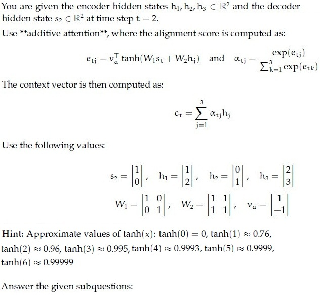

**Figure 49.** Additive attention formulation and values for Passage 7 (Questions 278–285).

e21:_________________

**Correct answer:** `-0.01 to 0.01`  
**Source evidence:** Official accepted answer/range '-0.01 to 0.01' in Possible Answers field on PDF page 20 with green text.

**Worked explanation:** Pending independent analysis.

### da5006_2025T2_Q2_NA · Q279 · 0.5 marks · ID 6406531333837

**Question ID:** `6406531333837` · **Type:** SA · **Marks:** 0.5  
**PDF pages:** 20, 21

**Comprehension:**

You are given the encoder hidden states $h_1, h_2, h_3 \in \mathbb{R}^2$ and the decoder hidden state $s_2 \in \mathbb{R}^2$ at time step $t = 2$.
Use **additive attention**, where $e_{tj} = v_a^T \tanh(W_s s_t + W_h h_j)$ and context vector $c_t = \sum_{j=1}^3 \alpha_{tj} h_j$.
*(Refer to Figure 34 in Question 278 for values and formulation).*

Answer the given subquestions:

e22:_________________

**Correct answer:** `-0.462`  
**Source evidence:** Official accepted answer/range '-0.462' in Possible Answers field on PDF page 21 with green text.

**Worked explanation:** Pending independent analysis.

### da5006_2025T2_Q2_NA · Q280 · 0.5 marks · ID 6406531333838

**Question ID:** `6406531333838` · **Type:** SA · **Marks:** 0.5  
**PDF pages:** 21

**Comprehension:**

You are given the encoder hidden states $h_1, h_2, h_3 \in \mathbb{R}^2$ and the decoder hidden state $s_2 \in \mathbb{R}^2$ at time step $t = 2$.
Use **additive attention**, where $e_{tj} = v_a^T \tanh(W_s s_t + W_h h_j)$ and context vector $c_t = \sum_{j=1}^3 \alpha_{tj} h_j$.
*(Refer to Figure 34 in Question 278 for values and formulation).*

Answer the given subquestions:

e23:_________________

**Correct answer:** `0.462`  
**Source evidence:** Official accepted answer/range '0.462' in Possible Answers field on PDF page 21 with green text.

**Worked explanation:** Pending independent analysis.

### da5006_2025T2_Q2_NA · Q281 · 0.5 marks · ID 6406531333839

**Question ID:** `6406531333839` · **Type:** SA · **Marks:** 0.5  
**PDF pages:** 21

**Comprehension:**

You are given the encoder hidden states $h_1, h_2, h_3 \in \mathbb{R}^2$ and the decoder hidden state $s_2 \in \mathbb{R}^2$ at time step $t = 2$.
Use **additive attention**, where $e_{tj} = v_a^T \tanh(W_s s_t + W_h h_j)$ and context vector $c_t = \sum_{j=1}^3 \alpha_{tj} h_j$.
*(Refer to Figure 34 in Question 278 for values and formulation).*

Answer the given subquestions:

α21:_________________

**Correct answer:** `0.32 to 0.34`  
**Source evidence:** Official accepted answer/range '0.32 to 0.34' in Possible Answers field on PDF page 21 with green text.

**Worked explanation:** Pending independent analysis.

### da5006_2025T2_Q2_NA · Q282 · 0.5 marks · ID 6406531333840

**Question ID:** `6406531333840` · **Type:** SA · **Marks:** 0.5  
**PDF pages:** 21, 22

**Comprehension:**

You are given the encoder hidden states $h_1, h_2, h_3 \in \mathbb{R}^2$ and the decoder hidden state $s_2 \in \mathbb{R}^2$ at time step $t = 2$.
Use **additive attention**, where $e_{tj} = v_a^T \tanh(W_s s_t + W_h h_j)$ and context vector $c_t = \sum_{j=1}^3 \alpha_{tj} h_j$.
*(Refer to Figure 34 in Question 278 for values and formulation).*

Answer the given subquestions:

α22:_________________

**Correct answer:** `0.22 to 0.24`  
**Source evidence:** Official accepted answer/range '0.22 to 0.24' in Possible Answers field on PDF page 22 with green text.

**Worked explanation:** Pending independent analysis.

### da5006_2025T2_Q2_NA · Q283 · 0.5 marks · ID 6406531333841

**Question ID:** `6406531333841` · **Type:** SA · **Marks:** 0.5  
**PDF pages:** 22

**Comprehension:**

You are given the encoder hidden states $h_1, h_2, h_3 \in \mathbb{R}^2$ and the decoder hidden state $s_2 \in \mathbb{R}^2$ at time step $t = 2$.
Use **additive attention**, where $e_{tj} = v_a^T \tanh(W_s s_t + W_h h_j)$ and context vector $c_t = \sum_{j=1}^3 \alpha_{tj} h_j$.
*(Refer to Figure 34 in Question 278 for values and formulation).*

Answer the given subquestions:

α23:_________________

**Correct answer:** `0.43 to 0.45`  
**Source evidence:** Official accepted answer/range '0.43 to 0.45' in Possible Answers field on PDF page 22 with green text.

**Worked explanation:** Pending independent analysis.

### da5006_2025T2_Q2_NA · Q284 · 0.5 marks · ID 6406531333842

**Question ID:** `6406531333842` · **Type:** SA · **Marks:** 0.5  
**PDF pages:** 22

**Comprehension:**

You are given the encoder hidden states $h_1, h_2, h_3 \in \mathbb{R}^2$ and the decoder hidden state $s_2 \in \mathbb{R}^2$ at time step $t = 2$.
Use **additive attention**, where $e_{tj} = v_a^T \tanh(W_s s_t + W_h h_j)$ and context vector $c_t = \sum_{j=1}^3 \alpha_{tj} h_j$.
*(Refer to Figure 34 in Question 278 for values and formulation).*

Answer the given subquestions:

c21:_________________

**Correct answer:** `1.4 to 1.6`  
**Source evidence:** Official accepted answer/range '1.4 to 1.6' in Possible Answers field on PDF page 22 with green text.

**Worked explanation:** Pending independent analysis.

### da5006_2025T2_Q2_NA · Q285 · 0.5 marks · ID 6406531333843

**Question ID:** `6406531333843` · **Type:** SA · **Marks:** 0.5  
**PDF pages:** 22

**Comprehension:**

You are given the encoder hidden states $h_1, h_2, h_3 \in \mathbb{R}^2$ and the decoder hidden state $s_2 \in \mathbb{R}^2$ at time step $t = 2$.
Use **additive attention**, where $e_{tj} = v_a^T \tanh(W_s s_t + W_h h_j)$ and context vector $c_t = \sum_{j=1}^3 \alpha_{tj} h_j$.
*(Refer to Figure 34 in Question 278 for values and formulation).*

Answer the given subquestions:

c22:_________________

**Correct answer:** `2.4 to 2.6`  
**Source evidence:** Official accepted answer/range '2.4 to 2.6' in Possible Answers field on PDF page 22 with green text.

**Worked explanation:** Pending independent analysis.

### da5006_2025T3_Q2_NA · Q137 · 2 marks · ID 6406531815729

**Question ID:** `6406531815729` · **Type:** Multiple Choice Question · **Marks:** 2  
**PDF pages:** 4

Which one of the following statements is True?

**Options**

**A.** Attention mechanisms can be applied to the bidirectional RNN model  
*Option ID:* `6406535903110`

**B.** An image captioning network cannot be trained end-to-end even though we are using 2 different modalities to train the network  
*Option ID:* `6406535903111`

**C.** One of the key components in the vanilla transformer are the recurrent connections that help them to deal with variable input length.  
*Option ID:* `6406535903112`

**D.** All Attention mechanisms can be applied to the bidirectional RNN model, An image captioning network cannot be trained end-to-end even though we are using 2 different modalities to train the network, One of the key components in the vanilla transformer are the recurrent connections that help them to deal with variable input length.  
*Option ID:* `6406535903113`

**E.** None of these  
*Option ID:* `6406535903114`

**Correct answer:** **A** — Attention mechanisms can be applied to the bidirectional RNN model.  
**Source evidence:** Option A (6406535903110) in green text (0x8000) with check icon, PDF page 4.

**Worked explanation:** Pending independent analysis.

### da5006_2025T3_Q2_NA · Q140 · 2 marks · ID 6406531815732

**Question ID:** `6406531815732` · **Type:** Multiple Choice Question · **Marks:** 2  
**PDF pages:** 5, 6

Match the following attention mechanisms to their corresponding alignment score functions:

| Attention Mechanism | Alignment Score Function |
| :--- | :--- |
| (1) General Attention | (i) $v_a^T \tanh(W_a [s_t; h_i])$ |
| (2) Content-Based Attention | (ii) $\alpha_{t,i} = \text{softmax}(W_a s_t)$ |
| (3) Dot-Product Attention | (iii) $s_t^T h_i$ |
| (4) Additive Attention | (iv) $\cos(s_t, h_i)$ |
| (5) Location-Based Attention | (v) $s_t^T W_a h_i$ |

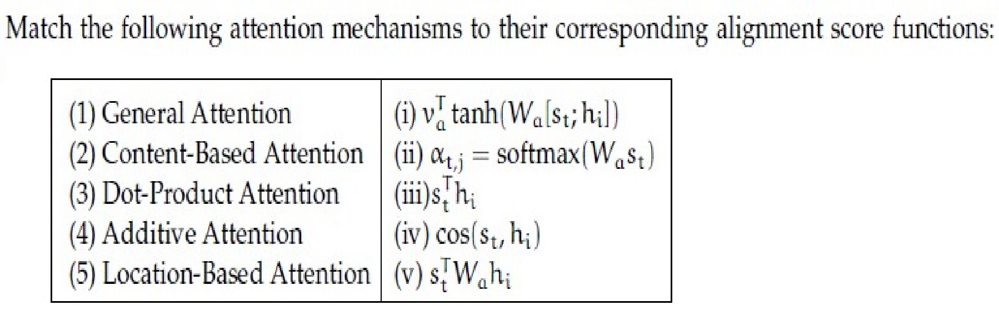

**Figure 50.** Attention mechanisms matching table for Question 140.

**Options**

**A.** 1→iii, 2→ii, 3→v, 4→iv,5→i  
*Option ID:* `6406535903123`

**B.** 1→iii, 2→iv, 3→i, 4→ii,5→v  
*Option ID:* `6406535903124`

**C.** 1→i, 2→iii, 3→iv, 4→ii,5→v  
*Option ID:* `6406535903125`

**D.** 1→v, 2→iv, 3→iii, 4→i,5→ii  
*Option ID:* `6406535903126`

**Correct answer:** **D** — 1→v, 2→iv, 3→iii, 4→i,5→ii.  
**Source evidence:** Option D (6406535903126) in green text (0x8000) with check icon, PDF page 6.

**Worked explanation:** Pending independent analysis.

### da5006_2025T3_Q2_NA · Q143 · 2 marks · ID 6406531815735

**Question ID:** `6406531815735` · **Type:** Multiple Choice Question · **Marks:** 2  
**PDF pages:** 7

Which one of the following statements is false? (Pick the most appropriate one.)

**Options**

**A.** Attention mechanisms cannot be applied to the bidirectional RNN model  
*Option ID:* `6406535903135`

**B.** An image captioning network cannot be trained end-to-end even though we are using 2 different modalities to train the network  
*Option ID:* `6406535903136`

**C.** One of the key components in the vanilla transformer is the recurrent connection that help them to deal with variable input length.  
*Option ID:* `6406535903137`

**D.** All of these  
*Option ID:* `6406535903138`

**Correct answer:** **D** — All of these.  
**Source evidence:** Option D (6406535903138) in green text (0x8000) with check icon, PDF page 7.

**Worked explanation:** Pending independent analysis.

### da5006_2025T3_Q2_NA · Q165 · 0.5 marks · ID 6406531815762

**Question ID:** `6406531815762` · **Type:** Short Answer · **Marks:** 0.5  
**PDF pages:** 16, 17

You are given the encoder hidden states $h_1, h_2, h_3 \in \mathbb{R}^2$ and the decoder hidden state $s_2 \in \mathbb{R}^2$ at time step $t = 2$.

Use dot-product attention, where the attention score is computed as:
$$e_{tj} = s_t^T h_j \quad \text{and} \quad \alpha_{tj} = \frac{\exp(e_{tj})}{\sum_{k=1}^3 \exp(e_{tk})}$$

The context vector is then computed as:
$$c_t = \sum_{j=1}^3 \alpha_{tj} h_j$$

Use the following values:
$$h_1 = \begin{bmatrix} 1 \\ 0 \end{bmatrix}, \quad h_2 = \begin{bmatrix} 0 \\ 2 \end{bmatrix}, \quad h_3 = \begin{bmatrix} 2 \\ 1 \end{bmatrix}, \quad s_2 = \begin{bmatrix} 1 \\ 0 \end{bmatrix}$$

Note: Use approximate values of exponential $\exp(1) \approx 2.72, \exp(2) \approx 7.39$, etc.

Answer the given subquestion:

$e_{21}:$

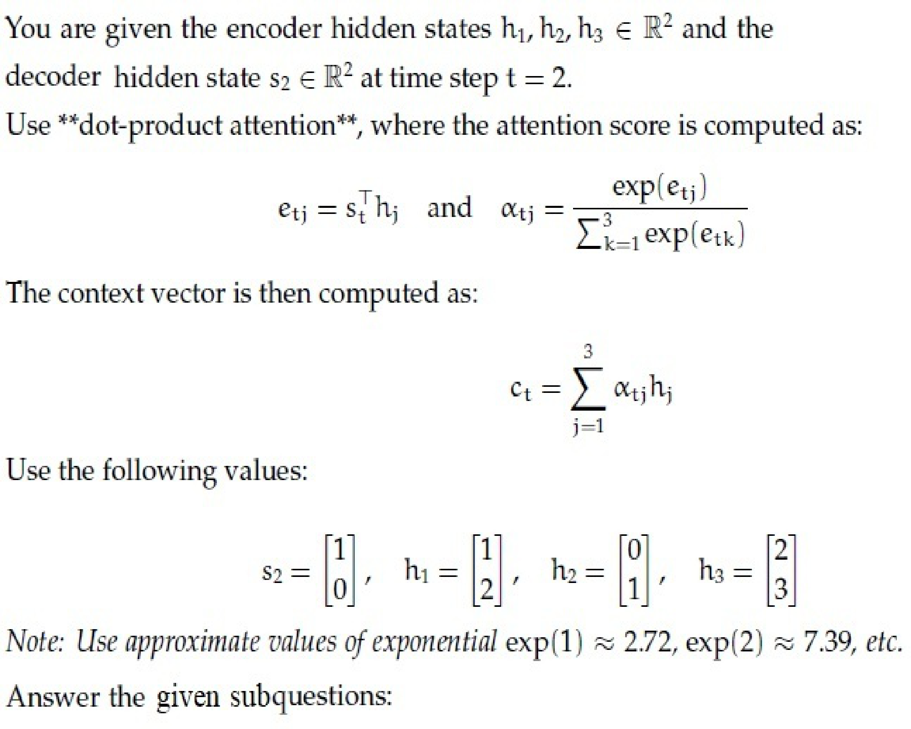

**Figure 51.** Dot-product attention equations and vector values for Questions 165 to 172.

**Figure 52.** Subquestion stem for Question 165.

**Correct answer:** `1`  
**Source evidence:** Green text (0x8000) under Possible Answers : 1, PDF page 17.

**Worked explanation:** Pending independent analysis.

### da5006_2025T3_Q2_NA · Q166 · 0.5 marks · ID 6406531815763

**Question ID:** `6406531815763` · **Type:** Short Answer · **Marks:** 0.5  
**PDF pages:** 17

Refer to the dot-product attention specifications in Question 165.

Answer the given subquestion:

$e_{22}:$

**Figure 53.** Subquestion stem for Question 166.

**Correct answer:** `0`  
**Source evidence:** Green text (0x8000) under Possible Answers : 0, PDF page 17.

**Worked explanation:** Pending independent analysis.

### da5006_2025T3_Q2_NA · Q167 · 0.5 marks · ID 6406531815764

**Question ID:** `6406531815764` · **Type:** Short Answer · **Marks:** 0.5  
**PDF pages:** 17

Refer to the dot-product attention specifications in Question 165.

Answer the given subquestion:

$e_{23}:$

**Figure 54.** Subquestion stem for Question 167.

**Correct answer:** `2`  
**Source evidence:** Green text (0x8000) under Possible Answers : 2, PDF page 17.

**Worked explanation:** Pending independent analysis.

### da5006_2025T3_Q2_NA · Q168 · 0.5 marks · ID 6406531815765

**Question ID:** `6406531815765` · **Type:** Short Answer · **Marks:** 0.5  
**PDF pages:** 17, 18

Refer to the dot-product attention specifications in Question 165.

Answer the given subquestion:

$\alpha_{21}:$

**Figure 55.** Subquestion stem for Question 168.

**Correct answer:** `0.24 to 0.25`  
**Source evidence:** Green text (0x8000) under Possible Answers : 0.24 to 0.25, PDF page 18.

**Worked explanation:** Pending independent analysis.

### da5006_2025T3_Q2_NA · Q169 · 0.5 marks · ID 6406531815766

**Question ID:** `6406531815766` · **Type:** Short Answer · **Marks:** 0.5  
**PDF pages:** 18

Refer to the dot-product attention specifications in Question 165.

Answer the given subquestion:

$\alpha_{22}:$

**Figure 56.** Subquestion stem for Question 169.

**Correct answer:** `0.09 to 0.1`  
**Source evidence:** Green text (0x8000) under Possible Answers : 0.09 to 0.1, PDF page 18.

**Worked explanation:** Pending independent analysis.

### da5006_2025T3_Q2_NA · Q170 · 0.5 marks · ID 6406531815767

**Question ID:** `6406531815767` · **Type:** Short Answer · **Marks:** 0.5  
**PDF pages:** 18

Refer to the dot-product attention specifications in Question 165.

Answer the given subquestion:

$\alpha_{23}:$

**Figure 57.** Subquestion stem for Question 170.

**Correct answer:** `0.66 to 0.68`  
**Source evidence:** Green text (0x8000) under Possible Answers : 0.66 to 0.68, PDF page 18.

**Worked explanation:** Pending independent analysis.

### da5006_2025T3_Q2_NA · Q171 · 0.5 marks · ID 6406531815768

**Question ID:** `6406531815768` · **Type:** Short Answer · **Marks:** 0.5  
**PDF pages:** 18

Refer to the dot-product attention specifications in Question 165.

Answer the given subquestion:

$c_{21}:$

**Figure 58.** Subquestion stem for Question 171.

**Correct answer:** `1.5 to 1.6`  
**Source evidence:** Green text (0x8000) under Possible Answers : 1.5 to 1.6, PDF page 18.

**Worked explanation:** Pending independent analysis.

### da5006_2025T3_Q2_NA · Q172 · 0.5 marks · ID 6406531815769

**Question ID:** `6406531815769` · **Type:** Short Answer · **Marks:** 0.5  
**PDF pages:** 19

Refer to the dot-product attention specifications in Question 165.

Answer the given subquestion:

$c_{22}:$

**Figure 59.** Subquestion stem for Question 172.

**Correct answer:** `2.5 to 2.6`  
**Source evidence:** Green text (0x8000) under Possible Answers : 2.5 to 2.6, PDF page 19.

**Worked explanation:** Pending independent analysis.

### da5006_2025T3_Q2_NA · Q173 · 0.5 marks · ID 6406531815771

**Question ID:** `6406531815771` · **Type:** Short Answer · **Marks:** 0.5  
**PDF pages:** 19, 20

You are given the encoder hidden states $h_1, h_2, h_3 \in \mathbb{R}^2$ and the decoder hidden state $s_2 \in \mathbb{R}^2$ at time step $t = 2$.

Use additive attention, where the alignment score is computed as:
$$e_{tj} = v_a^T \tanh(W_s s_t + W_e h_j) \quad \text{and} \quad \alpha_{tj} = \frac{\exp(e_{tj})}{\sum_{k=1}^3 \exp(e_{tk})}$$

The context vector is then computed as:
$$c_t = \sum_{j=1}^3 \alpha_{tj} h_j$$

Use the following values:
$$h_1 = \begin{bmatrix} 1 \\ 0 \end{bmatrix}, \quad h_2 = \begin{bmatrix} 1 \\ 1 \end{bmatrix}, \quad h_3 = \begin{bmatrix} 0 \\ 1 \end{bmatrix}, \quad s_2 = \begin{bmatrix} 2 \\ 1 \end{bmatrix}$$
$$W_s = \begin{bmatrix} 1 & 0 \\ 0 & 1 \end{bmatrix}, \quad W_e = \begin{bmatrix} 1 & 1 \\ 1 & 1 \end{bmatrix}, \quad v_a = \begin{bmatrix} 1 \\ -1 \end{bmatrix}$$

Answer the given subquestion:

$e_{21}:$

**Figure 60.** Additive attention equations and parameter values for Questions 173 to 179.

**Figure 61.** Subquestion stem for Question 173.

**Correct answer:** `-0.01 to 0.01`  
**Source evidence:** Green text (0x8000) under Possible Answers : -0.01 to 0.01, PDF page 20.

**Worked explanation:** Pending independent analysis.

### da5006_2025T3_Q2_NA · Q174 · 0.5 marks · ID 6406531815772

**Question ID:** `6406531815772` · **Type:** Short Answer · **Marks:** 0.5  
**PDF pages:** 20

Refer to the additive attention specifications in Question 173.

Answer the given subquestion:

$e_{22}:$

**Figure 62.** Subquestion stem for Question 174.

**Correct answer:** `-0.463 to -0.461`  
**Source evidence:** Green text (0x8000) under Possible Answers : -0.463 to -0.461, PDF page 20.

**Worked explanation:** Pending independent analysis.

### da5006_2025T3_Q2_NA · Q175 · 0.5 marks · ID 6406531815773

**Question ID:** `6406531815773` · **Type:** Short Answer · **Marks:** 0.5  
**PDF pages:** 20

Refer to the additive attention specifications in Question 173.

Answer the given subquestion:

$e_{23}:$

**Figure 63.** Subquestion stem for Question 175.

**Correct answer:** `0.461 to 0.463`  
**Source evidence:** Green text (0x8000) under Possible Answers : 0.461 to 0.463, PDF page 20.

**Worked explanation:** Pending independent analysis.

### da5006_2025T3_Q2_NA · Q176 · 0.5 marks · ID 6406531815774

**Question ID:** `6406531815774` · **Type:** Short Answer · **Marks:** 0.5  
**PDF pages:** 20, 21

Refer to the additive attention specifications in Question 173.

Answer the given subquestion:

$\alpha_{21}:$

**Figure 64.** Subquestion stem for Question 176.

**Correct answer:** `0.32 to 0.34`  
**Source evidence:** Green text (0x8000) under Possible Answers : 0.32 to 0.34, PDF page 21.

**Worked explanation:** Pending independent analysis.

### da5006_2025T3_Q2_NA · Q177 · 0.5 marks · ID 6406531815775

**Question ID:** `6406531815775` · **Type:** Short Answer · **Marks:** 0.5  
**PDF pages:** 21

Refer to the additive attention specifications in Question 173.

Answer the given subquestion:

$\alpha_{22}:$

**Figure 65.** Subquestion stem for Question 177.

**Correct answer:** `0.22 to 0.24`  
**Source evidence:** Green text (0x8000) under Possible Answers : 0.22 to 0.24, PDF page 21.

**Worked explanation:** Pending independent analysis.

### da5006_2025T3_Q2_NA · Q178 · 0.5 marks · ID 6406531815776

**Question ID:** `6406531815776` · **Type:** Short Answer · **Marks:** 0.5  
**PDF pages:** 21

Refer to the additive attention specifications in Question 173.

Answer the given subquestion:

$\alpha_{23}:$

**Figure 66.** Subquestion stem for Question 178.

**Correct answer:** `0.43 to 0.45`  
**Source evidence:** Green text (0x8000) under Possible Answers : 0.43 to 0.45, PDF page 21.

**Worked explanation:** Pending independent analysis.

### da5006_2025T3_Q2_NA · Q179 · 0.5 marks · ID 6406531815777

**Question ID:** `6406531815777` · **Type:** Short Answer · **Marks:** 0.5  
**PDF pages:** 21

Refer to the additive attention specifications in Question 173.

Answer the given subquestion:

$c_{21}:$

**Figure 67.** Subquestion stem for Question 179.

**Correct answer:** Answer not verifiable from the source PDF.  
**Source evidence:** Header 'Possible Answers :' present at page bottom margin (y=792.65-808.97), but numerical answer range is truncated off page., PDF page 21.

**Worked explanation:** Pending independent analysis.

### da5006_2026T1_Q2_NA · Q15 · 1 marks · ID 6406532040102

> [!NOTE] Week assignment uncertain: Self-attention is closest to sequence attention within Quiz 2 scope; transformer-specific taxonomy lies outside it.

**Question ID:** `6406532040102` · **Type:** MCQ · **Marks:** 1  
**PDF pages:** 6

Which statement is true?

**Options**

**A.** Transformers process sequences sequentially but utilize parallelized loss computation to speed up training.  
*Option ID:* `6406536642537`

**B.** The attention mechanism strictly limits the context window size, whereas RNNs have a theoretically infinite context window in practice.  
*Option ID:* `6406536642538`

**C.** Self-attention enables direct interactions between any pair of tokens within a layer.  
*Option ID:* `6406536642539`

**D.** Transformers inherently encode positional information in their feed-forward weights, eliminating the need for explicit sequence tracking.  
*Option ID:* `6406536642540`

**Correct answer:** **C** — Self-attention enables direct interactions between any pair of tokens within a layer..  
**Source evidence:** Green option text (0x8000) and check icon (xref 1768) for Option ID 6406536642539, PDF page 6.

**Worked explanation:** Pending independent analysis.

### da5006_2026T1_Q2_NA · Q24 · 1 marks · ID 6406532040111

**Question ID:** `6406532040111` · **Type:** SA · **Marks:** 1  
**PDF pages:** 9

Let query $q = [1,2]^T$ and keys:  
$k_1 = [1,0]^T$, $k_2 = [0,1]^T$, $k_3 = [1,1]^T$.  
Scores $s_i = q^T k_i$. Use softmax over scores.  
Use $\exp(1) = 2.72$, $\exp(2) = 7.39$, $\exp(3) = 20.09$.  

What is $\alpha_3$ (the attention weight for $k_3$)? Provide a value in a reasonable range.

**Correct answer:** 0.64 to 0.69  
**Source evidence:** Green text in 'Possible Answers : 0.64 to 0.69', PDF page 9.

**Worked explanation:** Pending independent analysis.

### da5006_2026T2_Q2_NA · Q10 · 1 marks · ID 6406532194394

> [!NOTE] Week assignment uncertain: Self-attention is closest to sequence attention within Quiz 2 scope; transformer-specific taxonomy lies outside it.

**Question ID:** `6406532194394` · **Type:** MCQ · **Marks:** 1  
**PDF pages:** 4

Which statement is true?

**Options**

**A.** Transformers rely on recurrence to model sequences.  
*Option ID:* `6406537126070`

**B.** Transformers cannot handle variable-length sequences.  
*Option ID:* `6406537126071`

**C.** Self-attention enables direct interactions between any pair of tokens within a layer.  
*Option ID:* `6406537126072`

**D.** Transformers require optical flow for vision tasks.  
*Option ID:* `6406537126073`

**Correct answer:** **C** — Self-attention enables direct interactions between any pair of tokens within a layer..  
**Source evidence:** Option C (6406537126072) is rendered in green font (#008000) with a checkmark icon (xref 1714).

**Worked explanation:** Pending independent analysis.

### da5006_2026T2_Q2_NA · Q23 · 4 marks · ID 6406532194403

**Question ID:** `6406532194403` · **Type:** SA · **Marks:** 4  
**PDF pages:** 8

Let query q = [1,2]^T and keys:k1 = [1,0]^T, k2 = [0,1]^T, k3 = [1,1]^T. Scores si = q^T ki. Use softmax over scores. Use exp(1)=2.72, exp(2)=7.39, exp(3)=20.09. 
What is α3 (the attention weight for k3)? Provide a value in a reasonable range.

**Response type:** Numeric  
**Evaluation required:** Yes  
**Answers type:** Range  

**Correct answer:** 0.6 to 0.69  
**Source evidence:** Source key specifies Possible Answers : 0.6 to 0.69 (Answers Type : Range, green font #008000).

**Worked explanation:** Pending independent analysis.

## Topic: Soft and hard attention

| Done | Paper | Q# | Marks | Type |
| :---: | :--- | ---: | ---: | :--- |
| ☐ | da5006_2024T2_ET_AN | 276 | 2 | MSQ |
| ☐ | da5006_2024T1_Q2_NA | 152 | 2 | MSQ |
| ☐ | da5006_2024T1_Q2_NA | 163 | 2 | MCQ |
| ☐ | da5006_2024T2_Q2_NA | 131 | 2 | MCQ |
| ☐ | da5006_2024T2_Q2_NA | 145 | 2 | MSQ |
| ☐ | da5006_2024T3_Q2_NA | 151 | 2 | MSQ |
| ☐ | da5006_2025T1_Q2_NA | 259 | 2 | MSQ |
| ☐ | da5006_2025T2_Q2_NA | 248 | 3 | MSQ |
| ☐ | da5006_2025T3_Q2_NA | 145 | 3 | Multiple Select Question |
| ☐ | da5006_2026T1_Q2_NA | 18 | 1 | MSQ |
| ☐ | da5006_2026T2_Q2_NA | 17 | 3 | MSQ |

### da5006_2024T2_ET_AN · Q276 · 2 marks · ID 640653904309

> [!NOTE] Week assignment uncertain: Tests attention on CNN feature maps and interpretability alongside autoencoders.

**Question ID:** `640653904309` · **Type:** MSQ · **Marks:** 2  
**PDF pages:** 14

Which of the following statements are true? (Select all possible correct options)

**Options**

**A.** To apply attention on images, we can take the feature map from CNN of dimension $m \times n \times c$ and then unroll it into $m \times n$ vectors of dimensions $1 \times 1 \times c$ and apply attention to each of these $m \times n$ vectors  

**Figure 68.** Option A image for Question 276.
*Option ID:* `6406533045047`

**B.** Autoencoder can be equivalent to Principal Component Analysis (PCA) provided we make use of non-linear activation functions  

**Figure 69.** Option B image for Question 276.
*Option ID:* `6406533045048`

**C.** Explainability can be obtained as a byproduct of attention  

**Figure 70.** Option C image for Question 276.
*Option ID:* `6406533045049`

**D.** In the denoising autoencoder, we aim to reconstruct the noisy input as it is  

**Figure 71.** Option D image for Question 276.
*Option ID:* `6406533045050`

**Correct answer:** **A**, **C** — A, C  
**Source evidence:** Option 6406533045047 has green label (#008000) and checkmark icon. (PDF page 14).

**Worked explanation:** Pending independent analysis.

### da5006_2024T1_Q2_NA · Q152 · 2 marks · ID 640653766159

**Question ID:** `640653766159` · **Type:** MSQ · **Marks:** 2  
**PDF pages:** 4

Which of the following is true regarding Hard Attention and Soft Attention?

**Options**

**A.** Soft Attention is smooth and differentiable  
*Option ID:* `6406532564211`

**B.** Variance reduction techniques are used to train Hard Attention models  
*Option ID:* `6406532564212`

**C.** Soft Attention is computationally cheaper than Hard Attention when the source input is large  
*Option ID:* `6406532564213`

**D.** The inference (test time) overhead is low in Hard Attention when compared to Soft Attention models  
*Option ID:* `6406532564214`

**Correct answer:** **A**, **B**, **D** — Soft Attention is smooth and differentiable; Variance reduction techniques are used to train Hard Attention models; The inference (test time) overhead is low in Hard Attention when compared to Soft Attention models  
**Source evidence:** Green option text (0x8000) and check icon (xref 18) for Option ID 6406532564211, PDF page 4; Green option text (0x8000) and check icon (xref 18) for Option ID 6406532564212, PDF page 4; Green option text (0x8000) and check icon (xref 18) for Option ID 6406532564214, PDF page 4.

**Worked explanation:** Pending independent analysis.

### da5006_2024T1_Q2_NA · Q163 · 2 marks · ID 640653766160

**Question ID:** `640653766160` · **Type:** MCQ · **Marks:** 2  
**PDF pages:** 10, 11

Consider an attention model for the image captioning task. At a particular time step $t$, the context vector $z$ is obtained from the feature map of the final layer of the CNN and attention weights obtained from RNN. If RNN’s attention output is $\begin{pmatrix} 0.25 & 0 \\ 0.75 & 0 \end{pmatrix}$ and the feature map has values $\begin{pmatrix} v_1 & v_2 \\ v_3 & v_4 \end{pmatrix}$ where $v_1, v_2, v_3, v_4$ are $d$-dimensional vectors, what is the value of the context vector $z$ under soft and hard attention mechanisms respectively?

**Figure 72.** Source diagram and formulation for Question 163.

**Options**

**A.** $\frac{v_1 + 3v_3}{4}, v_3$  

**Figure 73.** Option A for Question 163.
*Option ID:* `6406532564215`

**B.** $\frac{2v_1 + v_2 + 2v_3}{4}, \frac{2v_1 + v_2 + 2v_3}{4}$  

**Figure 74.** Option B for Question 163.
*Option ID:* `6406532564216`

**C.** $\frac{v_1 + v_2 + v_3 + v_4}{4}, \frac{2v_2 + v_3}{3}$  

**Figure 75.** Option C for Question 163.
*Option ID:* `6406532564217`

**D.** $\frac{3v_1 + v_3}{4}, v_1$  

**Figure 76.** Option D for Question 163.
*Option ID:* `6406532564218`

**Correct answer:** **A** — $\frac{v_1 + 3v_3}{4}, v_3$  
**Source evidence:** Green check icon (xref 18) next to Option ID 6406532564215, PDF page 10.

**Worked explanation:** Pending independent analysis.

### da5006_2024T2_Q2_NA · Q131 · 2 marks · ID 640653856607

**Question ID:** `640653856607` · **Type:** MCQ · **Marks:** 2  
**PDF pages:** 7, 8

Consider an attention model for the image captioning task. At a particular time step $t$, the context vector $z$ is obtained from the feature map of the final layer of the CNN and attention weights obtained from RNN. If RNN’s attention output is $\begin{pmatrix} 0.75 & 0.0 \\ 0.0 & 0.25 \end{pmatrix}$ and feature map from CNN is $\begin{pmatrix} v_1 & v_2 \\ v_3 & v_4 \end{pmatrix}$, where $v_1, v_2, v_3, v_4$ are $d$-dimensional vectors, what is the value of the context vector $z$ under soft and hard attention mechanisms respectively?

**Figure 77.** Source problem specification for Question 131.

**Options**

**A.** 

**Figure 78.** Option A formula for Question 131.

$$\frac{v_1 + 3v_4}{4}, v_4$$  
*Option ID:* `6406532878537`

**B.** 

**Figure 79.** Option B formula for Question 131.

$$\frac{2v_1 + v_2 + 2v_3}{4}, \frac{2v_1 + v_2 + 2v_3}{4}$$  
*Option ID:* `6406532878538`

**C.** 

**Figure 80.** Option C formula for Question 131.

$$\frac{v_1 + v_2 + v_3 + v_4}{4}, \frac{2v_2 + v_3}{4}$$  
*Option ID:* `6406532878539`

**D.** 

**Figure 81.** Option D formula for Question 131.

$$\frac{3v_1 + v_4}{4}, v_1$$  
*Option ID:* `6406532878540`

**Correct answer:** **D** — \frac{3v_1 + v_4}{4}, v_1.  
**Source evidence:** Green check icon beside option ID 6406532878540 on page 8.

**Worked explanation:** Pending independent analysis.

### da5006_2024T2_Q2_NA · Q145 · 2 marks · ID 640653856606

**Question ID:** `640653856606` · **Type:** MSQ · **Marks:** 2  
**PDF pages:** 13, 14

Which of the following is true regarding Hard Attention and Soft Attention?

**Options**

**A.** Soft Attention is smooth and differentiable  
*Option ID:* `6406532878533`

**B.** Variance reduction techniques are used to train Soft Attention models  
*Option ID:* `6406532878534`

**C.** Soft Attention is computationally cheaper than Hard Attention when the source input is large  
*Option ID:* `6406532878535`

**D.** The inference (test time) overhead is low in Hard Attention when compared to Soft Attention models  
*Option ID:* `6406532878536`

**Correct answer:** **A**, **C** — Soft Attention is smooth and differentiable; Soft Attention is computationally cheaper than Hard Attention when the source input is large.  
**Source evidence:** Green check icon beside option ID 6406532878533 on page 13; Green check icon beside option ID 6406532878535 on page 14.

**Worked explanation:** Pending independent analysis.

### da5006_2024T3_Q2_NA · Q151 · 2 marks · ID 6406531031084

**Question ID:** `6406531031084` · **Type:** MSQ · **Marks:** 2  
**PDF pages:** 9, 10

Which of the following is true regarding Hard Attention and Soft Attention?

**Options**

**A.** Soft Attention is smooth and differentiable  
*Option ID:* `6406533487257`

**B.** Variance reduction techniques are used to train Soft Attention models  
*Option ID:* `6406533487258`

**C.** Soft Attention is computationally cheaper than Hard Attention when the source input is large  
*Option ID:* `6406533487259`

**D.** The inference (test time) overhead is low in Hard Attention when compared to Soft Attention models  
*Option ID:* `6406533487260`

**Correct answer:** **A**, **D**  
**Source evidence:** Green check icons and green text on Option IDs `6406533487257` and `6406533487260`, PDF page 10.

**Worked explanation:** Pending independent analysis.

### da5006_2025T1_Q2_NA · Q259 · 2 marks · ID 6406531168233

**Question ID:** `6406531168233` · **Type:** MSQ · **Marks:** 2  
**PDF pages:** 8

Which of the following is true regarding Hard Attention and Soft Attention?

**Options**

**A.** Soft Attention is smooth and differentiable  
*Option ID:* `6406533940010`

**B.** Variance reduction techniques are used to train Soft Attention models  
*Option ID:* `6406533940011`

**C.** Soft Attention is computationally cheaper than Hard Attention when the source input is large  
*Option ID:* `6406533940012`

**D.** The inference (test time) overhead is low in Hard Attention when compared to Soft Attention models  
*Option ID:* `6406533940013`

**Correct answer:** **A**, **D**  
**Source evidence:** Options 6406533940010 and 6406533940013 marked with green checkmark icons and green text (color 0x8000), PDF page 8.

**Worked explanation:** Pending independent analysis.

### da5006_2025T2_Q2_NA · Q248 · 3 marks · ID 6406531333799

**Question ID:** `6406531333799` · **Type:** MSQ · **Marks:** 3  
**PDF pages:** 7

Which of the following is true regarding Hard Attention and Soft Attention?

**Options**

**A.** Soft Attention is smooth and differentiable  
*Option ID:* `6406534459638`

**B.** Variance reduction techniques are used to train Soft Attention models  
*Option ID:* `6406534459639`

**C.** Soft Attention is computationally cheaper than Hard Attention when the source input is large  
*Option ID:* `6406534459640`

**D.** The inference (test time) overhead is low in Hard Attention when compared to Soft Attention models  
*Option ID:* `6406534459641`

**Correct answer:** **A, C, D** — Soft Attention is smooth and differentiable; Soft Attention is computationally cheaper than Hard Attention when the source input is large; The inference (test time) overhead is low in Hard Attention when compared to Soft Attention models.  
**Source evidence:** Green option ID text 6406534459638 and text 'Soft Attention is smooth and differentiable' with green check icon at [119.02, 331.94, 131.02, 343.94].; Green option ID text 6406534459640 and text 'Soft Attention is computationally cheaper than Hard Attention when the source input is large' with green check icon at [119.02, 373.58, 131.02, 385.58].; Green option ID text 6406534459641 and text 'The inference (test time) overhead is low in Hard Attention when compared to Soft Attention models' with green check icon at [119.02, 410.72, 131.02, 422.72].

**Worked explanation:** Pending independent analysis.

### da5006_2025T3_Q2_NA · Q145 · 3 marks · ID 6406531815736

**Question ID:** `6406531815736` · **Type:** Multiple Select Question · **Marks:** 3  
**PDF pages:** 7, 8

Which of the following is true regarding Hard Attention and Soft Attention?

**Options**

**A.** Soft Attention is smooth and differentiable  
*Option ID:* `6406535903139`

**B.** Variance reduction techniques are used to train Soft Attention models  
*Option ID:* `6406535903140`

**C.** Soft Attention is computationally cheaper than Hard Attention when the source input is large  
*Option ID:* `6406535903141`

**D.** The inference (test time) overhead is low in Hard Attention when compared to Soft Attention models  
*Option ID:* `6406535903142`

**Correct answer:** **A**, **D** — Soft Attention is smooth and differentiable; The inference (test time) overhead is low in Hard Attention when compared to Soft Attention models.  
**Source evidence:** Option A (6406535903139) in green text (0x8000) with check icon, PDF page 8.

**Worked explanation:** Pending independent analysis.

### da5006_2026T1_Q2_NA · Q18 · 1 marks · ID 6406532040105

**Question ID:** `6406532040105` · **Type:** MSQ · **Marks:** 1  
**PDF pages:** 7

Which statements are true ?

**Options**

**A.** Soft attention is differentiable and can be trained with backpropagation.  
*Option ID:* `6406536642549`

**B.** Hard attention often needs sampling + REINFORCE (or similar) due to non-differentiability.  
*Option ID:* `6406536642550`

**C.** Soft attention significantly reduces the computational complexity of the forward pass compared to Hard attention.  
*Option ID:* `6406536642551`

**D.** Cross-attention can align decoder queries to encoder keys/values (e.g., words attending to image regions).  
*Option ID:* `6406536642552`

**Correct answer:** **A**, **B**, **D** — Soft attention is differentiable and can be trained with backpropagation; Hard attention often needs sampling + REINFORCE (or similar) due to non-differentiability; Cross-attention can align decoder queries to encoder keys/values (e.g., words attending to image regions)..  
**Source evidence:** Green option text (0x8000) and check icon (xref 1768) for Option ID 6406536642549, PDF page 7; Green option text (0x8000) and check icon (xref 1768) for Option ID 6406536642550, PDF page 7; Green option text (0x8000) and check icon (xref 1768) for Option ID 6406536642552, PDF page 7.

**Worked explanation:** Pending independent analysis.

### da5006_2026T2_Q2_NA · Q17 · 3 marks · ID 6406532194397

**Question ID:** `6406532194397` · **Type:** MSQ · **Marks:** 3  
**PDF pages:** 6

Which statements are true?

**Options**

**A.** Soft attention is differentiable and can be trained with backpropagation.  
*Option ID:* `6406537126082`

**B.** Hard attention often needs sampling + REINFORCE (or similar) due to non-differentiability.  
*Option ID:* `6406537126083`

**C.** Hard attention always has higher test-time compute than soft attention.  
*Option ID:* `6406537126084`

**D.** Cross-attention can align decoder queries to encoder keys/values (e.g., words attending to image regions).  
*Option ID:* `6406537126085`

**Correct answer:** **A, B, D** — Soft attention is differentiable and can be trained with backpropagation. / Hard attention often needs sampling + REINFORCE (or similar) due to non-differentiability. / Cross-attention can align decoder queries to encoder keys/values (e.g., words attending to image regions)..  
**Source evidence:** Option A (6406537126082) is rendered in green font (#008000) with a checkmark icon (xref 1714).; Option B (6406537126083) is rendered in green font (#008000) with a checkmark icon (xref 1714).; Option D (6406537126085) is rendered in green font (#008000) with a checkmark icon (xref 1714).

**Worked explanation:** Pending independent analysis.

## Topic: Recurrent image captioning and evaluation

| Done | Paper | Q# | Marks | Type |
| :---: | :--- | ---: | ---: | :--- |
| ☐ | da5006_2024T1_ET_AN | 178 | 2 | MCQ |
| ☐ | da5006_2024T2_ET_AN | 275 | 2 | MSQ |
| ☐ | da5006_2024T3_ET_AN | 204 | 2 | Multiple Choice Question (MCQ) |
| ☐ | da5006_2025T2_ET_FN | 163 | 2 | MCQ |
| ☐ | da5006_2024T1_Q2_NA | 167 | 2 | MCQ |
| ☐ | da5006_2024T2_Q2_NA | 127 | 2 | MCQ |
| ☐ | da5006_2024T2_Q2_NA | 132 | 2 | MCQ |
| ☐ | da5006_2024T3_Q2_NA | 144 | 2 | MCQ |
| ☐ | da5006_2024T3_Q2_NA | 146 | 2 | MCQ |
| ☐ | da5006_2025T1_Q2_NA | 257 | 2 | MCQ |

### da5006_2024T1_ET_AN · Q178 · 2 marks · ID 640653821616

> [!NOTE] Week assignment uncertain: Matches caption evaluation, CNN sharing, VAE divergence and image captioning.

**Question ID:** `640653821616` · **Type:** MCQ · **Marks:** 2  
**PDF pages:** 13, 14

Match the following:

1) BLEU score  
2) Parameter sharing  
3) KL divergence  
4) Image captioning  

i) CNN  
ii) GAN  
iii) StyleNet  
iv) Evaluating CNN performance  
v) Evaluating RNN performance  
vi) VAE

**Figure 82.** Source diagram for Question 178.

**Options**

**A.** 1 → ii, 2 → i, 3 → vi, 4 → iv  
*Option ID:* `6406532757370`

**Figure 83.** Source option graphic for Question 178, Option A.

**B.** 1 → v, 2 → i, 3 → vi, 4 → iii  
*Option ID:* `6406532757371`

**Figure 84.** Source option graphic for Question 178, Option B.

**C.** 1 → i, 2 → iv, 3 → ii, 4 → iii  
*Option ID:* `6406532757372`

**Figure 85.** Source option graphic for Question 178, Option C.

**D.** 1 → iv, 2 → iii, 3 → ii, 4 → i  
*Option ID:* `6406532757373`

**Figure 86.** Source option graphic for Question 178, Option D.

**Correct answer:** **B** — 1 → v, 2 → i, 3 → vi, 4 → iii.  
**Source evidence:** Option ID 6406532757371 rendered in green text (#008000) and accompanied by checkmark icon (xref 19) at PDF page 14.

**Worked explanation:** Pending independent analysis.

### da5006_2024T2_ET_AN · Q275 · 2 marks · ID 640653904308

> [!NOTE] Week assignment uncertain: Compares attention, image captioning and transformer architecture statements.

**Question ID:** `640653904308` · **Type:** MSQ · **Marks:** 2  
**PDF pages:** 14

Which one of the following statements is true?

**Options**

**A.** Attention mechanisms cannot be applied to the bidirectional RNN model  
*Option ID:* `6406533045043`

**B.** An image captioning network cannot be trained end-to-end even though we are using 2 different modalities to train the network  
*Option ID:* `6406533045044`

**C.** One of the key components in the vanilla transformer are the recurrent connections that help them to deal with variable input length.  
*Option ID:* `6406533045045`

**D.** None of these  
*Option ID:* `6406533045046`

**Correct answer:** **D** — None of these  
**Source evidence:** Option 6406533045046 is rendered in green text (#008000) with a checkmark icon. (PDF page 14).

**Worked explanation:** Pending independent analysis.

### da5006_2024T3_ET_AN · Q204 · 2 marks · ID 6406531046061

> [!NOTE] Week assignment uncertain: Compares recurrent attention, captioning and transformer statements.

**Question ID:** `6406531046061` · **Type:** Multiple Choice Question (MCQ) · **Marks:** 2  
**PDF pages:** 4, 5

Which one of the following statements is false? (Pick the most appropriate one.)

**Options**

**A.** Attention mechanisms cannot be applied to the bidirectional RNN model  
*Option ID:* `6406533531363`

**B.** An image captioning network cannot be trained end-to-end even though we are using 2 different modalities to train the network  
*Option ID:* `6406533531364`

**C.** One of the key components in the vanilla transformer is the recurrent connection that help them to deal with variable input length.  
*Option ID:* `6406533531365`

**D.** All of these  
*Option ID:* `6406533531366`

**Correct answer:** **D** — All of these.  
**Source evidence:** Option ID 6406533531366 is rendered in green (color #008000) with a checkmark icon.

**Worked explanation:** Pending independent analysis.

### da5006_2025T2_ET_FN · Q163 · 2 marks · ID 6406531422542

> [!NOTE] Week assignment uncertain: Compares recurrent attention, captioning, and transformer properties.

**Question ID:** `6406531422542` · **Type:** MCQ · **Marks:** 2  
**PDF pages:** 5

Which one of the following statements is true?

**Options**

**A.** Attention mechanisms cannot be applied to the bidirectional RNN model  
*Option ID:* `6406534756384`

**B.** An image captioning network cannot be trained end-to-end even though we are using 2 different modalities to train the network  
*Option ID:* `6406534756385`

**C.** One of the key components in the vanilla transformer are the recurrent connections that help them to deal with variable input length.  
*Option ID:* `6406534756386`

**D.** None of these  
*Option ID:* `6406534756387`

**Correct answer:** **D** — None of these.  
**Source evidence:** Option 6406534756387 is rendered in green text (#008000) with a checkmark icon. (PDF page 5).

**Worked explanation:** Pending independent analysis.

### da5006_2024T1_Q2_NA · Q167 · 2 marks · ID 640653766171

> [!NOTE] Week assignment uncertain: Mixed matching includes BLEU and captioning, plus CNN sharing and VAE KL.

**Question ID:** `640653766171` · **Type:** MCQ · **Marks:** 2  
**PDF pages:** 12, 13

Match the following:

| Term | Description / Application |
| :--- | :--- |
| 1) BLEU score | i) CNN |
| 2) Parameter sharing | ii) GAN |
| 3) KL divergence | iii) StyleNet |
| 4) Image captioning | iv) Evaluating CNN performance |
| | v) Evaluating RNN performance |
| | vi) VAE |

**Figure 87.** Source matching table for Question 167.

**Options**

**A.** 1→ iii, 2→ ii, 3 → vi, 4→ i  
*Option ID:* `6406532564243`

**B.** 1→ v, 2→i, 3 → vi, 4→ iii  
*Option ID:* `6406532564244`

**C.** 1→ ii, 2→ i, 3 → ii, 4 → iii  
*Option ID:* `6406532564245`

**D.** 1→ i, 2 →ii, 3 → vi, 4→ iv  
*Option ID:* `6406532564246`

**Correct answer:** **B** — 1→ v, 2→i, 3 → vi, 4→ iii  
**Source evidence:** Green option text (0x8000) and check icon (xref 18) for Option ID 6406532564244, PDF page 13.

**Worked explanation:** Pending independent analysis.

### da5006_2024T2_Q2_NA · Q127 · 2 marks · ID 640653856601

> [!NOTE] Week assignment uncertain: Combines image captioning and recurrent attention with a Transformer statement.

**Question ID:** `640653856601` · **Type:** MCQ · **Marks:** 2  
**PDF pages:** 6

Which one of the following statements is false?

**Options**

**A.** Attention mechanisms cannot be applied to the bidirectional RNN model  
*Option ID:* `6406532878513`

**B.** An image captioning network cannot be trained end-to-end even though we are using 2 different modalities to train the network  
*Option ID:* `6406532878514`

**C.** One of the key components in the vanilla transformer are the recurrent connections that help them to deal with variable input length.  
*Option ID:* `6406532878515`

**D.** All of these  
*Option ID:* `6406532878516`

**Correct answer:** **D** — All of these.  
**Source evidence:** Green check icon beside option ID 6406532878516 on page 6.

**Worked explanation:** Pending independent analysis.

### da5006_2024T2_Q2_NA · Q132 · 2 marks · ID 640653856608

> [!NOTE] Week assignment uncertain: Mixed matching includes BLEU and captioning, plus CNN sharing and VAE KL.

**Question ID:** `640653856608` · **Type:** MCQ · **Marks:** 2  
**PDF pages:** 8

Match the following:

**Figure 88.** Source matching table for Question 132.

| Column 1 | Column 2 |
| :--- | :--- |
| 1) BLEU score | i) CNN |
| 2) Parameter sharing | ii) GAN |
| 3) KL divergence | iii) StyleNet |
| 4) Image captioning | iv) Evaluating CNN performance |
| | v) Evaluating RNN performance |
| | vi) VAE |

**Options**

**A.** 1→ iii, 2→ ii, 3 → vi, 4→ i  
*Option ID:* `6406532878541`

**B.** 1→ v, 2→i, 3 → vi, 4→ iii  
*Option ID:* `6406532878542`

**C.** 1→ ii, 2→ i, 3 → ii, 4 → iii  
*Option ID:* `6406532878543`

**D.** 1→ i, 2 →ii, 3 → vi, 4→ iv  
*Option ID:* `6406532878544`

**Correct answer:** **B** — 1→ v, 2→i, 3 → vi, 4→ iii.  
**Source evidence:** Green check icon beside option ID 6406532878542 on page 8.

**Worked explanation:** Pending independent analysis.

### da5006_2024T3_Q2_NA · Q144 · 2 marks · ID 6406531031079

> [!NOTE] Week assignment uncertain: Combines image captioning and recurrent attention with a Transformer statement.

**Question ID:** `6406531031079` · **Type:** MCQ · **Marks:** 2  
**PDF pages:** 7

Which one of the following statements is false?

**Options**

**A.** Attention mechanisms cannot be applied to the bidirectional RNN model  
*Option ID:* `6406533487237`

**B.** An image captioning network cannot be trained end-to-end even though we are using 2 different modalities to train the network  
*Option ID:* `6406533487238`

**C.** One of the key components in the vanilla transformer are the recurrent connections that help them to deal with variable input length.  
*Option ID:* `6406533487239`

**D.** None of these  
*Option ID:* `6406533487240`

**Correct answer:** **D** — None of these  
**Source evidence:** Green check icon and green text on Option ID `6406533487240`, PDF page 7.

**Worked explanation:** Pending independent analysis.

### da5006_2024T3_Q2_NA · Q146 · 2 marks · ID 6406531031082

> [!NOTE] Week assignment uncertain: Combines image captioning and recurrent attention with a Transformer statement.

**Question ID:** `6406531031082` · **Type:** MCQ · **Marks:** 2  
**PDF pages:** 7, 8

Which one of the following statements is true?

**Options**

**A.** Attention mechanisms cannot be applied to the bidirectional RNN model  
*Option ID:* `6406533487249`

**B.** An image captioning network cannot be trained end-to-end even though we are using 2 different modalities to train the network  
*Option ID:* `6406533487250`

**C.** One of the key components in the vanilla transformer are the recurrent connections that help them to deal with variable input length.  
*Option ID:* `6406533487251`

**D.** None of these  
*Option ID:* `6406533487252`

**Correct answer:** **D** — None of these  
**Source evidence:** Green check icon and green text on Option ID `6406533487252`, PDF page 8.

**Worked explanation:** Pending independent analysis.

### da5006_2025T1_Q2_NA · Q257 · 2 marks · ID 6406531168232

> [!NOTE] Week assignment uncertain: Combines image captioning and recurrent attention with a Transformer statement.

**Question ID:** `6406531168232` · **Type:** MCQ · **Marks:** 2  
**PDF pages:** 7

Which one of the following statements is false? (Pick the most appropriate one.)

**Options**

**A.** Attention mechanisms cannot be applied to the bidirectional RNN model  
*Option ID:* `6406533940006`

**B.** An image captioning network cannot be trained end-to-end even though we are using 2 different modalities to train the network  
*Option ID:* `6406533940007`

**C.** One of the key components in the vanilla transformer is the recurrent connection that help them to deal with variable input length.  
*Option ID:* `6406533940008`

**D.** All of these  
*Option ID:* `6406533940009`

**Correct answer:** **D** — All of these.  
**Source evidence:** Option 6406533940009 marked with green checkmark icon and green text (color 0x8000), PDF page 7.

**Worked explanation:** Pending independent analysis.

