# Week 8 question bank

> Topics inferred from past papers; replace when the official syllabus is available.

**Counts:** ET: 30, Q2: 26; total: 56 questions, 87 marks.

## Topic: Generative models and KL divergence

| Done | Paper | Q# | Marks | Type |
| :--- | :--- | ---: | ---: | :--- |
| [ ] | da5006_2024T1_ET_AN | 185 | 2 | MSQ |
| [ ] | da5006_2024T2_ET_AN | 258 | 2 | MCQ |
| [ ] | da5006_2025T3_ET_FN | 10 | 1 | MSQ |
| [ ] | da5006_2026T2_ET_FN | 28 | 3 | MSQ |
| [ ] | da5006_2024T1_Q2_NA | 171 | 2 | SA |
| [ ] | da5006_2024T1_Q2_NA | 172 | 1 | SA |
| [ ] | da5006_2024T1_Q2_NA | 173 | 1 | SA |
| [ ] | da5006_2024T1_Q2_NA | 174 | 1 | SA |
| [ ] | da5006_2024T2_Q2_NA | 123 | 2 | MCQ |
| [ ] | da5006_2024T2_Q2_NA | 124 | 2 | MCQ |
| [ ] | da5006_2024T2_Q2_NA | 139 | 0.5 | SA |
| [ ] | da5006_2024T2_Q2_NA | 140 | 0.5 | SA |
| [ ] | da5006_2024T2_Q2_NA | 141 | 0.5 | SA |
| [ ] | da5006_2024T2_Q2_NA | 142 | 0.5 | SA |
| [ ] | da5006_2024T2_Q2_NA | 143 | 2 | MSQ |

### da5006_2024T1_ET_AN · Q185 · 2 marks · ID 640653821621

> [!NOTE] Week assignment uncertain: Relates KL divergence to likelihood; divergence direction is unspecified.

Consider a generative model whose parameters are learned by solving the following optimization problem:

$$\theta^* = \arg\min_\theta \text{dist}(p_\theta, p_{\text{data}})$$

If the distance function $\text{dist}$ is taken as the Kullback-Leibler divergence, the learned estimate is not equivalent to: (Select all possible correct options)

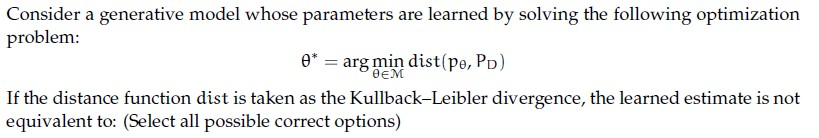

**Figure 1.** Source diagram for Question 185.

**Options**

**A.** Maximum likelihood estimate  
*Option ID:* `6406532757390`

**B.** Minimum likelihood estimate  
*Option ID:* `6406532757391`

**C.** Maximizing mean square error  
*Option ID:* `6406532757392`

**D.** Minimizing mean square error  
*Option ID:* `6406532757393`

**E.** Maximizing negative log likelihood  
*Option ID:* `6406532757394`

**F.** Minimizing negative log likelihood  
*Option ID:* `6406532757395`

**Correct answer:** **B**, **C**, **D**, **E** — Minimum likelihood estimate; Maximizing mean square error; Minimizing mean square error; Maximizing negative log likelihood.

> [!WARNING] The printed KL direction does not imply the maximum-likelihood equivalence used by the key.

**Worked explanation:** Maximum likelihood follows from minimizing $D_{KL}(p_{data}\|p_\theta)$, not generally the reverse order printed in the question. Squared-error equivalence also needs a fixed-variance Gaussian likelihood.

### da5006_2024T2_ET_AN · Q258 · 2 marks · ID 640653904323

What can we do with a generative model?
Match the following (select one among the options provided below):

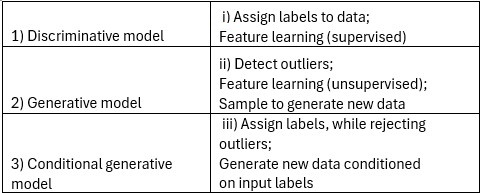

**Figure 2.** Source matching table for Question 258.

| Model Type | Purpose / Capability |
| :--- | :--- |
| 1) Discriminative model | i) Assign labels to data; Feature learning (supervised) |
| 2) Generative model | ii) Detect outliers; Feature learning (unsupervised); Sample to generate new data |
| 3) Conditional generative model | iii) Assign labels, while rejecting outliers; Generate new data conditioned on input labels |

**Options**

**A.** 1→iii,2→i, 3→ii  
*Option ID:* `6406533045073`

**B.** 1→i,2→iii, 3→ii  
*Option ID:* `6406533045074`

**C.** 1→ii,2→iii, 3→i  
*Option ID:* `6406533045075`

**D.** 1→i,2→ii, 3→iii  
*Option ID:* `6406533045076`

**Correct answer:** **D** — 1→i,2→ii, 3→iii

**Worked explanation:** Discriminative models predict labels; generative models can sample from a learned distribution. Conditional generative models additionally condition generation on labels or other inputs.

### da5006_2025T3_ET_FN · Q10 · 1 marks · ID 6406531862824

> [!NOTE] Week assignment uncertain: Compares VAE, GAN, diffusion, and autoregressive generative models.

Which statements about generative models are true? (Select all that apply.)

**Options**

**A.** VAEs optimize a lower bound on the data log-likelihood.  
*Option ID:* `6406536034949`

**B.** GANs perform explicit maximum likelihood estimation.  
*Option ID:* `6406536034950`

**C.** Diffusion models can trade off speed and quality via the number of sampling steps.  
*Option ID:* `6406536034951`

**D.** Autoregressive models factorize the joint distribution into a product of conditionals.  
*Option ID:* `6406536034952`

**Correct answer:** **A**, **C**, **D** — VAEs optimize a lower bound on the data log-likelihood. ; Diffusion models can trade off speed and quality via the number of sampling steps. ; Autoregressive models factorize the joint distribution into a product of conditionals..

**Worked explanation:** The VAE maximizes an evidence lower bound, and autoregressive models factorize a joint density into conditionals. Diffusion sampling steps affect cost and quality; standard GAN training does not explicitly maximize likelihood.

### da5006_2026T2_ET_FN · Q28 · 3 marks · ID 6406532270067

> [!NOTE] Week assignment uncertain: Compares GAN, VAE, and diffusion model principles.

Select all correct statements.

**Options**

**A.** GAN training involves adversarial objectives.  
*Option ID:* `6406537379107`

**B.** VAEs introduce latent variables and regularize an approximate posterior.  
*Option ID:* `6406537379108`

**C.** DDPMs use a noise-based forward process together with a learned reverse denoising process.  
*Option ID:* `6406537379109`

**D.** Classifier-free guidance requires a separate external classifier at sampling time.  
*Option ID:* `6406537379110`

**Correct answer:** **A**, **B**, **C** — GAN training involves adversarial objectives.; VAEs introduce latent variables and regularize an approximate posterior.; DDPMs use a noise-based forward process together with a learned reverse denoising process..

**Worked explanation:** GANs use adversarial objectives; VAEs regularize approximate posteriors. DDPMs corrupt data with a forward noise process and learn reverse denoising.

### da5006_2024T1_Q2_NA · Q171 · 2 marks · ID 640653766167

**Shared Comprehension Context (Questions 171–174):**
Fill in the blanks for the given sub questions.

**Subquestion 171:**
KL divergence is not a distance metric because $KL(P||Q)$ is___________ to $KL(Q||P)$.

NOTE: Enter the exact answer without any extra space in the beginning or at the end.

**Correct answer:** `not equal`

**Worked explanation:** KL is asymmetric in general: interchanging its arguments changes the expectation and density ratio. Particular pairs may nevertheless have equal divergences.

### da5006_2024T1_Q2_NA · Q172 · 1 marks · ID 640653766168

**Shared Comprehension Context (Questions 171–174):**
Fill in the blanks for the given sub questions.

**Subquestion 172:**
Also KL divergence is always greater than equal to _____________

**Correct answer:** `0`

**Worked explanation:** Gibbs’ inequality gives $D_{KL}(P\|Q)\ge0$ when defined, with equality when the distributions agree almost everywhere.

### da5006_2024T1_Q2_NA · Q173 · 1 marks · ID 640653766169

**Shared Comprehension Context (Questions 171–174):**
Fill in the blanks for the given sub questions.

**Subquestion 173:**
Suppose P := Bernoulli(0.9) and Q := Bernoulli(0.1), then $KL(P||Q) = c \times \log(d)$.
The value for c is_________ 

**Correct answer:** `0.9`

> [!WARNING] The keyed coefficient and the companion keyed value do not yield the stated KL divergence; infinitely many coefficient/base pairs are possible.

**Worked explanation:** Both outcomes contribute: $0.9\log 9+0.1\log(1/9)=0.8\log 9$. The requested pair $(c,d)$ is not uniquely determined without a convention.

### da5006_2024T1_Q2_NA · Q174 · 1 marks · ID 640653766170

**Shared Comprehension Context (Questions 171–174):**
Fill in the blanks for the given sub questions.

**Subquestion 174:**
Suppose P := Bernoulli(0.9) and Q := Bernoulli(0.1), then $KL(P||Q) = c \times \log(d)$.
The value for d is_________ 

**Correct answer:** `8`

> [!WARNING] With the companion key $c=0.9$, the required base is approximately 7.0504, not 8.

**Worked explanation:** The Bernoulli sum is $0.8\log 9$, not $0.9\log 8$. If the keyed $c=0.9$ is fixed, $d=9^{8/9}\approx7.0504$.

### da5006_2024T2_Q2_NA · Q123 · 2 marks · ID 640653856597

In an image classification problem, which of the following is the quantity of interest in a generative model?

**Options**

**A.** 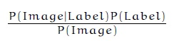

**Figure 3.** Option A formula for Question 123.

$$\frac{P(\text{Image} \mid \text{Label}) P(\text{Label})}{P(\text{Image})}$$  
*Option ID:* `6406532878497`

**B.** 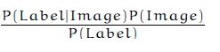

**Figure 4.** Option B formula for Question 123.

$$\frac{P(\text{Label} \mid \text{Image}) P(\text{Image})}{P(\text{Label})}$$  
*Option ID:* `6406532878498`

**C.** 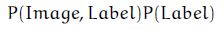

**Figure 5.** Option C formula for Question 123.

$$P(\text{Image}, \text{Label}) P(\text{Label})$$  
*Option ID:* `6406532878499`

**D.** 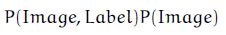

**Figure 6.** Option D formula for Question 123.

$$P(\text{Image}, \text{Label}) P(\text{Image})$$  
*Option ID:* `6406532878500`

**Correct answer:** **A** — \frac{P(\text{Image} \mid \text{Label}) P(\text{Label})}{P(\text{Image})}.

**Worked explanation:** Bayes’ rule turns a class-conditional density and class prior into the posterior in option A. The generative model itself learns the joint or its likelihood/prior factorization.

### da5006_2024T2_Q2_NA · Q124 · 2 marks · ID 640653856598

Imagine you trained a CNN for dog (vs) cat classifier. From your dataset, you found that $P(\text{class} = \text{Dog}) = 0.4$ and $P(\text{class} = \text{Cat}) = 0.6$. After training the model, a new image $I$ is input through the network. What is the value of $P(\text{class} = \text{Cat} \mid I)$ given that $P(I \mid \text{class} = \text{Dog}) = 0.02$ and $P(I \mid \text{class} = \text{Cat}) = 0.06$?

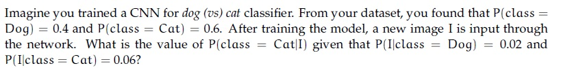

**Figure 7.** Source problem formulation for Question 124.

**Options**

**A.** 0.5151  
*Option ID:* `6406532878501`

**B.** 0.6161  
*Option ID:* `6406532878502`

**C.** 0.7171  
*Option ID:* `6406532878503`

**D.** 0.8181  
*Option ID:* `6406532878504`

**Correct answer:** **D** — 0.8181.

**Worked explanation:** Bayes’ rule gives $0.06(0.6)/[0.06(0.6)+0.02(0.4)]=0.818181\ldots$. The denominator sums over both classes.

### da5006_2024T2_Q2_NA · Q139 · 0.5 marks · ID 640653856592

**Shared Comprehension Data (Questions 139–142, Comprehension ID: `640653856591`):**
KL divergence is not a distance metric because $KL(P \| Q)$ is (a) _____ to $KL(Q \| P)$. And KL divergence is always $\ge$ (b) _____.
Suppose $P \sim \text{Bernoulli}(0.8)$ and $Q \sim \text{Bernoulli}(0.2)$ then (c) $KL(P \| Q) =$ _____ nats and (d) $KL(Q \| P) =$ _____ nats.
Hint: You can use these values of natural log: $\ln(2) = 0.69, \ln(4) = 1.38, \ln(0.6) = -0.510, \ln(8) = 2.079, \ln(0.4) = -0.91$.
Answer upto two decimal places. Based on the above data, answer the given subquestions.

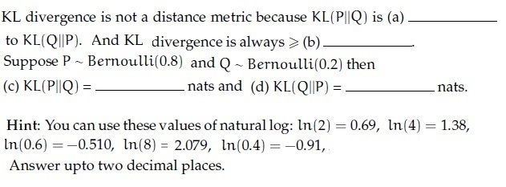

**Figure 8.** Shared context and hints for Questions 139–142.

**Subquestion 139:**
Enter the correct answer for (a)

NOTE:Enter the exact answer without any space in the beginning or at the end.

**Correct answer:** `not equal`.

**Worked explanation:** KL is generally asymmetric, although equality can occur for particular distributions. The symmetric Bernoulli complement pair in this question is one such exception.

### da5006_2024T2_Q2_NA · Q140 · 0.5 marks · ID 640653856593

*(Shared Comprehension Context: KL divergence properties and Bernoulli(0.8), Bernoulli(0.2))*  
KL divergence is always $\ge$ (b) _____.

Enter the correct answer for (b)

**Correct answer:** `0`.

**Worked explanation:** Gibbs’ inequality gives a lower bound of zero. Equality holds when the two distributions agree almost everywhere.

### da5006_2024T2_Q2_NA · Q141 · 0.5 marks · ID 640653856594

*(Shared Comprehension Context: $P \sim \text{Bernoulli}(0.8)$, $Q \sim \text{Bernoulli}(0.2)$)*  
(c) $KL(P \| Q) =$ _____ nats.

Enter the correct answer for (c)

**Correct answer:** `0.83`.

**Worked explanation:** For these complementary Bernoulli parameters, $0.8\ln4+0.2\ln(1/4)=0.6\ln4\approx0.83$ nats.

### da5006_2024T2_Q2_NA · Q142 · 0.5 marks · ID 640653856595

*(Shared Comprehension Context: $P \sim \text{Bernoulli}(0.8)$, $Q \sim \text{Bernoulli}(0.2)$)*  
(d) $KL(Q \| P) =$ _____ nats.

Enter the correct answer for (d)

**Correct answer:** `0.83`.

**Worked explanation:** Reversing this particular complementary pair gives the same $0.6\ln4\approx0.83$ nats. This special equality does not make KL symmetric in general.

### da5006_2024T2_Q2_NA · Q143 · 2 marks · ID 640653856596

Consider generative and discriminative models for a classification task. Generative models learn the data-generating mechanism by modeling class-conditional and prior distributions before making predictions. Discriminative models make predictions based on patterns learned in the training set. Which one of the following is an example of a generative model? Select all that are correct.

**Options**

**A.** Convolutional Neural Network  
*Option ID:* `6406532878492`

**B.** Naive-Bayes  
*Option ID:* `6406532878493`

**C.** Logistic Regression  
*Option ID:* `6406532878494`

**D.** Support Vector Machine  
*Option ID:* `6406532878495`

**E.** Quadratic Discriminant Analysis  
*Option ID:* `6406532878496`

**Correct answer:** **B**, **E** — Naive-Bayes; Quadratic Discriminant Analysis.

**Worked explanation:** Naive Bayes models class priors and class-conditional feature distributions; quadratic discriminant analysis models class-conditional Gaussians. Logistic regression and conventional SVMs are discriminative.

## Topic: Autoencoder representations

| Done | Paper | Q# | Marks | Type |
| :--- | :--- | ---: | ---: | :--- |
| [ ] | da5006_2025T2_ET_AN | 99 | 2 | MSQ |
| [ ] | da5006_2025T2_ET_FN | 173 | 2 | MSQ |
| [ ] | da5006_2025T3_ET_FN | 12 | 1 | MSQ |

### da5006_2025T2_ET_AN · Q99 · 2 marks · ID 6406531431359

> [!NOTE] Week assignment uncertain: Tests linear autoencoders alongside temporal attention and positional encoding.

Which of the following statements are true? (Select all possible correct options)

**Options**

**A.** Autoencoder are equivalent to Principal Component Analysis (PCA) provided we don’t use of non-linear activation functions  
*Option ID:* `6406534780309`

**B.** When using global attention on temporal data, alignment weights are learnt for encoder hidden representations for all time steps  
*Option ID:* `6406534780310`

**C.** Positional encoding is an important component of the trans- former architecture as it conveys information about order in a given sequence  
*Option ID:* `6406534780311`

**D.** It is not possible to generate different captions for the same image that have similar meaning but different tone/style  
*Option ID:* `6406534780312`

**E.** Autoencoders can not be used for data compression as its input and output dimensions are different  
*Option ID:* `6406534780313`

**Correct answer:** **A, B, C** — Autoencoder are equivalent to Principal Component Analysis (PCA) provided we don’t use of non-linear activation functions; When using global attention on temporal data, alignment weights are learnt for encoder hidden representations for all time steps; Positional encoding is an important component of the trans- former architecture as it conveys information about order in a given sequence.

**Worked explanation:** Global attention weights encoder time steps and positional encodings provide order. Linear autoencoder/PCA equivalence additionally assumes centered data, squared reconstruction error and a suitable optimum.

### da5006_2025T2_ET_FN · Q173 · 2 marks · ID 6406531422552

> [!NOTE] Week assignment uncertain: Tests autoencoders alongside sequence attention and positional encoding.

Which of the following statements are true? (Select all possible correct options)

**Options**

**A.** Autoencoder are equivalent to Principal Component Analysis (PCA) provided we don’t use of non-linear activation functions  
*Option ID:* `6406534756426`

**B.** When using global attention on temporal data, alignment weights are learnt for encoder hidden representations for all time steps  
*Option ID:* `6406534756427`

**C.** Positional encoding is an important component of the transformer architecture as it conveys information about order in a given sequence  
*Option ID:* `6406534756428`

**D.** It is not possible to generate different captions for the same image that have similar meaning but different tone/style  
*Option ID:* `6406534756429`

**E.** Autoencoders can not be used for data compression as its input and output dimensions are different  
*Option ID:* `6406534756430`

**Correct answer:** **A**, **B**, **C** — Autoencoder are equivalent to Principal Component Analysis (PCA) provided we don’t use of non-linear activation functions; When using global attention on temporal data, alignment weights are learnt for encoder hidden representations for all time steps; Positional encoding is an important component of the transformer architecture as it conveys information about order in a given sequence.

**Worked explanation:** Global attention uses all encoder states; position encoding supplies ordering. Linear autoencoders reproduce the PCA subspace only under appropriate centering, squared-error and optimization assumptions.

### da5006_2025T3_ET_FN · Q12 · 1 marks · ID 6406531862826

> [!NOTE] Week assignment uncertain: Tests linear autoencoders, global attention, and positional encoding.

Which statements are correct? (Select all that apply.)

**Options**

**A.** A linear autoencoder with MSE and no activation learns a subspace equivalent to PCA (up to rotation) when the hidden dimension < input dimension.  
*Option ID:* `6406536034957`

**B.** Global attention assigns alignment weights to all encoder time steps for each decoder step.  
*Option ID:* `6406536034958`

**C.** Positional encodings convey order information that self-attention lacks.  
*Option ID:* `6406536034959`

**D.** it is impossible to generate multiple, semantically similar captions with different styles for the same image.  
*Option ID:* `6406536034960`

**Correct answer:** **A**, **B**, **C** — A linear autoencoder with MSE and no activation learns a subspace equivalent to PCA (up to rotation) when the hidden dimension < input dimension. ; Global attention assigns alignment weights to all encoder time steps for each decoder step. ; Positional encodings convey order information that self-attention lacks..

**Worked explanation:** Under squared loss and appropriate centering, an optimal linear bottleneck spans a principal subspace. Global attention covers encoder positions, and positional information breaks self-attention’s position ambiguity.

## Topic: Variational autoencoders

| Done | Paper | Q# | Marks | Type |
| :--- | :--- | ---: | ---: | :--- |
| [ ] | da5006_2024T1_ET_AN | 180 | 2 | MCQ |
| [ ] | da5006_2024T1_ET_AN | 182 | 2 | MCQ |
| [ ] | da5006_2024T2_ET_AN | 272 | 0.67 | SA |
| [ ] | da5006_2024T2_ET_AN | 273 | 0.67 | SA |
| [ ] | da5006_2024T2_ET_AN | 274 | 0.66 | SA |
| [ ] | da5006_2024T3_ET_AN | 220 | 2 | Short Answer Question (SA) |
| [ ] | da5006_2024T3_ET_AN | 221 | 2 | Short Answer Question (SA) |
| [ ] | da5006_2024T3_ET_AN | 222 | 2 | Short Answer Question (SA) |
| [ ] | da5006_2025T2_ET_AN | 111 | 2 | SA |
| [ ] | da5006_2025T2_ET_AN | 112 | 2 | SA |
| [ ] | da5006_2025T2_ET_AN | 113 | 1 | SA |
| [ ] | da5006_2025T2_ET_AN | 114 | 1 | SA |
| [ ] | da5006_2025T2_ET_FN | 187 | 1 | SA |
| [ ] | da5006_2025T2_ET_FN | 188 | 1 | SA |
| [ ] | da5006_2025T2_ET_FN | 189 | 1 | SA |
| [ ] | da5006_2025T2_ET_FN | 190 | 1 | SA |
| [ ] | da5006_2026T2_ET_FN | 20 | 2 | MCQ |
| [ ] | da5006_2026T2_ET_FN | 37 | 4 | SA |
| [ ] | da5006_2024T1_Q2_NA | 166 | 2 | MCQ |
| [ ] | da5006_2024T2_Q2_NA | 121 | 2 | MCQ |
| [ ] | da5006_2024T2_Q2_NA | 122 | 2 | MCQ |
| [ ] | da5006_2024T2_Q2_NA | 136 | 0.67 | SA |
| [ ] | da5006_2024T2_Q2_NA | 137 | 0.67 | SA |
| [ ] | da5006_2024T2_Q2_NA | 138 | 0.66 | SA |

### da5006_2024T1_ET_AN · Q180 · 2 marks · ID 640653821618

> [!NOTE] Week assignment uncertain: Matches VAE regularization and reparameterization with GAN and likelihood concepts.

Match the following:

1) VAE  
2) GAN  
3) Reparametrization  
4) Generative models  

i) $z = \mu + \sigma \odot \epsilon; \quad \epsilon \sim \mathcal{N}(0, 1)$  
ii) Maximum Likelihood Estimation (MLE)  
iii) $\min \text{KL}(Q(z|X), p(z))$  
iv) $D(G(z)) = 0.5$

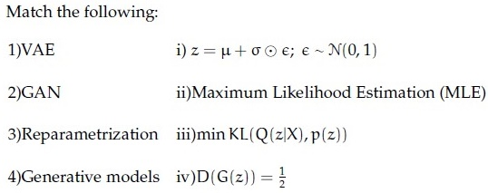

**Figure 9.** Source diagram for Question 180.

**Options**

**A.** 1 → i, 2 → ii, 3 → iii, 4 → iv  
*Option ID:* `6406532757378`

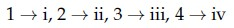

**Figure 10.** Source option graphic for Question 180, Option A.

**B.** 1 → ii, 2 → i, 3 → iv, 4 → iii  
*Option ID:* `6406532757379`

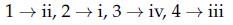

**Figure 11.** Source option graphic for Question 180, Option B.

**C.** 1 → iii, 2 → iv, 3 → i, 4 → ii  
*Option ID:* `6406532757380`

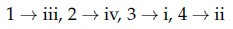

**Figure 12.** Source option graphic for Question 180, Option C.

**D.** 1 → iv, 2 → iii, 3 → ii, 4 → i  
*Option ID:* `6406532757381`

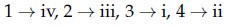

**Figure 13.** Source option graphic for Question 180, Option D.

**Correct answer:** **C** — 1 → iii, 2 → iv, 3 → i, 4 → ii.

**Worked explanation:** The VAE regularizes its approximate posterior; the reparameterization is $z=\mu+\sigma\odot\epsilon$. The ideal GAN discriminator outputs 1/2, while likelihood is a common generative fitting criterion.

### da5006_2024T1_ET_AN · Q182 · 2 marks · ID 640653821620

In the context of VAE, if the encoder outputs $\mu = [0.2, 0.3, 0.1]$, $\sigma = [0.1, 0.2, 0.1]$ and $\epsilon \sim \mathcal{N}(0, 1)$ is equal to $[0.5, 0.2, 0.8]$, then the latent value $z = ?$

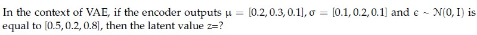

**Figure 14.** Source diagram for Question 182.

**Options**

**A.** [1.1, 2.06, 1.08]  
*Option ID:* `6406532757386`

**B.** [0.25, 0.34, 0.18]  
*Option ID:* `6406532757387`

**C.** [0.2, 0.3, 0.1]  
*Option ID:* `6406532757388`

**D.** [1.2, 2.3, 1.1]  
*Option ID:* `6406532757389`

**Correct answer:** **B** — [0.25, 0.34, 0.18].

**Worked explanation:** Apply $z_i=\mu_i+\sigma_i\epsilon_i$ componentwise: $(0.2+0.1(0.5),0.3+0.2(0.2),0.1+0.1(0.8))=(0.25,0.34,0.18)$.

### da5006_2024T2_ET_AN · Q272 · 0.67 marks · ID 640653904327

Find the value of $z_1$:

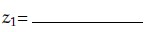

**Figure 15.** Prompt equation for Question 272.

*(Formula: $z_1 = \mu_1 + \sigma_1 \cdot \epsilon_1 = 0.3 + 0.01 \times 0.1 = 0.301$)*

**Correct answer:** `0.301`

**Worked explanation:** Use $z_1=0.3+0.01(0.1)=0.301$. The multiplication is componentwise, not a dot product.

### da5006_2024T2_ET_AN · Q273 · 0.67 marks · ID 640653904328

Find the value of $z_2$:

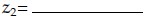

**Figure 16.** Prompt equation for Question 273.

*(Formula: $z_2 = \mu_2 + \sigma_2 \cdot \epsilon_2 = 0.2 + 0.5 \times 0.2 = 0.3$)*

**Correct answer:** `0.3`

**Worked explanation:** Use $z_2=0.2+0.5(0.2)=0.3$. The scale here is the standard deviation.

### da5006_2024T2_ET_AN · Q274 · 0.66 marks · ID 640653904329

Find the value of $z_3$:

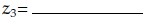

**Figure 17.** Prompt equation for Question 274.

*(Formula: $z_3 = \mu_3 + \sigma_3 \cdot \epsilon_3 = 0.1 + 0.5 \times 0.3 = 0.25$)*

**Correct answer:** `0.25`

**Worked explanation:** Use $z_3=0.1+0.5(0.3)=0.25$. The standard normal draw supplies the fixed noise value.

### da5006_2024T3_ET_AN · Q220 · 2 marks · ID 6406531046067

**Shared Comprehension Context (Question ID: `6406531046066`):**

In the context of VAE, if the encoder outputs $\mu = [0.3, 0.2, 0.1]$, $\sigma = [0.1, 0.2, 0.1]$ and $\epsilon \sim \mathcal{N}(0, 1)$ is equal to $[0.5, 0.2, 0.8]$, then the latent vector $z = [z_1, z_2, z_3]$, Give the values upto 2 decimal places.

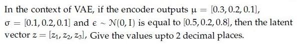

**Figure 18.** VAE latent vector formulation for Comprehension Questions 220–222.

Based on the above data, answer the given subquestions.

**Subquestion:**

$z_1 = $ _____

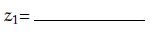

**Figure 19.** Source subquestion formula for Question 220.

Response Type : Numeric

**Correct answer:** **0.35**.

**Worked explanation:** Apply the reparameterization $z_i=\mu_i+\sigma_i\epsilon_i$ independently at the requested coordinate: $0.3+0.1(0.5)=0.35$.

### da5006_2024T3_ET_AN · Q221 · 2 marks · ID 6406531046068

**Shared Comprehension Context (Question ID: `6406531046066`):**

In the context of VAE, if the encoder outputs $\mu = [0.3, 0.2, 0.1]$, $\sigma = [0.1, 0.2, 0.1]$ and $\epsilon \sim \mathcal{N}(0, 1)$ is equal to $[0.5, 0.2, 0.8]$, then the latent vector $z = [z_1, z_2, z_3]$, Give the values upto 2 decimal places.

**Figure 20.** VAE latent vector formulation for Comprehension Questions 220–222.

Based on the above data, answer the given subquestions.

**Subquestion:**

$z_2 = $ _____

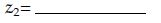

**Figure 21.** Source subquestion formula for Question 221.

Response Type : Numeric

**Correct answer:** **0.24**.

**Worked explanation:** Apply the reparameterization $z_i=\mu_i+\sigma_i\epsilon_i$ independently at the requested coordinate: $0.2+0.2(0.2)=0.24$.

### da5006_2024T3_ET_AN · Q222 · 2 marks · ID 6406531046069

**Shared Comprehension Context (Question ID: `6406531046066`):**

In the context of VAE, if the encoder outputs $\mu = [0.3, 0.2, 0.1]$, $\sigma = [0.1, 0.2, 0.1]$ and $\epsilon \sim \mathcal{N}(0, 1)$ is equal to $[0.5, 0.2, 0.8]$, then the latent vector $z = [z_1, z_2, z_3]$, Give the values upto 2 decimal places.

**Figure 22.** VAE latent vector formulation for Comprehension Questions 220–222.

Based on the above data, answer the given subquestions.

**Subquestion:**

$z_3 = $ _____

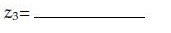

**Figure 23.** Source subquestion formula for Question 222.

Response Type : Numeric

**Correct answer:** **0.18**.

**Worked explanation:** Apply the reparameterization $z_i=\mu_i+\sigma_i\epsilon_i$ independently at the requested coordinate: $0.1+0.1(0.8)=0.18$.

### da5006_2025T2_ET_AN · Q111 · 2 marks · ID 6406531431373

**Shared Comprehension Context (Question ID: `6406531431372`):**

In a VAE, if the encoder outputs $\mu = [0.4, 0.2, 0.1, 0.5]$ and $\sigma = [0.1, 0.7, 0.02, 0.03]$, and $\epsilon$ sampled from $\mathcal{N}(0, I)$ is $[0.9, 0.5, 0.2, 0.1]$, what is the value of the latent vector $z = \mu + \sigma \odot \epsilon$?

[Note: Enter round-off values till 2 decimal places]

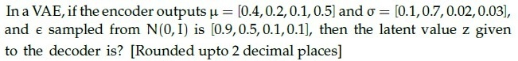

**Figure 24.** Source VAE problem statement for Comprehension Questions 111–114.

**Subquestion:**

Element 1:___________

**Correct answer:** 0.49

**Worked explanation:** Apply the reparameterization $z_i=\mu_i+\sigma_i\epsilon_i$ independently at the requested coordinate: $0.4+0.1(0.9)=0.49$.

### da5006_2025T2_ET_AN · Q112 · 2 marks · ID 6406531431374

**Shared Comprehension Context (Question ID: `6406531431372`):**

In a VAE, if the encoder outputs $\mu = [0.4, 0.2, 0.1, 0.5]$ and $\sigma = [0.1, 0.7, 0.02, 0.03]$, and $\epsilon$ sampled from $\mathcal{N}(0, I)$ is $[0.9, 0.5, 0.2, 0.1]$, what is the value of the latent vector $z = \mu + \sigma \odot \epsilon$?

[Note: Enter round-off values till 2 decimal places]

Refer to Figure 20 (Source VAE problem statement for Comprehension Questions 111–114).

**Subquestion:**

Element 2:___________

**Correct answer:** 0.55

**Worked explanation:** Apply the reparameterization $z_i=\mu_i+\sigma_i\epsilon_i$ independently at the requested coordinate: $0.2+0.7(0.5)=0.55$.

### da5006_2025T2_ET_AN · Q113 · 1 marks · ID 6406531431375

**Shared Comprehension Context (Question ID: `6406531431372`):**

In a VAE, if the encoder outputs $\mu = [0.4, 0.2, 0.1, 0.5]$ and $\sigma = [0.1, 0.7, 0.02, 0.03]$, and $\epsilon$ sampled from $\mathcal{N}(0, I)$ is $[0.9, 0.5, 0.2, 0.1]$, what is the value of the latent vector $z = \mu + \sigma \odot \epsilon$?

[Note: Enter round-off values till 2 decimal places]

Refer to Figure 20 (Source VAE problem statement for Comprehension Questions 111–114).

**Subquestion:**

Element 3:___________

**Correct answer:** 0.10

**Worked explanation:** Apply the reparameterization $z_i=\mu_i+\sigma_i\epsilon_i$ independently at the requested coordinate: $0.1+0.02(0.2)=0.104, which rounds to 0.10$.

### da5006_2025T2_ET_AN · Q114 · 1 marks · ID 6406531431376

**Shared Comprehension Context (Question ID: `6406531431372`):**

In a VAE, if the encoder outputs $\mu = [0.4, 0.2, 0.1, 0.5]$ and $\sigma = [0.1, 0.7, 0.02, 0.03]$, and $\epsilon$ sampled from $\mathcal{N}(0, I)$ is $[0.9, 0.5, 0.2, 0.1]$, what is the value of the latent vector $z = \mu + \sigma \odot \epsilon$?

[Note: Enter round-off values till 2 decimal places]

Refer to Figure 20 (Source VAE problem statement for Comprehension Questions 111–114).

**Subquestion:**

Element 4:___________

**Correct answer:** 0.50

**Worked explanation:** Apply the reparameterization $z_i=\mu_i+\sigma_i\epsilon_i$ independently at the requested coordinate: $0.5+0.03(0.1)=0.503, which rounds to 0.50$.

### da5006_2025T2_ET_FN · Q187 · 1 marks · ID 6406531422575

**Shared context (Comprehension Question ID: `6406531422574`, Subquestions: 187 to 190):**

In a VAE, if the encoder outputs μ = [0.4, 0.2, 0.1, 0.5] and σ = [0.2, 0.5, 0.3, 0.4], and ε sampled from N(0,1) is [0.7, 0.1, 0.3, 0.2], then the latent value z given to the decoder is? [Rounded upto 2 decimal places]

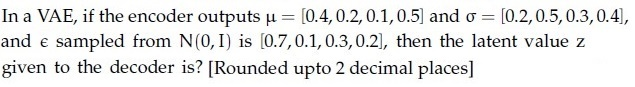

**Figure 25.** Comprehension 6406531422574, VAE latent vector problem statement.

Based on the above data, answer the given subquestions.

Element 1: _______________

**Correct answer:** `0.54`

**Worked explanation:** Apply the reparameterization $z_i=\mu_i+\sigma_i\epsilon_i$ independently at the requested coordinate: $0.4+0.2(0.7)=0.54$.

### da5006_2025T2_ET_FN · Q188 · 1 marks · ID 6406531422576

**Shared context (Comprehension Question ID: `6406531422574`, Subquestions: 187 to 190):**

In a VAE, latent value z = μ + σ ⊙ ε with μ = [0.4, 0.2, 0.1, 0.5], σ = [0.2, 0.5, 0.3, 0.4], ε = [0.7, 0.1, 0.3, 0.2].

Based on the above data, answer the given subquestions.

Element 2: _______________

**Correct answer:** `0.25`

**Worked explanation:** Apply the reparameterization $z_i=\mu_i+\sigma_i\epsilon_i$ independently at the requested coordinate: $0.2+0.5(0.1)=0.25$.

### da5006_2025T2_ET_FN · Q189 · 1 marks · ID 6406531422577

**Shared context (Comprehension Question ID: `6406531422574`, Subquestions: 187 to 190):**

In a VAE, latent value z = μ + σ ⊙ ε with μ = [0.4, 0.2, 0.1, 0.5], σ = [0.2, 0.5, 0.3, 0.4], ε = [0.7, 0.1, 0.3, 0.2].

Based on the above data, answer the given subquestions.

Element 3: _______________

**Correct answer:** `0.19`

**Worked explanation:** Apply the reparameterization $z_i=\mu_i+\sigma_i\epsilon_i$ independently at the requested coordinate: $0.1+0.3(0.3)=0.19$.

### da5006_2025T2_ET_FN · Q190 · 1 marks · ID 6406531422578

**Shared context (Comprehension Question ID: `6406531422574`, Subquestions: 187 to 190):**

In a VAE, latent value z = μ + σ ⊙ ε with μ = [0.4, 0.2, 0.1, 0.5], σ = [0.2, 0.5, 0.3, 0.4], ε = [0.7, 0.1, 0.3, 0.2].

Based on the above data, answer the given subquestions.

Element 4: _______________

**Correct answer:** `0.58`

**Worked explanation:** Apply the reparameterization $z_i=\mu_i+\sigma_i\epsilon_i$ independently at the requested coordinate: $0.5+0.4(0.2)=0.58$.

### da5006_2026T2_ET_FN · Q20 · 2 marks · ID 6406532270059

Which statement correctly distinguishes the two model families?

**Options**

**A.** A GAN necessarily contains an explicit encoder that outputs a Gaussian posterior  
*Option ID:* `6406537379075`

**B.** A VAE uses a latent-variable objective with a regularized approximate posterior, whereas a GAN uses an adversarial training objective  
*Option ID:* `6406537379076`

**C.** A VAE is trained only through a discriminator  
*Option ID:* `6406537379077`

**D.** GANs and VAEs have the same training objective but different optimizers  
*Option ID:* `6406537379078`

**Correct answer:** **B** — A VAE uses a latent-variable objective with a regularized approximate posterior, whereas a GAN uses an adversarial training objective.

**Worked explanation:** The VAE trains a latent-variable model with an approximate posterior and KL regularization. A GAN instead trains a generator against a discriminator; an encoder is not required in the original GAN.

### da5006_2026T2_ET_FN · Q37 · 4 marks · ID 6406532270076

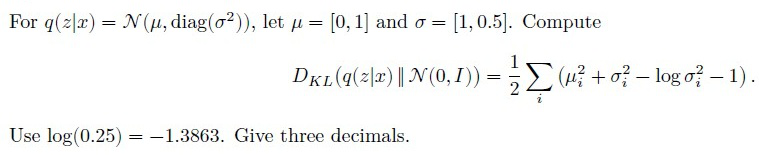

**Figure 26.** Source KL-divergence formulation for Question 37.

For $q(z|x) = \mathcal{N}(\mu, \text{diag}(\sigma^2))$, let $\mu = [0,1]$ and $\sigma = [1,0.5]$. Compute
$$D_{KL}(q(z|x) \parallel \mathcal{N}(0,I)) = \frac{1}{2} \sum_{i=1}^2 (\mu_i^2 + \sigma_i^2 - \log \sigma_i^2 - 1).$$
Use $\log(0.25) = -1.3863$. Give three decimals.

**Correct answer:** `0.817 to 0.819`

**Worked explanation:** The first coordinate contributes zero; the second contributes $\frac12(1+0.25-\log 0.25-1)=0.818147\ldots$. Use variance $\sigma^2=0.25$, not $0.5$, inside the logarithm.

### da5006_2024T1_Q2_NA · Q166 · 2 marks · ID 640653766165

Consider the following assertion and the reason for the assertion below :

* Assertion: The images generated by VAEs exhibit a lack of sharpness or clarity.
* Reason: The blurriness observed in the generated images of VAEs arises from the underlying assumptions and limitations of the model. VAEs aim to learn the data distribution by fitting it into a multivariate Gaussian. However, this assumption of conditional independence among samples given latent variables does not hold for many realistic distributions, such as natural images.

Now, pick one among the options below:

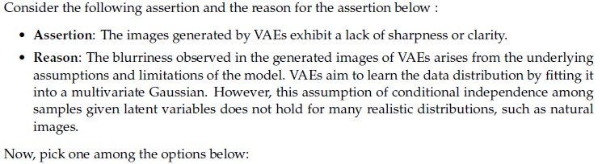

**Figure 27.** Source assertion and reason text for Question 166.

**Options**

**A.** Both assertion and reason are true, and the reason is the correct explanation of assertion  
*Option ID:* `6406532564235`

**B.** Both assertion and reason are true, but the reason is not the correct explanation of assertion  
*Option ID:* `6406532564236`

**C.** Assertion is true, the reason is false  
*Option ID:* `6406532564237`

**D.** Both assertion and reason are false  
*Option ID:* `6406532564238`

**Correct answer:** **A** — Both assertion and reason are true, and the reason is the correct explanation of assertion

**Worked explanation:** A pixelwise likelihood can encourage averaging over plausible outcomes, producing blur when conditional outcomes are multimodal. Blur is a common tendency of particular VAEs, not a necessity of the model family.

### da5006_2024T2_Q2_NA · Q121 · 2 marks · ID 640653856589

In the context of Variational Autoencoders, the idea of variational inference solves the problem of

**Options**

**A.** 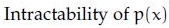

**Figure 28.** Option A mathematical expression for Question 121.

Intractability of $p(x)$  
*Option ID:* `6406532878480`

**B.** 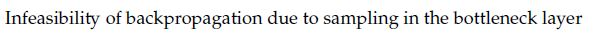

**Figure 29.** Option B mathematical expression for Question 121.

Infeasibility of backpropagation due to sampling in the bottleneck layer  
*Option ID:* `6406532878481`

**C.** 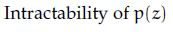

**Figure 30.** Option C mathematical expression for Question 121.

Intractability of $p(z)$  
*Option ID:* `6406532878482`

**D.** 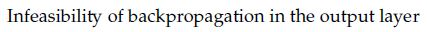

**Figure 31.** Option D mathematical expression for Question 121.

Infeasibility of backpropagation in the output layer  
*Option ID:* `6406532878483`

**Correct answer:** **A** — Intractability of $p(x)$.

**Worked explanation:** The evidence $p(x)=\int p(x,z)\,dz$ and exact posterior can be intractable. Variational inference optimizes a tractable lower bound using an approximate posterior.

### da5006_2024T2_Q2_NA · Q122 · 2 marks · ID 640653856590

Which of the following is incorrect for the reparametrization trick used in a Variational AutoEncoder (VAE)?

**Options**

**A.** This technique is used, since the expected reconstruction error requires estimation by sampling which has very high variance.  
*Option ID:* `6406532878484`

**B.** It can be applied to any “location-scale” family of distributions where the location (mean) and scale (variance) of the standard version is 0 and 1.  
*Option ID:* `6406532878485`

**C.** The reparametrization trick is applicable to continuous distributions as well as discrete distributions.  
*Option ID:* `6406532878486`

**D.** It allows the random variable to be expressed as a different transformation of auxiliary variables which helps the gradient estimation with only one sample  
*Option ID:* `6406532878487`

**Correct answer:** **C** — The reparametrization trick is applicable to continuous distributions as well as discrete distributions..

**Worked explanation:** A differentiable location-scale transformation gives pathwise gradients for continuous noise. Discrete samples generally lack an ordinary pathwise derivative; relaxations or other gradient estimators are needed.

### da5006_2024T2_Q2_NA · Q136 · 0.67 marks · ID 640653856586

**Shared Comprehension Data (Questions 136–138, Comprehension ID: `640653856585`):**
In the context of VAE, if the encoder outputs $\mu = [0.3, 0.2, 0.1]$, $\sigma = [0.1, 0.2, 0.1]$ and $\epsilon \sim \mathcal{N}(0, 1)$ is equal to $[0.5, 0.2, 0.8]$, then the latent vector $z = [z_1, z_2, z_3]$. Give the following values upto 2 decimal places. Based on the above data, answer the given subquestions.

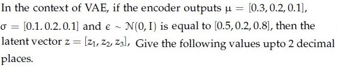

**Figure 32.** Shared passage parameters for Questions 136–138.

**Subquestion 136:**
z1=_________________

**Correct answer:** `0.35`.

**Worked explanation:** Apply the reparameterization $z_i=\mu_i+\sigma_i\epsilon_i$ independently at the requested coordinate: $0.3+0.1(0.5)=0.35$.

### da5006_2024T2_Q2_NA · Q137 · 0.67 marks · ID 640653856587

*(Shared Comprehension Context: VAE latent vector $z = \mu + \sigma \odot \epsilon$, with $\mu = [0.3, 0.2, 0.1]$, $\sigma = [0.1, 0.2, 0.1]$, $\epsilon = [0.5, 0.2, 0.8]$)*

z2=____________________

**Correct answer:** `0.24`.

**Worked explanation:** Apply the reparameterization $z_i=\mu_i+\sigma_i\epsilon_i$ independently at the requested coordinate: $0.2+0.2(0.2)=0.24$.

### da5006_2024T2_Q2_NA · Q138 · 0.66 marks · ID 640653856588

*(Shared Comprehension Context: VAE latent vector $z = \mu + \sigma \odot \epsilon$, with $\mu = [0.3, 0.2, 0.1]$, $\sigma = [0.1, 0.2, 0.1]$, $\epsilon = [0.5, 0.2, 0.8]$)*

z3=_______________

**Correct answer:** `0.18`.

**Worked explanation:** Apply the reparameterization $z_i=\mu_i+\sigma_i\epsilon_i$ independently at the requested coordinate: $0.1+0.1(0.8)=0.18$.

## Topic: GAN objectives and equilibrium

| Done | Paper | Q# | Marks | Type |
| :--- | :--- | ---: | ---: | :--- |
| [ ] | da5006_2024T1_ET_AN | 179 | 2 | MCQ |
| [ ] | da5006_2025T2_ET_AN | 97 | 2 | MSQ |
| [ ] | da5006_2025T2_ET_FN | 172 | 2 | MSQ |
| [ ] | da5006_2024T1_Q2_NA | 154 | 2 | MSQ |
| [ ] | da5006_2024T1_Q2_NA | 175 | 1 | SA |
| [ ] | da5006_2024T1_Q2_NA | 176 | 1 | SA |

### da5006_2024T1_ET_AN · Q179 · 2 marks · ID 640653821617

> [!NOTE] Week assignment uncertain: Compares VAE and autoencoder statements with GAN equilibrium.

Which of the following statements is false?

**Options**

**A.** Reparametrization trick is used in training VAEs to overcome the problem of non-differentiability of the objective function across a sampling step.  
*Option ID:* `6406532757374`

**B.** In denoising autoencoder, reconstructed output is compared against noise-free ground truth data point.  
*Option ID:* `6406532757375`

**C.** While training a GAN, Generator and Discriminator weights are not updated concurrently but updated sequentially.  
*Option ID:* `6406532757376`

**D.** When a GAN is completely trained, Discriminator D outputs very high probability (approximately 1) for images from Generator G, that is, D(G(z)) ≈ 1  
*Option ID:* `6406532757377`

**Correct answer:** **D** — When a GAN is completely trained, Discriminator D outputs very high probability (approximately 1) for images from Generator G, that is, D(G(z)) ≈ 1.

**Worked explanation:** At the ideal distributional equilibrium, the optimal discriminator outputs one half on generated and real samples. Sequential alternating updates are the usual training procedure.

### da5006_2025T2_ET_AN · Q97 · 2 marks · ID 6406531431357

Which of the following statements are true? (Select all possible correct options)

**Options**

**A.** Variational AutoEncoders (VAE) generate sharper images compared to Generative adversarial networks (GANs)  
*Option ID:* `6406534780301`

**B.** GAN is an example of an implicit density estimation model  
*Option ID:* `6406534780302`

**C.** Fully connected layers in mapping network of Style-GAN change the dimension of its input  
*Option ID:* `6406534780303`

**D.** In a GAN, the generator and discriminator are trained in an alternating fashion, each using the other’s output to improve.  
*Option ID:* `6406534780304`

**Correct answer:** **B, D** — GAN is an example of an implicit density estimation model; In a GAN, the generator and discriminator are trained in an alternating fashion, each using the other’s output to improve..

**Worked explanation:** A standard GAN defines samples through a generator without a tractable density and commonly alternates updates. Relative image sharpness is an empirical tendency, not a universal theorem.

### da5006_2025T2_ET_FN · Q172 · 2 marks · ID 6406531422551

> [!NOTE] Week assignment uncertain: Compares GAN training, density estimation, VAE outputs, and StyleGAN.

Which of the following statements are false? (Select all that apply)

**Options**

**A.** Generative adversarial networks (GANs) generate sharper images compared to Variational AutoEncoders (VAE)  
*Option ID:* `6406534756422`

**B.** GAN is an example of an implicit density estimation model  
*Option ID:* `6406534756423`

**C.** Fully connected layers in mapping network of Style-GAN do not change the dimension of its input  
*Option ID:* `6406534756424`

**D.** The generator and discriminator are always trained together in a GAN  
*Option ID:* `6406534756425`

**Correct answer:** **C**, **D** — Fully connected layers in mapping network of Style-GAN do not change the dimension of its input; The generator and discriminator are always trained together in a GAN.

**Worked explanation:** GANs are implicit generative models and their discriminator and generator are normally updated alternately. Mapping-network dimensions are architectural choices; a fully connected layer does not inherently change width.

### da5006_2024T1_Q2_NA · Q154 · 2 marks · ID 640653766164

If $x$ is an input feature vector and $y$ is the corresponding output/label, which distributions are modeled in a vanilla Generative Adversarial Network (GAN)?
(Select all possible correct options)

**Options**

**A.** $p(x)$  
*Option ID:* `6406532564231`

**B.** $p(x|y)$  
*Option ID:* `6406532564232`

**C.** $p(y|x)$  
*Option ID:* `6406532564233`

**D.** $p(x, y)$  
*Option ID:* `6406532564234`

**Correct answer:** **A**, **D** — $p(x)$; $p(x, y)$

> [!WARNING] The key includes $p(x,y)$, which is not modeled by the vanilla unconditional GAN.

**Worked explanation:** A vanilla unconditional GAN learns a distribution over $x$ through samples; it does not, without a label-conditioned formulation or joint samples, model $p(x,y)$.

### da5006_2024T1_Q2_NA · Q175 · 1 marks · ID 640653766173

**Shared Comprehension Context (Questions 175–176):**
While training a Generative Adversarial Network, a generator network G(.) and a discriminative network D(.) plays a zero-sum adversarial game.
Based on the above data, answer the given subquestions.

**Subquestion 175:**
The values of D(G(z)) during the initial phase of training_____________

**Correct answer:** `0`

> [!WARNING] The initial output is not determined by the premise; zero is only a possible limiting case.

**Worked explanation:** No initial discriminator output is fixed by the GAN objective: it depends on initialization and updates. A strong discriminator may assign fakes probabilities near zero.

### da5006_2024T1_Q2_NA · Q176 · 1 marks · ID 640653766174

**Shared Comprehension Context (Questions 175–176):**
While training a Generative Adversarial Network, a generator network G(.) and a discriminative network D(.) plays a zero-sum adversarial game.
Based on the above data, answer the given subquestions.

**Subquestion 176:**
After successfully training the GAN__________

**Correct answer:** `0.5`

**Worked explanation:** If generated and real distributions coincide and the discriminator is optimal with equal class priors, $D^*(x)=1/2$. Finite training does not guarantee this equilibrium.

## Topic: Metric learning and face verification

| Done | Paper | Q# | Marks | Type |
| :--- | :--- | ---: | ---: | :--- |
| [ ] | da5006_2024T1_ET_AN | 176 | 2 | MCQ |
| [ ] | da5006_2024T1_Q2_NA | 161 | 2 | MCQ |
| [ ] | da5006_2024T2_Q2_NA | 120 | 2 | MCQ |
| [ ] | da5006_2024T2_Q2_NA | 126 | 2 | MCQ |
| [ ] | da5006_2024T2_Q2_NA | 134 | 2 | SA |
| [ ] | da5006_2024T2_Q2_NA | 135 | 2 | SA |

### da5006_2024T1_ET_AN · Q176 · 2 marks · ID 640653821602

What is a unique challenge faced by Siamese networks in comparison to traditional neural networks?

**Options**

**A.** Siamese networks require significantly larger datasets for training due to their complex architecture.  
*Option ID:* `6406532757352`

**B.** Siamese networks need to learn a similarity metric between pairs of input samples, which requires specialized loss functions and training procedures.  
*Option ID:* `6406532757353`

**C.** Siamese networks are computationally more intensive, making them less scalable for real-time applications.  
*Option ID:* `6406532757354`

**D.** Siamese networks tend to suffer from overfitting more frequently than traditional neural networks due to their increased model complexity.  
*Option ID:* `6406532757355`

**Correct answer:** **B** — Siamese networks need to learn a similarity metric between pairs of input samples, which requires specialized loss functions and training procedures..

**Worked explanation:** Shared branches map both inputs into one embedding space. A pairwise or triplet objective specifies which distances should be small or separated by a margin.

### da5006_2024T1_Q2_NA · Q161 · 2 marks · ID 640653766157

Which one of the following statements is true?

**Options**

**A.** The goal of triplet loss is to ensure that the distance between the anchor and the negative sample is at least ’margin’ less than the distance between anchor and positive sample.  
*Option ID:* `6406532564203`

**B.** Face identification is a multi-class classification problem whereas face verification is a binary classification problem  
*Option ID:* `6406532564204`

**C.** Both the goal of triplet loss is to ensure that the distance between the anchor and the negative sample is at least ’margin’ less than the distance between anchor and positive sample & Face identification is a multi-class classification problem whereas face verification is a binary classification problem  
*Option ID:* `6406532564205`

**D.** None of these  
*Option ID:* `6406532564206`

**Correct answer:** **B** — Face identification is a multi-class classification problem whereas face verification is a binary classification problem

**Worked explanation:** Identification chooses an identity among candidates; verification tests whether a pair matches. Triplet loss requires the negative to be farther than the positive by the margin, not closer.

### da5006_2024T2_Q2_NA · Q120 · 2 marks · ID 640653856584

Identify the true statement regarding different loss functions:

**Options**

**A.** The objective of ranking loss is to predict relative distances between inputs.  
*Option ID:* `6406532878473`

**B.** The contrastive loss takes an anchor example and brings negative examples closer while pushing away positive examples.  
*Option ID:* `6406532878474`

**C.** The triplet loss always uses a non-negative margin to compare distances of sample representations.  
*Option ID:* `6406532878475`

**D.** The hinge loss only considers pairwise examples at a time.  
*Option ID:* `6406532878476`

**Correct answer:** **A** — The objective of ranking loss is to predict relative distances between inputs..

**Worked explanation:** Ranking loss enforces relative ordering of distances or scores. Contrastive loss pulls positive pairs together and pushes sufficiently close negatives apart.

### da5006_2024T2_Q2_NA · Q126 · 2 marks · ID 640653856600

Which one of the following statements is true?

**Options**

**A.** The goal of triplet loss is to ensure that the distance between the anchor and the negative sample is at least ’margin’ less than the distance between anchor and positive sample.  
*Option ID:* `6406532878509`

**B.** Face identification is a multi-class classification problem whereas face verification is a binary classification problem  
*Option ID:* `6406532878510`

**C.** Both the goal of triplet loss is to ensure that the distance between the anchor and the negative sample is at least ’margin’ less than the distance between anchor and positive sample. & Face identification is a multi-class classification problem whereas face verification is a binary classification problem  
*Option ID:* `6406532878511`

**D.** None of these  
*Option ID:* `6406532878512`

**Correct answer:** **B** — Face identification is a multi-class classification problem whereas face verification is a binary classification problem.

**Worked explanation:** Identification chooses an identity among candidates; verification tests whether a pair matches. Triplet loss requires the negative to be farther than the positive by the margin, not closer.

### da5006_2024T2_Q2_NA · Q134 · 2 marks · ID 640653856582

The feature embeddings obtained from a neural network for an anchor sample, positive sample and negative sample are as given below:
* Anchor Sample: [4, 5, 3, 7, 1]
* Positive Sample: [8, 5, 6, 7, 1]
* Negative Sample: [9, 1, 3, 8, 0]
The triplet loss given that margin $\alpha = 12$ will be
(Hint; Triplet loss uses squared euclidean distance.)

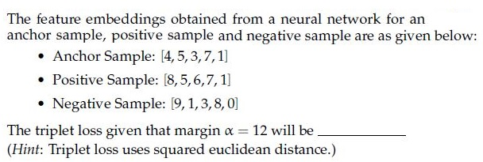

**Figure 33.** Source embeddings and parameters for Question 134.

**Correct answer:** `-30`.

> [!WARNING] The conventional hinge triplet loss is 0, not the keyed -30.

**Worked explanation:** Squared distances are $d(a,p)^2=25$ and $d(a,n)^2=43$. The conventional hinge triplet loss is $\max(0,25-43+12)=0$; even the unhinged expression is $-6$.

### da5006_2024T2_Q2_NA · Q135 · 2 marks · ID 640653856583

A Siamese network is trained for face verification. The face image to be verified is passed through the first branch and the anchor image is passed through the second branch. There are 73286 parameters in each of the branches. Triplet loss is used to learn the overall Siamese network. The total number of trainable parameters in the network (assuming there are no other layers or modules) are________________(write your answer as a number).

**Correct answer:** `73286`.

**Worked explanation:** Siamese branches share parameters: repeated application does not create independent copies. Count the shared parameter set once, giving 73,286.

## Topic: Generative model evaluation

| Done | Paper | Q# | Marks | Type |
| :--- | :--- | ---: | ---: | :--- |
| [ ] | da5006_2025T3_ET_FN | 9 | 1 | MCQ |
| [ ] | da5006_2024T1_Q2_NA | 153 | 2 | MSQ |

### da5006_2025T3_ET_FN · Q9 · 1 marks · ID 6406531862823

How is disentangled representation evaluated?:

**Options**

**A.** Using Mutual Information Gap  
*Option ID:* `6406536034945`

**B.** Using mean Average Precision  
*Option ID:* `6406536034946`

**C.** KL divergence  
*Option ID:* `6406536034947`

**D.** Sparsity in the latent one-hot codes  
*Option ID:* `6406536034948`

**Correct answer:** **A** — Using Mutual Information Gap.

**Worked explanation:** The mutual information gap compares the two highest latent-coordinate mutual informations for each known ground-truth factor, normalized by that factor’s entropy. It measures a particular notion of factor separation.

### da5006_2024T1_Q2_NA · Q153 · 2 marks · ID 640653766163

Frechet Inception Distance (FID) is used for measuring the feature distance between real and generated images to evaluate the goodness of image generation in deep generative models such as GANs. Select the limitations of FID from the given below options:
(Select all possible correct options)

**Options**

**A.** May not capture all features  
*Option ID:* `6406532564227`

**B.** Needs small sample size  
*Option ID:* `6406532564228`

**C.** Slow to run  
*Option ID:* `6406532564229`

**D.** None of these  
*Option ID:* `6406532564230`

**Correct answer:** **A**, **C** — May not capture all features; Slow to run

**Worked explanation:** FID compares Gaussian approximations to feature distributions, so it can miss aspects absent from those features. Its computational cost depends on feature extraction and sample count; it does not directly establish semantic coverage.
