# Week 9 question bank

> Topics inferred from past papers; replace when the official syllabus is available.

**Counts:** Q1: 0, Q2: 0, ET: 30; total: 30 questions, 41.1 marks.

## Topic: Self-attention and QKV projections

| Done | Paper | Q# | Marks | Type |
| :--- | :--- | :--- | ---: | :--- |
| ☐ | da5006_2024T1_ET_AN | 160 | 2 | MCQ |
| ☐ | da5006_2024T1_ET_AN | 191 | 0.7 | SA |
| ☐ | da5006_2024T1_ET_AN | 192 | 0.7 | SA |
| ☐ | da5006_2024T1_ET_AN | 193 | 0.6 | SA |
| ☐ | da5006_2025T2_ET_FN | 197 | 0.55 | SA |
| ☐ | da5006_2026T2_ET_FN | 18 | 2 | MCQ |
| ☐ | da5006_2026T2_ET_FN | 27 | 3 | MSQ |

### da5006_2024T1_ET_AN · Q160 · 2 marks · ID 640653821582

Given word embeddings for two words and weight matrix to generate queries, keys and values as below (in practice, these would be more complex or learned; for simplicity, we provide them here):

$Word_1 = [1\ 0\ 0]$, $Word_2 = [0\ 1\ 0]$

$$W_Q = \begin{bmatrix} 2 & 0 & 2 \\ 2 & 0 & 0 \\ 2 & 1 & 2 \end{bmatrix}, \quad W_K = \begin{bmatrix} 2 & 2 & 2 \\ 0 & 2 & 1 \\ 0 & 1 & 1 \end{bmatrix}, \quad W_V = \begin{bmatrix} 1 & 1 & 0 \\ 0 & 1 & 1 \\ 0 & 0 & 0 \end{bmatrix}$$

Calculate the query, key and value vectors for each word?

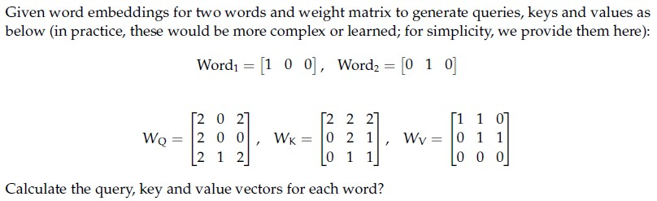

**Figure 1.** Source diagram for Question 160.

**Options**

**A.** $Q_1 = [2\ 0\ 2], K_1 = [2\ 2\ 2], V_1 = [1\ 1\ 0]$; $Q_2 = [2\ 0\ 0], K_2 = [0\ 2\ 1], V_2 = [0\ 1\ 1]$  
*Option ID:* `6406532757285`

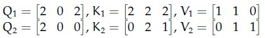

**Figure 2.** Source option graphic for Question 160, Option A.

**B.** $Q_1 = [2\ 0\ 0], K_1 = [2\ 1\ 2], V_1 = [1\ 1\ 0]$; $Q_2 = [2\ 0\ 0], K_2 = [0\ 2\ 1], V_2 = [0\ 1\ 1]$  
*Option ID:* `6406532757286`

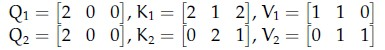

**Figure 3.** Source option graphic for Question 160, Option B.

**C.** $Q_1 = [2\ 0\ 2], K_1 = [2\ 2\ 2], V_1 = [1\ 1\ 0]$; $Q_2 = [2\ 0\ 1], K_2 = [1\ 0\ 1], V_2 = [0\ 1\ 1]$  
*Option ID:* `6406532757287`

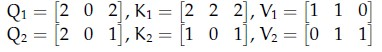

**Figure 4.** Source option graphic for Question 160, Option C.

**D.** None of these  
*Option ID:* `6406532757288`

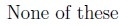

**Figure 5.** Source option graphic for Question 160, Option D.

**Correct answer:** **A** — $Q_1 = [2\ 0\ 2], K_1 = [2\ 2\ 2], V_1 = [1\ 1\ 0]$; $Q_2 = [2\ 0\ 0], K_2 = [0\ 2\ 1], V_2 = [0\ 1\ 1]$.

**Worked explanation:** The embeddings select the first and second rows of each projection matrix. Hence the listed Q, K and V are the rows in option A.

### da5006_2024T1_ET_AN · Q191 · 0.7 marks · ID 640653821584

Given word embeddings for two words and weight matrix to generate queries, keys and values as below (in practice, these would be more complex or learned; for simplicity, we provide them here):

$Word_1 = [1\ 0\ 0]$, $Word_2 = [0\ 1\ 0]$

$$W_Q = \begin{bmatrix} 2 & 0 & 2 \\ 2 & 0 & 0 \\ 2 & 1 & 2 \end{bmatrix}, \quad W_K = \begin{bmatrix} 2 & 2 & 2 \\ 0 & 2 & 1 \\ 0 & 1 & 1 \end{bmatrix}, \quad W_V = \begin{bmatrix} 1 & 1 & 0 \\ 0 & 1 & 1 \\ 0 & 0 & 0 \end{bmatrix}$$

Calculate the query, key, and value to calculate z1. Consider only the first word for calculating the scores; remember that attention output is calculated by a weighted sum of all value vectors. Also, the key vector dimension dk = 3

Based on the above data, answer the given subquestion:

First element of attention vector is __________________

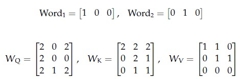

**Figure 6.** Shared context diagram for Questions 191–193.

**Correct answer:** **0.949 to 0.989**

**Worked explanation:** The first query is [2, 0, 2], and its scores against the two keys are 8 and 2. After division by √3 and softmax, the first weight is 0.969649; the first value coordinate gives that same output.

### da5006_2024T1_ET_AN · Q192 · 0.7 marks · ID 640653821585

Given word embeddings for two words and weight matrix to generate queries, keys and values as below (in practice, these would be more complex or learned; for simplicity, we provide them here):

$Word_1 = [1\ 0\ 0]$, $Word_2 = [0\ 1\ 0]$

$$W_Q = \begin{bmatrix} 2 & 0 & 2 \\ 2 & 0 & 0 \\ 2 & 1 & 2 \end{bmatrix}, \quad W_K = \begin{bmatrix} 2 & 2 & 2 \\ 0 & 2 & 1 \\ 0 & 1 & 1 \end{bmatrix}, \quad W_V = \begin{bmatrix} 1 & 1 & 0 \\ 0 & 1 & 1 \\ 0 & 0 & 0 \end{bmatrix}$$

Calculate the query, key, and value to calculate z1. Consider only the first word for calculating the scores; remember that attention output is calculated by a weighted sum of all value vectors. Also, the key vector dimension dk = 3

Based on the above data, answer the given subquestion:

Second element of attention vector is _____________

**Correct answer:** **0.98 to 1.02**

**Worked explanation:** The two value vectors have second coordinate 1. Their softmax weights sum to 1, so the second attention-output coordinate is exactly 1.

### da5006_2024T1_ET_AN · Q193 · 0.6 marks · ID 640653821586

Given word embeddings for two words and weight matrix to generate queries, keys and values as below (in practice, these would be more complex or learned; for simplicity, we provide them here):

$Word_1 = [1\ 0\ 0]$, $Word_2 = [0\ 1\ 0]$

$$W_Q = \begin{bmatrix} 2 & 0 & 2 \\ 2 & 0 & 0 \\ 2 & 1 & 2 \end{bmatrix}, \quad W_K = \begin{bmatrix} 2 & 2 & 2 \\ 0 & 2 & 1 \\ 0 & 1 & 1 \end{bmatrix}, \quad W_V = \begin{bmatrix} 1 & 1 & 0 \\ 0 & 1 & 1 \\ 0 & 0 & 0 \end{bmatrix}$$

Calculate the query, key, and value to calculate z1. Consider only the first word for calculating the scores; remember that attention output is calculated by a weighted sum of all value vectors. Also, the key vector dimension dk = 3

Based on the above data, answer the given subquestion:

Third element of attention vector is _________________

**Correct answer:** **0.010 to 0.050**

**Worked explanation:** The second attention weight is 0.030351; only the second value has third coordinate 1. Thus the third attention-output coordinate is 0.030351.

### da5006_2025T2_ET_FN · Q197 · 0.55 marks · ID 6406531422580

**Shared context (Comprehension Question ID: `6406531422579`, Subquestions: 197 to 207):**

Consider the BLIP model architecture with an input (image-text pair) as shown below:

For each of the given entities, enter the appropriate number from the figure that corresponds to it:

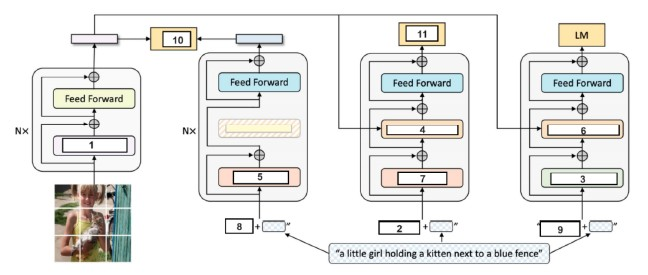

**Figure 7.** Comprehension 6406531422579, BLIP model architecture.

Based on the above data, answer the given subquestions.

Self-Attention

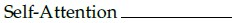

**Figure 8.** Question 197, Self-Attention entity label.

**Correct answer:** `1`

**Worked explanation:** The labelled self-attention component uses queries, keys and values from the same sequence. Identify the number using the shared architecture diagram.

### da5006_2026T2_ET_FN · Q18 · 2 marks · ID 6406532270057

In self-attention, changing the query vector for one token while keeping keys and values fixed directly changes:

**Options**

**A.** The number of tokens in the sequence  
*Option ID:* `6406537379067`

**B.** The attention weights used to combine the value vectors for that token  
*Option ID:* `6406537379068`

**C.** The dimensionality of every value vector  
*Option ID:* `6406537379069`

**D.** The number of transformer layers  
*Option ID:* `6406537379070`

**Correct answer:** **B** — The attention weights used to combine the value vectors for that token.

**Worked explanation:** The query changes its dot products with the fixed keys and therefore its softmax attention weights. The weighted sum of fixed value vectors can consequently change without changing tensor dimensions.

### da5006_2026T2_ET_FN · Q27 · 3 marks · ID 6406532270066

> [!NOTE] Week assignment uncertain: Tests soft attention, self-attention, and visual transformers.

Select all correct statements.

**Options**

**A.** Soft attention can form a weighted combination of visual features.  
*Option ID:* `6406537379103`

**B.** Self-attention allows token representations to depend directly on other tokens.  
*Option ID:* `6406537379104`

**C.** Vision Transformers adapt transformer-style token processing to visual inputs.  
*Option ID:* `6406537379105`

**D.** Transformer-based segmentation is restricted to producing one class label for an entire image.  
*Option ID:* `6406537379106`

**Correct answer:** **A**, **B**, **C** — Soft attention can form a weighted combination of visual features.; Self-attention allows token representations to depend directly on other tokens.; Vision Transformers adapt transformer-style token processing to visual inputs..

**Worked explanation:** Soft attention takes a weighted sum, and self-attention makes each token depend on other tokens. ViTs use visual tokens; segmentation can produce a label at each pixel.

## Topic: Transformer encoders and decoders

| Done | Paper | Q# | Marks | Type |
| :--- | :--- | :--- | ---: | :--- |
| ☐ | da5006_2024T2_ET_AN | 263 | 1 | SA |
| ☐ | da5006_2024T2_ET_AN | 264 | 1 | SA |
| ☐ | da5006_2024T2_ET_AN | 266 | 1 | SA |
| ☐ | da5006_2024T2_ET_AN | 267 | 1 | SA |
| ☐ | da5006_2024T2_ET_AN | 269 | 1 | SA |
| ☐ | da5006_2024T2_ET_AN | 270 | 1 | SA |
| ☐ | da5006_2024T2_ET_AN | 271 | 1 | SA |
| ☐ | da5006_2025T2_ET_AN | 90 | 2 | MCQ |
| ☐ | da5006_2025T2_ET_FN | 198 | 0.55 | SA |
| ☐ | da5006_2026T1_ET_FN | 18 | 3 | MSQ |

### da5006_2024T2_ET_AN · Q263 · 1 marks · ID 640653904312

**Comprehension ID:** `640653904311` · **Sub-Section:** 4 · **Total Marks:** 9 (9 subquestions × 1 mark)

Consider a vanilla transformer network at time step 't' shown below:

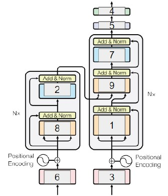

**Figure 9.** Vanilla transformer architecture at time step $t$ for Questions 263–271.

For each of the entities above, enter the appropriate Model component from the figure that corresponds to it:

Based on the above data, answer the given subquestions.

Enter the answer for Model component 1

NOTE: Enter the exact answer without any space in the beginning or at the end.

*(Refer to Figure 21 for Model component labels)*

**Correct answer:** `Decoder Masked Multi-Head Attention`

**Worked explanation:** The first decoder sublayer uses masked self-attention, preventing each target position from seeing future target positions. The mask preserves autoregressive training.

### da5006_2024T2_ET_AN · Q264 · 1 marks · ID 640653904313

**Comprehension ID:** `640653904311` · **Sub-Section:** 4 · **Total Marks:** 9 (9 subquestions × 1 mark)

Consider a vanilla transformer network at time step 't' shown below:

**Figure 10.** Vanilla transformer architecture at time step $t$ for Questions 263–271.

For each of the entities above, enter the appropriate Model component from the figure that corresponds to it:

Based on the above data, answer the given subquestions.

Enter the answer for Model component 2

NOTE: Enter the exact answer without any space in the beginning or at the end.

*(Refer to Figure 21 for Model component labels)*

**Correct answer:** `Encoder Feed Forward Layer`

**Worked explanation:** The encoder feed-forward layer applies the same learned nonlinear MLP independently at each token position. It follows the encoder attention sublayer.

### da5006_2024T2_ET_AN · Q266 · 1 marks · ID 640653904315

**Comprehension ID:** `640653904311` · **Sub-Section:** 4 · **Total Marks:** 9 (9 subquestions × 1 mark)

Consider a vanilla transformer network at time step 't' shown below:

**Figure 11.** Vanilla transformer architecture at time step $t$ for Questions 263–271.

For each of the entities above, enter the appropriate Model component from the figure that corresponds to it:

Based on the above data, answer the given subquestions.

Enter the answer for Model component 4

NOTE: Enter the exact answer without any space in the beginning or at the end.

*(Refer to Figure 21 for Model component labels)*

**Correct answer:** `Softmax`

**Worked explanation:** Softmax normalizes vocabulary logits into a probability distribution over the next token. It is applied after the output linear projection.

### da5006_2024T2_ET_AN · Q267 · 1 marks · ID 640653904316

**Comprehension ID:** `640653904311` · **Sub-Section:** 4 · **Total Marks:** 9 (9 subquestions × 1 mark)

Consider a vanilla transformer network at time step 't' shown below:

**Figure 12.** Vanilla transformer architecture at time step $t$ for Questions 263–271.

For each of the entities above, enter the appropriate Model component from the figure that corresponds to it:

Based on the above data, answer the given subquestions.

Enter the answer for Model component 5

NOTE: Enter the exact answer without any space in the beginning or at the end.

*(Refer to Figure 21 for Model component labels)*

**Correct answer:** `Linear projection`

**Worked explanation:** The output linear projection maps the decoder hidden vector to vocabulary-sized logits. Softmax then normalizes those logits.

### da5006_2024T2_ET_AN · Q269 · 1 marks · ID 640653904318

**Comprehension ID:** `640653904311` · **Sub-Section:** 4 · **Total Marks:** 9 (9 subquestions × 1 mark)

Consider a vanilla transformer network at time step 't' shown below:

**Figure 13.** Vanilla transformer architecture at time step $t$ for Questions 263–271.

For each of the entities above, enter the appropriate Model component from the figure that corresponds to it:

Based on the above data, answer the given subquestions.

Enter the answer for Model component 7

NOTE: Enter the exact answer without any space in the beginning or at the end.

*(Refer to Figure 21 for Model component labels)*

**Correct answer:** `Decoder Feed Forward Layer`

**Worked explanation:** The decoder feed-forward layer applies a shared position-wise nonlinear transformation. It follows the attention sublayers within the decoder block.

### da5006_2024T2_ET_AN · Q270 · 1 marks · ID 640653904319

**Comprehension ID:** `640653904311` · **Sub-Section:** 4 · **Total Marks:** 9 (9 subquestions × 1 mark)

Consider a vanilla transformer network at time step 't' shown below:

**Figure 14.** Vanilla transformer architecture at time step $t$ for Questions 263–271.

For each of the entities above, enter the appropriate Model component from the figure that corresponds to it:

Based on the above data, answer the given subquestions.

Enter the answer for Model component 8

NOTE: Enter the exact answer without any space in the beginning or at the end.

*(Refer to Figure 21 for Model component labels)*

**Correct answer:** `Encoder Multi-Head Attention`

**Worked explanation:** Encoder multi-head self-attention uses source representations for queries, keys and values. Each source position can use information from other unmasked positions.

### da5006_2024T2_ET_AN · Q271 · 1 marks · ID 640653904320

**Comprehension ID:** `640653904311` · **Sub-Section:** 4 · **Total Marks:** 9 (9 subquestions × 1 mark)

Consider a vanilla transformer network at time step 't' shown below:

**Figure 15.** Vanilla transformer architecture at time step $t$ for Questions 263–271.

For each of the entities above, enter the appropriate Model component from the figure that corresponds to it:

Based on the above data, answer the given subquestions.

Enter the answer for Model component 9

NOTE: Enter the exact answer without any space in the beginning or at the end.

*(Refer to Figure 21 for Model component labels)*

**Correct answer:** `Decoder Multi-Head Attention`

**Worked explanation:** Decoder cross-attention uses decoder states as queries and encoder outputs as keys and values. It connects generation to the source sequence.

### da5006_2025T2_ET_AN · Q90 · 2 marks · ID 6406531431350

> [!NOTE] Week assignment uncertain: Tests transformer recurrence alongside captioning and recurrent attention.

Which one of the following statements is false? (Pick the most appropriate one.)

**Options**

**A.** Attention mechanisms can be applied to the bidirectional RNN model  
*Option ID:* `6406534780273`

**B.** An image captioning network can be trained end-to-end even though we are using 2 different modalities to train the network  
*Option ID:* `6406534780274`

**C.** One of the key components in the vanilla transformer is the recurrent connection that help them to deal with variable input length.  
*Option ID:* `6406534780275`

**D.** All of these.  
*Option ID:* `6406534780276`

**Correct answer:** **C** — One of the key components in the vanilla transformer is the recurrent connection that help them to deal with variable input length..

**Worked explanation:** A vanilla Transformer uses attention and position-wise feed-forward layers, not recurrent connections. Attention can also be combined with a bidirectional RNN, and multimodal networks can be trained end-to-end.

### da5006_2025T2_ET_FN · Q198 · 0.55 marks · ID 6406531422581

**Shared context (Comprehension Question ID: `6406531422579`, Subquestions: 197 to 207):**

Consider the BLIP model architecture with an input (image-text pair) as shown below:

For each of the given entities, enter the appropriate number from the figure that corresponds to it:

**Figure 16.** Comprehension 6406531422579, BLIP model architecture.

**Shared context (Comprehension Question ID: `6406531422579`, Subquestions: 197 to 207):**

BLIP model architecture (Figure 41).

Based on the above data, answer the given subquestion:

BERT Text Encoder Bi Self Attention:

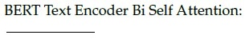

**Figure 17.** Question 198, BERT Text Encoder Bi Self Attention entity label.

**Correct answer:** `5`

**Worked explanation:** A bidirectional text encoder can attend to both left and right context when unmasked. The diagram identifies that component with the keyed number.

### da5006_2026T1_ET_FN · Q18 · 3 marks · ID 6406532136833

Select all correct statements:

**Options**

**A.** Self-attention computes pairwise interactions between tokens within a sequence.  
*Option ID:* `6406536959541`

**B.** Positional encodings are needed because self-attention alone is permutation-invariant.  
*Option ID:* `6406536959542`

**C.** Transformers must use recurrence to handle sequences.  
*Option ID:* `6406536959543`

**D.** Multi-head attention allows the model to attend to different subspaces/relations.  
*Option ID:* `6406536959544`

**Correct answer:** **A**, **B**, **D** — Self-attention computes pairwise interactions between tokens within a sequence.; Positional encodings are needed because self-attention alone is permutation-invariant.; Multi-head attention allows the model to attend to different subspaces/relations..

**Worked explanation:** Self-attention forms token-pair scores and multiple heads can learn distinct projections; recurrence is not required. Strictly, tokenwise self-attention is permutation-equivariant rather than invariant; an invariant pooling operation is a separate step.

> [!WARNING] The source key is retained, but the wording is technically imprecise; see the explanation and discrepancy log.

## Topic: Token and positional representations

| Done | Paper | Q# | Marks | Type |
| :--- | :--- | :--- | ---: | :--- |
| ☐ | da5006_2024T1_ET_AN | 190 | 2 | SA |
| ☐ | da5006_2024T2_ET_AN | 265 | 1 | SA |
| ☐ | da5006_2024T2_ET_AN | 268 | 1 | SA |

### da5006_2024T1_ET_AN · Q190 · 2 marks · ID 640653821623

Transformer encoder requires a sequence of __________ as input.

**Correct answer:** **vectors**

**Worked explanation:** An encoder consumes an ordered sequence of vector representations, usually with a common model width. A raw word or image patch must first be embedded.

### da5006_2024T2_ET_AN · Q265 · 1 marks · ID 640653904314

**Comprehension ID:** `640653904311` · **Sub-Section:** 4 · **Total Marks:** 9 (9 subquestions × 1 mark)

Consider a vanilla transformer network at time step 't' shown below:

**Figure 18.** Vanilla transformer architecture at time step $t$ for Questions 263–271.

For each of the entities above, enter the appropriate Model component from the figure that corresponds to it:

Based on the above data, answer the given subquestions.

Enter the answer for Model component 3

NOTE: Enter the exact answer without any space in the beginning or at the end.

*(Refer to Figure 21 for Model component labels)*

**Correct answer:** `Output Embedding`

**Worked explanation:** Output embedding maps preceding target tokens to model-width vectors. These vectors enter the decoder with positional information.

### da5006_2024T2_ET_AN · Q268 · 1 marks · ID 640653904317

**Comprehension ID:** `640653904311` · **Sub-Section:** 4 · **Total Marks:** 9 (9 subquestions × 1 mark)

Consider a vanilla transformer network at time step 't' shown below:

**Figure 19.** Vanilla transformer architecture at time step $t$ for Questions 263–271.

For each of the entities above, enter the appropriate Model component from the figure that corresponds to it:

Based on the above data, answer the given subquestions.

Enter the answer for Model component 6

NOTE: Enter the exact answer without any space in the beginning or at the end.

*(Refer to Figure 21 for Model component labels)*

**Correct answer:** `Input Embedding`

**Worked explanation:** Input embedding converts source token identities into model-width vectors. Positional information is combined with those representations before encoder processing.

## Topic: Vision transformers

| Done | Paper | Q# | Marks | Type |
| :--- | :--- | :--- | ---: | :--- |
| ☐ | da5006_2024T1_ET_AN | 200 | 1 | SA |
| ☐ | da5006_2024T1_ET_AN | 201 | 1 | SA |
| ☐ | da5006_2024T1_ET_AN | 202 | 1 | SA |
| ☐ | da5006_2024T1_ET_AN | 203 | 1 | SA |
| ☐ | da5006_2024T3_ET_AN | 198 | 2 | Multiple Choice Question (MCQ) |
| ☐ | da5006_2025T2_ET_AN | 86 | 2 | MCQ |
| ☐ | da5006_2025T3_ET_FN | 4 | 1 | MCQ |
| ☐ | da5006_2026T2_ET_FN | 19 | 2 | MCQ |

### da5006_2024T1_ET_AN · Q200 · 1 marks · ID 640653821625

> [!NOTE] Week assignment uncertain: Compares pixel and patch tokenization; parameter wording is ambiguous.

In vision transformers, if treat each pixel as a token for an image of size 64 × 64 × 3, the number of parameters required for the self-attention calculation are ________blank(a)________ . What will be the number of parameters if consider patches of size 8 × 8 × 3 ________blank(b)________.

Based on the above data, answer the given subquestion:

Enter the correct answer for blank(a):

**Correct answer:** **12288**

**Worked explanation:** The key 12288 equals 64×64×3 scalar input values, not a specified learned attention parameter count. Q/K/V parameter counts require the projection dimensions and bias convention.

> [!WARNING] The source key is retained, but the wording is technically imprecise; see the explanation and discrepancy log.

### da5006_2024T1_ET_AN · Q201 · 1 marks · ID 640653821626

> [!NOTE] Week assignment uncertain: Compares pixel and patch tokenization; parameter wording is ambiguous.

In vision transformers, if treat each pixel as a token for an image of size 64 × 64 × 3, the number of parameters required for the self-attention calculation are ________blank(a)________ . What will be the number of parameters if consider patches of size 8 × 8 × 3 ________blank(b)________.

Based on the above data, answer the given subquestion:

Enter the correct answer for blank(b):

**Correct answer:** **64**

**Worked explanation:** There are (64/8)² = 64 patches. This is a token count, not a learned parameter count; the actual attention parameter count requires projection widths.

> [!WARNING] The source key is retained, but the wording is technically imprecise; see the explanation and discrepancy log.

### da5006_2024T1_ET_AN · Q202 · 1 marks · ID 640653821628

In a ViT, all blocks have same ________blank(a)________ and number of ________blank(b)________

Based on the above data, answer the given subquestion:

Enter the correct answer for blank(a):

**Correct answer:** **resolution**

**Worked explanation:** The original isotropic ViT maintains the same patch-grid resolution throughout its encoder blocks. Later hierarchical variants need not do so.

### da5006_2024T1_ET_AN · Q203 · 1 marks · ID 640653821629

In a ViT, all blocks have same ________blank(a)________ and number of ________blank(b)________

Based on the above data, answer the given subquestion:

Enter the correct answer for blank(b):

**Correct answer:** **channels**

**Worked explanation:** Standard ViT blocks preserve the embedding width, also called the channel dimension. Residual additions require compatible dimensions.

### da5006_2024T3_ET_AN · Q198 · 2 marks · ID 6406531046050

What is the correct order of operations for processing an image through a Vision Transformer (ViT)?

**Options**

**A.** Image patching → Positional embedding → Linear projection of flattened patches → Transformer encoder→ Classification head  
*Option ID:* `6406533531331`

**B.** Image patching → Linear projection of flattened patches → Positional embedding → Transformer encoder→ Classification head  
*Option ID:* `6406533531332`

**C.** Positional embedding → Image patching → Linear projection of flattened patches → Transformer encoder→ Classification head  
*Option ID:* `6406533531333`

**D.** Linear projection of Images → Image patching → Positional embedding → Transformer encoder → Classification head  
*Option ID:* `6406533531334`

**E.** Linear projection of Images → Image patching → Positional embedding → Transformer encoder→ Transformer decoder→ Classification head  
*Option ID:* `6406533531335`

**Correct answer:** **B** — Image patching → Linear projection of flattened patches → Positional embedding → Transformer encoder→ Classification head.

**Worked explanation:** Split the image into patches, flatten and project each patch, add position information, then apply the encoder and classification head. Position vectors must match the projected model width.

### da5006_2025T2_ET_AN · Q86 · 2 marks · ID 6406531431346

What is the correct order of operations for processing an image through a Vision Transformer (ViT)?

**Options**

**A.** Image patching → Positional embedding → Linear projection of flattened patches → Transformer encoder→ Classification head  
*Option ID:* `6406534780256`

**B.** Image patching → Linear projection of flattened patches → Positional embedding → Transformer encoder→ Classification head  
*Option ID:* `6406534780257`

**C.** Positional embedding → Image patching → Linear projection of flattened patches → Transformer encoder→ Classification head  
*Option ID:* `6406534780258`

**D.** Linear projection of Images → Image patching → Positional embedding → Transformer encoder → Classification head  
*Option ID:* `6406534780259`

**E.** Linear projection of Images → Image patching → Positional embedding → Transformer encoder → Transformer decoder→ Classification head  
*Option ID:* `6406534780260`

**Correct answer:** **B** — Image patching → Linear projection of flattened patches → Positional embedding → Transformer encoder→ Classification head.

**Worked explanation:** Split the image into patches, flatten and project each patch, add position information, then apply the encoder and classification head. Position vectors must match the projected model width.

### da5006_2025T3_ET_FN · Q4 · 1 marks · ID 6406531862818

In a Vision Transformer (ViT), which step occurs immediately before adding positional embeddings?

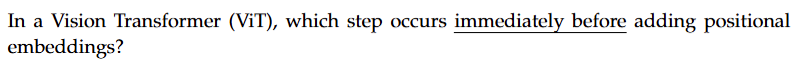

**Figure 20.** Source question text for Question 4.

**Options**

**A.** Passing patch embeddings through the Transformer encoder  
*Option ID:* `6406536034925`

**B.** Linear projection of flattened image patches  
*Option ID:* `6406536034926`

**C.** Adding a class token  
*Option ID:* `6406536034927`

**D.** Layer normalization of patch embeddings  
*Option ID:* `6406536034928`

**Correct answer:** **B** — Linear projection of flattened image patches.

**Worked explanation:** Flattened image patches are linearly projected to the model width before positional embeddings are added. A class token may also be concatenated before positional addition, so the exact immediate predecessor depends on the stated implementation.

### da5006_2026T2_ET_FN · Q19 · 2 marks · ID 6406532270058

A standard way to convert an image for processing by a Vision Transformer is to:

**Options**

**A.** Treat the complete image batch as a single token  
*Option ID:* `6406537379071`

**B.** Divide the image into patches and map the patches to token embeddings  
*Option ID:* `6406537379072`

**C.** Replace each patch with its ground-truth class before attention  
*Option ID:* `6406537379073`

**D.** Use only the global mean RGB value as the token sequence  
*Option ID:* `6406537379074`

**Correct answer:** **B** — Divide the image into patches and map the patches to token embeddings.

**Worked explanation:** Divide an image into fixed-size patches, flatten each patch and apply a shared learned projection. The resulting vectors form the Transformer input sequence.

## Topic: Transformer object detection

| Done | Paper | Q# | Marks | Type |
| :--- | :--- | :--- | ---: | :--- |
| ☐ | da5006_2025T2_ET_AN | 83 | 2 | MCQ |
| ☐ | da5006_2025T2_ET_FN | 171 | 2 | MCQ |

### da5006_2025T2_ET_AN · Q83 · 2 marks · ID 6406531431343

Why does DETR typically exhibit poor performance in detecting small objects compared to larger ones? Choose the best answer in your opinion.

**Options**

**A.** The CNN backbone used in DETR has a fixed receptive field that’s too large for small objects.  
*Option ID:* `6406534780241`

**B.** The global self-attention mechanism in DETR tends to dilute the signal from small objects across all image locations.  
*Option ID:* `6406534780242`

**C.** DETR’s loss function actively discards all detections smaller than 50 × 50 pixels.  
*Option ID:* `6406534780243`

**D.** The object queries in DETR are programmed to ignore any object smaller than 10% of the image size.  
*Option ID:* `6406534780244`

**E.** DETR’s encoder-decoder architecture was specifically designed to only detect objects larger than a cat.  
*Option ID:* `6406534780245`

**Correct answer:** **B** — The global self-attention mechanism in DETR tends to dilute the signal from small objects across all image locations..

**Worked explanation:** The source selects global attention dilution as the best listed explanation. In practice coarse feature resolution, limited multiscale features and training dynamics also contribute; this is not a universal causal theorem.

### da5006_2025T2_ET_FN · Q171 · 2 marks · ID 6406531422550

Why does DETR typically exhibit poor performance in detecting small objects compared to larger ones?

**Options**

**A.** The CNN backbone used in DETR has a fixed receptive field that’s too large for small objects  
*Option ID:* `6406534756417`

**B.** The global self-attention mechanism in DETR tends to dilute the signal from small objects across all image locations  
*Option ID:* `6406534756418`

**C.** DETR’s loss function actively discards all detections smaller than 50x50 pixels  
*Option ID:* `6406534756419`

**D.** The object queries in DETR are programmed to ignore any object smaller than 10  
*Option ID:* `6406534756420`

**E.** DETR’s encoder-decoder architecture was specifically designed to only detect large objects  
*Option ID:* `6406534756421`

**Correct answer:** **B** — The global self-attention mechanism in DETR tends to dilute the signal from small objects across all image locations.

**Worked explanation:** The source selects global attention dilution as the best listed explanation. In practice coarse feature resolution, limited multiscale features and training dynamics also contribute; this is not a universal causal theorem.
