# Week 10 question bank

> Topics inferred from past papers; replace when the official syllabus is available.

Exam counts: Q1 0; Q2 0; ET 17. Total: 17 questions, 34 marks.

## Topic: Progressive and style-based GANs

| Done | Paper | Q# | Marks | Type |
| :--- | :--- | ---: | ---: | :--- |
| [ ] | da5006_2024T1_ET_AN | 177 | 2 | MCQ |
| [ ] | da5006_2024T1_ET_AN | 183 | 2 | MCQ |
| [ ] | da5006_2024T2_ET_AN | 281 | 1 | MCQ |

### da5006_2024T1_ET_AN · Q177 · 2 marks · ID 640653821603

Consider the following assertion and reason, and state which of them is true. Assertion: ProgressiveGAN uses Minibatch Standard Deviation. Reason: This value will be different if the generated images do not have the same diversity as the actual images, and the discriminator will penalize it as a result.

**Options**

**A.** Both Assertion and Reason are True; Reason is a correct explanation of the Assertion  
*Option ID:* `6406532757356`

**B.** Both Assertion and Reason are True; but Reason is not a correct explanation of the Assertion  
*Option ID:* `6406532757357`

**C.** Assertion is True; Reason is False  
*Option ID:* `6406532757358`

**D.** Assertion is False by itself  
*Option ID:* `6406532757359`

**Correct answer:** **A** — Both Assertion and Reason are True; Reason is a correct explanation of the Assertion.

**Worked explanation:** A minibatch standard-deviation feature exposes variation across samples to the discriminator. A collapsed generator may produce a lower statistic, although one statistic cannot characterize the entire distribution.

### da5006_2024T1_ET_AN · Q183 · 2 marks · ID 640653821622

What is the advantage of the progressive training methodology proposed in the Progressive GAN paper?

**Options**

**A.** It allows for generating high-resolution images with unlimited variation.  
*Option ID:* `6406532757396`

**B.** It eliminates the need for using mini-batches during training.  
*Option ID:* `6406532757397`

**C.** It enables the discovery of large-scale structures before finer-scale details.  
*Option ID:* `6406532757398`

**D.** It ensures all layers in the networks remain fixed throughout the training process.  
*Option ID:* `6406532757399`

**Correct answer:** **C** — It enables the discovery of large-scale structures before finer-scale details..

**Worked explanation:** Progressive growing starts at low resolution and fades in higher-resolution blocks. The network can learn global structure before expensive fine detail.

### da5006_2024T2_ET_AN · Q281 · 1 marks · ID 640653904334

Generative Adversarial Networks (GANs) are widely used to generate new images. Many GAN-based architectures have been developed over the years to improve the quality of generation. Progressive GAN, a popular architecture among many others, uses a technique called progressive growing. Which one of the options below is the purpose for progressive growing?

**Options**

**A.** To grow the range of loss function  
*Option ID:* `6406533045095`

**B.** To gradually train the generator by increasing the resolution of images being generated in iterations  
*Option ID:* `6406533045096`

**C.** To iteratively train the generator to create 3D images from 2D ones  
*Option ID:* `6406533045097`

**D.** To shrink the size of the generator model so generator become faster  
*Option ID:* `6406533045098`

**Correct answer:** **B** — To gradually train the generator by increasing the resolution of images being generated in iterations

**Worked explanation:** Progressive growing adds generator and discriminator blocks while increasing image resolution. This is a training schedule, not a guarantee of diversity or a 3D reconstruction method.

## Topic: GAN diversity and failure modes

| Done | Paper | Q# | Marks | Type |
| :--- | :--- | ---: | ---: | :--- |

## Topic: Vector-quantized autoencoders

| Done | Paper | Q# | Marks | Type |
| :--- | :--- | ---: | ---: | :--- |
| [ ] | da5006_2024T3_ET_AN | 199 | 2 | Multiple Choice Question (MCQ) |
| [ ] | da5006_2025T2_ET_AN | 87 | 2 | MCQ |

### da5006_2024T3_ET_AN · Q199 · 2 marks · ID 6406531046051

Vector Quantized Variational Autoencoder (VQ-VAE) utilizes a discrete latent representation as opposed to continuous latent spaces used in traditional VAEs. One of the key components of a VQ-VAE is the codebook, which consists of a set of learnable vectors. What is the primary role of the codebook in VQ-VAE?

**Options**

**A.** It performs the non-linear transformation of the input data to a higher dimensional space.  
*Option ID:* `6406533531336`

**B.** It regularizes the encoder by penalizing complex encodings.  
*Option ID:* `6406533531337`

**C.** It provides a finite set of vectors which the encoder’s outputs are mapped to, effectively quantizing the latent space.  
*Option ID:* `6406533531338`

**D.** It decodes the quantized vectors back into the reconstructed input space.  
*Option ID:* `6406533531339`

**Correct answer:** **C** — It provides a finite set of vectors which the encoder’s outputs are mapped to, effectively quantizing the latent space..

**Worked explanation:** Each encoder vector is replaced by the nearest learned codebook vector. The decoder consumes that quantized representation; it is not itself the codebook.

### da5006_2025T2_ET_AN · Q87 · 2 marks · ID 6406531431347

Vector Quantized Variational Autoencoder (VQ-VAE) utilizes a discrete latent representation as opposed to continuous latent spaces used in traditional VAEs. One of the key components of a VQ-VAE is the codebook, which consists of a set of learnable vectors. What is the primary role of the codebook in VQ-VAE?

**Options**

**A.** It performs the non-linear transformation of the input data to a higher dimensional space.  
*Option ID:* `6406534780261`

**B.** It regularizes the encoder by penalizing complex encodings.  
*Option ID:* `6406534780262`

**C.** It provides a finite set of vectors which the encoder’s outputs are mapped to, effectively quantizing the latent space.  
*Option ID:* `6406534780263`

**D.** It decodes the quantized vectors back into the reconstructed input space.  
*Option ID:* `6406534780264`

**Correct answer:** **C** — It provides a finite set of vectors which the encoder’s outputs are mapped to, effectively quantizing the latent space..

**Worked explanation:** The finite learned codebook supplies the vectors to which encoder outputs are quantized. The decoder then maps those selected vectors back to image space.

## Topic: Forward diffusion and noise schedules

| Done | Paper | Q# | Marks | Type |
| :--- | :--- | ---: | ---: | :--- |
| [ ] | da5006_2024T3_ET_AN | 201 | 2 | Multiple Choice Question (MCQ) |
| [ ] | da5006_2025T2_ET_AN | 106 | 2 | SA |
| [ ] | da5006_2025T2_ET_FN | 183 | 2 | SA |
| [ ] | da5006_2026T2_ET_FN | 38 | 4 | SA |

### da5006_2024T3_ET_AN · Q201 · 2 marks · ID 6406531046054

In the forward process of a diffusion model, the data is incrementally corrupted by adding noise across $T$ timesteps. If the variance of the noise added at each step $t$ is $\beta_t$, which decreases linearly from 0.03 at the first step to 0.02 at the last step over 150 timesteps, calculate the total variance of the noise added over 150 timesteps. (Hint: Calculate average variance per step to calculate total variance)

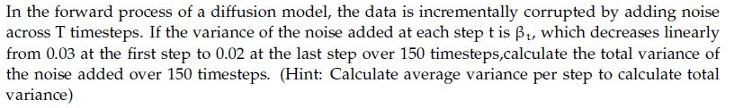
**Figure 1.** Source problem statement for Question 201.

**Options**

**A.** 3.25  
*Option ID:* `6406533531348`

**B.** 4.5  
*Option ID:* `6406533531349`

**C.** 7.5  
*Option ID:* `6406533531350`

**D.** 3.75  
*Option ID:* `6406533531351`

**Correct answer:** **D** — 3.75.

**Worked explanation:** The arithmetic schedule sum is $150(0.03+0.02)/2=3.75$. This sum is not the actual accumulated marginal DDPM noise variance, which depends on products of $1-\beta_t$.

### da5006_2025T2_ET_AN · Q106 · 2 marks · ID 6406531431366

In the forward process of a diffusion model, the data is incrementally corrupted by adding noise across $T$ timesteps. If the variance of the noise added at each step $t$ is $\beta_t$, which decreases linearly from 0.03 at the first step to 0.02 at the last step over 150 timesteps, calculate the total variance of the noise added over 150 timesteps ___. (Round decimal point till 2 places) (Hint: Calculate average variance per step to calculate total variance)

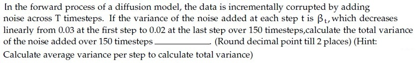

**Figure 2.** Source problem statement for Question 106.

**Correct answer:** 3.75

**Worked explanation:** The average of the linearly spaced endpoints is 0.025, so the requested sum is $150(0.025)=3.75$. The DDPM marginal variance is $1-\prod_t(1-\beta_t)$ instead.

### da5006_2025T2_ET_FN · Q183 · 2 marks · ID 6406531422562

In the forward process of a diffusion model, the data is incrementally corrupted by adding noise across T timesteps. If the variance of the noise added at each step t is β_t, which decreases linearly from 0.03 at the first step to 0.02 at the last step over 150 timesteps,calculate the total variance of the noise added over 150 timesteps ___. (Round decimal point till 2 places)

(Hint: Calculate average variance per step to calculate total variance)

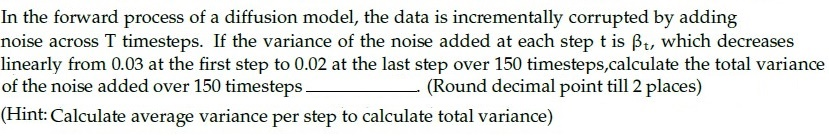

**Figure 3.** Question 183, diffusion forward process variance problem.

**Correct answer:** `3.75`

**Worked explanation:** An arithmetic sequence has mean $(0.03+0.02)/2=0.025$. Multiplying by 150 gives 3.75; this is the sum of schedule entries, not the DDPM marginal variance.

### da5006_2026T2_ET_FN · Q38 · 4 marks · ID 6406532270077

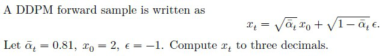

**Figure 4.** Source DDPM formulation for Question 38.

A DDPM forward sample is written as
$$x_t = \sqrt{\bar{\alpha}_t} x_0 + \sqrt{1 - \bar{\alpha}_t} \epsilon.$$
Let $\bar{\alpha}_t = 0.81$, $x_0 = 2$, $\epsilon = -1$. Compute $x_t$ to three decimals.

**Correct answer:** `1.363 to 1.365`

**Worked explanation:** Substitution gives $0.9(2)+\sqrt{0.19}(-1)=1.364110\ldots$, or 1.364 to three decimals. The coefficient 0.19 is a variance and must be square-rooted.

## Topic: Reverse diffusion and guidance

| Done | Paper | Q# | Marks | Type |
| :--- | :--- | ---: | ---: | :--- |
| [ ] | da5006_2024T3_ET_AN | 200 | 2 | Multiple Choice Question (MCQ) |
| [ ] | da5006_2024T3_ET_AN | 213 | 2 | Multiple Select Question (MSQ) |
| [ ] | da5006_2025T2_ET_AN | 98 | 2 | MSQ |
| [ ] | da5006_2025T2_ET_AN | 105 | 2 | SA |
| [ ] | da5006_2025T2_ET_FN | 182 | 2 | SA |
| [ ] | da5006_2025T3_ET_FN | 11 | 1 | MSQ |
| [ ] | da5006_2026T2_ET_FN | 21 | 2 | MCQ |

### da5006_2024T3_ET_AN · Q200 · 2 marks · ID 6406531046053

Consider a reverse process in a diffusion model where the goal is to reconstruct the original data from the noise. If the model correctly reduces the variance of the noise by 0.02 in each reverse step, and starts with a noise variance of 1.0 at timestep T = 50, how many steps are required to reduce the noise variance to 0.1?

**Options**

**A.** 45  
*Option ID:* `6406533531344`

**B.** 50  
*Option ID:* `6406533531345`

**C.** 40  
*Option ID:* `6406533531346`

**D.** 30  
*Option ID:* `6406533531347`

**Correct answer:** **A** — 45.

**Worked explanation:** Under the stated artificial linear decrement, $(1.0-0.1)/0.02=45$ steps. Actual DDPM reverse variances do not generally decrease by a fixed amount per step.

### da5006_2024T3_ET_AN · Q213 · 2 marks · ID 6406531046052

Classifier-free guidance is a technique used in diffusion models to improve sample quality without the explicit use of a classifier. This technique involves modifying the sampling process based on a control parameter. If the control parameter, denoted as $\gamma$, is set to zero, what effect does this have on the generation process?

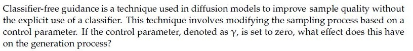
**Figure 5.** Source statement for Question 213.

**Options**

**A.** It fails to generate realistic samples  
*Option ID:* `6406533531340`

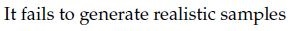
**Figure 6.** Question 213 Option A diagram.

**B.** It removes all guidance, effectively making the process equivalent to the unconditional generation.  
*Option ID:* `6406533531341`

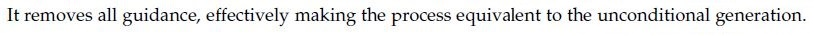
**Figure 7.** Question 213 Option B diagram.

**C.** It maximizes the influence of the classifier, leading to highly detailed generations.  
*Option ID:* `6406533531342`

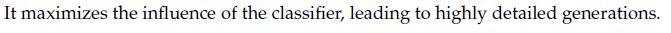
**Figure 8.** Question 213 Option C diagram.

**D.** It can lead to more diverse samples compared to higher values of $\gamma$, as the generation process is less constrained by the conditional information.  
*Option ID:* `6406533531343`

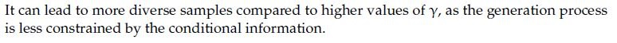
**Figure 9.** Question 213 Option D diagram.

**Correct answer:** **B**, **D** — B — It removes all guidance, effectively making the process equivalent to the unconditional generation; D — It can lead to more diverse samples compared to higher values of $\gamma$, as the generation process is less constrained by the conditional information..

**Worked explanation:** Using $\epsilon_\gamma=\epsilon_u+\gamma(\epsilon_c-\epsilon_u)$, zero returns the unconditional prediction. Greater guidance often trades diversity for condition adherence; this is a tendency, not a theorem.

### da5006_2025T2_ET_AN · Q98 · 2 marks · ID 6406531431358

Classifier-free guidance is a technique used in diffusion models to improve sample quality without the explicit use of a classifier. This technique involves modifying the sampling process based on a control parameter. If the control parameter, denoted as γ, is set to zero, what effect does this have on the generation process?

**Options**

**A.** It fails to generate realistic samples  
*Option ID:* `6406534780305`

**B.** It removes all guidance, effectively making the process equivalent to the unconditional generation.  
*Option ID:* `6406534780306`

**C.** It maximizes the influence of the classifier, leading to highly detailed generations.  
*Option ID:* `6406534780307`

**D.** It can lead to more diverse samples compared to higher values of γ, as the generation process is less constrained by the conditional information.  
*Option ID:* `6406534780308`

**Correct answer:** **B, D** — It removes all guidance, effectively making the process equivalent to the unconditional generation.; It can lead to more diverse samples compared to higher values of γ, as the generation process is less constrained by the conditional information..

**Worked explanation:** With the convention $\epsilon_\gamma=\epsilon_u+\gamma(\epsilon_c-\epsilon_u)$, $\gamma=0$ is unconditional. Reduced conditioning can increase diversity relative to stronger guidance, but does not guarantee it.

### da5006_2025T2_ET_AN · Q105 · 2 marks · ID 6406531431365

In a diffusion model reverse process the model reduces the noise variance by 0.02 at each reverse step. If it starts with a noise variance of 0.90 at timestep $T = 60$, how many steps are required to reduce the noise variance to 0.05?

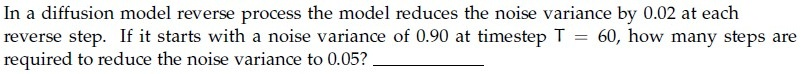

**Figure 10.** Source problem statement for Question 105.

**Correct answer:** 43

> [!WARNING] The source key assumes the first whole step at or below the target; exactly 0.05 is unattainable under the stated decrement.

**Worked explanation:** The real-valued step count is $(0.90-0.05)/0.02=42.5$. After 42 steps the variance is 0.06; after 43 it is 0.04, so 43 crosses the target rather than reaching it exactly.

### da5006_2025T2_ET_FN · Q182 · 2 marks · ID 6406531422561

Consider a reverse process in a diffusion model where the goal is to reconstruct the original data from the noise. If the model correctly reduces the variance of the noise by 0.02 in each reverse step, and starts with a noise variance of 1.0 at timestep T = 50, how many steps are required to reduce the noise variance to 0.1____?

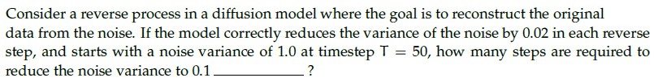

**Figure 11.** Question 182, diffusion reverse process problem.

**Correct answer:** `45`

**Worked explanation:** The requested reduction is $1.0-0.1=0.9$. Dividing by 0.02 gives 45 reverse steps under this simplified assumption.

### da5006_2025T3_ET_FN · Q11 · 1 marks · ID 6406531862825

In classifier-free guidance for diffusion models, increasing the guidance scale $\gamma$ tends to: (Select all that apply.)

**Options**

**A.** improve fidelity to the conditioning signal  
*Option ID:* `6406536034953`

**B.** always reduce mode collapse to zero  
*Option ID:* `6406536034954`

**C.** reduce sample diversity at very high values  
*Option ID:* `6406536034955`

**D.** be equivalent to classifier guidance  
*Option ID:* `6406536034956`

**Correct answer:** **A**, **C** — improve fidelity to the conditioning signal ; reduce sample diversity at very high values.

**Worked explanation:** Stronger classifier-free guidance generally emphasizes conditional prediction and may improve adherence. At excessive scales it can reduce diversity or introduce artifacts; it does not use an external classifier.

### da5006_2026T2_ET_FN · Q21 · 2 marks · ID 6406532270060

Classifier-free guidance during sampling is based on combining:

**Options**

**A.** Predictions from two external classifiers trained on different label sets  
*Option ID:* `6406537379079`

**B.** Conditional and unconditional denoising predictions from the diffusion model  
*Option ID:* `6406537379080`

**C.** The forward-noise sample and a segmentation mask with equal weights  
*Option ID:* `6406537379081`

**D.** Two independently sampled latent codes without conditioning information  
*Option ID:* `6406537379082`

**Correct answer:** **B** — Conditional and unconditional denoising predictions from the diffusion model.

**Worked explanation:** The sampler combines conditional and unconditional noise predictions from the same condition-dropout-trained model. No separate classifier is needed.

## Topic: Neural style transfer

| Done | Paper | Q# | Marks | Type |
| :--- | :--- | ---: | ---: | :--- |
| [ ] | da5006_2024T1_ET_AN | 173 | 2 | MCQ |

### da5006_2024T1_ET_AN · Q173 · 2 marks · ID 640653821599

What is the primary role of the Gram matrix in neural style transfer?

**Options**

**A.** To compute the style loss by measuring the similarity between feature maps from the content and style images.  
*Option ID:* `6406532757340`

**B.** To generate high-resolution images by applying a series of convolutions and upsampling operations.  
*Option ID:* `6406532757341`

**C.** To regularize the optimization process by penalizing large gradients in the feature space.  
*Option ID:* `6406532757342`

**D.** To visualize the internal representations learned by the neural network during training.  
*Option ID:* `6406532757343`

**Correct answer:** **A** — To compute the style loss by measuring the similarity between feature maps from the content and style images..

**Worked explanation:** For feature matrix $F$, the Gram matrix $FF^T$ stores channel inner products across spatial positions. Style loss compares the generated image’s Gram matrix to the style image’s, not normally the content image’s; A is the closest option.
