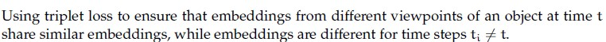
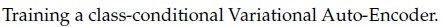
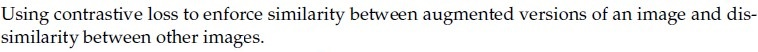
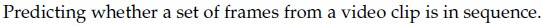
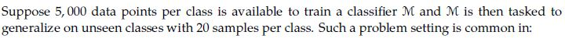
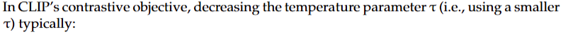

# Week 11 Question Bank

> Topics inferred from past papers; replace when the official syllabus is available.

**Counts:** Q1: 0; Q2: 0; ET: 11. **Total:** 11 questions, 22 marks.

## Topic: Self-supervised objectives and pretext tasks

| Done | Paper | Q# | Marks | Type |
| :---: | :--- | ---: | ---: | :--- |
| [ ] | da5006_2024T2_ET_AN | 282 | 1 | MCQ |

### da5006_2024T2_ET_AN · Q282 · 1 marks · ID 640653904335

Which of the following is not a self-supervised learning method?

**Options**

**A.** Using triplet loss to ensure that embeddings from different viewpoints of an object at time $t$ share similar embeddings, while embeddings are different for time steps $t_i \neq t$.  

**Figure 1.** Option A image for Question 282.

**B.** Training a class-conditional Variational Auto-Encoder.  

**Figure 2.** Option B image for Question 282.

**C.** Using contrastive loss to enforce similarity between augmented versions of an image and dis-similarity between other images.  

**Figure 3.** Option C image for Question 282.

**D.** Predicting whether a set of frames from a video clip is in sequence.  

**Figure 4.** Option D image for Question 282.

**Correct answer:** **B** — Training a class-conditional Variational Auto-Encoder.

**Worked explanation:** A class-conditional VAE uses class labels as conditioning information and is therefore not self-supervised in the sense tested. Augmentation pairs, temporal ordering, and suitable viewpoint pairs can generate targets from the data itself.

## Topic: Contrastive representation learning

| Done | Paper | Q# | Marks | Type |
| :---: | :--- | ---: | ---: | :--- |
| [ ] | da5006_2026T1_ET_FN | 20 | 4 | SA |
| [ ] | da5006_2026T2_ET_FN | 29 | 3 | MSQ |

### da5006_2026T1_ET_FN · Q20 · 4 marks · ID 6406532136835

For a single query, suppose similarity with the positive is $s+=2$ and with two negatives are $s1=1$, $s2=0$.
InfoNCE loss: $L = -\log( \exp(s+) / (\exp(s+)+\exp(s1)+\exp(s2)) )$.
Using $\exp(2)=7.39$, $\exp(1)=2.72$, $\exp(0)=1$, compute $L$.

**Correct answer:** `0.408 to 0.412`

**Worked explanation:** The positive probability is $7.39/(7.39+2.72+1)$; applying the natural logarithm gives $L=0.407718$, which rounds to 0.408. This is consistent with the keyed interval at the stated rounding precision.

### da5006_2026T2_ET_FN · Q29 · 3 marks · ID 6406532270068

Select all correct statements .

**Options**

**A.** SimCLR is a self-supervised contrastive representation-learning method.  

**B.** MoCo is a contrastive representation-learning method.  

**C.** CLIP learns relationships between visual and textual representations.  

**D.** In SimCLR, a positive pair is formed by two unrelated images solely because they receive the same predicted class.  

**Correct answer:** **A**, **B**, **C** — SimCLR is a self-supervised contrastive representation-learning method.; MoCo is a contrastive representation-learning method.; CLIP learns relationships between visual and textual representations..

**Worked explanation:** SimCLR and MoCo are contrastive methods and CLIP aligns visual and textual representations. SimCLR creates positive views by augmenting the same source image, not by grouping unrelated predicted labels.

## Topic: Few-shot and low-data adaptation

| Done | Paper | Q# | Marks | Type |
| :---: | :--- | ---: | ---: | :--- |
| [ ] | da5006_2024T1_ET_AN | 181 | 2 | MCQ |

### da5006_2024T1_ET_AN · Q181 · 2 marks · ID 640653821619

Suppose 5,000 data points per class is available to train a classifier M and M is then tasked to generalize on unseen classes with 20 samples per class. Such a problem setting is common in:

**Figure 5.** Source diagram for Question 181.

**Options**

**A.** Continual learning  

**B.** Zero-shot learning  

**C.** Few-shot learning  

**D.** Unsupervised learning  

**Correct answer:** **C** — Few-shot learning.

**Worked explanation:** The model sees labelled examples of each novel class at adaptation time. Twenty examples per new class makes this a few-shot setting; zero-shot uses no labelled examples of the target class.

## Topic: CLIP and image-text contrastive alignment

| Done | Paper | Q# | Marks | Type |
| :---: | :--- | ---: | ---: | :--- |
| [ ] | da5006_2024T1_ET_AN | 184 | 2 | MCQ |
| [ ] | da5006_2024T3_ET_AN | 202 | 2 | Multiple Choice Question (MCQ) |
| [ ] | da5006_2025T2_ET_AN | 88 | 2 | MCQ |
| [ ] | da5006_2025T2_ET_AN | 100 | 2 | MSQ |
| [ ] | da5006_2025T2_ET_FN | 174 | 2 | MSQ |
| [ ] | da5006_2025T3_ET_FN | 5 | 1 | MCQ |

### da5006_2024T1_ET_AN · Q184 · 2 marks · ID 640653821630

Contrastive Language Image Pre-training (CLIP) Can be used as a zero-shot classifier.

**Options**

**A.** TRUE  

**B.** FALSE  

**Correct answer:** **A** — TRUE.

**Worked explanation:** Encode an image and text prompts naming candidate classes in a shared space. Ranking their similarities predicts a class without downstream labelled training.

### da5006_2024T3_ET_AN · Q202 · 2 marks · ID 6406531046055

> [!NOTE] Week assignment uncertain: Tests CLIPScore; the supplied embedding dimensions do not match.

Given two normalized embeddings from CLIP, $I = [0.2, -0.5, 0.3, 0.4]$ for an image and $T = [-0.1, 0.6, -0.3]$, for a text description, compute the $\text{CLIPScore}(I, T)$.

**Options**

**A.** −69%  

**B.** 0%  

**C.** −30%  

**D.** 50%  

**Correct answer:** **B** — 0%.

> [!WARNING] The source key cannot be verified: the supplied embeddings have different dimensions and are not normalized.

**Worked explanation:** The vectors have dimensions four and three, so their dot product and cosine similarity are undefined. The stated vectors also are not unit length; the key cannot be verified without correcting the question.

### da5006_2025T2_ET_AN · Q88 · 2 marks · ID 6406531431348

Given two normalized embeddings from CLIP, $I = [0.2, 0.5, 0.3, 0.4]$ for an image and $T = [0.1, 0.6, 0.3, 0.7]$ for a text description, compute the $\text{CLIPScore}(I, T)$.

**Options**

**A.** − 69%  

**B.** 0%  

**C.** 69%  

**D.** 50%  

**Correct answer:** **C** — 69%.

> [!WARNING] The keyed 69% is the raw dot product, whereas cosine similarity for the displayed vectors is approximately 96.34%; the vectors are not normalized.

**Worked explanation:** The raw dot product is 0.69, explaining the keyed 69%. However, the displayed vectors have norms 0.734847 and 0.974679, so their actual cosine is 0.963364; the stated normalization is false.

### da5006_2025T2_ET_AN · Q100 · 2 marks · ID 6406531431360

Which of the following statements about CLIP are TRUE? (Select ALL that apply)

**Options**

**A.** CLIP uses a cross-entropy loss function to align text and image embeddings.  

**B.** CLIP requires image labels for training.  

**C.** CLIP is trained to maximize cosine similarity between embeddings of matching text-image pairs.  

**D.** CLIP model is trained with pretext tasks such as rotation prediction and inpainting to learn effective feature representations.  

**E.** To use the CLIP model for image classification, it is imperative to finetune it on downstream datasets.  

**Correct answer:** **C** — CLIP is trained to maximize cosine similarity between embeddings of matching text-image pairs..

> [!WARNING] The source key omits A: CLIP uses symmetric cross-entropy on contrastive similarity logits, so A and C are true.

**Worked explanation:** The standard CLIP objective is the average of image-to-text and text-to-image cross-entropies over contrastive similarity logits, so A and C are true. Matching captions provide supervision; labelled downstream classes and fine-tuning are not required.

### da5006_2025T2_ET_FN · Q174 · 2 marks · ID 6406531422553

Which of the following statements about CLIP are TRUE? (Select ALL that apply)

**Options**

**A.** CLIP uses a contrastive loss function to align text and image embeddings.  

**B.** CLIP requires image labels for training.  

**C.** CLIP is trained to maximize cosine similarity between embeddings of matching text-image pairs.  

**D.** CLIP model is trained with pretext tasks such as rotation prediction and inpainting to learn effective feature representations.  

**E.** To use the CLIP model for image classification, it is imperative to finetune it on downstream datasets.  

**Correct answer:** **A**, **C** — CLIP uses a contrastive loss function to align text and image embeddings.; CLIP is trained to maximize cosine similarity between embeddings of matching text-image pairs..

**Worked explanation:** CLIP uses symmetric contrastive classification of matched pairs, so A and C are true. Its image–text pairing does not require downstream class labels or mandatory fine-tuning.

### da5006_2025T3_ET_FN · Q5 · 1 marks · ID 6406531862819

In CLIP's contrastive objective, decreasing the temperature parameter $\tau$ (i.e., using a smaller $\tau$) typically:

**Figure 6.** Source question text for Question 5.

**Options**

**A.** Flattens the softmax distribution, reducing gradient magnitude  

**B.** sharpens the softmax distribution, increasing emphasis on hard negatives  

**C.** has no effect on the loss landscape  

**D.** makes image and text embeddings orthogonal  

**Correct answer:** **B** — sharpens the softmax distribution, increasing emphasis on hard negatives.

**Worked explanation:** Dividing fixed similarity logits by a smaller positive temperature enlarges their differences and sharpens softmax. High-scoring negatives receive more relative emphasis; gradient magnitude is not universally monotonic.

## Topic: Vision-language tasks and retrieval

| Done | Paper | Q# | Marks | Type |
| :---: | :--- | ---: | ---: | :--- |
| [ ] | da5006_2024T2_ET_AN | 280 | 1 | MCQ |

### da5006_2024T2_ET_AN · Q280 · 1 marks · ID 640653904333

Which of the following tasks are the Vision Language tasks?

**Options**

**A.** Image retrieval from text  

**B.** Object detection from image and text  

**C.** Visual Question Answering  

**D.** All of these  

**Correct answer:** **D** — All of these

**Worked explanation:** Text-to-image retrieval, text-conditioned object detection, and visual question answering all combine visual and linguistic inputs or outputs.
