# Week 12 question bank

> Topics inferred from past papers; replace when the official syllabus is available.

Source references to Figures 21 and 41 retain the paper’s numbering; the corresponding architecture figure is repeated immediately before each affected question. Captions below are numbered within this question bank.

**Counts:** Q1: 0, Q2: 0, ET: 27; total: 27 questions, 20.9 marks.

## Topic: BLIP architecture and objectives

| Done | Paper | Q# | Marks | Type |
| :--- | :--- | ---: | ---: | :--- |
| [ ] | da5006_2025T2_ET_AN | 115 | 1 | SA |
| [ ] | da5006_2025T2_ET_AN | 116 | 0.5 | SA |
| [ ] | da5006_2025T2_ET_AN | 117 | 0.5 | SA |
| [ ] | da5006_2025T2_ET_AN | 118 | 0.5 | SA |
| [ ] | da5006_2025T2_ET_AN | 119 | 0.5 | SA |
| [ ] | da5006_2025T2_ET_AN | 120 | 0.5 | SA |
| [ ] | da5006_2025T2_ET_AN | 121 | 0.5 | SA |
| [ ] | da5006_2025T2_ET_AN | 124 | 0.5 | SA |
| [ ] | da5006_2025T2_ET_FN | 199 | 0.55 | SA |
| [ ] | da5006_2025T2_ET_FN | 200 | 0.55 | SA |
| [ ] | da5006_2025T2_ET_FN | 201 | 0.55 | SA |
| [ ] | da5006_2025T2_ET_FN | 202 | 0.55 | SA |
| [ ] | da5006_2025T2_ET_FN | 203 | 0.54 | SA |
| [ ] | da5006_2025T2_ET_FN | 206 | 0.54 | SA |

### da5006_2025T2_ET_AN · Q115 · 1 marks · ID 6406531431378

**Shared Comprehension Context (Question ID: `6406531431377`):**

Consider the BLIP model architecture with an input (image-text pair) as shown below:
For each of the entities given, enter the appropriate number matching the diagram.

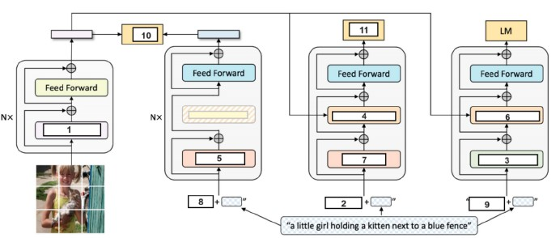

**Figure 1.** BLIP model architecture diagram for Comprehension Questions 115–125.

**Subquestion:**

Self-Attention _______________

**Correct answer:** 1

**Worked explanation:** Self-attention mixes representations within the same sequence. In the vision encoder, image tokens interact with image tokens. The keyed diagram label is 1.

### da5006_2025T2_ET_AN · Q116 · 0.5 marks · ID 6406531431379

**Figure 2.** BLIP model architecture diagram for Comprehension Questions 115–125.

**Shared Comprehension Context (Question ID: `6406531431377`):**

Consider the BLIP model architecture with an input (image-text pair) as shown below:
For each of the entities given, enter the appropriate number matching the diagram.

Refer to Figure 21 (BLIP model architecture diagram for Comprehension Questions 115–125).

**Subquestion:**

BERT Text Encoder Bi Self Attention:__________________

**Correct answer:** 5

**Worked explanation:** The standalone text encoder uses bidirectional self-attention, allowing each token to attend to tokens on both sides. This is suitable for encoding a complete text. The keyed diagram label is 5.

### da5006_2025T2_ET_AN · Q117 · 0.5 marks · ID 6406531431380

**Figure 3.** BLIP model architecture diagram for Comprehension Questions 115–125.

**Shared Comprehension Context (Question ID: `6406531431377`):**

Consider the BLIP model architecture with an input (image-text pair) as shown below:
For each of the entities given, enter the appropriate number matching the diagram.

Refer to Figure 21 (BLIP model architecture diagram for Comprehension Questions 115–125).

**Subquestion:**

Image-Text Matching Loss ($L_{ITM}$):__________________

**Correct answer:** 11

**Worked explanation:** Image-text matching classifies a fused image–text pair as matched or mismatched. It uses multimodal interactions rather than just independent embedding similarity. The keyed diagram label is 11.

### da5006_2025T2_ET_AN · Q118 · 0.5 marks · ID 6406531431381

**Figure 4.** BLIP model architecture diagram for Comprehension Questions 115–125.

**Shared Comprehension Context (Question ID: `6406531431377`):**

Consider the BLIP model architecture with an input (image-text pair) as shown below:
For each of the entities given, enter the appropriate number matching the diagram.

Refer to Figure 21 (BLIP model architecture diagram for Comprehension Questions 115–125).

**Subquestion:**

Image Grounded Text Encoder Bi Self Attention: ___________________

**Correct answer:** 7

**Worked explanation:** The grounded encoder uses bidirectional text self-attention and also cross-attends to visual features. The former allows access to the complete input text. The keyed diagram label is 7.

### da5006_2025T2_ET_AN · Q119 · 0.5 marks · ID 6406531431382

**Figure 5.** BLIP model architecture diagram for Comprehension Questions 115–125.

**Shared Comprehension Context (Question ID: `6406531431377`):**

Consider the BLIP model architecture with an input (image-text pair) as shown below:
For each of the entities given, enter the appropriate number matching the diagram.

Refer to Figure 21 (BLIP model architecture diagram for Comprehension Questions 115–125).

**Subquestion:**

\<CLS\> Prompt: ___________________

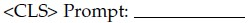

**Figure 6.** Source entity prompt for Question 119.

**Correct answer:** 8

**Worked explanation:** The classification token summarizes the encoded sequence for the matching head. Its representation can be used to decide whether image and text match. The keyed diagram label is 8.

### da5006_2025T2_ET_AN · Q120 · 0.5 marks · ID 6406531431383

**Figure 7.** BLIP model architecture diagram for Comprehension Questions 115–125.

**Shared Comprehension Context (Question ID: `6406531431377`):**

Consider the BLIP model architecture with an input (image-text pair) as shown below:
For each of the entities given, enter the appropriate number matching the diagram.

Refer to Figure 21 (BLIP model architecture diagram for Comprehension Questions 115–125).

**Subquestion:**

Image Grounded Text Encoder Cross Attention: _________________

**Correct answer:** 4

**Worked explanation:** Cross-attention uses text representations as queries and visual representations as keys and values. This grounds the text encoding in the image. The keyed diagram label is 4.

### da5006_2025T2_ET_AN · Q121 · 0.5 marks · ID 6406531431384

**Figure 8.** BLIP model architecture diagram for Comprehension Questions 115–125.

**Shared Comprehension Context (Question ID: `6406531431377`):**

Consider the BLIP model architecture with an input (image-text pair) as shown below:
For each of the entities given, enter the appropriate number matching the diagram.

Refer to Figure 21 (BLIP model architecture diagram for Comprehension Questions 115–125).

**Subquestion:**

Image-Text Contrastive Loss ($L_{ITC}$): ____________

**Correct answer:** 10

**Worked explanation:** The contrastive objective aligns matched image and text embeddings relative to mismatched pairs. It supports efficient retrieval using separately computed embeddings. The keyed diagram label is 10.

### da5006_2025T2_ET_AN · Q124 · 0.5 marks · ID 6406531431387

**Figure 9.** BLIP model architecture diagram for Comprehension Questions 115–125.

**Shared Comprehension Context (Question ID: `6406531431377`):**

Consider the BLIP model architecture with an input (image-text pair) as shown below:
For each of the entities given, enter the appropriate number matching the diagram.

Refer to Figure 21 (BLIP model architecture diagram for Comprehension Questions 115–125).

**Subquestion:**

\<Encode\> Prompt: _________________

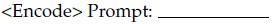

**Figure 10.** Source entity prompt for Question 124.

**Correct answer:** 2

**Worked explanation:** The encode token selects the image-grounded encoding mode. Bidirectional text processing and image cross-attention produce a fused representation. The keyed diagram label is 2.

### da5006_2025T2_ET_FN · Q199 · 0.55 marks · ID 6406531422582

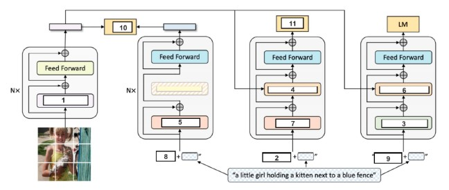

**Figure 11.** Comprehension 6406531422579, BLIP model architecture.

**Shared context (Comprehension Question ID: `6406531422579`, Subquestions: 197 to 207):**

BLIP model architecture (Figure 41).

Based on the above data, answer the given subquestion:

Image-Text Matching Loss (LITM ):

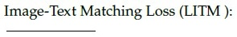

**Figure 12.** Question 199, Image-Text Matching Loss entity label.

**Correct answer:** `11`

**Worked explanation:** Image-text matching classifies a fused image–text pair as matched or mismatched. It uses multimodal interactions rather than just independent embedding similarity. The keyed diagram label is `11`.

### da5006_2025T2_ET_FN · Q200 · 0.55 marks · ID 6406531422583

**Figure 13.** Comprehension 6406531422579, BLIP model architecture.

**Shared context (Comprehension Question ID: `6406531422579`, Subquestions: 197 to 207):**

BLIP model architecture (Figure 41).

Based on the above data, answer the given subquestion:

Image Grounded Text Encoder Bi Self Attention: —_—

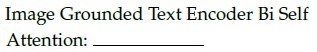

**Figure 14.** Question 200, Image Grounded Text Encoder Bi Self Attention entity label.

**Correct answer:** `7`

**Worked explanation:** The grounded encoder uses bidirectional text self-attention and also cross-attends to visual features. The former allows access to the complete input text. The keyed diagram label is `7`.

### da5006_2025T2_ET_FN · Q201 · 0.55 marks · ID 6406531422584

**Figure 15.** Comprehension 6406531422579, BLIP model architecture.

**Shared context (Comprehension Question ID: `6406531422579`, Subquestions: 197 to 207):**

BLIP model architecture (Figure 41).

Based on the above data, answer the given subquestion:

<CLS> Prompt: —

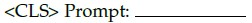

**Figure 16.** Question 201, CLS Prompt entity label.

**Correct answer:** `8`

**Worked explanation:** The classification token summarizes the encoded sequence for the matching head. Its representation can be used to decide whether image and text match. The keyed diagram label is `8`.

### da5006_2025T2_ET_FN · Q202 · 0.55 marks · ID 6406531422585

**Figure 17.** Comprehension 6406531422579, BLIP model architecture.

**Shared context (Comprehension Question ID: `6406531422579`, Subquestions: 197 to 207):**

BLIP model architecture (Figure 41).

Based on the above data, answer the given subquestion:

Image Grounded Text Encoder Cross Attention:

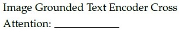

**Figure 18.** Question 202, Image Grounded Text Encoder Cross Attention entity label.

**Correct answer:** `4`

**Worked explanation:** Cross-attention uses text representations as queries and visual representations as keys and values. This grounds the text encoding in the image. The keyed diagram label is `4`.

### da5006_2025T2_ET_FN · Q203 · 0.54 marks · ID 6406531422586

**Figure 19.** Comprehension 6406531422579, BLIP model architecture.

**Shared context (Comprehension Question ID: `6406531422579`, Subquestions: 197 to 207):**

BLIP model architecture (Figure 41).

Based on the above data, answer the given subquestion:

Image-Text Contrastive Loss (LITC):

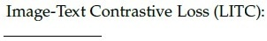

**Figure 20.** Question 203, Image-Text Contrastive Loss entity label.

**Correct answer:** `10`

**Worked explanation:** The contrastive objective aligns matched image and text embeddings relative to mismatched pairs. It supports efficient retrieval using separately computed embeddings. The keyed diagram label is `10`.

### da5006_2025T2_ET_FN · Q206 · 0.54 marks · ID 6406531422589

**Figure 21.** Comprehension 6406531422579, BLIP model architecture.

**Shared context (Comprehension Question ID: `6406531422579`, Subquestions: 197 to 207):**

BLIP model architecture (Figure 41).

Based on the above data, answer the given subquestion:

<Encode> Prompt: ——____

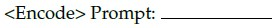

**Figure 22.** Question 206, Encode Prompt entity label.

**Correct answer:** `2`

**Worked explanation:** The encode token selects the image-grounded encoding mode. Bidirectional text processing and image cross-attention produce a fused representation. The keyed diagram label is `2`.

## Topic: Promptable segmentation and SAM

| Done | Paper | Q# | Marks | Type |
| :--- | :--- | ---: | ---: | :--- |
| [ ] | da5006_2025T2_ET_AN | 96 | 2 | MCQ |
| [ ] | da5006_2025T2_ET_FN | 169 | 2 | MCQ |
| [ ] | da5006_2025T2_ET_FN | 170 | 2 | MCQ |

### da5006_2025T2_ET_AN · Q96 · 2 marks · ID 6406531431356

Why might Segment Anything (SAM) be particularly useful in data annotation tasks compared to traditional segmentation models?

**Options**

**A.** It produces perfect segmentation masks.  
*Option ID:* `6406534780297`

**B.** It can adapt to segment any object, even those not seen during training  
*Option ID:* `6406534780298`

**C.** It requires less computational resources  
*Option ID:* `6406534780299`

**D.** It automatically labels all objects in an image without user input  
*Option ID:* `6406534780300`

**Correct answer:** **B** — It can adapt to segment any object, even those not seen during training.

**Worked explanation:** A promptable model can transfer to unfamiliar object categories and speed mask annotation. Its masks still require review and it does not promise perfect accuracy.

### da5006_2025T2_ET_FN · Q169 · 2 marks · ID 6406531422548

What makes the Segment Anything Model (SAM) particularly advantageous for image annotation tasks compared to conventional segmentation approaches?

**Options**

**A.** It has perfect segmentation accuracy  
*Option ID:* `6406534756408`

**B.** It has minimal hardware requirements for operation  
*Option ID:* `6406534756409`

**C.** It can generalize to segment objects it wasn’t specifically trained on  
*Option ID:* `6406534756410`

**D.** It automatically identifies and labels all objects in an image without user prompts  
*Option ID:* `6406534756411`

**Correct answer:** **C** — It can generalize to segment objects it wasn’t specifically trained on.

**Worked explanation:** Prompt-conditioned segmentation can generalize to objects outside the training categories. This can accelerate annotation, but the resulting masks are not guaranteed correct.

### da5006_2025T2_ET_FN · Q170 · 2 marks · ID 6406531422549

Statement 1: The Segment Anything Model (SAM) demonstrates zero-shot generalization capabilities across various downstream tasks.

Statement 2: SAM’s training involves a largescale, diverse mask dataset using a prompt-based segmentation approach. Which one of the following options is most appropriate?

**Options**

**A.** Both statements are correct, and Statement 2 correctly explains Statement 1.  
*Option ID:* `6406534756412`

**B.** Both statements are correct, but Statement 2 does not correctly explain Statement 1.  
*Option ID:* `6406534756413`

**C.** Statement 1 is correct, but Statement 2 is incorrect.  
*Option ID:* `6406534756414`

**D.** Statement 1 is incorrect, but Statement 2 is correct.  
*Option ID:* `6406534756415`

**E.** Both statements are incorrect.  
*Option ID:* `6406534756416`

**Correct answer:** **A** — Both statements are correct, and Statement 2 correctly explains Statement 1..

**Worked explanation:** The large, diverse mask dataset and prompt-conditioned task support transfer to new segmentation tasks. Zero-shot generalization is an empirical capability, not a guarantee for every domain.

## Topic: Adversarial examples and attacks

| Done | Paper | Q# | Marks | Type |
| :--- | :--- | ---: | ---: | :--- |
| [ ] | da5006_2024T1_ET_AN | 194 | 0.7 | SA |
| [ ] | da5006_2024T1_ET_AN | 195 | 0.7 | SA |
| [ ] | da5006_2024T1_ET_AN | 196 | 0.6 | SA |
| [ ] | da5006_2024T2_ET_AN | 277 | 2 | MSQ |

### da5006_2024T1_ET_AN · Q194 · 0.7 marks · ID 640653821605

Consider Fast Gradient Sign Method (FGSM) given by:

$$x^* = x + \epsilon \cdot \text{sign}(\nabla_x L(x, y_{\text{true}}))$$

Given $x = [3\ 7\ 5]$, $\nabla_x L(x, y_{\text{true}}) = [0.5\ -0.5\ 1]$ and $\epsilon = 0.01$, find the resulting adversarial perturbation / attack with FGSM, where $[x_1^*\ x_2^*\ x_3^*]$.

Based on the above data, answer the given subquestion:

$$x_1^* = \text{__________}$$

NOTE: Enter your answer in two decimal places.

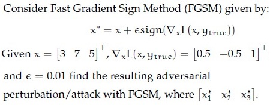

**Figure 23.** Shared context diagram for Questions 194–196.

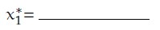

**Figure 24.** Source diagram for Question 194.

**Correct answer:** **3.01**

**Worked explanation:** The gradient signs are $(+1,-1,+1)$; multiplying by $0.01$ and adding to the input gives $(3.01,6.99,5.01)$. The first component is $3.01$.

### da5006_2024T1_ET_AN · Q195 · 0.7 marks · ID 640653821606

Consider Fast Gradient Sign Method (FGSM) given by:

$$x^* = x + \epsilon \cdot \text{sign}(\nabla_x L(x, y_{\text{true}}))$$

Given $x = [3\ 7\ 5]$, $\nabla_x L(x, y_{\text{true}}) = [0.5\ -0.5\ 1]$ and $\epsilon = 0.01$, find the resulting adversarial perturbation / attack with FGSM, where $[x_1^*\ x_2^*\ x_3^*]$.

Based on the above data, answer the given subquestion:

$$x_2^* = \text{__________}$$

NOTE: Enter your answer in two decimal places.

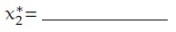

**Figure 25.** Source diagram for Question 195.

**Correct answer:** **6.99**

**Worked explanation:** The gradient signs are $(+1,-1,+1)$; the second perturbation is $-0.01$. Adding it to $7$ gives $6.99$.

### da5006_2024T1_ET_AN · Q196 · 0.6 marks · ID 640653821607

Consider Fast Gradient Sign Method (FGSM) given by:

$$x^* = x + \epsilon \cdot \text{sign}(\nabla_x L(x, y_{\text{true}}))$$

Given $x = [3\ 7\ 5]$, $\nabla_x L(x, y_{\text{true}}) = [0.5\ -0.5\ 1]$ and $\epsilon = 0.01$, find the resulting adversarial perturbation / attack with FGSM, where $[x_1^*\ x_2^*\ x_3^*]$.

Based on the above data, answer the given subquestion:

$$x_3^* = \text{__________}$$

NOTE: Enter your answer in two decimal places.

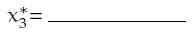

**Figure 26.** Source diagram for Question 196.

**Correct answer:** **5.01**

**Worked explanation:** The third gradient component is positive, so its perturbation is $+0.01$. Adding it to $5$ gives $5.01$.

### da5006_2024T2_ET_AN · Q277 · 2 marks · ID 640653904322

In adversarial robustness literature, which of the following are white box attacks?

**Options**

**A.** Carlini and Wagner (C&W) attack  
*Option ID:* `6406533045068`

**B.** Projected Gradient Descent (PGD)  
*Option ID:* `6406533045069`

**C.** Random Input Transformation  
*Option ID:* `6406533045070`

**D.** Zeroth-Order Optimization (ZOO)  
*Option ID:* `6406533045071`

**E.** Opt-Attack  
*Option ID:* `6406533045072`

**Correct answer:** **A**, **B** — A, B — Carlini and Wagner (C&W) attack; Projected Gradient Descent (PGD)

**Worked explanation:** C&W and gradient-based PGD use model gradients in their standard white-box formulations. ZOO estimates derivatives through queries; random transformations are not themselves a standard white-box attack.

## Topic: Multimodal generation and decoding

| Done | Paper | Q# | Marks | Type |
| :--- | :--- | ---: | ---: | :--- |
| [ ] | da5006_2025T2_ET_AN | 122 | 0.5 | SA |
| [ ] | da5006_2025T2_ET_AN | 123 | 0.5 | SA |
| [ ] | da5006_2025T2_ET_AN | 125 | 0.5 | SA |
| [ ] | da5006_2025T2_ET_FN | 204 | 0.54 | SA |
| [ ] | da5006_2025T2_ET_FN | 205 | 0.54 | SA |
| [ ] | da5006_2025T2_ET_FN | 207 | 0.54 | SA |

### da5006_2025T2_ET_AN · Q122 · 0.5 marks · ID 6406531431385

**Figure 27.** BLIP model architecture diagram for Comprehension Questions 115–125.

**Shared Comprehension Context (Question ID: `6406531431377`):**

Consider the BLIP model architecture with an input (image-text pair) as shown below:
For each of the entities given, enter the appropriate number matching the diagram.

Refer to Figure 21 (BLIP model architecture diagram for Comprehension Questions 115–125).

**Subquestion:**

\<Decode\> Prompt: _________________

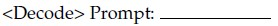

**Figure 28.** Source entity prompt for Question 122.

**Correct answer:** 9

**Worked explanation:** The decode token signals the language-generation mode. Subsequent tokens are generated autoregressively conditioned on the image and preceding text. The keyed diagram label is 9.

### da5006_2025T2_ET_AN · Q123 · 0.5 marks · ID 6406531431386

**Figure 29.** BLIP model architecture diagram for Comprehension Questions 115–125.

**Shared Comprehension Context (Question ID: `6406531431377`):**

Consider the BLIP model architecture with an input (image-text pair) as shown below:
For each of the entities given, enter the appropriate number matching the diagram.

Refer to Figure 21 (BLIP model architecture diagram for Comprehension Questions 115–125).

**Subquestion:**

Causal Self Attention: _____________

**Correct answer:** 3

**Worked explanation:** A causal mask prevents a position from attending to later text tokens. This preserves the autoregressive factorization used for generation. The keyed diagram label is 3.

### da5006_2025T2_ET_AN · Q125 · 0.5 marks · ID 6406531431388

**Figure 30.** BLIP model architecture diagram for Comprehension Questions 115–125.

**Shared Comprehension Context (Question ID: `6406531431377`):**

Consider the BLIP model architecture with an input (image-text pair) as shown below:
For each of the entities given, enter the appropriate number matching the diagram.

Refer to Figure 21 (BLIP model architecture diagram for Comprehension Questions 115–125).

**Subquestion:**

Image Grounded Text Decoder Cross Attention: _____________

**Correct answer:** 6

**Worked explanation:** The decoder cross-attends to image features while generating text. Causal self-attention constrains access to text history, not access to the image. The keyed diagram label is 6.

### da5006_2025T2_ET_FN · Q204 · 0.54 marks · ID 6406531422587

**Figure 31.** Comprehension 6406531422579, BLIP model architecture.

**Shared context (Comprehension Question ID: `6406531422579`, Subquestions: 197 to 207):**

BLIP model architecture (Figure 41).

Based on the above data, answer the given subquestion:

<Decode> Prompt;

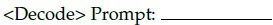

**Figure 32.** Question 204, Decode Prompt entity label.

**Correct answer:** `9`

**Worked explanation:** The decode token signals the language-generation mode. Subsequent tokens are generated autoregressively conditioned on the image and preceding text. The keyed diagram label is `9`.

### da5006_2025T2_ET_FN · Q205 · 0.54 marks · ID 6406531422588

**Figure 33.** Comprehension 6406531422579, BLIP model architecture.

**Shared context (Comprehension Question ID: `6406531422579`, Subquestions: 197 to 207):**

BLIP model architecture (Figure 41).

Based on the above data, answer the given subquestion:

Causal Self Attention: —____

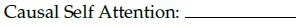

**Figure 34.** Question 205, Causal Self Attention entity label.

**Correct answer:** `3`

**Worked explanation:** A causal mask prevents a position from attending to later text tokens. This preserves the autoregressive factorization used for generation. The keyed diagram label is `3`.

### da5006_2025T2_ET_FN · Q207 · 0.54 marks · ID 6406531422590

**Figure 35.** Comprehension 6406531422579, BLIP model architecture.

**Shared context (Comprehension Question ID: `6406531422579`, Subquestions: 197 to 207):**

BLIP model architecture (Figure 41).

Based on the above data, answer the given subquestion:

Image Grounded Text Decoder Cross Attention:

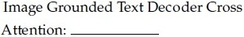

**Figure 36.** Question 207, Image Grounded Text Decoder Cross Attention entity label.

**Correct answer:** `6`

**Worked explanation:** The decoder cross-attends to image features while generating text. Causal self-attention constrains access to text history, not access to the image. The keyed diagram label is `6`.
