# Week 1 — Previous-year questions

Source wording, answer keys, and source limitations are reproduced from the extracted Markdown. Classification is based on the course notes.

---

**Source:** `da5006_2024T1_Q1_NA.md` · Quiz 1, 2024T1 · Question 159 · ID `640653739731`  
**Classification:** Week 1 — global operations, Fourier transform, histogram equalization, contrast stretching, separable 2D kernels, Gaussian kernel  
**Course evidence:** [## 4. Spatial Linear Filtering, Cross-Correlation, and Convolution](/Volumes/1700%20APFS/PERSONAL_PROGRAMMING_PROJECTS/Notes/Deep%20Learning%20for%20Computer%20Vision/month%201/week%201/week-1-report.md) · Related weeks: none

### Question 159

**Question ID:** `640653739731` · **Type:** MCQ · **Marks:** 2  
**PDF pages:** 2, 3

Match the following:

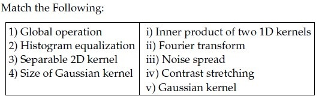

**Figure 1.** Source table for Question 159.

| Column 1 | Column 2 |
| :--- | :--- |
| 1) Global operation | i) Inner product of two 1D kernels |
| 2) Histogram equalization | ii) Fourier transform |
| 3) Separable 2D kernel | iii) Noise spread |
| 4) Size of Gaussian kernel | iv) Contrast stretching |
| | v) Gaussian kernel |

**Options**

**A.** 1→ ii, 2→ ii, 3 → iv, 4→ i  
*Option ID:* `6406532474450`

**B.** 1→ ii, 2→iv, 3 → i, 4→ iii  
*Option ID:* `6406532474451`

**C.** 1→ ii, 2→ ii, 3 → iv, 4→ iii  
*Option ID:* `6406532474452`

**D.** 1→ ii, 2→ iv, 3 → v, 4→ iii  
*Option ID:* `6406532474453`

**Correct answer:** **D** — 1→ ii, 2→ iv, 3 → v, 4→ iii.  
**Source evidence:** Option 6406532474453 rendered in green font (color 0x8000) with green checkmark icon in source PDF.

---


---

**Source:** `da5006_2024T1_Q1_NA.md` · Quiz 1, 2024T1 · Question 160 · ID `640653739735`  
**Classification:** Week 1 — spatial filtering, filter separability, median filter, nonlinear filtering, Gaussian filter  
**Course evidence:** [## 5. Template Matching & Non-Linear Spatial Filtering](/Volumes/1700%20APFS/PERSONAL_PROGRAMMING_PROJECTS/Notes/Deep%20Learning%20for%20Computer%20Vision/month%201/week%201/week-1-report.md) · Related weeks: none

### Question 160

**Question ID:** `640653739735` · **Type:** MCQ · **Marks:** 2  
**PDF pages:** 3

Which of the following statements is true regarding filtering operation?

**Options**

**A.** Gaussian filter is Separable filter because it is non linear.  
*Option ID:* `6406532474460`

**B.** Median filter is a non separable filter  
*Option ID:* `6406532474461`

**C.** Gaussian filter is a High Pass filter.  
*Option ID:* `6406532474462`

**D.** Mean filter is a non separable filter because it is non linear  
*Option ID:* `6406532474463`

**Correct answer:** **B** — Median filter is a non separable filter.  
**Source evidence:** Option 6406532474461 rendered in green font (color 0x8000) with green checkmark icon in source PDF.

---


---

**Source:** `da5006_2024T1_Q1_NA.md` · Quiz 1, 2024T1 · Question 167 · ID `640653739734`  
**Classification:** Week 1 — spatial filtering, linear convolution, filter kernels, neighborhood operations, pixel invariance  
**Course evidence:** [## 4. Spatial Linear Filtering, Cross-Correlation, and Convolution](/Volumes/1700%20APFS/PERSONAL_PROGRAMMING_PROJECTS/Notes/Deep%20Learning%20for%20Computer%20Vision/month%201/week%201/week-1-report.md) · Related weeks: none

### Question 167

**Question ID:** `640653739734` · **Type:** MSQ · **Marks:** 2  
**PDF pages:** 7

Which of the following linear filters will leave the central value of the given matrix unchanged.

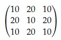

**Figure 2.** Source matrix for Question 167.

$$\begin{bmatrix} 10 & 20 & 10 \\ 20 & 10 & 20 \\ 10 & 20 & 10 \end{bmatrix}$$

**Options**

**A.** Linear filter kernel shown in Figure 3.

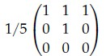

**Figure 3.** Filter matrix for Option A.

*Option ID:* `6406532474456`

**B.** Linear filter kernel shown in Figure 4.

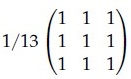

**Figure 4.** Filter matrix for Option B.

*Option ID:* `6406532474457`

**C.** Linear filter kernel shown in Figure 5.

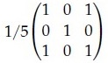

**Figure 5.** Filter matrix for Option C.

*Option ID:* `6406532474458`

**D.** Linear filter kernel shown in Figure 6.

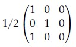

**Figure 6.** Filter matrix for Option D.

*Option ID:* `6406532474459`

**Correct answer:** **A**, **B**, **C** — A, B, C.  
**Source evidence:** Option A (6406532474456) rendered in green font (color 0x8000) with green checkmark icon in source PDF; Option B (6406532474457) rendered in green font (color 0x8000) with green checkmark icon in source PDF; Option C (6406532474458) rendered in green font (color 0x8000) with green checkmark icon in source PDF.

---


---

**Source:** `da5006_2024T1_Q1_NA.md` · Quiz 1, 2024T1 · Question 169 · ID `640653739732`  
**Classification:** Week 1 — contrast stretching, linear point operations, grayscale intensity scaling, dynamic range  
**Course evidence:** [## 3. Digital Image Representation & Elementary Point Operations](/Volumes/1700%20APFS/PERSONAL_PROGRAMMING_PROJECTS/Notes/Deep%20Learning%20for%20Computer%20Vision/month%201/week%201/week-1-report.md) · Related weeks: none

### Question 169

**Question ID:** `640653739732` · **Type:** SA · **Marks:** 2  
**PDF pages:** 8, 9

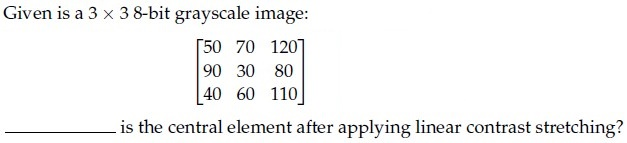

**Figure 7.** Source matrix and question text for Question 169.

Given is a 3 x 3 8-bit grayscale image:

$$\begin{bmatrix} 50 & 70 & 120 \\ 90 & 30 & 80 \\ 40 & 60 & 110 \end{bmatrix}$$

___________ is the central element after applying linear contrast stretching?

**Correct answer:** `0`  
**Source evidence:** Official answer '0' in Possible Answers field with green text (color 0x8000).

---


---

**Source:** `da5006_2024T1_Q1_NA.md` · Quiz 1, 2024T1 · Question 170 · ID `640653739733`  
**Classification:** Week 1 — median filtering, nonlinear filtering, neighborhood ranking, spatial filtering  
**Course evidence:** [## 5. Template Matching & Non-Linear Spatial Filtering](/Volumes/1700%20APFS/PERSONAL_PROGRAMMING_PROJECTS/Notes/Deep%20Learning%20for%20Computer%20Vision/month%201/week%201/week-1-report.md) · Related weeks: none

### Question 170

**Question ID:** `640653739733` · **Type:** SA · **Marks:** 2  
**PDF pages:** 9

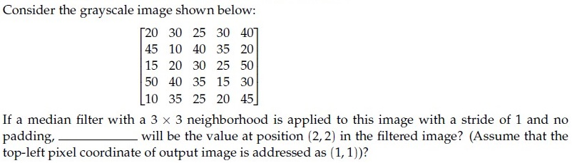

**Figure 8.** Source image and question text for Question 170.

Consider the grayscale image shown below:

$$\begin{bmatrix} 20 & 30 & 25 & 30 & 40 \\ 45 & 10 & 40 & 35 & 20 \\ 15 & 20 & 30 & 25 & 50 \\ 50 & 40 & 35 & 15 & 30 \\ 10 & 35 & 25 & 20 & 45 \end{bmatrix}$$

If a median filter with a 3 x 3 neighborhood is applied to this image with a stride of 1 and no padding, _____ will be the value at position (2, 2) in the filtered image? (Assume that the top-left pixel coordinate of output image is addressed as (1, 1))?

**Correct answer:** `30`  
**Source evidence:** Official answer '30' in Possible Answers field with green text (color 0x8000).

---


---

**Source:** `da5006_2024T1_Q1_NA.md` · Quiz 1, 2024T1 · Question 174 · ID `640653739729`  
**Classification:** Week 1 — template matching, cross-correlation, geometric variations, scale invariance, orientation invariance  
**Course evidence:** [## 5. Template Matching & Non-Linear Spatial Filtering](/Volumes/1700%20APFS/PERSONAL_PROGRAMMING_PROJECTS/Notes/Deep%20Learning%20for%20Computer%20Vision/month%201/week%201/week-1-report.md) · Related weeks: none

### Question 174

**Question ID:** `640653739729` · **Type:** SA · **Marks:** 1  
**PDF pages:** 11, 12

**Comprehension Context (Questions 174–175):**

> In case of template matching by using correlation, even if template is not identical to some subimage in the scene, match can be meaningful, if (a) _____________ , (b) _____________ and general appearance is right.
>
> Based on the above data, answer the given subquestions.

Enter the correct answer for Blank (a) ______________ .

**Correct answer:** `scale (or orientation)`  
**Source evidence:** Official accepted answer set ['scale', 'orientation'] in Possible Answers field with green text (color 0x8000).

---


---

**Source:** `da5006_2024T1_Q1_NA.md` · Quiz 1, 2024T1 · Question 175 · ID `640653739730`  
**Classification:** Week 1 — template matching, cross-correlation, scale invariance, orientation invariance  
**Course evidence:** [## 5. Template Matching & Non-Linear Spatial Filtering](/Volumes/1700%20APFS/PERSONAL_PROGRAMMING_PROJECTS/Notes/Deep%20Learning%20for%20Computer%20Vision/month%201/week%201/week-1-report.md) · Related weeks: none

### Question 175

**Question ID:** `640653739730` · **Type:** SA · **Marks:** 1  
**PDF pages:** 12

**Comprehension Context (Questions 174–175):**

> In case of template matching by using correlation, even if template is not identical to some subimage in the scene, match can be meaningful, if (a) _____________ , (b) _____________ and general appearance is right.
>
> Based on the above data, answer the given subquestions.

Enter the correct answer for Blank (b) ______________ .

**Correct answer:** `orientation (or scale)`  
**Source evidence:** Official accepted answer set ['orientation', 'scale'] in Possible Answers field with green text (color 0x8000).

---


---

**Source:** `da5006_2024T1_ET_AN.md` · End-term, 2024T1 · Question 187 · ID `640653821613`  
**Classification:** Week 1 — Histogram Equalization, Discrete CDF Transformation, Point Operations, Grayscale Intensity Mapping  
**Course evidence:** [### 3.7 Full Mathematical Derivation of Histogram Equalization](/Volumes/1700%20APFS/PERSONAL_PROGRAMMING_PROJECTS/Notes/Deep%20Learning%20for%20Computer%20Vision/month%201/week%201/week-1-report.md) · Related weeks: none

### Question 187

**Question ID:** `640653821613` · **Type:** SA · **Marks:** 2  
**PDF pages:** 19

Consider a 3 x 3 grayscale image in terms of pixel intensities as shown in matrix form below.

$$\begin{bmatrix} 9 & 1 & 6 \\ 4 & 6 & 1 \\ 9 & 8 & 2 \end{bmatrix}$$

Assume that each pixel takes values from 1 to 9 (inclusive). After performing histogram equalization, the number of pixels with intensity value 6 are__?

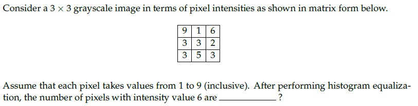

**Figure 9.** Source diagram for Question 187.

**Correct answer:** **4**  
**Source evidence:** Possible Answers field indicates 4 in green text (#008000) at PDF page 19.

---


---

**Source:** `da5006_2024T2_Q1_NA.md` · Quiz 1, 2024T2 · Question 81 · ID `640653829644`  
**Classification:** Week 1 — linear spatial filtering, kernel convolution, central pixel response, filter normalization, 2D convolution  
**Course evidence:** [### 4.1 Foundations of Spatial Linear Filtering](/Volumes/1700%20APFS/PERSONAL_PROGRAMMING_PROJECTS/Notes/Deep%20Learning%20for%20Computer%20Vision/month%201/week%201/week-1-report.md) · Related weeks: none

### Question 81

**Question ID:** `640653829644` · **Type:** MSQ · **Marks:** 2  
**PDF pages:** 2–3

Which of the following linear filters will leave the central value of the given matrix unchanged?

$$\begin{bmatrix} 10 & 20 & 10 \\ 20 & 10 & 20 \\ 10 & 20 & 10 \end{bmatrix}$$

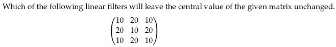

**Figure 10.** Source question stem matrix for Question 81.

**Options**

**A.** Filter kernel with central weight 1/5:

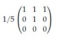

**Figure 11.** Option A filter kernel for Question 81.

*Option ID:* `6406532786640`

**B.** Filter kernel:

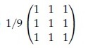

**Figure 12.** Option B filter kernel for Question 81.

*Option ID:* `6406532786641`

**C.** Filter kernel with central weight 1/5:

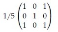

**Figure 13.** Option C filter kernel for Question 81.

*Option ID:* `6406532786642`

**D.** Filter kernel:

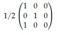

**Figure 14.** Option D filter kernel for Question 81.

*Option ID:* `6406532786643`

**Correct answer:** **A**, **C** — Filter kernels with option IDs `6406532786640` and `6406532786642`.  
**Source evidence:** Green check mark icons beside Option A (y=647.6) and Option C (y=796.8) on PDF page 2; red cross icons beside Option B (page 2) and Option D (page 3).

---


---

**Source:** `da5006_2024T2_Q1_NA.md` · Quiz 1, 2024T2 · Question 82 · ID `640653829647`  
**Classification:** Week 1 — separable kernel, kernel separability, rank-1 matrix, outer product decomposition, spatial filtering  
**Course evidence:** [### 4.3 Kernel Separability and the SVD Rank-1 Theorem](/Volumes/1700%20APFS/PERSONAL_PROGRAMMING_PROJECTS/Notes/Deep%20Learning%20for%20Computer%20Vision/month%201/week%201/week-1-report.md) · Related weeks: none

### Question 82

**Question ID:** `640653829647` · **Type:** MSQ · **Marks:** 2  
**PDF pages:** 3

Certain 2D kernel $K$ can be decomposed into two 1D kernels ($v$ and $h$) to reduce the computation cost such as $K = vh^T$. The 2D kernel is called as Separable Kernel.  
Consider the following 2D kernels. Which of the given kernels are separable?

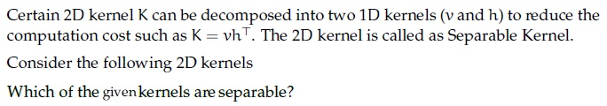

**Figure 15.** Source question stem for Question 82.

**Options**

**A.** 2D kernel:

$$\begin{bmatrix} 2 & 4 & 6 \\ 3 & 6 & 9 \\ 1 & 2 & 3 \end{bmatrix}$$

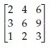

**Figure 16.** Option A 2D kernel for Question 82.

*Option ID:* `6406532786649`

**B.** 2D kernel:

$$\begin{bmatrix} 2 & 4 & 6 \\ 3 & 6 & 9 \\ 2 & 3 & 4 \end{bmatrix}$$

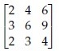

**Figure 17.** Option B 2D kernel for Question 82.

*Option ID:* `6406532786650`

**C.** 2D kernel:

$$\begin{bmatrix} 5 & 0 & -5 \\ 10 & 0 & 10 \\ 5 & 0 & 5 \end{bmatrix}$$

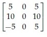

**Figure 18.** Option C 2D kernel for Question 82.

*Option ID:* `6406532786651`

**D.** 2D kernel:

$$\begin{bmatrix} 5 & 0 & -5 \\ 10 & 0 & -10 \\ 5 & 0 & -5 \end{bmatrix}$$

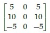

**Figure 19.** Option D 2D kernel for Question 82.

*Option ID:* `6406532786652`

**Correct answer:** **A**, **D** — Option A (rank-1 matrix) and Option D (rank-1 matrix).  
**Source evidence:** Green check mark icons beside Option A (y=354.0) and Option D (y=579.2) on PDF page 3; red cross icons beside Option B (y=426.3) and Option C (y=504.7).

---


---

**Source:** `da5006_2024T2_Q1_NA.md` · Quiz 1, 2024T2 · Question 84 · ID `640653829645`  
**Classification:** Week 1 — median filter, Gaussian filter, linear vs non-linear filtering, filter separability  
**Course evidence:** [### 5.2 Non-Linear Spatial Filters](/Volumes/1700%20APFS/PERSONAL_PROGRAMMING_PROJECTS/Notes/Deep%20Learning%20for%20Computer%20Vision/month%201/week%201/week-1-report.md) · Related weeks: none

### Question 84

**Question ID:** `640653829645` · **Type:** MCQ · **Marks:** 2  
**PDF pages:** 4

Which of the following statements is True?

**Options**

**A.** Gaussian filter is Separable filter because it is non linear.  
*Option ID:* `6406532786644`

**B.** Median filter is a non separable filter  
*Option ID:* `6406532786645`

**C.** Gaussian filter is a High Pass filter.  
*Option ID:* `6406532786646`

**D.** Mean filter is a non separable filter because it is non linear  
*Option ID:* `6406532786647`

**Correct answer:** **B** — Median filter is a non separable filter.  
**Source evidence:** Green check mark icon beside Option B on PDF page 4 (y=391.7); red cross icons beside Option A (y=370.9), Option C (y=412.6), and Option D (y=433.4).

---


---

**Source:** `da5006_2024T2_Q1_NA.md` · Quiz 1, 2024T2 · Question 85 · ID `640653829648`  
**Classification:** Week 1 — bilateral filter, edge-preserving smoothing, range kernel, spatial Gaussian kernel, photometric distance  
**Course evidence:** [### 5.2 Non-Linear Spatial Filters](/Volumes/1700%20APFS/PERSONAL_PROGRAMMING_PROJECTS/Notes/Deep%20Learning%20for%20Computer%20Vision/month%201/week%201/week-1-report.md) · Related weeks: none

### Question 85

**Question ID:** `640653829648` · **Type:** MCQ · **Marks:** 2  
**PDF pages:** 4

In Bilateral filtering, we do not reject the pixels whose values differ too much from the central pixel value.

**Options**

**A.** TRUE  
*Option ID:* `6406532786653`

**B.** FALSE  
*Option ID:* `6406532786654`

**Correct answer:** **B** — FALSE.  
**Source evidence:** Green check mark icon beside Option B on PDF page 4 (y=611.8); red cross icon beside Option A (y=590.9).

---


---

**Source:** `da5006_2024T2_Q1_NA.md` · Quiz 1, 2024T2 · Question 86 · ID `640653829649`  
**Classification:** Week 1 — 2D Discrete Fourier Transform (DFT), Fourier magnitude spectrum, spatial frequency domain, Fourier image  
**Course evidence:** [### 6.2 The 2D Discrete Fourier Transform (DFT)](/Volumes/1700%20APFS/PERSONAL_PROGRAMMING_PROJECTS/Notes/Deep%20Learning%20for%20Computer%20Vision/month%201/week%201/week-1-report.md) · Related weeks: none

### Question 86

**Question ID:** `640653829649` · **Type:** MCQ · **Marks:** 2  
**PDF pages:** 4–6

Which of the following is the Fourier image of the given intensity image?

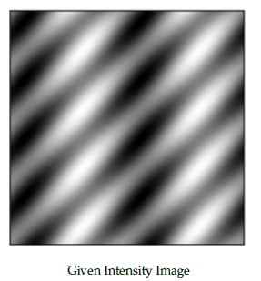

**Figure 20.** Given intensity image for Question 86.

**Options**

**A.** Fourier image candidate A:


**Figure 21.** Option A Fourier image for Question 86.

*Option ID:* `6406532786655`

**B.** Fourier image candidate B:


**Figure 22.** Option B Fourier image for Question 86.

*Option ID:* `6406532786656`

**C.** Fourier image candidate C:

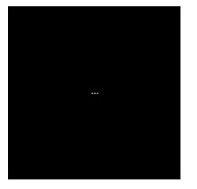

**Figure 23.** Option C Fourier image for Question 86.

*Option ID:* `6406532786657`

**D.** Fourier image candidate D:

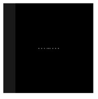

**Figure 24.** Option D Fourier image for Question 86.

*Option ID:* `6406532786658`

**Correct answer:** **B** — Fourier image candidate B (Option ID `6406532786656`).  
**Source evidence:** Green check mark icon beside Option B on PDF page 5 (y=568.7); red cross icons beside Option A (page 5, y=404.8), Option C (page 5, y=734.7), and Option D (page 5, y=771.9).

---


---

**Source:** `da5006_2024T2_Q1_NA.md` · Quiz 1, 2024T2 · Question 95 · ID `640653829646`  
**Classification:** Week 1 — median filter, non-linear filtering, spatial filtering, order statistics, patch median  
**Course evidence:** [### 5.2 Non-Linear Spatial Filters](/Volumes/1700%20APFS/PERSONAL_PROGRAMMING_PROJECTS/Notes/Deep%20Learning%20for%20Computer%20Vision/month%201/week%201/week-1-report.md) · Related weeks: none

### Question 95

**Question ID:** `640653829646` · **Type:** SA · **Marks:** 2  
**PDF pages:** 9

Consider the grayscale image shown below:

$$\begin{bmatrix} 0 & 30 & 25 & 30 & 40 \\ 45 & 10 & 40 & 35 & 20 \\ 15 & 20 & 30 & 25 & 50 \\ 50 & 40 & 35 & 15 & 30 \\ 10 & 35 & 25 & 20 & 45 \end{bmatrix}$$

If a median filter with a 3 × 3 neighborhood is applied to this image with a stride of 1 and no padding, ______ will be the value at position (2, 2) in the filtered image? (Assume that the top-left pixel coordinate of output image is addressed as (1,1))?

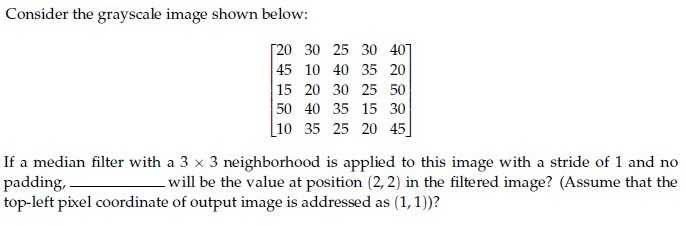

**Figure 25.** Source grayscale matrix for Question 95.

**Correct answer:** `30`  
**Source evidence:** Explicit official answer in `Possible Answers: 30` on PDF page 9.

---


---

**Source:** `da5006_2024T2_ET_AN.md` · End-term, 2024T2 · Question 255 · ID `640653904307`  
**Classification:** Week 1 — kernel separability, separable convolution, 1D decomposition, computational complexity reduction, rank-1 matrix  
**Course evidence:** [### 4.3 Kernel Separability and the SVD Rank-1 Theorem](/Volumes/1700%20APFS/PERSONAL_PROGRAMMING_PROJECTS/Notes/Deep%20Learning%20for%20Computer%20Vision/month%201/week%201/week-1-report.md) · Related weeks: 4

### Question 255

**Question ID:** `640653904307` · **Type:** MCQ · **Marks:** 2  
**PDF pages:** 5

For certain filters, we can speed up the convolution operation by separating convolution kernels from $k^2$ operations to $2k$ operations. Given the 2D Kernel below, what are the separated 1D kernels $v$ and $h$ for it?

$$\frac{1}{16} \begin{bmatrix} 1 & 2 & 1 \\ 2 & 4 & 2 \\ 1 & 2 & 1 \end{bmatrix}$$

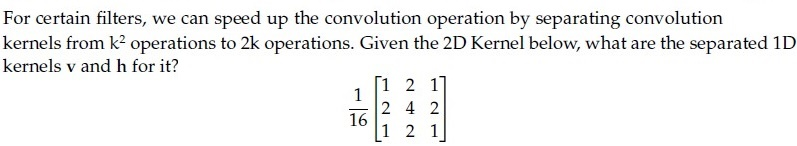

**Figure 26.** Source 2D convolution kernel for Question 255.

**Options**

**A.** $v = \frac{1}{4} \begin{bmatrix} 1 \\ 2 \\ 1 \end{bmatrix}, \quad h = \frac{1}{4} \begin{bmatrix} 1 \\ 2 \\ 1 \end{bmatrix}$  
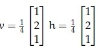

**Figure 27.** Option A image for Question 255.
*Option ID:* `6406533045039`

**B.** $v = \frac{1}{4} \begin{bmatrix} 1 \\ 2 \\ 1 \end{bmatrix}, \quad h = \frac{1}{4} \begin{bmatrix} 1 \\ 2 \\ 2 \end{bmatrix}$  
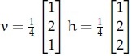

**Figure 28.** Option B image for Question 255.
*Option ID:* `6406533045040`

**C.** $v = \frac{1}{3} \begin{bmatrix} 4 \\ 2 \\ 3 \end{bmatrix}, \quad h = \frac{1}{2} \begin{bmatrix} 1 \\ 2 \\ 4 \end{bmatrix}$  
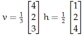

**Figure 29.** Option C image for Question 255.
*Option ID:* `6406533045041`

**D.** $v = \frac{1}{2} \begin{bmatrix} 1 \\ 1 \\ 1 \end{bmatrix}, \quad h = \frac{1}{2} \begin{bmatrix} 1 \\ 0 \\ 1 \end{bmatrix}$  
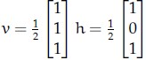

**Figure 30.** Option D image for Question 255.
*Option ID:* `6406533045042`

**Correct answer:** **A** — $v = \frac{1}{4} \begin{bmatrix} 1 \\ 2 \\ 1 \end{bmatrix}, \quad h = \frac{1}{4} \begin{bmatrix} 1 \\ 2 \\ 1 \end{bmatrix}$  
**Source evidence:** Option 6406533045039 is rendered in green text (#008000) with a checkmark icon. (PDF page 5).

---


---

**Source:** `da5006_2024T2_ET_AN.md` · End-term, 2024T2 · Question 257 · ID `640653904321`  
**Classification:** Week 1 — digital image representation, continuous vs discrete, geometric image transformations, point vs local vs global operations, moving average filter  
**Course evidence:** [### 3.4 Image Processing Hierarchy: Point, Local, and Global](/Volumes/1700%20APFS/PERSONAL_PROGRAMMING_PROJECTS/Notes/Deep%20Learning%20for%20Computer%20Vision/month%201/week%201/week-1-report.md) · Related weeks: none

### Question 257

**Question ID:** `640653904321` · **Type:** MCQ · **Marks:** 2  
**PDF pages:** 6

Which one of the following statements is false?

**Options**

**A.** Real-world RGB images can be thought of as matrices in continuous space on $\mathbb{R}^3$, but the images we store on a computer are discrete.  
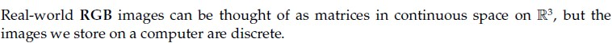

**Figure 31.** Option A image for Question 257.
*Option ID:* `6406533045064`

**B.** We can represent an RGB image as a function of the form $f : \mathbb{R}^3 \to \mathbb{R}$ where $\mathbb{R}^3$ represents image coordinates (channel, height, width) and $\mathbb{R}$ represents intensity.  
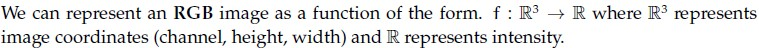

**Figure 32.** Option B image for Question 257.
*Option ID:* `6406533045065`

**C.** The transformation $I(x, y) = I(x, -y)$ flips the image $I$ upside down.  
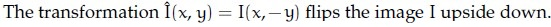

**Figure 33.** Option C image for Question 257.
*Option ID:* `6406533045066`

**D.** Denoising an image through the moving average filter is an example of a global operation as opposed to point or local operations.  
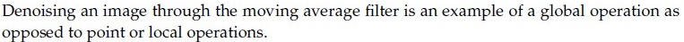

**Figure 34.** Option D image for Question 257.
*Option ID:* `6406533045067`

**Correct answer:** **D** — Denoising an image through the moving average filter is an example of a global operation as opposed to point or local operations.  
**Source evidence:** Option 6406533045067 is rendered with green label (#008000) and checkmark icon. (PDF page 6).

---


---

**Source:** `da5006_2024T3_Q1_NA.md` · Quiz 1, 2024T3 · Question 143 · ID `640653994479`  
**Classification:** Week 1 — linear_contrast_stretching, point_operations, grayscale_image_representation, min_max_normalization  
**Course evidence:** [3.5 Elementary Point Operations](/Volumes/1700%20APFS/PERSONAL_PROGRAMMING_PROJECTS/Notes/Deep%20Learning%20for%20Computer%20Vision/month%201/week%201/week-1-report.md) · Related weeks: none

### Question 143

**Question ID:** `640653994479` · **Type:** MCQ · **Marks:** 2  
**PDF pages:** 1

Given is a 3 × 3 8-bit grayscale image:

$$\begin{bmatrix} 50 & 70 & 120 \\ 90 & 30 & 80 \\ 40 & 60 & 110 \end{bmatrix}$$

What is the central element after applying linear contrast stretching?

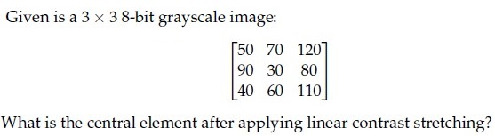

**Figure 35.** Source matrix and question for Question 143.

**Options**

**A.** 54  
*Option ID:* `6406533358191`

**B.** 10  
*Option ID:* `6406533358192`

**C.** 0  
*Option ID:* `6406533358193`

**D.** 18  
*Option ID:* `6406533358194`

**Correct answer:** **C** — 0.  
**Source evidence:** Option C (Option ID 6406533358193) is marked with green text and a checkmark icon in the source PDF.

---


---

**Source:** `da5006_2024T3_Q1_NA.md` · Quiz 1, 2024T3 · Question 145 · ID `640653994483`  
**Classification:** Week 1 — kernel_separability, median_filter, gaussian_filter, linear_filtering, non_linear_filtering  
**Course evidence:** [5.2 Non-Linear Spatial Filters](/Volumes/1700%20APFS/PERSONAL_PROGRAMMING_PROJECTS/Notes/Deep%20Learning%20for%20Computer%20Vision/month%201/week%201/week-1-report.md) · Related weeks: none

### Question 145

**Question ID:** `640653994483` · **Type:** MCQ · **Marks:** 2  
**PDF pages:** 2

Which of the following statements is True

**Options**

**A.** Gaussian filter is Separable filter because it is non linear.  
*Option ID:* `6406533358207`

**B.** Median filter is a non separable filter  
*Option ID:* `6406533358208`

**C.** Gaussian filter is a High Pass filter.  
*Option ID:* `6406533358209`

**D.** Mean filter is a non separable filter because it is non linear  
*Option ID:* `6406533358210`

**Correct answer:** **B** — Median filter is a non separable filter.  
**Source evidence:** Option B (Option ID 6406533358208) is marked with green text and a checkmark icon in the source PDF.

---


---

**Source:** `da5006_2024T3_Q1_NA.md` · Quiz 1, 2024T3 · Question 154 · ID `640653994482`  
**Classification:** Week 1 — linear_filtering, spatial_filtering, 2d_convolution, kernel_operations, center_pixel_response  
**Course evidence:** [4. Spatial Linear Filtering, Cross-Correlation, and Convolution](/Volumes/1700%20APFS/PERSONAL_PROGRAMMING_PROJECTS/Notes/Deep%20Learning%20for%20Computer%20Vision/month%201/week%201/week-1-report.md) · Related weeks: none

### Question 154

**Question ID:** `640653994482` · **Type:** MSQ · **Marks:** 2  
**PDF pages:** 5

Which of the following linear filters will leave the central value of the given matrix unchanged.

$$\begin{bmatrix} 10 & 20 & 10 \\ 20 & 10 & 20 \\ 10 & 20 & 10 \end{bmatrix}$$

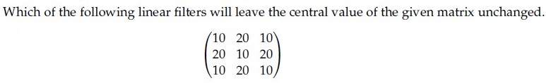

**Figure 36.** Source matrix for Question 154.

**Options**

**A.** 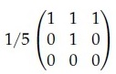

**Figure 37.** Filter kernel for Option A of Question 154.  
*Option ID:* `6406533358203`

**B.** 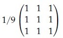

**Figure 38.** Filter kernel for Option B of Question 154.  
*Option ID:* `6406533358204`

**C.** 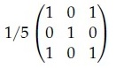

**Figure 39.** Filter kernel for Option C of Question 154.  
*Option ID:* `6406533358205`

**D.** 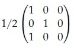

**Figure 40.** Filter kernel for Option D of Question 154.  
*Option ID:* `6406533358206`

**Correct answer:** **A**, **C** — A, C.  
**Source evidence:** Option A (Option ID 6406533358203) is marked with green text and a checkmark icon in the source PDF.; Option C (Option ID 6406533358205) is marked with green text and a checkmark icon in the source PDF.

---


---

**Source:** `da5006_2024T3_Q1_NA.md` · Quiz 1, 2024T3 · Question 155 · ID `640653994485`  
**Classification:** Week 1 — kernel_separability, outer_product_decomposition, rank_1_condition, spatial_filtering  
**Course evidence:** [4.3 Kernel Separability and the SVD Rank-1 Theorem](/Volumes/1700%20APFS/PERSONAL_PROGRAMMING_PROJECTS/Notes/Deep%20Learning%20for%20Computer%20Vision/month%201/week%201/week-1-report.md) · Related weeks: none

### Question 155

**Question ID:** `640653994485` · **Type:** MSQ · **Marks:** 2  
**PDF pages:** 6

Certain 2D kernel $K$ can be decomposed into two 1D kernels ($v$ and $h$) to reduce the computation cost such as $K = vh^T$. The 2D kernel is called as Separable Kernel.

Consider the following 2D kernels

Which of the below kernels are separable?

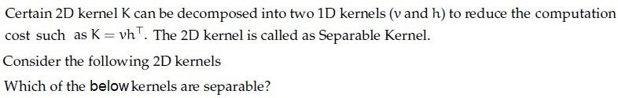

**Figure 41.** Problem description for separable 2D kernels for Question 155.

**Options**

**A.** 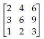

**Figure 42.** 2D kernel for Option A of Question 155.  
*Option ID:* `6406533358212`

**B.** 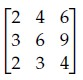

**Figure 43.** 2D kernel for Option B of Question 155.  
*Option ID:* `6406533358213`

**C.** 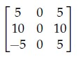

**Figure 44.** 2D kernel for Option C of Question 155.  
*Option ID:* `6406533358214`

**D.** 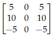

**Figure 45.** 2D kernel for Option D of Question 155.  
*Option ID:* `6406533358215`

**Correct answer:** **A**, **D** — A, D.  
**Source evidence:** Option A (Option ID 6406533358212) is marked with green text and a checkmark icon in the source PDF.; Option D (Option ID 6406533358215) is marked with green text and a checkmark icon in the source PDF.

---


---

**Source:** `da5006_2024T3_Q1_NA.md` · Quiz 1, 2024T3 · Question 163 · ID `640653994500`  
**Classification:** Week 1 — shear_transformation, affine_transformations, homogeneous_coordinates, geometric_transformations  
**Course evidence:** [3. Digital Image Representation & Elementary Point Operations](/Volumes/1700%20APFS/PERSONAL_PROGRAMMING_PROJECTS/Notes/Deep%20Learning%20for%20Computer%20Vision/month%201/week%201/week-1-report.md) · Related weeks: none

### Question 163

**Question ID:** `640653994500` · **Type:** SA · **Marks:** 0.5  
**PDF pages:** 10

**Comprehension Context (Questions 163 to 166):**

For the given figure, complete the transformation matrix with $x$-shear = 0.5:

$$\begin{bmatrix} x' \\ y' \\ 1 \end{bmatrix} = \begin{bmatrix} a_{11} & a_{12} & 0 \\ a_{21} & a_{22} & 0 \\ 0 & 0 & 1 \end{bmatrix} \begin{bmatrix} x \\ y \\ 1 \end{bmatrix}$$

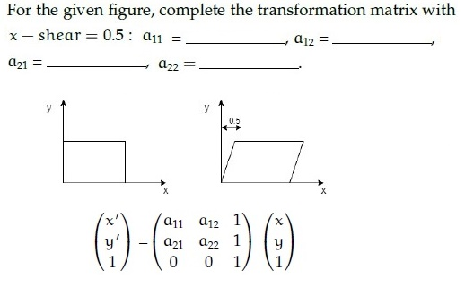

**Figure 46.** Shear transformation diagram and coordinate mapping matrix for Questions 163–166.

Based on the above data, answer the given subquestions.

**Subquestion:**

Enter the correct answer for $a_{11}$

Response Type : Numeric  
Answers Type : Equal

**Correct answer:** 1  
**Source evidence:** Official Possible Answers field displays '1' in green text on page 10.

---


---

**Source:** `da5006_2024T3_Q1_NA.md` · Quiz 1, 2024T3 · Question 164 · ID `640653994501`  
**Classification:** Week 1 — shear_transformation, affine_transformations, homogeneous_coordinates, geometric_transformations  
**Course evidence:** [3. Digital Image Representation & Elementary Point Operations](/Volumes/1700%20APFS/PERSONAL_PROGRAMMING_PROJECTS/Notes/Deep%20Learning%20for%20Computer%20Vision/month%201/week%201/week-1-report.md) · Related weeks: none


**Figure 47.** Shear transformation diagram and coordinate mapping matrix for Questions 163–166.

### Question 164

**Question ID:** `640653994501` · **Type:** SA · **Marks:** 0.5  
**PDF pages:** 10–11

*(Context: Refer to Comprehension passage and Figure 47 above Question 163)*

Enter the correct answer for $a_{12}$

Response Type : Numeric  
Answers Type : Equal

**Correct answer:** 0.5  
**Source evidence:** Official Possible Answers field displays '0.5' in green text on page 11.

---


---

**Source:** `da5006_2024T3_Q1_NA.md` · Quiz 1, 2024T3 · Question 166 · ID `640653994503`  
**Classification:** Week 1 — shear_transformation, affine_transformations, homogeneous_coordinates, geometric_transformations  
**Course evidence:** [3. Digital Image Representation & Elementary Point Operations](/Volumes/1700%20APFS/PERSONAL_PROGRAMMING_PROJECTS/Notes/Deep%20Learning%20for%20Computer%20Vision/month%201/week%201/week-1-report.md) · Related weeks: none


**Figure 48.** Shear transformation diagram and coordinate mapping matrix for Questions 163–166.

### Question 166

**Question ID:** `640653994503` · **Type:** SA · **Marks:** 0.5  
**PDF pages:** 11

*(Context: Refer to Comprehension passage and Figure 48 above Question 163)*

Enter the correct answer for $a_{22}$

Response Type : Numeric  
Answers Type : Equal

**Correct answer:** 1  
**Source evidence:** Official Possible Answers field displays '1' in green text on page 11.

---


---

**Source:** `da5006_2024T3_Q1_NA.md` · Quiz 1, 2024T3 · Question 167 · ID `640653994477`  
**Classification:** Week 1 — numpy_array_manipulation, array_flattening, memory_copy_vs_view, image_tensor_representation  
**Course evidence:** [3. Digital Image Representation & Elementary Point Operations](/Volumes/1700%20APFS/PERSONAL_PROGRAMMING_PROJECTS/Notes/Deep%20Learning%20for%20Computer%20Vision/month%201/week%201/week-1-report.md) · Related weeks: none

### Question 167

**Question ID:** `640653994477` · **Type:** SA · **Marks:** 2  
**PDF pages:** 11–12

Consider the following numpy array:

```python
arr = np.array([[0, 1], [2, 3], [4, 5]])
```

Now consider the following operations:

```python
flattened_arr = arr.flatten()
flattened_arr[0] = 10
```

Write the value of `arr[0]`

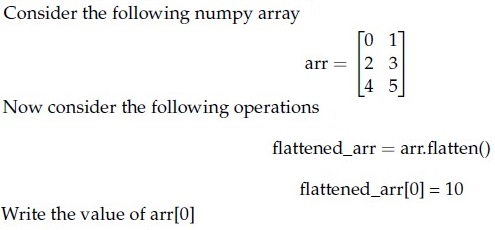

**Figure 49.** NumPy array operations snippet for Question 167.

Response Type : Numeric  
Answers Type : Equal

**Correct answer:** 0  
**Source evidence:** Official Possible Answers field displays '0' in green text on page 12.

---


---

**Source:** `da5006_2024T3_Q1_NA.md` · Quiz 1, 2024T3 · Question 169 · ID `640653994484`  
**Classification:** Week 1 — median_filter, non_linear_filtering, order_statistics, spatial_filtering  
**Course evidence:** [5.2 Non-Linear Spatial Filters](/Volumes/1700%20APFS/PERSONAL_PROGRAMMING_PROJECTS/Notes/Deep%20Learning%20for%20Computer%20Vision/month%201/week%201/week-1-report.md) · Related weeks: none

### Question 169

**Question ID:** `640653994484` · **Type:** SA · **Marks:** 2  
**PDF pages:** 12–13

Consider the grayscale image shown below:

$$\begin{bmatrix} 20 & 30 & 25 & 30 & 40 \\ 45 & 10 & 40 & 35 & 20 \\ 15 & 20 & 30 & 25 & 50 \\ 50 & 40 & 35 & 15 & 30 \\ 10 & 35 & 25 & 20 & 45 \end{bmatrix}$$

If a median filter with a 3 × 3 neighborhood is applied to this image with a stride of 1 and no padding, _____ will be the value at position (2, 2) in the filtered image? (Assume that the top-left pixel coordinate of output image is addressed as (1, 1))?

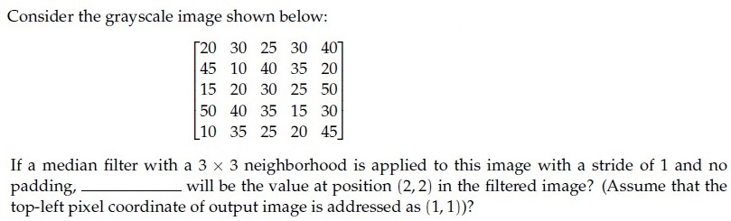

**Figure 50.** Grayscale pixel matrix and question for Question 169.

Response Type : Numeric  
Answers Type : Equal

**Correct answer:** 30  
**Source evidence:** Official Possible Answers field displays '30' in green text on page 13.

---


---

**Source:** `da5006_2024T3_ET_AN.md` · End-term, 2024T3 · Question 208 · ID `6406531046071`  
**Classification:** Week 1 — separable convolution kernels, 1D kernel separation, outer product decomposition, computational complexity K^2 to 2K, spatial linear filtering  
**Course evidence:** [4.3 Kernel Separability and the SVD Rank-1 Theorem](/Volumes/1700%20APFS/PERSONAL_PROGRAMMING_PROJECTS/Notes/Deep%20Learning%20for%20Computer%20Vision/month%201/week%201/week-1-report.md) · Related weeks: none

### Question 208

**Question ID:** `6406531046071` · **Type:** Multiple Choice Question (MCQ) · **Marks:** 2  
**PDF pages:** 6

For certain filters, we can speed up the convolution operation by separating convolution kernels from $K^2$ operations to $2K$ operations. Given the 2D Kernel below, what are the separated 1D kernels $v$ and $h$ for it?

$$\frac{1}{16} \begin{bmatrix} 1 & 2 & 1 \\ 2 & 4 & 2 \\ 1 & 2 & 1 \end{bmatrix}$$

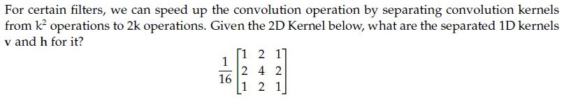
**Figure 51.** Source 2D convolution kernel for Question 208.

**Options**

**A.** $v = \frac{1}{4}\begin{bmatrix} 1 \\ 2 \\ 1 \end{bmatrix}, h = \frac{1}{4}\begin{bmatrix} 1 & 2 & 1 \end{bmatrix}$  
*Option ID:* `6406533531386`

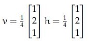
**Figure 52.** Question 208 Option A diagram.

**B.** $v = \frac{1}{2}\begin{bmatrix} 1 \\ 2 \\ 1 \end{bmatrix}, h = \frac{1}{4}\begin{bmatrix} 1 & 2 & 1 \end{bmatrix}$  
*Option ID:* `6406533531387`

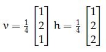
**Figure 53.** Question 208 Option B diagram.

**C.** $v = \frac{1}{4}\begin{bmatrix} 1 \\ 2 \\ 1 \end{bmatrix}, h = \frac{1}{2}\begin{bmatrix} 1 & 2 & 1 \end{bmatrix}$  
*Option ID:* `6406533531388`

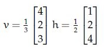
**Figure 54.** Question 208 Option C diagram.

**D.** $v = \frac{1}{2}\begin{bmatrix} 1 \\ 2 \\ 1 \end{bmatrix}, h = \frac{1}{2}\begin{bmatrix} 1 & 2 & 1 \end{bmatrix}$  
*Option ID:* `6406533531389`


**Figure 55.** Question 208 Option D diagram.

**Correct answer:** **A** — $v = \frac{1}{4}\begin{bmatrix} 1 \\ 2 \\ 1 \end{bmatrix}, h = \frac{1}{4}\begin{bmatrix} 1 & 2 & 1 \end{bmatrix}$.  
**Source evidence:** Option ID 6406533531386 is highlighted in green with a checkmark icon.

---


---

**Source:** `da5006_2024T3_ET_AN.md` · End-term, 2024T3 · Question 219 · ID `6406531046075`  
**Classification:** Week 1 — linear_contrast_stretching, point_operations, grayscale_image_representation, min_max_normalization  
**Course evidence:** [3.5 Elementary Point Operations](/Volumes/1700%20APFS/PERSONAL_PROGRAMMING_PROJECTS/Notes/Deep%20Learning%20for%20Computer%20Vision/month%201/week%201/week-1-report.md) · Related weeks: none

### Question 219

**Question ID:** `6406531046075` · **Type:** Short Answer Question (SA) · **Marks:** 2  
**PDF pages:** 12

Given is a 3 x 3 8-bit grayscale image:

$$\begin{bmatrix} 50 & 70 & 120 \\ 90 & 30 & 80 \\ 40 & 60 & 110 \end{bmatrix}$$

_________ is the central element after applying linear contrast stretching?

Response Type : Numeric


**Figure 56.** Source problem statement for Question 219.

**Correct answer:** **0**.  
**Source evidence:** Source key specifies Possible Answers : 0 (rendered in green #008000).

---


---

**Source:** `da5006_2025T1_Q1_NA.md` · Quiz 1, 2025T1 · Question 154 · ID `6406531130610`  
**Classification:** Week 1 — numpy_array_manipulation, array_flattening, memory_copy_vs_view, discrete_tensor_representation  
**Course evidence:** [3.1 Mathematical Models: Continuous Surface vs. Discrete Tensor](/Volumes/1700%20APFS/PERSONAL_PROGRAMMING_PROJECTS/Notes/Deep%20Learning%20for%20Computer%20Vision/month%201/week%201/week-1-report.md) · Related weeks: none

### Question 154

**Question ID:** `6406531130610` · **Type:** SA · **Marks:** 2  
**PDF pages:** 2

Consider the following numpy array:

```python
arr = np.array([[0, 1], [2, 3], [4, 5]])
```

Now consider the following operations:

```python
flattened_arr = arr.flatten()
flattened_arr[2] = 10
```

Write the value of `arr[2]` (or the element at index 2).


**Figure 57.** Source numpy array and operations for Question 154.

**Correct answer:** `2`  
**Source evidence:** Official answer '2' specified in Possible Answers field with green text (color 0x8000).

---


---

**Source:** `da5006_2025T1_Q1_NA.md` · Quiz 1, 2025T1 · Question 155 · ID `6406531130611`  
**Classification:** Week 1 — numpy_array_manipulation, array_ravel, memory_view, discrete_tensor_representation  
**Course evidence:** [3.1 Mathematical Models: Continuous Surface vs. Discrete Tensor](/Volumes/1700%20APFS/PERSONAL_PROGRAMMING_PROJECTS/Notes/Deep%20Learning%20for%20Computer%20Vision/month%201/week%201/week-1-report.md) · Related weeks: none

### Question 155

**Question ID:** `6406531130611` · **Type:** SA · **Marks:** 2  
**PDF pages:** 3

Consider the following numpy array:

```python
arr = np.array([[0, 1], [2, 3], [4, 5]])
```

Now consider the following operations:

```python
raveled_arr = arr.ravel()
raveled_arr[2] = 20
```

Write the value of `arr[2]` (or the element at index 2).


**Figure 58.** Source numpy array and operations for Question 155.

**Correct answer:** `20`  
**Source evidence:** Official answer '20' specified in Possible Answers field with green text (color 0x8000).

---


---

**Source:** `da5006_2025T1_Q1_NA.md` · Quiz 1, 2025T1 · Question 156 · ID `6406531130617`  
**Classification:** Week 1 — median_filter, non_linear_spatial_filtering, order_statistics, spatial_filtering_window  
**Course evidence:** [5.2 Non-Linear Spatial Filters](/Volumes/1700%20APFS/PERSONAL_PROGRAMMING_PROJECTS/Notes/Deep%20Learning%20for%20Computer%20Vision/month%201/week%201/week-1-report.md) · Related weeks: none

### Question 156

**Question ID:** `6406531130617` · **Type:** SA · **Marks:** 2  
**PDF pages:** 3

Consider the grayscale image shown below:

$$\begin{bmatrix} 20 & 30 & 25 & 30 & 40 \\ 45 & 10 & 40 & 35 & 20 \\ 15 & 20 & 30 & 25 & 50 \\ 50 & 40 & 35 & 15 & 30 \\ 10 & 35 & 25 & 20 & 45 \end{bmatrix}$$

If a median filter with a $3 \times 3$ neighborhood is applied to this image with a stride of 1 and no padding, _____ will be the value at position (2, 2) in the filtered image? (Assume that the top-left pixel coordinate of output image is addressed as (1, 1))?


**Figure 59.** Source grayscale pixel matrix for Question 156.

**Correct answer:** `30`  
**Source evidence:** Official answer '30' specified in Possible Answers field with green text (color 0x8000).

---


---

**Source:** `da5006_2025T1_Q1_NA.md` · Quiz 1, 2025T1 · Question 161 · ID `6406531130612`  
**Classification:** Week 1 — linear_contrast_stretching, point_operations, image_enhancement, min_max_normalization, grayscale_image_representation  
**Course evidence:** [3.5 Elementary Point Operations](/Volumes/1700%20APFS/PERSONAL_PROGRAMMING_PROJECTS/Notes/Deep%20Learning%20for%20Computer%20Vision/month%201/week%201/week-1-report.md) · Related weeks: none

### Question 161

**Question ID:** `6406531130612` · **Type:** MCQ · **Marks:** 2  
**PDF pages:** 5

Given is a $3 \times 3$ 8-bit grayscale image:

$$\begin{bmatrix} 50 & 70 & 120 \\ 90 & 30 & 80 \\ 40 & 60 & 110 \end{bmatrix}$$

What is the mean of transformed pixels of after applying linear contrast stretching? Linear contrast stretching is an image enhancement technique used to improve the contrast in an image. This is achieved by linearly scaling the pixel values so that they span a desired range (0 to 255 for an 8-bit grayscale image).


**Figure 60.** Grayscale pixel matrix and question statement for Question 161.

**Options**

**A.** 119.33  
*Option ID:* `6406533822672`

**B.** 110.5  
*Option ID:* `6406533822673`

**C.** 134.25  
*Option ID:* `6406533822674`

**D.** 0  
*Option ID:* `6406533822675`

**Correct answer:** **A** — 119.33.  
**Source evidence:** Option 6406533822672 rendered in green font (color 0x8000) with green checkmark icon in source PDF.

---


---

**Source:** `da5006_2025T1_Q1_NA.md` · Quiz 1, 2025T1 · Question 162 · ID `6406531130616`  
**Classification:** Week 1 — kernel_separability, linear_filtering, non_linear_filtering, median_filter, gaussian_filter  
**Course evidence:** [4.3 Kernel Separability and the SVD Rank-1 Theorem](/Volumes/1700%20APFS/PERSONAL_PROGRAMMING_PROJECTS/Notes/Deep%20Learning%20for%20Computer%20Vision/month%201/week%201/week-1-report.md) · Related weeks: none

### Question 162

**Question ID:** `6406531130616` · **Type:** MCQ · **Marks:** 2  
**PDF pages:** 5, 6

Which of the following statements is True ?

**Options**

**A.** Gaussian filter is Separable filter because it is non linear.  
*Option ID:* `6406533822688`

**B.** Median filter is a non separable filter  
*Option ID:* `6406533822689`

**C.** Gaussian filter is a High Pass filter.  
*Option ID:* `6406533822690`

**D.** Mean filter is a non separable filter because it is non linear  
*Option ID:* `6406533822691`

**Correct answer:** **B** — Median filter is a non separable filter.  
**Source evidence:** Option 6406533822689 rendered in green font (color 0x8000) with green checkmark icon in source PDF.

---


---

**Source:** `da5006_2025T1_Q1_NA.md` · Quiz 1, 2025T1 · Question 170 · ID `6406531130642`  
**Classification:** Week 1 — Convolution Properties, Commutativity, Associativity, Fourier Transform, Convolution Theorem  
**Course evidence:** [### 6.4 The Convolution Theorem](/Volumes/1700%20APFS/PERSONAL_PROGRAMMING_PROJECTS/Notes/Deep%20Learning%20for%20Computer%20Vision/month%201/week%201/week-1-report.md) · Related weeks: 4

### Question 170

**Question ID:** `6406531130642` · **Type:** MCQ · **Marks:** 2  
**PDF pages:** 8, 9

Consider the following two statements. Which of the following statements are true?

(a) Convolution operator is both commutative and associative.
(b) Fourier transform of a convolved image FT (a * b), is not the product of the Fourier transform of the constituent images FT(a) x FT(b)

**Options**

**A.** a and b  
*Option ID:* `6406533822744`

**B.** not a but b  
*Option ID:* `6406533822745`

**C.** a but not b  
*Option ID:* `6406533822746`

**D.** Neither a nor b  
*Option ID:* `6406533822747`

**Correct answer:** **C** — a but not b.  
**Source evidence:** Option 6406533822746 rendered in green font (color 0x8000) with green checkmark icon in source PDF on page 9.

---


---

**Source:** `da5006_2025T1_Q1_NA.md` · Quiz 1, 2025T1 · Question 171 · ID `6406531130643`  
**Classification:** Week 1 — Convolution Computational Complexity, Spatial Filtering, Kernel Operations, FLOPs  
**Course evidence:** [### 4.1 Foundations of Spatial Linear Filtering](/Volumes/1700%20APFS/PERSONAL_PROGRAMMING_PROJECTS/Notes/Deep%20Learning%20for%20Computer%20Vision/month%201/week%201/week-1-report.md) · Related weeks: none

### Question 171

**Question ID:** `6406531130643` · **Type:** MCQ · **Marks:** 2  
**PDF pages:** 9

A 3x3 kernel generates an output image of dimension 20x20 after convolution. The (approximate) number of computations performed to obtain this output image is:

**Options**

**A.** 3600  
*Option ID:* `6406533822748`

**B.** 180  
*Option ID:* `6406533822749`

**C.** 400  
*Option ID:* `6406533822750`

**D.** 9  
*Option ID:* `6406533822751`

**Correct answer:** **A** — 3600.  
**Source evidence:** Option 6406533822748 rendered in green font (color 0x8000) with green checkmark icon in source PDF.

---


---

**Source:** `da5006_2025T1_Q1_NA.md` · Quiz 1, 2025T1 · Question 174 · ID `6406531130613`  
**Classification:** Week 1 — Point Operations, Local Operations, Linear Contrast Stretching, Moving Average Filter, Convolution Theorem  
**Course evidence:** [### 3.4 Image Processing Hierarchy: Point, Local, and Global](/Volumes/1700%20APFS/PERSONAL_PROGRAMMING_PROJECTS/Notes/Deep%20Learning%20for%20Computer%20Vision/month%201/week%201/week-1-report.md) · Related weeks: none

### Question 174

**Question ID:** `6406531130613` · **Type:** MSQ · **Marks:** 2  
**PDF pages:** 10

Which of the following statements is false?

**Options**

**A.** Linear contrast stretching is a local operation.  
*Option ID:* `6406533822676`

**B.** Moving average is an example of local operation.  
*Option ID:* `6406533822677`

**C.** Convolution in the spatial domain can be obtained through addition in the frequency domain.  
*Option ID:* `6406533822678`

**D.** All of these.  
*Option ID:* `6406533822679`

**Correct answer:** **A**, **C** — Linear contrast stretching is a local operation. ; Convolution in the spatial domain can be obtained through addition in the frequency domain..  
**Source evidence:** Option A (6406533822676) rendered in green font (color 0x8000) with green checkmark icon in source PDF; Option C (6406533822678) rendered in green font (color 0x8000) with green checkmark icon in source PDF.

---


---

**Source:** `da5006_2025T1_Q1_NA.md` · Quiz 1, 2025T1 · Question 176 · ID `6406531130615`  
**Classification:** Week 1 — Linear Spatial Filtering, Kernel Convolution, Central Pixel Response, Filter Normalization  
**Course evidence:** [### 4.1 Foundations of Spatial Linear Filtering](/Volumes/1700%20APFS/PERSONAL_PROGRAMMING_PROJECTS/Notes/Deep%20Learning%20for%20Computer%20Vision/month%201/week%201/week-1-report.md) · Related weeks: none

### Question 176

**Question ID:** `6406531130615` · **Type:** MSQ · **Marks:** 2  
**PDF pages:** 10, 11

Which of the following linear filters will leave the central value of the given matrix unchanged.

$$\begin{bmatrix} 20 & 10 & 20 \\ 10 & 20 & 10 \\ 5 & 5 & 5 \end{bmatrix}$$


**Figure 61.** Source matrix for Question 176.

**Options**

**A.** Linear filter kernel shown in Figure 62:


**Figure 62.** Filter kernel for Option A.

*Option ID:* `6406533822684`

**B.** Linear filter kernel shown in Figure 63:


**Figure 63.** Filter kernel for Option B.

*Option ID:* `6406533822685`

**C.** Linear filter kernel shown in Figure 64:


**Figure 64.** Filter kernel for Option C.

*Option ID:* `6406533822686`

**D.** Linear filter kernel shown in Figure 65:


**Figure 65.** Filter kernel for Option D.

*Option ID:* `6406533822687`

**Correct answer:** **A** — Linear filter kernel shown in Figure 62.  
**Source evidence:** Option A (6406533822684) rendered in green font (color 0x8000) with green checkmark icon in source PDF on page 11.

---


---

**Source:** `da5006_2025T1_Q1_NA.md` · Quiz 1, 2025T1 · Question 177 · ID `6406531130618`  
**Classification:** Week 1 — Separable Kernel, Kernel Separability, Rank-1 Matrix, Outer Product Decomposition  
**Course evidence:** [### 4.3 Kernel Separability and the SVD Rank-1 Theorem](/Volumes/1700%20APFS/PERSONAL_PROGRAMMING_PROJECTS/Notes/Deep%20Learning%20for%20Computer%20Vision/month%201/week%201/week-1-report.md) · Related weeks: none

### Question 177

**Question ID:** `6406531130618` · **Type:** MSQ · **Marks:** 2  
**PDF pages:** 11, 12

Certain 2D kernel $K$ can be decomposed into two 1D kernels ($v$ and $h$) to reduce the computation cost such as $K = vh^T$. The 2D kernel is called as Separable Kernel.

Consider the following 2D kernels:

$$\text{(a) } \begin{bmatrix} 2 & 4 & 6 \\ 3 & 6 & 9 \\ 1 & 2 & 3 \end{bmatrix} \quad \text{(b) } \begin{bmatrix} 2 & 4 & 6 \\ 3 & 6 & 9 \\ 2 & 3 & 4 \end{bmatrix}$$

$$\text{(c) } \begin{bmatrix} 5 & 0 & 5 \\ 10 & 0 & 10 \\ 5 & 0 & 5 \end{bmatrix} \quad \text{(d) } \begin{bmatrix} 5 & 0 & -5 \\ 10 & 0 & -10 \\ 5 & 0 & -5 \end{bmatrix}$$

Which of the above kernels are separable?


**Figure 66.** 2D kernels (a), (b), (c), and (d) for Question 177.

**Options**

**A.** (a)  
*Option ID:* `6406533822693`

**B.** (b)  
*Option ID:* `6406533822694`

**C.** (c)  
*Option ID:* `6406533822695`

**D.** (d)  
*Option ID:* `6406533822696`

**Correct answer:** **A**, **D** — (a) ; (d).  
**Source evidence:** Option A (6406533822693) on page 11 rendered in green font (color 0x8000) with green checkmark icon in source PDF; Option D (6406533822696) on page 12 rendered in green font (color 0x8000) with green checkmark icon in source PDF.

---


---

**Source:** `da5006_2025T1_Q1_NA.md` · Quiz 1, 2025T1 · Question 184 · ID `6406531130632`  
**Classification:** Week 1 — Affine Transformation, Shear Transformation, Homogeneous Coordinates, Transformation Matrix  
**Course evidence:** [### 3.1 Mathematical Models: Continuous Surface vs. Discrete Tensor](/Volumes/1700%20APFS/PERSONAL_PROGRAMMING_PROJECTS/Notes/Deep%20Learning%20for%20Computer%20Vision/month%201/week%201/week-1-report.md) · Related weeks: 2

### Question 184

**Question ID:** `6406531130632` · **Type:** SA · **Marks:** 0.5  
**PDF pages:** 15

**Shared Comprehension Context (Question ID: `6406531130631`):**

> For the given figure, complete the transformation matrix with x — shear = 0.5 :
>
> $$\begin{bmatrix} x' \\ y' \\ 1 \end{bmatrix} = \begin{bmatrix} a_{11} & a_{12} & 1 \\ a_{21} & a_{22} & 1 \\ 0 & 0 & 1 \end{bmatrix} \begin{bmatrix} x \\ y \\ 1 \end{bmatrix}$$
>
> Based on the above data, answer the given subquestions.


**Figure 67.** Shear transformation diagram and transformation matrix for Questions 184–187.

a11= ____________

**Correct answer:** `1`  
**Source evidence:** Official answer '1' in Possible Answers field with green text (color 0x8000).

---


---

**Source:** `da5006_2025T1_Q1_NA.md` · Quiz 1, 2025T1 · Question 185 · ID `6406531130633`  
**Classification:** Week 1 — Affine Transformation, Shear Transformation, Homogeneous Coordinates, Transformation Matrix  
**Course evidence:** [### 3.1 Mathematical Models: Continuous Surface vs. Discrete Tensor](/Volumes/1700%20APFS/PERSONAL_PROGRAMMING_PROJECTS/Notes/Deep%20Learning%20for%20Computer%20Vision/month%201/week%201/week-1-report.md) · Related weeks: 2

### Question 185

**Question ID:** `6406531130633` · **Type:** SA · **Marks:** 0.5  
**PDF pages:** 15, 16

**Shared Comprehension Context (Question ID: `6406531130631`):**

> For the given figure, complete the transformation matrix with x — shear = 0.5 :
>
> $$\begin{bmatrix} x' \\ y' \\ 1 \end{bmatrix} = \begin{bmatrix} a_{11} & a_{12} & 1 \\ a_{21} & a_{22} & 1 \\ 0 & 0 & 1 \end{bmatrix} \begin{bmatrix} x \\ y \\ 1 \end{bmatrix}$$
>
> Based on the above data, answer the given subquestions.

a12= ____________

**Correct answer:** `0.5`  
**Source evidence:** Official answer '0.5' in Possible Answers field with green text (color 0x8000) on PDF page 16.

---


---

**Source:** `da5006_2025T1_Q1_NA.md` · Quiz 1, 2025T1 · Question 186 · ID `6406531130634`  
**Classification:** Week 1 — Affine Transformation, Shear Transformation, Homogeneous Coordinates, Transformation Matrix  
**Course evidence:** [### 3.1 Mathematical Models: Continuous Surface vs. Discrete Tensor](/Volumes/1700%20APFS/PERSONAL_PROGRAMMING_PROJECTS/Notes/Deep%20Learning%20for%20Computer%20Vision/month%201/week%201/week-1-report.md) · Related weeks: 2

### Question 186

**Question ID:** `6406531130634` · **Type:** SA · **Marks:** 0.5  
**PDF pages:** 16

**Shared Comprehension Context (Question ID: `6406531130631`):**

> For the given figure, complete the transformation matrix with x — shear = 0.5 :
>
> $$\begin{bmatrix} x' \\ y' \\ 1 \end{bmatrix} = \begin{bmatrix} a_{11} & a_{12} & 1 \\ a_{21} & a_{22} & 1 \\ 0 & 0 & 1 \end{bmatrix} \begin{bmatrix} x \\ y \\ 1 \end{bmatrix}$$
>
> Based on the above data, answer the given subquestions.

a21= ____________

**Correct answer:** `0`  
**Source evidence:** Official answer '0' in Possible Answers field with green text (color 0x8000).

---


---

**Source:** `da5006_2025T1_Q1_NA.md` · Quiz 1, 2025T1 · Question 187 · ID `6406531130635`  
**Classification:** Week 1 — Affine Transformation, Shear Transformation, Homogeneous Coordinates, Transformation Matrix  
**Course evidence:** [### 3.1 Mathematical Models: Continuous Surface vs. Discrete Tensor](/Volumes/1700%20APFS/PERSONAL_PROGRAMMING_PROJECTS/Notes/Deep%20Learning%20for%20Computer%20Vision/month%201/week%201/week-1-report.md) · Related weeks: 2

### Question 187

**Question ID:** `6406531130635` · **Type:** SA · **Marks:** 0.5  
**PDF pages:** 16

**Shared Comprehension Context (Question ID: `6406531130631`):**

> For the given figure, complete the transformation matrix with x — shear = 0.5 :
>
> $$\begin{bmatrix} x' \\ y' \\ 1 \end{bmatrix} = \begin{bmatrix} a_{11} & a_{12} & 1 \\ a_{21} & a_{22} & 1 \\ 0 & 0 & 1 \end{bmatrix} \begin{bmatrix} x \\ y \\ 1 \end{bmatrix}$$
>
> Based on the above data, answer the given subquestions.

a22= ____________

**Correct answer:** `1`  
**Source evidence:** Official answer '1' in Possible Answers field with green text (color 0x8000).

---


---

**Source:** `da5006_2025T2_Q1_NA.md` · Quiz 1, 2025T2 · Question 157 · ID `6406531279499`  
**Classification:** Week 1 — Linear Contrast Stretching, Point Operations, Pixel Normalization, Digital Image Representation  
**Course evidence:** [### 3.5 Elementary Point Operations](/Volumes/1700%20APFS/PERSONAL_PROGRAMMING_PROJECTS/Notes/Deep%20Learning%20for%20Computer%20Vision/month%201/week%201/week-1-report.md) · Related weeks: none

### Question 157

**Question ID:** `6406531279499` · **Type:** MCQ · **Marks:** 2  
**PDF pages:** 2

What is the mean of transformed pixels after applying linear contrast stretching to the following 3x3 image?

$$\begin{bmatrix} 52 & 55 & 61 \\ 59 & 79 & 61 \\ 76 & 61 & 64 \end{bmatrix}$$

$$\text{Image} =$$


**Figure 68.** 3x3 pixel matrix and linear contrast stretching problem statement for Question 157.

**Options**

**A.** 104.94  
*Option ID:* `6406534313841`

**B.** 100.25  
*Option ID:* `6406534313842`

**C.** 110.56  
*Option ID:* `6406534313843`

**D.** 98.78  
*Option ID:* `6406534313844`

**Correct answer:** **A** — 104.94.  
**Source evidence:** Option 6406534313841 rendered in green text (color 0x8000) with checkmark icon on PDF page 2.

---


---

**Source:** `da5006_2025T2_Q1_NA.md` · Quiz 1, 2025T2 · Question 158 · ID `6406531279500`  
**Classification:** Week 1 — Histogram Equalization, Point Operations, Local Operations, Global Operations, Median Filtering, Convolution Theorem  
**Course evidence:** [### 3.4 Image Processing Hierarchy: Point, Local, and Global](/Volumes/1700%20APFS/PERSONAL_PROGRAMMING_PROJECTS/Notes/Deep%20Learning%20for%20Computer%20Vision/month%201/week%201/week-1-report.md) · Related weeks: none

### Question 158

**Question ID:** `6406531279500` · **Type:** MCQ · **Marks:** 2  
**PDF pages:** 3

Which of the following statements is false?

**Options**

**A.** Histogram equalization is a global operation.  
*Option ID:* `6406534313845`

**B.** Gaussian filtering is a local operation.  
*Option ID:* `6406534313846`

**C.** Convolution in the spatial domain corresponds to multiplication in the frequency domain.  
*Option ID:* `6406534313847`

**D.** Median filtering is a global operation.  
*Option ID:* `6406534313848`

**Correct answer:** **D** — Median filtering is a global operation..  
**Source evidence:** Option 6406534313848 rendered in green text (color 0x8000) on PDF page 3.

---


---

**Source:** `da5006_2025T2_Q1_NA.md` · Quiz 1, 2025T2 · Question 159 · ID `6406531279501`  
**Classification:** Week 1 — Gaussian Filter, Kernel Separability, Linear Filtering, Median Filter, Non-linear Filtering  
**Course evidence:** [### 4.3 Kernel Separability and the SVD Rank-1 Theorem](/Volumes/1700%20APFS/PERSONAL_PROGRAMMING_PROJECTS/Notes/Deep%20Learning%20for%20Computer%20Vision/month%201/week%201/week-1-report.md) · Related weeks: none

### Question 159

**Question ID:** `6406531279501` · **Type:** MCQ · **Marks:** 2  
**PDF pages:** 3

Which of the following statements is True?

**Options**

**A.** Gaussian filter is a separable filter because it is linear.  
*Option ID:* `6406534313849`

**B.** Median filter is a non-separable filter.  
*Option ID:* `6406534313850`

**C.** Gaussian filter is a high-pass filter.  
*Option ID:* `6406534313851`

**D.** Mean filter is a non-separable filter because it is non-linear.  
*Option ID:* `6406534313852`

**Correct answer:** **A** — Gaussian filter is a separable filter because it is linear..  
**Source evidence:** Option 6406534313849 rendered in green text (color 0x8000) on PDF page 3.

---


---

**Source:** `da5006_2025T2_Q1_NA.md` · Quiz 1, 2025T2 · Question 160 · ID `6406531279502`  
**Classification:** Week 1 — Spatial Linear Filtering, Kernel Convolution, Central Pixel Response, Filter Normalization  
**Course evidence:** [### 4.1 Foundations of Spatial Linear Filtering](/Volumes/1700%20APFS/PERSONAL_PROGRAMMING_PROJECTS/Notes/Deep%20Learning%20for%20Computer%20Vision/month%201/week%201/week-1-report.md) · Related weeks: none

### Question 160

**Question ID:** `6406531279502` · **Type:** MCQ · **Marks:** 2  
**PDF pages:** 4

Which of the following linear filters will leave the central value of the given matrix unchanged after convolution?

$$\begin{bmatrix} 12 & 15 & 14 \\ 9 & 8 & 7 \\ 5 & 6 & 4 \end{bmatrix}$$


**Figure 69.** Source matrix and convolution problem statement for Question 160.

**Options**

**A.** $$\frac{1}{7}\begin{bmatrix} 0 & 1 & 0 \\ 1 & 3 & 1 \\ 0 & 1 & 0 \end{bmatrix}$$


**Figure 70.** Option A filter matrix for Question 160.  
*Option ID:* `6406534313853`

**B.** $$\frac{1}{9}\begin{bmatrix} 1 & 1 & 1 \\ 1 & 1 & 1 \\ 1 & 1 & 1 \end{bmatrix}$$


**Figure 71.** Option B filter matrix for Question 160.  
*Option ID:* `6406534313854`

**C.** $$\frac{1}{5}\begin{bmatrix} 0 & 0 & 1 \\ 0 & 3 & 0 \\ 1 & 0 & 0 \end{bmatrix}$$


**Figure 72.** Option C filter matrix for Question 160.  
*Option ID:* `6406534313855`

**D.** $$\frac{1}{6}\begin{bmatrix} 0 & 1 & 0 \\ 1 & 2 & 1 \\ 0 & 1 & 0 \end{bmatrix}$$


**Figure 73.** Option D filter matrix for Question 160.  
*Option ID:* `6406534313856`

**Correct answer:** **A** — $$\frac{1}{7}\begin{bmatrix} 0 & 1 & 0 \\ 1 & 3 & 1 \\ 0 & 1 & 0 \end{bmatrix}$$.  
**Source evidence:** Option 6406534313853 rendered in green text (color 0x8000) with checkmark icon on PDF page 4.

---


---

**Source:** `da5006_2025T2_Q1_NA.md` · Quiz 1, 2025T2 · Question 173 · ID `6406531279515`  
**Classification:** Week 1 — Convolution Properties, Commutativity, Associativity, Fourier Transform, Convolution Theorem, Cross-Correlation vs Convolution  
**Course evidence:** [### 6.4 The Convolution Theorem](/Volumes/1700%20APFS/PERSONAL_PROGRAMMING_PROJECTS/Notes/Deep%20Learning%20for%20Computer%20Vision/month%201/week%201/week-1-report.md) · Related weeks: none

### Question 173

**Question ID:** `6406531279515` · **Type:** MSQ · **Marks:** 3  
**PDF pages:** 11

Consider the following statements. Which of the following statements are true?

**Options**

**A.** Convolution operator is both commutative and associative.


**Figure 74.** Option A candidate statement for Question 173.  
*Option ID:* `6406534313905`

**B.** Fourier transform of a convolved image $\mathcal{F}\{a * b\}$ is not the product of the Fourier transforms of the constituent images $\mathcal{F}\{a\} \times \mathcal{F}\{b\}$.


**Figure 75.** Option B candidate statement for Question 173.  
*Option ID:* `6406534313906`

**C.** Convolution in the spatial domain corresponds to multiplication in the frequency domain.


**Figure 76.** Option C candidate statement for Question 173.  
*Option ID:* `6406534313907`

**D.** The Fourier transform of a convolution is equal to the product of the individual Fourier transforms only for linear, time-invariant systems.


**Figure 77.** Option D candidate statement for Question 173.  
*Option ID:* `6406534313908`

**E.** Correlation and convolution are the same if one of the signals/images is symmetric.


**Figure 78.** Option E candidate statement for Question 173.  
*Option ID:* `6406534313909`

**F.** The Fourier transform is a linear operator.


**Figure 79.** Option F candidate statement for Question 173.  
*Option ID:* `6406534313910`

**Correct answer:** **A, C, E, F**  
**Source evidence:** Option 6406534313905 rendered in green text (color 0x8000) on PDF page 11; Option 6406534313907 rendered in green text (color 0x8000) on PDF page 11; Option 6406534313909 rendered in green text (color 0x8000) on PDF page 11; Option 6406534313910 rendered in green text (color 0x8000) on PDF page 11.

---


---

**Source:** `da5006_2025T2_Q1_NA.md` · Quiz 1, 2025T2 · Question 174 · ID `6406531279516`  
**Classification:** Week 1 — Separable Kernel, Outer Product Decomposition, Linear Algebra, Rank-1 Matrix  
**Course evidence:** [### 4.3 Kernel Separability and the SVD Rank-1 Theorem](/Volumes/1700%20APFS/PERSONAL_PROGRAMMING_PROJECTS/Notes/Deep%20Learning%20for%20Computer%20Vision/month%201/week%201/week-1-report.md) · Related weeks: none

### Question 174

**Question ID:** `6406531279516` · **Type:** MSQ · **Marks:** 3  
**PDF pages:** 12

Certain 2D kernel $K$ can be decomposed into two 1D kernels ($v$ and $h^T$) to reduce the computation cost such as $K = v h^T$. The 2D kernel is called as Separable Kernel.

Consider the following 2D kernels:

Which of the below kernels are separable?


**Figure 80.** Separable kernel problem statement for Question 174.

**Options**

**A.** $$\begin{bmatrix} 2 & 4 & 6 \\ 3 & 6 & 9 \\ 1 & 2 & 3 \end{bmatrix}$$


**Figure 81.** Option A kernel matrix for Question 174.  
*Option ID:* `6406534313911`

**B.** $$\begin{bmatrix} 2 & 4 & 6 \\ 3 & 6 & 9 \\ 2 & 3 & 4 \end{bmatrix}$$


**Figure 82.** Option B kernel matrix for Question 174.  
*Option ID:* `6406534313912`

**C.** $$\begin{bmatrix} 5 & 0 & 5 \\ 10 & 0 & 10 \\ -5 & 0 & 5 \end{bmatrix}$$


**Figure 83.** Option C kernel matrix for Question 174.  
*Option ID:* `6406534313913`

**D.** $$\begin{bmatrix} 5 & 0 & 5 \\ 10 & 0 & 10 \\ -5 & 0 & -5 \end{bmatrix}$$


**Figure 84.** Option D kernel matrix for Question 174.  
*Option ID:* `6406534313914`

**Correct answer:** **A, D**  
**Source evidence:** Option 6406534313911 rendered in green text (color 0x8000) on PDF page 12; Option 6406534313914 rendered in green text (color 0x8000) on PDF page 12.

---


---

**Source:** `da5006_2025T2_Q1_NA.md` · Quiz 1, 2025T2 · Question 176 · ID `6406531279518`  
**Classification:** Week 1 — Median Filter, Non-linear Spatial Filtering, Order-Statistic Filters, Salt-and-Pepper Noise Reduction  
**Course evidence:** [### 5.2 Non-Linear Spatial Filters](/Volumes/1700%20APFS/PERSONAL_PROGRAMMING_PROJECTS/Notes/Deep%20Learning%20for%20Computer%20Vision/month%201/week%201/week-1-report.md) · Related weeks: none

### Question 176

**Question ID:** `6406531279518` · **Type:** SA · **Marks:** 3  
**PDF pages:** 13

Consider the grayscale image shown below:

$$\begin{bmatrix} 12 & 18 & 22 & 25 & 30 \\ 20 & 15 & 17 & 21 & 23 \\ 25 & 19 & 20 & 24 & 28 \\ 27 & 22 & 23 & 18 & 20 \\ 30 & 24 & 21 & 19 & 25 \end{bmatrix}$$

If a median filter with a $3 \times 3$ neighborhood is applied to this image with a stride of 1 and no padding, _____ will be the value at position (3, 3) in the filtered image? (Assume that the top-left pixel coordinate of the output image is addressed as (1, 1)).


**Figure 85.** Grayscale pixel matrix for Question 176.

**Correct answer:** `20`  
**Source evidence:** Official answer '20' specified in Possible Answers field with green text (color 0x8000) on PDF page 13.

---


---

**Source:** `da5006_2025T2_Q1_NA.md` · Quiz 1, 2025T2 · Question 183 · ID `6406531279534`  
**Classification:** Week 1 — NumPy Array Copy, Array Memory Semantics, Deep Copy, Digital Image Representation  
**Course evidence:** [## 3. Digital Image Representation & Elementary Point Operations](/Volumes/1700%20APFS/PERSONAL_PROGRAMMING_PROJECTS/Notes/Deep%20Learning%20for%20Computer%20Vision/month%201/week%201/week-1-report.md) · Related weeks: none

### Question 183

**Question ID:** `6406531279534` · **Type:** SA · **Marks:** 3  
**PDF pages:** 17

Consider the following numpy array:

```python
arr = np.array([[5, 6], [7, 8]])
```

Now consider the following operations:

```python
copied_arr = arr.copy()
copied_arr[0, 0] = 100
```

Write the value of `arr[0, 0]`.


**Figure 86.** Numpy array copy operation for Question 183.

**Correct answer:** `5`  
**Source evidence:** Official answer '5' specified in Possible Answers field with green text (color 0x8000) on PDF page 17.

---


---

**Source:** `da5006_2025T2_Q1_NA.md` · Quiz 1, 2025T2 · Question 184 · ID `6406531279535`  
**Classification:** Week 1 — NumPy Array View, Array Memory Semantics, Shared Memory View, Digital Image Representation  
**Course evidence:** [## 3. Digital Image Representation & Elementary Point Operations](/Volumes/1700%20APFS/PERSONAL_PROGRAMMING_PROJECTS/Notes/Deep%20Learning%20for%20Computer%20Vision/month%201/week%201/week-1-report.md) · Related weeks: none

### Question 184

**Question ID:** `6406531279535` · **Type:** SA · **Marks:** 3  
**PDF pages:** 18

Consider the following numpy array:

```python
arr = np.array([[1, 2], [3, 4]])
```

Now consider the following operations:

```python
viewed_arr = arr.view()
viewed_arr[0, 1] = 99
```

Write the value of `arr[0, 1]`.


**Figure 87.** Numpy array view operation for Question 184.

**Correct answer:** `99`  
**Source evidence:** Official answer '99' specified in Possible Answers field with green text (color 0x8000) on PDF page 18.

---


---

**Source:** `da5006_2025T2_ET_AN.md` · End-term, 2025T2 · Question 85 · ID `6406531431345`  
**Classification:** Week 1 — point operations, linear contrast stretching, local operations, moving average filter, Convolution Theorem in frequency domain  
**Course evidence:** [3.4 Image Processing Hierarchy: Point, Local, and Global](/Volumes/1700%20APFS/PERSONAL_PROGRAMMING_PROJECTS/Notes/Deep%20Learning%20for%20Computer%20Vision/month%201/week%201/week-1-report.md) · Related weeks: none

### Question 85

**Question ID:** `6406531431345` · **Type:** MCQ · **Marks:** 2  
**PDF pages:** 2

Which one of the following statements is false?

**Options**

**A.** Linear contrast stretching is a point operation.  
*Option ID:* `6406534780252`

**B.** Moving average is an example of a local operation.  
*Option ID:* `6406534780253`

**C.** Convolution in the spatial domain cannot be obtained through addition in the frequency domain.  
*Option ID:* `6406534780254`

**D.** All of these.  
*Option ID:* `6406534780255`

**Correct answer:** **D** — All of these..  
**Source evidence:** Option D (6406534780255) rendered in green font (#008000) indicating the officially accepted answer in the source key. (PDF page 2).

---


---

**Source:** `da5006_2025T2_ET_AN.md` · End-term, 2025T2 · Question 92 · ID `6406531431352`  
**Classification:** Week 1 — kernel separability, outer product decomposition, 2D to 1D convolution, computational complexity reduction k^2 to 2k  
**Course evidence:** [4.3 Kernel Separability and the SVD Rank-1 Theorem](/Volumes/1700%20APFS/PERSONAL_PROGRAMMING_PROJECTS/Notes/Deep%20Learning%20for%20Computer%20Vision/month%201/week%201/week-1-report.md) · Related weeks: none

### Question 92

**Question ID:** `6406531431352` · **Type:** MCQ · **Marks:** 2  
**PDF pages:** 4, 5

For certain filters, we can speed up the convolution operation by separating convolution kernels from $k^2$ operations to $2k$ operations. Given the 2D Kernel below, what are the separated 1D kernels $v$ and $h$ for it?

$$\begin{bmatrix} 1 & 2 & 1 \\ 2 & 4 & 2 \\ 1 & 2 & 1 \end{bmatrix}$$


**Figure 88.** Source 2D kernel for Question 92.

**Options**

**A.** 

**Figure 89.** Option A separated 1D kernels for Question 92.  
*Option ID:* `6406534780281`

**B.** 

**Figure 90.** Option B separated 1D kernels for Question 92.  
*Option ID:* `6406534780282`

**C.** 

**Figure 91.** Option C separated 1D kernels for Question 92.  
*Option ID:* `6406534780283`

**D.** 

**Figure 92.** Option D separated 1D kernels for Question 92.  
*Option ID:* `6406534780284`

**Correct answer:** **A** — Option A ($v = [1, 2, 1]^T, h = [1, 2, 1]$).  
**Source evidence:** Option 6406534780281 is rendered in green text (#008000) with a checkmark icon. (PDF page 5).

---


---

**Source:** `da5006_2025T2_ET_AN.md` · End-term, 2025T2 · Question 102 · ID `6406531431362`  
**Classification:** Week 1 — High-Pass Filtering, Linear Spatial Filtering, Laplacian Kernel, Frequency Domain Filtering, Edge Sharpening  
**Course evidence:** [### 6.6 Frequency Domain Filtering & Hybrid Images](/Volumes/1700%20APFS/PERSONAL_PROGRAMMING_PROJECTS/Notes/Deep%20Learning%20for%20Computer%20Vision/month%201/week%201/week-1-report.md) · Related weeks: none

### Question 102

**Question ID:** `6406531431362` · **Type:** MSQ · **Marks:** 2  
**PDF pages:** 8, 9

Which of the following are examples of a high-pass filter?

**Options**

**A.** 

**Figure 93.** Option A filter kernel for Question 102.  
*Option ID:* `6406534780323`

**B.** 

**Figure 94.** Option B filter kernel for Question 102.  
*Option ID:* `6406534780324`

**C.** 

**Figure 95.** Option C filter kernel for Question 102.  
*Option ID:* `6406534780325`

**D.** 

**Figure 96.** Option D filter kernel for Question 102.  
*Option ID:* `6406534780326`

**Correct answer:** **A, B, C** — Options A, B, and C.  
**Source evidence:** Option 6406534780323 is rendered in green text (#008000) with a checkmark icon. (PDF page 8).

---


---

**Source:** `da5006_2025T2_ET_AN.md` · End-term, 2025T2 · Question 103 · ID `6406531431363`  
**Classification:** Week 1 — Linear Dynamic Range Stretching, Contrast Stretching, Point Operations, Grayscale Intensity Normalization  
**Course evidence:** [### 3.5 Elementary Point Operations](/Volumes/1700%20APFS/PERSONAL_PROGRAMMING_PROJECTS/Notes/Deep%20Learning%20for%20Computer%20Vision/month%201/week%201/week-1-report.md) · Related weeks: none

### Question 103

**Question ID:** `6406531431363` · **Type:** SA · **Marks:** 2  
**PDF pages:** 9

Given is a 3 × 3 8-bit grayscale image:

$$\begin{bmatrix} 10 & 50 & 200 \\ 70 & 100 & 150 \\ 20 & 80 & 255 \end{bmatrix}$$

What is the central element after applying linear contrast stretching (from the range $[I_{min}, I_{max}]$ to $[0, 255]$) ?


**Figure 97.** Source problem statement for Question 103.

**Correct answer:** 93 to 94  
**Source evidence:** Source key specifies Possible Answers : 93 to 94 (Answers Type : Equal).

---


---

**Source:** `da5006_2025T2_ET_FN.md` · End-term, 2025T2 · Question 166 · ID `6406531422545`  
**Classification:** Week 1 — separable convolution filter, kernel separability, outer product decomposition, computational complexity reduction  
**Course evidence:** [4.3 Kernel Separability and the SVD Rank-1 Theorem](/Volumes/1700%20APFS/PERSONAL_PROGRAMMING_PROJECTS/Notes/Deep%20Learning%20for%20Computer%20Vision/month%201/week%201/week-1-report.md) · Related weeks: none

### Question 166

**Question ID:** `6406531422545` · **Type:** MCQ · **Marks:** 2  
**PDF pages:** 7

For certain filters, we can speed up the convolution operation by separating convolution kernels from k² operations to 2k operations. Given the 2D Kernel below, what are the separated 1D kernels v and h for it?


**Figure 98.** Question 166, 2D convolution kernel.

**Options**

**A.** v = [1, 2, 1]ᵀ, h = [1, 2, 1]  

**Figure 99.** Option A image for Question 166.
*Option ID:* `6406534756396`

**B.** v = [1, 2, 1]ᵀ, h = [2, 1, 2]  

**Figure 100.** Option B image for Question 166.
*Option ID:* `6406534756397`

**C.** v = [1, 2, 1]ᵀ, h = [1, 4, 1]  

**Figure 101.** Option C image for Question 166.
*Option ID:* `6406534756398`

**D.** v = [2, 1, 2]ᵀ, h = [1, 2, 1]  

**Figure 102.** Option D image for Question 166.
*Option ID:* `6406534756399`

**Correct answer:** **A** — v = [1, 2, 1]ᵀ, h = [1, 2, 1].  
**Source evidence:** Option 6406534756396 is rendered in green text (#008000) with a checkmark icon. (PDF page 7).

---


---

**Source:** `da5006_2025T2_ET_FN.md` · End-term, 2025T2 · Question 176 · ID `6406531422555`  
**Classification:** Week 1 — high-pass filters, spatial linear filtering, derivative operators, Sobel filter, Prewitt filter, discrete Laplacian kernel  
**Course evidence:** [4. Spatial Linear Filtering, Cross-Correlation, and Convolution](/Volumes/1700%20APFS/PERSONAL_PROGRAMMING_PROJECTS/Notes/Deep%20Learning%20for%20Computer%20Vision/month%201/week%201/week-1-report.md) · Related weeks: 2

### Question 176

**Question ID:** `6406531422555` · **Type:** MSQ · **Marks:** 2  
**PDF pages:** 11

Which of the following are examples of a high-pass filter?

**Options**

**A.** [-1 0 1; -2 0 2; -1 0 1]  

**Figure 103.** Option A image for Question 176.
*Option ID:* `6406534756440`

**B.** [-1 -2 -1; 0 0 0; 1 2 1]  

**Figure 104.** Option B image for Question 176.
*Option ID:* `6406534756441`

**C.** [0 -1 0; -1 4 -1; 0 -1 0]  

**Figure 105.** Option C image for Question 176.
*Option ID:* `6406534756442`

**D.** [-1 0 1; -1 0 1; -1 0 1]  

**Figure 106.** Option D image for Question 176.
*Option ID:* `6406534756443`

**Correct answer:** **A**, **B**, **C**, **D** — [-1 0 1; -2 0 2; -1 0 1]; [-1 -2 -1; 0 0 0; 1 2 1]; [0 -1 0; -1 4 -1; 0 -1 0]; [-1 0 1; -1 0 1; -1 0 1].  
**Source evidence:** Option 6406534756440 is rendered in green text (#008000) with a checkmark icon. Option 6406534756441 is rendered in green text (#008000) with a checkmark icon. Option 6406534756442 is rendered in green text (#008000) with a checkmark icon. Option 6406534756443 is rendered in green text (#008000) with a checkmark icon. (PDF page 11).

---


---

**Source:** `da5006_2025T2_ET_FN.md` · End-term, 2025T2 · Question 179 · ID `6406531422558`  
**Classification:** Week 1 — point operations, linear contrast stretching, dynamic range scaling, digital image representation  
**Course evidence:** [3.5 Elementary Point Operations](/Volumes/1700%20APFS/PERSONAL_PROGRAMMING_PROJECTS/Notes/Deep%20Learning%20for%20Computer%20Vision/month%201/week%201/week-1-report.md) · Related weeks: none

### Question 179

**Question ID:** `6406531422558` · **Type:** SA · **Marks:** 2  
**PDF pages:** 12, 13

Given is a 3 x 3 8-bit grayscale image:


**Figure 107.** Question 179, source grayscale image matrix and problem statement.

$$\begin{bmatrix} 50 & 70 & 120 \\ 90 & 30 & 80 \\ 40 & 60 & 110 \end{bmatrix}$$

What is the central element after applying linear contrast stretching? Linear contrast stretching is an image enhancement technique used to improve the contrast in an image. This is achieved by linearly scaling the pixel values so that they span a desired range (0 to 255 for an 8-bit grayscale image).

**Correct answer:** `0`  
**Source evidence:** Official text specification: 'Possible Answers : 0' rendered in green text (#008000). (PDF page 13).

---


---

**Source:** `da5006_2025T2_ET_FN.md` · End-term, 2025T2 · Question 180 · ID `6406531422559`  
**Classification:** Week 1 — non-linear spatial filters, median filter, order-statistic filtering, sliding window filtering  
**Course evidence:** [5.2 Non-Linear Spatial Filters](/Volumes/1700%20APFS/PERSONAL_PROGRAMMING_PROJECTS/Notes/Deep%20Learning%20for%20Computer%20Vision/month%201/week%201/week-1-report.md) · Related weeks: none

### Question 180

**Question ID:** `6406531422559` · **Type:** SA · **Marks:** 2  
**PDF pages:** 13

Consider the grayscale image shown below as a 5 x 5 matrix:


**Figure 108.** Question 180, 5x5 matrix image.

$$\begin{bmatrix} 20 & 30 & 25 & 30 & 40 \\ 45 & 10 & 40 & 35 & 20 \\ 15 & 20 & 30 & 25 & 50 \\ 50 & 40 & 35 & 15 & 30 \\ 10 & 35 & 25 & 20 & 45 \end{bmatrix}$$

If a median filter with a 3 x 3 neighborhood is applied to this image with a stride of 1 and no padding, what will be the value at position (2, 2) in the filtered image? (Assume that the top-left pixel coordinate of output image is addressed as (1, 1))?

**Correct answer:** `30`  
**Source evidence:** Official text specification: 'Possible Answers : 30' rendered in green text (#008000). (PDF page 13).

---


---

**Source:** `da5006_2025T3_ET_FN.md` · End-term, 2025T3 · Question 3 · ID `6406531862817`  
**Classification:** Week 1 — Linear Contrast Stretching, Elementary Point Operations, Dynamic Range Expansion, Grayscale Image Processing  
**Course evidence:** [### 3.5 Elementary Point Operations](/Volumes/1700%20APFS/PERSONAL_PROGRAMMING_PROJECTS/Notes/Deep%20Learning%20for%20Computer%20Vision/month%201/week%201/week-1-report.md) · Related weeks: none

### Question 3

**Question ID:** `6406531862817` · **Type:** SA · **Marks:** 1  
**PDF pages:** 2

Given the $3 \times 3$ 8-bit grayscale image

$$\begin{bmatrix} 12 & 40 & 210 \\ 75 & 95 & 160 \\ 30 & 120 & 240 \end{bmatrix}$$

Apply linear contrast stretching from $[I_{min}, I_{max}]$ to $[0, 255]$. What is the central element after stretching?
(Round to the nearest integer.)


**Figure 109.** Source grayscale image matrix and linear contrast stretching task for Question 3.

**Correct answer:** `92 to 94`  
**Source evidence:** Official accepted range '92 to 94' specified in Possible Answers field with green text (color 0x008000); calculation: (95 - 12) / (240 - 12) * 255 = 83 / 228 * 255 ≈ 92.83, rounding to 93.

---


---

**Source:** `da5006_2026T1_Q1_NA.md` · Quiz 1, 2026T1 · Question 5 · ID `6406531961524`  
**Classification:** Week 1 — kernel separability, SVD rank-1 theorem, 2D spatial filtering, Gaussian kernel decomposition, outer product  
**Course evidence:** [### 4.3 Kernel Separability and the SVD Rank-1 Theorem](/Volumes/1700%20APFS/PERSONAL_PROGRAMMING_PROJECTS/Notes/Deep%20Learning%20for%20Computer%20Vision/month%201/week%201/week-1-report.md) · Related weeks: none

### Question 5

**Question ID:** `6406531961524` · **Type:** Multiple Choice Question · **Marks:** 1  
**PDF pages:** 4

Which of the following $3 \times 3$ kernels is separable?

**Options**

**A.**


**Figure 110.** Option A kernel diagram for Question 5.

*Option ID:* `6406536373704`

**B.**


**Figure 111.** Option B kernel diagram for Question 5.

*Option ID:* `6406536373705`

**C.**


**Figure 112.** Option C kernel diagram for Question 5.

*Option ID:* `6406536373706`

**D.**


**Figure 113.** Option D kernel diagram for Question 5.

*Option ID:* `6406536373707`

**Correct answer:** **C** — Option C (separable Gaussian smoothing filter $\frac{1}{16} \begin{bmatrix} 1 & 2 & 1 \\ 2 & 4 & 2 \\ 1 & 2 & 1 \end{bmatrix}$)  
**Source evidence:** Green option ID and check marker, PDF page 4.

---


---

**Source:** `da5006_2026T1_Q1_NA.md` · Quiz 1, 2026T1 · Question 8 · ID `6406531961518`  
**Classification:** Week 1 — linear contrast stretching, elementary point operations, min-max intensity scaling, dynamic range, 8-bit grayscale image  
**Course evidence:** [### 3.5 Elementary Point Operations](/Volumes/1700%20APFS/PERSONAL_PROGRAMMING_PROJECTS/Notes/Deep%20Learning%20for%20Computer%20Vision/month%201/week%201/week-1-report.md) · Related weeks: none

### Question 8

**Question ID:** `6406531961518` · **Type:** Short Answer Question · **Marks:** 1  
**PDF pages:** 5, 6


**Figure 114.** Grayscale image matrix and contrast stretching specification for Question 8.

Given the $3 \times 3$ 8-bit grayscale image

$$\begin{bmatrix} 12 & 40 & 210 \\ 75 & 95 & 160 \\ 30 & 120 & 240 \end{bmatrix}$$

Apply linear contrast stretching from $[I_{min}, I_{max}]$ to $[0, 255]$. What is the central element after stretching? (Round to the nearest integer.)

**Correct answer:** `92 to 94`  
**Source evidence:** Green text in Possible Answers range field, PDF page 6.

---


---

**Source:** `da5006_2026T1_Q1_NA.md` · Quiz 1, 2026T1 · Question 9 · ID `6406531961519`  
**Classification:** Week 1 — NumPy array aliasing, shared memory reference, in-place mutation, 2D matrix indexing, digital image representation  
**Course evidence:** [## 3. Digital Image Representation & Elementary Point Operations](/Volumes/1700%20APFS/PERSONAL_PROGRAMMING_PROJECTS/Notes/Deep%20Learning%20for%20Computer%20Vision/month%201/week%201/week-1-report.md) · Related weeks: none

### Question 9

**Question ID:** `6406531961519` · **Type:** Short Answer Question · **Marks:** 1  
**PDF pages:** 6


**Figure 115.** Array definition and aliasing operation for Question 9.

Consider $\text{arr} = \begin{bmatrix} 4 & 8 \\ 5 & 3 \end{bmatrix}$ and the operations $\text{alias} = \text{arr}; \text{alias}[1, 1] = 0$. Write the value of $\text{arr}[1, 1]$: ______

**Correct answer:** `0`  
**Source evidence:** Green text in Possible Answers field, PDF page 6.

---


---

**Source:** `da5006_2026T1_Q1_NA.md` · Quiz 1, 2026T1 · Question 10 · ID `6406531961520`  
**Classification:** Week 1 — NumPy reshape, arr.ravel, flattened array view, shared memory buffer, discrete tensor representation  
**Course evidence:** [## 3. Digital Image Representation & Elementary Point Operations](/Volumes/1700%20APFS/PERSONAL_PROGRAMMING_PROJECTS/Notes/Deep%20Learning%20for%20Computer%20Vision/month%201/week%201/week-1-report.md) · Related weeks: none

### Question 10

**Question ID:** `6406531961520` · **Type:** Short Answer Question · **Marks:** 1  
**PDF pages:** 6, 7


**Figure 116.** Array reshape and ravel operations for Question 10.

Let $\text{arr} = \text{reshape}([0, 1, 2, 3, 4, 5], (2, 3))$, $v = \text{arr.ravel}()$, and set $v[3] = 99$. The value of $\text{arr}[1, 0]$ is _____

**Correct answer:** `99`  
**Source evidence:** Green text in Possible Answers field, PDF page 7.

---


---

**Source:** `da5006_2026T1_Q1_NA.md` · Quiz 1, 2026T1 · Question 13 · ID `6406531961526`  
**Classification:** Week 1 — median filter, non-linear spatial filtering, order statistics, sliding window, impulse noise reduction  
**Course evidence:** [### 5.2 Non-Linear Spatial Filters](/Volumes/1700%20APFS/PERSONAL_PROGRAMMING_PROJECTS/Notes/Deep%20Learning%20for%20Computer%20Vision/month%201/week%201/week-1-report.md) · Related weeks: none

### Question 13

**Question ID:** `6406531961526` · **Type:** Short Answer Question · **Marks:** 1  
**PDF pages:** 7, 8


**Figure 117.** Grayscale image matrix and median filter specifications for Question 13.

Consider the $5 \times 5$ grayscale image

$$\begin{bmatrix} 14 & 18 & 22 & 25 & 31 \\ 19 & 16 & 20 & 23 & 24 \\ 27 & 21 & 19 & 26 & 28 \\ 29 & 23 & 22 & 17 & 18 \\ 33 & 26 & 24 & 20 & 27 \end{bmatrix}$$

After a median filter with $3 \times 3$ window, stride 1, no padding, the value at position (3, 3) of the output is ________.

**Correct answer:** `22`  
**Source evidence:** Green text in Possible Answers field, PDF page 8.

---


---

**Source:** `da5006_2026T1_ET_FN.md` · End-term, 2026T1 · Question 2 · ID `6406532136817`  
**Classification:** Week 1 — digital image representation, RGB color image, uncompressed raw memory, 8-bit unsigned integer (uint8), pixel storage calculus  
**Course evidence:** [## 3. Digital Image Representation & Elementary Point Operations](/Volumes/1700%20APFS/PERSONAL_PROGRAMMING_PROJECTS/Notes/Deep%20Learning%20for%20Computer%20Vision/month%201/week%201/week-1-report.md) · Related weeks: none

### Question 2

**Question ID:** `6406532136817` · **Type:** MCQ · **Marks:** 2  
**PDF pages:** 2

A standard RGB image of size 256×256 is stored as 8-bit unsigned integers per channel. What is the total memory (in bytes) to store the raw image (no compression)?

**Options**

**A.** 256×256 = 65,536 bytes  
*Option ID:* `6406536959477`

**B.** 256×256×2 = 131,072 bytes  
*Option ID:* `6406536959478`

**C.** 256×256×3 = 196,608 bytes  
*Option ID:* `6406536959479`

**D.** 256×256×3×8 = 1,572,864 bytes  
*Option ID:* `6406536959480`

**Correct answer:** **C** — 256×256×3 = 196,608 bytes.  
**Source evidence:** Option ID 6406536959479 rendered in green text (#008000) with checkmark icon (xref 1692) on PDF page 2.

---


---

**Source:** `da5006_2026T1_ET_FN.md` · End-term, 2026T1 · Question 3 · ID `6406532136818`  
**Classification:** Week 1 — spatial convolution, cross-correlation, kernel flipping (180-degree rotation), linear shift-invariant filtering, filter symmetry  
**Course evidence:** [### 4.2 Cross-Correlation vs. Convolution: The $180^\circ$ Rotation](/Volumes/1700%20APFS/PERSONAL_PROGRAMMING_PROJECTS/Notes/Deep%20Learning%20for%20Computer%20Vision/month%201/week%201/week-1-report.md) · Related weeks: 4

### Question 3

**Question ID:** `6406532136818` · **Type:** MCQ · **Marks:** 2  
**PDF pages:** 2

Which statement is correct?

**Options**

**A.** Convolution equals correlation for all filters.  
*Option ID:* `6406536959481`

**B.** Convolution flips the kernel spatially; correlation does not.  
*Option ID:* `6406536959482`

**C.** Correlation flips the kernel; convolution does not.  
*Option ID:* `6406536959483`

**D.** Both operations always preserve energy.  
*Option ID:* `6406536959484`

**Correct answer:** **B** — Convolution flips the kernel spatially; correlation does not..  
**Source evidence:** Option ID 6406536959482 rendered in green text (#008000) with checkmark icon (xref 1692) on PDF page 2.

---


---

**Source:** `da5006_2026T2_Q1_NA.md` · Quiz 1, 2026T2 · Question 5 · ID `6406532166260`  
**Classification:** Week 1 — Kernel Separability, SVD Rank-1 Theorem, Outer Product Decomposition, 2D Spatial Filtering, Gaussian Kernel  
**Course evidence:** [### 4.3 Kernel Separability and the SVD Rank-1 Theorem](/Volumes/1700%20APFS/PERSONAL_PROGRAMMING_PROJECTS/Notes/Deep%20Learning%20for%20Computer%20Vision/month%201/week%201/week-1-report.md) · Related weeks: none

### Question 5

**Question ID:** `6406532166260` · **Type:** Multiple Choice Question · **Marks:** 1  
**PDF pages:** 3

Which of the following $3 \times 3$ kernels is separable?

**Options**

**A.**


**Figure 118.** Option A kernel diagram for Question 5.

*Option ID:* `6406537043619`

**B.**


**Figure 119.** Option B kernel diagram for Question 5.

*Option ID:* `6406537043620`

**C.**


**Figure 120.** Option C kernel diagram for Question 5.

*Option ID:* `6406537043621`

**D.**


**Figure 121.** Option D kernel diagram for Question 5.

*Option ID:* `6406537043622`

**Correct answer:** **C** — Option C (separable Gaussian smoothing filter $\frac{1}{16} \begin{bmatrix} 1 & 2 & 1 \\ 2 & 4 & 2 \\ 1 & 2 & 1 \end{bmatrix}$)  
**Source evidence:** Green option ID `6406537043621` and check marker, PDF page 3.

---


---

**Source:** `da5006_2026T2_Q1_NA.md` · Quiz 1, 2026T2 · Question 8 · ID `6406532166255`  
**Classification:** Week 1 — Linear Contrast Stretching, Point Operations, Min-Max Normalization, Pixel Transformation, Digital Image Representation  
**Course evidence:** [### 3.5 Elementary Point Operations](/Volumes/1700%20APFS/PERSONAL_PROGRAMMING_PROJECTS/Notes/Deep%20Learning%20for%20Computer%20Vision/month%201/week%201/week-1-report.md) · Related weeks: none

### Question 8

**Question ID:** `6406532166255` · **Type:** Short Answer Question · **Marks:** 1  
**PDF pages:** 4, 5


**Figure 122.** Grayscale image matrix and contrast stretching specification for Question 8.

Given the $3 \times 3$ 8-bit grayscale image

$$\begin{bmatrix} 12 & 40 & 210 \\ 75 & 95 & 160 \\ 30 & 120 & 240 \end{bmatrix}$$

Apply linear contrast stretching from $[I_{min}, I_{max}]$ to $[0, 255]$. What is the central element after stretching? (Round to the nearest integer.)

**Correct answer:** `92 to 94`  
**Source evidence:** Green text in Possible Answers range field, PDF page 5.

---


---

**Source:** `da5006_2026T2_Q1_NA.md` · Quiz 1, 2026T2 · Question 9 · ID `6406532166256`  
**Classification:** Week 1 — NumPy Array Manipulation, Array Ravel, Memory View vs Copy, Discrete Tensor Representation  
**Course evidence:** [### 3.1 Mathematical Models: Continuous Surface vs. Discrete Tensor](/Volumes/1700%20APFS/PERSONAL_PROGRAMMING_PROJECTS/Notes/Deep%20Learning%20for%20Computer%20Vision/month%201/week%201/week-1-report.md) · Related weeks: none

### Question 9

**Question ID:** `6406532166256` · **Type:** Short Answer Question · **Marks:** 1  
**PDF pages:** 5


**Figure 123.** Array reshape and ravel operations for Question 9.

Let $\text{arr} = \text{reshape}([0, 1, 2, 3, 4, 5], (2, 3))$, $v = \text{arr.ravel}()$, and set $v[3] = 99$. The value of $\text{arr}[1, 0]$ is _____

**Correct answer:** `99`  
**Source evidence:** Green text in Possible Answers field, PDF page 5.

---


---

**Source:** `da5006_2026T2_Q1_NA.md` · Quiz 1, 2026T2 · Question 12 · ID `6406532166262`  
**Classification:** Week 1 — Median Filter, Non-Linear Spatial Filtering, Order Statistics, Spatial Neighborhood Filtering  
**Course evidence:** [### 5.2 Non-Linear Spatial Filters](/Volumes/1700%20APFS/PERSONAL_PROGRAMMING_PROJECTS/Notes/Deep%20Learning%20for%20Computer%20Vision/month%201/week%201/week-1-report.md) · Related weeks: none

### Question 12

**Question ID:** `6406532166262` · **Type:** Short Answer Question · **Marks:** 1  
**PDF pages:** 6


**Figure 124.** Grayscale image matrix and median filter specifications for Question 12.

Consider the $5 \times 5$ grayscale image

$$\begin{bmatrix} 14 & 18 & 22 & 25 & 31 \\ 19 & 16 & 20 & 23 & 24 \\ 27 & 21 & 19 & 26 & 28 \\ 29 & 23 & 22 & 17 & 18 \\ 33 & 26 & 24 & 20 & 27 \end{bmatrix}$$

After a median filter with $3 \times 3$ window, stride 1, no padding, the value at position (3, 3) of the output is ________.

**Correct answer:** `22`  
**Source evidence:** Green text in Possible Answers field, PDF page 6.

---


---

**Source:** `da5006_2026T2_ET_FN.md` · End-term, 2026T2 · Question 2 · ID `6406532270041`  
**Classification:** Week 1 — Digital Image Representation, Color Tensor Memory Layout, RGB Channels, Floating-Point Precision, Byte Storage Calculation  
**Course evidence:** [### 3.1 Mathematical Models: Continuous Surface vs. Discrete Tensor](/Volumes/1700%20APFS/PERSONAL_PROGRAMMING_PROJECTS/Notes/Deep%20Learning%20for%20Computer%20Vision/month%201/week%201/week-1-report.md) · Related weeks: none

### Question 2

**Question ID:** `6406532270041` · **Type:** MCQ · **Marks:** 2  
**PDF pages:** 2

An RGB image of size $128 \times 96$ is stored with 32-bit floating-point values for every channel. Ignoring metadata, how many bytes are required?

**Options**

**A.** 36,864  
*Option ID:* `6406537379003`

**B.** 73,728  
*Option ID:* `6406537379004`

**C.** 147,456  
*Option ID:* `6406537379005`

**D.** 294,912  
*Option ID:* `6406537379006`

**Correct answer:** **C** — 147,456.  
**Source evidence:** Option ID 6406537379005 rendered in green text (#008000) with checkmark icon (xref 2581) on PDF page 2.

---


---

**Source:** `da5006_2026T2_ET_FN.md` · End-term, 2026T2 · Question 3 · ID `6406532270042`  
**Classification:** Week 1 — Cross-Correlation vs Convolution, Kernel Reflection Rule, 1D Spatial Filtering, Impulse Response, Linear Filtering  
**Course evidence:** [### 4.2 Cross-Correlation vs. Convolution: The $180^\circ$ Rotation](/Volumes/1700%20APFS/PERSONAL_PROGRAMMING_PROJECTS/Notes/Deep%20Learning%20for%20Computer%20Vision/month%201/week%201/week-1-report.md) · Related weeks: 4

### Question 3

**Question ID:** `6406532270042` · **Type:** MCQ · **Marks:** 2  
**PDF pages:** 2

Let a 1-D filter be $h=[2,-1,3]$. A library routine performs cross-correlation. Which filter should be supplied to the routine to reproduce mathematical convolution with $h$, ignoring boundary effects?

**Options**

**A.** [2,-1,3]  
*Option ID:* `6406537379007`

**B.** [-2,1,-3]  
*Option ID:* `6406537379008`

**C.** [3,-1,2]  
*Option ID:* `6406537379009`

**D.** [3,1,2]  
*Option ID:* `6406537379010`

**Correct answer:** **C** — [3,-1,2].  
**Source evidence:** Option ID 6406537379009 rendered in green text (#008000) with checkmark icon (xref 2581) on PDF page 2.

---


---

**Source:** `da5006_2026T2_ET_FN.md` · End-term, 2026T2 · Question 22 · ID `6406532270061`  
**Classification:** Week 1 — Normalized Averaging Filter, Gaussian Scale-Space, Image Pyramids, Cross-Correlation vs Convolution, Multi-Scale Signal Processing  
**Course evidence:** [## 4. Spatial Linear Filtering, Cross-Correlation, and Convolution](/Volumes/1700%20APFS/PERSONAL_PROGRAMMING_PROJECTS/Notes/Deep%20Learning%20for%20Computer%20Vision/month%201/week%201/week-1-report.md) · Related weeks: none

### Question 22

**Question ID:** `6406532270061` · **Type:** MSQ · **Marks:** 3  
**PDF pages:** 8

Select all correct statements

**Options**

**A.** A normalized averaging filter preserves a constant-valued region away from boundary effects.  
*Option ID:* `6406537379083`

**B.** Increasing Gaussian scale suppresses progressively finer image structure.  
*Option ID:* `6406537379084`

**C.** Image pyramids represent image information at multiple spatial scales.  
*Option ID:* `6406537379085`

**D.** Cross-correlation always flips the filter before applying it.  
*Option ID:* `6406537379086`

**Correct answer:** **A**, **B**, **C** — A normalized averaging filter preserves a constant-valued region away from boundary effects.; Increasing Gaussian scale suppresses progressively finer image structure.; Image pyramids represent image information at multiple spatial scales..  
**Source evidence:** Option ID 6406537379083 rendered in green text (#008000) with checkmark icon (xref 2581) on PDF page 8.; Option ID 6406537379084 rendered in green text (#008000) with checkmark icon (xref 2581) on PDF page 8.; Option ID 6406537379085 rendered in green text (#008000) with checkmark icon (xref 2581) on PDF page 8.

---


## Source extraction notes

The following notes are reproduced from each included paper; figure numbers in these notes refer to the original paper.

### `da5006_2024T1_ET_AN.md`

- **Subject boundary reconciliation:** Physical page 1 begins with residual text from the preceding subject (Section 7, ending with Question 158). Section 8 (`DL(CV)`) starts on page 1 with Section ID `64065357859` and declares 37 questions and 72 marks. Question 159 on page 2 is the administrative subject confirmation question (YES/NO) and was omitted per contract.
- **Declared count reconciliation:** The 37 test delivery units in Section 8 comprise 1 administrative confirmation question + 25 MCQs (Q160–Q184) + 1 MSQ (Q185) + 5 standalone SA questions (Q186–Q190) + 5 comprehension parent passages (containing 13 subquestions: Q191–Q203). Total extracted academic questions: 44. Total score reconciles exactly to 72 marks.
- **Image-as-text questions preserved:** Questions 160, 178, 180, 181, 182, 185, 186, 187, 188, 194, 195, 196, 197, 198, 199 and comprehension contexts contain formulas/text embedded as images. All 30 images were cleanly extracted, saved to `assets/da5006_2024T1_ET_AN/`, transcribed into LaTeX/Markdown, visually inspected, and verified.
- **Status:** Extracted with all source academic content, formulas, option IDs, and answer evidence preserved; marked `needs-review` pending independent audit.


### `da5006_2024T1_Q1_NA.md`

- **Scope boundaries:** The DL(CV) section begins on Page 1 at the `DL(CV)` section header (Section Id 64065351460, Section Number 11) and concludes on Page 16 at the end of Question 181. The Section 10 remnant lines at the top of Page 1 and the Section 12 LLM material starting on Page 16 have been strictly excluded.
- **Administrative confirmation excluded:** Question 158 on Pages 1–2 (Question Id 640653739727, 0 marks), the administrative subject verification prompt, is excluded in accordance with extraction requirements.
- **Question count reconciliation:** The Section 11 header declares 19 questions. This corresponds to 1 excluded confirmation question, 15 standalone questions (Q159–Q173), and 3 comprehension passages (treated as parent units). Inside the comprehension passages are 8 subquestions (Q174–Q175, Q176–Q179, Q180–Q181), resulting in exactly 23 academic questions summing to the declared 36 marks.
- **MSQ questions:** Question 167 has three correct options (A, B, C); Option D is incorrect. Question 168 has two correct options (B, D); Options A and C are incorrect. All marked correct options are preserved.
- **Mathematical / Range answer:** Question 172 specifies an official accepted answer range of `-0.4 to -0.3` (corresponding to the ratio $\lambda_2 / \lambda_1 = -1/3 \approx -0.333$ for $M = \begin{bmatrix} 1 & 2 \\ 2 & 1 \end{bmatrix}$), which is preserved exactly as given in the source key.


### `da5006_2024T2_ET_AN.md`

1. **Scope and Reconciliation:** Section header specifies `DL(CV)` with 25 parent question units and 50 marks. Sub-section 1 contains Question 248 (Question Id: 640653904299), which is the standard administrative subject confirmation (administrative subject confirmation question) and is excluded. The academic exam consists of 11 standalone MCQs (Q249–Q259, 22 marks), 3 standalone numerical SAs (Q260–Q262, 6 marks), Comprehension Passage 1 (Q263–Q271, 9 marks across 9 subquestions), Comprehension Passage 2 (Q272–Q274, 2 marks across 3 subquestions), 3 MSQs (Q275–Q277, 6 marks), 1 SA (Q278, 1 mark), and 4 MCQs (Q279–Q282, 4 marks). Total: 34 academic questions evaluated, exactly totaling 50 marks.
2. **Subsequent Subject:** Section 11 (`SPG`, Section Id: 64065364139) starting on page 17 is out-of-scope and excluded.
3. **Image Options and Mathematical Transcription:** Questions 250, 255, 257, 276, and 282 have option text embedded as raster figures in the original PDF. All raster crops have been faithfully extracted to `assets/da5006_2024T2_ET_AN/`, verified for non-emptiness, and transcribed into standard Markdown LaTeX alongside the original figures.
4. **Answer Grounding:** Every question answer is grounded directly in the source PDF via font colors (#008000 green spans for correct options vs #ff0000 red spans for incorrect options), checkmark/cross icons, or explicit `Possible Answers` text fields. No answer has been guessed or inferred.


### `da5006_2024T2_Q1_NA.md`

- Question 80 (administrative subject confirmation) has been excluded in accordance with the extraction contract.
- Declared question count in section header is 23, representing 23 parent question items (1 administrative item + 18 standalone questions + 4 comprehension groups). The total number of individually scored academic questions is 29 (Questions 81 to 109).
- All 33 images (question stems, math formulas, matching tables, and image options) have been extracted natively at original resolution, verified, and embedded with sequential figure numbers and captions.
- Every correct answer is backed by visible source evidence from green check mark icons or explicit 'Possible Answers' scoring entries.


### `da5006_2024T3_ET_AN.md`

- Scope confirmed from Section 9 "DL(CV)" (Page 1, y=197.6) to Section 10 "DLP" (Page 13, y=730.4).
- Administrative subject confirmation question (Question 197, Question ID `6406531046049`, 0 marks, YES/NO confirmation prompt) excluded per extraction prompt instructions.
- Declared section question count of 23 reconciled: 1 administrative confirmation question (Q197) + 15 standalone MCQs (Q198–Q212) + 2 MSQs (Q213–Q214) + 1 Comprehension parent block (Q215–Q216) + 3 standalone SAs (Q217–Q219) + 1 Comprehension parent block (Q220–Q222) = 1 + 15 + 2 + 1 + 3 + 1 = 23 declared units, yielding 25 scored academic questions (Q198–Q222).
- Comprehension blocks retain full shared context and parent diagrams in both child questions to ensure independent readability.
- All 30 image assets (stems, options, and comprehension shared figures) extracted at native resolution into `assets/da5006_2024T3_ET_AN/` with sequential figures (Figures 1–33 across 30 unique asset files on disk).
- Correct answers for MCQs/MSQs confirmed via green text color (#008000) and checkmark icons; correct answers for SA questions confirmed via official `Possible Answers` numeric key fields.


### `da5006_2024T3_Q1_NA.md`

1. **Administrative Question Exclusion:** The administrative subject confirmation question (Question ID unnumbered/0 marks, options YES/NO) at the top of physical page 1 has been excluded per instructions.
2. **Sequential Figure Numbering:** All 29 embedded visual assets have been extracted at native resolution, visually inspected, and sequentially captioned as Figures 1 through 29.
3. **Source Cutoff at Question 172:** The source PDF terminates at physical page 13 immediately following the Question 172 header (`Question Number : 172 Question Id : 640653994508 Question Type : SA Correct Marks : 2`). The question body, response fields, and answer key are truncated in the source PDF. This has been faithfully recorded as `Answer not verifiable from the source PDF`.


### `da5006_2025T1_Q1_NA.md`

- **Scope boundaries:** The DL(CV) section begins on Page 1 at the `DL(CV)` section header (Section Id 64065379956, Section Number 9) and concludes on Page 17 at the end of Question 189. The Section 8 NLP remnant text at the top of Page 1 (IDs 6406533822651, 6406533822652, and Question 152) and the Section 10 RL material starting on Page 17 (Section Id 64065379957) have been strictly excluded.
- **Administrative confirmation excluded:** Question 153 on Page 2 (Question Id 6406531130609, 0 marks), the administrative subject verification prompt, is excluded in accordance with extraction requirements.
- **Question count reconciliation:** The Section 9 header declares 31 questions. This corresponds to 1 excluded confirmation question, 26 standalone questions (Q154–Q160 SA, Q161–Q173 MCQ, Q174–Q179 MSQ), and 4 comprehension passages (treated as parent units). Inside the comprehension passages are 10 subquestions (Q180–Q181, Q182–Q183, Q184–Q187, Q188–Q189), resulting in exactly 36 academic questions summing to the declared 60 marks.
- **MSQ questions and stem polarities:** Questions 174 and 175 in the source exam explicitly ask 'Which of the following statements is/are false?'. In Question 174, false statements A and C are marked correct in the official exam key. In Question 175, false statements C and D are marked correct in the official exam key. Question 176 has one correct option (A); Question 177 has two correct options (A, D); Question 178 has two correct options (A, D); Question 179 has two correct options (A, B). All marked correct options are preserved with exact option IDs and source evidence.
- **Accepted ranges and alternatives:** Question 157 has accepted range `-0.34 to -0.33` (straightness measure $\lambda_2 / \lambda_1 = -1/3$ for second moment matrix $\begin{bmatrix} 1 & 2 \\ 2 & 1 \end{bmatrix}$); Question 160 has accepted range `-0.260 to -0.210` (momentum update); Question 182 accepts `thick`, `coarse`, or `large scale`. All source alternatives and conditions are faithfully preserved.
- **Comprehension 3 matrix transcription:** In Figure 27 (Comprehension 3, Questions 184–187), the source exam figure displays the affine transformation matrix with column 3 rows 1–2 as explicitly `1` and `1` (i.e. $\begin{bmatrix} a_{11} & a_{12} & 1 \\ a_{21} & a_{22} & 1 \\ 0 & 0 & 1 \end{bmatrix}$). The source formula has been faithfully preserved with `1` and `1` in accordance with the source PDF, preserving authorial authenticity rather than silently normalizing to zeros.
- **Comprehension 4 partial derivative notation:** In Figure 29 (Question 188) and Figure 30 (Question 189), the source exam explicitly queries the partial derivatives of output variable $e$ with respect to inputs $a$ and $b$, i.e. $\frac{\partial e}{\partial a}$ and $\frac{\partial e}{\partial b}$ (where computation graph evaluates $c = a + b$, $d = b + 1$, $e = c \times d$), verified against the original PDF and native assets.


### `da5006_2025T2_ET_AN.md`

- Administrative confirmation Question 82 (Question Id `6406531431342`, Sub-Section 1) is excluded per MASTER_EXTRACTION_PROMPT.md.
- Section 6 'Mathematical Foundations of Generative AI' starting at page 20, y=682.0 pt is excluded as out-of-scope.
- In Question 88, source option C is printed as '69%' in green font (#008000) indicating the officially accepted answer.
- In Question 90, source option C ('One of the key components in the vanilla transformer is the recurrent connection that help them to deal with variable input length.') is printed in green font (#008000), while Option D ('All of these.') is printed in red font (#ff0000). The question queries for the incorrect statement; vanilla transformers do not possess recurrent connections, confirming Option C.
- In Question 91, source option A (`1 → Gaussian filter, 2 → Laplacian of Gaussian, 3 → First derivative of Gaussian, 4 → Sobel operator`) is printed in green font (#008000), confirming Option A.
- In Questions 109 and 110, derivative queries are confirmed from source computation graph and equation images to have output node $e$ in the numerator: $\frac{\partial e}{\partial a}$ and $\frac{\partial e}{\partial b}$.
- In Questions 119, 122, and 124, subquestion labels correspond to image prompt queries `\<CLS\> Prompt:`, `\<Decode\> Prompt:`, and `\<Encode\> Prompt:`, with brackets escaped to ensure clean Markdown rendering.
- In Comprehension Questions 126 to 131, the 4D input vector is restored to its complete form $x = [4, -5, -7, 10]$ as shown in Figure 25.


### `da5006_2025T2_ET_FN.md`

1. **Section scope & exclusions:** The DL(CV) section begins on PDF Page 1 (Section Id 64065399798, Section Number 7). Preceding content on Page 1 belongs to the previous exam subject and is excluded. Question 155 (Question Id 6406531422534) on Page 2 is the administrative subject confirmation question (YES/NO options, 0 marks) and is excluded from academic questions. The exam paper terminates DL(CV) on Page 24; Page 25 begins the next subject 'Mathematical Foundations of Generative AI' (Section Id 64065399800, Section Number 9) and is excluded as out-of-scope.
2. **Declared question count reconciliation:** The section metadata declares 34 questions and 76 marks. This reconciles exactly with the source structure:
   - Sub-section 1: Administrative confirmation (1 parent unit, 0 marks, excluded).
   - Sub-section 2: 16 MCQs Q156–Q171 (16 parent units, 32 marks).
   - Sub-section 3: 7 MSQs Q172–Q178 (7 parent units, 14 marks).
   - Sub-section 4: 6 SAs Q179–Q184 (6 parent units, 12 marks).
   - Sub-section 5: Comprehension passage Id 6406531422563 (1 parent unit) containing 2 SA subquestions Q185–Q186 (2 marks).
   - Sub-section 6: Comprehension passage Id 6406531422574 (1 parent unit) containing 4 SA subquestions Q187–Q190 (4 marks).
   - Sub-section 7: Comprehension passage Id 6406531422566 (1 parent unit) containing 6 SA subquestions Q191–Q196 (6 marks).
   - Sub-section 8: Comprehension passage Id 6406531422579 (1 parent unit) containing 11 SA subquestions Q197–Q207 (6 marks total: 6 @ 0.55 marks = 3.30 + 5 @ 0.54 marks = 2.70 marks).
   - Total parent units = 1 + 16 + 7 + 6 + 1 + 1 + 1 + 1 = 34 questions.
   - Total scored academic questions = 16 + 7 + 6 + 2 + 4 + 6 + 11 = 52 questions, totaling exactly 76.0 marks.
3. **Source answers:** All answers are evidenced directly from font color (#008000 green text / checkmark icons) for MCQs and MSQs, or explicit official 'Possible Answers :' text specifications for short-answer questions. Every MSQ has multiple verified answers preserved. Question 172 asks 'Which of the following statements are false? (Select all that apply)' and has verified official key C, D. Short-answer Question 184 has verified source Possible Answers '100', preserved despite academic suspicion regarding convolution padding arithmetic.
4. **Figure fidelity:** All 52 assets are extracted from the original PDF at native resolution and referenced with sequential figure captions (Figures 1 to 52).


### `da5006_2025T2_Q1_NA.md`

- **Scope boundaries:** The DL(CV) section begins on Page 1 at the `DL(CV)` section header (Section Id 64065391702, Section Number 9) and concludes on Page 22 at the end of Question 190. The Section 8 NLP remnant text at the top of Page 1 (Question 155 ID 6406531279497) and the Section 10 Mathematical Foundations of Generative AI material starting on Page 22 at bottom (Section Id 64065391703) have been strictly excluded.
- **Administrative confirmation excluded:** Question 156 on Page 2 (Question Id 6406531279498, 0 marks), the administrative subject verification prompt, is excluded in accordance with extraction requirements.
- **Question count reconciliation:** The Section 9 header declares 32 questions and 79 marks. This corresponds to 1 excluded confirmation question, 28 standalone questions (Q157–Q170 MCQ at 2 marks = 28 marks; Q171–Q175 MSQ at 3 marks = 15 marks; Q176–Q184 SA at 3 marks = 27 marks), and 3 comprehension passages (treated as parent units toward the 32 declared count). Inside the 3 comprehension passages are 6 subquestions (Q185–Q186, Q187–Q188, Q189–Q190 at 1.5 marks each = 9 marks), resulting in exactly 34 academic questions summing to 28 + 15 + 27 + 9 = 79 marks, exactly matching declared section marks.
- **MSQ questions:** Question 171 has two correct options (A, D); Question 172 has two correct options (A, B); Question 173 has four correct options (A, C, E, F); Question 174 has two correct options (A, D); Question 175 has two correct options (C, D). All marked correct options are preserved with exact option IDs and source evidence.
- **Accepted ranges and alternatives:** Question 182 accepts range `-0.260 to -0.210` (momentum parameter update); Question 185 and 186 accept `high`, `higher`, `large`, or `largest`; Question 187 accepts `thick`, `coarse`, or `large-scale`; Question 188 accepts `fine` or `thin`. All source alternatives and conditions are faithfully preserved.
- **Figure preservation & mathematical fidelity:** All 66 embedded raster diagrams, matching tables, and candidate options have been extracted at native resolution, saved to assets/da5006_2025T2_Q1_NA/, sequentially captioned (Figure 1 to Figure 66), and visually verified against original PDF renders.


### `da5006_2025T3_ET_FN.md`

- **Scope boundaries:** The DL(CV) section begins on Page 1 at the `DL(CV)` section header (Section Id `640653124677`) and concludes on Page 9 at the end of Question 20. There are no preceding or trailing out-of-scope subjects in this question paper.
- **Administrative confirmation excluded:** Question 1 on Page 1 (Question Id `6406531862815`, 0 marks), the administrative subject verification prompt with YES/NO options, has been excluded in accordance with extraction requirements.
- **Question count and score reconciliation:** The Section header declares 20 questions and 19 section marks. Excluding the 0-mark administrative confirmation Question 1 leaves exactly 19 academic questions (Questions 2–20), each carrying 1 mark (total 19 marks), perfectly reconciling with the declared section marks.
- **Question types:** The paper consists of 7 Short Answer (SA) questions (Questions 2, 3, 13, 14, 15, 17, 20), 8 Multiple Choice Questions (MCQ) (Questions 4, 5, 6, 7, 8, 9, 16, 18), and 4 Multiple Select Questions (MSQ) (Questions 10, 11, 12, 19).
- **Embedded image stems:** Questions 2, 3, 4, 5, 7, 8, 13, 14, 15, 17, and 20 contain embedded source images in their stems. Each image has been faithfully transcribed in Markdown/LaTeX and accompanied by the exact source graphic asset (`assets/da5006_2025T3_ET_FN/qXX-stem-01-pYYY.png`) and sequential numbered caption.
- **MSQ questions:** Question 10 has 3 correct options (A, C, D); Question 11 has 2 correct options (A, C); Question 12 has 3 correct options (A, B, C); Question 19 has 3 correct options (A, B, C). All marked correct options are preserved with exact option IDs, green font color, and green checkmark evidence.
- **Numeric ranges and formulas:** Question 3 accepts range `92 to 94` (central element under linear contrast stretching); Question 17 accepts range `0.6 to 0.69` (softmax probability of class 1); Question 20 calculates $\frac{\partial l}{\partial w} = 6$ for $l = \frac{1}{2}(\hat{y} - y)^2$. All calculations and official keys have been independently verified.


### `da5006_2026T1_ET_FN.md`

1. **Section scope & exclusions:** The DL(CV) section encompasses the entire paper da5006_2026T1_ET_FN.pdf from physical PDF Page 1 to Page 8 (Section Id 640653139242, Section Number 1). Question 1 (Question Id 6406532136816) on Pages 1–2 is the administrative subject confirmation question (YES/NO options, 0 marks) and is excluded from academic questions. There are no other exam subjects or extraneous sections.
2. **Declared question count reconciliation:** Section metadata declares 23 questions and 57 marks. This reconciles exactly as follows:
   - Sub-section 1: Administrative confirmation (Question 1, 0 marks, excluded).
   - Sub-section 2: 14 MCQs Q2–Q15 (14 @ 2 marks = 28 marks).
   - Sub-section 3: 3 MSQs Q16–Q18 (3 @ 3 marks = 9 marks).
   - Sub-section 4: 5 SAs Q19–Q23 (5 @ 4 marks = 20 marks).
   - Total delivery units = 1 + 14 + 3 + 5 = 23 questions.
   - Total scored academic questions = 14 + 3 + 5 = 22 questions, totaling exactly 28 + 9 + 20 = 57 marks.
3. **Source answers & evidence:** All answers are evidenced directly from the official PDF using font color (#008000 green text) and checkmark icons (xref 1692) for MCQs and MSQs, or explicit official 'Possible Answers :' text specifications for short-answer questions. All 3 MSQs preserve multiple verified correct answers.
4. **Figure fidelity & option images:** Question 5 options are embedded raster images from the original PDF (xrefs 1694, 1695, 1696, 1697) preserved faithfully at native resolution in assets/da5006_2026T1_ET_FN/ and captioned sequentially as Figures 1–4.


### `da5006_2026T1_Q1_NA.md`

- **Administrative confirmation excluded:** Question 1 (Question Id `6406531961515`, Sub-Section 1) is the administrative subject confirmation question (0 marks, YES/NO options). It is excluded from the academic questions in accordance with Section 4 of the extraction contract.
- **Section count reconciliation:** The `DL(CV)` section header specifies 15 questions and 14 marks. This matches exactly 1 excluded confirmation question (0 marks) plus 14 extracted academic questions (1 mark each, total 14 marks).
- **Question 5 options:** Options A, B, C, and D are visual kernel matrices. Option C represents the separable $3 \times 3$ Gaussian smoothing kernel $\frac{1}{16}\begin{bmatrix}1 & 2 & 1 \\ 2 & 4 & 2 \\ 1 & 2 & 1\end{bmatrix}$ and is marked correct in the source PDF.
- **Question 12 source answer:** The official key marks `12` as the correct answer. In 3D geometry, translation has 3 DOF and affine transformation has 12 DOF (algebraic sum would be 15, or affine alone 12). As mandated, the official source answer `12` is preserved faithfully.
- **Question 15 source key:** The official accepted range in the source PDF is `-6 to -5`. The mathematical eigenvalue calculation of $M$ yields eigenvalues $\frac{7 \pm \sqrt{13}}{2}$, giving a straightness ratio of $\approx \pm 0.515$. As observed by the coordinator and required by the extraction contract, the official accepted range `-6 to -5` is preserved faithfully without altering source keys.


### `da5006_2026T2_ET_FN.md`

1. **Section scope & exclusions:** The DL(CV) section encompasses the entire paper `da5006_2026T2_ET_FN.pdf` from physical PDF Page 1 to Page 13 (Section Id 640653148370, Section Number 1). Question 1 (Question Id 6406532270040) on Pages 1–2 is the administrative subject confirmation question (YES/NO options, 0 marks) and is excluded from academic questions. There are no other exam subjects or extraneous sections.
2. **Declared question count reconciliation:** Section metadata declares 38 questions and 100 marks. This reconciles exactly as follows:
   - Sub-section 1: Administrative confirmation (Question 1, 0 marks, excluded).
   - Sub-section 2: 20 MCQs Q2–Q21 (20 @ 2 marks = 40 marks).
   - Sub-section 3: 8 MSQs Q22–Q29 (8 @ 3 marks = 24 marks).
   - Sub-section 4: 9 SAs Q30–Q38 (9 @ 4 marks = 36 marks).
   - Total delivery units = 1 + 20 + 8 + 9 = 38 questions.
   - Total scored academic questions = 20 + 8 + 9 = 37 questions, totaling exactly 40 + 24 + 36 = 100 marks.
3. **Source answers & evidence:** All answers are evidenced directly from the official PDF using font color (#008000 green text) and checkmark icons (xref 2581) for MCQs and MSQs, or explicit official 'Possible Answers :' text specifications for short-answer questions. In this paper export, option IDs are rendered in green (#008000) with checkmark icons, while option text is in standard font. All 8 MSQs (Questions 22–29) have verified correct options A, B, and C with full source evidence. Short-answer numerical questions Q36, Q37, and Q38 have verified ranges: Q36 = 0.730 to 0.732, Q37 = 0.817 to 0.819, Q38 = 1.363 to 1.365.
4. **Figure fidelity & option images:** All figures and raster option images are preserved at native resolution in `assets/da5006_2026T2_ET_FN/` and sequentially captioned as Figures 1–10:
   - Figures 1–4: Option images A, B, C, D for Question 5 (xrefs 2583, 2584, 2585, 2586).
   - Figure 5: Source residual block diagram for Question 12 (xref 2587).
   - Figure 6: Source scalar loss and derivative formulation for Question 32 (xref 2588).
   - Figure 7: Source recurrent layer formulation for Question 35 (xref 2589).
   - Figure 8: Source softmax attention formulation for Question 36 (xref 2590).
   - Figure 9: Source Gaussian KL-divergence formulation for Question 37 (xref 2591).
   - Figure 10: Source DDPM forward sampling formulation for Question 38 (xref 2592).
   Each image stem includes both the native crop and a fully verified source-faithful mathematical transcription.


### `da5006_2026T2_Q1_NA.md`

- Question 1 (Question ID `6406532166252`, Sub-Section 1) is the administrative subject confirmation question (YES/NO options, 0 marks) spanning PDF pages 1–2; it is excluded from academic questions in accordance with extraction specifications.
- In Question 5, Option A contains matrix $\begin{bmatrix} 1 & 0 & -1 \\ 2 & 0 & -2 \\ 1 & -50 & -2 \end{bmatrix}$ with bottom-middle element `-50` as visible in the source diagram; this has been preserved faithfully without normalization to `-5` or `50`.
- In Question 14, the official source key specifies the accepted range as `-0.6 to -0.5`. Analytically, for $M = \begin{bmatrix} 5 & 1 \\ 1 & 2 \end{bmatrix}$, the eigenvalues are $\lambda = \frac{7 \pm \sqrt{13}}{2}$, yielding $\text{Straightness} = \frac{\sqrt{13}}{7} \approx +0.515$. The negative range in the official key is retained verbatim from the source PDF.

