# Week 2 — Previous-year questions

Source wording, answer keys, and source limitations are reproduced from the extracted Markdown. Classification is based on the course notes.

---

**Source:** `da5006_2024T1_Q1_NA.md` · Quiz 1, 2024T1 · Question 161 · ID `640653739736`  
**Classification:** Week 2 — SIFT, SURF, local invariant feature descriptors, integral images, box filters, descriptor dimensionality  
**Course evidence:** [### 6.6 The Local Descriptor Family: SIFT vs. GLOH vs. SURF vs. MOPS](/Volumes/1700%20APFS/PERSONAL_PROGRAMMING_PROJECTS/Notes/Deep%20Learning%20for%20Computer%20Vision/month%201/week%202/week-2-report.md) · Related weeks: none

### Question 161

**Question ID:** `640653739736` · **Type:** MCQ · **Marks:** 2  
**PDF pages:** 3, 4

Which of the following statements is false regarding SIFT and SURF?

**Options**

**A.** SIFT and SURF are two most useful approaches to detect and match features because they are invariant to scale, rotation, translation, illumination, and blur  
*Option ID:* `6406532474464`

**B.** SURF is better than SIFT in rotation invariance, blur and warp transform  
*Option ID:* `6406532474465`

**C.** SURF is 3 times faster than SIFT because of its use of integral image and box filter  
*Option ID:* `6406532474466`

**D.** descriptors with dimensions lower than 128 perform pretty well across a range of matching tasks  
*Option ID:* `6406532474467`

**Correct answer:** **D** — descriptors with dimensions lower than 128 perform pretty well across a range of matching tasks.  
**Source evidence:** Option 6406532474467 rendered in green font (color 0x8000) across pages 3 and 4 with green checkmark icon in source PDF.

---

---

**Source:** `da5006_2024T1_Q1_NA.md` · Quiz 1, 2024T1 · Question 162 · ID `640653739737`  
**Classification:** Week 2 — Canny edge detector, Gaussian smoothing, gradient magnitude and direction, non-maximum suppression, hysteresis thresholding, edge linking  
**Course evidence:** [### 2.4 The 4-Stage Canny Algorithmic Pipeline](/Volumes/1700%20APFS/PERSONAL_PROGRAMMING_PROJECTS/Notes/Deep%20Learning%20for%20Computer%20Vision/month%201/week%202/week-2-report.md) · Related weeks: none

### Question 162

**Question ID:** `640653739737` · **Type:** MCQ · **Marks:** 2  
**PDF pages:** 4

Identify the correct sequence of steps in a Canny edge detection pipeline. Steps listed below:

1. Compute gradient magnitude and direction
2. Connect individual components
3. Smoothen the image
4. Non-maximum suppression along the edge
5. Threshold into strong, weak or no edge
6. Non-maximum suppression perpendicular to the edge

**Options**

**A.** 3→ 1→ 4→ 5 → 2  
*Option ID:* `6406532474468`

**B.** 3→ 5→ 1→ 4 → 2  
*Option ID:* `6406532474469`

**C.** 3→ 1→ 6→ 5 → 2  
*Option ID:* `6406532474470`

**D.** 3→ 1→ 5→ 6 → 2  
*Option ID:* `6406532474471`

**Correct answer:** **C** — 3→ 1→ 6→ 5 → 2.  
**Source evidence:** Option 6406532474470 rendered in green font (color 0x8000) with green checkmark icon in source PDF.

---

---

**Source:** `da5006_2024T1_Q1_NA.md` · Quiz 1, 2024T1 · Question 163 · ID `640653739742`  
**Classification:** Week 2 — Harris corner detector, structure tensor, second moment matrix, eigenvalue analysis, corner detection, edge detection  
**Course evidence:** [### 4.3 Eigenvalue Analysis and Geometric Interpretation](/Volumes/1700%20APFS/PERSONAL_PROGRAMMING_PROJECTS/Notes/Deep%20Learning%20for%20Computer%20Vision/month%201/week%202/week-2-report.md) · Related weeks: none

### Question 163

**Question ID:** `640653739742` · **Type:** MCQ · **Marks:** 2  
**PDF pages:** 4, 5

Match the following with the corresponding eigenvalues (assume that $\lambda_1$ measures change across a row of the image or the x — axis, and $\lambda_2$ measures change across a column or y — axis):

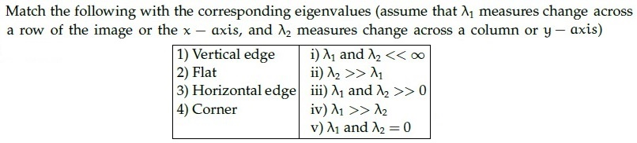

**Figure 1.** Source table for Question 163.

| Feature | Eigenvalue condition |
| :--- | :--- |
| 1) Vertical edge | i) $\lambda_1$ and $\lambda_2 \ll \infty$ |
| 2) Flat | ii) $\lambda_2 \gg \lambda_1$ |
| 3) Horizontal edge | iii) $\lambda_1$ and $\lambda_2 \gg 0$ |
| 4) Corner | iv) $\lambda_1 \gg \lambda_2$ |
| | v) $\lambda_1$ and $\lambda_2 \approx 0$ |

**Options**

**A.** 1→iii, 2 → iv, 3→ i,4→ v  
*Option ID:* `6406532474479`

**B.** 1→ii, 2→i, 3→iv,4→iii  
*Option ID:* `6406532474480`

**C.** 1→iii, 2→i, 3→iv,4→ii  
*Option ID:* `6406532474481`

**D.** 1→iv, 2→i, 3→iii,4→ii  
*Option ID:* `6406532474482`

**Correct answer:** **D** — 1→iv, 2→i, 3→iii,4→ii.  
**Source evidence:** Option 6406532474482 rendered in green font (color 0x8000) with green checkmark icon in source PDF.

---

---

**Source:** `da5006_2024T1_Q1_NA.md` · Quiz 1, 2024T1 · Question 164 · ID `640653739748`  
**Classification:** Week 2 — RANSAC, robust model fitting, inliers, outliers, probability of failure  
**Course evidence:** [## 6. Scale-Invariant Feature Transform (SIFT) & Descriptor Family](/Volumes/1700%20APFS/PERSONAL_PROGRAMMING_PROJECTS/Notes/Deep%20Learning%20for%20Computer%20Vision/month%201/week%202/week-2-report.md) · Related weeks: none

### Question 164

**Question ID:** `640653739748` · **Type:** MCQ · **Marks:** 2  
**PDF pages:** 5

In RANSAC, what is the probability that the algorithm never selects a whole set of inliers from 20 data points (which has 5 inliers in total) for k = 2 time steps? Here, n = 2 is the minimum number of samples to fit a model.

**Options**

**A.** 0.2  
*Option ID:* `6406532474487`

**B.** 0.93  
*Option ID:* `6406532474488`

**C.** 0.87  
*Option ID:* `6406532474489`

**D.** 0  
*Option ID:* `6406532474490`

**Correct answer:** **C** — 0.87.  
**Source evidence:** Option 6406532474489 rendered in green font (color 0x8000) with green checkmark icon in source PDF.

---

---

**Source:** `da5006_2024T1_Q1_NA.md` · Quiz 1, 2024T1 · Question 165 · ID `640653739749`  
**Classification:** Week 2 — Bag-of-Words, SIFT, visual codebook, visual words, histogram descriptor dimensionality  
**Course evidence:** [## 6. Scale-Invariant Feature Transform (SIFT) & Descriptor Family](/Volumes/1700%20APFS/PERSONAL_PROGRAMMING_PROJECTS/Notes/Deep%20Learning%20for%20Computer%20Vision/month%201/week%202/week-2-report.md) · Related weeks: none

### Question 165

**Question ID:** `640653739749` · **Type:** MCQ · **Marks:** 2  
**PDF pages:** 5, 6

Suppose we have a codebook of 2048 SIFT visual words. We extract 1000 SIFT descriptors (SIFT is a 128-dimensional feature) from a new image. What is the dimensionality of the BoW (Bag-of-Words) descriptor?

**Options**

**A.** 1000  
*Option ID:* `6406532474491`

**B.** 128  
*Option ID:* `6406532474492`

**C.** 128 × 2048  
*Option ID:* `6406532474493`

**D.** 2048  
*Option ID:* `6406532474494`

**Correct answer:** **D** — 2048.  
**Source evidence:** Option 6406532474494 rendered in green font (color 0x8000) with green checkmark icon in source PDF.

---

---

**Source:** `da5006_2024T1_Q1_NA.md` · Quiz 1, 2024T1 · Question 168 · ID `640653739741`  
**Classification:** Week 2 — Laplacian of Gaussian, blob detection, gradient localization, corners, hysteresis thresholding, Canny edge detector  
**Course evidence:** [### 2.4 The 4-Stage Canny Algorithmic Pipeline](/Volumes/1700%20APFS/PERSONAL_PROGRAMMING_PROJECTS/Notes/Deep%20Learning%20for%20Computer%20Vision/month%201/week%202/week-2-report.md) · Related weeks: 1

### Question 168

**Question ID:** `640653739741` · **Type:** MSQ · **Marks:** 2  
**PDF pages:** 8

Which of the following statements are True?

**Options**

**A.** LoG Filter is not appropriate to be used for blob detection.  
*Option ID:* `6406532474475`

**B.** Image patches with large contrast changes (gradients) are easier to localize.  
*Option ID:* `6406532474476`

**C.** Gradients in at least two (significantly) different orientations are the hardest (e.g., corners) to detect.  
*Option ID:* `6406532474477`

**D.** In case of ‘Hysteresis Thresholding’, if gradient at a pixel is greater than high threshold that means it is an edge pixel.  
*Option ID:* `6406532474478`

**Correct answer:** **B**, **D** — B, D.  
**Source evidence:** Option B (6406532474476) rendered in green font (color 0x8000) with green checkmark icon in source PDF; Option D (6406532474478) rendered in green font (color 0x8000) with green checkmark icon in source PDF.

---

---

**Source:** `da5006_2024T1_Q1_NA.md` · Quiz 1, 2024T1 · Question 171 · ID `640653739738`  
**Classification:** Week 2 — Local Binary Patterns, LBP descriptor, texture descriptors, handcrafted features  
**Course evidence:** [## 8. Geometric Shape Descriptors: Shape Context & MSER](/Volumes/1700%20APFS/PERSONAL_PROGRAMMING_PROJECTS/Notes/Deep%20Learning%20for%20Computer%20Vision/month%201/week%202/week-2-report.md) · Related weeks: none

### Question 171

**Question ID:** `640653739738` · **Type:** SA · **Marks:** 2  
**PDF pages:** 9, 10

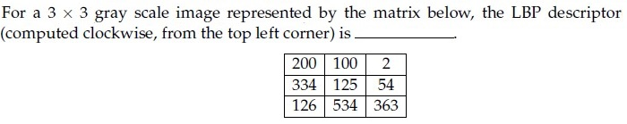

**Figure 2.** Source matrix and question text for Question 171.

For a 3 x 3 gray scale image represented by the matrix below, the LBP descriptor (computed clockwise, from the top left corner) is __

| | | |
| :---: | :---: | :---: |
| 200 | 100 | 2 |
| 334 | 125 | 54 |
| 126 | 534 | 363 |

**Correct answer:** `143`  
**Source evidence:** Official answer '143' in Possible Answers field with green text (color 0x8000).

---

---

**Source:** `da5006_2024T1_Q1_NA.md` · Quiz 1, 2024T1 · Question 172 · ID `640653739739`  
**Classification:** Week 2 — edgelets, second moment matrix, measure of straightness, PCA, eigenvalues, Canny edge detector  
**Course evidence:** [### 3.3 Principal Component Analysis (PCA) of Edgelet Geometry](/Volumes/1700%20APFS/PERSONAL_PROGRAMMING_PROJECTS/Notes/Deep%20Learning%20for%20Computer%20Vision/month%201/week%202/week-2-report.md) · Related weeks: none

### Question 172

**Question ID:** `640653739739` · **Type:** SA · **Marks:** 2  
**PDF pages:** 10

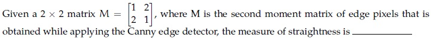

**Figure 3.** Source matrix equation and question text for Question 172.

Given a 2 x 2 matrix $M = \begin{bmatrix} 1 & 2 \\ 2 & 1 \end{bmatrix}$, where M is the second moment matrix of edge pixels that is obtained while applying the Canny edge detector, the measure of straightness is —___

**Correct answer:** `-0.4 to -0.3`  
**Source evidence:** Official accepted answer range '-0.4 to -0.3' in Possible Answers field with green text (color 0x8000).

---

---

**Source:** `da5006_2024T1_Q1_NA.md` · Quiz 1, 2024T1 · Question 173 · ID `640653739740`  
**Classification:** Week 2 — discrete second derivative, Laplacian operator, Laplacian of Gaussian, LoG filter kernel, discrete approximations  
**Course evidence:** [### 3.4 Second Derivatives: The Laplacian of Gaussian (LoG)](/Volumes/1700%20APFS/PERSONAL_PROGRAMMING_PROJECTS/Notes/Deep%20Learning%20for%20Computer%20Vision/month%201/week%202/week-2-report.md) · Related weeks: 1

### Question 173

**Question ID:** `640653739740` · **Type:** SA · **Marks:** 2  
**PDF pages:** 10, 11

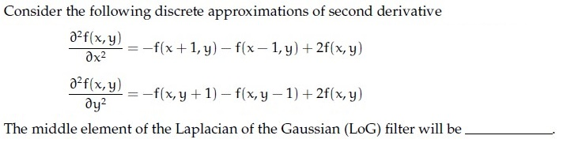

**Figure 4.** Discrete second derivative approximations and question text for Question 173.

Consider the following discrete approximations of second derivative:

$$\frac{\partial^2 F(x, y)}{\partial x^2} = F(x+1, y) - 2F(x, y) + F(x-1, y)$$

$$\frac{\partial^2 F(x, y)}{\partial y^2} = F(x, y+1) - 2F(x, y) + F(x, y-1)$$

The middle element of the Laplacian of the Gaussian (LoG) filter will be

**Correct answer:** `4`  
**Source evidence:** Official answer '4' in Possible Answers field with green text (color 0x8000).

---

---

**Source:** `da5006_2024T1_Q1_NA.md` · Quiz 1, 2024T1 · Question 176 · ID `640653739744`  
**Classification:** Week 2 — shear transformation, affine transformation matrix, homogeneous coordinates, 2D geometric transformations  
**Course evidence:** [### 4.5 Transformation Invariance of the Harris Detector](/Volumes/1700%20APFS/PERSONAL_PROGRAMMING_PROJECTS/Notes/Deep%20Learning%20for%20Computer%20Vision/month%201/week%202/week-2-report.md) · Related weeks: 1

### Question 176

**Question ID:** `640653739744` · **Type:** SA · **Marks:** 0.5  
**PDF pages:** 12, 13

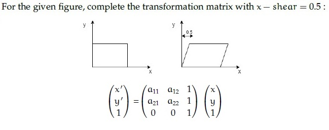

**Figure 5.** Shear transformation diagram and transformation matrix for Questions 176–179.

**Comprehension Context (Questions 176–179):**

> For the given figure, complete the transformation matrix with x — shear = 0.5 :
>
> $$\begin{bmatrix} x' \\ y' \\ 1 \end{bmatrix} = \begin{bmatrix} a_{11} & a_{12} & 0 \\ a_{21} & a_{22} & 0 \\ 0 & 0 & 1 \end{bmatrix} \begin{bmatrix} x \\ y \\ 1 \end{bmatrix}$$
>
> Based on the above data, answer the given subquestions.

$a_{11}$ = ____________

**Correct answer:** `1`  
**Source evidence:** Official answer '1' in Possible Answers field with green text (color 0x8000).

---

---

**Source:** `da5006_2024T1_Q1_NA.md` · Quiz 1, 2024T1 · Question 177 · ID `640653739745`  
**Classification:** Week 2 — shear transformation, affine transformation matrix, homogeneous coordinates, 2D geometric transformations  
**Course evidence:** [### 4.5 Transformation Invariance of the Harris Detector](/Volumes/1700%20APFS/PERSONAL_PROGRAMMING_PROJECTS/Notes/Deep%20Learning%20for%20Computer%20Vision/month%201/week%202/week-2-report.md) · Related weeks: 1

### Question 177

**Question ID:** `640653739745` · **Type:** SA · **Marks:** 0.5  
**PDF pages:** 13, 14

**Comprehension Context (Questions 176–179):**

> For the given figure, complete the transformation matrix with x — shear = 0.5 :
>
> $$\begin{bmatrix} x' \\ y' \\ 1 \end{bmatrix} = \begin{bmatrix} a_{11} & a_{12} & 0 \\ a_{21} & a_{22} & 0 \\ 0 & 0 & 1 \end{bmatrix} \begin{bmatrix} x \\ y \\ 1 \end{bmatrix}$$
>
> Based on the above data, answer the given subquestions.

$a_{12}$ = ____________

**Correct answer:** `0.5`  
**Source evidence:** Official answer '0.5' in Possible Answers field with green text (color 0x8000).

---

---

**Source:** `da5006_2024T1_Q1_NA.md` · Quiz 1, 2024T1 · Question 178 · ID `640653739746`  
**Classification:** Week 2 — shear transformation, affine transformation matrix, homogeneous coordinates, 2D geometric transformations  
**Course evidence:** [### 4.5 Transformation Invariance of the Harris Detector](/Volumes/1700%20APFS/PERSONAL_PROGRAMMING_PROJECTS/Notes/Deep%20Learning%20for%20Computer%20Vision/month%201/week%202/week-2-report.md) · Related weeks: 1

### Question 178

**Question ID:** `640653739746` · **Type:** SA · **Marks:** 0.5  
**PDF pages:** 14

**Comprehension Context (Questions 176–179):**

> For the given figure, complete the transformation matrix with x — shear = 0.5 :
>
> $$\begin{bmatrix} x' \\ y' \\ 1 \end{bmatrix} = \begin{bmatrix} a_{11} & a_{12} & 0 \\ a_{21} & a_{22} & 0 \\ 0 & 0 & 1 \end{bmatrix} \begin{bmatrix} x \\ y \\ 1 \end{bmatrix}$$
>
> Based on the above data, answer the given subquestions.

$a_{21}$ = ____________

**Correct answer:** `0`  
**Source evidence:** Official answer '0' in Possible Answers field with green text (color 0x8000).

---

---

**Source:** `da5006_2024T1_Q1_NA.md` · Quiz 1, 2024T1 · Question 179 · ID `640653739747`  
**Classification:** Week 2 — shear transformation, affine transformation matrix, homogeneous coordinates, 2D geometric transformations  
**Course evidence:** [### 4.5 Transformation Invariance of the Harris Detector](/Volumes/1700%20APFS/PERSONAL_PROGRAMMING_PROJECTS/Notes/Deep%20Learning%20for%20Computer%20Vision/month%201/week%202/week-2-report.md) · Related weeks: 1

### Question 179

**Question ID:** `640653739747` · **Type:** SA · **Marks:** 0.5  
**PDF pages:** 14, 15

**Comprehension Context (Questions 176–179):**

> For the given figure, complete the transformation matrix with x — shear = 0.5 :
>
> $$\begin{bmatrix} x' \\ y' \\ 1 \end{bmatrix} = \begin{bmatrix} a_{11} & a_{12} & 0 \\ a_{21} & a_{22} & 0 \\ 0 & 0 & 1 \end{bmatrix} \begin{bmatrix} x \\ y \\ 1 \end{bmatrix}$$
>
> Based on the above data, answer the given subquestions.

$a_{22}$ = ____________

**Correct answer:** `1`  
**Source evidence:** Official answer '1' in Possible Answers field with green text (color 0x8000).

---

---

**Source:** `da5006_2024T1_Q1_NA.md` · Quiz 1, 2024T1 · Question 180 · ID `640653739752`  
**Classification:** Week 2 — degrees of freedom, translation transformation, 2D geometric transformations, affine transformations  
**Course evidence:** [### 4.5 Transformation Invariance of the Harris Detector](/Volumes/1700%20APFS/PERSONAL_PROGRAMMING_PROJECTS/Notes/Deep%20Learning%20for%20Computer%20Vision/month%201/week%202/week-2-report.md) · Related weeks: none

### Question 180

**Question ID:** `640653739752` · **Type:** SA · **Marks:** 1  
**PDF pages:** 15

**Comprehension Context (Questions 180–181):**

> The degrees of freedom for translation and affine transformations are (a) __________ and (b) ___________ respectively.
>
> Based on the above data, answer the given subquestions.

Enter the correct answer for blank (a) __________.

**Correct answer:** `2`  
**Source evidence:** Official answer '2' in Possible Answers field with green text (color 0x8000).

---

---

**Source:** `da5006_2024T1_Q1_NA.md` · Quiz 1, 2024T1 · Question 181 · ID `640653739753`  
**Classification:** Week 2 — degrees of freedom, affine transformation, 2D geometric transformations  
**Course evidence:** [### 4.5 Transformation Invariance of the Harris Detector](/Volumes/1700%20APFS/PERSONAL_PROGRAMMING_PROJECTS/Notes/Deep%20Learning%20for%20Computer%20Vision/month%201/week%202/week-2-report.md) · Related weeks: none

### Question 181

**Question ID:** `640653739753` · **Type:** SA · **Marks:** 1  
**PDF pages:** 16

**Comprehension Context (Questions 180–181):**

> The degrees of freedom for translation and affine transformations are (a) __________ and (b) ___________ respectively.
>
> Based on the above data, answer the given subquestions.

Enter the correct answer for blank (b) __________.

**Correct answer:** `6`  
**Source evidence:** Official answer '6' in Possible Answers field with green text (color 0x8000).

---

---

**Source:** `da5006_2024T1_ET_AN.md` · End-term, 2024T1 · Question 161 · ID `640653821587`  
**Classification:** Week 2 — Canny Edge Detector, Gaussian Blur, Standard Deviation Parameter σ, Noise Suppression, Differential Edge Detection  
**Course evidence:** [### 2.4 The 4-Stage Canny Algorithmic Pipeline](/Volumes/1700%20APFS/PERSONAL_PROGRAMMING_PROJECTS/Notes/Deep%20Learning%20for%20Computer%20Vision/month%201/week%202/week-2-report.md) · Related weeks: 1

### Question 161

**Question ID:** `640653821587` · **Type:** MCQ · **Marks:** 2  
**PDF pages:** 3, 4

What is the role of the Gaussian blur in the Canny edge detection algorithm, and how does the choice of the standard deviation parameter affect the performance of edge detection? Which option do you think best describes the role of the Gaussian blur and its relationship with the standard deviation parameter in the Canny edge detection algorithm?

**Options**

**A.** The Gaussian blur helps to reduce noise in the image and smooth out pixel intensity variations. The standard deviation parameter controls the amount of blurring applied, with higher values resulting in more aggressive smoothing, which may lead to loss of edge detail.  
*Option ID:* `6406532757292`

**B.** The Gaussian blur enhances edge contrast in the image and amplifies pixel intensity gradients. The standard deviation parameter determines the width of the blur kernel, with larger values resulting in sharper edges and finer details preserved.  
*Option ID:* `6406532757293`

**C.** The Gaussian blur serves to highlight high-frequency components in the image and accentuate edge boundaries. The standard deviation parameter dictates the level of detail preserved, with smaller values preserving finer details but potentially amplifying noise.  
*Option ID:* `6406532757294`

**D.** The Gaussian blur functions to dilate edge regions in the image and expand the edge boundaries. The standard deviation parameter controls the extent of dilation, with higher values resulting in broader edge regions but also increasing the risk of false edge detections.  
*Option ID:* `6406532757295`

**Correct answer:** **A** — The Gaussian blur helps to reduce noise in the image and smooth out pixel intensity variations. The standard deviation parameter controls the amount of blurring applied, with higher values resulting in more aggressive smoothing, which may lead to loss of edge detail..  
**Source evidence:** Option ID 6406532757292 rendered in green text (#008000) and accompanied by checkmark icon (xref 19) at PDF page 4.

---

---

**Source:** `da5006_2024T1_ET_AN.md` · End-term, 2024T1 · Question 162 · ID `640653821588`  
**Classification:** Week 2 — SIFT Descriptor, Scale-Space Representation, Scale Invariance, Local Invariant Descriptors  
**Course evidence:** [### 6.2 Step 1: Scale-Space Extrema Detection](/Volumes/1700%20APFS/PERSONAL_PROGRAMMING_PROJECTS/Notes/Deep%20Learning%20for%20Computer%20Vision/month%201/week%202/week-2-report.md) · Related weeks: none

### Question 162

**Question ID:** `640653821588` · **Type:** MCQ · **Marks:** 2  
**PDF pages:** 4, 5

Which property of the SIFT descriptor is primarily responsible for its resilience to changes in scale, viewpoint, and illumination?

**Options**

**A.** Scale space representation  
*Option ID:* `6406532757296`

**B.** Histogram of gradients  
*Option ID:* `6406532757297`

**C.** Keypoint detection  
*Option ID:* `6406532757298`

**D.** Orientation assignment  
*Option ID:* `6406532757299`

**Correct answer:** **A** — Scale space representation.  
**Source evidence:** Option ID 6406532757296 rendered in green text (#008000) and accompanied by checkmark icon (xref 19) at PDF page 5.

---

---

**Source:** `da5006_2024T1_ET_AN.md` · End-term, 2024T1 · Question 163 · ID `640653821589`  
**Classification:** Week 2 — MSER (Maximally Stable Extremal Regions), Component Trees, Hierarchical Region Representation, Region Stability Analysis  
**Course evidence:** [### 8.2 Maximally Stable Extremal Regions (MSER)](/Volumes/1700%20APFS/PERSONAL_PROGRAMMING_PROJECTS/Notes/Deep%20Learning%20for%20Computer%20Vision/month%201/week%202/week-2-report.md) · Related weeks: none

### Question 163

**Question ID:** `640653821589` · **Type:** MCQ · **Marks:** 2  
**PDF pages:** 5

In the Maximally Stable External Regions (MSER) algorithm, how does the tree structure contribute to the efficiency of region stability analysis?

**Options**

**A.** By enabling quick access to all regions in constant time.  
*Option ID:* `6406532757300`

**B.** By allowing for parallel computation of stability measures across regions.  
*Option ID:* `6406532757301`

**C.** By organizing regions hierarchically based on stability, facilitating efficient stability analysis.  
*Option ID:* `6406532757302`

**D.** By providing a compact representation of pixel intensities within each region, reducing computational overhead.  
*Option ID:* `6406532757303`

**Correct answer:** **C** — By organizing regions hierarchically based on stability, facilitating efficient stability analysis..  
**Source evidence:** Option ID 6406532757302 rendered in green text (#008000) and accompanied by checkmark icon (xref 19) at PDF page 5.

---

---

**Source:** `da5006_2024T1_ET_AN.md` · End-term, 2024T1 · Question 164 · ID `640653821590`  
**Classification:** Week 2 — RANSAC (Random Sample Consensus), Least Squares, Robust Parameter Estimation, Outlier Rejection, Feature Matching  
**Course evidence:** [## 6. Scale-Invariant Feature Transform (SIFT) & Descriptor Family](/Volumes/1700%20APFS/PERSONAL_PROGRAMMING_PROJECTS/Notes/Deep%20Learning%20for%20Computer%20Vision/month%201/week%202/week-2-report.md) · Related weeks: none

### Question 164

**Question ID:** `640653821590` · **Type:** MCQ · **Marks:** 2  
**PDF pages:** 5, 6

In which scenarios is the Random Sample Consensus (RANSAC) algorithm more suitable compared to least squares?

**Options**

**A.** When the dataset contains a high percentage of outliers or erroneous data points.  
*Option ID:* `6406532757304`

**B.** When the dataset consists of noise-free and well-behaved data with minimal outliers.  
*Option ID:* `6406532757305`

**C.** When the computational resources are limited, and quick solutions are required.  
*Option ID:* `6406532757306`

**D.** When the dataset is small, and exact solutions are necessary without considering outliers.  
*Option ID:* `6406532757307`

**Correct answer:** **A** — When the dataset contains a high percentage of outliers or erroneous data points..  
**Source evidence:** Option ID 6406532757304 rendered in green text (#008000) and accompanied by checkmark icon (xref 19) at PDF page 6.

---

---

**Source:** `da5006_2024T1_ET_AN.md` · End-term, 2024T1 · Question 165 · ID `640653821591`  
**Classification:** Week 2 — VLAD (Vector of Locally Aggregated Descriptors), Bag of Words (BoW), Visual Words Codebook, Local Descriptor Aggregation  
**Course evidence:** [## 6. Scale-Invariant Feature Transform (SIFT) & Descriptor Family](/Volumes/1700%20APFS/PERSONAL_PROGRAMMING_PROJECTS/Notes/Deep%20Learning%20for%20Computer%20Vision/month%201/week%202/week-2-report.md) · Related weeks: none

### Question 165

**Question ID:** `640653821591` · **Type:** MCQ · **Marks:** 2  
**PDF pages:** 6

In what way does VLAD (Vector of Locally Aggregated Descriptors) differ from Bag of Words (BoW) in representing visual features in images?

**Options**

**A.** VLAD captures spatial relationships between local descriptors, while BoW does not.  
*Option ID:* `6406532757308`

**B.** BoW captures spatial relationships between local descriptors, while VLAD does not.  
*Option ID:* `6406532757309`

**C.** VLAD and BoW both capture spatial relationships between local descriptors.  
*Option ID:* `6406532757310`

**D.** Neither VLAD nor BoW capture spatial relationships between local descriptors.  
*Option ID:* `6406532757311`

**Correct answer:** **A** — VLAD captures spatial relationships between local descriptors, while BoW does not..  
**Source evidence:** Option ID 6406532757308 rendered in green text (#008000) and accompanied by checkmark icon (xref 19) at PDF page 6.

---

---

**Source:** `da5006_2024T1_ET_AN.md` · End-term, 2024T1 · Question 166 · ID `640653821592`  
**Classification:** Week 2 — Pyramid Matching, SURF (Speeded-Up Robust Features), Multi-Resolution Matching, Scale Invariant Local Descriptors  
**Course evidence:** [### 6.6 The Local Descriptor Family: SIFT vs. GLOH vs. SURF vs. MOPS](/Volumes/1700%20APFS/PERSONAL_PROGRAMMING_PROJECTS/Notes/Deep%20Learning%20for%20Computer%20Vision/month%201/week%202/week-2-report.md) · Related weeks: none

### Question 166

**Question ID:** `640653821592` · **Type:** MCQ · **Marks:** 2  
**PDF pages:** 6, 7

How does pyramid matching differ from Speeded-Up Robust Features (SURF) in image matching?

**Options**

**A.** Pyramid matching matches images at multiple resolutions using multi-resolution representations, while SURF focuses on detecting and describing local features invariant to scale and rotation.  
*Option ID:* `6406532757312`

**B.** SURF relies on gradient-based descriptors for feature matching, whereas pyramid matching utilizes histogram-based representations.  
*Option ID:* `6406532757313`

**C.** Pyramid matching is computationally more efficient compared to SURF, which requires extensive feature extraction and matching procedures.  
*Option ID:* `6406532757314`

**D.** SURF is more suitable for matching images with complex patterns and cluttered backgrounds, while pyramid matching excels in scenarios where multi-scale matching is critical, such as image registration across different resolutions.  
*Option ID:* `6406532757315`

**Correct answer:** **A** — Pyramid matching matches images at multiple resolutions using multi-resolution representations, while SURF focuses on detecting and describing local features invariant to scale and rotation..  
**Source evidence:** Option ID 6406532757312 rendered in green text (#008000) and accompanied by checkmark icon (xref 19) at PDF page 7.

---

---

**Source:** `da5006_2024T1_ET_AN.md` · End-term, 2024T1 · Question 186 · ID `640653821608`  
**Classification:** Week 2 — Harris Corner Detector, Structure Tensor, Cornerness Score R, Second-Moment Matrix, Local Image Gradients  
**Course evidence:** [### 4.4 The Harris Cornerness Response Function $R$](/Volumes/1700%20APFS/PERSONAL_PROGRAMMING_PROJECTS/Notes/Deep%20Learning%20for%20Computer%20Vision/month%201/week%202/week-2-report.md) · Related weeks: 1

### Question 186

**Question ID:** `640653821608` · **Type:** SA · **Marks:** 2  
**PDF pages:** 18

The cornerness score of the center pixel for the image represented by the matrix below is ___

$$\begin{bmatrix} 1 & 0 & 0 & 0 & 1 \\ 0 & 1 & 0 & 1 & 0 \\ 0 & 0 & 1 & 0 & 0 \\ 0 & 1 & 0 & 1 & 0 \\ 1 & 0 & 0 & 0 & 1 \end{bmatrix}$$

NOTE: Enter your answer in two decimal places.

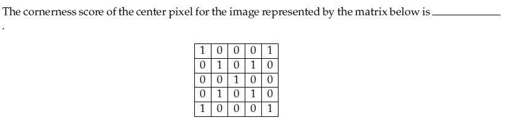

**Figure 6.** Source diagram for Question 186.

**Correct answer:** **6.56**  
**Source evidence:** Possible Answers field indicates 6.56 in green text (#008000) at PDF page 18.

---

---

**Source:** `da5006_2024T1_ET_AN.md` · End-term, 2024T1 · Question 188 · ID `640653821614`  
**Classification:** Week 2 — Difference-of-Gaussians (DoG), Gaussian Scale Space, Octave Construction, SIFT Extrema Detection, Scale Sampling  
**Course evidence:** [### 5.4 Difference of Gaussians (DoG) as an Efficient Approximation](/Volumes/1700%20APFS/PERSONAL_PROGRAMMING_PROJECTS/Notes/Deep%20Learning%20for%20Computer%20Vision/month%201/week%202/week-2-report.md) · Related weeks: 1

### Question 188

**Question ID:** `640653821614` · **Type:** SA · **Marks:** 2  
**PDF pages:** 19, 20

Assume that you have been given an octave of scale-space representation of an image of size N x N that has been formed by convolving it with a Gaussian filter at different scales of $\sigma$, where $\sigma$ is varied from $k^0\sigma$ to $k^{s+2}\sigma$ and $k = 2^{1/s}$. The number of DoG (Difference-of-Gaussian) outputs obtained from the above octave is __.

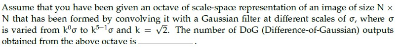

**Figure 7.** Source diagram for Question 188.

**Correct answer:** **4**  
**Source evidence:** Possible Answers field indicates 4 in green text (#008000) at PDF page 20.

---

---

**Source:** `da5006_2024T2_Q1_NA.md` · Quiz 1, 2024T2 · Question 87 · ID `640653829654`  
**Classification:** Week 2 — SIFT, scale-space extrema detection, keypoint localization, orientation assignment, keypoint descriptor  
**Course evidence:** [### 6.1 Lowe's SIFT Pipeline (IJCV 2004)](/Volumes/1700%20APFS/PERSONAL_PROGRAMMING_PROJECTS/Notes/Deep%20Learning%20for%20Computer%20Vision/month%201/week%202/week-2-report.md) · Related weeks: none

### Question 87

**Question ID:** `640653829654` · **Type:** MCQ · **Marks:** 2  
**PDF pages:** 6

Identify the correct sequence of steps in Scale Invariant Feature Transform (SIFT) method. Steps listed below:  

1. Keypoint Descriptor  
2. Keypoint Localization  
3. Scale-space Extrema Detection  
4. Orientation Estimation

**Options**

**A.** 4→ 2→ 1→ 3  
*Option ID:* `6406532786662`

**B.** 3→ 2→ 4→ 1  
*Option ID:* `6406532786663`

**C.** 3→ 1→ 2→ 4  
*Option ID:* `6406532786664`

**D.** None of these  
*Option ID:* `6406532786665`

**Correct answer:** **B** — 3→ 2→ 4→ 1.  
**Source evidence:** Green check mark icon beside Option B on PDF page 6 (y=431.8); red cross icons beside Option A (y=411.0), Option C (y=452.6), and Option D (y=473.4).

---

---

**Source:** `da5006_2024T2_Q1_NA.md` · Quiz 1, 2024T2 · Question 88 · ID `640653829655`  
**Classification:** Week 2 — SIFT stages, Difference of Gaussians (DoG), keypoint localization, orientation assignment, local gradient descriptor  
**Course evidence:** [### 6.1 Lowe's SIFT Pipeline (IJCV 2004)](/Volumes/1700%20APFS/PERSONAL_PROGRAMMING_PROJECTS/Notes/Deep%20Learning%20for%20Computer%20Vision/month%201/week%202/week-2-report.md) · Related weeks: none

### Question 88

**Question ID:** `640653829655` · **Type:** MCQ · **Marks:** 2  
**PDF pages:** 6

Match the Following:  

| Left Column | Right Column |
| :--- | :--- |
| 1) Keypoint Descriptor | i) Assign orientation to each local keypoint using image gradients |
| 2) Keypoint Localization | ii) Extract local image gradients at selected scale around keypoint |
| 3) Scale-space Extrema Detection | iii) Determine location and scale at each candidate location |
| 4) Orientation Estimation | iv) Detect interesting points using DOG. |

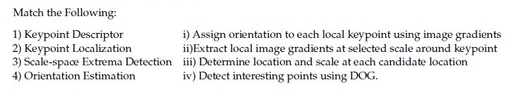

**Figure 8.** Source matching table for Question 88.

**Options**

**A.** 1→iii, 2 → ii , 3→ i , 4 → iv  
*Option ID:* `6406532786666`

**B.** 1→iv, 2→ i , 3 → ii , 4→ iii  
*Option ID:* `6406532786667`

**C.** 1→ii, 2 → iii , 3→ iv , 4→ i  
*Option ID:* `6406532786668`

**D.** None of these  
*Option ID:* `6406532786669`

**Correct answer:** **C** — 1→ii, 2 → iii , 3→ iv , 4→ i.  
**Source evidence:** Green check mark icon beside Option C on PDF page 6 (y=741.8); red cross icons beside Option A (y=700.1), Option B (y=720.9), and Option D (y=762.6).

---

---

**Source:** `da5006_2024T2_Q1_NA.md` · Quiz 1, 2024T2 · Question 89 · ID `640653829663`  
**Classification:** Week 2 — Harris corner detector, structure tensor, local image gradients, aperture problem, corner detection  
**Course evidence:** [### 4.1 The Aperture Problem: Why Edges Are Insufficient for Alignment](/Volumes/1700%20APFS/PERSONAL_PROGRAMMING_PROJECTS/Notes/Deep%20Learning%20for%20Computer%20Vision/month%201/week%202/week-2-report.md) · Related weeks: 1

### Question 89

**Question ID:** `640653829663` · **Type:** MCQ · **Marks:** 2  
**PDF pages:** 6–7

Match the Following:  

| Left Column | Right Column |
| :--- | :--- |
| 1) Flat region in the image | i) No Change along the edge direction |
| 2) Edge pixel | ii) Significant change in all directions |
| 3) Corner pixel | iii) No Change in all directions |

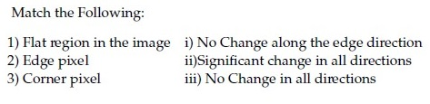

**Figure 9.** Source matching table for Question 89.

**Options**

**A.** 1→ iii, 2→ i, 3 → ii  
*Option ID:* `6406532786675`

**B.** 1→ iii, 2→ ii, 3 → i  
*Option ID:* `6406532786676`

**C.** 1→ ii, 2→ iii, 3 → i  
*Option ID:* `6406532786677`

**D.** None of these  
*Option ID:* `6406532786678`

**Correct answer:** **A** — 1→ iii, 2→ i, 3 → ii.  
**Source evidence:** Green check mark icon beside Option A on PDF page 7 (y=169.0); red cross icons beside Option B (y=189.8), Option C (y=210.7), and Option D (y=231.5).

---

---

**Source:** `da5006_2024T2_Q1_NA.md` · Quiz 1, 2024T2 · Question 90 · ID `640653829669`  
**Classification:** Week 2 — RANSAC, robust model fitting, inliers, outliers, probability of failure  
**Course evidence:** [## 6. Scale-Invariant Feature Transform (SIFT) & Descriptor Family](/Volumes/1700%20APFS/PERSONAL_PROGRAMMING_PROJECTS/Notes/Deep%20Learning%20for%20Computer%20Vision/month%201/week%202/week-2-report.md) · Related weeks: none

### Question 90

**Question ID:** `640653829669` · **Type:** MCQ · **Marks:** 2  
**PDF pages:** 7

In RANSAC, what is the probability that the algorithm never selects a whole set of inliers from 20 data points (which has 5 inliers in total) for k = 2 time steps? Here, n = 2 is the minimum number of samples to fit a model.

**Options**

**A.** 0.2  
*Option ID:* `6406532786683`

**B.** 0.93  
*Option ID:* `6406532786684`

**C.** 0.87  
*Option ID:* `6406532786685`

**D.** 0  
*Option ID:* `6406532786686`

**Correct answer:** **C** — 0.87.  
**Source evidence:** Green check mark icon beside Option C on PDF page 7 (y=447.0); red cross icons beside Option A (y=405.4), Option B (y=426.2), and Option D (y=467.8).

---

---

**Source:** `da5006_2024T2_Q1_NA.md` · Quiz 1, 2024T2 · Question 91 · ID `640653829670`  
**Classification:** Week 2 — Bag of Visual Words (BoW), visual vocabulary codebook, SIFT descriptor, feature histogram dimensionality  
**Course evidence:** [## 6. Scale-Invariant Feature Transform (SIFT) & Descriptor Family](/Volumes/1700%20APFS/PERSONAL_PROGRAMMING_PROJECTS/Notes/Deep%20Learning%20for%20Computer%20Vision/month%201/week%202/week-2-report.md) · Related weeks: none

### Question 91

**Question ID:** `640653829670` · **Type:** MCQ · **Marks:** 2  
**PDF pages:** 7

Suppose we have a codebook of 2048 SIFT visual words. We extract 1000 SIFT descriptors (SIFT is a 128-dimensional feature) from a new image. What is the dimensionality of the BoW (Bag-of-Words) descriptor?

**Options**

**A.** 1000  
*Option ID:* `6406532786687`

**B.** 128  
*Option ID:* `6406532786688`

**C.** 128 × 2048  
*Option ID:* `6406532786689`

**D.** 2048  
*Option ID:* `6406532786690`

**Correct answer:** **D** — 2048.  
**Source evidence:** Green check mark icon beside Option D on PDF page 7 (y=704.2); red cross icons beside Option A (y=641.7), Option B (y=662.5), and Option C (y=683.3).

---

---

**Source:** `da5006_2024T2_Q1_NA.md` · Quiz 1, 2024T2 · Question 96 · ID `640653829653`  
**Classification:** Week 2 — edgelet representation, second moment matrix, Canny edge detector, straightness metric, PCA eigendecomposition  
**Course evidence:** [### 3.3 Principal Component Analysis (PCA) of Edgelet Geometry](/Volumes/1700%20APFS/PERSONAL_PROGRAMMING_PROJECTS/Notes/Deep%20Learning%20for%20Computer%20Vision/month%201/week%202/week-2-report.md) · Related weeks: none

### Question 96

**Question ID:** `640653829653` · **Type:** SA · **Marks:** 2  
**PDF pages:** 9

Given a 2 × 2 matrix $M = \begin{bmatrix} 1 & 2 \\ 2 & 1 \end{bmatrix}$ where $M$ is the second moment matrix of edge pixels that is obtained while applying the Canny edge detector, the measure of straightness is —____  

NOTE: Enter your answer in two decimal places.

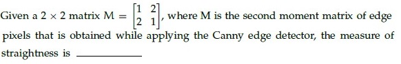

**Figure 10.** Source question stem for Question 96.

**Correct answer:** `-0.33`  
**Source evidence:** Explicit official answer in `Possible Answers: -0.33` on PDF page 9.

---

---

**Source:** `da5006_2024T2_Q1_NA.md` · Quiz 1, 2024T2 · Question 101 · ID `640653829657`  
**Classification:** Week 2 — image gradient, image derivatives, differential edge detection, high frequency accentuation, frequency response  
**Course evidence:** [### 2.2 Mathematical Edge Modeling & Derivative Operators](/Volumes/1700%20APFS/PERSONAL_PROGRAMMING_PROJECTS/Notes/Deep%20Learning%20for%20Computer%20Vision/month%201/week%202/week-2-report.md) · Related weeks: 1

### Question 101

**Question ID:** `640653829657` · **Type:** SA · **Marks:** 2  
**PDF pages:** 11–12

**Context:** The gradient of an image I, points in the direction of most rapid change in intensity, taking image derivatives accentuates (a) ____ frequencies and hence amplifies noise, since the proportion of noise to signal is larger at (b) frequencies. The solution to this is (c) ______ the image prior to computing gradients.  
Based on the above data, answer the given subquestions.

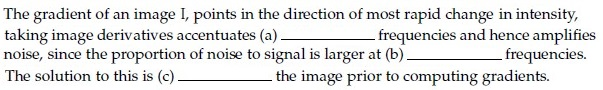

**Figure 11.** Source comprehension passage for Questions 101–103.

**Subquestion:** Fill in the blank for (a)_____________________

**Correct answer:** `high`  
**Source evidence:** Explicit official answer in `Possible Answers: high` on PDF page 12.

---

---

**Source:** `da5006_2024T2_Q1_NA.md` · Quiz 1, 2024T2 · Question 102 · ID `640653829658`  
**Classification:** Week 2 — noise amplification, high frequency noise, signal to noise ratio, image gradient, differential operators  
**Course evidence:** [## 2. Differential Edge Detection & The Canny Optimization Pipeline](/Volumes/1700%20APFS/PERSONAL_PROGRAMMING_PROJECTS/Notes/Deep%20Learning%20for%20Computer%20Vision/month%201/week%202/week-2-report.md) · Related weeks: 1

### Question 102

**Question ID:** `640653829658` · **Type:** SA · **Marks:** 1  
**PDF pages:** 11–12

**Context:** The gradient of an image I, points in the direction of most rapid change in intensity, taking image derivatives accentuates (a) ____ frequencies and hence amplifies noise, since the proportion of noise to signal is larger at (b) frequencies. The solution to this is (c) ______ the image prior to computing gradients.  
Based on the above data, answer the given subquestions.

**Subquestion:** Fill in the blank for (b) _____________________

**Correct answer:** `high`  
**Source evidence:** Explicit official answer in `Possible Answers: high` on PDF page 12.

---

---

**Source:** `da5006_2024T2_Q1_NA.md` · Quiz 1, 2024T2 · Question 103 · ID `640653829659`  
**Classification:** Week 2 — image smoothing, Gaussian smoothing, noise suppression, edge detection pipeline, gradient filtering  
**Course evidence:** [### 2.2 Mathematical Edge Modeling & Derivative Operators](/Volumes/1700%20APFS/PERSONAL_PROGRAMMING_PROJECTS/Notes/Deep%20Learning%20for%20Computer%20Vision/month%201/week%202/week-2-report.md) · Related weeks: 1

### Question 103

**Question ID:** `640653829659` · **Type:** SA · **Marks:** 1  
**PDF pages:** 11–13

**Context:** The gradient of an image I, points in the direction of most rapid change in intensity, taking image derivatives accentuates (a) ____ frequencies and hence amplifies noise, since the proportion of noise to signal is larger at (b) frequencies. The solution to this is (c) ______ the image prior to computing gradients.  
Based on the above data, answer the given subquestions.

**Subquestion:** Fill in the blank for (c) _____________________

**Correct answer:** `smooth`  
**Source evidence:** Explicit official answer in `Possible Answers: smooth` on PDF page 13.

---

---

**Source:** `da5006_2024T2_Q1_NA.md` · Quiz 1, 2024T2 · Question 104 · ID `640653829661`  
**Classification:** Week 2 — Canny edge detector, Gaussian kernel spread sigma, scale space, coarse edges, scale selection  
**Course evidence:** [### 2.3 John Canny's Optimal Edge Detector (1986)](/Volumes/1700%20APFS/PERSONAL_PROGRAMMING_PROJECTS/Notes/Deep%20Learning%20for%20Computer%20Vision/month%201/week%202/week-2-report.md) · Related weeks: none

### Question 104

**Question ID:** `640653829661` · **Type:** SA · **Marks:** 2  
**PDF pages:** 13

**Context:** In Canny edge detection, large value of the Gaussian kernel spread, $\sigma$ leads to (a) edges, and small value of $\sigma$ leads to (b) edges.  
Based on the above data, answer the given subquestions.

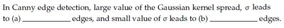

**Figure 12.** Source comprehension passage for Questions 104–105.

**Subquestion:** Fill in the blank for (a):

**Correct answer:** `thick` (accepted alternatives: `coarse`, `large scale`)  
**Source evidence:** Explicit official accepted answer set in `Possible Answers: thick / coarse / large scale` on PDF page 13.

---

---

**Source:** `da5006_2024T2_Q1_NA.md` · Quiz 1, 2024T2 · Question 105 · ID `640653829662`  
**Classification:** Week 2 — Canny edge detector, Gaussian kernel spread sigma, scale space, fine edges, scale selection  
**Course evidence:** [### 2.3 John Canny's Optimal Edge Detector (1986)](/Volumes/1700%20APFS/PERSONAL_PROGRAMMING_PROJECTS/Notes/Deep%20Learning%20for%20Computer%20Vision/month%201/week%202/week-2-report.md) · Related weeks: none

### Question 105

**Question ID:** `640653829662` · **Type:** SA · **Marks:** 2  
**PDF pages:** 13–14

**Context:** In Canny edge detection, large value of the Gaussian kernel spread, $\sigma$ leads to (a) edges, and small value of $\sigma$ leads to (b) edges.  
Based on the above data, answer the given subquestions.

**Subquestion:** Fill in the blank for (b):

**Correct answer:** `fine`  
**Source evidence:** Explicit official answer in `Possible Answers: fine` on PDF page 14.

---

---

**Source:** `da5006_2024T2_ET_AN.md` · End-term, 2024T2 · Question 249 · ID `640653904300`  
**Classification:** Week 2 — Canny edge detector, Gaussian blur, smoothing parameter sigma, noise suppression, edge detail loss  
**Course evidence:** [### 2.4 The 4-Stage Canny Algorithmic Pipeline](/Volumes/1700%20APFS/PERSONAL_PROGRAMMING_PROJECTS/Notes/Deep%20Learning%20for%20Computer%20Vision/month%201/week%202/week-2-report.md) · Related weeks: 1

### Question 249

**Question ID:** `640653904300` · **Type:** MCQ · **Marks:** 2  
**PDF pages:** 2

What is the role of the Gaussian blur in the Canny edge detection algorithm, and how does the choice of the standard deviation parameter affect the performance of edge detection? Which option do you think best describes the role of the Gaussian blur and its relationship with the standard deviation parameter in the Canny edge detection algorithm?

**Options**

**A.** The Gaussian blur helps to reduce noise in the image and smooth out pixel intensity variations.The standard deviation parameter controls the amount of blurring applied, with higher values resulting in more aggressive smoothing, which may lead to loss of edge detail.  
*Option ID:* `6406533045014`

**B.** The Gaussian blur enhances edge contrast in the image and amplifies pixel intensity gradients. The standard deviation parameter determines the width of the blur kernel, with larger values resulting in sharper edges and finer details preserved.  
*Option ID:* `6406533045015`

**C.** The Gaussian blur serves to highlight high-frequency components in the image and accentuate edge boundaries. The standard deviation parameter dictates the level of detail preserved, with smaller values preserving finer details but potentially amplifying noise.  
*Option ID:* `6406533045016`

**D.** The Gaussian blur functions to dilate edge regions in the image and expand the edge boundaries.The standard deviation parameter controls the extent of dilation, with higher values resulting in broader edge regions but also increasing the risk of false edge detections.  
*Option ID:* `6406533045017`

**Correct answer:** **A** — The Gaussian blur helps to reduce noise in the image and smooth out pixel intensity variations.The standard deviation parameter controls the amount of blurring applied, with higher values resulting in more aggressive smoothing, which may lead to loss of edge detail.  
**Source evidence:** Option 6406533045014 is rendered in green text (#008000) with a checkmark icon. (PDF page 2).

---

---

**Source:** `da5006_2024T2_ET_AN.md` · End-term, 2024T2 · Question 250 · ID `640653904302`  
**Classification:** Week 2 — image gradients, partial derivatives, gradient vector, gradient orientation angle, edge direction  
**Course evidence:** [## 2. Differential Edge Detection & The Canny Optimization Pipeline](/Volumes/1700%20APFS/PERSONAL_PROGRAMMING_PROJECTS/Notes/Deep%20Learning%20for%20Computer%20Vision/month%201/week%202/week-2-report.md) · Related weeks: 1

### Question 250

**Question ID:** `640653904302` · **Type:** MCQ · **Marks:** 2  
**PDF pages:** 2, 3

Consider the following orientation of edges s:

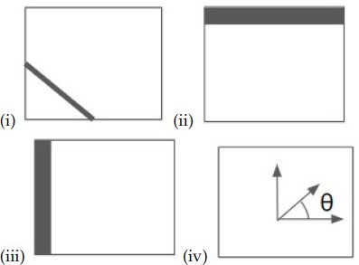

**Figure 13.** Source diagram of edge orientations for Question 250.

Choose the correct matching:

**Options**

**A.** (i) = tan⁻¹((∂f/∂y) / (∂f/∂x)), (ii) = (∂f/∂x, 0), (iii) = (0, ∂f/∂y), (iv) = (∂f/∂x, ∂f/∂y)  
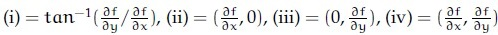

**Figure 14.** Option A image for Question 250.
*Option ID:* `6406533045019`

**B.** (i) = tan⁻¹((∂f/∂y) / (∂f/∂x)), (ii) = (0, ∂f/∂y), (iii) = (∂f/∂x, 0), (iv) = (∂f/∂x, ∂f/∂y)  
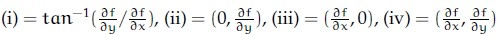

**Figure 15.** Option B image for Question 250.
*Option ID:* `6406533045020`

**C.** (i) = (∂f/∂x, ∂f/∂y), (ii) = (∂f/∂x, 0), (iii) = (0, ∂f/∂y), (iv) = tan⁻¹((∂f/∂y) / (∂f/∂x))  
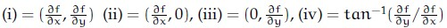

**Figure 16.** Option C image for Question 250.
*Option ID:* `6406533045021`

**D.** (i) = (∂f/∂x, ∂f/∂y), (ii) = (0, ∂f/∂y), (iii) = (∂f/∂x, 0), (iv) = tan⁻¹((∂f/∂y) / (∂f/∂x))  
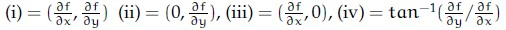

**Figure 17.** Option D image for Question 250.
*Option ID:* `6406533045022`

**Correct answer:** **D** — (i) = (∂f/∂x, ∂f/∂y), (ii) = (0, ∂f/∂y), (iii) = (∂f/∂x, 0), (iv) = tan⁻¹((∂f/∂y) / (∂f/∂x))  
**Source evidence:** Option 6406533045022 is rendered with green label (#008000) and checkmark icon. (PDF page 3).

---

---

**Source:** `da5006_2024T2_ET_AN.md` · End-term, 2024T2 · Question 251 · ID `640653904303`  
**Classification:** Week 2 — Gaussian filter, Sobel filter, first derivative of Gaussian, second derivative of Gaussian, zero crossings, edge detection  
**Course evidence:** [### 2.2 Mathematical Edge Modeling & Derivative Operators](/Volumes/1700%20APFS/PERSONAL_PROGRAMMING_PROJECTS/Notes/Deep%20Learning%20for%20Computer%20Vision/month%201/week%202/week-2-report.md) · Related weeks: 1

### Question 251

**Question ID:** `640653904303` · **Type:** MCQ · **Marks:** 2  
**PDF pages:** 3, 4

Match the following:

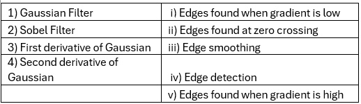

**Figure 18.** Source matching table of filters and edge properties for Question 251.

| Filter | Edge property |
| :--- | :--- |
| 1) Gaussian Filter | i) Edges found when gradient is low |
| 2) Sobel Filter | ii) Edges found at zero crossing |
| 3) First derivative of Gaussian | iii) Edge smoothing |
| 4) Second derivative of Gaussian | iv) Edge detection |
| | v) Edges found when gradient is high |

**Options**

**A.** 1→ iii, 2→ iv, 3 →i, 4 → ii  
*Option ID:* `6406533045023`

**B.** 1→ iii, 2→ i, 3 → ii, 4 → v  
*Option ID:* `6406533045024`

**C.** 1→ iii, 2→ iv, 3 →v, 4 → ii  
*Option ID:* `6406533045025`

**D.** 1→ iv, 2→ iii, 3 → i, 4→ ii  
*Option ID:* `6406533045026`

**Correct answer:** **C** — 1→ iii, 2→ iv, 3 →v, 4 → ii  
**Source evidence:** Option 6406533045025 is rendered in green text (#008000) with a checkmark icon. (PDF page 3).

---

---

**Source:** `da5006_2024T2_ET_AN.md` · End-term, 2024T2 · Question 254 · ID `640653904306`  
**Classification:** Week 2 — SIFT algorithm, scale-space extrema detection, Taylor series keypoint localization, Hessian edge rejection, orientation assignment, keypoint descriptor  
**Course evidence:** [## 6. Scale-Invariant Feature Transform (SIFT) & Descriptor Family](/Volumes/1700%20APFS/PERSONAL_PROGRAMMING_PROJECTS/Notes/Deep%20Learning%20for%20Computer%20Vision/month%201/week%202/week-2-report.md) · Related weeks: none

### Question 254

**Question ID:** `640653904306` · **Type:** MCQ · **Marks:** 2  
**PDF pages:** 4, 5

Which of the following is the correct sequence of steps of the SIFT algorithm? 
1. Using the Taylor series expansion of the scale-space function, localize the key points. 
2. Estimate the orientation of keypoints using the local image gradients. 
3. Find the edge points using the eigenvalues of the Hessian and reject these points. 
4. Find a raw SIFT descriptor vector using the gradient orientations of the neighborhood around the key points. 
5. Detect extreme points in scale space using an approximation of the Laplacian of Gaussian.

**Options**

**A.** 5, 2, 1, 3, 4  
*Option ID:* `6406533045035`

**B.** 5, 1, 3, 2, 4  
*Option ID:* `6406533045036`

**C.** 1, 3, 2, 4, 5  
*Option ID:* `6406533045037`

**D.** 1, 5, 3, 2, 4  
*Option ID:* `6406533045038`

**Correct answer:** **B** — 5, 1, 3, 2, 4  
**Source evidence:** Option 6406533045036 is rendered in green text (#008000) with a checkmark icon. (PDF page 5).

---

---

**Source:** `da5006_2024T2_ET_AN.md` · End-term, 2024T2 · Question 260 · ID `640653904301`  
**Classification:** Week 2 — Difference of Gaussians (DoG), scale space octave, Gaussian scales, SIFT detector, scale-space pyramid  
**Course evidence:** [### 5.4 Difference of Gaussians (DoG) as an Efficient Approximation](/Volumes/1700%20APFS/PERSONAL_PROGRAMMING_PROJECTS/Notes/Deep%20Learning%20for%20Computer%20Vision/month%201/week%202/week-2-report.md) · Related weeks: 1

### Question 260

**Question ID:** `640653904301` · **Type:** SA · **Marks:** 2  
**PDF pages:** 7

Assume that you have been given an octave of scale-space representation of an image of size $N \times N$ that has been formed by convolving it with a Gaussian filter at different scales of $\sigma$, where $\sigma$ is varied from $k^0 \sigma_0$ to $k^4 \sigma_0$ and $k = \sqrt{2}$. The number of DoG (Difference-of-Gaussian) outputs obtained from the above octave is

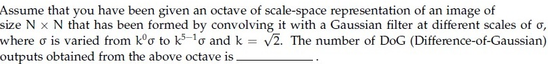

**Figure 19.** Source problem statement for Question 260.

**Correct answer:** `4`  
**Source evidence:** Official text specification: 'Possible Answers : 4'. (PDF page 7).

---

---

**Source:** `da5006_2024T3_Q1_NA.md` · Quiz 1, 2024T3 · Question 148 · ID `640653994490`  
**Classification:** Week 2 — sift_descriptor, scale_space_extrema, keypoint_localization, orientation_assignment, feature_descriptors  
**Course evidence:** [6.1 Lowe's SIFT Pipeline (IJCV 2004)](/Volumes/1700%20APFS/PERSONAL_PROGRAMMING_PROJECTS/Notes/Deep%20Learning%20for%20Computer%20Vision/month%201/week%202/week-2-report.md) · Related weeks: none

### Question 148

**Question ID:** `640653994490` · **Type:** MCQ · **Marks:** 2  
**PDF pages:** 3

Identify the correct sequence of steps in Scale Invariant Feature Transform (SIFT) method. Steps listed below:

1. Keypoint Descriptor
2. Keypoint Localization
3. Scale-space Extrema Detection
4. Orientation Estimation

**Options**

**A.** 4→ 2→ 1→ 3  
*Option ID:* `6406533358229`

**B.** 3→ 2→ 4→ 1  
*Option ID:* `6406533358230`

**C.** 3→ 1→ 2→ 4  
*Option ID:* `6406533358231`

**D.** None of these.  
*Option ID:* `6406533358232`

**Correct answer:** **B** — 3→ 2→ 4→ 1.  
**Source evidence:** Option B (Option ID 6406533358230) is marked with green text and a checkmark icon in the source PDF.

---

---

**Source:** `da5006_2024T3_Q1_NA.md` · Quiz 1, 2024T3 · Question 149 · ID `640653994498`  
**Classification:** Week 2 — harris_corner_detector, structure_tensor, aperture_problem, eigenvalue_analysis, interest_point_localization  
**Course evidence:** [4.1 The Aperture Problem: Why Edges Are Insufficient for Alignment](/Volumes/1700%20APFS/PERSONAL_PROGRAMMING_PROJECTS/Notes/Deep%20Learning%20for%20Computer%20Vision/month%201/week%202/week-2-report.md) · Related weeks: none

### Question 149

**Question ID:** `640653994498` · **Type:** MCQ · **Marks:** 2  
**PDF pages:** 3

Match the Following:

1) Flat region in the image — i) No Change along the edge direction  
2) Edge pixel — ii) Significant change in all directions  
3) Corner pixel — iii) No Change in all directions

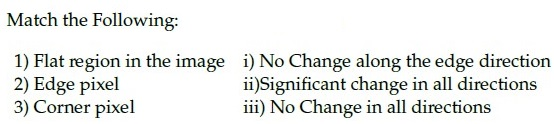

**Figure 20.** Matching table for Question 149.

**Options**

**A.** 1→ iii, 2→ i, 3 → ii  
*Option ID:* `6406533358238`

**B.** 1→ iii, 2→ ii, 3 → i  
*Option ID:* `6406533358239`

**C.** 1→ ii, 2→ iii, 3 → i  
*Option ID:* `6406533358240`

**D.** None of these.  
*Option ID:* `6406533358241`

**Correct answer:** **A** — 1→ iii, 2→ i, 3 → ii.  
**Source evidence:** Option A (Option ID 6406533358238) is marked with green text and a checkmark icon in the source PDF.

---

---

**Source:** `da5006_2024T3_Q1_NA.md` · Quiz 1, 2024T3 · Question 158 · ID `640653994492`  
**Classification:** Week 2 — image_derivatives, differential_edge_detection, high_frequency_accentuation, frequency_response  
**Course evidence:** [2.2 Mathematical Edge Modeling & Derivative Operators](/Volumes/1700%20APFS/PERSONAL_PROGRAMMING_PROJECTS/Notes/Deep%20Learning%20for%20Computer%20Vision/month%201/week%202/week-2-report.md) · Related weeks: 1

### Question 158

**Question ID:** `640653994492` · **Type:** SA · **Marks:** 0.5  
**PDF pages:** 7–8

**Comprehension Context (Questions 158 to 160):**

The gradient of an image I, points in the direction of most rapid change in intensity, taking image derivatives accentuates (a) ____________ frequencies and hence amplifies noise, since the proportion of noise to signal is larger at (b) __________ frequencies. The solution to this is (c) _________ the image prior to computing gradients.

Based on the above data, answer the given subquestions.

**Subquestion:**

Enter the correct answer for (a).

NOTE: Enter the exact answer without any space in the beginning or at the end.

Response Type : Alphanumeric  
Answers Type : Equal  
Answers Case Sensitive : No

**Correct answer:** high  
**Source evidence:** Official Possible Answers field displays 'high' in green text on page 8.

---

---

**Source:** `da5006_2024T3_Q1_NA.md` · Quiz 1, 2024T3 · Question 160 · ID `640653994494`  
**Classification:** Week 2 — image_smoothing, gaussian_filter, noise_suppression, edge_detection_pipeline  
**Course evidence:** [2.2 Mathematical Edge Modeling & Derivative Operators](/Volumes/1700%20APFS/PERSONAL_PROGRAMMING_PROJECTS/Notes/Deep%20Learning%20for%20Computer%20Vision/month%201/week%202/week-2-report.md) · Related weeks: 1

### Question 160

**Question ID:** `640653994494` · **Type:** SA · **Marks:** 1  
**PDF pages:** 8

*(Context: Refer to Comprehension passage above Question 158)*

Enter the correct answer for (c).

NOTE: Enter the exact answer without any space in the beginning or at the end.

Response Type : Alphanumeric  
Answers Type : Equal  
Answers Case Sensitive : No

**Correct answer:** smooth  
**Source evidence:** Official Possible Answers field displays 'smooth' in green text on page 8.

---

---

**Source:** `da5006_2024T3_Q1_NA.md` · Quiz 1, 2024T3 · Question 161 · ID `640653994496`  
**Classification:** Week 2 — canny_edge_detector, gaussian_scale_parameter, coarse_scale_edges, scale_selection  
**Course evidence:** [2.4 The 4-Stage Canny Algorithmic Pipeline](/Volumes/1700%20APFS/PERSONAL_PROGRAMMING_PROJECTS/Notes/Deep%20Learning%20for%20Computer%20Vision/month%201/week%202/week-2-report.md) · Related weeks: none

### Question 161

**Question ID:** `640653994496` · **Type:** SA · **Marks:** 1  
**PDF pages:** 8–9

**Comprehension Context (Questions 161 to 162):**

In Canny edge detection, large value of the Gaussian kernel spread, $\sigma$ leads to (a) __________ edges, and small value of $\sigma$ leads to (b) __________ edges.

Based on the above data, answer the given subquestions.

**Subquestion:**

Enter the correct answer for (a).

NOTE: Enter the exact answer without any space in the beginning or at the end.

Response Type : Alphanumeric  
Answers Type : Set  
Answers Case Sensitive : No

**Correct answer:** thick (Accepted alternatives: coarse, large scale)  
**Source evidence:** Official Possible Answers set contains 'thick', 'coarse', and 'large scale' in green text on page 9.

---

---

**Source:** `da5006_2024T3_Q1_NA.md` · Quiz 1, 2024T3 · Question 170 · ID `640653994489`  
**Classification:** Week 2 — edgelet_representation, second_moment_matrix, canny_edge_detector, straightness_metric, pca_eigendecomposition  
**Course evidence:** [3.3 Principal Component Analysis (PCA) of Edgelet Geometry](/Volumes/1700%20APFS/PERSONAL_PROGRAMMING_PROJECTS/Notes/Deep%20Learning%20for%20Computer%20Vision/month%201/week%202/week-2-report.md) · Related weeks: none

### Question 170

**Question ID:** `640653994489` · **Type:** SA · **Marks:** 2  
**PDF pages:** 13

Given a 2 × 2 matrix $M = \begin{bmatrix} E & F \\ F & G \end{bmatrix}$ where $M$ is the second moment matrix of edge pixels that is obtained while applying the Canny edge detector, the measure of straightness is _________

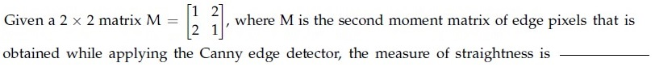

**Figure 21.** Second moment matrix definition for Question 170.

Response Type : Numeric  
Answers Type : Range

**Correct answer:** -0.34 to -0.29  
**Source evidence:** Official Possible Answers range displays '-0.34 to -0.29' in green text on page 13.

---

---

**Source:** `da5006_2024T3_ET_AN.md` · End-term, 2024T3 · Question 206 · ID `6406531046064`  
**Classification:** Week 2 — Gaussian filter, Sobel filter, first derivative of Gaussian, second derivative of Gaussian, Laplacian of Gaussian, zero crossings, edge smoothing vs detection  
**Course evidence:** [2. Differential Edge Detection & The Canny Optimization Pipeline](/Volumes/1700%20APFS/PERSONAL_PROGRAMMING_PROJECTS/Notes/Deep%20Learning%20for%20Computer%20Vision/month%201/week%202/week-2-report.md) · Related weeks: 1

### Question 206

**Question ID:** `6406531046064` · **Type:** Multiple Choice Question (MCQ) · **Marks:** 2  
**PDF pages:** 5

Match the following:

1) Gaussian Filter
2) Sobel Filter
3) First derivative of Gaussian
4) Second derivative of Gaussian

i) Edges found when gradient is low
ii) Edges found at zero crossing
iii) Edge smoothing
iv) Edge detection
v) Edges found when gradient is high

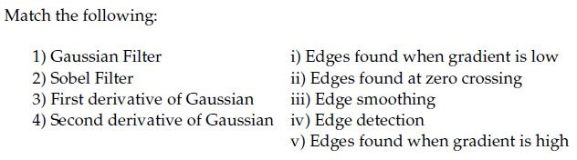
**Figure 22.** Source matching table for Question 206.

**Options**

**A.** 1→ iii, 2→ iv, 3→ i, 4 → ii  
*Option ID:* `6406533531374`

**B.** 1→ iii, 2→ i, 3 → ii, 4 →v  
*Option ID:* `6406533531375`

**C.** 1→ iii, 2→ iv, 3→ v, 4 → ii  
*Option ID:* `6406533531376`

**D.** 1→ iv, 2→ iii, 3→ i, 4 → ii  
*Option ID:* `6406533531377`

**Correct answer:** **C** — 1→ iii, 2→ iv, 3→ v, 4 → ii.  
**Source evidence:** Option ID 6406533531376 is rendered in green (color #008000) with a checkmark icon.

---

---

**Source:** `da5006_2024T3_ET_AN.md` · End-term, 2024T3 · Question 210 · ID `6406531046073`  
**Classification:** Week 2 — Canny edge detector, algorithmic pipeline, Gaussian smoothing, gradient computation, non-maximum suppression, hysteresis thresholding, edge linking  
**Course evidence:** [2.4 The 4-Stage Canny Algorithmic Pipeline](/Volumes/1700%20APFS/PERSONAL_PROGRAMMING_PROJECTS/Notes/Deep%20Learning%20for%20Computer%20Vision/month%201/week%202/week-2-report.md) · Related weeks: 1

### Question 210

**Question ID:** `6406531046073` · **Type:** Multiple Choice Question (MCQ) · **Marks:** 2  
**PDF pages:** 7

Identify the correct sequence of steps in a Canny edge detection pipeline. Steps are listed below:

1. Compute gradient magnitude and direction
2. Connect individual components
3. Smoothen the image
4. Threshold into strong, weak, or no edge
5. Gaussian Filter and Hysteresis
6. Non-maximum suppression
7. Apply derivative to get edges

**Options**

**A.** 6→ 1→ 4→ 5 → 2  
*Option ID:* `6406533531394`

**B.** 3→ 1→ 6→ 4 → 2  
*Option ID:* `6406533531395`

**C.** 3→ 5→ 1→ 4 → 2  
*Option ID:* `6406533531396`

**D.** 6→ 8→ 5→ 7 → 2  
*Option ID:* `6406533531397`

**Correct answer:** **B** — 3→ 1→ 6→ 4 → 2.  
**Source evidence:** Option ID 6406533531395 is rendered in green (color #008000) with a checkmark icon.

---

---

**Source:** `da5006_2025T1_Q1_NA.md` · Quiz 1, 2025T1 · Question 157 · ID `6406531130622`  
**Classification:** Week 2 — edgelet_representation, second_moment_matrix, canny_edge_detector, pca_eigendecomposition, straightness_metric  
**Course evidence:** [3.3 Principal Component Analysis (PCA) of Edgelet Geometry](/Volumes/1700%20APFS/PERSONAL_PROGRAMMING_PROJECTS/Notes/Deep%20Learning%20for%20Computer%20Vision/month%201/week%202/week-2-report.md) · Related weeks: none

### Question 157

**Question ID:** `6406531130622` · **Type:** SA · **Marks:** 2  
**PDF pages:** 4

Given a $2 \times 2$ matrix $M = \begin{bmatrix} 1 & 2 \\ 2 & 1 \end{bmatrix}$ where $M$ is the second moment matrix of edge pixels that is obtained while applying the Canny edge detector, the measure of straightness is _________

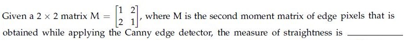

**Figure 23.** Second moment matrix equation for Question 157.

**Correct answer:** `-0.34 to -0.33`  
**Source evidence:** Official accepted answer range '-0.34 to -0.33' in Possible Answers field with green text (color 0x8000).

---

---

**Source:** `da5006_2025T1_Q1_NA.md` · Quiz 1, 2025T1 · Question 164 · ID `6406531130620`  
**Classification:** Week 2 — canny_edge_detector, edge_detection_pipeline, image_smoothing, gradient_computation, non_maximum_suppression, hysteresis_thresholding  
**Course evidence:** [2.4 The 4-Stage Canny Algorithmic Pipeline](/Volumes/1700%20APFS/PERSONAL_PROGRAMMING_PROJECTS/Notes/Deep%20Learning%20for%20Computer%20Vision/month%201/week%202/week-2-report.md) · Related weeks: none

### Question 164

**Question ID:** `6406531130620` · **Type:** MCQ · **Marks:** 2  
**PDF pages:** 6

Identify the correct sequence of steps in a Canny edge detection pipeline. Steps are listed below:

1. Compute gradient magnitude and direction
2. Connect individual components
3. Smoothen the image
4. Threshold into strong, weak, or no edge
5. Gaussian Filter and Hysteresis
6. Non-maximum suppression
7. Apply derivative to get edges

**Options**

**A.** 6→ 1→ 4→ 5 → 2  
*Option ID:* `6406533822701`

**B.** 3→ 1→ 6→ 4 → 2  
*Option ID:* `6406533822702`

**C.** 3→ 5→ 1→ 4 → 2  
*Option ID:* `6406533822703`

**D.** 6→ 1→ 5→ 7 → 2  
*Option ID:* `6406533822704`

**Correct answer:** **B** — 3→ 1→ 6→ 4 → 2.  
**Source evidence:** Option 6406533822702 rendered in green font (color 0x8000) with green checkmark icon in source PDF.

---

---

**Source:** `da5006_2025T1_Q1_NA.md` · Quiz 1, 2025T1 · Question 165 · ID `6406531130623`  
**Classification:** Week 2 — sift_pipeline, scale_space_extrema_detection, keypoint_localization, orientation_assignment, keypoint_descriptor  
**Course evidence:** [6.1 Lowe's SIFT Pipeline (IJCV 2004)](/Volumes/1700%20APFS/PERSONAL_PROGRAMMING_PROJECTS/Notes/Deep%20Learning%20for%20Computer%20Vision/month%201/week%202/week-2-report.md) · Related weeks: none

### Question 165

**Question ID:** `6406531130623` · **Type:** MCQ · **Marks:** 2  
**PDF pages:** 7

Identify the correct sequence of steps in Scale Invariant Feature Transform (SIFT) method. Steps listed below:

1. Keypoint Descriptor
2. Keypoint Localization
3. Scale-space Extrema Detection
4. Orientation Estimation

**Options**

**A.** 4→ 2→ 1→ 3  
*Option ID:* `6406533822710`

**B.** 3→ 2→ 4→ 1  
*Option ID:* `6406533822711`

**C.** 3→ 1→ 2→ 4  
*Option ID:* `6406533822712`

**D.** None of these.  
*Option ID:* `6406533822713`

**Correct answer:** **B** — 3→ 2→ 4→ 1.  
**Source evidence:** Option B (6406533822711) rendered in green font (color 0x8000) with green checkmark icon in source PDF.

---

---

**Source:** `da5006_2025T1_Q1_NA.md` · Quiz 1, 2025T1 · Question 166 · ID `6406531130630`  
**Classification:** Week 2 — Harris Corner Detector, Structure Tensor, Local Image Gradients, Corner Detection, Edge and Flat Region Classification  
**Course evidence:** [## 4. 2D Interest Point Localization: The Harris Structure Tensor](/Volumes/1700%20APFS/PERSONAL_PROGRAMMING_PROJECTS/Notes/Deep%20Learning%20for%20Computer%20Vision/month%201/week%202/week-2-report.md) · Related weeks: 1

### Question 166

**Question ID:** `6406531130630` · **Type:** MCQ · **Marks:** 2  
**PDF pages:** 7

Match the Following:

| Column 1 | Column 2 |
| :--- | :--- |
| 1) Flat region in the image | i) No Change along the edge direction |
| 2) Edge pixel | ii) Significant change in all directions |
| 3) Corner pixel | iii) No Change in all directions |

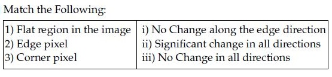

**Figure 24.** Source table for Question 166.

**Options**

**A.** 1→ iii, 2→ i, 3 → ii  
*Option ID:* `6406533822718`

**B.** 1→ iii, 2→ ii, 3 → i  
*Option ID:* `6406533822719`

**C.** 1→ ii, 2→ iii, 3 → ii  
*Option ID:* `6406533822720`

**D.** None of these  
*Option ID:* `6406533822721`

**Correct answer:** **A** — 1→ iii, 2→ i, 3 → ii.  
**Source evidence:** Option 6406533822718 rendered in green font (color 0x8000) with green checkmark icon in source PDF.

---

---

**Source:** `da5006_2025T1_Q1_NA.md` · Quiz 1, 2025T1 · Question 167 · ID `6406531130636`  
**Classification:** Week 2 — SIFT, Bag-of-Visual-Words (BoW), Visual Words Codebook, Feature Vector Dimensionality  
**Course evidence:** [## 6. Scale-Invariant Feature Transform (SIFT) & Descriptor Family](/Volumes/1700%20APFS/PERSONAL_PROGRAMMING_PROJECTS/Notes/Deep%20Learning%20for%20Computer%20Vision/month%201/week%202/week-2-report.md) · Related weeks: none

### Question 167

**Question ID:** `6406531130636` · **Type:** MCQ · **Marks:** 2  
**PDF pages:** 7

Suppose we have a codebook of 2048 SIFT visual words. We extract 1000 SIFT descriptors (SIFT is a 128-dimensional feature) from a new image. What is the dimensionality of the BoW (Bag-of-Words) descriptor?

**Options**

**A.** 1000  
*Option ID:* `6406533822726`

**B.** 128  
*Option ID:* `6406533822727`

**C.** 128 × 2048  
*Option ID:* `6406533822728`

**D.** 2048  
*Option ID:* `6406533822729`

**Correct answer:** **D** — 2048.  
**Source evidence:** Option D (6406533822729) rendered in green font (color 0x8000) with green checkmark icon in source PDF.

---

---

**Source:** `da5006_2025T1_Q1_NA.md` · Quiz 1, 2025T1 · Question 173 · ID `6406531130649`  
**Classification:** Week 2 — Gaussian Filter, Sobel Filter, First Derivative of Gaussian, Second Derivative of Gaussian, Laplacian of Gaussian, Zero Crossings  
**Course evidence:** [### 2.2 Mathematical Edge Modeling & Derivative Operators](/Volumes/1700%20APFS/PERSONAL_PROGRAMMING_PROJECTS/Notes/Deep%20Learning%20for%20Computer%20Vision/month%201/week%202/week-2-report.md) · Related weeks: 1

### Question 173

**Question ID:** `6406531130649` · **Type:** MCQ · **Marks:** 2  
**PDF pages:** 9, 10

Match the following:

| Column 1 | Column 2 |
| :--- | :--- |
| 1) Gaussian Filter | i) Edges found when gradient is low |
| 2) Sobel Filter | ii) Edges found at zero crossing |
| 3) First derivative of Gaussian | iii) Edge smoothing |
| 4) Second derivative of Gaussian | iv) Edge detection |
| | v) Edges found when gradient is high |

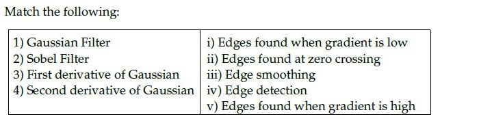

**Figure 25.** Filter and edge operation matching table for Question 173.

**Options**

**A.** 1→ iii, 2→ iv, 3→ i, 4 → ii  
*Option ID:* `6406533822759`

**B.** 1→ iii, 2→ i, 3 → ii, 4 →v  
*Option ID:* `6406533822760`

**C.** 1→ iii, 2→ iv, 3→ v, 4 → ii  
*Option ID:* `6406533822761`

**D.** 1→ iv, 2→ iii, 3→ i, 4 → ii  
*Option ID:* `6406533822762`

**Correct answer:** **C** — 1→ iii, 2→ iv, 3→ v, 4 → ii.  
**Source evidence:** Option C (6406533822761) rendered in green font (color 0x8000) with green checkmark icon in source PDF on page 10.

---

---

**Source:** `da5006_2025T1_Q1_NA.md` · Quiz 1, 2025T1 · Question 180 · ID `6406531130625`  
**Classification:** Week 2 — Image Gradient, Differential Operators, High Frequency Amplification, Noise Sensitivity, Gaussian Pre-Smoothing  
**Course evidence:** [### 2.2 Mathematical Edge Modeling & Derivative Operators](/Volumes/1700%20APFS/PERSONAL_PROGRAMMING_PROJECTS/Notes/Deep%20Learning%20for%20Computer%20Vision/month%201/week%202/week-2-report.md) · Related weeks: 1

### Question 180

**Question ID:** `6406531130625` · **Type:** SA · **Marks:** 1  
**PDF pages:** 13

**Shared Comprehension Context (Question ID: `6406531130624`):**

> The gradient of an image I, points in the direction of most rapid change in intensity, taking image derivatives accentuates (a) _______ frequencies and hence amplifies noise, since the proportion of noise to signal is larger at (b) _______ frequencies. The solution to this is smooth the image prior to computing gradients.
>
> Based on the above data, answer the given subquestions.

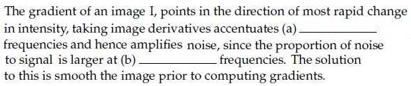

**Figure 26.** Source text passage for Comprehension Questions 180–181.

Enter the correct answer for blank (a) ____________

NOTE: Enter the exact answer without any extra space in the beginning or at the end.

**Correct answer:** `high`  
**Evaluation conditions:** Alphanumeric; Equal; case insensitive.

**Source evidence:** Official answer 'high' in Possible Answers field with green text (color 0x8000).

---

---

**Source:** `da5006_2025T1_Q1_NA.md` · Quiz 1, 2025T1 · Question 181 · ID `6406531130626`  
**Classification:** Week 2 — Image Gradient, Noise Spectral Distribution, High Frequency Noise, Gaussian Pre-Smoothing  
**Course evidence:** [### 2.2 Mathematical Edge Modeling & Derivative Operators](/Volumes/1700%20APFS/PERSONAL_PROGRAMMING_PROJECTS/Notes/Deep%20Learning%20for%20Computer%20Vision/month%201/week%202/week-2-report.md) · Related weeks: 1

### Question 181

**Question ID:** `6406531130626` · **Type:** SA · **Marks:** 1  
**PDF pages:** 13

**Shared Comprehension Context (Question ID: `6406531130624`):**

> The gradient of an image I, points in the direction of most rapid change in intensity, taking image derivatives accentuates (a) _______ frequencies and hence amplifies noise, since the proportion of noise to signal is larger at (b) _______ frequencies. The solution to this is smooth the image prior to computing gradients.
>
> Based on the above data, answer the given subquestions.

Enter the correct answer for blank (b) ____________

NOTE: Enter the exact answer without any extra space in the beginning or at the end.

**Correct answer:** `high`  
**Evaluation conditions:** Alphanumeric; Equal; case insensitive.

**Source evidence:** Official answer 'high' in Possible Answers field with green text (color 0x8000).

---

---

**Source:** `da5006_2025T1_Q1_NA.md` · Quiz 1, 2025T1 · Question 182 · ID `6406531130628`  
**Classification:** Week 2 — Canny Edge Detector, Gaussian Kernel Spread $\sigma$, Scale Space, Coarse Edges  
**Course evidence:** [### 2.4 The 4-Stage Canny Algorithmic Pipeline](/Volumes/1700%20APFS/PERSONAL_PROGRAMMING_PROJECTS/Notes/Deep%20Learning%20for%20Computer%20Vision/month%201/week%202/week-2-report.md) · Related weeks: 1

### Question 182

**Question ID:** `6406531130628` · **Type:** SA · **Marks:** 1  
**PDF pages:** 14

**Shared Comprehension Context (Question ID: `6406531130627`):**

> In Canny edge detection, large value of the Gaussian kernel spread, $\sigma$ leads to (a) ____ edges, and small value of $\sigma$ leads to (b) ____ edges.
>
> Based on the above data, answer the given subquestions.

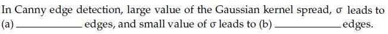

**Figure 27.** Source text passage for Comprehension Questions 182–183.

Enter the correct answer for blank (a) ____________

NOTE: Enter the exact answer without any extra space in the beginning or at the end.

**Correct answer:** `thick` / `coarse` / `large scale`  
**Evaluation conditions:** Alphanumeric; Set; case insensitive.

**Source evidence:** Official accepted alternatives ['thick', 'coarse', 'large scale'] in Possible Answers field with green text (color 0x8000).

---

---

**Source:** `da5006_2025T1_Q1_NA.md` · Quiz 1, 2025T1 · Question 183 · ID `6406531130629`  
**Classification:** Week 2 — Canny Edge Detector, Gaussian Kernel Spread $\sigma$, Fine Edges, Scale Space  
**Course evidence:** [### 2.4 The 4-Stage Canny Algorithmic Pipeline](/Volumes/1700%20APFS/PERSONAL_PROGRAMMING_PROJECTS/Notes/Deep%20Learning%20for%20Computer%20Vision/month%201/week%202/week-2-report.md) · Related weeks: 1

### Question 183

**Question ID:** `6406531130629` · **Type:** SA · **Marks:** 1  
**PDF pages:** 14

**Shared Comprehension Context (Question ID: `6406531130627`):**

> In Canny edge detection, large value of the Gaussian kernel spread, $\sigma$ leads to (a) ____ edges, and small value of $\sigma$ leads to (b) ____ edges.
>
> Based on the above data, answer the given subquestions.

Enter the correct answer for blank (b) ____________

NOTE: Enter the exact answer without any extra space in the beginning or at the end.

**Correct answer:** `fine`  
**Evaluation conditions:** Alphanumeric; Equal; case insensitive.

**Source evidence:** Official answer 'fine' in Possible Answers field with green text (color 0x8000).

---

---

**Source:** `da5006_2025T2_Q1_NA.md` · Quiz 1, 2025T2 · Question 162 · ID `6406531279504`  
**Classification:** Week 2 — Canny Edge Detector, Edge Detection Pipeline, Gaussian Smoothing, Non-Maximum Suppression, Hysteresis Thresholding  
**Course evidence:** [### 2.4 The 4-Stage Canny Algorithmic Pipeline](/Volumes/1700%20APFS/PERSONAL_PROGRAMMING_PROJECTS/Notes/Deep%20Learning%20for%20Computer%20Vision/month%201/week%202/week-2-report.md) · Related weeks: none

### Question 162

**Question ID:** `6406531279504` · **Type:** MCQ · **Marks:** 2  
**PDF pages:** 5

Identify the correct sequence of steps in a Canny edge detection pipeline. Steps are listed below:

1. Compute gradient magnitude and direction  
2. Connect individual components  
3. Smoothen the image  
4. Threshold into strong, weak, or no edge  
5. Gaussian Filter and Hysteresis  
6. Non-maximum suppression  
7. Apply derivative to get edges  

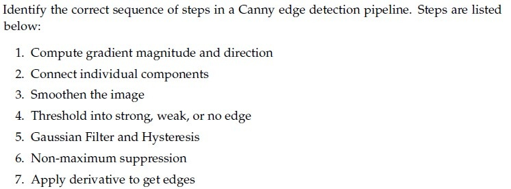

**Figure 28.** Canny edge detection pipeline steps for Question 162.

**Options**

**A.** 6 -> 1 -> 4 -> 5 -> 2

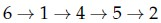

**Figure 29.** Option A candidate sequence for Question 162.  
*Option ID:* `6406534313861`

**B.** 3 -> 1 -> 6 -> 4 -> 2

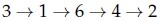

**Figure 30.** Option B candidate sequence for Question 162.  
*Option ID:* `6406534313862`

**C.** 3 -> 7 -> 6 -> 4 -> 2

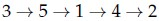

**Figure 31.** Option C candidate sequence for Question 162.  
*Option ID:* `6406534313863`

**D.** 6 -> 1 -> 5 -> 7 -> 2

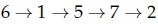

**Figure 32.** Option D candidate sequence for Question 162.  
*Option ID:* `6406534313864`

**Correct answer:** **B** — 3 -> 1 -> 6 -> 4 -> 2.  
**Source evidence:** Option 6406534313862 rendered in green text (color 0x8000) on PDF page 5.

---

---

**Source:** `da5006_2025T2_Q1_NA.md` · Quiz 1, 2025T2 · Question 163 · ID `6406531279505`  
**Classification:** Week 2 — SIFT, Scale-Space Extrema Detection, Keypoint Localization, Orientation Assignment, Keypoint Descriptor  
**Course evidence:** [### 6.1 Lowe's SIFT Pipeline (IJCV 2004)](/Volumes/1700%20APFS/PERSONAL_PROGRAMMING_PROJECTS/Notes/Deep%20Learning%20for%20Computer%20Vision/month%201/week%202/week-2-report.md) · Related weeks: none

### Question 163

**Question ID:** `6406531279505` · **Type:** MCQ · **Marks:** 2  
**PDF pages:** 6

Identify the correct sequence of steps in Scale Invariant Feature Transform (SIFT) method. Steps listed below:

1. Keypoint Descriptor  
2. Keypoint Localization  
3. Scale-space Extrema Detection  
4. Orientation Estimation  

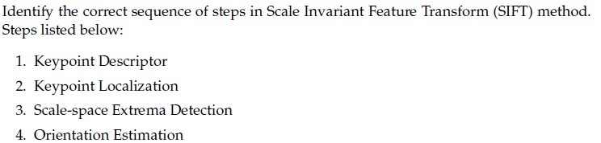

**Figure 33.** SIFT pipeline steps for Question 163.

**Options**

**A.** 4 -> 2 -> 1 -> 3

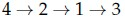

**Figure 34.** Option A candidate sequence for Question 163.  
*Option ID:* `6406534313865`

**B.** 3 -> 2 -> 4 -> 1

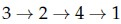

**Figure 35.** Option B candidate sequence for Question 163.  
*Option ID:* `6406534313866`

**C.** 3 -> 1 -> 2 -> 4

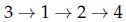

**Figure 36.** Option C candidate sequence for Question 163.  
*Option ID:* `6406534313867`

**D.** None of these.

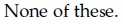

**Figure 37.** Option D statement for Question 163.  
*Option ID:* `6406534313868`

**Correct answer:** **B** — 3 -> 2 -> 4 -> 1.  
**Source evidence:** Option 6406534313866 rendered in green text (color 0x8000) on PDF page 6.

---

---

**Source:** `da5006_2025T2_Q1_NA.md` · Quiz 1, 2025T2 · Question 164 · ID `6406531279506`  
**Classification:** Week 2 — Canny Edge Detector, Double Thresholding, Hysteresis, Weak Edges  
**Course evidence:** [### 2.4 The 4-Stage Canny Algorithmic Pipeline](/Volumes/1700%20APFS/PERSONAL_PROGRAMMING_PROJECTS/Notes/Deep%20Learning%20for%20Computer%20Vision/month%201/week%202/week-2-report.md) · Related weeks: none

### Question 164

**Question ID:** `6406531279506` · **Type:** MCQ · **Marks:** 2  
**PDF pages:** 6

During the double thresholding step in Canny edge detection, the high threshold is set at 100 and the low threshold is 40. A pixel gradient magnitude of 65 will be classified as:

**Options**

**A.** Strong edge  
*Option ID:* `6406534313869`

**B.** Weak edge  
*Option ID:* `6406534313870`

**C.** Non-edge  
*Option ID:* `6406534313871`

**D.** Ambiguous edge  
*Option ID:* `6406534313872`

**Correct answer:** **B** — Weak edge.  
**Source evidence:** Option 6406534313870 rendered in green text (color 0x8000) on PDF page 6.

---

---

**Source:** `da5006_2025T2_Q1_NA.md` · Quiz 1, 2025T2 · Question 168 · ID `6406531279510`  
**Classification:** Week 2 — Gaussian Kernel, Gaussian Smoothing, Canny Edge Detector, Kernel Weight Normalization  
**Course evidence:** [### 2.4 The 4-Stage Canny Algorithmic Pipeline](/Volumes/1700%20APFS/PERSONAL_PROGRAMMING_PROJECTS/Notes/Deep%20Learning%20for%20Computer%20Vision/month%201/week%202/week-2-report.md) · Related weeks: 1

### Question 168

**Question ID:** `6406531279510` · **Type:** MCQ · **Marks:** 2  
**PDF pages:** 8

In the Gaussian smoothing step of the Canny edge detector, a Gaussian kernel of size 5 x 5 with standard deviation $\sigma$ is used to reduce noise. If the standard deviation $\sigma = 1.0$, what is the approximate value of the center weight in the Gaussian kernel? [Use the formula for Gaussian kernel weight at the center: $G(0, 0) = \frac{1}{2\pi \sigma^2}$].

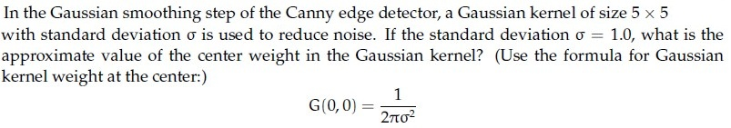

**Figure 38.** Gaussian kernel center weight problem statement for Question 168.

**Options**

**A.** 0.16  
*Option ID:* `6406534313885`

**B.** 0.08  
*Option ID:* `6406534313886`

**C.** 0.20  
*Option ID:* `6406534313887`

**D.** 0.12  
*Option ID:* `6406534313888`

**Correct answer:** **A** — 0.16.  
**Source evidence:** Option 6406534313885 rendered in green text (color 0x8000) on PDF page 8.

---

---

**Source:** `da5006_2025T2_Q1_NA.md` · Quiz 1, 2025T2 · Question 169 · ID `6406531279511`  
**Classification:** Week 2 — Gaussian Filter, Sobel Filter, Derivative of Gaussian, Laplacian of Gaussian, Zero Crossings  
**Course evidence:** [### 2.2 Mathematical Edge Modeling & Derivative Operators](/Volumes/1700%20APFS/PERSONAL_PROGRAMMING_PROJECTS/Notes/Deep%20Learning%20for%20Computer%20Vision/month%201/week%202/week-2-report.md) · Related weeks: 1

### Question 169

**Question ID:** `6406531279511` · **Type:** MCQ · **Marks:** 2  
**PDF pages:** 9

Match the following.

1) Gaussian Filter  
2) Sobel Filter  
3) First derivative of Gaussian  
4) Second derivative of Gaussian  

Right column:

i) Edges found when gradient is low  
ii) Edges found at zero crossing  
iii) Edge smoothing  
iv) Edge detection  
v) Edges found when gradient is high  

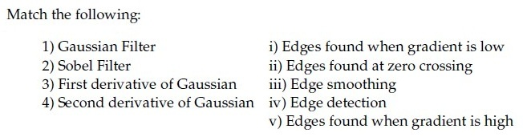

**Figure 39.** Filter type and property matching table for Question 169.

**Options**

**A.** 1 -> iii, 2 -> iv, 3 -> i, 4 -> ii

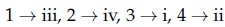

**Figure 40.** Option A candidate mapping for Question 169.  
*Option ID:* `6406534313889`

**B.** 1 -> iii, 2 -> i, 3 -> ii, 4 -> v

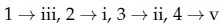

**Figure 41.** Option B candidate mapping for Question 169.  
*Option ID:* `6406534313890`

**C.** 1 -> iii, 2 -> iv, 3 -> v, 4 -> ii

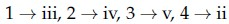

**Figure 42.** Option C candidate mapping for Question 169.  
*Option ID:* `6406534313891`

**D.** 1 -> iv, 2 -> iii, 3 -> i, 4 -> ii

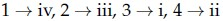

**Figure 43.** Option D candidate mapping for Question 169.  
*Option ID:* `6406534313892`

**Correct answer:** **C** — 1 -> iii, 2 -> iv, 3 -> v, 4 -> ii.  
**Source evidence:** Option 6406534313891 rendered in green text (color 0x8000) on PDF page 9.

---

---

**Source:** `da5006_2025T2_Q1_NA.md` · Quiz 1, 2025T2 · Question 170 · ID `6406531279512`  
**Classification:** Week 2 — Harris Corner Detector, Structure Tensor, Flat Region, Edge Pixel, Corner Pixel, Intensity Variation  
**Course evidence:** [## 4. 2D Interest Point Localization: The Harris Structure Tensor](/Volumes/1700%20APFS/PERSONAL_PROGRAMMING_PROJECTS/Notes/Deep%20Learning%20for%20Computer%20Vision/month%201/week%202/week-2-report.md) · Related weeks: none

### Question 170

**Question ID:** `6406531279512` · **Type:** MCQ · **Marks:** 2  
**PDF pages:** 9

Match the Following.

1) Flat region in the image  
2) Edge pixel  
3) Corner pixel  

Right column:

i) No Change along the edge direction  
ii) Significant change in all directions  
iii) No Change in all directions  

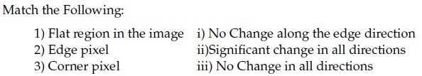

**Figure 44.** Image region feature matching table for Question 170.

**Options**

**A.** 1 -> iii, 2 -> i, 3 -> ii

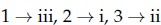

**Figure 45.** Option A candidate mapping for Question 170.  
*Option ID:* `6406534313893`

**B.** 1 -> iii, 2 -> ii, 3 -> i

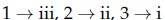

**Figure 46.** Option B candidate mapping for Question 170.  
*Option ID:* `6406534313894`

**C.** 1 -> ii, 2 -> iii, 3 -> ii

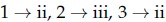

**Figure 47.** Option C candidate mapping for Question 170.  
*Option ID:* `6406534313895`

**D.** None of these.

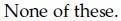

**Figure 48.** Option D statement for Question 170.  
*Option ID:* `6406534313896`

**Correct answer:** **A** — 1 -> iii, 2 -> i, 3 -> ii.  
**Source evidence:** Option 6406534313893 rendered in green text (color 0x8000) on PDF page 9.

---

---

**Source:** `da5006_2025T2_Q1_NA.md` · Quiz 1, 2025T2 · Question 177 · ID `6406531279519`  
**Classification:** Week 2 — Laplacian of Gaussian, Discrete Second Derivative, Differential Edge Operators, Laplacian Operator  
**Course evidence:** [### 3.4 Second Derivatives: The Laplacian of Gaussian (LoG)](/Volumes/1700%20APFS/PERSONAL_PROGRAMMING_PROJECTS/Notes/Deep%20Learning%20for%20Computer%20Vision/month%201/week%202/week-2-report.md) · Related weeks: 1

### Question 177

**Question ID:** `6406531279519` · **Type:** SA · **Marks:** 3  
**PDF pages:** 14

Consider the following discrete approximations of second derivative:

$$\frac{\partial^2 f(x, y)}{\partial x^2} = - f(x+1, y) - f(x-1, y) + 2 f(x, y)$$

$$\frac{\partial^2 f(x, y)}{\partial y^2} = - f(x, y+1) - f(x, y-1) + 2 f(x, y)$$

The middle element of the Laplacian of the Gaussian (LoG) filter will be _____?

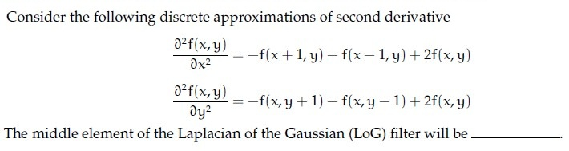

**Figure 49.** Second derivative discrete approximations for Question 177.

**Correct answer:** `4`  
**Source evidence:** Official answer '4' specified in Possible Answers field with green text (color 0x8000) on PDF page 14.

---

---

**Source:** `da5006_2025T2_Q1_NA.md` · Quiz 1, 2025T2 · Question 178 · ID `6406531279520`  
**Classification:** Week 2 — Second Moment Matrix, Edgelet Extraction, Eigendecomposition, Straightness Metric, Canny Edge Detector  
**Course evidence:** [### 3.3 Principal Component Analysis (PCA) of Edgelet Geometry](/Volumes/1700%20APFS/PERSONAL_PROGRAMMING_PROJECTS/Notes/Deep%20Learning%20for%20Computer%20Vision/month%201/week%202/week-2-report.md) · Related weeks: none

### Question 178

**Question ID:** `6406531279520` · **Type:** SA · **Marks:** 3  
**PDF pages:** 14

Given a 2 x 2 second moment matrix of edge pixel $M = \begin{bmatrix} 1 & 2 \\ 2 & 1 \end{bmatrix}$ obtained during the Canny edge detection process, compute the measure of straightness defined as:

$$\text{Straightness} = \frac{\lambda_{\min} - \lambda_{\max}}{\lambda_{\max} + \lambda_{\min}}$$

where $\lambda_{\max}$ and $\lambda_{\min}$ are the maximum and minimum eigenvalues of $M$ respectively.

The value of the straightness is _____?

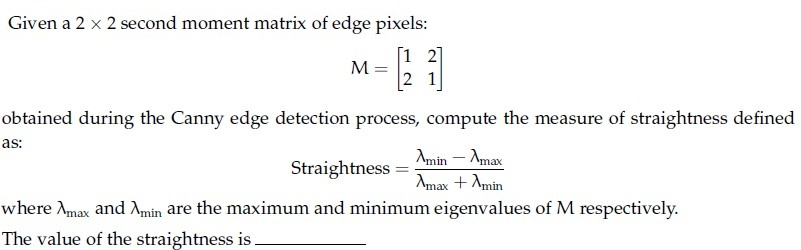

**Figure 50.** Second moment matrix and straightness formula for Question 178.

**Correct answer:** `-2`  
**Source evidence:** Official answer '-2' specified in Possible Answers field with green text (color 0x8000) on PDF page 14.

---

---

**Source:** `da5006_2025T2_Q1_NA.md` · Quiz 1, 2025T2 · Question 185 · ID `6406531279522`  
**Classification:** Week 2 — Image Derivatives, High-Frequency Amplification, Noise Amplification, Differential Edge Operators  
**Course evidence:** [### 2.2 Mathematical Edge Modeling & Derivative Operators](/Volumes/1700%20APFS/PERSONAL_PROGRAMMING_PROJECTS/Notes/Deep%20Learning%20for%20Computer%20Vision/month%201/week%202/week-2-report.md) · Related weeks: 1

### Question 185

**Question ID:** `6406531279522` · **Type:** SA · **Marks:** 1.5  
**PDF pages:** 19

**Shared Comprehension Context (Question ID: `6406531279521`):**

> The gradient of an image I points in the direction of the most rapid change in intensity. Taking image derivatives accentuates (a)_________________ frequencies and hence amplifies noise, since the proportion of noise to signal is larger at (b) _________________frequencies. The common solution is to smooth the image prior to computing gradients.
>
> Based on the above data, answer the given subquestions.

Enter the correct answer for Blank (a):

NOTE: Enter the exact answer without any extra space in the beginning or at the end.

**Correct answer:** `high, higher, large, largest` (accepted set; case-insensitive)  
**Source evidence:** Official accepted answer set 'high', 'higher', 'large', 'largest' (Evaluation Required: Yes, Answers Type: Set, Case Sensitive: No) specified in Possible Answers field with green text (color 0x8000) on PDF page 19.

---

---

**Source:** `da5006_2025T2_Q1_NA.md` · Quiz 1, 2025T2 · Question 186 · ID `6406531279523`  
**Classification:** Week 2 — Image Derivatives, Noise-to-Signal Ratio, High-Frequency Noise, Pre-Smoothing  
**Course evidence:** [### 2.2 Mathematical Edge Modeling & Derivative Operators](/Volumes/1700%20APFS/PERSONAL_PROGRAMMING_PROJECTS/Notes/Deep%20Learning%20for%20Computer%20Vision/month%201/week%202/week-2-report.md) · Related weeks: 1

### Question 186

**Question ID:** `6406531279523` · **Type:** SA · **Marks:** 1.5  
**PDF pages:** 19, 20

**Shared Comprehension Context (Question ID: `6406531279521`):**

> The gradient of an image I points in the direction of the most rapid change in intensity. Taking image derivatives accentuates (a)_________________ frequencies and hence amplifies noise, since the proportion of noise to signal is larger at (b) _________________frequencies. The common solution is to smooth the image prior to computing gradients.
>
> Based on the above data, answer the given subquestions.

Enter the correct answer for Blank (b):

NOTE: Enter the exact answer without any extra space in the beginning or at the end.

**Correct answer:** `high, higher, large, largest` (accepted set; case-insensitive)  
**Source evidence:** Official accepted answer set 'high', 'higher', 'large', 'largest' (Evaluation Required: Yes, Answers Type: Set, Case Sensitive: No) specified in Possible Answers field with green text (color 0x8000) on PDF page 20.

---

---

**Source:** `da5006_2025T2_Q1_NA.md` · Quiz 1, 2025T2 · Question 187 · ID `6406531279525`  
**Classification:** Week 2 — Canny Edge Detector, Gaussian Scale Space, Kernel Spread Sigma, Coarse Edges  
**Course evidence:** [### 2.4 The 4-Stage Canny Algorithmic Pipeline](/Volumes/1700%20APFS/PERSONAL_PROGRAMMING_PROJECTS/Notes/Deep%20Learning%20for%20Computer%20Vision/month%201/week%202/week-2-report.md) · Related weeks: none

### Question 187

**Question ID:** `6406531279525` · **Type:** SA · **Marks:** 1.5  
**PDF pages:** 21

**Shared Comprehension Context (Question ID: `6406531279524`):**

> In Canny edge detection, a large value of the Gaussian kernel spread $\sigma$ leads to (a)________________ edges, while a small value of $\sigma$ leads to (b)_________________ edges.
>
> Based on the above data, answer the given subquestions.

Enter the correct answer for Blank (a) :

NOTE: Enter the exact answer without any extra space in the beginning or at the end.

**Correct answer:** `thick, coarse, large-scale` (accepted set; case-insensitive)  
**Source evidence:** Official accepted answer set 'thick', 'coarse', 'large-scale' (Evaluation Required: Yes, Answers Type: Set, Case Sensitive: No) specified in Possible Answers field with green text (color 0x8000) on PDF page 21.

---

---

**Source:** `da5006_2025T2_Q1_NA.md` · Quiz 1, 2025T2 · Question 188 · ID `6406531279526`  
**Classification:** Week 2 — Canny Edge Detector, Gaussian Scale Space, Kernel Spread Sigma, Fine Edges  
**Course evidence:** [### 2.4 The 4-Stage Canny Algorithmic Pipeline](/Volumes/1700%20APFS/PERSONAL_PROGRAMMING_PROJECTS/Notes/Deep%20Learning%20for%20Computer%20Vision/month%201/week%202/week-2-report.md) · Related weeks: none

### Question 188

**Question ID:** `6406531279526` · **Type:** SA · **Marks:** 1.5  
**PDF pages:** 21

**Shared Comprehension Context (Question ID: `6406531279524`):**

> In Canny edge detection, a large value of the Gaussian kernel spread $\sigma$ leads to (a)________________ edges, while a small value of $\sigma$ leads to (b)_________________ edges.
>
> Based on the above data, answer the given subquestions.

Enter the correct answer for Blank (b) :

NOTE: Enter the exact answer without any extra space in the beginning or at the end.

**Correct answer:** `fine, thin` (accepted set; case-insensitive)  
**Source evidence:** Official accepted answer set 'fine', 'thin' (Evaluation Required: Yes, Answers Type: Set, Case Sensitive: No) specified in Possible Answers field with green text (color 0x8000) on PDF page 21.

---

---

**Source:** `da5006_2025T2_Q1_NA.md` · Quiz 1, 2025T2 · Question 189 · ID `6406531279528`  
**Classification:** Week 2 — Bag-of-Visual-Words, SIFT, Visual Vocabulary Codebook, Histogram Feature Vector  
**Course evidence:** [## 6. Scale-Invariant Feature Transform (SIFT) & Descriptor Family](/Volumes/1700%20APFS/PERSONAL_PROGRAMMING_PROJECTS/Notes/Deep%20Learning%20for%20Computer%20Vision/month%201/week%202/week-2-report.md) · Related weeks: none

### Question 189

**Question ID:** `6406531279528` · **Type:** SA · **Marks:** 1.5  
**PDF pages:** 22

**Shared Comprehension Context (Question ID: `6406531279527`):**

> You have a visual codebook with 1500 visual words. From a test image, you extract 1200 SIFT descriptors, each of 128 dimensions. After assigning each descriptor to its nearest visual word, you compute the Bag-of-Words histogram by counting descriptor assignments.
>
> Based on the above data, answer the given subquestions.

What is the dimensionality of the Bag-of-Words (BoW) feature vector for this image?________________

**Correct answer:** `1500`  
**Source evidence:** Official answer '1500' specified in Possible Answers field with green text (color 0x8000) on PDF page 22.

---

---

**Source:** `da5006_2025T2_Q1_NA.md` · Quiz 1, 2025T2 · Question 190 · ID `6406531279529`  
**Classification:** Week 2 — SIFT, Local Descriptor Concatenation, Feature Dimensionality, Curse of Dimensionality  
**Course evidence:** [## 6. Scale-Invariant Feature Transform (SIFT) & Descriptor Family](/Volumes/1700%20APFS/PERSONAL_PROGRAMMING_PROJECTS/Notes/Deep%20Learning%20for%20Computer%20Vision/month%201/week%202/week-2-report.md) · Related weeks: none

### Question 190

**Question ID:** `6406531279529` · **Type:** SA · **Marks:** 1.5  
**PDF pages:** 22

**Shared Comprehension Context (Question ID: `6406531279527`):**

> You have a visual codebook with 1500 visual words. From a test image, you extract 1200 SIFT descriptors, each of 128 dimensions. After assigning each descriptor to its nearest visual word, you compute the Bag-of-Words histogram by counting descriptor assignments.
>
> Based on the above data, answer the given subquestions.

If instead, you concatenate all the 1200 descriptors into a single vector (without using BoW), what will be the dimensionality of that vector?__________________

**Correct answer:** `153600`  
**Source evidence:** Official answer '153600' specified in Possible Answers field with green text (color 0x8000) on PDF page 22.

---

---

**Source:** `da5006_2025T2_ET_AN.md` · End-term, 2025T2 · Question 91 · ID `6406531431351`  
**Classification:** Week 2 — Gaussian smoothing filter, Laplacian of Gaussian (LoG), zero-crossing edge detection, first derivative of Gaussian, Sobel directional gradient operator  
**Course evidence:** [## 2. Differential Edge Detection & The Canny Optimization Pipeline](/Volumes/1700%20APFS/PERSONAL_PROGRAMMING_PROJECTS/Notes/Deep%20Learning%20for%20Computer%20Vision/month%201/week%202/week-2-report.md) · Related weeks: 1

### Question 91

**Question ID:** `6406531431351` · **Type:** MCQ · **Marks:** 2  
**PDF pages:** 4

You are designing an edge detection pipeline for noisy grayscale images. For each of the following goals, choose the most appropriate filter or method: 1. Smooth out noise before any edge detection step 2. Detect edges by finding zero-crossings in the second derivative 3. Highlight regions with a strong intensity gradient 4. Perform basic edge detection with a simple directional gradient filter

**Options**

**A.** 1 → Gaussian filter, 2 → Laplacian of Gaussian, 3 → First derivative of Gaussian, 4 → Sobel operator  
*Option ID:* `6406534780277`

**B.** 1 → Sobel operator, 2 → Gaussian filter, 3 → Laplacian of Gaussian, 4 → First derivative of Gaussian  
*Option ID:* `6406534780278`

**C.** 1 → First derivative of Gaussian, 2 → Sobel operator, 3 → Gaussian filter, 4 → Laplacian of Gaussian  
*Option ID:* `6406534780279`

**D.** 1→Laplacian of Gaussian, 2→First derivative of Gaussian, 3→Sobel operator, 4→Gaussian filter  
*Option ID:* `6406534780280`

**Correct answer:** **A** — 1 → Gaussian filter, 2 → Laplacian of Gaussian, 3 → First derivative of Gaussian, 4 → Sobel operator.  
**Source evidence:** Option A (6406534780277) rendered in green font (#008000) indicating the officially accepted answer in the source key. (PDF page 4).

---

---

**Source:** `da5006_2025T2_ET_AN.md` · End-term, 2025T2 · Question 93 · ID `6406531431353`  
**Classification:** Week 2 — Laplacian of Gaussian (LoG), Difference of Gaussians (DoG), scale-invariant interest points, image pyramid, texture analysis via filter banks, Gabor filters (Gaussian + sinusoid)  
**Course evidence:** [5. Multi-Scale Representation, Image Pyramids, and Filter Banks](/Volumes/1700%20APFS/PERSONAL_PROGRAMMING_PROJECTS/Notes/Deep%20Learning%20for%20Computer%20Vision/month%201/week%202/week-2-report.md) · Related weeks: 1

### Question 93

**Question ID:** `6406531431353` · **Type:** MCQ · **Marks:** 2  
**PDF pages:** 5, 6

Match the following:

**Figure 51.** Source matching table for Question 93.

| List 1 | List 2 |
| :--- | :--- |
| 1) Laplacian of Gaussian | i) Image Pyramid |
| 2) Scale-invariant interest point detection uses | ii) Filter banks |
| 3) Texture can be obtained by using | iii) Difference of Gaussian |
| 4) Gabor Filter | iv) Feature pyramid |
| | v) Gaussian + Sinusoid |

**Options**

**A.** 1→ iii, 2→ iv, 3→ ii, 4 → i  
*Option ID:* `6406534780285`

**B.** 1→ i, 2→ iv, 3 → iii, 4→ ii  
*Option ID:* `6406534780286`

**C.** 1→ iv, 2→ iii, 3→ ii, 4 → i  
*Option ID:* `6406534780287`

**D.** 1→ iii, 2→ i, 3 → ii, 4 →v  
*Option ID:* `6406534780288`

**Correct answer:** **D** — 1→ iii, 2→ i, 3 → ii, 4 →v.  
**Source evidence:** Option D (6406534780288) rendered in green font (#008000) indicating the officially accepted answer in the source key. (PDF page 6).

---

---

**Source:** `da5006_2025T2_ET_FN.md` · End-term, 2025T2 · Question 156 · ID `6406531422535`  
**Classification:** Week 2 — Differential Edge Detection, Image Gradient Vector, Gradient Magnitude and Orientation, Directional Derivatives, Edge Orientation  
**Course evidence:** [#### Step 2: Gradient Magnitude and Orientation](/Volumes/1700%20APFS/PERSONAL_PROGRAMMING_PROJECTS/Notes/Deep%20Learning%20for%20Computer%20Vision/month%201/week%202/week-2-report.md) · Related weeks: 1

### Question 156

**Question ID:** `6406531422535` · **Type:** MCQ · **Marks:** 2  
**PDF pages:** 2, 3

Consider the following orientation of edges:

**Figure 52.** Question 156, source diagram of edge orientations.

Choose the correct matching:

**Options**

**A.** (i) = tan⁻¹(∂I/∂y / ∂I/∂x), (ii) = (∂I/∂x, 0), (iii) = (0, ∂I/∂y), (iv) = (∂I/∂x, ∂I/∂y)  

**Figure 53.** Option A image for Question 156.
*Option ID:* `6406534756356`

**B.** (i) = tan⁻¹(∂I/∂x / ∂I/∂y), (ii) = (0, ∂I/∂x), (iii) = (∂I/∂y, 0), (iv) = (∂I/∂x, ∂I/∂y)  

**Figure 54.** Option B image for Question 156.
*Option ID:* `6406534756357`

**C.** (i) = (∂I/∂x, ∂I/∂y), (ii) = (∂I/∂x, 0), (iii) = (0, ∂I/∂y), (iv) = tan⁻¹(∂I/∂y / ∂I/∂x)  

**Figure 55.** Option C image for Question 156.
*Option ID:* `6406534756358`

**D.** (i) = (∂I/∂x, ∂I/∂y), (ii) = (0, ∂I/∂y), (iii) = (∂I/∂x, 0), (iv) = tan⁻¹(∂I/∂y / ∂I/∂x)  

**Figure 56.** Option D image for Question 156.
*Option ID:* `6406534756359`

**Correct answer:** **D** — (i) = (∂I/∂x, ∂I/∂y), (ii) = (0, ∂I/∂y), (iii) = (∂I/∂x, 0), (iv) = tan⁻¹(∂I/∂y / ∂I/∂x).  
**Source evidence:** Option 6406534756359 is rendered in green text (#008000) with a checkmark icon. (PDF page 3).

---

---

**Source:** `da5006_2025T2_ET_FN.md` · End-term, 2025T2 · Question 157 · ID `6406531422536`  
**Classification:** Week 2 — Gaussian Filter, Sobel Filter, First Derivative of Gaussian, Second Derivative of Gaussian, Zero-Crossing Detection, Differential Edge Detection  
**Course evidence:** [### 2.2 Mathematical Edge Modeling & Derivative Operators](/Volumes/1700%20APFS/PERSONAL_PROGRAMMING_PROJECTS/Notes/Deep%20Learning%20for%20Computer%20Vision/month%201/week%202/week-2-report.md) · Related weeks: 1

### Question 157

**Question ID:** `6406531422536` · **Type:** MCQ · **Marks:** 2  
**PDF pages:** 3

Match the following:

**Figure 57.** Question 157, source matching table.

**Options**

**A.** 1→ iii, 2→ iv, 3→ i, 4 → ii  
*Option ID:* `6406534756360`

**B.** 1→ iii, 2→ i, 3 → ii, 4 → v  
*Option ID:* `6406534756361`

**C.** 1→ iii, 2→ iv, 3→ v, 4 → ii  
*Option ID:* `6406534756362`

**D.** 1→ iv, 2→ iii, 3→ i, 4 → ii  
*Option ID:* `6406534756363`

**Correct answer:** **C** — 1→ iii, 2→ iv, 3→ v, 4 → ii.  
**Source evidence:** Option 6406534756362 is rendered in green text (#008000) with a checkmark icon. (PDF page 3).

---

---

**Source:** `da5006_2025T2_ET_FN.md` · End-term, 2025T2 · Question 158 · ID `6406531422537`  
**Classification:** Week 2 — Canny Edge Detector, Gaussian Smoothing, Gradient Magnitude and Direction, Non-Maximum Suppression (NMS), Hysteresis Thresholding, Component Linking  
**Course evidence:** [### 2.4 The 4-Stage Canny Algorithmic Pipeline](/Volumes/1700%20APFS/PERSONAL_PROGRAMMING_PROJECTS/Notes/Deep%20Learning%20for%20Computer%20Vision/month%201/week%202/week-2-report.md) · Related weeks: none

### Question 158

**Question ID:** `6406531422537` · **Type:** MCQ · **Marks:** 2  
**PDF pages:** 3

Identify the correct sequence of steps in a Canny edge detection pipeline. Steps are listed below:

1. Compute gradient magnitude and direction
2. Connect individual components
3. Smoothen the image
4. Threshold into strong, weak, or no edge
5. Gaussian Filter and Hysteresis
6. Non-maximum suppression
7. Apply derivative to get edges

**Options**

**A.** 6→ 1→ 4→ 5 → 2  
*Option ID:* `6406534756364`

**B.** 3→ 1→ 6→ 4 → 2  
*Option ID:* `6406534756365`

**C.** 3→ 5→ 1→ 4 → 2  
*Option ID:* `6406534756366`

**D.** 6→ 3→ 5→ 7 → 2  
*Option ID:* `6406534756367`

**Correct answer:** **B** — 3→ 1→ 6→ 4 → 2.  
**Source evidence:** Option 6406534756365 is rendered in green text (#008000) with a checkmark icon. (PDF page 3).

---

---

**Source:** `da5006_2025T2_ET_FN.md` · End-term, 2025T2 · Question 161 · ID `6406531422540`  
**Classification:** Week 2 — SIFT Algorithm Pipeline, Scale-Space Extrema Detection, Sub-Pixel Keypoint Localization, Hessian Edge Rejection, Orientation Assignment, Local Feature Descriptor  
**Course evidence:** [### 6.1 Lowe's SIFT Pipeline (IJCV 2004)](/Volumes/1700%20APFS/PERSONAL_PROGRAMMING_PROJECTS/Notes/Deep%20Learning%20for%20Computer%20Vision/month%201/week%202/week-2-report.md) · Related weeks: none

### Question 161

**Question ID:** `6406531422540` · **Type:** MCQ · **Marks:** 2  
**PDF pages:** 4, 5

Which of the following is the correct sequence of steps of the SIFT algorithm?

1. Using the Taylor series expansion of the scale-space function, lo-calize the key points.
2. Estimate the orientation of keypoints using the local image gra-dients.
3. Find the edge points using the eigenvalues of the Hessian and reject these points.
4. Find a raw SIFT descriptor vector using the gradient orientations of the neighborhood around the key points.
5. Detect extreme points in scale space using an approximation of the Laplacian of Gaussian.

**Options**

**A.** 5, 2, 1, 3, 4  
*Option ID:* `6406534756376`

**B.** 5, 1, 3, 2, 4  
*Option ID:* `6406534756377`

**C.** 1, 3, 2, 4, 5  
*Option ID:* `6406534756378`

**D.** 1, 5, 3, 2, 4  
*Option ID:* `6406534756379`

**Correct answer:** **B** — 5, 1, 3, 2, 4.  
**Source evidence:** Option 6406534756377 is rendered in green text (#008000) with a checkmark icon. (PDF page 5).

---

---

**Source:** `da5006_2025T2_ET_FN.md` · End-term, 2025T2 · Question 167 · ID `6406531422546`  
**Classification:** Week 2 — Laplacian of Gaussian (LoG), Difference of Gaussians (DoG), scale-invariant interest points, image pyramid, texture analysis via filter banks, Gabor filters (Gaussian + sinusoid)  
**Course evidence:** [5. Multi-Scale Representation, Image Pyramids, and Filter Banks](/Volumes/1700%20APFS/PERSONAL_PROGRAMMING_PROJECTS/Notes/Deep%20Learning%20for%20Computer%20Vision/month%201/week%202/week-2-report.md) · Related weeks: 1

### Question 167

**Question ID:** `6406531422546` · **Type:** MCQ · **Marks:** 2  
**PDF pages:** 7, 8

Match the following:

**Figure 58.** Question 167, source matching table.

**Options**

**A.** 1→ iii, 2→ iv, 3→ ii, 4 → i  
*Option ID:* `6406534756400`

**B.** 1→ i, 2→ iv, 3 → iii, 4→ ii  
*Option ID:* `6406534756401`

**C.** 1→ iv, 2→ iii, 3→ ii, 4 → i  
*Option ID:* `6406534756402`

**D.** 1→ iii, 2→ i, 3 → ii, 4 →v  
*Option ID:* `6406534756403`

**Correct answer:** **D** — 1→ iii, 2→ i, 3 → ii, 4 →v.  
**Source evidence:** Option 6406534756403 is rendered in green text (#008000) with a checkmark icon. (PDF page 8).

---

---

**Source:** `da5006_2026T1_Q1_NA.md` · Quiz 1, 2026T1 · Question 2 · ID `6406531961516`  
**Classification:** Week 2 — Canny edge detector, Gaussian smoothing, gradient computation, Non-Maximum Suppression (NMS), hysteresis thresholding  
**Course evidence:** [### 2.4 The 4-Stage Canny Algorithmic Pipeline](/Volumes/1700%20APFS/PERSONAL_PROGRAMMING_PROJECTS/Notes/Deep%20Learning%20for%20Computer%20Vision/month%201/week%202/week-2-report.md) · Related weeks: 1

### Question 2

**Question ID:** `6406531961516` · **Type:** Multiple Choice Question · **Marks:** 1  
**PDF pages:** 3

In the Canny edge detector, which is the correct order of major steps?

**Options**

**A.** Non-maximum suppression → Gaussian smoothing → gradient computation → hysteresis thresholding  
*Option ID:* `6406536373687`

**B.** Gaussian smoothing → gradient computation → non-maximum suppression → hysteresis thresholding  
*Option ID:* `6406536373688`

**C.** Gradient computation → Gaussian smoothing → hysteresis thresholding → non-maximum suppression  
*Option ID:* `6406536373689`

**D.** Gaussian smoothing → hysteresis thresholding → non-maximum suppression → gradient computation  
*Option ID:* `6406536373690`

**Correct answer:** **B** — Gaussian smoothing → gradient computation → non-maximum suppression → hysteresis thresholding  
**Source evidence:** Green option text and check marker, PDF page 3.

---

---

**Source:** `da5006_2026T1_Q1_NA.md` · Quiz 1, 2026T1 · Question 4 · ID `6406531961523`  
**Classification:** Week 2 — SIFT pipeline, scale-space extrema detection, keypoint localization, canonical orientation assignment, local descriptor generation  
**Course evidence:** [## 6. Scale-Invariant Feature Transform (SIFT) & Descriptor Family](/Volumes/1700%20APFS/PERSONAL_PROGRAMMING_PROJECTS/Notes/Deep%20Learning%20for%20Computer%20Vision/month%201/week%202/week-2-report.md) · Related weeks: none

### Question 4

**Question ID:** `6406531961523` · **Type:** Multiple Choice Question · **Marks:** 1  
**PDF pages:** 4

Correct order of SIFT stages is:

**Options**

**A.** Orientation → Descriptor → Localization → Extrema Detection  
*Option ID:* `6406536373700`

**B.** Extrema Detection → Localization → Orientation → Descriptor  
*Option ID:* `6406536373701`

**C.** Extrema Detection → Descriptor → Localization → Orientation  
*Option ID:* `6406536373702`

**D.** None of these.  
*Option ID:* `6406536373703`

**Correct answer:** **B** — Extrema Detection → Localization → Orientation → Descriptor  
**Source evidence:** Green option text and check marker, PDF page 4.

---

---

**Source:** `da5006_2026T1_Q1_NA.md` · Quiz 1, 2026T1 · Question 12 · ID `6406531961525`  
**Classification:** Week 2 — degrees of freedom, 3D affine transformations, 3D translation, geometric transformation hierarchy, transformation invariance  
**Course evidence:** [### 4.5 Transformation Invariance of the Harris Detector](/Volumes/1700%20APFS/PERSONAL_PROGRAMMING_PROJECTS/Notes/Deep%20Learning%20for%20Computer%20Vision/month%201/week%202/week-2-report.md) · Related weeks: 1

### Question 12

**Question ID:** `6406531961525` · **Type:** Short Answer Question · **Marks:** 1  
**PDF pages:** 7

The sum of the degrees of freedom for translation and affine transformations in 3D is __

**Correct answer:** `12`  
**Source evidence:** Green text in Possible Answers field, PDF page 7.

---

---

**Source:** `da5006_2026T1_Q1_NA.md` · Quiz 1, 2026T1 · Question 14 · ID `6406531961527`  
**Classification:** Week 2 — discrete Laplacian, 8-neighbor Laplacian kernel, second-order spatial derivative, Laplacian of Gaussian, differential edge detection  
**Course evidence:** [### 3.4 Second Derivatives: The Laplacian of Gaussian (LoG)](/Volumes/1700%20APFS/PERSONAL_PROGRAMMING_PROJECTS/Notes/Deep%20Learning%20for%20Computer%20Vision/month%201/week%202/week-2-report.md) · Related weeks: 1

### Question 14

**Question ID:** `6406531961527` · **Type:** Short Answer Question · **Marks:** 1  
**PDF pages:** 8

**Figure 59.** Discrete Laplacian definition and formula for Question 14.

Using the 8-neighbor discrete Laplacian

$$\Delta f(x, y) = - \sum_{\substack{(u, v) \in \{-1, 0, 1\}^2 \\ (u, v) \neq (0, 0)}} f(x+u, y+v) + 8 f(x, y),$$

the middle element of its $3 \times 3$ kernel is _____.

**Correct answer:** `8`  
**Source evidence:** Green text in Possible Answers field, PDF page 8.

---

---

**Source:** `da5006_2026T1_Q1_NA.md` · Quiz 1, 2026T1 · Question 15 · ID `6406531961528`  
**Classification:** Week 2 — straightness metric, second moment matrix, PCA eigendecomposition, edgelet extraction, Canny edge detector  
**Course evidence:** [### 3.3 Principal Component Analysis (PCA) of Edgelet Geometry](/Volumes/1700%20APFS/PERSONAL_PROGRAMMING_PROJECTS/Notes/Deep%20Learning%20for%20Computer%20Vision/month%201/week%202/week-2-report.md) · Related weeks: none

### Question 15

**Question ID:** `6406531961528` · **Type:** Short Answer Question · **Marks:** 1  
**PDF pages:** 8, 9

**Figure 60.** Matrix $M$ and straightness definition for Question 15.

Let $M = \begin{bmatrix} 5 & 1 \\ 1 & 2 \end{bmatrix}$. Define

$$\text{Straightness} = \frac{\lambda_{max} - \lambda_{min}}{\lambda_{max} + \lambda_{min}}$$

The straightness equals _______ (round to 3 decimals).

**Correct answer:** `-6 to -5`  
**Source evidence:** Green text in Possible Answers range field, PDF page 9.

---

---

**Source:** `da5006_2026T1_ET_FN.md` · End-term, 2026T1 · Question 5 · ID `6406532136820`  
**Classification:** Week 2 — Sobel operator, image gradients, differential edge detection, spatial partial derivatives  
**Course evidence:** [### 2.2 Mathematical Edge Modeling & Derivative Operators](/Volumes/1700%20APFS/PERSONAL_PROGRAMMING_PROJECTS/Notes/Deep%20Learning%20for%20Computer%20Vision/month%201/week%202/week-2-report.md) · Related weeks: 1

### Question 5

**Question ID:** `6406532136820` · **Type:** MCQ · **Marks:** 2  
**PDF pages:** 3

The Sobel operator primarily estimates:

**Options**

**A.** Local intensity mean  
  
**Figure 61.** Option A image for Question 5.  
*Option ID:* `6406536959489`

**B.** Image gradients (approx. $\partial I/\partial x$, $\partial I/\partial y$)  
  
**Figure 62.** Option B image for Question 5.  
*Option ID:* `6406536959490`

**C.** Laplacian of Gaussian only  
  
**Figure 63.** Option C image for Question 5.  
*Option ID:* `6406536959491`

**D.** Harris corner response directly  
  
**Figure 64.** Option D image for Question 5.  
*Option ID:* `6406536959492`

**Correct answer:** **B** — Image gradients (approx. $\partial I/\partial x$, $\partial I/\partial y$).  
**Source evidence:** Option ID 6406536959490 rendered in green text (#008000) with checkmark icon (xref 1692) on PDF page 3.

---

---

**Source:** `da5006_2026T1_ET_FN.md` · End-term, 2026T1 · Question 6 · ID `6406532136821`  
**Classification:** Week 2 — SIFT, Scale-Invariant Feature Transform, scale invariance, rotation invariance, local invariant descriptors  
**Course evidence:** [## 6. Scale-Invariant Feature Transform (SIFT) & Descriptor Family](/Volumes/1700%20APFS/PERSONAL_PROGRAMMING_PROJECTS/Notes/Deep%20Learning%20for%20Computer%20Vision/month%201/week%202/week-2-report.md) · Related weeks: none

### Question 6

**Question ID:** `6406532136821` · **Type:** MCQ · **Marks:** 2  
**PDF pages:** 3

SIFT is designed to be robust mainly to:

**Options**

**A.** Scale and rotation changes  
*Option ID:* `6406536959493`

**B.** Only translation (shifts)  
*Option ID:* `6406536959494`

**C.** Only illumination changes  
*Option ID:* `6406536959495`

**D.** Only affine viewpoint changes with no residual error  
*Option ID:* `6406536959496`

**Correct answer:** **A** — Scale and rotation changes.  
**Source evidence:** Option ID 6406536959493 rendered in green text (#008000) with checkmark icon (xref 1692) on PDF page 3.

---

---

**Source:** `da5006_2026T1_ET_FN.md` · End-term, 2026T1 · Question 7 · ID `6406532136822`  
**Classification:** Week 2 — scale-space theory, Gaussian smoothing, standard deviation sigma, high-frequency suppression, multiscale representation  
**Course evidence:** [### 5.2 Scale-Space Theory & The Gaussian Uniqueness Theorem](/Volumes/1700%20APFS/PERSONAL_PROGRAMMING_PROJECTS/Notes/Deep%20Learning%20for%20Computer%20Vision/month%201/week%202/week-2-report.md) · Related weeks: 1

### Question 7

**Question ID:** `6406532136822` · **Type:** MCQ · **Marks:** 2  
**PDF pages:** 3

In classical scale-space theory, increasing $\sigma$ in Gaussian smoothing generally:

**Options**

**A.** Enhances high-frequency details  
*Option ID:* `6406536959497`

**B.** Suppresses high-frequency details and removes fine structures  
*Option ID:* `6406536959498`

**C.** Has no effect on edges  
*Option ID:* `6406536959499`

**D.** Increases noise  
*Option ID:* `6406536959500`

**Correct answer:** **B** — Suppresses high-frequency details and removes fine structures.  
**Source evidence:** Option ID 6406536959498 rendered in green text (#008000) with checkmark icon (xref 1692) on PDF page 3.

---

---

**Source:** `da5006_2026T1_ET_FN.md` · End-term, 2026T1 · Question 16 · ID `6406532136831`  
**Classification:** Week 2 — Harris corner detector, Difference-of-Gaussians (DoG), Laplacian-of-Gaussian (LoG), SIFT descriptor, Canny edge detector  
**Course evidence:** [## 4. 2D Interest Point Localization: The Harris Structure Tensor](/Volumes/1700%20APFS/PERSONAL_PROGRAMMING_PROJECTS/Notes/Deep%20Learning%20for%20Computer%20Vision/month%201/week%202/week-2-report.md) · Related weeks: 1

### Question 16

**Question ID:** `6406532136831` · **Type:** MSQ · **Marks:** 3  
**PDF pages:** 6

Select all correct statements:

**Options**

**A.** Harris corner detector responds strongly where gradient changes in two orthogonal directions.  
*Option ID:* `6406536959533`

**B.** Difference-of-Gaussians approximates Laplacian-of-Gaussian for blob detection.  
*Option ID:* `6406536959534`

**C.** SIFT descriptors are computed from raw pixel intensities without gradients.  
*Option ID:* `6406536959535`

**D.** Canny edge detector is a data driven method to calculate edges in an image.  
*Option ID:* `6406536959536`

**Correct answer:** **A**, **B** — Harris corner detector responds strongly where gradient changes in two orthogonal directions.; Difference-of-Gaussians approximates Laplacian-of-Gaussian for blob detection..  
**Source evidence:** Option ID 6406536959533 rendered in green text (#008000) with checkmark icon (xref 1692) on PDF page 6.; Option ID 6406536959534 rendered in green text (#008000) with checkmark icon (xref 1692) on PDF page 6.

---

---

**Source:** `da5006_2026T2_Q1_NA.md` · Quiz 1, 2026T2 · Question 2 · ID `6406532166253`  
**Classification:** Week 2 — Canny Edge Detector, Gaussian Smoothing, Gradient Computation, Non-Maximum Suppression (NMS), Hysteresis Thresholding  
**Course evidence:** [### 2.4 The 4-Stage Canny Algorithmic Pipeline](/Volumes/1700%20APFS/PERSONAL_PROGRAMMING_PROJECTS/Notes/Deep%20Learning%20for%20Computer%20Vision/month%201/week%202/week-2-report.md) · Related weeks: none

### Question 2

**Question ID:** `6406532166253` · **Type:** Multiple Choice Question · **Marks:** 1  
**PDF pages:** 2

In the Canny edge detector, which is the correct order of major steps?

**Options**

**A.** Non-maximum suppression → Gaussian smoothing → gradient computation → hysteresis thresholding  
*Option ID:* `6406537043603`

**B.** Gaussian smoothing → gradient computation → non-maximum suppression → hysteresis thresholding  
*Option ID:* `6406537043604`

**C.** Gradient computation → Gaussian smoothing → hysteresis thresholding → non-maximum suppression  
*Option ID:* `6406537043605`

**D.** Gaussian smoothing → hysteresis thresholding → non-maximum suppression → gradient computation  
*Option ID:* `6406537043606`

**Correct answer:** **B** — Gaussian smoothing → gradient computation → non-maximum suppression → hysteresis thresholding  
**Source evidence:** Green option ID `6406537043604` and check marker, PDF page 2.

---

---

**Source:** `da5006_2026T2_Q1_NA.md` · Quiz 1, 2026T2 · Question 4 · ID `6406532166259`  
**Classification:** Week 2 — Scale-Invariant Feature Transform (SIFT), Scale-Space Extrema Detection, Keypoint Localization, Canonical Orientation Assignment, Keypoint Descriptor Generation  
**Course evidence:** [### 6.1 Lowe's SIFT Pipeline (IJCV 2004)](/Volumes/1700%20APFS/PERSONAL_PROGRAMMING_PROJECTS/Notes/Deep%20Learning%20for%20Computer%20Vision/month%201/week%202/week-2-report.md) · Related weeks: none

### Question 4

**Question ID:** `6406532166259` · **Type:** Multiple Choice Question · **Marks:** 1  
**PDF pages:** 2, 3

Correct order of SIFT stages is:

**Options**

**A.** Orientation → Descriptor → Localization → Extrema Detection  
*Option ID:* `6406537043615`

**B.** Extrema Detection → Localization → Orientation → Descriptor  
*Option ID:* `6406537043616`

**C.** Extrema Detection → Descriptor → Localization → Orientation  
*Option ID:* `6406537043617`

**D.** None of these  
*Option ID:* `6406537043618`

**Correct answer:** **B** — Extrema Detection → Localization → Orientation → Descriptor  
**Source evidence:** Green option ID `6406537043616` and check marker, PDF page 3.

---

---

**Source:** `da5006_2026T2_Q1_NA.md` · Quiz 1, 2026T2 · Question 11 · ID `6406532166261`  
**Classification:** Week 2 — Degrees of Freedom, Affine Transformation, 3D Geometric Transformations, Transformation Invariance  
**Course evidence:** [### 4.5 Transformation Invariance of the Harris Detector](/Volumes/1700%20APFS/PERSONAL_PROGRAMMING_PROJECTS/Notes/Deep%20Learning%20for%20Computer%20Vision/month%201/week%202/week-2-report.md) · Related weeks: none

### Question 11

**Question ID:** `6406532166261` · **Type:** Short Answer Question · **Marks:** 1  
**PDF pages:** 5, 6

The degrees of freedom for affine transformations in 3D is __

**Correct answer:** `12`  
**Source evidence:** Green text in Possible Answers field, PDF page 6.

---

---

**Source:** `da5006_2026T2_Q1_NA.md` · Quiz 1, 2026T2 · Question 13 · ID `6406532166263`  
**Classification:** Week 2 — Discrete Laplacian, Second Derivative Operator, Laplacian Kernel, Spatial Linear Filtering  
**Course evidence:** [### 3.4 Second Derivatives: The Laplacian of Gaussian (LoG)](/Volumes/1700%20APFS/PERSONAL_PROGRAMMING_PROJECTS/Notes/Deep%20Learning%20for%20Computer%20Vision/month%201/week%202/week-2-report.md) · Related weeks: 1

### Question 13

**Question ID:** `6406532166263` · **Type:** Short Answer Question · **Marks:** 1  
**PDF pages:** 6

**Figure 65.** Discrete Laplacian definition and formula for Question 13.

Using the 8-neighbor discrete Laplacian

$$\Delta f(x, y) = - \sum_{\substack{(u, v) \in \{-1, 0, 1\}^2 \\ (u, v) \neq (0, 0)}} f(x+u, y+v) + 8 f(x, y),$$

the middle element of its $3 \times 3$ kernel is _____.

**Correct answer:** `8`  
**Source evidence:** Green text in Possible Answers field, PDF page 6.

---

---

**Source:** `da5006_2026T2_Q1_NA.md` · Quiz 1, 2026T2 · Question 14 · ID `6406532166264`  
**Classification:** Week 2 — Structure Tensor Eigendecomposition, Second-Moment Matrix, Straightness Metric, Principal Component Analysis (PCA), Edgelet Geometry  
**Course evidence:** [### 3.3 Principal Component Analysis (PCA) of Edgelet Geometry](/Volumes/1700%20APFS/PERSONAL_PROGRAMMING_PROJECTS/Notes/Deep%20Learning%20for%20Computer%20Vision/month%201/week%202/week-2-report.md) · Related weeks: none

### Question 14

**Question ID:** `6406532166264` · **Type:** Short Answer Question · **Marks:** 1  
**PDF pages:** 7

**Figure 66.** Matrix $M$ and straightness definition for Question 14.

Let $M = \begin{bmatrix} 5 & 1 \\ 1 & 2 \end{bmatrix}$. Define

$$\text{Straightness} = \frac{\lambda_{max} - \lambda_{min}}{\lambda_{max} + \lambda_{min}}$$

The straightness equals _______ (round to 3 decimals).

**Correct answer:** `-0.6 to -0.5`  
**Source evidence:** Green text in Possible Answers range field, PDF page 7.

---

---

**Source:** `da5006_2026T2_ET_FN.md` · End-term, 2026T2 · Question 4 · ID `6406532270043`  
**Classification:** Week 2 — Image Gradient Vector, Differential Edge Detection, Edge Normal Direction, Gradient Orientation, First-Order Derivatives  
**Course evidence:** [## 2. Differential Edge Detection & The Canny Optimization Pipeline](/Volumes/1700%20APFS/PERSONAL_PROGRAMMING_PROJECTS/Notes/Deep%20Learning%20for%20Computer%20Vision/month%201/week%202/week-2-report.md) · Related weeks: 1

### Question 4

**Question ID:** `6406532270043` · **Type:** MCQ · **Marks:** 2  
**PDF pages:** 2, 3

At a point on an ideal straight intensity edge, the local image-gradient vector is most naturally interpreted as pointing:

**Options**

**A.** Along the tangent direction of the edge  
*Option ID:* `6406537379011`

**B.** Approximately normal to the edge  
*Option ID:* `6406537379012`

**C.** Along the direction of maximum smoothing  
*Option ID:* `6406537379013`

**D.** Along the local isophote  
*Option ID:* `6406537379014`

**Correct answer:** **B** — Approximately normal to the edge.  
**Source evidence:** Option ID 6406537379012 rendered in green text (#008000) with checkmark icon (xref 2581) on PDF page 3.

---

---

**Source:** `da5006_2026T2_ET_FN.md` · End-term, 2026T2 · Question 5 · ID `6406532270044`  
**Classification:** Week 2 — Gaussian Smoothing, Cascaded Gaussian Filtering, Semi-Group Property of Gaussians, Scale-Space Representation, Effective Standard Deviation  
**Course evidence:** [### 5.2 Scale-Space Theory & The Gaussian Uniqueness Theorem](/Volumes/1700%20APFS/PERSONAL_PROGRAMMING_PROJECTS/Notes/Deep%20Learning%20for%20Computer%20Vision/month%201/week%202/week-2-report.md) · Related weeks: 1

### Question 5

**Question ID:** `6406532270044` · **Type:** MCQ · **Marks:** 2  
**PDF pages:** 3

An image is smoothed successively with Gaussian kernels of standard deviations 2 and 3. Ignoring discretization, the equivalent single Gaussian has standard deviation:

**Options**

**A.** $2.5$  
  
**Figure 67.** Option A image for Question 5.  
*Option ID:* `6406537379015`

**B.** $5$  
  
**Figure 68.** Option B image for Question 5.  
*Option ID:* `6406537379016`

**C.** $\sqrt{13}$  
  
**Figure 69.** Option C image for Question 5.  
*Option ID:* `6406537379017`

**D.** $6$  
  
**Figure 70.** Option D image for Question 5.  
*Option ID:* `6406537379018`

**Correct answer:** **C** — $\sqrt{13}$.  
**Source evidence:** Option ID 6406537379017 rendered in green text (#008000) with checkmark icon (xref 2581) on PDF page 3.

---

---

**Source:** `da5006_2026T2_ET_FN.md` · End-term, 2026T2 · Question 6 · ID `6406532270045`  
**Classification:** Week 2 — SIFT Descriptor, Rotation Invariance, Canonical Keypoint Orientation, Local Gradient Orientation Histogram, Invariant Feature Matching  
**Course evidence:** [### 6.4 Step 3: Canonical Orientation Assignment](/Volumes/1700%20APFS/PERSONAL_PROGRAMMING_PROJECTS/Notes/Deep%20Learning%20for%20Computer%20Vision/month%201/week%202/week-2-report.md) · Related weeks: none

### Question 6

**Question ID:** `6406532270045` · **Type:** MCQ · **Marks:** 2  
**PDF pages:** 3

Which design choice is most directly responsible for the rotation robustness of a SIFT descriptor?

**Options**

**A.** Detecting candidate keypoints across multiple image scales  
*Option ID:* `6406537379019`

**B.** Expressing local gradient orientations relative to an assigned keypoint orientation  
*Option ID:* `6406537379020`

**C.** Normalizing the descriptor vector after histogram construction  
*Option ID:* `6406537379021`

**D.** Building an image pyramid without assigning an orientation  
*Option ID:* `6406537379022`

**Correct answer:** **B** — Expressing local gradient orientations relative to an assigned keypoint orientation.  
**Source evidence:** Option ID 6406537379020 rendered in green text (#008000) with checkmark icon (xref 2581) on PDF page 3.

---

---

**Source:** `da5006_2026T2_ET_FN.md` · End-term, 2026T2 · Question 31 · ID `6406532270070`  
**Classification:** Week 2 — Gaussian Filtering, Semi-Group Property, Scale-Space Theory, Cascaded Gaussian Convolutions, Effective Standard Deviation  
**Course evidence:** [### 5.2 Scale-Space Theory & The Gaussian Uniqueness Theorem](/Volumes/1700%20APFS/PERSONAL_PROGRAMMING_PROJECTS/Notes/Deep%20Learning%20for%20Computer%20Vision/month%201/week%202/week-2-report.md) · Related weeks: 1

### Question 31

**Question ID:** `6406532270070` · **Type:** SA · **Marks:** 4  
**PDF pages:** 10, 11

An image is smoothed successively by Gaussian kernels with $\sigma_1=1.2$ and $\sigma_2=1.6$. Ignoring discretization, compute the equivalent single Gaussian standard deviation.

**Correct answer:** `2.0`  
**Source evidence:** Official text specification: 'Possible Answers : 2.0' on PDF page 11.

---

## Source extraction notes

The following notes are reproduced from each included paper; figure numbers in these notes refer to the original paper.

### `da5006_2024T1_ET_AN.md`

- **Subject boundary reconciliation:** Physical page 1 begins with residual text from the preceding subject (Section 7, ending with Question 158). Section 8 (`DL(CV)`) starts on page 1 with Section ID `64065357859` and declares 37 questions and 72 marks. Question 159 on page 2 is the administrative subject confirmation question (YES/NO) and was omitted per contract.
- **Declared count reconciliation:** The 37 test delivery units in Section 8 comprise 1 administrative confirmation question + 25 MCQs (Q160–Q184) + 1 MSQ (Q185) + 5 standalone SA questions (Q186–Q190) + 5 comprehension parent passages (containing 13 subquestions: Q191–Q203). Total extracted academic questions: 44. Total score reconciles exactly to 72 marks.
- **Image-as-text questions preserved:** Questions 160, 178, 180, 181, 182, 185, 186, 187, 188, 194, 195, 196, 197, 198, 199 and comprehension contexts contain formulas/text embedded as images. All 30 images were cleanly extracted, saved to `assets/da5006_2024T1_ET_AN/`, transcribed into LaTeX/Markdown, visually inspected, and verified.
- **Status:** Extracted with all source academic content, formulas, option IDs, and answer evidence preserved; marked `needs-review` pending independent audit.

### `da5006_2024T1_Q1_NA.md`

- **Scope boundaries:** The DL(CV) section begins on Page 1 at the `DL(CV)` section header (Section Id 64065351460, Section Number 11) and concludes on Page 16 at the end of Question 181. The Section 10 remnant lines at the top of Page 1 and the Section 12 LLM material starting on Page 16 have been strictly excluded.
- **Administrative confirmation excluded:** Question 158 on Pages 1–2 (Question Id 640653739727, 0 marks), the administrative subject verification prompt, is excluded in accordance with extraction requirements.
- **Question count reconciliation:** The Section 11 header declares 19 questions. This corresponds to 1 excluded confirmation question, 15 standalone questions (Q159–Q173), and 3 comprehension passages (treated as parent units). Inside the comprehension passages are 8 subquestions (Q174–Q175, Q176–Q179, Q180–Q181), resulting in exactly 23 academic questions summing to the declared 36 marks.
- **MSQ questions:** Question 167 has three correct options (A, B, C); Option D is incorrect. Question 168 has two correct options (B, D); Options A and C are incorrect. All marked correct options are preserved.
- **Mathematical / Range answer:** Question 172 specifies an official accepted answer range of `-0.4 to -0.3` (corresponding to the ratio $\lambda_2 / \lambda_1 = -1/3 \approx -0.333$ for $M = \begin{bmatrix} 1 & 2 \\ 2 & 1 \end{bmatrix}$), which is preserved exactly as given in the source key.

### `da5006_2024T2_ET_AN.md`

1. **Scope and Reconciliation:** Section header specifies `DL(CV)` with 25 parent question units and 50 marks. Sub-section 1 contains Question 248 (Question Id: 640653904299), which is the standard administrative subject confirmation (administrative subject confirmation question) and is excluded. The academic exam consists of 11 standalone MCQs (Q249–Q259, 22 marks), 3 standalone numerical SAs (Q260–Q262, 6 marks), Comprehension Passage 1 (Q263–Q271, 9 marks across 9 subquestions), Comprehension Passage 2 (Q272–Q274, 2 marks across 3 subquestions), 3 MSQs (Q275–Q277, 6 marks), 1 SA (Q278, 1 mark), and 4 MCQs (Q279–Q282, 4 marks). Total: 34 academic questions evaluated, exactly totaling 50 marks.
2. **Subsequent Subject:** Section 11 (`SPG`, Section Id: 64065364139) starting on page 17 is out-of-scope and excluded.
3. **Image Options and Mathematical Transcription:** Questions 250, 255, 257, 276, and 282 have option text embedded as raster figures in the original PDF. All raster crops have been faithfully extracted to `assets/da5006_2024T2_ET_AN/`, verified for non-emptiness, and transcribed into standard Markdown LaTeX alongside the original figures.
4. **Answer Grounding:** Every question answer is grounded directly in the source PDF via font colors (#008000 green spans for correct options vs #ff0000 red spans for incorrect options), checkmark/cross icons, or explicit `Possible Answers` text fields. No answer has been guessed or inferred.

### `da5006_2024T2_Q1_NA.md`

- Question 80 (administrative subject confirmation) has been excluded in accordance with the extraction contract.
- Declared question count in section header is 23, representing 23 parent question items (1 administrative item + 18 standalone questions + 4 comprehension groups). The total number of individually scored academic questions is 29 (Questions 81 to 109).
- All 33 images (question stems, math formulas, matching tables, and image options) have been extracted natively at original resolution, verified, and embedded with sequential figure numbers and captions.
- Every correct answer is backed by visible source evidence from green check mark icons or explicit 'Possible Answers' scoring entries.

### `da5006_2024T3_ET_AN.md`

- Scope confirmed from Section 9 "DL(CV)" (Page 1, y=197.6) to Section 10 "DLP" (Page 13, y=730.4).
- Administrative subject confirmation question (Question 197, Question ID `6406531046049`, 0 marks, YES/NO confirmation prompt) excluded per extraction prompt instructions.
- Declared section question count of 23 reconciled: 1 administrative confirmation question (Q197) + 15 standalone MCQs (Q198–Q212) + 2 MSQs (Q213–Q214) + 1 Comprehension parent block (Q215–Q216) + 3 standalone SAs (Q217–Q219) + 1 Comprehension parent block (Q220–Q222) = 1 + 15 + 2 + 1 + 3 + 1 = 23 declared units, yielding 25 scored academic questions (Q198–Q222).
- Comprehension blocks retain full shared context and parent diagrams in both child questions to ensure independent readability.
- All 30 image assets (stems, options, and comprehension shared figures) extracted at native resolution into `assets/da5006_2024T3_ET_AN/` with sequential figures (Figures 1–33 across 30 unique asset files on disk).
- Correct answers for MCQs/MSQs confirmed via green text color (#008000) and checkmark icons; correct answers for SA questions confirmed via official `Possible Answers` numeric key fields.

### `da5006_2024T3_Q1_NA.md`

1. **Administrative Question Exclusion:** The administrative subject confirmation question (Question ID unnumbered/0 marks, options YES/NO) at the top of physical page 1 has been excluded per instructions.
2. **Sequential Figure Numbering:** All 29 embedded visual assets have been extracted at native resolution, visually inspected, and sequentially captioned as Figures 1 through 29.
3. **Source Cutoff at Question 172:** The source PDF terminates at physical page 13 immediately following the Question 172 header (`Question Number : 172 Question Id : 640653994508 Question Type : SA Correct Marks : 2`). The question body, response fields, and answer key are truncated in the source PDF. This has been faithfully recorded as `Answer not verifiable from the source PDF`.

### `da5006_2025T1_Q1_NA.md`

- **Scope boundaries:** The DL(CV) section begins on Page 1 at the `DL(CV)` section header (Section Id 64065379956, Section Number 9) and concludes on Page 17 at the end of Question 189. The Section 8 NLP remnant text at the top of Page 1 (IDs 6406533822651, 6406533822652, and Question 152) and the Section 10 RL material starting on Page 17 (Section Id 64065379957) have been strictly excluded.
- **Administrative confirmation excluded:** Question 153 on Page 2 (Question Id 6406531130609, 0 marks), the administrative subject verification prompt, is excluded in accordance with extraction requirements.
- **Question count reconciliation:** The Section 9 header declares 31 questions. This corresponds to 1 excluded confirmation question, 26 standalone questions (Q154–Q160 SA, Q161–Q173 MCQ, Q174–Q179 MSQ), and 4 comprehension passages (treated as parent units). Inside the comprehension passages are 10 subquestions (Q180–Q181, Q182–Q183, Q184–Q187, Q188–Q189), resulting in exactly 36 academic questions summing to the declared 60 marks.
- **MSQ questions and stem polarities:** Questions 174 and 175 in the source exam explicitly ask 'Which of the following statements is/are false?'. In Question 174, false statements A and C are marked correct in the official exam key. In Question 175, false statements C and D are marked correct in the official exam key. Question 176 has one correct option (A); Question 177 has two correct options (A, D); Question 178 has two correct options (A, D); Question 179 has two correct options (A, B). All marked correct options are preserved with exact option IDs and source evidence.
- **Accepted ranges and alternatives:** Question 157 has accepted range `-0.34 to -0.33` (straightness measure $\lambda_2 / \lambda_1 = -1/3$ for second moment matrix $\begin{bmatrix} 1 & 2 \\ 2 & 1 \end{bmatrix}$); Question 160 has accepted range `-0.260 to -0.210` (momentum update); Question 182 accepts `thick`, `coarse`, or `large scale`. All source alternatives and conditions are faithfully preserved.
- **Comprehension 3 matrix transcription:** In Figure 27 (Comprehension 3, Questions 184–187), the source exam figure displays the affine transformation matrix with column 3 rows 1–2 as explicitly `1` and `1` (i.e. $\begin{bmatrix} a_{11} & a_{12} & 1 \\ a_{21} & a_{22} & 1 \\ 0 & 0 & 1 \end{bmatrix}$). The source formula has been faithfully preserved with `1` and `1` in accordance with the source PDF, preserving authorial authenticity rather than silently normalizing to zeros.
- **Comprehension 4 partial derivative notation:** In Figure 29 (Question 188) and Figure 30 (Question 189), the source exam explicitly queries the partial derivatives of output variable $e$ with respect to inputs $a$ and $b$, i.e. $\frac{\partial e}{\partial a}$ and $\frac{\partial e}{\partial b}$ (where computation graph evaluates $c = a + b$, $d = b + 1$, $e = c \times d$), verified against the original PDF and native assets.

### `da5006_2025T2_ET_AN.md`

- Administrative confirmation Question 82 (Question Id `6406531431342`, Sub-Section 1) is excluded per MASTER_EXTRACTION_PROMPT.md.
- Section 6 'Mathematical Foundations of Generative AI' starting at page 20, y=682.0 pt is excluded as out-of-scope.
- In Question 88, source option C is printed as '69%' in green font (#008000) indicating the officially accepted answer.
- In Question 90, source option C ('One of the key components in the vanilla transformer is the recurrent connection that help them to deal with variable input length.') is printed in green font (#008000), while Option D ('All of these.') is printed in red font (#ff0000). The question queries for the incorrect statement; vanilla transformers do not possess recurrent connections, confirming Option C.
- In Question 91, source option A (`1 → Gaussian filter, 2 → Laplacian of Gaussian, 3 → First derivative of Gaussian, 4 → Sobel operator`) is printed in green font (#008000), confirming Option A.
- In Questions 109 and 110, derivative queries are confirmed from source computation graph and equation images to have output node $e$ in the numerator: $\frac{\partial e}{\partial a}$ and $\frac{\partial e}{\partial b}$.
- In Questions 119, 122, and 124, subquestion labels correspond to image prompt queries `\<CLS\> Prompt:`, `\<Decode\> Prompt:`, and `\<Encode\> Prompt:`, with brackets escaped to ensure clean Markdown rendering.
- In Comprehension Questions 126 to 131, the 4D input vector is restored to its complete form $x = [4, -5, -7, 10]$ as shown in Figure 25.

### `da5006_2025T2_ET_FN.md`

1. **Section scope & exclusions:** The DL(CV) section begins on PDF Page 1 (Section Id 64065399798, Section Number 7). Preceding content on Page 1 belongs to the previous exam subject and is excluded. Question 155 (Question Id 6406531422534) on Page 2 is the administrative subject confirmation question (YES/NO options, 0 marks) and is excluded from academic questions. The exam paper terminates DL(CV) on Page 24; Page 25 begins the next subject 'Mathematical Foundations of Generative AI' (Section Id 64065399800, Section Number 9) and is excluded as out-of-scope.
2. **Declared question count reconciliation:** The section metadata declares 34 questions and 76 marks. This reconciles exactly with the source structure:
   - Sub-section 1: Administrative confirmation (1 parent unit, 0 marks, excluded).
   - Sub-section 2: 16 MCQs Q156–Q171 (16 parent units, 32 marks).
   - Sub-section 3: 7 MSQs Q172–Q178 (7 parent units, 14 marks).
   - Sub-section 4: 6 SAs Q179–Q184 (6 parent units, 12 marks).
   - Sub-section 5: Comprehension passage Id 6406531422563 (1 parent unit) containing 2 SA subquestions Q185–Q186 (2 marks).
   - Sub-section 6: Comprehension passage Id 6406531422574 (1 parent unit) containing 4 SA subquestions Q187–Q190 (4 marks).
   - Sub-section 7: Comprehension passage Id 6406531422566 (1 parent unit) containing 6 SA subquestions Q191–Q196 (6 marks).
   - Sub-section 8: Comprehension passage Id 6406531422579 (1 parent unit) containing 11 SA subquestions Q197–Q207 (6 marks total: 6 @ 0.55 marks = 3.30 + 5 @ 0.54 marks = 2.70 marks).
   - Total parent units = 1 + 16 + 7 + 6 + 1 + 1 + 1 + 1 = 34 questions.
   - Total scored academic questions = 16 + 7 + 6 + 2 + 4 + 6 + 11 = 52 questions, totaling exactly 76.0 marks.
3. **Source answers:** All answers are evidenced directly from font color (#008000 green text / checkmark icons) for MCQs and MSQs, or explicit official 'Possible Answers :' text specifications for short-answer questions. Every MSQ has multiple verified answers preserved. Question 172 asks 'Which of the following statements are false? (Select all that apply)' and has verified official key C, D. Short-answer Question 184 has verified source Possible Answers '100', preserved despite academic suspicion regarding convolution padding arithmetic.
4. **Figure fidelity:** All 52 assets are extracted from the original PDF at native resolution and referenced with sequential figure captions (Figures 1 to 52).

### `da5006_2025T2_Q1_NA.md`

- **Scope boundaries:** The DL(CV) section begins on Page 1 at the `DL(CV)` section header (Section Id 64065391702, Section Number 9) and concludes on Page 22 at the end of Question 190. The Section 8 NLP remnant text at the top of Page 1 (Question 155 ID 6406531279497) and the Section 10 Mathematical Foundations of Generative AI material starting on Page 22 at bottom (Section Id 64065391703) have been strictly excluded.
- **Administrative confirmation excluded:** Question 156 on Page 2 (Question Id 6406531279498, 0 marks), the administrative subject verification prompt, is excluded in accordance with extraction requirements.
- **Question count reconciliation:** The Section 9 header declares 32 questions and 79 marks. This corresponds to 1 excluded confirmation question, 28 standalone questions (Q157–Q170 MCQ at 2 marks = 28 marks; Q171–Q175 MSQ at 3 marks = 15 marks; Q176–Q184 SA at 3 marks = 27 marks), and 3 comprehension passages (treated as parent units toward the 32 declared count). Inside the 3 comprehension passages are 6 subquestions (Q185–Q186, Q187–Q188, Q189–Q190 at 1.5 marks each = 9 marks), resulting in exactly 34 academic questions summing to 28 + 15 + 27 + 9 = 79 marks, exactly matching declared section marks.
- **MSQ questions:** Question 171 has two correct options (A, D); Question 172 has two correct options (A, B); Question 173 has four correct options (A, C, E, F); Question 174 has two correct options (A, D); Question 175 has two correct options (C, D). All marked correct options are preserved with exact option IDs and source evidence.
- **Accepted ranges and alternatives:** Question 182 accepts range `-0.260 to -0.210` (momentum parameter update); Question 185 and 186 accept `high`, `higher`, `large`, or `largest`; Question 187 accepts `thick`, `coarse`, or `large-scale`; Question 188 accepts `fine` or `thin`. All source alternatives and conditions are faithfully preserved.
- **Figure preservation & mathematical fidelity:** All 66 embedded raster diagrams, matching tables, and candidate options have been extracted at native resolution, saved to assets/da5006_2025T2_Q1_NA/, sequentially captioned (Figure 1 to Figure 66), and visually verified against original PDF renders.

### `da5006_2026T1_ET_FN.md`

1. **Section scope & exclusions:** The DL(CV) section encompasses the entire paper da5006_2026T1_ET_FN.pdf from physical PDF Page 1 to Page 8 (Section Id 640653139242, Section Number 1). Question 1 (Question Id 6406532136816) on Pages 1–2 is the administrative subject confirmation question (YES/NO options, 0 marks) and is excluded from academic questions. There are no other exam subjects or extraneous sections.
2. **Declared question count reconciliation:** Section metadata declares 23 questions and 57 marks. This reconciles exactly as follows:
   - Sub-section 1: Administrative confirmation (Question 1, 0 marks, excluded).
   - Sub-section 2: 14 MCQs Q2–Q15 (14 @ 2 marks = 28 marks).
   - Sub-section 3: 3 MSQs Q16–Q18 (3 @ 3 marks = 9 marks).
   - Sub-section 4: 5 SAs Q19–Q23 (5 @ 4 marks = 20 marks).
   - Total delivery units = 1 + 14 + 3 + 5 = 23 questions.
   - Total scored academic questions = 14 + 3 + 5 = 22 questions, totaling exactly 28 + 9 + 20 = 57 marks.
3. **Source answers & evidence:** All answers are evidenced directly from the official PDF using font color (#008000 green text) and checkmark icons (xref 1692) for MCQs and MSQs, or explicit official 'Possible Answers :' text specifications for short-answer questions. All 3 MSQs preserve multiple verified correct answers.
4. **Figure fidelity & option images:** Question 5 options are embedded raster images from the original PDF (xrefs 1694, 1695, 1696, 1697) preserved faithfully at native resolution in assets/da5006_2026T1_ET_FN/ and captioned sequentially as Figures 1–4.

### `da5006_2026T1_Q1_NA.md`

- **Administrative confirmation excluded:** Question 1 (Question Id `6406531961515`, Sub-Section 1) is the administrative subject confirmation question (0 marks, YES/NO options). It is excluded from the academic questions in accordance with Section 4 of the extraction contract.
- **Section count reconciliation:** The `DL(CV)` section header specifies 15 questions and 14 marks. This matches exactly 1 excluded confirmation question (0 marks) plus 14 extracted academic questions (1 mark each, total 14 marks).
- **Question 5 options:** Options A, B, C, and D are visual kernel matrices. Option C represents the separable $3 \times 3$ Gaussian smoothing kernel $\frac{1}{16}\begin{bmatrix}1 & 2 & 1 \\ 2 & 4 & 2 \\ 1 & 2 & 1\end{bmatrix}$ and is marked correct in the source PDF.
- **Question 12 source answer:** The official key marks `12` as the correct answer. In 3D geometry, translation has 3 DOF and affine transformation has 12 DOF (algebraic sum would be 15, or affine alone 12). As mandated, the official source answer `12` is preserved faithfully.
- **Question 15 source key:** The official accepted range in the source PDF is `-6 to -5`. The mathematical eigenvalue calculation of $M$ yields eigenvalues $\frac{7 \pm \sqrt{13}}{2}$, giving a straightness ratio of $\approx \pm 0.515$. As observed by the coordinator and required by the extraction contract, the official accepted range `-6 to -5` is preserved faithfully without altering source keys.

### `da5006_2026T2_ET_FN.md`

1. **Section scope & exclusions:** The DL(CV) section encompasses the entire paper `da5006_2026T2_ET_FN.pdf` from physical PDF Page 1 to Page 13 (Section Id 640653148370, Section Number 1). Question 1 (Question Id 6406532270040) on Pages 1–2 is the administrative subject confirmation question (YES/NO options, 0 marks) and is excluded from academic questions. There are no other exam subjects or extraneous sections.
2. **Declared question count reconciliation:** Section metadata declares 38 questions and 100 marks. This reconciles exactly as follows:
   - Sub-section 1: Administrative confirmation (Question 1, 0 marks, excluded).
   - Sub-section 2: 20 MCQs Q2–Q21 (20 @ 2 marks = 40 marks).
   - Sub-section 3: 8 MSQs Q22–Q29 (8 @ 3 marks = 24 marks).
   - Sub-section 4: 9 SAs Q30–Q38 (9 @ 4 marks = 36 marks).
   - Total delivery units = 1 + 20 + 8 + 9 = 38 questions.
   - Total scored academic questions = 20 + 8 + 9 = 37 questions, totaling exactly 40 + 24 + 36 = 100 marks.
3. **Source answers & evidence:** All answers are evidenced directly from the official PDF using font color (#008000 green text) and checkmark icons (xref 2581) for MCQs and MSQs, or explicit official 'Possible Answers :' text specifications for short-answer questions. In this paper export, option IDs are rendered in green (#008000) with checkmark icons, while option text is in standard font. All 8 MSQs (Questions 22–29) have verified correct options A, B, and C with full source evidence. Short-answer numerical questions Q36, Q37, and Q38 have verified ranges: Q36 = 0.730 to 0.732, Q37 = 0.817 to 0.819, Q38 = 1.363 to 1.365.
4. **Figure fidelity & option images:** All figures and raster option images are preserved at native resolution in `assets/da5006_2026T2_ET_FN/` and sequentially captioned as Figures 1–10:
   - Figures 1–4: Option images A, B, C, D for Question 5 (xrefs 2583, 2584, 2585, 2586).
   - Figure 5: Source residual block diagram for Question 12 (xref 2587).
   - Figure 6: Source scalar loss and derivative formulation for Question 32 (xref 2588).
   - Figure 7: Source recurrent layer formulation for Question 35 (xref 2589).
   - Figure 8: Source softmax attention formulation for Question 36 (xref 2590).
   - Figure 9: Source Gaussian KL-divergence formulation for Question 37 (xref 2591).
   - Figure 10: Source DDPM forward sampling formulation for Question 38 (xref 2592).
   Each image stem includes both the native crop and a fully verified source-faithful mathematical transcription.

### `da5006_2026T2_Q1_NA.md`

- Question 1 (Question ID `6406532166252`, Sub-Section 1) is the administrative subject confirmation question (YES/NO options, 0 marks) spanning PDF pages 1–2; it is excluded from academic questions in accordance with extraction specifications.
- In Question 5, Option A contains matrix $\begin{bmatrix} 1 & 0 & -1 \\ 2 & 0 & -2 \\ 1 & -50 & -2 \end{bmatrix}$ with bottom-middle element `-50` as visible in the source diagram; this has been preserved faithfully without normalization to `-5` or `50`.
- In Question 14, the official source key specifies the accepted range as `-0.6 to -0.5`. Analytically, for $M = \begin{bmatrix} 5 & 1 \\ 1 & 2 \end{bmatrix}$, the eigenvalues are $\lambda = \frac{7 \pm \sqrt{13}}{2}$, yielding $\text{Straightness} = \frac{\sqrt{13}}{7} \approx +0.515$. The negative range in the official key is retained verbatim from the source PDF.

