# Week 3 — Previous-year questions

Source wording, answer keys, and source limitations are reproduced from the extracted Markdown. Classification is based on the course notes.

---

**Source:** `da5006_2024T1_Q2_NA.md` · Quiz 2, 2024T1 · Question 149 · ID `640653766144`  
**Classification:** Week 3 — activation functions, sigmoid activation, tanh activation, zero-centered activations, saturation and vanishing gradients  
**Course evidence:** [## 3. Activation Functions & The Vanishing Gradient Problem](/Volumes/1700%20APFS/PERSONAL_PROGRAMMING_PROJECTS/Notes/Deep%20Learning%20for%20Computer%20Vision/month%201/week%203/week-3-report.md) · Related weeks: none

### Question 149

**Question ID:** `640653766144` · **Type:** MSQ · **Marks:** 2  
**PDF pages:** 2, 3

Which of the following statements are true?

**Options**

**A.** Tanh activation function can be represented as below in terms of sigmoid activation function: $\tanh(x) = 2\sigma(2x) - 1$, where $\sigma$ = sigmoid activation function  
*Option ID:* `6406532564170`

**B.** The derivative of the Sigmoid activation function is symmetric around the origin.  
*Option ID:* `6406532564171`

**C.** Gradient of sigmoid neuron at saturation explodes  
*Option ID:* `6406532564172`

**D.** sigmoid activation is centered around 0.5 whereas tanh activation is centered around 0.  
*Option ID:* `6406532564173`

**Correct answer:** **A**, **D** — Tanh activation function can be represented as below in terms of sigmoid activation function: $\tanh(x) = 2\sigma(2x) - 1$, where $\sigma$ = sigmoid activation function; sigmoid activation is centered around 0.5 whereas tanh activation is centered around 0.  
**Source evidence:** Green option text (0x8000) and check icon (xref 18) for Option ID 6406532564170, PDF page 3; Green option text (0x8000) and check icon (xref 18) for Option ID 6406532564173, PDF page 3.

---


---

**Source:** `da5006_2024T1_Q2_NA.md` · Quiz 2, 2024T1 · Question 157 · ID `640653766147`  
**Classification:** Week 3 — activation functions, activation derivatives, Leaky ReLU, Tanh, ReLU, Sigmoid, backpropagation gradients  
**Course evidence:** [## 3. Activation Functions & The Vanishing Gradient Problem](/Volumes/1700%20APFS/PERSONAL_PROGRAMMING_PROJECTS/Notes/Deep%20Learning%20for%20Computer%20Vision/month%201/week%203/week-3-report.md) · Related weeks: none

### Question 157

**Question ID:** `640653766147` · **Type:** MCQ · **Marks:** 2  
**PDF pages:** 7

Match the derivative of activation functions $f(x)$ with their counterparts on the right column accordingly.

| Left Column | Right Column |
| :--- | :--- |
| 1) Leaky ReLU | i) $f(x)(1 - f(x))$ |
| 2) Tanh | ii) $0 \text{ if } x < 0 \text{ and } 1 \text{ if } x > 0$ |
| 3) ReLU | iii) $1 - f(x)^2$ |
| 4) Sigmoid | iv) $0.01 \text{ if } x < 0 \text{ and } 1 \text{ if } x > 0$ |
| | v) $0 \text{ if } x > 0 \text{ and } 1 \text{ if } x < 0$ |
| | vi) $0.01 \text{ if } x > 0 \text{ and } 1 \text{ if } x < 0$ |

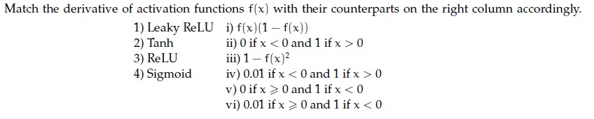

**Figure 1.** Source matching table for Question 157.

**Options**

**A.** 1→ vi, 2→ iii, 3→ v, 4 → i  
*Option ID:* `6406532564176`

**B.** 1→ i, 2→ iv, 3 → iii, 4→ ii  
*Option ID:* `6406532564177`

**C.** 1→ i, 2→ v, 3 → iii, 4→ iv  
*Option ID:* `6406532564178`

**D.** 1→ iv, 2→ iii, 3→ ii, 4 → i  
*Option ID:* `6406532564179`

**Correct answer:** **D** — 1→ iv, 2→ iii, 3→ ii, 4 → i  
**Source evidence:** Green option text (0x8000) and check icon (xref 18) for Option ID 6406532564179, PDF page 7.

---


---

**Source:** `da5006_2024T1_Q2_NA.md` · Quiz 2, 2024T1 · Question 168 · ID `640653766149`  
**Classification:** Week 3 — artificial neuron, linear activation function, affine transformation, feedforward neural network, neuron pre-activation  
**Course evidence:** [## 3. Activation Functions & The Vanishing Gradient Problem](/Volumes/1700%20APFS/PERSONAL_PROGRAMMING_PROJECTS/Notes/Deep%20Learning%20for%20Computer%20Vision/month%201/week%203/week-3-report.md) · Related weeks: none

### Question 168

**Question ID:** `640653766149` · **Type:** SA · **Marks:** 2  
**PDF pages:** 13, 14

**Shared Comprehension Context (Questions 168–170):**
A four-dimensional input $x = [3, 4, 1, 2]$ is passed to a hidden layer with a single neuron and an activation function $a(\cdot)$ to obtain $z$. Assume that the corresponding weights (from input to hidden layer) are $[0.3, 0, -0.4, 0.5]$ and bias is $0.2$.
Consider the corresponding activation functions and give the corresponding value of $z$.
Based on the above data, answer the given subquestions.

**Subquestion 168:**
Linear______________

**Correct answer:** `1.7`  
**Source evidence:** Green text in 'Possible Answers : 1.7', PDF page 14.

---


---

**Source:** `da5006_2024T1_Q2_NA.md` · Quiz 2, 2024T1 · Question 169 · ID `640653766150`  
**Classification:** Week 3 — indicator function, Heaviside step function, threshold activation, McCulloch-Pitts neuron, perceptron activation  
**Course evidence:** [### 1.1 The Biological Blueprint and the McCulloch-Pitts Neuron (1943)](/Volumes/1700%20APFS/PERSONAL_PROGRAMMING_PROJECTS/Notes/Deep%20Learning%20for%20Computer%20Vision/month%201/week%203/week-3-report.md) · Related weeks: none

### Question 169

**Question ID:** `640653766150` · **Type:** SA · **Marks:** 2  
**PDF pages:** 14

**Shared Comprehension Context (Questions 168–170):**
A four-dimensional input $x = [3, 4, 1, 2]$ is passed to a hidden layer with a single neuron and an activation function $a(\cdot)$ to obtain $z$. Assume that the corresponding weights (from input to hidden layer) are $[0.3, 0, -0.4, 0.5]$ and bias is $0.2$.
Consider the corresponding activation functions and give the corresponding value of $z$.
Based on the above data, answer the given subquestions.

**Subquestion 169:**
Indicator function____________

**Correct answer:** `1`  
**Source evidence:** Green text in 'Possible Answers : 1', PDF page 14.

---


---

**Source:** `da5006_2024T1_Q2_NA.md` · Quiz 2, 2024T1 · Question 170 · ID `640653766151`  
**Classification:** Week 3 — Leaky ReLU activation function, rectified linear activations, neural network activations, dead neuron prevention  
**Course evidence:** [## 3. Activation Functions & The Vanishing Gradient Problem](/Volumes/1700%20APFS/PERSONAL_PROGRAMMING_PROJECTS/Notes/Deep%20Learning%20for%20Computer%20Vision/month%201/week%203/week-3-report.md) · Related weeks: none

### Question 170

**Question ID:** `640653766151` · **Type:** SA · **Marks:** 1  
**PDF pages:** 14, 15

**Shared Comprehension Context (Questions 168–170):**
A four-dimensional input $x = [3, 4, 1, 2]$ is passed to a hidden layer with a single neuron and an activation function $a(\cdot)$ to obtain $z$. Assume that the corresponding weights (from input to hidden layer) are $[0.3, 0, -0.4, 0.5]$ and bias is $0.2$.
Consider the corresponding activation functions and give the corresponding value of $z$.
Based on the above data, answer the given subquestions.

**Subquestion 170:**
Leaky-ReLU_____________

**Correct answer:** `1.7`  
**Source evidence:** Green text in 'Possible Answers : 1.7', PDF page 15.

---


---

**Source:** `da5006_2024T1_ET_AN.md` · End-term, 2024T1 · Question 197 · ID `640653821610`  
**Classification:** Week 3 — Computational Graph, Backpropagation, Chain Rule of Calculus, Local Gradients, Arithmetic Circuit  
**Course evidence:** [## 4. The Backpropagation Algorithm & Multivariate Matrix Calculus](/Volumes/1700%20APFS/PERSONAL_PROGRAMMING_PROJECTS/Notes/Deep%20Learning%20for%20Computer%20Vision/month%201/week%203/week-3-report.md) · Related weeks: none

### Question 197

**Question ID:** `640653821610` · **Type:** SA · **Marks:** 0.7  
**PDF pages:** 26, 27

Consider the equation represented by the following circuit:

Circuit: inputs $x, y$ go into addition $(+)$ giving $q = x + y$; $q$ and $z$ go into multiplication $(*)$ giving $f = q \cdot z$.
where $+$ and $*$ represent addition and multiplication.
If $x = -2, y = 5$ and $z = -4$,

Based on the above data, answer the given subquestion:

$$\frac{\partial f}{\partial x} = \text{__________}$$

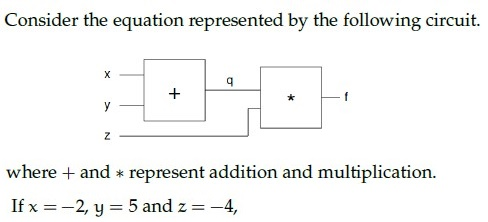

**Figure 2.** Shared context diagram for Questions 197–199.

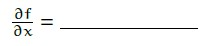

**Figure 3.** Source diagram for Question 197.

**Correct answer:** **-4**  
**Source evidence:** Possible Answers field indicates -4 in green text (#008000) at PDF page 27.

---


---

**Source:** `da5006_2024T1_ET_AN.md` · End-term, 2024T1 · Question 198 · ID `640653821611`  
**Classification:** Week 3 — Computational Graph, Backpropagation, Chain Rule of Calculus, Local Gradients, Arithmetic Circuit  
**Course evidence:** [## 4. The Backpropagation Algorithm & Multivariate Matrix Calculus](/Volumes/1700%20APFS/PERSONAL_PROGRAMMING_PROJECTS/Notes/Deep%20Learning%20for%20Computer%20Vision/month%201/week%203/week-3-report.md) · Related weeks: none

### Question 198

**Question ID:** `640653821611` · **Type:** SA · **Marks:** 0.7  
**PDF pages:** 27

Consider the equation represented by the following circuit:

Circuit: inputs $x, y$ go into addition $(+)$ giving $q = x + y$; $q$ and $z$ go into multiplication $(*)$ giving $f = q \cdot z$.
where $+$ and $*$ represent addition and multiplication.
If $x = -2, y = 5$ and $z = -4$,

Based on the above data, answer the given subquestion:

$$\frac{\partial f}{\partial y} = \text{__________}$$

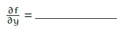

**Figure 4.** Source diagram for Question 198.

**Correct answer:** **-4**  
**Source evidence:** Possible Answers field indicates -4 in green text (#008000) at PDF page 27.

---


---

**Source:** `da5006_2024T1_ET_AN.md` · End-term, 2024T1 · Question 199 · ID `640653821612`  
**Classification:** Week 3 — Computational Graph, Backpropagation, Chain Rule of Calculus, Intermediate Gate Gradients, Arithmetic Circuit  
**Course evidence:** [## 4. The Backpropagation Algorithm & Multivariate Matrix Calculus](/Volumes/1700%20APFS/PERSONAL_PROGRAMMING_PROJECTS/Notes/Deep%20Learning%20for%20Computer%20Vision/month%201/week%203/week-3-report.md) · Related weeks: none

### Question 199

**Question ID:** `640653821612` · **Type:** SA · **Marks:** 0.6  
**PDF pages:** 27, 28

Consider the equation represented by the following circuit:

Circuit: inputs $x, y$ go into addition $(+)$ giving $q = x + y$; $q$ and $z$ go into multiplication $(*)$ giving $f = q \cdot z$.
where $+$ and $*$ represent addition and multiplication.
If $x = -2, y = 5$ and $z = -4$,

Based on the above data, answer the given subquestion:

$$\frac{\partial f}{\partial q} = \text{__________}$$

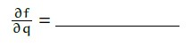

**Figure 5.** Source diagram for Question 199.

**Correct answer:** **-4**  
**Source evidence:** Possible Answers field indicates -4 in green text (#008000) at PDF page 27.

---


---

**Source:** `da5006_2024T2_Q1_NA.md` · Quiz 1, 2024T2 · Question 93 · ID `640653829672`  
**Classification:** Week 3 — activation functions, activation function derivatives, Sigmoid, Tanh, ReLU, Leaky ReLU  
**Course evidence:** [### 3.1 Mathematical Comparison of Canonical Activation Functions](/Volumes/1700%20APFS/PERSONAL_PROGRAMMING_PROJECTS/Notes/Deep%20Learning%20for%20Computer%20Vision/month%201/week%203/week-3-report.md) · Related weeks: none

### Question 93

**Question ID:** `640653829672` · **Type:** MCQ · **Marks:** 2  
**PDF pages:** 8

Match the derivative of activation functions $f(x)$ with their counterparts on the right column accordingly.  

| Left Column | Right Column |
| :--- | :--- |
| 1) Leaky ReLU | i) $f(x)(1 - f(x))$ |
| 2) Tanh | ii) $0$ if $x < 0$ and $1$ if $x > 0$ |
| 3) ReLU | iii) $1 - f(x)^2$ |
| 4) Sigmoid | iv) $0.01$ if $x < 0$ and $1$ if $x > 0$ |
| | v) $0$ if $x > 0$ and $1$ if $x < 0$ |
| | vi) $0.01$ if $x > 0$ and $1$ if $x < 0$ |

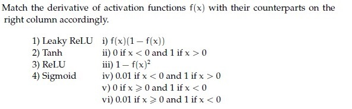

**Figure 6.** Source matching table for Question 93.

**Options**

**A.** 1→ vi, 2→ iii, 3→ v, 4 → i  
*Option ID:* `6406532786695`

**B.** 1→ i, 2→ iv, 3 → iii, 4→ ii  
*Option ID:* `6406532786696`

**C.** 1→ i, 2→ v, 3 → iii, 4→ iv  
*Option ID:* `6406532786697`

**D.** 1→ iv, 2→ iii, 3→ ii, 4 → i  
*Option ID:* `6406532786698`

**Correct answer:** **D** — 1→ iv, 2→ iii, 3→ ii, 4 → i.  
**Source evidence:** Green check mark icon beside Option D on PDF page 8 (y=545.7); red cross icons beside Option A (y=483.3), Option B (y=504.1), and Option C (y=524.9).

---


---

**Source:** `da5006_2024T2_Q2_NA.md` · Quiz 2, 2024T2 · Question 129 · ID `640653856604`  
**Classification:** Week 3 — single neuron forward pass, affine transformation, activation functions, Sigmoid, Linear, Indicator function, Softplus, ReLU, Leaky-ReLU  
**Course evidence:** [3. Activation Functions & The Vanishing Gradient Problem](/Volumes/1700%20APFS/PERSONAL_PROGRAMMING_PROJECTS/Notes/Deep%20Learning%20for%20Computer%20Vision/month%201/week%203/week-3-report.md) · Related weeks: none

### Question 129

**Question ID:** `640653856604` · **Type:** MCQ · **Marks:** 2  
**PDF pages:** 7

A four-dimensional input vector $x = [5, 3, -1, 2]$ is passed to a hidden layer with a single neuron and an activation function $a(.)$ to obtain $z$. Assume that the corresponding weights (from input to hidden layer) are $[0.4, 0.6, 0.8, -0.2]$ and bias is $0.4$. If the activation function $a(.)$ is Sigmoid, Linear, Indicator function, Softplus, ReLU and Leaky-ReLU, what are the corresponding values of $z$? (Note that Indicator function returns 1 for a positive input, and 0 otherwise. Softplus is defined as: $\ln(1 + \exp(z))$).

**Options**

**A.** 0.95, 3, 1, 0.35, 3, 3  
*Option ID:* `6406532878525`

**B.** 0.95, 3, 0, 3.05, 3, 3  
*Option ID:* `6406532878526`

**C.** 0.92, 3, 1, 3.5, 3, 3  
*Option ID:* `6406532878527`

**D.** 0.95, 3, 1, 3.05, 3, 3  
*Option ID:* `6406532878528`

**Correct answer:** **D** — 0.95, 3, 1, 3.05, 3, 3.  
**Source evidence:** Green check icon beside option ID 6406532878528 on page 7.

---


---

**Source:** `da5006_2024T2_ET_AN.md` · End-term, 2024T2 · Question 253 · ID `640653904305`  
**Classification:** Week 3 — hyperparameter tuning, validation set, test set, generalization, overfitting prevention, train-val-test split  
**Course evidence:** [## 7. Training Dynamics: Normalization & Weight Initialization](/Volumes/1700%20APFS/PERSONAL_PROGRAMMING_PROJECTS/Notes/Deep%20Learning%20for%20Computer%20Vision/month%201/week%203/week-3-report.md) · Related weeks: none

### Question 253

**Question ID:** `640653904305` · **Type:** MCQ · **Marks:** 2  
**PDF pages:** 4

Which one of the following statements regarding hyperparameter tuning is True?

**Options**

**A.** Test set performance, with hyperparameters tuned on the validation set, would be a realistic measure of how the model will generalize to new data.  
*Option ID:* `6406533045031`

**B.** Train set is the best choice for tuning hyperparameters  
*Option ID:* `6406533045032`

**C.** Picking hyperparameters that perform the best on the validation set leads to overfitting  
*Option ID:* `6406533045033`

**D.** Tuning hyperparameters on the test set is an acceptable approach to find the most powerful model for generalization performance  
*Option ID:* `6406533045034`

**Correct answer:** **A** — Test set performance, with hyperparameters tuned on the validation set, would be a realistic measure of how the model will generalize to new data.  
**Source evidence:** Option 6406533045031 is rendered in green text (#008000) with a checkmark icon. (PDF page 4).

---


---

**Source:** `da5006_2024T3_Q1_NA.md` · Quiz 1, 2024T3 · Question 146 · ID `640653994486`  
**Classification:** Week 3 — artificial_neuron, activation_functions, preactivation, sigmoid, relu, leaky_relu, softplus  
**Course evidence:** [3.1 Mathematical Comparison of Canonical Activation Functions](/Volumes/1700%20APFS/PERSONAL_PROGRAMMING_PROJECTS/Notes/Deep%20Learning%20for%20Computer%20Vision/month%201/week%203/week-3-report.md) · Related weeks: none

### Question 146

**Question ID:** `640653994486` · **Type:** MCQ · **Marks:** 2  
**PDF pages:** 2

A four-dimensional input vector $\mathbf{x} = [1, -2, 3, -4]$ is passed to a hidden layer with a single neuron and an activation function $a(\cdot)$ to obtain $z$. Assume that the corresponding weights (from input to hidden layer) are $[0.5, -0.3, 0.8, 1.2]$ and bias is $-0.2$. If the activation function $a(\cdot)$ is Sigmoid, Linear, Indicator function, Softplus, ReLU and Leaky-ReLU, what are the corresponding values of $z$? (Note that Indicator function returns 1 for a positive input, and 0 otherwise. Softplus is defined as: $\ln(1 + \exp(z)))$. 

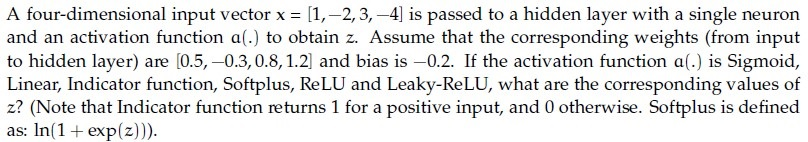

**Figure 7.** Source problem statement and parameters for Question 146.

**Options**

**A.** 0.18, 1.5, 1.5, 0.20,−1.5,−0.015  
*Option ID:* `6406533358216`

**B.** 0.92, 2.5, 1, 2.5, 2.5, 1  
*Option ID:* `6406533358217`

**C.** 0.18,−1.5, 0, 0.20, 0,−0.015  
*Option ID:* `6406533358218`

**D.** 0.91, 1, 0, 0.2, 1, 1.7  
*Option ID:* `6406533358219`

**Correct answer:** **C** — 0.18,−1.5, 0, 0.20, 0,−0.015.  
**Source evidence:** Option C (Option ID 6406533358218) is marked with green text and a checkmark icon in the source PDF.

---


---

**Source:** `da5006_2024T3_Q1_NA.md` · Quiz 1, 2024T3 · Question 151 · ID `640653994505`  
**Classification:** Week 3 — activation_functions, activation_function_derivatives, sigmoid, tanh, relu, leaky_relu  
**Course evidence:** [3. Activation Functions & The Vanishing Gradient Problem](/Volumes/1700%20APFS/PERSONAL_PROGRAMMING_PROJECTS/Notes/Deep%20Learning%20for%20Computer%20Vision/month%201/week%203/week-3-report.md) · Related weeks: none

### Question 151

**Question ID:** `640653994505` · **Type:** MCQ · **Marks:** 2  
**PDF pages:** 4

Match the derivative of activation functions $f(x)$ with their counterparts on the right column accordingly.

1) Leaky ReLU — i) $f(x)(1 - f(x))$  
2) Tanh — ii) $0\text{ if } x < 0\text{ and } 1\text{ if } x > 0$  
3) ReLU — iii) $1 - f(x)^2$  
4) Sigmoid — iv) $0.01\text{ if } x < 0\text{ and } 1\text{ if } x > 0$  
v) $0\text{ if } x > 0\text{ and } 1\text{ if } x < 0$  
vi) $0.01\text{ if } x > 0\text{ and } 1\text{ if } x < 0$

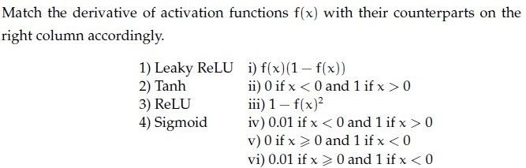

**Figure 8.** Matching table for activation functions and derivatives for Question 151.

**Options**

**A.** 1→ vi, 2→ iii, 3→ v, 4 → i  
*Option ID:* `6406533358250`

**B.** 1→ i, 2 →iv, 3 → iii, 4→ ii  
*Option ID:* `6406533358251`

**C.** 1→ i, 2 →v, 3 → iii, 4→ iv  
*Option ID:* `6406533358252`

**D.** 1→ iv, 2→ iii, 3→ ii, 4 → i  
*Option ID:* `6406533358253`

**Correct answer:** **D** — 1→ iv, 2→ iii, 3→ ii, 4 → i.  
**Source evidence:** Option D (Option ID 6406533358253) is marked with green text and a checkmark icon in the source PDF.

---


---

**Source:** `da5006_2024T3_ET_AN.md` · End-term, 2024T3 · Question 209 · ID `6406531046072`  
**Classification:** Week 3 — single neuron forward pass, affine transformation, activation functions, Sigmoid, Linear, Indicator function, Softplus, ReLU, Leaky-ReLU  
**Course evidence:** [3. Activation Functions & The Vanishing Gradient Problem](/Volumes/1700%20APFS/PERSONAL_PROGRAMMING_PROJECTS/Notes/Deep%20Learning%20for%20Computer%20Vision/month%201/week%203/week-3-report.md) · Related weeks: none

### Question 209

**Question ID:** `6406531046072` · **Type:** Multiple Choice Question (MCQ) · **Marks:** 2  
**PDF pages:** 6, 7

A four-dimensional input vector $x = [1, -2, 3, -4]$ is passed to a hidden layer with a single neuron and an activation function $a(\cdot)$ to obtain $z$. Assume that the corresponding weights (from input to hidden layer) are $[0.5, -0.3, 0.8, 1.2]$ and bias is $-0.2$. If the activation function $a(\cdot)$ is Sigmoid, Linear, Indicator function, Softplus, ReLU and Leaky-ReLU, what are the corresponding values of $z$? (Note that Indicator function returns 1 for a positive input, and 0 otherwise. Softplus is defined as: $\ln(1 + \exp(z))$).

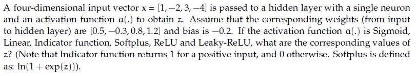
**Figure 9.** Source problem statement for Question 209.

**Options**

**A.** 0.18, 1.5, 1.5, 0.20,−1.5,−0.015  
*Option ID:* `6406533531390`

**B.** 0.92, 2.5, 1, 2.5, 2.5, 1  
*Option ID:* `6406533531391`

**C.** 0.18,−1.5, 0, 0.20, 0,−0.015  
*Option ID:* `6406533531392`

**D.** 0.91, 1, 0, 0.2, 1, 1.7  
*Option ID:* `6406533531393`

**Correct answer:** **C** — 0.18,−1.5, 0, 0.20, 0,−0.015.  
**Source evidence:** Option ID 6406533531392 is rendered in green (color #008000) with a checkmark icon.

---


---

**Source:** `da5006_2024T3_ET_AN.md` · End-term, 2024T3 · Question 212 · ID `6406531046076`  
**Classification:** Week 3 — activation_functions, activation_function_derivatives, sigmoid, tanh, relu, leaky_relu  
**Course evidence:** [3. Activation Functions & The Vanishing Gradient Problem](/Volumes/1700%20APFS/PERSONAL_PROGRAMMING_PROJECTS/Notes/Deep%20Learning%20for%20Computer%20Vision/month%201/week%203/week-3-report.md) · Related weeks: none

### Question 212

**Question ID:** `6406531046076` · **Type:** Multiple Choice Question (MCQ) · **Marks:** 2  
**PDF pages:** 8, 9

Match the derivative of activation functions $f(x)$ with their counterparts on the right column accordingly.

1) Leaky ReLU
2) Tanh
3) ReLU
4) Sigmoid

i) $f(x)(1 - f(x))$
ii) 0 if $x < 0$ and 1 if $x > 0$
iii) $1 - f(x)^2$
iv) 0.01 if $x < 0$ and 1 if $x > 0$
v) 0 if $x > 0$ and 1 if $x < 0$
vi) 0.01 if $x > 0$ and 1 if $x < 0$

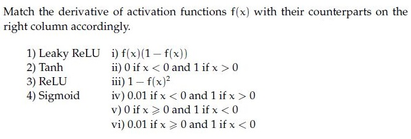
**Figure 10.** Source activation function derivatives matching table for Question 212.

**Options**

**A.** 1→ vi, 2→ iii, 3→ v, 4 → i  
*Option ID:* `6406533531403`

**B.** 1→ i, 2 →iv, 3 → iii, 4→ ii  
*Option ID:* `6406533531404`

**C.** 1→ i, 2 →v, 3 → iii, 4→ iv  
*Option ID:* `6406533531405`

**D.** 1→ iv, 2→ iii, 3→ ii, 4 → i  
*Option ID:* `6406533531406`

**Correct answer:** **D** — 1→ iv, 2→ iii, 3→ ii, 4 → i.  
**Source evidence:** Option ID 6406533531406 is rendered in green (color #008000) with a checkmark icon.

---


---

**Source:** `da5006_2024T3_ET_AN.md` · End-term, 2024T3 · Question 216 · ID `6406531046058`  
**Classification:** Week 3 — computational_graphs, backpropagation, chain_rule, partial_derivatives  
**Course evidence:** [4. The Backpropagation Algorithm & Multivariate Matrix Calculus](/Volumes/1700%20APFS/PERSONAL_PROGRAMMING_PROJECTS/Notes/Deep%20Learning%20for%20Computer%20Vision/month%201/week%203/week-3-report.md) · Related weeks: none

### Question 216

**Question ID:** `6406531046058` · **Type:** Short Answer Question (SA) · **Marks:** 2  
**PDF pages:** 10, 11

**Shared Comprehension Context (Question ID: `6406531046056`):**

Consider the computation graph given below:

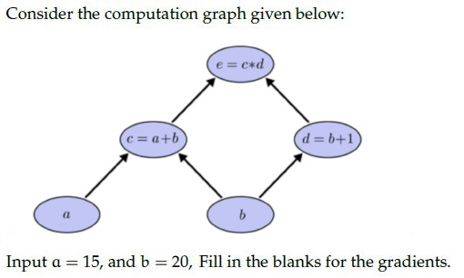
**Figure 11.** Computation graph diagram for Comprehension Questions 215–216.

Input $a = 15$, and $b = 20$, Fill in the blanks for the gradients.

Based on the above data, answer the given subquestions.

**Subquestion:**

The value for $\frac{\partial e}{\partial b} = $ _____

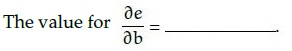
**Figure 12.** Source formula for Question 216.

Response Type : Numeric

**Correct answer:** **56**.  
**Source evidence:** Source key specifies Possible Answers : 56 (rendered in green #008000).

---


---

**Source:** `da5006_2025T1_Q1_NA.md` · Quiz 1, 2025T1 · Question 160 · ID `6406531130645`  
**Classification:** Week 3 — momentum_gradient_descent, velocity_update, optimization_algorithms, first_order_optimization  
**Course evidence:** [5.3 Advanced Momentum and Adaptive Optimizers](/Volumes/1700%20APFS/PERSONAL_PROGRAMMING_PROJECTS/Notes/Deep%20Learning%20for%20Computer%20Vision/month%201/week%203/week-3-report.md) · Related weeks: none

### Question 160

**Question ID:** `6406531130645` · **Type:** SA · **Marks:** 2  
**PDF pages:** 5

Using momentum-based gradient descent, find the new value of the parameter $\theta_{t+1}$, given that the old value $\theta_t = 0.5$, gradient of loss function $\nabla_{\theta_t} L(\theta_t) = 0.2$, velocity term $V_{t-1} = 0.7$, learning rate $\alpha = 0.75$ and momentum term $\gamma = 0.8$ (Round decimal point till 3 places) [Note: Assume that there is no bias].

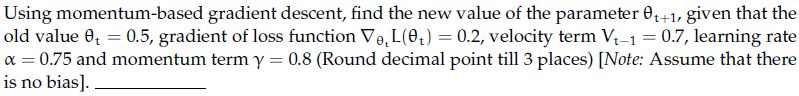

**Figure 13.** Momentum-based gradient descent parameter statement for Question 160.

**Correct answer:** `-0.260 to -0.210`  
**Source evidence:** Official accepted answer range '-0.260 to -0.210' in Possible Answers field with green text (color 0x8000).

---


---

**Source:** `da5006_2025T1_Q1_NA.md` · Quiz 1, 2025T1 · Question 163 · ID `6406531130619`  
**Classification:** Week 3 — artificial_neuron, preactivation, activation_functions, sigmoid, relu, leaky_relu, softplus  
**Course evidence:** [3.1 Mathematical Comparison of Canonical Activation Functions](/Volumes/1700%20APFS/PERSONAL_PROGRAMMING_PROJECTS/Notes/Deep%20Learning%20for%20Computer%20Vision/month%201/week%203/week-3-report.md) · Related weeks: none

### Question 163

**Question ID:** `6406531130619` · **Type:** MCQ · **Marks:** 2  
**PDF pages:** 6

A four-dimensional input vector $\mathbf{x} = [1, -2, 3, -4]$ is passed to a hidden layer with a single neuron and an activation function $a(\cdot)$ to obtain $z$. Assume that the corresponding weights (from input to hidden layer) are $[0.5, -0.3, 0.8, 1.2]$ and bias is $-0.2$. If the activation function $a(\cdot)$ is Sigmoid, Linear, Indicator function, Softplus, ReLU and Leaky-ReLU, what are the corresponding values of $z$? (Note that Indicator function returns 1 for a positive input, and 0 otherwise. Softplus is defined as: $\ln(1 + \exp(z)))$.

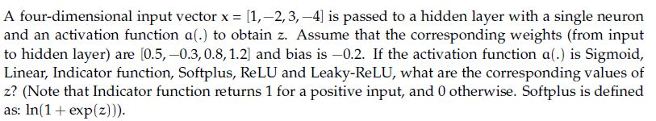

**Figure 14.** Input vector and activation function problem statement for Question 163.

**Options**

**A.** 0.18, 1.5, 1.5, 0.20,−1.5,−0.015  
*Option ID:* `6406533822697`

**B.** 0.92, 2.5, 1, 2.5, 2.5, 1  
*Option ID:* `6406533822698`

**C.** 0.18,−1.5, 0, 0.20, 0,−0.015  
*Option ID:* `6406533822699`

**D.** 0.91, 1, 0, 0.2, 1, 1.7  
*Option ID:* `6406533822700`

**Correct answer:** **C** — 0.18,−1.5, 0, 0.20, 0,−0.015.  
**Source evidence:** Option 6406533822699 rendered in green font (color 0x8000) with green checkmark icon in source PDF.

---


---

**Source:** `da5006_2025T1_Q1_NA.md` · Quiz 1, 2025T1 · Question 168 · ID `6406531130637`  
**Classification:** Week 3 — Activation Functions, Derivatives of Activation Functions, Sigmoid, Tanh, ReLU, Leaky ReLU  
**Course evidence:** [## 3. Activation Functions & The Vanishing Gradient Problem](/Volumes/1700%20APFS/PERSONAL_PROGRAMMING_PROJECTS/Notes/Deep%20Learning%20for%20Computer%20Vision/month%201/week%203/week-3-report.md) · Related weeks: none

### Question 168

**Question ID:** `6406531130637` · **Type:** MCQ · **Marks:** 2  
**PDF pages:** 8

Match the derivative of activation functions $f(x)$ with their counterparts on the right column accordingly.

| Column 1 | Column 2 |
| :--- | :--- |
| 1) Leaky ReLU | i) $f(x)(1 - f(x))$ |
| 2) Tanh | ii) 0 if $x < 0$ and 1 if $x > 0$ |
| 3) ReLU | iii) $1 - f(x)^2$ |
| 4) Sigmoid | iv) 0.01 if $x < 0$ and 1 if $x > 0$ |
| | v) 0 if $x > 0$ and 1 if $x < 0$ |
| | vi) 0.01 if $x > 0$ and 1 if $x < 0$ |

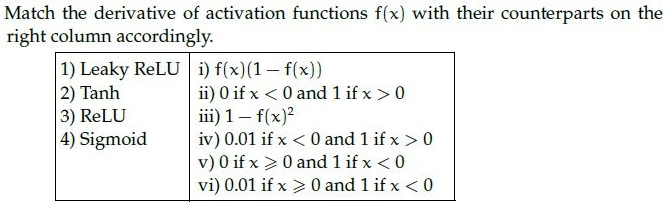

**Figure 15.** Activation function derivatives matching table for Question 168.

**Options**

**A.** 1→ vi, 2→ iii, 3→ v, 4 → i  
*Option ID:* `6406533822730`

**B.** 1→ i, 2→ iv, 3 → iii, 4→ ii  
*Option ID:* `6406533822731`

**C.** 1→ i, 2→ v, 3 → iii, 4→ iv  
*Option ID:* `6406533822732`

**D.** 1→ iv, 2→ iii, 3→ ii, 4 → i  
*Option ID:* `6406533822733`

**Correct answer:** **D** — 1→ iv, 2→ iii, 3→ ii, 4 → i.  
**Source evidence:** Option 6406533822733 rendered in green font (color 0x8000) with green checkmark icon in source PDF.

---


---

**Source:** `da5006_2025T1_Q1_NA.md` · Quiz 1, 2025T1 · Question 172 · ID `6406531130644`  
**Classification:** Week 3 — Gradient Descent, Momentum-based GD, Stochastic Gradient Descent (SGD), Optimization Dynamics  
**Course evidence:** [### 5.3 Advanced Momentum and Adaptive Optimizers](/Volumes/1700%20APFS/PERSONAL_PROGRAMMING_PROJECTS/Notes/Deep%20Learning%20for%20Computer%20Vision/month%201/week%203/week-3-report.md) · Related weeks: none

### Question 172

**Question ID:** `6406531130644` · **Type:** MCQ · **Marks:** 2  
**PDF pages:** 9

Which of the following statements are True?

**Options**

**A.** Vanilla Gradient Descent converges faster than Momentum-based GD.  
*Option ID:* `6406533822752`

**B.** Momentum based GD oscillates around minima before convergence.  
*Option ID:* `6406533822753`

**C.** Noise in Stochastic Gradient descent weight updates – can lead to faster convergence.  
*Option ID:* `6406533822754`

**D.** None of these  
*Option ID:* `6406533822755`

**Correct answer:** **B** — Momentum based GD oscillates around minima before convergence..  
**Source evidence:** Option 6406533822753 rendered in green font (color 0x8000) with green checkmark icon in source PDF.

---


---

**Source:** `da5006_2025T1_Q1_NA.md` · Quiz 1, 2025T1 · Question 175 · ID `6406531130614`  
**Classification:** Week 3 — Optimization Algorithms, Momentum, Stochastic Gradient Descent, AdaGrad, RMSprop, Adam  
**Course evidence:** [### 5.3 Advanced Momentum and Adaptive Optimizers](/Volumes/1700%20APFS/PERSONAL_PROGRAMMING_PROJECTS/Notes/Deep%20Learning%20for%20Computer%20Vision/month%201/week%203/week-3-report.md) · Related weeks: none

### Question 175

**Question ID:** `6406531130614` · **Type:** MSQ · **Marks:** 2  
**PDF pages:** 10

Which of the following statements are false?

**Options**

**A.** Momentum in optimization can cause oscillations around minima when encountering flat regions or saddle points due to the dominance of the momentum term over the small gradient.  
*Option ID:* `6406533822680`

**B.** Stochastic Gradient Descent (SGD) with its inherent noise can be beneficial in escaping local minima and saddle points, provided that there is enough gradient information in the neighborhood.  
*Option ID:* `6406533822681`

**C.** Adagrad is an optimization algorithm introduced to overcome the diminishing learning rate problem in techniques like RMSProp.  
*Option ID:* `6406533822682`

**D.** ADAM is introduced to solve problems in RMSProp by combining RMSProp and Adagrad techniques.  
*Option ID:* `6406533822683`

**Correct answer:** **C**, **D** — Adagrad is an optimization algorithm introduced to overcome the diminishing learning rate problem in techniques like RMSProp. ; ADAM is introduced to solve problems in RMSProp by combining RMSProp and Adagrad techniques..  
**Source evidence:** Option C (6406533822682) rendered in green font (color 0x8000) with green checkmark icon in source PDF; Option D (6406533822683) rendered in green font (color 0x8000) with green checkmark icon in source PDF.

---


---

**Source:** `da5006_2025T1_Q1_NA.md` · Quiz 1, 2025T1 · Question 178 · ID `6406531130621`  
**Classification:** Week 3 — Activation Functions, Sigmoid, Tanh, Vanishing Gradient, Zero-Centered Activation  
**Course evidence:** [### 3.1 Mathematical Comparison of Canonical Activation Functions](/Volumes/1700%20APFS/PERSONAL_PROGRAMMING_PROJECTS/Notes/Deep%20Learning%20for%20Computer%20Vision/month%201/week%203/week-3-report.md) · Related weeks: none

### Question 178

**Question ID:** `6406531130621` · **Type:** MSQ · **Marks:** 2  
**PDF pages:** 12

Which of the following statements are true ? (Select all that apply)

**Options**

**A.** tanh activation function can be represented as below in terms of sigmoid activation function: $\tanh(x) = 2\sigma(2x) - 1$, where $\sigma$ = sigmoid activation function

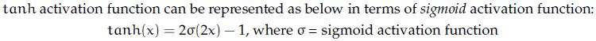

**Figure 16.** Statement for Option A.

*Option ID:* `6406533822705`

**B.** The derivative of the Sigmoid activation function is symmetric around the origin.

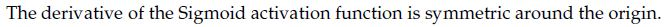

**Figure 17.** Statement for Option B.

*Option ID:* `6406533822706`

**C.** Gradient of sigmoid neuron at saturation explodes

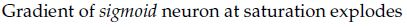

**Figure 18.** Statement for Option C.

*Option ID:* `6406533822707`

**D.** sigmoid activation is centered around 0.5 whereas tanh activation is centered around 0.

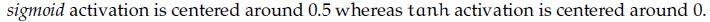

**Figure 19.** Statement for Option D.

*Option ID:* `6406533822708`

**Correct answer:** **A**, **D** — tanh activation function can be represented as below in terms of sigmoid activation function: tanh(x) = 2sigma(2x) - 1, where sigma = sigmoid activation function ; sigmoid activation is centered around 0.5 whereas tanh activation is centered around 0..  
**Source evidence:** Option A (6406533822705) rendered in green font (color 0x8000) with green checkmark icon in source PDF; Option D (6406533822708) rendered in green font (color 0x8000) with green checkmark icon in source PDF.

---


---

**Source:** `da5006_2025T1_Q1_NA.md` · Quiz 1, 2025T1 · Question 188 · ID `6406531130647`  
**Classification:** Week 3 — Computation Graph, Backpropagation, Chain Rule, Partial Derivatives, Gradient Calculus  
**Course evidence:** [## 4. The Backpropagation Algorithm & Multivariate Matrix Calculus](/Volumes/1700%20APFS/PERSONAL_PROGRAMMING_PROJECTS/Notes/Deep%20Learning%20for%20Computer%20Vision/month%201/week%203/week-3-report.md) · Related weeks: none

### Question 188

**Question ID:** `6406531130647` · **Type:** SA · **Marks:** 1  
**PDF pages:** 16, 17

**Shared Comprehension Context (Question ID: `6406531130646`):**

> Consider the computation graph and given answer the subquestions.
>
> Based on the above data, answer the given subquestions.

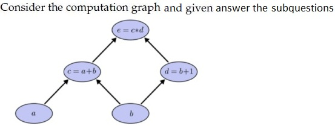

**Figure 20.** Computation graph diagram for Comprehension Questions 188–189.

Input $a = 50$, and $b = 2$, The value for $\frac{\partial e}{\partial a} = $ _____  
Fill in the blank for the gradients.

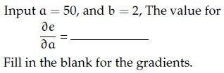

**Figure 21.** Partial derivative formula for Question 188.

**Correct answer:** `3`  
**Source evidence:** Official answer '3' in Possible Answers field with green text (color 0x8000) on PDF page 17.

---


---

**Source:** `da5006_2025T1_Q1_NA.md` · Quiz 1, 2025T1 · Question 189 · ID `6406531130648`  
**Classification:** Week 3 — Computation Graph, Backpropagation, Chain Rule, Partial Derivatives, Gradient Calculus  
**Course evidence:** [## 4. The Backpropagation Algorithm & Multivariate Matrix Calculus](/Volumes/1700%20APFS/PERSONAL_PROGRAMMING_PROJECTS/Notes/Deep%20Learning%20for%20Computer%20Vision/month%201/week%203/week-3-report.md) · Related weeks: none

### Question 189

**Question ID:** `6406531130648` · **Type:** SA · **Marks:** 1  
**PDF pages:** 17

**Shared Comprehension Context (Question ID: `6406531130646`):**

> Consider the computation graph and given answer the subquestions.
>
> Based on the above data, answer the given subquestions.

Input $a = 50$, and $b = 2$, The value for $\frac{\partial e}{\partial b} = $ _____  
Fill in the blank for the gradients.

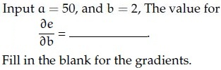

**Figure 22.** Partial derivative formula for Question 189.

**Correct answer:** `55`  
**Source evidence:** Official answer '55' in Possible Answers field with green text (color 0x8000) on PDF page 17.

---


---

**Source:** `da5006_2025T2_Q1_NA.md` · Quiz 1, 2025T2 · Question 161 · ID `6406531279503`  
**Classification:** Week 3 — Neuron Activation, Sigmoid, ReLU, Leaky ReLU, Softplus, Artificial Neurons  
**Course evidence:** [### 3.1 Mathematical Comparison of Canonical Activation Functions](/Volumes/1700%20APFS/PERSONAL_PROGRAMMING_PROJECTS/Notes/Deep%20Learning%20for%20Computer%20Vision/month%201/week%203/week-3-report.md) · Related weeks: none

### Question 161

**Question ID:** `6406531279503` · **Type:** MCQ · **Marks:** 2  
**PDF pages:** 5

A four-dimensional input vector $x = [2, -1, 0, 3]^T$ is passed to a hidden layer with a single neuron and an activation function $\sigma(\cdot)$ to obtain $z$. Assume the corresponding weights are $[0.4, -0.6, 0.3, 0.9]$ and the bias is $-0.1$. If the activation function $\sigma(\cdot)$ is Sigmoid, Linear, Indicator, Softplus, ReLU, and Leaky-ReLU (with leak coefficient 0.01), what are the corresponding values of $z$? [Note: Indicator function returns 1 for positive input, 0 otherwise; Softplus is defined as $\ln(1 + e^x)$].

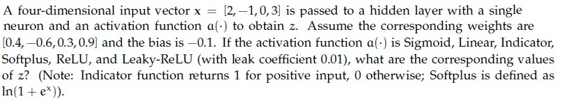

**Figure 23.** Input vector and activation function problem statement for Question 161.

**Options**

**A.** 0.9820, 4.00, 1, 4.02, 4.00, 4.00  
*Option ID:* `6406534313857`

**B.** 0.8808, 3.50, 1, 3.54, 3.50, 3.50  
*Option ID:* `6406534313858`

**C.** 0.7311, 2.00, 1, 2.13, 2.00, 2.00  
*Option ID:* `6406534313859`

**D.** 0.5000, 0.00, 0, 0.69, 0.00, 0.00  
*Option ID:* `6406534313860`

**Correct answer:** **A** — 0.9820, 4.00, 1, 4.02, 4.00, 4.00.  
**Source evidence:** Option 6406534313857 rendered in green text (color 0x8000) on PDF page 5.

---


---

**Source:** `da5006_2025T2_Q1_NA.md` · Quiz 1, 2025T2 · Question 165 · ID `6406531279507`  
**Classification:** Week 3 — Activation Functions, Derivatives of Activation Functions, Sigmoid, Tanh, ReLU, Leaky ReLU  
**Course evidence:** [### 3.1 Mathematical Comparison of Canonical Activation Functions](/Volumes/1700%20APFS/PERSONAL_PROGRAMMING_PROJECTS/Notes/Deep%20Learning%20for%20Computer%20Vision/month%201/week%203/week-3-report.md) · Related weeks: none

### Question 165

**Question ID:** `6406531279507` · **Type:** MCQ · **Marks:** 2  
**PDF pages:** 7

Match the derivative of activation functions $f(x)$ with their counterparts on the right column accordingly.

1) Leaky ReLU  
2) Tanh  
3) ReLU  
4) Sigmoid  

Right column:

i) $f(x)(1 - f(x))$  
ii) $0 \text{ if } x < 0 \text{ and } 1 \text{ if } x > 0$  
iii) $1 - f(x)^2$  
iv) $0.01 \text{ if } x < 0 \text{ and } 1 \text{ if } x > 0$  
v) $0 \text{ if } x > 0 \text{ and } 1 \text{ if } x < 0$  
vi) $0.01 \text{ if } x > 0 \text{ and } 1 \text{ if } x < 0$  

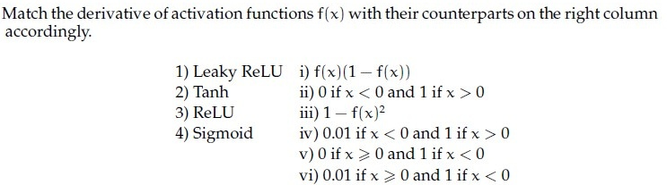

**Figure 24.** Activation function derivative matching problem statement for Question 165.

**Options**

**A.** 1 -> vi, 2 -> iii, 3 -> v, 4 -> i

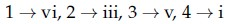

**Figure 25.** Option A candidate mapping for Question 165.  
*Option ID:* `6406534313873`

**B.** 1 -> i, 2 -> iv, 3 -> iii, 4 -> ii

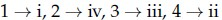

**Figure 26.** Option B candidate mapping for Question 165.  
*Option ID:* `6406534313874`

**C.** 1 -> i, 2 -> v, 3 -> iii, 4 -> iv

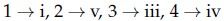

**Figure 27.** Option C candidate mapping for Question 165.  
*Option ID:* `6406534313875`

**D.** 1 -> iv, 2 -> iii, 3 -> ii, 4 -> i

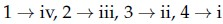

**Figure 28.** Option D candidate mapping for Question 165.  
*Option ID:* `6406534313876`

**Correct answer:** **D** — 1 -> iv, 2 -> iii, 3 -> ii, 4 -> i.  
**Source evidence:** Option 6406534313876 rendered in green text (color 0x8000) on PDF page 7.

---


---

**Source:** `da5006_2025T2_Q1_NA.md` · Quiz 1, 2025T2 · Question 167 · ID `6406531279509`  
**Classification:** Week 3 — Gradient Descent, Momentum-based GD, Optimization Dynamics, Oscillation Around Minima  
**Course evidence:** [### 5.3 Advanced Momentum and Adaptive Optimizers](/Volumes/1700%20APFS/PERSONAL_PROGRAMMING_PROJECTS/Notes/Deep%20Learning%20for%20Computer%20Vision/month%201/week%203/week-3-report.md) · Related weeks: none

### Question 167

**Question ID:** `6406531279509` · **Type:** MCQ · **Marks:** 2  
**PDF pages:** 8

Which of the following statements are True?

**Options**

**A.** Vanilla Gradient Descent converges faster than Momentum-based GD.  
*Option ID:* `6406534313881`

**B.** Momentum based GD oscillates around minima before convergence.  
*Option ID:* `6406534313882`

**C.** Noise in Stochastic Gradient descent weight updates – can lead to faster convergence.  
*Option ID:* `6406534313883`

**D.** None of these  
*Option ID:* `6406534313884`

**Correct answer:** **B** — Momentum based GD oscillates around minima before convergence..  
**Source evidence:** Option 6406534313882 rendered in green text (color 0x8000) on PDF page 8.

---


---

**Source:** `da5006_2025T2_Q1_NA.md` · Quiz 1, 2025T2 · Question 171 · ID `6406531279513`  
**Classification:** Week 3 — Activation Functions, Sigmoid, Tanh, Zero-Centered Activation, Vanishing Gradient  
**Course evidence:** [### 3.1 Mathematical Comparison of Canonical Activation Functions](/Volumes/1700%20APFS/PERSONAL_PROGRAMMING_PROJECTS/Notes/Deep%20Learning%20for%20Computer%20Vision/month%201/week%203/week-3-report.md) · Related weeks: none

### Question 171

**Question ID:** `6406531279513` · **Type:** MSQ · **Marks:** 3  
**PDF pages:** 10

Which of the following statements are true?(Select all that apply)

**Options**

**A.** tanh activation function can be expressed in terms of the sigmoid activation function as: $\tanh(x) = 2\sigma(2x) - 1$, where $\sigma$ is the sigmoid activation function.

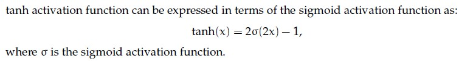

**Figure 29.** Option A candidate statement for Question 171.  
*Option ID:* `6406534313897`

**B.** The derivative of the sigmoid activation function is symmetric around the origin.

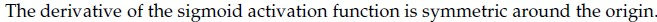

**Figure 30.** Option B candidate statement for Question 171.  
*Option ID:* `6406534313898`

**C.** The gradient of a sigmoid neuron at saturation tends to explode.

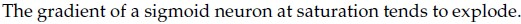

**Figure 31.** Option C candidate statement for Question 171.  
*Option ID:* `6406534313899`

**D.** The sigmoid activation function is centered around 0.5, whereas the tanh activation function is centered around 0.

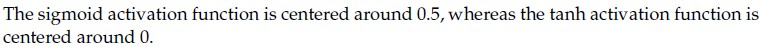

**Figure 32.** Option D candidate statement for Question 171.  
*Option ID:* `6406534313900`

**Correct answer:** **A, D**  
**Source evidence:** Option 6406534313897 rendered in green text (color 0x8000) on PDF page 10; Option 6406534313900 rendered in green text (color 0x8000) on PDF page 10.

---


---

**Source:** `da5006_2025T2_Q1_NA.md` · Quiz 1, 2025T2 · Question 175 · ID `6406531279517`  
**Classification:** Week 3 — Momentum, Stochastic Gradient Descent, Optimization Dynamics, Saddle Points  
**Course evidence:** [### 5.3 Advanced Momentum and Adaptive Optimizers](/Volumes/1700%20APFS/PERSONAL_PROGRAMMING_PROJECTS/Notes/Deep%20Learning%20for%20Computer%20Vision/month%201/week%203/week-3-report.md) · Related weeks: none

### Question 175

**Question ID:** `6406531279517` · **Type:** MSQ · **Marks:** 3  
**PDF pages:** 12

Which of the following statements are false?

**Options**

**A.** Momentum in optimization can cause oscillations around minima when encountering flat regions or saddle points due to the dominance of the momentum term over the small gradient.  
*Option ID:* `6406534313915`

**B.** Stochastic Gradient Descent (SGD) with its inherent noise can be beneficial in escaping local minima and saddle points, provided that there is enough gradient information in the neighborhood.  
*Option ID:* `6406534313916`

**C.** Adagrad is an optimization algorithm introduced to overcome the diminishing learning rate problem in techniques like RMSProp.  
*Option ID:* `6406534313917`

**D.** ADAM is introduced to solve problems in RMSProp by combining RMSProp and Adagrad techniques.  
*Option ID:* `6406534313918`

**Correct answer:** **C, D**  
**Source evidence:** Option 6406534313917 rendered in green text (color 0x8000) on PDF page 12; Option 6406534313918 rendered in green text (color 0x8000) on PDF page 12.

---


---

**Source:** `da5006_2025T2_Q1_NA.md` · Quiz 1, 2025T2 · Question 182 · ID `6406531279533`  
**Classification:** Week 3 — Momentum-based Gradient Descent, Parameter Update Formula, Velocity Term, Optimization Algorithms  
**Course evidence:** [### 5.3 Advanced Momentum and Adaptive Optimizers](/Volumes/1700%20APFS/PERSONAL_PROGRAMMING_PROJECTS/Notes/Deep%20Learning%20for%20Computer%20Vision/month%201/week%203/week-3-report.md) · Related weeks: none

### Question 182

**Question ID:** `6406531279533` · **Type:** SA · **Marks:** 3  
**PDF pages:** 16

Using momentum-based gradient descent, find the new value of the parameter $\theta_{t+1}$, given that the old value $\theta_t = 0.5$, gradient of loss function $\nabla_{\theta_t} L(\theta_t) = 0.2$, velocity term $V_{t-1} = 0.7$, learning rate $\alpha = 0.75$ and momentum term $\gamma = 0.8$ (Round decimal point till 3 places) [Note: Assume that there is no bias].

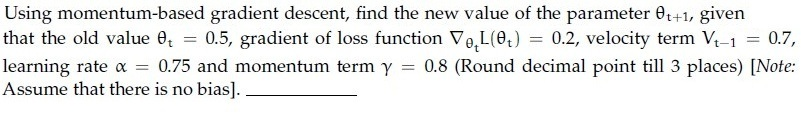

**Figure 33.** Momentum-based gradient descent parameter update for Question 182.

**Correct answer:** `-0.260 to -0.210`  
**Source evidence:** Official accepted answer range '-0.260 to -0.210' specified in Possible Answers field with green text (color 0x8000) on PDF page 16.

---


---

**Source:** `da5006_2025T2_ET_AN.md` · End-term, 2025T2 · Question 84 · ID `6406531431344`  
**Classification:** Week 3 — PyTorch tensor operations, torch.mean, reduction along batch dimension dim=0, keepdim, tensor statistics in deep learning  
**Course evidence:** [7.4 Batch Normalization (Ioffe & Szegedy, 2015)](/Volumes/1700%20APFS/PERSONAL_PROGRAMMING_PROJECTS/Notes/Deep%20Learning%20for%20Computer%20Vision/month%201/week%203/week-3-report.md) · Related weeks: 1

### Question 84

**Question ID:** `6406531431344` · **Type:** MCQ · **Marks:** 2  
**PDF pages:** 2

Consider the following Pytorch code:

```python
1. x = torch.tensor([[-3., 2., 3.], [4., -5., 7.], [20., 3., 2.]])
2. print(torch.mean(x, dim=0, keepdim=True))
```

The output of the code is:

**Options**

**A.** tensor([ 7., 0., 4.])  
*Option ID:* `6406534780246`

**B.** tensor([[ -7., 10., -4.]])  
*Option ID:* `6406534780247`

**C.** tensor([[ -7.],[7.],[4.]])  
*Option ID:* `6406534780248`

**D.** tensor([ -7., 7., 3.])  
*Option ID:* `6406534780249`

**E.** tensor([[7., 0., 4.]])  
*Option ID:* `6406534780250`

**F.** tensor([[ 0.],[7.],[4.]])  
*Option ID:* `6406534780251`

**Correct answer:** **E** — tensor([[7., 0., 4.]]).  
**Source evidence:** Option E (6406534780250) rendered in green font (#008000) indicating the officially accepted answer in the source key. (PDF page 2).

---


---

**Source:** `da5006_2025T2_ET_AN.md` · End-term, 2025T2 · Question 89 · ID `6406531431349`  
**Classification:** Week 3 — hyperparameter tuning, validation set, test set data leakage, overfitting, generalization performance  
**Course evidence:** [6. Regularization, Inductive Bias & Generalization Mechanics](/Volumes/1700%20APFS/PERSONAL_PROGRAMMING_PROJECTS/Notes/Deep%20Learning%20for%20Computer%20Vision/month%201/week%203/week-3-report.md) · Related weeks: none

### Question 89

**Question ID:** `6406531431349` · **Type:** MCQ · **Marks:** 2  
**PDF pages:** 3, 4

Which one of the following statements regarding hyperparameter tuning is false?

**Options**

**A.** Validation set is the best choice for tuning hyperparameters  
*Option ID:* `6406534780269`

**B.** Picking hyperparameters that perform the best on the training set leads to overfitting  
*Option ID:* `6406534780270`

**C.** Tuning hyperparameters on the test set is an acceptable approach to find the most powerful model for generalization performance  
*Option ID:* `6406534780271`

**D.** Test set performance, with hyperparameters tuned on the validation set, would be a realistic measure of how the model will generalize to new data.  
*Option ID:* `6406534780272`

**Correct answer:** **C** — Tuning hyperparameters on the test set is an acceptable approach to find the most powerful model for generalization performance.  
**Source evidence:** Option C (6406534780271) rendered in green font (#008000) indicating the officially accepted answer in the source key. (PDF page 4).

---


---

**Source:** `da5006_2025T2_ET_AN.md` · End-term, 2025T2 · Question 101 · ID `6406531431361`  
**Classification:** Week 3 — McCulloch-Pitts neuron, linear separability, XOR problem, L1 vs L2 regularization, weight sparsity, Dropout training vs test phase scaling  
**Course evidence:** [6. Regularization, Inductive Bias & Generalization Mechanics](/Volumes/1700%20APFS/PERSONAL_PROGRAMMING_PROJECTS/Notes/Deep%20Learning%20for%20Computer%20Vision/month%201/week%203/week-3-report.md) · Related weeks: none

### Question 101

**Question ID:** `6406531431361` · **Type:** MSQ · **Marks:** 2  
**PDF pages:** 8

Which one of the following statements is true:

**Options**

**A.** Weight change criterion is a method of ‘early stopping’ that checks whether or not the error is dropping over epochs to decide whether to continue training or stop.  
*Option ID:* `6406534780319`

**B.** L1 norm tends to create more sparse weights than L2 norm.  
*Option ID:* `6406534780320`

**C.** During the training phase, for each iteration, Dropout ignores a random fraction, p, of nodes, and accounts for it in the test phase by scaling down the activations by a factor of p.  
*Option ID:* `6406534780321`

**D.** A single McCulloch-Pitts neuron is capable of modeling AND, OR, XOR, NOR, and NAND functions.  
*Option ID:* `6406534780322`

**Correct answer:** **B, C** — L1 norm tends to create more sparse weights than L2 norm.; During the training phase, for each iteration, Dropout ignores a random fraction, p, of nodes, and accounts for it in the test phase by scaling down the activations by a factor of p..  
**Source evidence:** Option 6406534780320 is rendered in green text (#008000) with a checkmark icon. (PDF page 8).

---


---

**Source:** `da5006_2025T2_ET_AN.md` · End-term, 2025T2 · Question 104 · ID `6406531431364`  
**Classification:** Week 3 — Momentum-Based Gradient Descent, Polyak Classical Momentum, Velocity Vector Update, Optimization, Learning Rate and Momentum Coefficient  
**Course evidence:** [#### 1. Polyak Classical Momentum (1964)](/Volumes/1700%20APFS/PERSONAL_PROGRAMMING_PROJECTS/Notes/Deep%20Learning%20for%20Computer%20Vision/month%201/week%203/week-3-report.md) · Related weeks: none

### Question 104

**Question ID:** `6406531431364` · **Type:** SA · **Marks:** 2  
**PDF pages:** 9, 10

Using momentum-based gradient descent, find the new value of the parameter $\theta_{t+1}$, given that the old value $\theta_t = 1.20$, gradient of loss function $\nabla_{\theta_t} L(\theta_t) = -0.05$, velocity term $V_{t-1} = 0.30$, learning rate $\alpha = 0.10$ and momentum term $\gamma = 0.90$. (Round decimal point till 3 places) [Note: Assume that there is no bias].

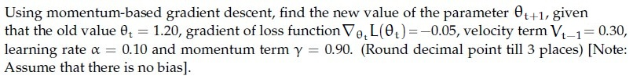

**Figure 34.** Source problem statement for Question 104.

**Correct answer:** 0.930 to 0.940  
**Source evidence:** Source key specifies Possible Answers : 0.930 to 0.940 (Answers Type : Equal).

---


---

**Source:** `da5006_2025T2_ET_AN.md` · End-term, 2025T2 · Question 109 · ID `6406531431368`  
**Classification:** Week 3 — Backpropagation, Computational Graph, Reverse-Mode Automatic Differentiation, Partial Derivatives, Chain Rule  
**Course evidence:** [## 4. The Backpropagation Algorithm & Multivariate Matrix Calculus](/Volumes/1700%20APFS/PERSONAL_PROGRAMMING_PROJECTS/Notes/Deep%20Learning%20for%20Computer%20Vision/month%201/week%203/week-3-report.md) · Related weeks: none

### Question 109

**Question ID:** `6406531431368` · **Type:** SA · **Marks:** 1  
**PDF pages:** 12

**Shared Comprehension Context (Question ID: `6406531431367`):**

Consider the computation graph given below:
Input $a = 10$, and $b = -3$,
Fill in the blanks for the gradients.

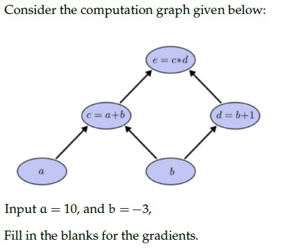

**Figure 35.** Source computation graph for Comprehension Questions 109–110.

**Subquestion:**

The value for $\frac{\partial e}{\partial a}$

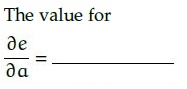

**Figure 36.** Source gradient query for Question 109.

**Correct answer:** -2  
**Source evidence:** Source key specifies Possible Answers : -2 (Answers Type : Equal).

---


---

**Source:** `da5006_2025T2_ET_AN.md` · End-term, 2025T2 · Question 110 · ID `6406531431369`  
**Classification:** Week 3 — Backpropagation, Computational Graph, Reverse-Mode Automatic Differentiation, Partial Derivatives, Chain Rule  
**Course evidence:** [## 4. The Backpropagation Algorithm & Multivariate Matrix Calculus](/Volumes/1700%20APFS/PERSONAL_PROGRAMMING_PROJECTS/Notes/Deep%20Learning%20for%20Computer%20Vision/month%201/week%203/week-3-report.md) · Related weeks: none


**Figure 37.** Source computation graph for Comprehension Questions 109–110.

### Question 110

**Question ID:** `6406531431369` · **Type:** SA · **Marks:** 1  
**PDF pages:** 12, 13

**Shared Comprehension Context (Question ID: `6406531431367`):**

Consider the computation graph given below:
Input $a = 10$, and $b = -3$,
Fill in the blanks for the gradients.

Refer to Figure 37 (Source computation graph for Comprehension Questions 109–110).

**Subquestion:**

The value for $\frac{\partial e}{\partial b}$

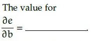

**Figure 38.** Source gradient query for Question 110.

**Correct answer:** 5  
**Source evidence:** Source key specifies Possible Answers : 5 (Answers Type : Equal).

---


---

**Source:** `da5006_2025T2_ET_AN.md` · End-term, 2025T2 · Question 126 · ID `6406531431390`  
**Classification:** Week 3 — Artificial Neuron, Affine Pre-Activation, Sigmoid Activation Function, Logistic Function, Forward Pass  
**Course evidence:** [### 3.1 Mathematical Comparison of Canonical Activation Functions](/Volumes/1700%20APFS/PERSONAL_PROGRAMMING_PROJECTS/Notes/Deep%20Learning%20for%20Computer%20Vision/month%201/week%203/week-3-report.md) · Related weeks: none

### Question 126

**Question ID:** `6406531431390` · **Type:** SA · **Marks:** 1  
**PDF pages:** 18, 19

**Shared Comprehension Context (Question ID: `6406531431389`):**

A four-dimensional input vector $x = [4, -5, -7, 10]$ is passed to a hidden layer with a single neuron and an activation function $a(z)$. The weights and bias for this neuron are $w = [2, 1, -3, 1]^T$ and $b = 1$, respectively. The output is calculated as $\hat{y} = a(z)$, where $z = w^T x + b$. Calculate the output $\hat{y}$ (enter the value in blank) for the following activation functions.

[Note: Enter round-off values till 2 decimal places]

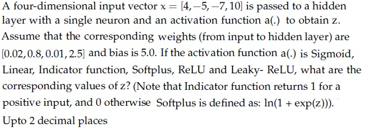

**Figure 39.** Source activation function problem statement for Comprehension Questions 126–131.

**Subquestion:**

Sigmoid ______________

**Correct answer:** 0.99  
**Source evidence:** Source key specifies Possible Answers : 0.99 (Answers Type : Equal).

---


---

**Source:** `da5006_2025T2_ET_AN.md` · End-term, 2025T2 · Question 127 · ID `6406531431391`  
**Classification:** Week 3 — Artificial Neuron, Linear Activation Function, Affine Pre-Activation, Neural Network Foundations  
**Course evidence:** [## 3. Activation Functions & The Vanishing Gradient Problem](/Volumes/1700%20APFS/PERSONAL_PROGRAMMING_PROJECTS/Notes/Deep%20Learning%20for%20Computer%20Vision/month%201/week%203/week-3-report.md) · Related weeks: none


**Figure 40.** Source activation function problem statement for Comprehension Questions 126–131.

### Question 127

**Question ID:** `6406531431391` · **Type:** SA · **Marks:** 1  
**PDF pages:** 19

**Shared Comprehension Context (Question ID: `6406531431389`):**

A four-dimensional input vector $x = [4, -5, -7, 10]$ is passed to a hidden layer with a single neuron and an activation function $a(z)$. The weights and bias for this neuron are $w = [2, 1, -3, 1]^T$ and $b = 1$, respectively. The output is calculated as $\hat{y} = a(z)$, where $z = w^T x + b$. Calculate the output $\hat{y}$ (enter the value in blank) for the following activation functions.

[Note: Enter round-off values till 2 decimal places]

Refer to Figure 40 (Source activation function problem statement for Comprehension Questions 126–131).

**Subquestion:**

Linear ______________

**Correct answer:** 26.01  
**Source evidence:** Source key specifies Possible Answers : 26.01 (Answers Type : Equal).

---


---

**Source:** `da5006_2025T2_ET_AN.md` · End-term, 2025T2 · Question 128 · ID `6406531431392`  
**Classification:** Week 3 — Perceptron, McCulloch-Pitts Neuron, Indicator Function, Heaviside Step Function, Threshold Activation  
**Course evidence:** [### 1.2 Rosenblatt's Perceptron (1958)](/Volumes/1700%20APFS/PERSONAL_PROGRAMMING_PROJECTS/Notes/Deep%20Learning%20for%20Computer%20Vision/month%201/week%203/week-3-report.md) · Related weeks: none


**Figure 41.** Source activation function problem statement for Comprehension Questions 126–131.

### Question 128

**Question ID:** `6406531431392` · **Type:** SA · **Marks:** 1  
**PDF pages:** 19

**Shared Comprehension Context (Question ID: `6406531431389`):**

A four-dimensional input vector $x = [4, -5, -7, 10]$ is passed to a hidden layer with a single neuron and an activation function $a(z)$. The weights and bias for this neuron are $w = [2, 1, -3, 1]^T$ and $b = 1$, respectively. The output is calculated as $\hat{y} = a(z)$, where $z = w^T x + b$. Calculate the output $\hat{y}$ (enter the value in blank) for the following activation functions.

[Note: Enter round-off values till 2 decimal places]

Refer to Figure 41 (Source activation function problem statement for Comprehension Questions 126–131).

**Subquestion:**

Indicator Function ______________

**Correct answer:** 1  
**Source evidence:** Source key specifies Possible Answers : 1 (Answers Type : Equal).

---


---

**Source:** `da5006_2025T2_ET_AN.md` · End-term, 2025T2 · Question 129 · ID `6406531431393`  
**Classification:** Week 3 — Softplus Activation Function, Smooth ReLU Approximation, Neuron Pre-Activation, Activation Functions  
**Course evidence:** [### 3.1 Mathematical Comparison of Canonical Activation Functions](/Volumes/1700%20APFS/PERSONAL_PROGRAMMING_PROJECTS/Notes/Deep%20Learning%20for%20Computer%20Vision/month%201/week%203/week-3-report.md) · Related weeks: none


**Figure 42.** Source activation function problem statement for Comprehension Questions 126–131.

### Question 129

**Question ID:** `6406531431393` · **Type:** SA · **Marks:** 1  
**PDF pages:** 19, 20

**Shared Comprehension Context (Question ID: `6406531431389`):**

A four-dimensional input vector $x = [4, -5, -7, 10]$ is passed to a hidden layer with a single neuron and an activation function $a(z)$. The weights and bias for this neuron are $w = [2, 1, -3, 1]^T$ and $b = 1$, respectively. The output is calculated as $\hat{y} = a(z)$, where $z = w^T x + b$. Calculate the output $\hat{y}$ (enter the value in blank) for the following activation functions.

[Note: Enter round-off values till 2 decimal places]

Refer to Figure 42 (Source activation function problem statement for Comprehension Questions 126–131).

**Subquestion:**

Softplus _____________

**Correct answer:** 26.01  
**Source evidence:** Source key specifies Possible Answers : 26.01 (Answers Type : Equal).

---


---

**Source:** `da5006_2025T2_ET_AN.md` · End-term, 2025T2 · Question 130 · ID `6406531431394`  
**Classification:** Week 3 — Rectified Linear Unit (ReLU), Neuron Pre-Activation, Piecewise Linear Activation, Activation Functions  
**Course evidence:** [### 3.1 Mathematical Comparison of Canonical Activation Functions](/Volumes/1700%20APFS/PERSONAL_PROGRAMMING_PROJECTS/Notes/Deep%20Learning%20for%20Computer%20Vision/month%201/week%203/week-3-report.md) · Related weeks: none


**Figure 43.** Source activation function problem statement for Comprehension Questions 126–131.

### Question 130

**Question ID:** `6406531431394` · **Type:** SA · **Marks:** 1  
**PDF pages:** 20

**Shared Comprehension Context (Question ID: `6406531431389`):**

A four-dimensional input vector $x = [4, -5, -7, 10]$ is passed to a hidden layer with a single neuron and an activation function $a(z)$. The weights and bias for this neuron are $w = [2, 1, -3, 1]^T$ and $b = 1$, respectively. The output is calculated as $\hat{y} = a(z)$, where $z = w^T x + b$. Calculate the output $\hat{y}$ (enter the value in blank) for the following activation functions.

[Note: Enter round-off values till 2 decimal places]

Refer to Figure 43 (Source activation function problem statement for Comprehension Questions 126–131).

**Subquestion:**

ReLU _______________

**Correct answer:** 26.01  
**Source evidence:** Source key specifies Possible Answers : 26.01 (Answers Type : Equal).

---


---

**Source:** `da5006_2025T2_ET_AN.md` · End-term, 2025T2 · Question 131 · ID `6406531431395`  
**Classification:** Week 3 — Leaky ReLU, Activation Functions, Dying ReLU Prevention, Neuron Pre-Activation  
**Course evidence:** [### 3.1 Mathematical Comparison of Canonical Activation Functions](/Volumes/1700%20APFS/PERSONAL_PROGRAMMING_PROJECTS/Notes/Deep%20Learning%20for%20Computer%20Vision/month%201/week%203/week-3-report.md) · Related weeks: none


**Figure 44.** Source activation function problem statement for Comprehension Questions 126–131.

### Question 131

**Question ID:** `6406531431395` · **Type:** SA · **Marks:** 1  
**PDF pages:** 20

**Shared Comprehension Context (Question ID: `6406531431389`):**

A four-dimensional input vector $x = [4, -5, -7, 10]$ is passed to a hidden layer with a single neuron and an activation function $a(z)$. The weights and bias for this neuron are $w = [2, 1, -3, 1]^T$ and $b = 1$, respectively. The output is calculated as $\hat{y} = a(z)$, where $z = w^T x + b$. Calculate the output $\hat{y}$ (enter the value in blank) for the following activation functions.

[Note: Enter round-off values till 2 decimal places]

Refer to Figure 44 (Source activation function problem statement for Comprehension Questions 126–131).

**Subquestion:**

Leaky-ReLU _____________

**Correct answer:** 26.01  
**Source evidence:** Source key specifies Possible Answers : 26.01 (Answers Type : Equal).

---


---

**Source:** `da5006_2025T2_ET_FN.md` · End-term, 2025T2 · Question 160 · ID `6406531422539`  
**Classification:** Week 3 — Activation Functions, Derivatives of Activation Functions, Sigmoid Derivative, Tanh Derivative, ReLU Subgradient, Leaky ReLU Derivative  
**Course evidence:** [### 3.1 Mathematical Comparison of Canonical Activation Functions](/Volumes/1700%20APFS/PERSONAL_PROGRAMMING_PROJECTS/Notes/Deep%20Learning%20for%20Computer%20Vision/month%201/week%203/week-3-report.md) · Related weeks: none

### Question 160

**Question ID:** `6406531422539` · **Type:** MCQ · **Marks:** 2  
**PDF pages:** 4

Match the derivative of activation functions f(x) with their counterparts on the right column accordingly.

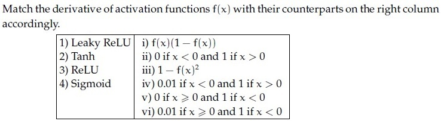

**Figure 45.** Question 160, matching table of activation function derivatives.

**Options**

**A.** 1→ vi, 2→ iii, 3 →v, 4 → i  
*Option ID:* `6406534756372`

**B.** 1→ i, 2→ iv, 3 → iii, 4→ ii  
*Option ID:* `6406534756373`

**C.** 1→ i, 2→ v, 3 → iii, 4→ iv  
*Option ID:* `6406534756374`

**D.** 1→ iv, 2→ iii, 3→ ii, 4 → i  
*Option ID:* `6406534756375`

**Correct answer:** **D** — 1→ iv, 2→ iii, 3→ ii, 4 → i.  
**Source evidence:** Option 6406534756375 is rendered in green text (#008000) with a checkmark icon. (PDF page 4).

---


---

**Source:** `da5006_2025T2_ET_FN.md` · End-term, 2025T2 · Question 165 · ID `6406531422544`  
**Classification:** Week 3 — Hyperparameter Tuning, Validation Set, Test Set Data Leakage, Overfitting Prevention, Generalization Performance  
**Course evidence:** [## 6. Regularization, Inductive Bias & Generalization Mechanics](/Volumes/1700%20APFS/PERSONAL_PROGRAMMING_PROJECTS/Notes/Deep%20Learning%20for%20Computer%20Vision/month%201/week%203/week-3-report.md) · Related weeks: none

### Question 165

**Question ID:** `6406531422544` · **Type:** MCQ · **Marks:** 2  
**PDF pages:** 6, 7

Which one of the following statements regarding hyperparameter tuning is false?

**Options**

**A.** Validation set is the best choice for tuning hyperparameters  
*Option ID:* `6406534756392`

**B.** Picking hyperparameters that perform the best on the training set leads to overfitting  
*Option ID:* `6406534756393`

**C.** Tuning hyperparameters on the test set is an acceptable approach to find the most powerful model for generalization performance  
*Option ID:* `6406534756394`

**D.** Test set performance, with hyperparameters tuned on the validation set, would be a realistic measure of how the model will generalize to new data.  
*Option ID:* `6406534756395`

**Correct answer:** **C** — Tuning hyperparameters on the test set is an acceptable approach to find the most powerful model for generalization performance.  
**Source evidence:** Option 6406534756394 is rendered in green text (#008000) with a checkmark icon. (PDF page 7).

---


---

**Source:** `da5006_2025T2_ET_FN.md` · End-term, 2025T2 · Question 175 · ID `6406531422554`  
**Classification:** Week 3 — L1 regularization sparsity, L2 regularization weight decay, Dropout regularization training vs test scaling, McCulloch-Pitts neuron, linear separability and XOR  
**Course evidence:** [6. Regularization, Inductive Bias & Generalization Mechanics](/Volumes/1700%20APFS/PERSONAL_PROGRAMMING_PROJECTS/Notes/Deep%20Learning%20for%20Computer%20Vision/month%201/week%203/week-3-report.md) · Related weeks: none

### Question 175

**Question ID:** `6406531422554` · **Type:** MSQ · **Marks:** 2  
**PDF pages:** 10, 11

Which one of the following statements is true:

**Options**

**A.** Weight change criterion is a method of ‘early stopping’ that checks whether or not the error is dropping over epochs to decide whether to continue training or stop.  
*Option ID:* `6406534756436`

**B.** L1 norm tends to create more sparse weights than L2 norm.  
*Option ID:* `6406534756437`

**C.** During the training phase, for each iteration, Dropout ignores a random fraction, p, of nodes, and accounts for it in the test phase by scaling down the activations by a factor of p.  
*Option ID:* `6406534756438`

**D.** A single McCulloch-Pitts neuron is capable of modeling AND, OR, XOR, NOR, and NAND functions.  
*Option ID:* `6406534756439`

**Correct answer:** **B**, **C** — L1 norm tends to create more sparse weights than L2 norm.; During the training phase, for each iteration, Dropout ignores a random fraction, p, of nodes, and accounts for it in the test phase by scaling down the activations by a factor of p..  
**Source evidence:** Option 6406534756437 is rendered in green text (#008000) with a checkmark icon. Option 6406534756438 is rendered in green text (#008000) with a checkmark icon. (PDF page 11).

---


---

**Source:** `da5006_2025T2_ET_FN.md` · End-term, 2025T2 · Question 177 · ID `6406531422556`  
**Classification:** Week 3 — Sigmoid activation function, Tanh activation function, vanishing gradient at saturation, derivative symmetry around y-axis  
**Course evidence:** [3. Activation Functions & The Vanishing Gradient Problem](/Volumes/1700%20APFS/PERSONAL_PROGRAMMING_PROJECTS/Notes/Deep%20Learning%20for%20Computer%20Vision/month%201/week%203/week-3-report.md) · Related weeks: none

### Question 177

**Question ID:** `6406531422556` · **Type:** MSQ · **Marks:** 2  
**PDF pages:** 11, 12

Which of the following statements are true? (Select all that apply)

**Options**

**A.** Sigmoid activation function σ(.) can be represented in terms of tanh activation function as below: σ(x) = (tanh(x/2) - 1)/2  
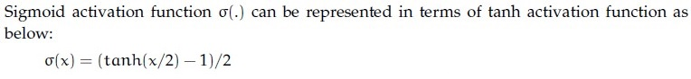
**Figure 46.** Option A image for Question 177.
*Option ID:* `6406534756444`

**B.** The derivative of the sigmoid activation function is symmetric around the y-axis.  
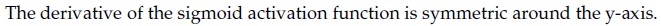
**Figure 47.** Option B image for Question 177.
*Option ID:* `6406534756445`

**C.** Gradient of a sigmoid neuron vanishes at saturation.  
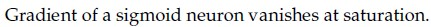
**Figure 48.** Option C image for Question 177.
*Option ID:* `6406534756446`

**D.** Sigmoid activation is centered around 0 whereas tanh activation is centered around 0.5  
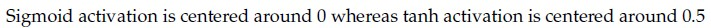
**Figure 49.** Option D image for Question 177.
*Option ID:* `6406534756447`

**Correct answer:** **B**, **C** — The derivative of the sigmoid activation function is symmetric around the y-axis.; Gradient of a sigmoid neuron vanishes at saturation..  
**Source evidence:** Option 6406534756445 is rendered in green text (#008000) with a checkmark icon. Option 6406534756446 is rendered in green text (#008000) with a checkmark icon. (PDF page 11, 12).

---


---

**Source:** `da5006_2025T2_ET_FN.md` · End-term, 2025T2 · Question 181 · ID `6406531422560`  
**Classification:** Week 3 — momentum-based gradient descent, Polyak momentum, velocity update, first-order optimization  
**Course evidence:** [### 5.3 Advanced Momentum and Adaptive Optimizers](/Volumes/1700%20APFS/PERSONAL_PROGRAMMING_PROJECTS/Notes/Deep%20Learning%20for%20Computer%20Vision/month%201/week%203/week-3-report.md) · Related weeks: none

### Question 181

**Question ID:** `6406531422560` · **Type:** SA · **Marks:** 2  
**PDF pages:** 13

Using momentum-based gradient descent, find the new value of the parameter θ_{t+1}, given that the old value θ_t = 0.5, gradient of loss function ∇_{θ_t} L(θ_t) = 0.2, velocity term V_{t-1} = 0.7, learning rate α = 0.75 and momentum term γ = 0.8 (Round decimal point till 3 places) [Note: Assume that there is no bias].

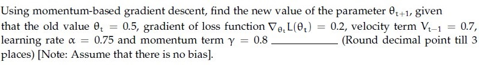

**Figure 50.** Question 181, momentum-based gradient descent statement.

**Correct answer:** `-0.215 to -0.205`  
**Source evidence:** Official text specification: 'Possible Answers : -0.215 to -0.205' rendered in green text (#008000). (PDF page 13).

---


---

**Source:** `da5006_2025T2_ET_FN.md` · End-term, 2025T2 · Question 185 · ID `6406531422564`  
**Classification:** Week 3 — computational graph, backpropagation, multivariate chain rule, gradient evaluation  
**Course evidence:** [4. The Backpropagation Algorithm & Multivariate Matrix Calculus](/Volumes/1700%20APFS/PERSONAL_PROGRAMMING_PROJECTS/Notes/Deep%20Learning%20for%20Computer%20Vision/month%201/week%203/week-3-report.md) · Related weeks: none

### Question 185

**Question ID:** `6406531422564` · **Type:** SA · **Marks:** 1  
**PDF pages:** 15

**Shared context (Comprehension Question ID: `6406531422563`, Subquestions: 185 to 186):**

Consider the computation graph given below:
Input a = 10, and b = -3.
Fill in the blanks for the gradients, given in the subquestions.

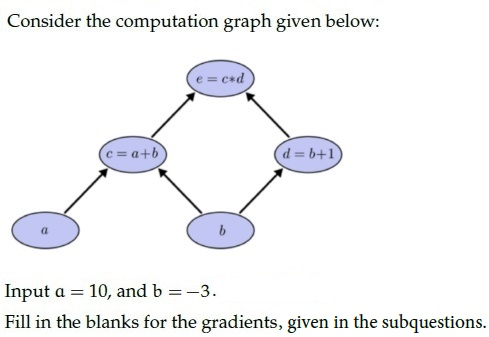

**Figure 51.** Comprehension 6406531422563, computation graph diagram.

Based on the above data, answer the given subquestion:

The value of ∂e/∂a = ______

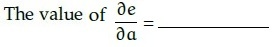

**Figure 52.** Question 185, gradient ∂e/∂a equation.

**Correct answer:** `-2`  
**Source evidence:** Official text specification: 'Possible Answers : -2' rendered in green text (#008000). (PDF page 15).

---


---

**Source:** `da5006_2025T2_ET_FN.md` · End-term, 2025T2 · Question 186 · ID `6406531422565`  
**Classification:** Week 3 — computational graph, backpropagation, multivariate chain rule, gradient evaluation  
**Course evidence:** [4. The Backpropagation Algorithm & Multivariate Matrix Calculus](/Volumes/1700%20APFS/PERSONAL_PROGRAMMING_PROJECTS/Notes/Deep%20Learning%20for%20Computer%20Vision/month%201/week%203/week-3-report.md) · Related weeks: none


**Figure 53.** Comprehension 6406531422563, computation graph diagram.

### Question 186

**Question ID:** `6406531422565` · **Type:** SA · **Marks:** 1  
**PDF pages:** 16

**Shared context (Comprehension Question ID: `6406531422563`, Subquestions: 185 to 186):**

Consider the computation graph given in Figure 53 (Input a = 10, b = -3).

Based on the above data, answer the given subquestion:

The value of ∂e/∂b = ______

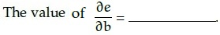

**Figure 54.** Question 186, gradient ∂e/∂b equation.

**Correct answer:** `5`  
**Source evidence:** Official text specification: 'Possible Answers : 5' rendered in green text (#008000). (PDF page 16).

---


---

**Source:** `da5006_2025T2_ET_FN.md` · End-term, 2025T2 · Question 191 · ID `6406531422567`  
**Classification:** Week 3 — single-neuron model, affine pre-activation, Sigmoid activation function, feedforward propagation  
**Course evidence:** [3. Activation Functions & The Vanishing Gradient Problem](/Volumes/1700%20APFS/PERSONAL_PROGRAMMING_PROJECTS/Notes/Deep%20Learning%20for%20Computer%20Vision/month%201/week%203/week-3-report.md) · Related weeks: none

### Question 191

**Question ID:** `6406531422567` · **Type:** SA · **Marks:** 1  
**PDF pages:** 17, 18

**Shared context (Comprehension Question ID: `6406531422566`, Subquestions: 191 to 196):**

A 4-dimensional input vector x = [5, 3, 1, 2] is passed to a hidden layer with a single neuron and an activation function a(.) to obtain z. Assume that the corresponding weights (from input to hidden layer) are [0.4, 0.6, 0.8, -0.2] and bias is 0.4. If the activation function a(.) is Sigmoid, Linear, Indicator function, Softplus, ReLU and Leaky-ReLU, what are the corresponding values of z? (Note that Indicator function returns 1 for a positive input, and 0 otherwise. Softplus is defined as: ln(1 + exp(z)).

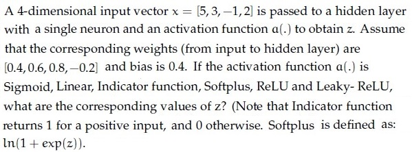

**Figure 55.** Comprehension 6406531422566, single-neuron activation problem statement.

Based on the above data, answer the given subquestions.

Sigmoid _______________

**Correct answer:** `0.95`  
**Source evidence:** Official text specification: 'Possible Answers : 0.95' rendered in green text (#008000). (PDF page 18).

---


---

**Source:** `da5006_2025T2_ET_FN.md` · End-term, 2025T2 · Question 192 · ID `6406531422568`  
**Classification:** Week 3 — single-neuron model, linear activation function, affine transformation, feedforward propagation  
**Course evidence:** [3. Activation Functions & The Vanishing Gradient Problem](/Volumes/1700%20APFS/PERSONAL_PROGRAMMING_PROJECTS/Notes/Deep%20Learning%20for%20Computer%20Vision/month%201/week%203/week-3-report.md) · Related weeks: none


**Figure 56.** Comprehension 6406531422566, single-neuron activation problem statement.

### Question 192

**Question ID:** `6406531422568` · **Type:** SA · **Marks:** 1  
**PDF pages:** 18

**Shared context (Comprehension Question ID: `6406531422566`, Subquestions: 191 to 196):**

Single-neuron activation values with pre-activation u = 3 (from Figure 56).

Based on the above data, answer the given subquestions.

Linear _______________

**Correct answer:** `3`  
**Source evidence:** Official text specification: 'Possible Answers : 3' rendered in green text (#008000). (PDF page 18).

---


---

**Source:** `da5006_2025T2_ET_FN.md` · End-term, 2025T2 · Question 193 · ID `6406531422569`  
**Classification:** Week 3 — single-neuron model, indicator function, Heaviside step activation, McCulloch-Pitts neuron, threshold perceptron  
**Course evidence:** [### 1.1 The Biological Blueprint and the McCulloch-Pitts Neuron (1943)](/Volumes/1700%20APFS/PERSONAL_PROGRAMMING_PROJECTS/Notes/Deep%20Learning%20for%20Computer%20Vision/month%201/week%203/week-3-report.md) · Related weeks: none


**Figure 57.** Comprehension 6406531422566, single-neuron activation problem statement.

### Question 193

**Question ID:** `6406531422569` · **Type:** SA · **Marks:** 1  
**PDF pages:** 18, 19

**Shared context (Comprehension Question ID: `6406531422566`, Subquestions: 191 to 196):**

Single-neuron activation values with pre-activation u = 3 (from Figure 57).

Based on the above data, answer the given subquestions.

Indicator Function _______________

**Correct answer:** `1`  
**Source evidence:** Official text specification: 'Possible Answers : 1' rendered in green text (#008000). (PDF page 19).

---


---

**Source:** `da5006_2025T2_ET_FN.md` · End-term, 2025T2 · Question 194 · ID `6406531422570`  
**Classification:** Week 3 — single-neuron model, Softplus activation function, smooth ReLU approximation, feedforward propagation  
**Course evidence:** [3. Activation Functions & The Vanishing Gradient Problem](/Volumes/1700%20APFS/PERSONAL_PROGRAMMING_PROJECTS/Notes/Deep%20Learning%20for%20Computer%20Vision/month%201/week%203/week-3-report.md) · Related weeks: none


**Figure 58.** Comprehension 6406531422566, single-neuron activation problem statement.

### Question 194

**Question ID:** `6406531422570` · **Type:** SA · **Marks:** 1  
**PDF pages:** 19

**Shared context (Comprehension Question ID: `6406531422566`, Subquestions: 191 to 196):**

Single-neuron activation values with pre-activation u = 3 (from Figure 58).

Based on the above data, answer the given subquestions.

Softplus _______________

**Correct answer:** `3.05`  
**Source evidence:** Official text specification: 'Possible Answers : 3.05' rendered in green text (#008000). (PDF page 19).

---


---

**Source:** `da5006_2025T2_ET_FN.md` · End-term, 2025T2 · Question 195 · ID `6406531422571`  
**Classification:** Week 3 — single-neuron model, ReLU activation function, rectified linear unit, feedforward propagation  
**Course evidence:** [3. Activation Functions & The Vanishing Gradient Problem](/Volumes/1700%20APFS/PERSONAL_PROGRAMMING_PROJECTS/Notes/Deep%20Learning%20for%20Computer%20Vision/month%201/week%203/week-3-report.md) · Related weeks: none


**Figure 59.** Comprehension 6406531422566, single-neuron activation problem statement.

### Question 195

**Question ID:** `6406531422571` · **Type:** SA · **Marks:** 1  
**PDF pages:** 19

**Shared context (Comprehension Question ID: `6406531422566`, Subquestions: 191 to 196):**

Single-neuron activation values with pre-activation u = 3 (from Figure 59).

Based on the above data, answer the given subquestions.

ReLu _______________

**Correct answer:** `3`  
**Source evidence:** Official text specification: 'Possible Answers : 3' rendered in green text (#008000). (PDF page 19).

---


---

**Source:** `da5006_2025T2_ET_FN.md` · End-term, 2025T2 · Question 196 · ID `6406531422572`  
**Classification:** Week 3 — single-neuron model, Leaky ReLU activation function, non-saturating non-linearities, feedforward propagation  
**Course evidence:** [3. Activation Functions & The Vanishing Gradient Problem](/Volumes/1700%20APFS/PERSONAL_PROGRAMMING_PROJECTS/Notes/Deep%20Learning%20for%20Computer%20Vision/month%201/week%203/week-3-report.md) · Related weeks: none


**Figure 60.** Comprehension 6406531422566, single-neuron activation problem statement.

### Question 196

**Question ID:** `6406531422572` · **Type:** SA · **Marks:** 1  
**PDF pages:** 19, 20

**Shared context (Comprehension Question ID: `6406531422566`, Subquestions: 191 to 196):**

Single-neuron activation values with pre-activation u = 3 (from Figure 60).

Based on the above data, answer the given subquestions.

Leaky-ReLu _______________

**Correct answer:** `3`  
**Source evidence:** Official text specification: 'Possible Answers : 3' rendered in green text (#008000). (PDF page 20).

---


---

**Source:** `da5006_2025T3_ET_FN.md` · End-term, 2025T3 · Question 8 · ID `6406531862822`  
**Classification:** Week 3 — Hyperparameter Tuning, k-Fold Cross-Validation, Validation Protocol, Test Set Integrity, Small Dataset Regime  
**Course evidence:** [## 6. Regularization, Inductive Bias & Generalization Mechanics](/Volumes/1700%20APFS/PERSONAL_PROGRAMMING_PROJECTS/Notes/Deep%20Learning%20for%20Computer%20Vision/month%201/week%203/week-3-report.md) · Related weeks: none

### Question 8

**Question ID:** `6406531862822` · **Type:** MCQ · **Marks:** 1  
**PDF pages:** 4

Which of the following is the most appropriate way to tune hyperparameters when the dataset is small?

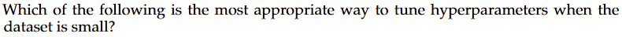

**Figure 61.** Source question text for Question 8.

**Options**

**A.** Use the test set to select the best hyperparameters  
*Option ID:* `6406536034941`

**B.** Use k-fold cross-validation on the training data and keep the test set untouched for final re-porting  
*Option ID:* `6406536034942`

**C.** Tune on the training loss only; validation is unnecessary  
*Option ID:* `6406536034943`

**D.** Pick hyperparameters from a prior paper without checking performance  
*Option ID:* `6406536034944`

**Correct answer:** **B** — Use k-fold cross-validation on the training data and keep the test set untouched for final re-porting.  
**Source evidence:** Option B (6406536034942) rendered in green font (color 0x008000) with green checkmark icon (xref 1374 at y=505.26..517.26) in source PDF.

---


---

**Source:** `da5006_2025T3_ET_FN.md` · End-term, 2025T3 · Question 15 · ID `6406531862829`  
**Classification:** Week 3 — Mini-Batch Gradient Descent, Batch Size, Iterations per Epoch, Optimization Dynamics  
**Course evidence:** [### 5.1 First-Order Gradient Descent Mechanics](/Volumes/1700%20APFS/PERSONAL_PROGRAMMING_PROJECTS/Notes/Deep%20Learning%20for%20Computer%20Vision/month%201/week%203/week-3-report.md) · Related weeks: none

### Question 15

**Question ID:** `6406531862829` · **Type:** SA · **Marks:** 1  
**PDF pages:** 7

You are training a model with a batch size of 64 on a dataset of 10,000 images. How many iterations (parameter updates) happen in exactly one epoch? (Assume the final incomplete batch is dropped).

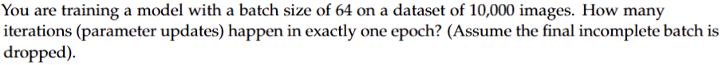

**Figure 62.** Source training dataset and batch size parameters for Question 15.

**Correct answer:** `156`  
**Source evidence:** Official answer '156' specified in Possible Answers field with green text (color 0x008000); calculation: floor(10000 / 64) = 156.

---


---

**Source:** `da5006_2025T3_ET_FN.md` · End-term, 2025T3 · Question 18 · ID `6406531862832`  
**Classification:** Week 3 — Batch Normalization, Mini-Batch Statistics, Running Population Estimates, Training vs Inference Dynamics  
**Course evidence:** [### 7.4 Batch Normalization (Ioffe & Szegedy, 2015)](/Volumes/1700%20APFS/PERSONAL_PROGRAMMING_PROJECTS/Notes/Deep%20Learning%20for%20Computer%20Vision/month%201/week%203/week-3-report.md) · Related weeks: 4

### Question 18

**Question ID:** `6406531862832` · **Type:** MCQ · **Marks:** 1  
**PDF pages:** 8

During training, Batch Normalization uses:

**Options**

**A.** Running (population) statistics only  
*Option ID:* `6406536034969`

**B.** batch statistics for normalization and updates running estimates for inference  
*Option ID:* `6406536034970`

**C.** neither batch nor running statistics  
*Option ID:* `6406536034971`

**D.** group-wise normalization identical to GroupNorm  
*Option ID:* `6406536034972`

**Correct answer:** **B** — batch statistics for normalization and updates running estimates for inference.  
**Source evidence:** Option B (6406536034970) rendered in green font (color 0x008000) with green checkmark icon (xref 1374 at y=435.19..447.19) in source PDF.

---


---

**Source:** `da5006_2025T3_ET_FN.md` · End-term, 2025T3 · Question 20 · ID `6406531862834`  
**Classification:** Week 3 — Scalar Loss Function, Gradient Derivation, Backpropagation Chain Rule, Univariate Loss Derivative  
**Course evidence:** [### 4.2 Derivation of the Four Fundamental Backpropagation Equations](/Volumes/1700%20APFS/PERSONAL_PROGRAMMING_PROJECTS/Notes/Deep%20Learning%20for%20Computer%20Vision/month%201/week%203/week-3-report.md) · Related weeks: none

### Question 20

**Question ID:** `6406531862834` · **Type:** SA · **Marks:** 1  
**PDF pages:** 9

Consider a scalar loss $l = \frac{1}{2}(\hat{y} - y)^2$ with $\hat{y} = wx + b$. For $x = 3, y = 5, w = 2, b = 1$, compute $\frac{\partial l}{\partial w}$.


**Figure 63.** Source scalar loss and gradient query for Question 20.

**Correct answer:** `6`  
**Source evidence:** Official answer '6' specified in Possible Answers field with green text (color 0x008000); calculation: y_hat = 2*3 + 1 = 7, dl/dw = (y_hat - y) * x = (7 - 5) * 3 = 6.

---


---

**Source:** `da5006_2026T1_Q1_NA.md` · Quiz 1, 2026T1 · Question 3 · ID `6406531961522`  
**Classification:** Week 3 — Nesterov Accelerated Gradient (NAG), classical momentum, gradient descent, adaptive optimizers, lookahead gradient  
**Course evidence:** [### 5.3 Advanced Momentum and Adaptive Optimizers](/Volumes/1700%20APFS/PERSONAL_PROGRAMMING_PROJECTS/Notes/Deep%20Learning%20for%20Computer%20Vision/month%201/week%203/week-3-report.md) · Related weeks: none

### Question 3

**Question ID:** `6406531961522` · **Type:** Multiple Choice Question · **Marks:** 1  
**PDF pages:** 3

Which is True?

**Options**

**A.** Nesterov momentum looks ahead and often converges faster than classical momentum.  
*Option ID:* `6406536373696`

**B.** large fixed learning rate always speeds convergence.  
*Option ID:* `6406536373697`

**C.** Adam uses only a first-moment estimate of gradients.  
*Option ID:* `6406536373698`

**D.** None of these.  
*Option ID:* `6406536373699`

**Correct answer:** **A** — Nesterov momentum looks ahead and often converges faster than classical momentum.  
**Source evidence:** Green option text and check marker, PDF page 3.

---


---

**Source:** `da5006_2026T1_Q1_NA.md` · Quiz 1, 2026T1 · Question 6 · ID `6406531961529`  
**Classification:** Week 3 — PyTorch tensor operations, torch.softmax, Softmax activation function, probability distribution normalization, multi-class classification  
**Course evidence:** [## 3. Activation Functions & The Vanishing Gradient Problem](/Volumes/1700%20APFS/PERSONAL_PROGRAMMING_PROJECTS/Notes/Deep%20Learning%20for%20Computer%20Vision/month%201/week%203/week-3-report.md) · Related weeks: 4, 1

### Question 6

**Question ID:** `6406531961529` · **Type:** Multiple Choice Question · **Marks:** 1  
**PDF pages:** 4, 5

Consider the following pyTorch code:


**Figure 64.** PyTorch code snippet for Question 6.

```python
1. x = torch.tensor([[1., 2., 3.], [4., 5., 6.]])
2. y = torch.softmax(x, dim=1)
3. print (torch.round(y[0], decimals=2))
```

The printed tensor is:

**Options**

**A.** `tensor([0.09, 0.24, 0.67])`  
*Option ID:* `6406536373712`

**B.** `tensor([0.09, 0.24, 0.66])`  
*Option ID:* `6406536373713`

**C.** `tensor([0.09, 0.23, 0.68])`  
*Option ID:* `6406536373714`

**D.** `tensor([0.10, 0.27, 0.63])`  
*Option ID:* `6406536373715`

**Correct answer:** **A** — `tensor([0.09, 0.24, 0.67])`  
**Source evidence:** Green option text and check marker, PDF page 5.

---


---

**Source:** `da5006_2026T1_ET_FN.md` · End-term, 2026T1 · Question 8 · ID `6406532136823`  
**Classification:** Week 3 — backpropagation, chain rule, computational graphs, multivariate calculus, gradient calculation  
**Course evidence:** [## 4. The Backpropagation Algorithm & Multivariate Matrix Calculus](/Volumes/1700%20APFS/PERSONAL_PROGRAMMING_PROJECTS/Notes/Deep%20Learning%20for%20Computer%20Vision/month%201/week%203/week-3-report.md) · Related weeks: none

### Question 8

**Question ID:** `6406532136823` · **Type:** MCQ · **Marks:** 2  
**PDF pages:** 3, 4

Backpropagation is best described as:

**Options**

**A.** A method to avoid overfitting  
*Option ID:* `6406536959501`

**B.** Efficient computation of gradients using the chain rule through computation graphs  
*Option ID:* `6406536959502`

**C.** A method that works only for linear models  
*Option ID:* `6406536959503`

**D.** An optimizer like Adam  
*Option ID:* `6406536959504`

**Correct answer:** **B** — Efficient computation of gradients using the chain rule through computation graphs.  
**Source evidence:** Option ID 6406536959502 rendered in green text (#008000) with checkmark icon (xref 1692) on PDF page 4.

---


---

**Source:** `da5006_2026T1_ET_FN.md` · End-term, 2026T1 · Question 9 · ID `6406532136824`  
**Classification:** Week 3 — momentum, Polyak momentum, velocity accumulator, gradient descent, optimization ravines  
**Course evidence:** [### 5.3 Advanced Momentum and Adaptive Optimizers](/Volumes/1700%20APFS/PERSONAL_PROGRAMMING_PROJECTS/Notes/Deep%20Learning%20for%20Computer%20Vision/month%201/week%203/week-3-report.md) · Related weeks: none

### Question 9

**Question ID:** `6406532136824` · **Type:** MCQ · **Marks:** 2  
**PDF pages:** 4

Which is a key effect of momentum?

**Options**

**A.** Makes gradients unbiased  
*Option ID:* `6406536959505`

**B.** Accumulates a velocity term  
*Option ID:* `6406536959506`

**C.** Gurantees to converge unlike vanilla Gradient Descent  
*Option ID:* `6406536959507`

**D.** Eliminates need for setting learning rate by adpatly calculaitng it on the fly.  
*Option ID:* `6406536959508`

**Correct answer:** **B** — Accumulates a velocity term.  
**Source evidence:** Option ID 6406536959506 rendered in green text (#008000) with checkmark icon (xref 1692) on PDF page 4.

---


---

**Source:** `da5006_2026T1_ET_FN.md` · End-term, 2026T1 · Question 10 · ID `6406532136825`  
**Classification:** Week 3 — L2 regularization, weight decay, parameter norm penalty, model complexity, overfitting  
**Course evidence:** [### 6.1 Parameter Penalties: $L_1$ vs. $L_2$ Regularization](/Volumes/1700%20APFS/PERSONAL_PROGRAMMING_PROJECTS/Notes/Deep%20Learning%20for%20Computer%20Vision/month%201/week%203/week-3-report.md) · Related weeks: none

### Question 10

**Question ID:** `6406532136825` · **Type:** MCQ · **Marks:** 2  
**PDF pages:** 4

L2 regularization on weights most directly encourages:

**Options**

**A.** Sparse weights with many exact zeros  
*Option ID:* `6406536959509`

**B.** Smaller-magnitude weights  
*Option ID:* `6406536959510`

**C.** Larger-magnitude weights  
*Option ID:* `6406536959511`

**D.** Larger learning rates  
*Option ID:* `6406536959512`

**Correct answer:** **B** — Smaller-magnitude weights.  
**Source evidence:** Option ID 6406536959510 rendered in green text (#008000) with checkmark icon (xref 1692) on PDF page 4.

---


---

**Source:** `da5006_2026T1_ET_FN.md` · End-term, 2026T1 · Question 17 · ID `6406532136832`  
**Classification:** Week 3 — Adam optimizer, early stopping, dropout, data augmentation, regularization  
**Course evidence:** [## 6. Regularization, Inductive Bias & Generalization Mechanics](/Volumes/1700%20APFS/PERSONAL_PROGRAMMING_PROJECTS/Notes/Deep%20Learning%20for%20Computer%20Vision/month%201/week%203/week-3-report.md) · Related weeks: 4

### Question 17

**Question ID:** `6406532136832` · **Type:** MSQ · **Marks:** 3  
**PDF pages:** 6

Select all correct statements :

**Options**

**A.** Adam adapts per-parameter learning rates using estimates of first and second moments.  
*Option ID:* `6406536959537`

**B.** Early stopping can act as a form of regularization.  
*Option ID:* `6406536959538`

**C.** Dropout increases training accuracy by removing bad training data samples .  
*Option ID:* `6406536959539`

**D.** Data augmentation typically improves generalization in vision tasks.  
*Option ID:* `6406536959540`

**Correct answer:** **A**, **B**, **D** — Adam adapts per-parameter learning rates using estimates of first and second moments.; Early stopping can act as a form of regularization.; Data augmentation typically improves generalization in vision tasks..  
**Source evidence:** Option ID 6406536959537 rendered in green text (#008000) with checkmark icon (xref 1692) on PDF page 6.; Option ID 6406536959538 rendered in green text (#008000) with checkmark icon (xref 1692) on PDF page 6.; Option ID 6406536959540 rendered in green text (#008000) with checkmark icon (xref 1692) on PDF page 6.

---


---

**Source:** `da5006_2026T1_ET_FN.md` · End-term, 2026T1 · Question 22 · ID `6406532136837`  
**Classification:** Week 3 — fully connected network, parameter counting, weight matrices, Multilayer Perceptron (MLP), feedforward architectures  
**Course evidence:** [## 2. Multi-Layer Feedforward Architectures & Representation Power](/Volumes/1700%20APFS/PERSONAL_PROGRAMMING_PROJECTS/Notes/Deep%20Learning%20for%20Computer%20Vision/month%201/week%203/week-3-report.md) · Related weeks: 4

### Question 22

**Question ID:** `6406532136837` · **Type:** SA · **Marks:** 4  
**PDF pages:** 8

A fully connected network maps input 100 → hidden 50 → output 10. Ignore bias. What is the total number of weights?

**Correct answer:** `5500`  
**Source evidence:** Official text specification: 'Possible Answers : 5500' rendered in green text (#008000) on PDF page 8.

---


---

**Source:** `da5006_2026T2_Q1_NA.md` · Quiz 1, 2026T2 · Question 3 · ID `6406532166258`  
**Classification:** Week 3 — Nesterov Accelerated Gradient (NAG), Classical Momentum, Adam Optimizer, Gradient Descent Optimizers, Lookahead Gradient  
**Course evidence:** [### 5.3 Advanced Momentum and Adaptive Optimizers](/Volumes/1700%20APFS/PERSONAL_PROGRAMMING_PROJECTS/Notes/Deep%20Learning%20for%20Computer%20Vision/month%201/week%203/week-3-report.md) · Related weeks: none

### Question 3

**Question ID:** `6406532166258` · **Type:** Multiple Choice Question · **Marks:** 1  
**PDF pages:** 2

Which is True?

**Options**

**A.** Nesterov momentum looks ahead and often converges faster than classical momentum.  
*Option ID:* `6406537043611`

**B.** large fixed learning rate always speeds convergence.  
*Option ID:* `6406537043612`

**C.** Adam uses only a first-moment estimate of gradients.  
*Option ID:* `6406537043613`

**D.** None of these.  
*Option ID:* `6406537043614`

**Correct answer:** **A** — Nesterov momentum looks ahead and often converges faster than classical momentum.  
**Source evidence:** Green option ID `6406537043611` and check marker, PDF page 2.

---


---

**Source:** `da5006_2026T2_Q1_NA.md` · Quiz 1, 2026T2 · Question 6 · ID `6406532166265`  
**Classification:** Week 3 — PyTorch Tensor Operations, torch.softmax, Softmax Activation Function, Probability Distribution Normalization, Multi-Class Classification  
**Course evidence:** [## 3. Activation Functions & The Vanishing Gradient Problem](/Volumes/1700%20APFS/PERSONAL_PROGRAMMING_PROJECTS/Notes/Deep%20Learning%20for%20Computer%20Vision/month%201/week%203/week-3-report.md) · Related weeks: 4, 1

### Question 6

**Question ID:** `6406532166265` · **Type:** Multiple Choice Question · **Marks:** 1  
**PDF pages:** 3, 4

Consider the following pyTorch code:


**Figure 65.** PyTorch code snippet for Question 6.

```python
1. x = torch.tensor([[1., 2., 3.], [4., 5., 6.]])
2. y = torch.softmax(x, dim=1)
3. print (torch.round(y[0], decimals=2))
```

The printed tensor is:

**Options**

**A.** `tensor([0.09, 0.24, 0.67])`  
*Option ID:* `6406537043627`

**B.** `tensor([0.09, 0.24, 0.66])`  
*Option ID:* `6406537043628`

**C.** `tensor([0.09, 0.23, 0.68])`  
*Option ID:* `6406537043629`

**D.** `tensor([0.10, 0.27, 0.63])`  
*Option ID:* `6406537043630`

**Correct answer:** **A** — `tensor([0.09, 0.24, 0.67])`  
**Source evidence:** Green option ID `6406537043627` and check marker, PDF page 3.

---


---

**Source:** `da5006_2026T2_ET_FN.md` · End-term, 2026T2 · Question 7 · ID `6406532270046`  
**Classification:** Week 3 — Backpropagation, Multivariate Chain Rule, Computational Graph, Branching Error Gradients, Gradient Accumulation  
**Course evidence:** [### 4.2 Derivation of the Four Fundamental Backpropagation Equations](/Volumes/1700%20APFS/PERSONAL_PROGRAMMING_PROJECTS/Notes/Deep%20Learning%20for%20Computer%20Vision/month%201/week%203/week-3-report.md) · Related weeks: none

### Question 7

**Question ID:** `6406532270046` · **Type:** MCQ · **Marks:** 2  
**PDF pages:** 3, 4

A hidden activation $h$ is used by two downstream branches, and both branches affect the same scalar loss $L$. During backpropagation, the gradient with respect to $h$ is obtained by:

**Options**

**A.** Taking the larger of the two branch gradients  
*Option ID:* `6406537379023`

**B.** Summing the gradient contributions from the two branches  
*Option ID:* `6406537379024`

**C.** Multiplying the two branch gradients  
*Option ID:* `6406537379025`

**D.** Averaging the two branch gradients regardless of the graph  
*Option ID:* `6406537379026`

**Correct answer:** **B** — Summing the gradient contributions from the two branches.  
**Source evidence:** Option ID 6406537379024 rendered in green text (#008000) with checkmark icon (xref 2581) on PDF page 3.

---


---

**Source:** `da5006_2026T2_ET_FN.md` · End-term, 2026T2 · Question 8 · ID `6406532270047`  
**Classification:** Week 3 — Momentum Optimizer, Polyak Momentum, Gradient Descent Variants, Velocity Accumulation, Oscillation Damping  
**Course evidence:** [### 5.3 Advanced Momentum and Adaptive Optimizers](/Volumes/1700%20APFS/PERSONAL_PROGRAMMING_PROJECTS/Notes/Deep%20Learning%20for%20Computer%20Vision/month%201/week%203/week-3-report.md) · Related weeks: none

### Question 8

**Question ID:** `6406532270047` · **Type:** MCQ · **Marks:** 2  
**PDF pages:** 4

Suppose successive gradients keep pointing in a similar direction over several updates. Compared with plain gradient descent using the same nominal learning rate, momentum tends to:

**Options**

**A.** Cancel updates in that direction  
*Option ID:* `6406537379027`

**B.** Build velocity in that direction while smoothing short-term gradient fluctuations  
*Option ID:* `6406537379028`

**C.** Make the gradient exactly unbiased  
*Option ID:* `6406537379029`

**D.** Force every parameter to use the same accumulated gradient  
*Option ID:* `6406537379030`

**Correct answer:** **B** — Build velocity in that direction while smoothing short-term gradient fluctuations.  
**Source evidence:** Option ID 6406537379028 rendered in green text (#008000) with checkmark icon (xref 2581) on PDF page 4.

---


---

**Source:** `da5006_2026T2_ET_FN.md` · End-term, 2026T2 · Question 9 · ID `6406532270048`  
**Classification:** Week 3 — Overfitting, Generalization Error, Validation Loss Divergence, Training Dynamics, Bias-Variance Tradeoff  
**Course evidence:** [## 6. Regularization, Inductive Bias & Generalization Mechanics](/Volumes/1700%20APFS/PERSONAL_PROGRAMMING_PROJECTS/Notes/Deep%20Learning%20for%20Computer%20Vision/month%201/week%203/week-3-report.md) · Related weeks: none

### Question 9

**Question ID:** `6406532270048` · **Type:** MCQ · **Marks:** 2  
**PDF pages:** 4

Training loss continues to decrease, but validation loss has begun to increase consistently. Which interpretation is most appropriate?

**Options**

**A.** The model is necessarily underfitting  
*Option ID:* `6406537379031`

**B.** Generalization is worsening even though optimization on the training set is improving  
*Option ID:* `6406537379032`

**C.** The training objective is necessarily non-differentiable  
*Option ID:* `6406537379033`

**D.** The model has reached the global optimum on unseen data  
*Option ID:* `6406537379034`

**Correct answer:** **B** — Generalization is worsening even though optimization on the training set is improving.  
**Source evidence:** Option ID 6406537379032 rendered in green text (#008000) with checkmark icon (xref 2581) on PDF page 4.

---


---

**Source:** `da5006_2026T2_ET_FN.md` · End-term, 2026T2 · Question 23 · ID `6406532270062`  
**Classification:** Week 3 — Backpropagation on Computation Graphs, Regularization Effects, Gradient Descent Optimizers, Validation Performance Dynamics, Neural Network Optimization Foundations  
**Course evidence:** [## 4. The Backpropagation Algorithm & Multivariate Matrix Calculus](/Volumes/1700%20APFS/PERSONAL_PROGRAMMING_PROJECTS/Notes/Deep%20Learning%20for%20Computer%20Vision/month%201/week%203/week-3-report.md) · Related weeks: none

### Question 23

**Question ID:** `6406532270062` · **Type:** MSQ · **Marks:** 3  
**PDF pages:** 8

Select all correct statements .

**Options**

**A.** Backpropagation applies the chain rule efficiently through a computation graph.  
*Option ID:* `6406537379087`

**B.** Regularization can change the learned solution even when the network architecture is unchanged.  
*Option ID:* `6406537379088`

**C.** Gradient-descent variants can modify how current and past gradient information is used to update parameters.  
*Option ID:* `6406537379089`

**D.** Improving training means validation performance must increase after every individual parameter update.  
*Option ID:* `6406537379090`

**Correct answer:** **A**, **B**, **C** — Backpropagation applies the chain rule efficiently through a computation graph.; Regularization can change the learned solution even when the network architecture is unchanged.; Gradient-descent variants can modify how current and past gradient information is used to update parameters..  
**Source evidence:** Option ID 6406537379087 rendered in green text (#008000) with checkmark icon (xref 2581) on PDF page 8.; Option ID 6406537379088 rendered in green text (#008000) with checkmark icon (xref 2581) on PDF page 8.; Option ID 6406537379089 rendered in green text (#008000) with checkmark icon (xref 2581) on PDF page 8.

---


---

**Source:** `da5006_2026T2_ET_FN.md` · End-term, 2026T2 · Question 32 · ID `6406532270071`  
**Classification:** Week 3 — Backpropagation, Chain Rule, ReLU Activation, Gradient of Loss with Respect to Weights, Computational Graph  
**Course evidence:** [### 4.2 Derivation of the Four Fundamental Backpropagation Equations](/Volumes/1700%20APFS/PERSONAL_PROGRAMMING_PROJECTS/Notes/Deep%20Learning%20for%20Computer%20Vision/month%201/week%203/week-3-report.md) · Related weeks: none

### Question 32

**Question ID:** `6406532270071` · **Type:** SA · **Marks:** 4  
**PDF pages:** 11


**Figure 66.** Source formulation for Question 32.

Let
$$a = wx + b, \quad y = \text{ReLU}(a), \quad L = (y - 4)^2.$$
For $x = 2$, $w = 3$, $b = -1$, compute $\partial L/\partial w$.

**Correct answer:** `4`  
**Source evidence:** Official text specification: 'Possible Answers : 4' on PDF page 11.

---


## Source extraction notes

The following notes are reproduced from each included paper; figure numbers in these notes refer to the original paper.

### `da5006_2024T1_ET_AN.md`

- **Subject boundary reconciliation:** Physical page 1 begins with residual text from the preceding subject (Section 7, ending with Question 158). Section 8 (`DL(CV)`) starts on page 1 with Section ID `64065357859` and declares 37 questions and 72 marks. Question 159 on page 2 is the administrative subject confirmation question (YES/NO) and was omitted per contract.
- **Declared count reconciliation:** The 37 test delivery units in Section 8 comprise 1 administrative confirmation question + 25 MCQs (Q160–Q184) + 1 MSQ (Q185) + 5 standalone SA questions (Q186–Q190) + 5 comprehension parent passages (containing 13 subquestions: Q191–Q203). Total extracted academic questions: 44. Total score reconciles exactly to 72 marks.
- **Image-as-text questions preserved:** Questions 160, 178, 180, 181, 182, 185, 186, 187, 188, 194, 195, 196, 197, 198, 199 and comprehension contexts contain formulas/text embedded as images. All 30 images were cleanly extracted, saved to `assets/da5006_2024T1_ET_AN/`, transcribed into LaTeX/Markdown, visually inspected, and verified.
- **Status:** Extracted with all source academic content, formulas, option IDs, and answer evidence preserved; marked `needs-review` pending independent audit.


### `da5006_2024T1_Q2_NA.md`

1. **Reconciliation of Declared Count**: Section 10 declares 23 questions and 50 marks. The paper comprises:
   - 1 administrative confirmation question (Question 148, excluded from academic questions);
   - 19 standalone questions (Questions 149–167);
   - 3 comprehension question blocks containing 9 child questions:
     - Comprehension ID `640653766148` (Questions 168–170, 3 numerical SA questions);
     - Comprehension ID `640653766166` (Questions 171–174, 4 fill-in SA questions);
     - Comprehension ID `640653766172` (Questions 175–176, 2 numerical SA questions).
   Reconciliation: 1 administrative question + 19 standalone questions + 3 comprehension groups = 23 parent question items. Total extracted academic questions: 19 + 3 + 4 + 2 = 28 questions. Total marks: 12 (MSQ) + 4 (SA) + 22 (MCQ) + 5 (Comp 1) + 5 (Comp 2) + 2 (Comp 3) = 50 marks, matching the declared section total exactly.
2. **Subject Boundary**: The PDF opens with Question 147 (page 1), which pertains to pre-training datasets for Large Language Models and belongs to a preceding exam section. Section 10 "DL(CV)" begins on page 1 (`[271.17, 380.62, 329.96, 405.10]`). The DL(CV) section concludes on page 18 with Question 176. Page 19 introduces Section 11 "SPG" (Strategies for Professional Growth) starting with administrative question 177, which is excluded from scope.
3. **Question 150 (Grad-CAM MSQ)**: Although labeled as a Multiple Select Question (`MSQ`), the official source marks only Option A (`6406532564183`) in green text with a check icon, while Options B, C, and D are marked with red text and cross icons. Faithfully recorded as marked in the source key.
4. **Question 174 (KL Divergence for Bernoulli distributions)**: The source key specifies accepted answer `8` for parameter $d$ where $KL(P||Q) = c \times \log(d)$ with $P = \text{Bernoulli}(0.9)$ and $Q = \text{Bernoulli}(0.1)$, with $c = 0.9$ (from Question 173). Faithfully preserved from the official key.


### `da5006_2024T2_ET_AN.md`

1. **Scope and Reconciliation:** Section header specifies `DL(CV)` with 25 parent question units and 50 marks. Sub-section 1 contains Question 248 (Question Id: 640653904299), which is the standard administrative subject confirmation (administrative subject confirmation question) and is excluded. The academic exam consists of 11 standalone MCQs (Q249–Q259, 22 marks), 3 standalone numerical SAs (Q260–Q262, 6 marks), Comprehension Passage 1 (Q263–Q271, 9 marks across 9 subquestions), Comprehension Passage 2 (Q272–Q274, 2 marks across 3 subquestions), 3 MSQs (Q275–Q277, 6 marks), 1 SA (Q278, 1 mark), and 4 MCQs (Q279–Q282, 4 marks). Total: 34 academic questions evaluated, exactly totaling 50 marks.
2. **Subsequent Subject:** Section 11 (`SPG`, Section Id: 64065364139) starting on page 17 is out-of-scope and excluded.
3. **Image Options and Mathematical Transcription:** Questions 250, 255, 257, 276, and 282 have option text embedded as raster figures in the original PDF. All raster crops have been faithfully extracted to `assets/da5006_2024T2_ET_AN/`, verified for non-emptiness, and transcribed into standard Markdown LaTeX alongside the original figures.
4. **Answer Grounding:** Every question answer is grounded directly in the source PDF via font colors (#008000 green spans for correct options vs #ff0000 red spans for incorrect options), checkmark/cross icons, or explicit `Possible Answers` text fields. No answer has been guessed or inferred.


### `da5006_2024T2_Q1_NA.md`

- Question 80 (administrative subject confirmation) has been excluded in accordance with the extraction contract.
- Declared question count in section header is 23, representing 23 parent question items (1 administrative item + 18 standalone questions + 4 comprehension groups). The total number of individually scored academic questions is 29 (Questions 81 to 109).
- All 33 images (question stems, math formulas, matching tables, and image options) have been extracted natively at original resolution, verified, and embedded with sequential figure numbers and captions.
- Every correct answer is backed by visible source evidence from green check mark icons or explicit 'Possible Answers' scoring entries.


### `da5006_2024T2_Q2_NA.md`

1. **Section Boundaries and Exclusions:** The DL(CV) section declared 25 items on page 2. Physical examination confirms 1 excluded administrative confirmation question (Question 116), 16 MCQs (Questions 117–132), 3 Short Answer questions (Questions 133–135), 2 Comprehension parent blocks spanning 7 subquestions (Questions 136–142), and 3 MSQs (Questions 143–145), yielding 29 academic questions. Preceding subject material on page 1 and subsequent Algorithmic Thinking in Bioinformatics section on page 14 are strictly excluded.
2. **Question 134 Key Discrepancy:** The source answer key records `Possible Answers : -30` for Question 134. Standard triplet loss is $\max(0, d(a,p)^2 - d(a,n)^2 + \alpha)$ where squared Euclidean distances give $25 - 43 + 12 = -6$ (which would clip to 0 under standard hinge/margin definition). The source key's value of `-30` is preserved faithfully as required by the extraction protocol without unauthorized modification.
3. **Asset Preservation:** 25 graphical assets extracted natively at source resolution into `assets/da5006_2024T2_Q2_NA/`, covering matching tables (Q119, Q130, Q132), equation options (Q121, Q123, Q131, Q144), question stems (Q124, Q125, Q131, Q134), and comprehension shared contexts (Q136–138, Q139–142). Captions are sequential from Figure 1 to Figure 25.

### `da5006_2024T3_ET_AN.md`

- Scope confirmed from Section 9 "DL(CV)" (Page 1, y=197.6) to Section 10 "DLP" (Page 13, y=730.4).
- Administrative subject confirmation question (Question 197, Question ID `6406531046049`, 0 marks, YES/NO confirmation prompt) excluded per extraction prompt instructions.
- Declared section question count of 23 reconciled: 1 administrative confirmation question (Q197) + 15 standalone MCQs (Q198–Q212) + 2 MSQs (Q213–Q214) + 1 Comprehension parent block (Q215–Q216) + 3 standalone SAs (Q217–Q219) + 1 Comprehension parent block (Q220–Q222) = 1 + 15 + 2 + 1 + 3 + 1 = 23 declared units, yielding 25 scored academic questions (Q198–Q222).
- Comprehension blocks retain full shared context and parent diagrams in both child questions to ensure independent readability.
- All 30 image assets (stems, options, and comprehension shared figures) extracted at native resolution into `assets/da5006_2024T3_ET_AN/` with sequential figures (Figures 1–33 across 30 unique asset files on disk).
- Correct answers for MCQs/MSQs confirmed via green text color (#008000) and checkmark icons; correct answers for SA questions confirmed via official `Possible Answers` numeric key fields.


### `da5006_2024T3_Q1_NA.md`

1. **Administrative Question Exclusion:** The administrative subject confirmation question (Question ID unnumbered/0 marks, options YES/NO) at the top of physical page 1 has been excluded per instructions.
2. **Sequential Figure Numbering:** All 29 embedded visual assets have been extracted at native resolution, visually inspected, and sequentially captioned as Figures 1 through 29.
3. **Source Cutoff at Question 172:** The source PDF terminates at physical page 13 immediately following the Question 172 header (`Question Number : 172 Question Id : 640653994508 Question Type : SA Correct Marks : 2`). The question body, response fields, and answer key are truncated in the source PDF. This has been faithfully recorded as `Answer not verifiable from the source PDF`.


### `da5006_2025T1_Q1_NA.md`

- **Scope boundaries:** The DL(CV) section begins on Page 1 at the `DL(CV)` section header (Section Id 64065379956, Section Number 9) and concludes on Page 17 at the end of Question 189. The Section 8 NLP remnant text at the top of Page 1 (IDs 6406533822651, 6406533822652, and Question 152) and the Section 10 RL material starting on Page 17 (Section Id 64065379957) have been strictly excluded.
- **Administrative confirmation excluded:** Question 153 on Page 2 (Question Id 6406531130609, 0 marks), the administrative subject verification prompt, is excluded in accordance with extraction requirements.
- **Question count reconciliation:** The Section 9 header declares 31 questions. This corresponds to 1 excluded confirmation question, 26 standalone questions (Q154–Q160 SA, Q161–Q173 MCQ, Q174–Q179 MSQ), and 4 comprehension passages (treated as parent units). Inside the comprehension passages are 10 subquestions (Q180–Q181, Q182–Q183, Q184–Q187, Q188–Q189), resulting in exactly 36 academic questions summing to the declared 60 marks.
- **MSQ questions and stem polarities:** Questions 174 and 175 in the source exam explicitly ask 'Which of the following statements is/are false?'. In Question 174, false statements A and C are marked correct in the official exam key. In Question 175, false statements C and D are marked correct in the official exam key. Question 176 has one correct option (A); Question 177 has two correct options (A, D); Question 178 has two correct options (A, D); Question 179 has two correct options (A, B). All marked correct options are preserved with exact option IDs and source evidence.
- **Accepted ranges and alternatives:** Question 157 has accepted range `-0.34 to -0.33` (straightness measure $\lambda_2 / \lambda_1 = -1/3$ for second moment matrix $\begin{bmatrix} 1 & 2 \\ 2 & 1 \end{bmatrix}$); Question 160 has accepted range `-0.260 to -0.210` (momentum update); Question 182 accepts `thick`, `coarse`, or `large scale`. All source alternatives and conditions are faithfully preserved.
- **Comprehension 3 matrix transcription:** In Figure 27 (Comprehension 3, Questions 184–187), the source exam figure displays the affine transformation matrix with column 3 rows 1–2 as explicitly `1` and `1` (i.e. $\begin{bmatrix} a_{11} & a_{12} & 1 \\ a_{21} & a_{22} & 1 \\ 0 & 0 & 1 \end{bmatrix}$). The source formula has been faithfully preserved with `1` and `1` in accordance with the source PDF, preserving authorial authenticity rather than silently normalizing to zeros.
- **Comprehension 4 partial derivative notation:** In Figure 29 (Question 188) and Figure 30 (Question 189), the source exam explicitly queries the partial derivatives of output variable $e$ with respect to inputs $a$ and $b$, i.e. $\frac{\partial e}{\partial a}$ and $\frac{\partial e}{\partial b}$ (where computation graph evaluates $c = a + b$, $d = b + 1$, $e = c \times d$), verified against the original PDF and native assets.


### `da5006_2025T2_ET_AN.md`

- Administrative confirmation Question 82 (Question Id `6406531431342`, Sub-Section 1) is excluded per MASTER_EXTRACTION_PROMPT.md.
- Section 6 'Mathematical Foundations of Generative AI' starting at page 20, y=682.0 pt is excluded as out-of-scope.
- In Question 88, source option C is printed as '69%' in green font (#008000) indicating the officially accepted answer.
- In Question 90, source option C ('One of the key components in the vanilla transformer is the recurrent connection that help them to deal with variable input length.') is printed in green font (#008000), while Option D ('All of these.') is printed in red font (#ff0000). The question queries for the incorrect statement; vanilla transformers do not possess recurrent connections, confirming Option C.
- In Question 91, source option A (`1 → Gaussian filter, 2 → Laplacian of Gaussian, 3 → First derivative of Gaussian, 4 → Sobel operator`) is printed in green font (#008000), confirming Option A.
- In Questions 109 and 110, derivative queries are confirmed from source computation graph and equation images to have output node $e$ in the numerator: $\frac{\partial e}{\partial a}$ and $\frac{\partial e}{\partial b}$.
- In Questions 119, 122, and 124, subquestion labels correspond to image prompt queries `\<CLS\> Prompt:`, `\<Decode\> Prompt:`, and `\<Encode\> Prompt:`, with brackets escaped to ensure clean Markdown rendering.
- In Comprehension Questions 126 to 131, the 4D input vector is restored to its complete form $x = [4, -5, -7, 10]$ as shown in Figure 25.


### `da5006_2025T2_ET_FN.md`

1. **Section scope & exclusions:** The DL(CV) section begins on PDF Page 1 (Section Id 64065399798, Section Number 7). Preceding content on Page 1 belongs to the previous exam subject and is excluded. Question 155 (Question Id 6406531422534) on Page 2 is the administrative subject confirmation question (YES/NO options, 0 marks) and is excluded from academic questions. The exam paper terminates DL(CV) on Page 24; Page 25 begins the next subject 'Mathematical Foundations of Generative AI' (Section Id 64065399800, Section Number 9) and is excluded as out-of-scope.
2. **Declared question count reconciliation:** The section metadata declares 34 questions and 76 marks. This reconciles exactly with the source structure:
   - Sub-section 1: Administrative confirmation (1 parent unit, 0 marks, excluded).
   - Sub-section 2: 16 MCQs Q156–Q171 (16 parent units, 32 marks).
   - Sub-section 3: 7 MSQs Q172–Q178 (7 parent units, 14 marks).
   - Sub-section 4: 6 SAs Q179–Q184 (6 parent units, 12 marks).
   - Sub-section 5: Comprehension passage Id 6406531422563 (1 parent unit) containing 2 SA subquestions Q185–Q186 (2 marks).
   - Sub-section 6: Comprehension passage Id 6406531422574 (1 parent unit) containing 4 SA subquestions Q187–Q190 (4 marks).
   - Sub-section 7: Comprehension passage Id 6406531422566 (1 parent unit) containing 6 SA subquestions Q191–Q196 (6 marks).
   - Sub-section 8: Comprehension passage Id 6406531422579 (1 parent unit) containing 11 SA subquestions Q197–Q207 (6 marks total: 6 @ 0.55 marks = 3.30 + 5 @ 0.54 marks = 2.70 marks).
   - Total parent units = 1 + 16 + 7 + 6 + 1 + 1 + 1 + 1 = 34 questions.
   - Total scored academic questions = 16 + 7 + 6 + 2 + 4 + 6 + 11 = 52 questions, totaling exactly 76.0 marks.
3. **Source answers:** All answers are evidenced directly from font color (#008000 green text / checkmark icons) for MCQs and MSQs, or explicit official 'Possible Answers :' text specifications for short-answer questions. Every MSQ has multiple verified answers preserved. Question 172 asks 'Which of the following statements are false? (Select all that apply)' and has verified official key C, D. Short-answer Question 184 has verified source Possible Answers '100', preserved despite academic suspicion regarding convolution padding arithmetic.
4. **Figure fidelity:** All 52 assets are extracted from the original PDF at native resolution and referenced with sequential figure captions (Figures 1 to 52).


### `da5006_2025T2_Q1_NA.md`

- **Scope boundaries:** The DL(CV) section begins on Page 1 at the `DL(CV)` section header (Section Id 64065391702, Section Number 9) and concludes on Page 22 at the end of Question 190. The Section 8 NLP remnant text at the top of Page 1 (Question 155 ID 6406531279497) and the Section 10 Mathematical Foundations of Generative AI material starting on Page 22 at bottom (Section Id 64065391703) have been strictly excluded.
- **Administrative confirmation excluded:** Question 156 on Page 2 (Question Id 6406531279498, 0 marks), the administrative subject verification prompt, is excluded in accordance with extraction requirements.
- **Question count reconciliation:** The Section 9 header declares 32 questions and 79 marks. This corresponds to 1 excluded confirmation question, 28 standalone questions (Q157–Q170 MCQ at 2 marks = 28 marks; Q171–Q175 MSQ at 3 marks = 15 marks; Q176–Q184 SA at 3 marks = 27 marks), and 3 comprehension passages (treated as parent units toward the 32 declared count). Inside the 3 comprehension passages are 6 subquestions (Q185–Q186, Q187–Q188, Q189–Q190 at 1.5 marks each = 9 marks), resulting in exactly 34 academic questions summing to 28 + 15 + 27 + 9 = 79 marks, exactly matching declared section marks.
- **MSQ questions:** Question 171 has two correct options (A, D); Question 172 has two correct options (A, B); Question 173 has four correct options (A, C, E, F); Question 174 has two correct options (A, D); Question 175 has two correct options (C, D). All marked correct options are preserved with exact option IDs and source evidence.
- **Accepted ranges and alternatives:** Question 182 accepts range `-0.260 to -0.210` (momentum parameter update); Question 185 and 186 accept `high`, `higher`, `large`, or `largest`; Question 187 accepts `thick`, `coarse`, or `large-scale`; Question 188 accepts `fine` or `thin`. All source alternatives and conditions are faithfully preserved.
- **Figure preservation & mathematical fidelity:** All 66 embedded raster diagrams, matching tables, and candidate options have been extracted at native resolution, saved to assets/da5006_2025T2_Q1_NA/, sequentially captioned (Figure 1 to Figure 66), and visually verified against original PDF renders.


### `da5006_2025T3_ET_FN.md`

- **Scope boundaries:** The DL(CV) section begins on Page 1 at the `DL(CV)` section header (Section Id `640653124677`) and concludes on Page 9 at the end of Question 20. There are no preceding or trailing out-of-scope subjects in this question paper.
- **Administrative confirmation excluded:** Question 1 on Page 1 (Question Id `6406531862815`, 0 marks), the administrative subject verification prompt with YES/NO options, has been excluded in accordance with extraction requirements.
- **Question count and score reconciliation:** The Section header declares 20 questions and 19 section marks. Excluding the 0-mark administrative confirmation Question 1 leaves exactly 19 academic questions (Questions 2–20), each carrying 1 mark (total 19 marks), perfectly reconciling with the declared section marks.
- **Question types:** The paper consists of 7 Short Answer (SA) questions (Questions 2, 3, 13, 14, 15, 17, 20), 8 Multiple Choice Questions (MCQ) (Questions 4, 5, 6, 7, 8, 9, 16, 18), and 4 Multiple Select Questions (MSQ) (Questions 10, 11, 12, 19).
- **Embedded image stems:** Questions 2, 3, 4, 5, 7, 8, 13, 14, 15, 17, and 20 contain embedded source images in their stems. Each image has been faithfully transcribed in Markdown/LaTeX and accompanied by the exact source graphic asset (`assets/da5006_2025T3_ET_FN/qXX-stem-01-pYYY.png`) and sequential numbered caption.
- **MSQ questions:** Question 10 has 3 correct options (A, C, D); Question 11 has 2 correct options (A, C); Question 12 has 3 correct options (A, B, C); Question 19 has 3 correct options (A, B, C). All marked correct options are preserved with exact option IDs, green font color, and green checkmark evidence.
- **Numeric ranges and formulas:** Question 3 accepts range `92 to 94` (central element under linear contrast stretching); Question 17 accepts range `0.6 to 0.69` (softmax probability of class 1); Question 20 calculates $\frac{\partial l}{\partial w} = 6$ for $l = \frac{1}{2}(\hat{y} - y)^2$. All calculations and official keys have been independently verified.


### `da5006_2026T1_ET_FN.md`

1. **Section scope & exclusions:** The DL(CV) section encompasses the entire paper da5006_2026T1_ET_FN.pdf from physical PDF Page 1 to Page 8 (Section Id 640653139242, Section Number 1). Question 1 (Question Id 6406532136816) on Pages 1–2 is the administrative subject confirmation question (YES/NO options, 0 marks) and is excluded from academic questions. There are no other exam subjects or extraneous sections.
2. **Declared question count reconciliation:** Section metadata declares 23 questions and 57 marks. This reconciles exactly as follows:
   - Sub-section 1: Administrative confirmation (Question 1, 0 marks, excluded).
   - Sub-section 2: 14 MCQs Q2–Q15 (14 @ 2 marks = 28 marks).
   - Sub-section 3: 3 MSQs Q16–Q18 (3 @ 3 marks = 9 marks).
   - Sub-section 4: 5 SAs Q19–Q23 (5 @ 4 marks = 20 marks).
   - Total delivery units = 1 + 14 + 3 + 5 = 23 questions.
   - Total scored academic questions = 14 + 3 + 5 = 22 questions, totaling exactly 28 + 9 + 20 = 57 marks.
3. **Source answers & evidence:** All answers are evidenced directly from the official PDF using font color (#008000 green text) and checkmark icons (xref 1692) for MCQs and MSQs, or explicit official 'Possible Answers :' text specifications for short-answer questions. All 3 MSQs preserve multiple verified correct answers.
4. **Figure fidelity & option images:** Question 5 options are embedded raster images from the original PDF (xrefs 1694, 1695, 1696, 1697) preserved faithfully at native resolution in assets/da5006_2026T1_ET_FN/ and captioned sequentially as Figures 1–4.


### `da5006_2026T1_Q1_NA.md`

- **Administrative confirmation excluded:** Question 1 (Question Id `6406531961515`, Sub-Section 1) is the administrative subject confirmation question (0 marks, YES/NO options). It is excluded from the academic questions in accordance with Section 4 of the extraction contract.
- **Section count reconciliation:** The `DL(CV)` section header specifies 15 questions and 14 marks. This matches exactly 1 excluded confirmation question (0 marks) plus 14 extracted academic questions (1 mark each, total 14 marks).
- **Question 5 options:** Options A, B, C, and D are visual kernel matrices. Option C represents the separable $3 \times 3$ Gaussian smoothing kernel $\frac{1}{16}\begin{bmatrix}1 & 2 & 1 \\ 2 & 4 & 2 \\ 1 & 2 & 1\end{bmatrix}$ and is marked correct in the source PDF.
- **Question 12 source answer:** The official key marks `12` as the correct answer. In 3D geometry, translation has 3 DOF and affine transformation has 12 DOF (algebraic sum would be 15, or affine alone 12). As mandated, the official source answer `12` is preserved faithfully.
- **Question 15 source key:** The official accepted range in the source PDF is `-6 to -5`. The mathematical eigenvalue calculation of $M$ yields eigenvalues $\frac{7 \pm \sqrt{13}}{2}$, giving a straightness ratio of $\approx \pm 0.515$. As observed by the coordinator and required by the extraction contract, the official accepted range `-6 to -5` is preserved faithfully without altering source keys.


### `da5006_2026T2_ET_FN.md`

1. **Section scope & exclusions:** The DL(CV) section encompasses the entire paper `da5006_2026T2_ET_FN.pdf` from physical PDF Page 1 to Page 13 (Section Id 640653148370, Section Number 1). Question 1 (Question Id 6406532270040) on Pages 1–2 is the administrative subject confirmation question (YES/NO options, 0 marks) and is excluded from academic questions. There are no other exam subjects or extraneous sections.
2. **Declared question count reconciliation:** Section metadata declares 38 questions and 100 marks. This reconciles exactly as follows:
   - Sub-section 1: Administrative confirmation (Question 1, 0 marks, excluded).
   - Sub-section 2: 20 MCQs Q2–Q21 (20 @ 2 marks = 40 marks).
   - Sub-section 3: 8 MSQs Q22–Q29 (8 @ 3 marks = 24 marks).
   - Sub-section 4: 9 SAs Q30–Q38 (9 @ 4 marks = 36 marks).
   - Total delivery units = 1 + 20 + 8 + 9 = 38 questions.
   - Total scored academic questions = 20 + 8 + 9 = 37 questions, totaling exactly 40 + 24 + 36 = 100 marks.
3. **Source answers & evidence:** All answers are evidenced directly from the official PDF using font color (#008000 green text) and checkmark icons (xref 2581) for MCQs and MSQs, or explicit official 'Possible Answers :' text specifications for short-answer questions. In this paper export, option IDs are rendered in green (#008000) with checkmark icons, while option text is in standard font. All 8 MSQs (Questions 22–29) have verified correct options A, B, and C with full source evidence. Short-answer numerical questions Q36, Q37, and Q38 have verified ranges: Q36 = 0.730 to 0.732, Q37 = 0.817 to 0.819, Q38 = 1.363 to 1.365.
4. **Figure fidelity & option images:** All figures and raster option images are preserved at native resolution in `assets/da5006_2026T2_ET_FN/` and sequentially captioned as Figures 1–10:
   - Figures 1–4: Option images A, B, C, D for Question 5 (xrefs 2583, 2584, 2585, 2586).
   - Figure 5: Source residual block diagram for Question 12 (xref 2587).
   - Figure 6: Source scalar loss and derivative formulation for Question 32 (xref 2588).
   - Figure 7: Source recurrent layer formulation for Question 35 (xref 2589).
   - Figure 8: Source softmax attention formulation for Question 36 (xref 2590).
   - Figure 9: Source Gaussian KL-divergence formulation for Question 37 (xref 2591).
   - Figure 10: Source DDPM forward sampling formulation for Question 38 (xref 2592).
   Each image stem includes both the native crop and a fully verified source-faithful mathematical transcription.


### `da5006_2026T2_Q1_NA.md`

- Question 1 (Question ID `6406532166252`, Sub-Section 1) is the administrative subject confirmation question (YES/NO options, 0 marks) spanning PDF pages 1–2; it is excluded from academic questions in accordance with extraction specifications.
- In Question 5, Option A contains matrix $\begin{bmatrix} 1 & 0 & -1 \\ 2 & 0 & -2 \\ 1 & -50 & -2 \end{bmatrix}$ with bottom-middle element `-50` as visible in the source diagram; this has been preserved faithfully without normalization to `-5` or `50`.
- In Question 14, the official source key specifies the accepted range as `-0.6 to -0.5`. Analytically, for $M = \begin{bmatrix} 5 & 1 \\ 1 & 2 \end{bmatrix}$, the eigenvalues are $\lambda = \frac{7 \pm \sqrt{13}}{2}$, yielding $\text{Straightness} = \frac{\sqrt{13}}{7} \approx +0.515$. The negative range in the official key is retained verbatim from the source PDF.

