# Week 4 — Previous-year questions

Source wording, answer keys, and source limitations are reproduced from the extracted Markdown. Classification is based on the course notes.

---

**Source:** `da5006_2024T1_Q2_NA.md` · Quiz 2, 2024T1 · Question 155 · ID `640653766145`  
**Classification:** Week 4 — convolution output dimension formula, spatial dimensions, stride, padding, feature map calculus  
**Course evidence:** [### 1.5 Rigorous Derivation of Output Spatial Dimensions](/Volumes/1700%20APFS/PERSONAL_PROGRAMMING_PROJECTS/Notes/Deep%20Learning%20for%20Computer%20Vision/month%201/week%204/week-4-report.md) · Related weeks: none

### Question 155

**Question ID:** `640653766145` · **Type:** SA · **Marks:** 2  
**PDF pages:** 6

What is the size of the feature map after applying two successive convolution operations with given parameters? Image size = 64 x 64, Kernel size = 6 x 6, Padding = 1 and Stride = 2. (In calculation, take floor(x) whenever x is non-integer. If the answer is FxF, write F in the answer).

**Correct answer:** `14`  
**Source evidence:** Green text in 'Possible Answers : 14', PDF page 6.

---


---

**Source:** `da5006_2024T1_Q2_NA.md` · Quiz 2, 2024T1 · Question 156 · ID `640653766146`  
**Classification:** Week 4 — CNN parameters, convolutional layer weights, kernel calculus, filter depth, channel depth  
**Course evidence:** [### 1.4 The 3D Convolution Operation & Tensor Algebra](/Volumes/1700%20APFS/PERSONAL_PROGRAMMING_PROJECTS/Notes/Deep%20Learning%20for%20Computer%20Vision/month%201/week%204/week-4-report.md) · Related weeks: none

### Question 156

**Question ID:** `640653766146` · **Type:** SA · **Marks:** 2  
**PDF pages:** 6, 7

Let an input to a convolutional layer in a CNN have size $D_I \times D_I \times M$ where $D_I = 64$ and $M = 16$, and output feature map (after passing input through conv layer) has $D_I \times D_I \times N$ size where $N = 8$. Let the kernel in the conv layer be $k \times k$ where $k = 3$. Calculate the number of parameters for this convolution layer. (Assume appropriate padding is applied for all convolutions so the input and output sizes are equal. Ignore the bias term in the calculation).

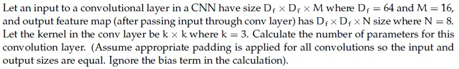

**Figure 1.** Source diagram for Question 156.

**Correct answer:** `1152`  
**Source evidence:** Green text in 'Possible Answers : 1152', PDF page 7.

---


---

**Source:** `da5006_2024T1_ET_AN.md` · End-term, 2024T1 · Question 167 · ID `640653821593`  
**Classification:** Week 4 — Convolutional Neural Networks (CNNs), CNN Backpropagation, Weight Sharing, Local Connectivity, Spatial Structure  
**Course evidence:** [## Module 2: Backpropagation in Convolutional Neural Networks](/Volumes/1700%20APFS/PERSONAL_PROGRAMMING_PROJECTS/Notes/Deep%20Learning%20for%20Computer%20Vision/month%201/week%204/week-4-report.md) · Related weeks: 3

### Question 167

**Question ID:** `640653821593` · **Type:** MCQ · **Marks:** 2  
**PDF pages:** 7, 8

In the context of Convolutional Neural Networks (CNNs), what is the primary challenge associated with backpropagation compared to traditional feedforward neural networks?

**Options**

**A.** The increased number of parameters and layers in CNNs make backpropagation computationally intensive and prone to overfitting.  
*Option ID:* `6406532757316`

**B.** The presence of convolutional and pooling layers in CNNs requires the development of specialized backpropagation algorithms for efficient gradient computation.  
*Option ID:* `6406532757317`

**C.** The non-linear activation functions used in CNNs introduce discontinuities in the error surface, making it difficult to find the global minimum during backpropagation.  
*Option ID:* `6406532757318`

**D.** The spatial structure of CNNs results in weight sharing and local connectivity, requiring careful consideration of the error propagation process during backpropagation.  
*Option ID:* `6406532757319`

**Correct answer:** **D** — The spatial structure of CNNs results in weight sharing and local connectivity, requiring careful consideration of the error propagation process during backpropagation..  
**Source evidence:** Option ID 6406532757319 rendered in green text (#008000) and accompanied by checkmark icon (xref 19) at PDF page 8.

---


---

**Source:** `da5006_2024T2_Q1_NA.md` · Quiz 1, 2024T2 · Question 83 · ID `640653829673`  
**Classification:** Week 4 — same padding, CNN backpropagation, input loss gradient, pooling layer parameters, convolutional feature maps  
**Course evidence:** [## Module 1: Introduction to Convolutional Neural Networks](/Volumes/1700%20APFS/PERSONAL_PROGRAMMING_PROJECTS/Notes/Deep%20Learning%20for%20Computer%20Vision/month%201/week%204/week-4-report.md) · Related weeks: 3

### Question 83

**Question ID:** `640653829673` · **Type:** MSQ · **Marks:** 2  
**PDF pages:** 3–4

Which of the following are true? (Select all that apply)

**Options**

**A.** To get the output with the same size as that of the input after a convolution with kernel size $k \times k$ ($k$ is odd) and stride 1, padding used is $\frac{k-1}{2}$.

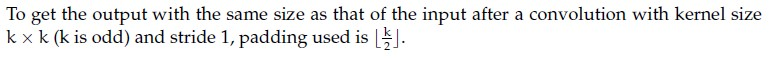

**Figure 2.** Option A statement for Question 83.

*Option ID:* `6406532786699`

**B.** Derivative of loss w.r.t. input image $X$, where $Y = X * W$ is $\frac{\partial L}{\partial X} = \frac{\partial L}{\partial Y} \star W$, where $*$ represents convolution and $\star$ represents correlation.

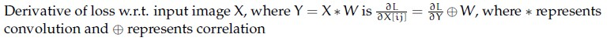

**Figure 3.** Option B statement for Question 83.

*Option ID:* `6406532786700`

**C.** The number of learnable parameters in a pooling layer is not 0.

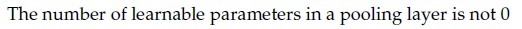

**Figure 4.** Option C statement for Question 83.

*Option ID:* `6406532786701`

**D.** The number of feature maps obtained after a convolution operation depends on the depth of the input but not on the number of filters.

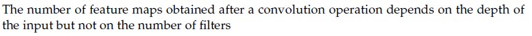

**Figure 5.** Option D statement for Question 83.

*Option ID:* `6406532786702`

**Correct answer:** **A**, **B**  
**Source evidence:** Green check mark icons beside Option A (page 3, y=767.5) and Option B (page 3, y=804.6); red cross icons beside Option C (page 4, y=91.3) and Option D (page 4, y=155.4).

---


---

**Source:** `da5006_2024T2_Q1_NA.md` · Quiz 1, 2024T2 · Question 94 · ID `640653829676`  
**Classification:** Week 4 — receptive field, effective receptive field, convolution layer, max pooling, stride  
**Course evidence:** [### 2.3 Backpropagation Through Spatial Pooling Layers](/Volumes/1700%20APFS/PERSONAL_PROGRAMMING_PROJECTS/Notes/Deep%20Learning%20for%20Computer%20Vision/month%201/week%204/week-4-report.md) · Related weeks: none

### Question 94

**Question ID:** `640653829676` · **Type:** MCQ · **Marks:** 2  
**PDF pages:** 8–9

Consider a Convolutional Neural Network which processes an RGB image. It has 128 kernels each of spatial dimension 5 × 5 in the first layer. They are convolved with a stride 1. This is followed by a max-pooling layer with stride 2 and kernel size 5 × 5. What would be the receptive field size of a single neuron in the pooling layer? (Recap: A receptive field is the size of the region in the input image, which influences the activation of that specific neuron.)

**Options**

**A.** 5 × 5  
*Option ID:* `6406532786705`

**B.** 7 × 7  
*Option ID:* `6406532786706`

**C.** 9 × 9  
*Option ID:* `6406532786707`

**D.** 3 × 3  
*Option ID:* `6406532786708`

**Correct answer:** **C** — 9 × 9.  
**Source evidence:** Green check mark icon beside Option C on PDF page 8 (y=793.9); red cross icons beside Option A (page 8, y=752.2), Option B (page 8, y=773.1), and Option D (page 9, y=18.3).

---


---

**Source:** `da5006_2024T2_Q1_NA.md` · Quiz 1, 2024T2 · Question 97 · ID `640653829674`  
**Classification:** Week 4 — convolution dimension calculus, feature map size, stride, padding, CNN layer stacking  
**Course evidence:** [### 1.5 Rigorous Derivation of Output Spatial Dimensions](/Volumes/1700%20APFS/PERSONAL_PROGRAMMING_PROJECTS/Notes/Deep%20Learning%20for%20Computer%20Vision/month%201/week%204/week-4-report.md) · Related weeks: none

### Question 97

**Question ID:** `640653829674` · **Type:** SA · **Marks:** 2  
**PDF pages:** 10

What is the size of the feature map after applying two successive convolution operations with given parameters? Image size = 64 x 64, Kernel size = 6 x 6, Padding = 1 and Stride = 2. (In calculation, take floor(x) whenever x is non-integer. If the answer is FxF, write F in the blank). ___________

**Correct answer:** `14`  
**Source evidence:** Explicit official answer in `Possible Answers: 14` on PDF page 10.

---


---

**Source:** `da5006_2024T2_Q1_NA.md` · Quiz 1, 2024T2 · Question 98 · ID `640653829675`  
**Classification:** Week 4 — CNN parameters, convolutional kernel weights, parameter counting, 3D convolution volume  
**Course evidence:** [### 1.4 The 3D Convolution Operation & Tensor Algebra](/Volumes/1700%20APFS/PERSONAL_PROGRAMMING_PROJECTS/Notes/Deep%20Learning%20for%20Computer%20Vision/month%201/week%204/week-4-report.md) · Related weeks: none

### Question 98

**Question ID:** `640653829675` · **Type:** SA · **Marks:** 2  
**PDF pages:** 10

Let an input to a convolutional layer in a CNN have size Df × Df × M where Df = 64 and M = 16, and output feature map (after passing input through conv layer) has Df × Df × N size where N = 8. Let the kernel in the conv layer be k × k where k = 3. Calculate the number of parameters for this convolution layer. (Assume appropriate padding is applied for all convolutions so the input and output sizes are equal. Ignore the bias term in the calculation).

**Correct answer:** `1152`  
**Source evidence:** Explicit official answer in `Possible Answers: 1152` on PDF page 10.

---


---

**Source:** `da5006_2024T2_ET_AN.md` · End-term, 2024T2 · Question 262 · ID `640653904325`  
**Classification:** Week 4 — convolution output spatial dimensions, stride, padding, feature map size calculus, stacked convolutional layers  
**Course evidence:** [### 1.5 Rigorous Derivation of Output Spatial Dimensions](/Volumes/1700%20APFS/PERSONAL_PROGRAMMING_PROJECTS/Notes/Deep%20Learning%20for%20Computer%20Vision/month%201/week%204/week-4-report.md) · Related weeks: 1

### Question 262

**Question ID:** `640653904325` · **Type:** SA · **Marks:** 2  
**PDF pages:** 8

What is the size of the feature map after applying two successive convolution operations with given parameters? Image size = $64 \times 64$, Kernel size = $6 \times 6$, Padding = 1 and Stride = 2. (In calculation, take $\lfloor x \rfloor$ whenever $x$ is non-integer. If the answer is $F \times F$, write $F$ in the blank).

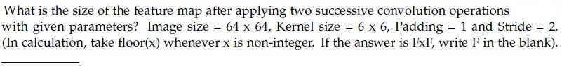

**Figure 6.** Source convolution parameters for Question 262.

**Correct answer:** `14`  
**Source evidence:** Official text specification: 'Possible Answers : 14'. (PDF page 8).

---


---

**Source:** `da5006_2024T3_Q1_NA.md` · Quiz 1, 2024T3 · Question 152 · ID `640653994509`  
**Classification:** Week 4 — receptive_field, convolution_layers, max_pooling, cnn_layer_stacking, effective_receptive_field  
**Course evidence:** [Module 3: CNN Architectures for Image Classification](/Volumes/1700%20APFS/PERSONAL_PROGRAMMING_PROJECTS/Notes/Deep%20Learning%20for%20Computer%20Vision/month%201/week%204/week-4-report.md) · Related weeks: none

### Question 152

**Question ID:** `640653994509` · **Type:** MCQ · **Marks:** 2  
**PDF pages:** 4

Consider a Convolutional Neural Network which processes an RGB image. It has 128 kernels each of spatial dimension 5 × 5 in the first layer. They are convolved with a stride 1. This is followed by a max-pooling layer with stride 2 and kernel size 5 × 5. What would be the receptive field size of a single neuron in the pooling layer? (Recap: A receptive field is the size of the region in the input image, which influences the activation of that specific neuron.)

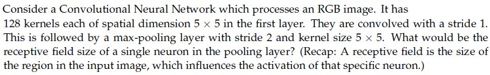

**Figure 7.** Source problem statement for Question 152.

**Options**

**A.** 5 × 5  
*Option ID:* `6406533358260`

**B.** 7 × 7  
*Option ID:* `6406533358261`

**C.** 9 × 9  
*Option ID:* `6406533358262`

**D.** 3 × 3  
*Option ID:* `6406533358263`

**Correct answer:** **C** — 9 × 9.  
**Source evidence:** Option C (Option ID 6406533358262) is marked with green text and a checkmark icon in the source PDF.

---


---

**Source:** `da5006_2024T3_Q1_NA.md` · Quiz 1, 2024T3 · Question 157 · ID `640653994506`  
**Classification:** Week 4 — same_padding, cnn_backpropagation_input, pooling_layers, filter_depth_feature_maps  
**Course evidence:** [Module 1: Introduction to Convolutional Neural Networks](/Volumes/1700%20APFS/PERSONAL_PROGRAMMING_PROJECTS/Notes/Deep%20Learning%20for%20Computer%20Vision/month%201/week%204/week-4-report.md) · Related weeks: none

### Question 157

**Question ID:** `640653994506` · **Type:** MSQ · **Marks:** 2  
**PDF pages:** 7

Which of the following are true? (Select all that apply)

**Options**

**A.** To get the output with the same size as that of the input after a convolution with kernel size $k \times k$ ($k$ is odd) and stride 1, padding used is $\lfloor \frac{k}{2} \rfloor$.

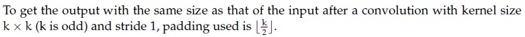

**Figure 8.** Statement and formula for Option A of Question 157.  
*Option ID:* `6406533358254`

**B.** Derivative of loss w.r.t. input image $X$, where $Y = X * W$ is $\frac{\partial L}{\partial X} = \frac{\partial L}{\partial Y} \odot W$, where $*$ represents convolution and $\odot$ represents correlation

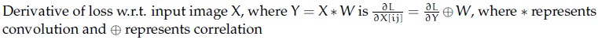

**Figure 9.** Statement and formula for Option B of Question 157.  
*Option ID:* `6406533358255`

**C.** The number of learnable parameters in a pooling layer is not 0

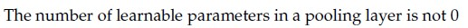

**Figure 10.** Statement for Option C of Question 157.  
*Option ID:* `6406533358256`

**D.** The number of feature maps obtained after a convolution operation depends on the depth of the input but not on the number of filters

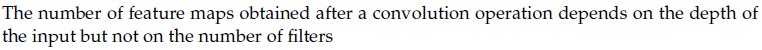

**Figure 11.** Statement for Option D of Question 157.  
*Option ID:* `6406533358257`

**Correct answer:** **A**, **B** — A, B.  
**Source evidence:** Option A (Option ID 6406533358254) is marked with green text and a checkmark icon in the source PDF.; Option B (Option ID 6406533358255) is marked with green text and a checkmark icon in the source PDF.

---


---

**Source:** `da5006_2024T3_Q1_NA.md` · Quiz 1, 2024T3 · Question 171 · ID `640653994507`  
**Classification:** Week 4 — convolution_output_dimensions, stride, padding, feature_map_dimensions, successive_convolutions  
**Course evidence:** [1.5 Rigorous Derivation of Output Spatial Dimensions](/Volumes/1700%20APFS/PERSONAL_PROGRAMMING_PROJECTS/Notes/Deep%20Learning%20for%20Computer%20Vision/month%201/week%204/week-4-report.md) · Related weeks: none

### Question 171

**Question ID:** `640653994507` · **Type:** SA · **Marks:** 2  
**PDF pages:** 13

What is the size of the feature map after applying two successive convolution operations with given parameters? Image size = 64 × 64, Kernel size = 6 × 6, Padding = 1 and Stride = 2. (In calculation, take $\text{floor}(x)$ whenever $x$ is non-integer. If the answer is $F \times F$, write $F$ in the blank).

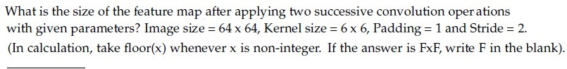

**Figure 12.** Feature map size question and parameters for Question 171.

Response Type : Numeric  
Answers Type : Equal

**Correct answer:** 14  
**Source evidence:** Official Possible Answers field displays '14' in green text on page 13.

---


---

**Source:** `da5006_2024T3_Q2_NA.md` · Quiz 2, 2024T3 · Question 132 · ID `6406531031065`  
**Classification:** Week 4 — convolutional_layer, parameter_count, kernel_dimensions, input_channels, output_channels  
**Course evidence:** [1.4 The 3D Convolution Operation & Tensor Algebra](/Volumes/1700%20APFS/PERSONAL_PROGRAMMING_PROJECTS/Notes/Deep%20Learning%20for%20Computer%20Vision/month%201/week%204/week-4-report.md) · Related weeks: none

### Question 132

**Question ID:** `6406531031065` · **Type:** Short Answer · **Marks:** 2  
**PDF pages:** 1, 2

**Context:** Let input have size $D_I \times D_I \times M$ where $D_I = 128$ and $M = 16$ and output feature map (after passing input through conv layer) has $D_I \times D_I \times N$ size where $N = 32$. Assume padded convolution. Let width of the square kernel in conv layer be $k$ where $k = 5$ (Ignore the bias term in the calculation). Calculate the number of parameters and computational cost for this convolution layer.

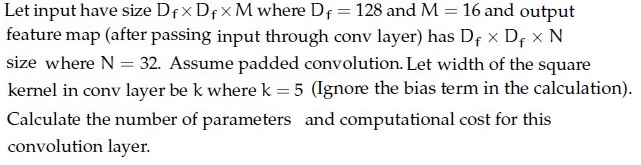

**Figure 13.** Convolutional layer specifications for Questions 132 and 133.

Based on the above data, answer the given subquestion.

Number of Parameters: ______________

**Correct answer:** `12800`  
**Source evidence:** Green text `12800` under Possible Answers, PDF page 2.

---


---

**Source:** `da5006_2024T3_Q2_NA.md` · Quiz 2, 2024T3 · Question 133 · ID `6406531031066`  
**Classification:** Week 4 — convolutional_layer, computational_cost, flops, macs, tensor_algebra  
**Course evidence:** [1.4 The 3D Convolution Operation & Tensor Algebra](/Volumes/1700%20APFS/PERSONAL_PROGRAMMING_PROJECTS/Notes/Deep%20Learning%20for%20Computer%20Vision/month%201/week%204/week-4-report.md) · Related weeks: 1, 5

### Question 133

**Question ID:** `6406531031066` · **Type:** Short Answer · **Marks:** 2  
**PDF pages:** 1, 2

**Context:** Refer to the specifications in Question 132.

Based on the above data, answer the given subquestion.

Computational Cost: ______________

**Correct answer:** `209715200`  
**Source evidence:** Green text `209715200` under Possible Answers, PDF page 2.

---


---

**Source:** `da5006_2025T1_Q1_NA.md` · Quiz 1, 2025T1 · Question 158 · ID `6406531130639`  
**Classification:** Week 4 — convolution_output_dimensions, stride, padding, feature_map_dimensions, successive_convolutions  
**Course evidence:** [1.5 Rigorous Derivation of Output Spatial Dimensions](/Volumes/1700%20APFS/PERSONAL_PROGRAMMING_PROJECTS/Notes/Deep%20Learning%20for%20Computer%20Vision/month%201/week%204/week-4-report.md) · Related weeks: none

### Question 158

**Question ID:** `6406531130639` · **Type:** SA · **Marks:** 2  
**PDF pages:** 4

What is the size of the feature map after applying two successive convolution operations with given parameters? Image size = 64 x 64, Kernel size = 3 x 3, Padding = 2 and Stride = 3. (In calculation, take floor(x) whenever x is non-integer. If the answer is FxF, write F in the blank).

**Correct answer:** `8`  
**Source evidence:** Official answer '8' specified in Possible Answers field with green text (color 0x8000).

---


---

**Source:** `da5006_2025T1_Q1_NA.md` · Quiz 1, 2025T1 · Question 159 · ID `6406531130640`  
**Classification:** Week 4 — convolutional_layer, parameter_count, kernel_dimensions, input_channels, output_channels  
**Course evidence:** [1.4 The 3D Convolution Operation & Tensor Algebra](/Volumes/1700%20APFS/PERSONAL_PROGRAMMING_PROJECTS/Notes/Deep%20Learning%20for%20Computer%20Vision/month%201/week%204/week-4-report.md) · Related weeks: none

### Question 159

**Question ID:** `6406531130640` · **Type:** SA · **Marks:** 2  
**PDF pages:** 4, 5

Let an input to a convolutional layer in a CNN have size $D_f \times D_f \times M$ where $D_f = 32$ and $M = 100$, and output feature map (after passing input through conv layer) has $D_f \times D_f \times N$ size where $N = 64$. Let the kernel in the conv layer be $k \times k$ where $k = 5$. Calculate the number of parameters for this convolution layer. (Assume appropriate padding is applied for all convolutions so the input and output sizes are equal. Ignore the bias term in the calculation)._________________

**Correct answer:** `160000`  
**Source evidence:** Official answer '160000' specified in Possible Answers field with green text (color 0x8000) on PDF page 5.

---


---

**Source:** `da5006_2025T1_Q1_NA.md` · Quiz 1, 2025T1 · Question 169 · ID `6406531130641`  
**Classification:** Week 4 — Receptive Field, Convolutional Neural Network, Max-Pooling, Receptive Field Calculation  
**Course evidence:** [### 3.5 Receptive Field Equivalency: Stacked $3 \times 3$ vs. Single $7 \times 7$](/Volumes/1700%20APFS/PERSONAL_PROGRAMMING_PROJECTS/Notes/Deep%20Learning%20for%20Computer%20Vision/month%201/week%204/week-4-report.md) · Related weeks: none

### Question 169

**Question ID:** `6406531130641` · **Type:** MCQ · **Marks:** 2  
**PDF pages:** 8

Consider a Convolutional Neural Network which processes an RGB image. It has 128 kernels each of spatial dimension 5 × 5 in the first layer. They are convolved with a stride 1. This is followed by a max-pooling layer with stride 2 and kernel size 5 × 5. What would be the receptive field size of a single neuron in the pooling layer? (Recap: A receptive field is the size of the region in the input image, which influences the activation of that specific neuron.)

**Options**

**A.** 5 × 5  
*Option ID:* `6406533822740`

**B.** 7 × 7  
*Option ID:* `6406533822741`

**C.** 9 × 9  
*Option ID:* `6406533822742`

**D.** 3 × 3  
*Option ID:* `6406533822743`

**Correct answer:** **C** — 9 × 9.  
**Source evidence:** Option 6406533822742 rendered in green font (color 0x8000) with green checkmark icon in source PDF.

---


---

**Source:** `da5006_2025T1_Q1_NA.md` · Quiz 1, 2025T1 · Question 179 · ID `6406531130638`  
**Classification:** Week 4 — Convolutional Neural Networks, Padding Formula, Backpropagation Through Convolution, Pooling Parameters, Feature Maps  
**Course evidence:** [### 1.5 Rigorous Derivation of Output Spatial Dimensions](/Volumes/1700%20APFS/PERSONAL_PROGRAMMING_PROJECTS/Notes/Deep%20Learning%20for%20Computer%20Vision/month%201/week%204/week-4-report.md) · Related weeks: 1

### Question 179

**Question ID:** `6406531130638` · **Type:** MSQ · **Marks:** 2  
**PDF pages:** 12

Which of the following are true ? (Select all that apply)

**Options**

**A.** To get the output with the same size as that of the input after a convolution with kernel size $k \times k$ ($k$ is odd) and stride 1, padding used is $\lfloor \frac{k}{2} \rfloor$.

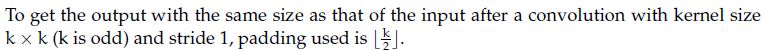

**Figure 14.** Statement for Option A.

*Option ID:* `6406533822734`

**B.** Derivative of loss w.r.t. input image X, where $Y = X * W$ is convolution and $\otimes$ represents correlation: $\frac{\partial L}{\partial X} = \frac{\partial L}{\partial Y} \otimes W$, where $*$ represents convolution and $\otimes$ represents correlation

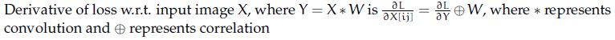

**Figure 15.** Statement for Option B.

*Option ID:* `6406533822735`

**C.** The number of learnable parameters in a pooling layer is not 0

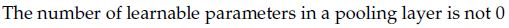

**Figure 16.** Statement for Option C.

*Option ID:* `6406533822736`

**D.** The number of feature maps obtained after a convolution operation depends on the depth of the input but not on the number of filters

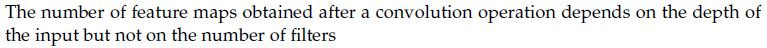

**Figure 17.** Statement for Option D.

*Option ID:* `6406533822737`

**Correct answer:** **A**, **B** — To get the output with the same size as that of the input after a convolution with kernel size k x k (k is odd) and stride 1, padding used is floor(k/2). ; Derivative of loss w.r.t. input image X, where Y = X * W is convolution and correlation represents correlation: dL/dX = dL/dY corr W.  
**Source evidence:** Option A (6406533822734) rendered in green font (color 0x8000) with green checkmark icon in source PDF; Option B (6406533822735) rendered in green font (color 0x8000) with green checkmark icon in source PDF.

---


---

**Source:** `da5006_2025T1_Q2_NA.md` · Quiz 2, 2025T1 · Question 268 · ID `6406531168244`  
**Classification:** Week 4 — standard 3D convolution layer, convolution parameter calculus, filter weights count, MobileNet baseline comparison  
**Course evidence:** [1.4 The 3D Convolution Operation & Tensor Algebra](/Volumes/1700%20APFS/PERSONAL_PROGRAMMING_PROJECTS/Notes/Deep%20Learning%20for%20Computer%20Vision/month%201/week%204/week-4-report.md) · Related weeks: 5

### Question 268

**Question ID:** `6406531168244` · **Type:** SA · **Marks:** 3  
**PDF pages:** 12

**Comprehension Context (Questions 268–269):**

> Let input have size $D_f \times D_f \times M$ where $D_f = 128$ and $M = 16$ and output feature map (after passing input through conv layer) has $D_f \times D_f \times N$ size where $N = 32$. Assume padded convolution. Let width of the square kernel in conv layer be $k$ where $k = 5$ (Ignore the bias term in the calculation).
> Calculate the number of parameters and computational cost for this convolution layer.
>
> 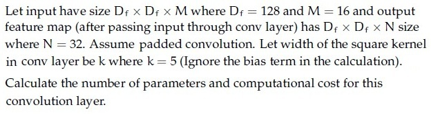
>
> **Figure 18.** Standard convolution specification for Comprehension Context 2 (Questions 268–269).
>
> Based on the above data, answer the given subquestions.

Number of Parameters: __________________

**Correct answer:** `12800`  
**Source evidence:** Official answer '12800' in Possible Answers field with green text (color 0x8000), PDF page 12.

---


---

**Source:** `da5006_2025T1_Q2_NA.md` · Quiz 2, 2025T1 · Question 269 · ID `6406531168245`  
**Classification:** Week 4 — standard convolution computational cost, FLOP / MAC calculation, tensor dimensions, MobileNet baseline comparison  
**Course evidence:** [1.4 The 3D Convolution Operation & Tensor Algebra](/Volumes/1700%20APFS/PERSONAL_PROGRAMMING_PROJECTS/Notes/Deep%20Learning%20for%20Computer%20Vision/month%201/week%204/week-4-report.md) · Related weeks: 5

### Question 269

**Question ID:** `6406531168245` · **Type:** SA · **Marks:** 3  
**PDF pages:** 12, 13

Computational Cost: __________________

**Correct answer:** `209715200`  
**Source evidence:** Official answer '209715200' in Possible Answers field with green text (color 0x8000), PDF page 13.

---


---

**Source:** `da5006_2025T2_Q1_NA.md` · Quiz 1, 2025T2 · Question 166 · ID `6406531279508`  
**Classification:** Week 4 — Receptive Field, Convolutional Neural Network, Max-Pooling, Stride  
**Course evidence:** [### 3.5 Receptive Field Equivalency: Stacked $3 \times 3$ vs. Single $7 \times 7$](/Volumes/1700%20APFS/PERSONAL_PROGRAMMING_PROJECTS/Notes/Deep%20Learning%20for%20Computer%20Vision/month%201/week%204/week-4-report.md) · Related weeks: none

### Question 166

**Question ID:** `6406531279508` · **Type:** MCQ · **Marks:** 2  
**PDF pages:** 7

Consider a Convolutional Neural Network which processes an RGB image. It has 128 kernels each of spatial dimension 5 x 5 in the first layer. They are convolved with a stride 1. This is followed by a max-pooling layer with stride 2 and kernel size 5 x 5. What would be the receptive field size of a single neuron in the pooling layer? (Recap: A receptive field is the size of the region in the input image, which influences the activation of that specific neuron.)

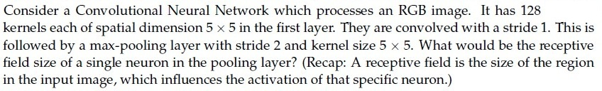

**Figure 19.** CNN receptive field problem statement for Question 166.

**Options**

**A.** 5x5

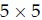

**Figure 20.** Option A receptive field size for Question 166.  
*Option ID:* `6406534313877`

**B.** 7x7

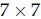

**Figure 21.** Option B receptive field size for Question 166.  
*Option ID:* `6406534313878`

**C.** 9x9

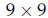

**Figure 22.** Option C receptive field size for Question 166.  
*Option ID:* `6406534313879`

**D.** 3x3

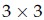

**Figure 23.** Option D receptive field size for Question 166.  
*Option ID:* `6406534313880`

**Correct answer:** **C** — 9x9.  
**Source evidence:** Option 6406534313879 rendered in green text (color 0x8000) on PDF page 7.

---


---

**Source:** `da5006_2025T2_Q1_NA.md` · Quiz 1, 2025T2 · Question 172 · ID `6406531279514`  
**Classification:** Week 4 — Convolutional Neural Networks, Padding Formula, Backpropagation Through Convolution, Pooling Parameters  
**Course evidence:** [### 1.5 Rigorous Derivation of Output Spatial Dimensions](/Volumes/1700%20APFS/PERSONAL_PROGRAMMING_PROJECTS/Notes/Deep%20Learning%20for%20Computer%20Vision/month%201/week%204/week-4-report.md) · Related weeks: 1

### Question 172

**Question ID:** `6406531279514` · **Type:** MSQ · **Marks:** 3  
**PDF pages:** 10

Which of the following statements are true ?(Select all that apply)

**Options**

**A.** To obtain an output of the same spatial size as the input after a convolution with kernel size $k \times k$ (where $k$ is odd) and stride 1, the padding used should be $\frac{k-1}{2}$.

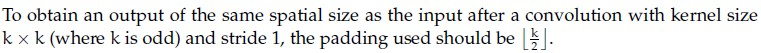

**Figure 24.** Option A candidate statement for Question 172.  
*Option ID:* `6406534313901`

**B.** The derivative of the loss $L$ with respect to the input image $X$, where $Y = X * W$, is given by $\frac{\partial L}{\partial X}[i, j] = \frac{\partial L}{\partial Y} \star W$, where $*$ denotes convolution and $\star$ denotes correlation.

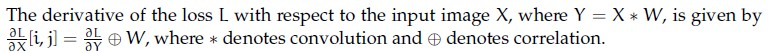

**Figure 25.** Option B candidate statement for Question 172.  
*Option ID:* `6406534313902`

**C.** The number of learnable parameters in a pooling layer is not zero.

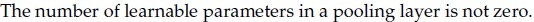

**Figure 26.** Option C candidate statement for Question 172.  
*Option ID:* `6406534313903`

**D.** The number of feature maps obtained after a convolution operation depends on the depth of the input but not on the number of filters.

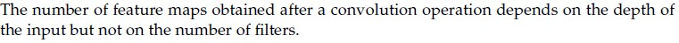

**Figure 27.** Option D candidate statement for Question 172.  
*Option ID:* `6406534313904`

**Correct answer:** **A, B**  
**Source evidence:** Option 6406534313901 rendered in green text (color 0x8000) on PDF page 10; Option 6406534313902 rendered in green text (color 0x8000) on PDF page 10.

---


---

**Source:** `da5006_2025T2_Q1_NA.md` · Quiz 1, 2025T2 · Question 179 · ID `6406531279530`  
**Classification:** Week 4 — Convolutional Neural Networks, Backpropagation Through Convolution, Input Activation Gradient Dimensions, Full Convolution  
**Course evidence:** [### 2.2 Gradient with Respect to Input Activations ($\frac{\partial \mathcal{L}}{\partial X}$)](/Volumes/1700%20APFS/PERSONAL_PROGRAMMING_PROJECTS/Notes/Deep%20Learning%20for%20Computer%20Vision/month%201/week%204/week-4-report.md) · Related weeks: none

### Question 179

**Question ID:** `6406531279530` · **Type:** SA · **Marks:** 3  
**PDF pages:** 15

In backpropagation through a convolutional layer, if the gradient of the loss with respect to the output feature map $\frac{\partial L}{\partial Y}$ is known, and the filter weights $W$ have size $3 \times 3$, stride 1, and no padding, what is the size of the gradient with respect to the input $\frac{\partial L}{\partial X}$, given that $\frac{\partial L}{\partial Y}$ has dimensions $26 \times 26 \times 5$?

Assume if the size of gradient is $F \times F \times d$, then give the value of $F$.

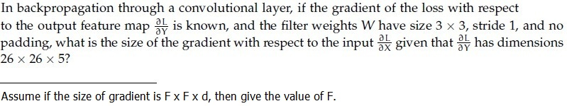

**Figure 28.** Convolution backpropagation gradient dimension problem statement for Question 179.

**Correct answer:** `28`  
**Source evidence:** Official answer '28' specified in Possible Answers field with green text (color 0x8000) on PDF page 15.

---


---

**Source:** `da5006_2025T2_Q1_NA.md` · Quiz 1, 2025T2 · Question 180 · ID `6406531279531`  
**Classification:** Week 4 — Convolutional Neural Networks, Output Spatial Dimensions, Stride and Padding, Successive Convolutions  
**Course evidence:** [### 1.5 Rigorous Derivation of Output Spatial Dimensions](/Volumes/1700%20APFS/PERSONAL_PROGRAMMING_PROJECTS/Notes/Deep%20Learning%20for%20Computer%20Vision/month%201/week%204/week-4-report.md) · Related weeks: none

### Question 180

**Question ID:** `6406531279531` · **Type:** SA · **Marks:** 3  
**PDF pages:** 15

What is the size of the feature map after applying two successive convolution operations with the following parameters? Input image size = $128 \times 128$, Kernel size = $5 \times 5$, Padding = 1, Stride = 4. (In calculation, take $\lfloor x \rfloor$ whenever $x$ is non-integer. If the answer is $F \times F$, write only $F$ in the blank.)

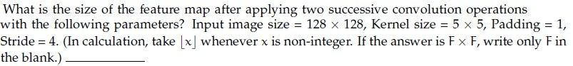

**Figure 29.** Successive convolution feature map size problem statement for Question 180.

**Correct answer:** `8`  
**Source evidence:** Official answer '8' specified in Possible Answers field with green text (color 0x8000) on PDF page 15.

---


---

**Source:** `da5006_2025T2_Q1_NA.md` · Quiz 1, 2025T2 · Question 181 · ID `6406531279532`  
**Classification:** Week 4 — Convolutional Neural Networks, Parameter Counting, 3D Convolution, Filter Weights  
**Course evidence:** [### 1.4 The 3D Convolution Operation & Tensor Algebra](/Volumes/1700%20APFS/PERSONAL_PROGRAMMING_PROJECTS/Notes/Deep%20Learning%20for%20Computer%20Vision/month%201/week%204/week-4-report.md) · Related weeks: none

### Question 181

**Question ID:** `6406531279532` · **Type:** SA · **Marks:** 3  
**PDF pages:** 16

Let an input to a convolutional layer in a CNN have size $D_f \times D_f \times M$, where $D_f = 28$ and $M = 120$. The output feature map after the convolution has size $D_f \times D_f \times N$, where $N = 80$. The kernel size of the convolution layer is $k \times k$, with $k = 3$.

Calculate the number of parameters for this convolution layer. (Assume appropriate padding is applied so that input and output spatial sizes remain the same. Ignore bias terms.)

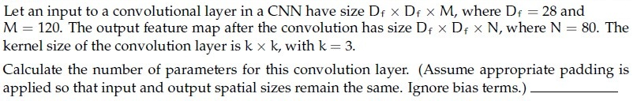

**Figure 30.** CNN convolution layer parameter calculation problem statement for Question 181.

**Correct answer:** `86400`  
**Source evidence:** Official answer '86400' specified in Possible Answers field with green text (color 0x8000) on PDF page 16.

---


---

**Source:** `da5006_2025T2_Q2_NA.md` · Quiz 2, 2025T2 · Question 239 · ID `6406531333790`  
**Classification:** Week 4 — AlexNet, Local Response Normalization (LRN), Lateral Inhibition, Convolutional vs Fully Connected Layers, Parameter vs Computation Asymmetry  
**Course evidence:** [### 3.2 AlexNet (2012)](/Volumes/1700%20APFS/PERSONAL_PROGRAMMING_PROJECTS/Notes/Deep%20Learning%20for%20Computer%20Vision/month%201/week%204/week-4-report.md) · Related weeks: 3

### Question 239

**Question ID:** `6406531333790` · **Type:** MCQ · **Marks:** 2  
**PDF pages:** 3

Consider the following statements P and Q regarding AlexNet and choose the correct option:

(P) In AlexNet, a trainable Local Response Normalization Layers were introduced to emulate the competitive nature of real neurons, where highly active neurons suppress the activity of neighboring neurons, creating competition among different kernel outputs.

(Q) In AlexNet, a total of 8 Convolutional layers contain only about 6-7% of the total parameters hence account for the least computation.

**Options**

**A.** Only statement P is true  
*Option ID:* `6406534459605`

**B.** Only statement Q is true  
*Option ID:* `6406534459606`

**C.** Both statements are true  
*Option ID:* `6406534459607`

**D.** None of these statements is true  
*Option ID:* `6406534459608`

**Correct answer:** **D** — None of these statements is true  
**Source evidence:** Green option ID text 6406534459608 and option text 'None of these statements is true' with green check icon at [119.02, 687.77, 131.02, 699.77].

---


---

**Source:** `da5006_2025T2_Q2_NA.md` · Quiz 2, 2025T2 · Question 259 · ID `6406531333813`  
**Classification:** Week 4 — Standard 3D Convolution, Parameter Calculus, Filter Weights Count, MobileNet Baseline Comparison  
**Course evidence:** [### 1.4 The 3D Convolution Operation & Tensor Algebra](/Volumes/1700%20APFS/PERSONAL_PROGRAMMING_PROJECTS/Notes/Deep%20Learning%20for%20Computer%20Vision/month%201/week%204/week-4-report.md) · Related weeks: 5

### Question 259

**Question ID:** `6406531333813` · **Type:** SA · **Marks:** 2  
**PDF pages:** 11, 12

**Comprehension:**

Let input have size $D_f \times D_f \times M$ where $D_f = 10$ and $M = 256$ and output feature map (after passing input through conv layer) has $D_f \times D_f \times N$ size where $N = 512$. Assume padded convolution. Let width of the square kernel in conv layer be $k$ where $k = 7$ (Ignore the bias term in the calculation). Calculate the number of parameters and computational cost for this convolution layer.

Based on the above data, answer the given subquestions.

Number of Parameters:_____________

**Correct answer:** `6422528`  
**Source evidence:** Official answer '6422528' in Possible Answers field on PDF page 12 with green text.

---


---

**Source:** `da5006_2025T2_Q2_NA.md` · Quiz 2, 2025T2 · Question 260 · ID `6406531333814`  
**Classification:** Week 4 — Standard Convolution Computational Cost, FLOP / MAC Calculation, Tensor Algebra, MobileNet Baseline Comparison  
**Course evidence:** [### 1.4 The 3D Convolution Operation & Tensor Algebra](/Volumes/1700%20APFS/PERSONAL_PROGRAMMING_PROJECTS/Notes/Deep%20Learning%20for%20Computer%20Vision/month%201/week%204/week-4-report.md) · Related weeks: 5

### Question 260

**Question ID:** `6406531333814` · **Type:** SA · **Marks:** 2  
**PDF pages:** 12

**Comprehension:**

Let input have size $D_f \times D_f \times M$ where $D_f = 10$ and $M = 256$ and output feature map (after passing input through conv layer) has $D_f \times D_f \times N$ size where $N = 512$. Assume padded convolution. Let width of the square kernel in conv layer be $k$ where $k = 7$ (Ignore the bias term in the calculation). Calculate the number of parameters and computational cost for this convolution layer.

Based on the above data, answer the given subquestions.

Computational Cost:___________________

**Correct answer:** `642252800`  
**Source evidence:** Official answer '642252800' in Possible Answers field on PDF page 12 with green text.

---


---

**Source:** `da5006_2025T2_ET_AN.md` · End-term, 2025T2 · Question 108 · ID `6406531431371`  
**Classification:** Week 4 — Convolutional Layer Output Dimensions, Spatial Dimension Calculus, Padding and Stride, Successive Convolutions, Feature Map Size  
**Course evidence:** [### 1.5 Rigorous Derivation of Output Spatial Dimensions](/Volumes/1700%20APFS/PERSONAL_PROGRAMMING_PROJECTS/Notes/Deep%20Learning%20for%20Computer%20Vision/month%201/week%204/week-4-report.md) · Related weeks: none

### Question 108

**Question ID:** `6406531431371` · **Type:** SA · **Marks:** 2  
**PDF pages:** 11

What is the size of the feature map after applying two successive convolution operations with given parameters? Image size = 72×72, Kernel size = 5×5, Padding = 2 and Stride = 3. (In calculation, take floor(x) whenever x is non-integer.If the answer is N × N, write just one value N in the blank) __________________ .

**Correct answer:** 8  
**Source evidence:** Source key specifies Possible Answers : 8 (Answers Type : Equal).

---


---

**Source:** `da5006_2025T2_ET_FN.md` · End-term, 2025T2 · Question 159 · ID `6406531422538`  
**Classification:** Week 4 — AlexNet, Local Response Normalization (LRN), Lateral Inhibition, Parameter Asymmetry, FLOP Distribution in CNNs  
**Course evidence:** [### 3.2 AlexNet (2012)](/Volumes/1700%20APFS/PERSONAL_PROGRAMMING_PROJECTS/Notes/Deep%20Learning%20for%20Computer%20Vision/month%201/week%204/week-4-report.md) · Related weeks: none

### Question 159

**Question ID:** `6406531422538` · **Type:** MCQ · **Marks:** 2  
**PDF pages:** 4

Consider the following statements P and Q regarding AlexNet and choose the correct option:

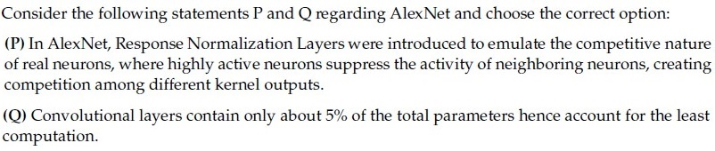

**Figure 31.** Question 159, statements P and Q.

(P) In AlexNet, Response Normalization Layers were introduced to emulate the competitive nature of real neurons, where highly active neurons suppress the activity of neighboring neurons, creating competition among different kernel outputs.

(Q) Convolutional layers contain only about 5% of the total parameters hence account for the least computation.

**Options**

**A.** Only statement P is true  
*Option ID:* `6406534756368`

**B.** Only statement Q is true  
*Option ID:* `6406534756369`

**C.** Both statements are true  
*Option ID:* `6406534756370`

**D.** None of these statements is true  
*Option ID:* `6406534756371`

**Correct answer:** **A** — Only statement P is true.  
**Source evidence:** Option 6406534756368 is rendered in green text (#008000) with a checkmark icon. (PDF page 4).

---


---

**Source:** `da5006_2025T2_ET_FN.md` · End-term, 2025T2 · Question 184 · ID `6406531422573`  
**Classification:** Week 4 — CNN spatial dimension calculus, successive convolution layers, kernel size, padding, stride  
**Course evidence:** [1.5 Rigorous Derivation of Output Spatial Dimensions](/Volumes/1700%20APFS/PERSONAL_PROGRAMMING_PROJECTS/Notes/Deep%20Learning%20for%20Computer%20Vision/month%201/week%204/week-4-report.md) · Related weeks: none

### Question 184

**Question ID:** `6406531422573` · **Type:** SA · **Marks:** 2  
**PDF pages:** 14, 15

What is the size of the feature map after applying two successive convolution operations with given parameters? Image size = 64 x 64, Kernel size = 6 x 6, Padding = 1 and Stride = 2.(In calculation, take floor(x) whenever x is non-integer. If the answer is N x N, enter just one value N in the blank)

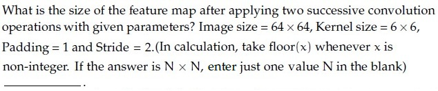

**Figure 32.** Question 184, convolution feature map size problem.

**Correct answer:** `100`  
**Source evidence:** Official text specification: 'Possible Answers : 100' rendered in green text (#008000). (PDF page 15).

---


---

**Source:** `da5006_2025T3_Q2_NA.md` · Quiz 2, 2025T3 · Question 135 · ID `6406531815727`  
**Classification:** Week 4 — AlexNet Architecture, Local Response Normalization (LRN), Trainable vs Fixed Hyperparameters, Parameter vs Computation Asymmetry, Convolutional Layer FLOPs  
**Course evidence:** [### 3.2 AlexNet (2012)](/Volumes/1700%20APFS/PERSONAL_PROGRAMMING_PROJECTS/Notes/Deep%20Learning%20for%20Computer%20Vision/month%201/week%204/week-4-report.md) · Related weeks: none

### Question 135

**Question ID:** `6406531815727` · **Type:** Multiple Choice Question · **Marks:** 2  
**PDF pages:** 3, 4

Consider the following statements P and Q regarding AlexNet and choose the correct option: (P) In AlexNet, a trainable Local Response Normalization Layers were introduced to emulate the competitive nature of real neurons, where highly active neurons suppress the activity of neighboring neurons, creating competition among different kernel outputs. (Q) In AlexNet, a total of 8 Convolutional layers contain only about 6-7% of the total parameters hence account for the least computation.

**Options**

**A.** Only statement P is true  
*Option ID:* `6406535903102`

**B.** Only statement Q is true  
*Option ID:* `6406535903103`

**C.** Both statements are true  
*Option ID:* `6406535903104`

**D.** None of the statements is true  
*Option ID:* `6406535903105`

**Correct answer:** **D** — None of the statements is true.  
**Source evidence:** Option D (6406535903105) in green text (0x8000) with check icon, PDF page 4.

---


---

**Source:** `da5006_2025T3_Q2_NA.md` · Quiz 2, 2025T3 · Question 154 · ID `6406531815748`  
**Classification:** Week 4 — standard 3D convolution layer, convolution parameter calculus, filter weights count, MobileNet baseline comparison  
**Course evidence:** [### 1.4 The 3D Convolution Operation & Tensor Algebra](/Volumes/1700%20APFS/PERSONAL_PROGRAMMING_PROJECTS/Notes/Deep%20Learning%20for%20Computer%20Vision/month%201/week%204/week-4-report.md) · Related weeks: 5

### Question 154

**Question ID:** `6406531815748` · **Type:** Short Answer · **Marks:** 2  
**PDF pages:** 11

Let input have size $D_I \times D_I \times M$ where $D_I = 10$ and $M = 256$ and output feature map (after passing input through conv layer) has $D_I \times D_I \times N$ size where $N = 512$. Assume padded convolution. Let width of the square kernel in conv layer be $k$ where $k = 7$ (Ignore the bias term in the calculation). Calculate the number of parameters and computational cost for this convolution layer.

Based on the above data, answer the given subquestion.

Number of Parameters: ______________

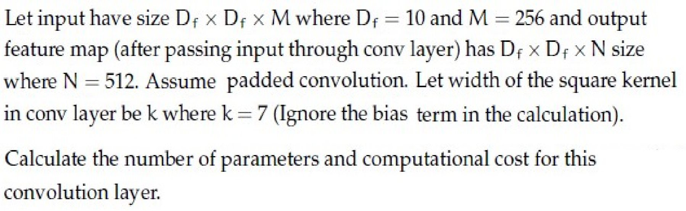

**Figure 33.** Convolutional layer specifications for Questions 154 and 155.

**Correct answer:** `6422528`  
**Source evidence:** Green text (0x8000) under Possible Answers : 6422528, PDF page 11.

---


---

**Source:** `da5006_2025T3_Q2_NA.md` · Quiz 2, 2025T3 · Question 155 · ID `6406531815749`  
**Classification:** Week 4 — standard convolution computational cost, FLOP / MAC calculation, tensor dimensions, MobileNet baseline comparison  
**Course evidence:** [### 1.4 The 3D Convolution Operation & Tensor Algebra](/Volumes/1700%20APFS/PERSONAL_PROGRAMMING_PROJECTS/Notes/Deep%20Learning%20for%20Computer%20Vision/month%201/week%204/week-4-report.md) · Related weeks: 5

### Question 155

**Question ID:** `6406531815749` · **Type:** Short Answer · **Marks:** 2  
**PDF pages:** 11, 12

Refer to the convolutional layer specifications in Question 154.

Based on the above data, answer the given subquestion.

Computational Cost: ________________

**Correct answer:** `642252800`  
**Source evidence:** Green text (0x8000) under Possible Answers : 642252800, PDF page 12.

---


---

**Source:** `da5006_2025T3_ET_FN.md` · End-term, 2025T3 · Question 2 · ID `6406531862816`  
**Classification:** Week 4 — 2D Convolution, Spatial Dimension Calculus, Output Size Formula, Stride and Padding  
**Course evidence:** [### 1.5 Rigorous Derivation of Output Spatial Dimensions](/Volumes/1700%20APFS/PERSONAL_PROGRAMMING_PROJECTS/Notes/Deep%20Learning%20for%20Computer%20Vision/month%201/week%204/week-4-report.md) · Related weeks: none

### Question 2

**Question ID:** `6406531862816` · **Type:** SA · **Marks:** 1  
**PDF pages:** 2

A single 2D convolution (no dilation). Input size $128 \times 128$, kernel $7 \times 7$, stride $2$, padding $1$.
What is the output spatial size $N \times N$? (Enter $N$.)

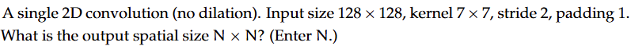

**Figure 34.** Source 2D convolution parameters for Question 2.

**Correct answer:** `62`  
**Source evidence:** Official answer '62' specified in Possible Answers field with green text (color 0x008000); calculation: floor((128 - 7 + 2*1)/2) + 1 = 61 + 1 = 62.

---


---

**Source:** `da5006_2025T3_ET_FN.md` · End-term, 2025T3 · Question 7 · ID `6406531862821`  
**Classification:** Week 4 — Softmax Function, Categorical Probability Distribution, PyTorch Tensor Operations, Classification Output Layer  
**Course evidence:** [### 3.1 Historical Milestones & ImageNet](/Volumes/1700%20APFS/PERSONAL_PROGRAMMING_PROJECTS/Notes/Deep%20Learning%20for%20Computer%20Vision/month%201/week%204/week-4-report.md) · Related weeks: 3

### Question 7

**Question ID:** `6406531862821` · **Type:** MCQ · **Marks:** 1  
**PDF pages:** 4

Consider the following pyTorch code:

```python
x = torch.tensor([[1., 2., 3.], [4., 5., 6.]])
y = torch.softmax(x, dim=1)
print(torch.round(y[0], decimals=2))
```

The printed tensor is:

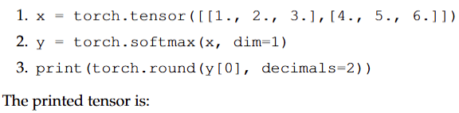

**Figure 35.** Source PyTorch code snippet for Question 7.

**Options**

**A.** tensor([0.09, 0.24, 0.67])  
*Option ID:* `6406536034937`

**B.** tensor([0.09, 0.24, 0.66])  
*Option ID:* `6406536034938`

**C.** tensor([0.09, 0.23, 0.68])  
*Option ID:* `6406536034939`

**D.** tensor([0.10, 0.27, 0.63])  
*Option ID:* `6406536034940`

**Correct answer:** **A** — tensor([0.09, 0.24, 0.67]).  
**Source evidence:** Option A (6406536034937) rendered in green font (color 0x008000) with green checkmark icon (xref 1374 at y=257.56..269.56) in source PDF.

---


---

**Source:** `da5006_2025T3_ET_FN.md` · End-term, 2025T3 · Question 14 · ID `6406531862828`  
**Classification:** Week 4 — 1D Convolution, Output Dimension Calculus, Stride and Padding, Tensor Algebra  
**Course evidence:** [### 1.5 Rigorous Derivation of Output Spatial Dimensions](/Volumes/1700%20APFS/PERSONAL_PROGRAMMING_PROJECTS/Notes/Deep%20Learning%20for%20Computer%20Vision/month%201/week%204/week-4-report.md) · Related weeks: none

### Question 14

**Question ID:** `6406531862828` · **Type:** SA · **Marks:** 1  
**PDF pages:** 6

Calculate the output size ($W_{out}$) of a 1D convolution layer. Input width $W_{in} = 100$, Kernel size $K = 3$, Stride $S = 2$, Padding $P = 1$.

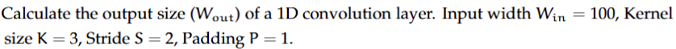

**Figure 36.** Source 1D convolution parameters for Question 14.

**Correct answer:** `50`  
**Source evidence:** Official answer '50' specified in Possible Answers field with green text (color 0x008000); calculation: floor((100 - 3 + 2*1)/2) + 1 = floor(99/2) + 1 = 49 + 1 = 50.

---


---

**Source:** `da5006_2025T3_ET_FN.md` · End-term, 2025T3 · Question 17 · ID `6406531862831`  
**Classification:** Week 4 — Softmax Function, Logits, Categorical Probability Distribution, Multi-Class Classification  
**Course evidence:** [### 3.1 Historical Milestones & ImageNet](/Volumes/1700%20APFS/PERSONAL_PROGRAMMING_PROJECTS/Notes/Deep%20Learning%20for%20Computer%20Vision/month%201/week%204/week-4-report.md) · Related weeks: 3

### Question 17

**Question ID:** `6406531862831` · **Type:** SA · **Marks:** 1  
**PDF pages:** 8

In a classification problem with 3 classes, the logits are vector $\mathbf{z} = [2.0, 1.0, 0.1]$. Calculate the probability of the first class after applying Softmax. (Round to 2 decimal places).

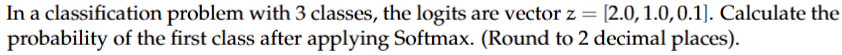

**Figure 37.** Source logits vector and softmax probability query for Question 17.

**Correct answer:** `0.6 to 0.69`  
**Source evidence:** Official accepted range '0.6 to 0.69' specified in Possible Answers field with green text (color 0x008000); calculation: exp(2.0)/(exp(2.0)+exp(1.0)+exp(0.1)) ≈ 7.389 / 11.213 ≈ 0.66.

---


---

**Source:** `da5006_2026T1_Q1_NA.md` · Quiz 1, 2026T1 · Question 11 · ID `6406531961521`  
**Classification:** Week 4 — successive convolutions, convolution dimension calculus, output spatial dimension, stride, padding  
**Course evidence:** [### 1.5 Rigorous Derivation of Output Spatial Dimensions](/Volumes/1700%20APFS/PERSONAL_PROGRAMMING_PROJECTS/Notes/Deep%20Learning%20for%20Computer%20Vision/month%201/week%204/week-4-report.md) · Related weeks: none

### Question 11

**Question ID:** `6406531961521` · **Type:** Short Answer Question · **Marks:** 1  
**PDF pages:** 7

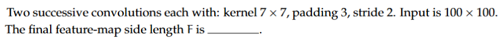

**Figure 38.** Successive convolution layer specifications for Question 11.

Two successive convolutions each with: kernel $7 \times 7$, padding 3, stride 2. Input is $100 \times 100$. The final feature-map side length $F$ is _____.

**Correct answer:** `25`  
**Source evidence:** Green text in Possible Answers field, PDF page 7.

---


---

**Source:** `da5006_2026T1_Q2_NA.md` · Quiz 2, 2026T1 · Question 19 · ID `6406532040106`  
**Classification:** Week 4 — Convolutional Layer Parameters, 3D Convolution Calculus, Kernel Tensor Dimensions, Channel Depth, Feedforward Weights  
**Course evidence:** [### 1.4 The 3D Convolution Operation & Tensor Algebra](/Volumes/1700%20APFS/PERSONAL_PROGRAMMING_PROJECTS/Notes/Deep%20Learning%20for%20Computer%20Vision/month%201/week%204/week-4-report.md) · Related weeks: 3

### Question 19

**Question ID:** `6406532040106` · **Type:** SA · **Marks:** 1  
**PDF pages:** 7

Input feature map: 14×14×128, output: 14×14×256, kernel: 3×3, stride 1, same padding, ignore bias.  
Compute number of parameters for a standard convolution layer.

**Correct answer:** 294912  
**Source evidence:** Green text in 'Possible Answers : 294912', PDF page 7.

---


---

**Source:** `da5006_2026T1_Q2_NA.md` · Quiz 2, 2026T1 · Question 20 · ID `6406532040107`  
**Classification:** Week 4 — Multiply-Accumulate Operations (MACs), Computational Complexity, Convolution FLOP Calculus, Output Spatial Dimensions, Tensor Computations  
**Course evidence:** [### 1.4 The 3D Convolution Operation & Tensor Algebra](/Volumes/1700%20APFS/PERSONAL_PROGRAMMING_PROJECTS/Notes/Deep%20Learning%20for%20Computer%20Vision/month%201/week%204/week-4-report.md) · Related weeks: 5

### Question 20

**Question ID:** `6406532040107` · **Type:** SA · **Marks:** 1  
**PDF pages:** 8

Using the same setup (Input feature map: 14×14×128, output: 14×14×256, kernel: 3×3, stride 1, same padding, ignore bias), compute total MACs operation (multiply-accumulates). A single MAC operation multiplies two numbers and adds the result to an accumulator.

**Correct answer:** 57802752  
**Source evidence:** Green text in 'Possible Answers : 57802752', PDF page 8.

---


---

**Source:** `da5006_2026T1_ET_FN.md` · End-term, 2026T1 · Question 4 · ID `6406532136819`  
**Classification:** Week 4 — output spatial dimension calculus, valid convolution padding, convolution stride, receptive field and feature map size  
**Course evidence:** [### 1.5 Rigorous Derivation of Output Spatial Dimensions](/Volumes/1700%20APFS/PERSONAL_PROGRAMMING_PROJECTS/Notes/Deep%20Learning%20for%20Computer%20Vision/month%201/week%204/week-4-report.md) · Related weeks: 1

### Question 4

**Question ID:** `6406532136819` · **Type:** MCQ · **Marks:** 2  
**PDF pages:** 2, 3

You apply a 5×5 filter with stride 1 and no padding on a 32×32 image. Output size is:

**Options**

**A.** 32×32  
*Option ID:* `6406536959485`

**B.** 28×28  
*Option ID:* `6406536959486`

**C.** 27×27  
*Option ID:* `6406536959487`

**D.** 26×26  
*Option ID:* `6406536959488`

**Correct answer:** **B** — 28×28.  
**Source evidence:** Option ID 6406536959486 rendered in green text (#008000) with checkmark icon (xref 1692) on PDF page 3.

---


---

**Source:** `da5006_2026T1_ET_FN.md` · End-term, 2026T1 · Question 11 · ID `6406532136826`  
**Classification:** Week 4 — CNN inductive biases, weight sharing, local receptive fields, parameter efficiency, Feedforward Neural Networks  
**Course evidence:** [### 1.3 Core Architectural Inductive Biases of CNNs](/Volumes/1700%20APFS/PERSONAL_PROGRAMMING_PROJECTS/Notes/Deep%20Learning%20for%20Computer%20Vision/month%201/week%204/week-4-report.md) · Related weeks: 3

### Question 11

**Question ID:** `6406532136826` · **Type:** MCQ · **Marks:** 2  
**PDF pages:** 4

A key reason CNNs are parameter-efficient compared to fully connected nets for images is:

**Options**

**A.** Weight sharing and local receptive fields  
*Option ID:* `6406536959513`

**B.** They never use nonlinearities thus easier to train  
*Option ID:* `6406536959514`

**C.** They always use pooling  
*Option ID:* `6406536959515`

**D.** Compared to vanilla neural network and RNN, they are robust to gradient explosion and vanishing gradient.  
*Option ID:* `6406536959516`

**Correct answer:** **A** — Weight sharing and local receptive fields.  
**Source evidence:** Option ID 6406536959513 rendered in green text (#008000) with checkmark icon (xref 1692) on PDF page 4.

---


---

**Source:** `da5006_2026T1_ET_FN.md` · End-term, 2026T1 · Question 12 · ID `6406532136827`  
**Classification:** Week 4 — receptive field, stacked convolutions, effective receptive field, VGGNet, spatial context  
**Course evidence:** [### 3.5 Receptive Field Equivalency: Stacked $3 \times 3$ vs. Single $7 \times 7$](/Volumes/1700%20APFS/PERSONAL_PROGRAMMING_PROJECTS/Notes/Deep%20Learning%20for%20Computer%20Vision/month%201/week%204/week-4-report.md) · Related weeks: none

### Question 12

**Question ID:** `6406532136827` · **Type:** MCQ · **Marks:** 2  
**PDF pages:** 5

Stacking multiple 3×3 convolutions (stride 1) increases receptive field because:

**Options**

**A.** Each layer composes local neighborhoods into larger effective context  
*Option ID:* `6406536959517`

**B.** Each layer reduces spatial resolution  
*Option ID:* `6406536959518`

**C.** It removes nonlinearities thereby increasing the effective context  
*Option ID:* `6406536959519`

**D.** It forces global averaging thereby increasing the contribution of input pixels  
*Option ID:* `6406536959520`

**Correct answer:** **A** — Each layer composes local neighborhoods into larger effective context.  
**Source evidence:** Option ID 6406536959517 rendered in green text (#008000) with checkmark icon (xref 1692) on PDF page 5.

---


---

**Source:** `da5006_2026T1_ET_FN.md` · End-term, 2026T1 · Question 21 · ID `6406532136836`  
**Classification:** Week 4 — convolution dimension calculus, output spatial dimension, stride, padding, kernel size  
**Course evidence:** [### 1.5 Rigorous Derivation of Output Spatial Dimensions](/Volumes/1700%20APFS/PERSONAL_PROGRAMMING_PROJECTS/Notes/Deep%20Learning%20for%20Computer%20Vision/month%201/week%204/week-4-report.md) · Related weeks: none

### Question 21

**Question ID:** `6406532136836` · **Type:** SA · **Marks:** 4  
**PDF pages:** 7, 8

Input image: 64×64. Convolution: kernel 7×7, stride 2, padding 3. Compute output spatial size.

**Correct answer:** `32`  
**Source evidence:** Official text specification: 'Possible Answers : 32' rendered in green text (#008000) on PDF page 8.

---


---

**Source:** `da5006_2026T2_Q1_NA.md` · Quiz 1, 2026T2 · Question 10 · ID `6406532166257`  
**Classification:** Week 4 — Convolutional Output Dimensions, Successive Convolutions, Stride, Padding, Tensor Arithmetic  
**Course evidence:** [### 1.5 Rigorous Derivation of Output Spatial Dimensions](/Volumes/1700%20APFS/PERSONAL_PROGRAMMING_PROJECTS/Notes/Deep%20Learning%20for%20Computer%20Vision/month%201/week%204/week-4-report.md) · Related weeks: none

### Question 10

**Question ID:** `6406532166257` · **Type:** Short Answer Question · **Marks:** 1  
**PDF pages:** 5

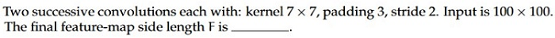

**Figure 39.** Successive convolution layer specifications for Question 10.

Two successive convolutions each with: kernel $7 \times 7$, padding 3, stride 2. Input is $100 \times 100$. The final feature-map side length $F$ is _____.

**Correct answer:** `25`  
**Source evidence:** Green text in Possible Answers field, PDF page 5.

---


---

**Source:** `da5006_2026T2_Q2_NA.md` · Quiz 2, 2026T2 · Question 18 · ID `6406532194398`  
**Classification:** Week 4 — Convolutional Layer Parameters, 3D Convolution Calculus, Kernel Tensor Dimensions, Channel Depth, Feedforward Weights  
**Course evidence:** [### 1.4 The 3D Convolution Operation & Tensor Algebra](/Volumes/1700%20APFS/PERSONAL_PROGRAMMING_PROJECTS/Notes/Deep%20Learning%20for%20Computer%20Vision/month%201/week%204/week-4-report.md) · Related weeks: 3

### Question 18

**Question ID:** `6406532194398` · **Type:** SA · **Marks:** 4  
**PDF pages:** 6, 7

Input feature map: 14×14×128, output: 14×14×256, kernel: 3×3, stride 1, same padding, ignore bias. 

Compute number of parameters for a standard convolution layer.

**Response type:** Numeric  
**Evaluation required:** Yes  
**Answers type:** Equal  

**Correct answer:** 294912  
**Source evidence:** Source key specifies Possible Answers : 294912 (Answers Type : Equal, green font #008000).

---


---

**Source:** `da5006_2026T2_Q2_NA.md` · Quiz 2, 2026T2 · Question 19 · ID `6406532194399`  
**Classification:** Week 4 — Multiply-Accumulate Operations (MACs), Computational Complexity, Convolution FLOP Calculus, Output Spatial Dimensions, Tensor Computations  
**Course evidence:** [### 1.4 The 3D Convolution Operation & Tensor Algebra](/Volumes/1700%20APFS/PERSONAL_PROGRAMMING_PROJECTS/Notes/Deep%20Learning%20for%20Computer%20Vision/month%201/week%204/week-4-report.md) · Related weeks: 5

### Question 19

**Question ID:** `6406532194399` · **Type:** SA · **Marks:** 4  
**PDF pages:** 7

Input feature map: 14×14×128, output: 14×14×256, kernel: 3×3, stride 1, same padding, ignore bias, compute total MACs (multiply-accumulates).

**Response type:** Numeric  
**Evaluation required:** Yes  
**Answers type:** Equal  

**Correct answer:** 57802752  
**Source evidence:** Source key specifies Possible Answers : 57802752 (Answers Type : Equal, green font #008000).

---


---

**Source:** `da5006_2026T2_ET_FN.md` · End-term, 2026T2 · Question 10 · ID `6406532270049`  
**Classification:** Week 4 — Weight Sharing, Convolutional Parameters, Translation Equivariance, Spatial Invariance of Weights, CNN Inductive Biases  
**Course evidence:** [### 1.3 Core Architectural Inductive Biases of CNNs](/Volumes/1700%20APFS/PERSONAL_PROGRAMMING_PROJECTS/Notes/Deep%20Learning%20for%20Computer%20Vision/month%201/week%204/week-4-report.md) · Related weeks: 3

### Question 10

**Question ID:** `6406532270049` · **Type:** MCQ · **Marks:** 2  
**PDF pages:** 4

A $3 \times 3$ convolution maps 16 input channels to 32 output channels. If the input spatial size changes from $64 \times 64$ to $128 \times 128$ while the layer configuration is unchanged, the number of trainable convolution weights:

**Options**

**A.** Doubles  
*Option ID:* `6406537379035`

**B.** Quadruples  
*Option ID:* `6406537379036`

**C.** Remains unchanged  
*Option ID:* `6406537379037`

**D.** Is halved  
*Option ID:* `6406537379038`

**Correct answer:** **C** — Remains unchanged.  
**Source evidence:** Option ID 6406537379037 rendered in green text (#008000) with checkmark icon (xref 2581) on PDF page 4.

---


---

**Source:** `da5006_2026T2_ET_FN.md` · End-term, 2026T2 · Question 11 · ID `6406532270050`  
**Classification:** Week 4 — Backpropagation in CNNs, Kernel Weight Gradient, Spatial Weight Sharing, Gradient Accumulation, Multivariate Chain Rule  
**Course evidence:** [## Module 1: Introduction to Convolutional Neural Networks](/Volumes/1700%20APFS/PERSONAL_PROGRAMMING_PROJECTS/Notes/Deep%20Learning%20for%20Computer%20Vision/month%201/week%204/week-4-report.md) · Related weeks: 3

### Question 11

**Question ID:** `6406532270050` · **Type:** MCQ · **Marks:** 2  
**PDF pages:** 4, 5

A convolution kernel is reused at many spatial locations. The gradient of the loss with respect to one kernel coefficient therefore contains:

**Options**

**A.** A contribution from only the central output location  
*Option ID:* `6406537379039`

**B.** Contributions accumulated from all output locations where that coefficient was used  
*Option ID:* `6406537379040`

**C.** Only the gradient of the bias corresponding to that output channel  
*Option ID:* `6406537379041`

**D.** A contribution from exactly one spatial location chosen during the forward pass  
*Option ID:* `6406537379042`

**Correct answer:** **B** — Contributions accumulated from all output locations where that coefficient was used.  
**Source evidence:** Option ID 6406537379040 rendered in green text (#008000) with checkmark icon (xref 2581) on PDF page 5.

---


---

**Source:** `da5006_2026T2_ET_FN.md` · End-term, 2026T2 · Question 30 · ID `6406532270069`  
**Classification:** Week 4 — Convolutional Output Dimensions, Spatial Dimension Calculus, Stride, Padding, Convolution Arithmetic  
**Course evidence:** [### 1.5 Rigorous Derivation of Output Spatial Dimensions](/Volumes/1700%20APFS/PERSONAL_PROGRAMMING_PROJECTS/Notes/Deep%20Learning%20for%20Computer%20Vision/month%201/week%204/week-4-report.md) · Related weeks: none

### Question 30

**Question ID:** `6406532270069` · **Type:** SA · **Marks:** 4  
**PDF pages:** 10

An input feature map has spatial size $63 \times 63$. A $5 \times 5$ convolution is applied with stride 2 and padding 1. Compute the output size along one spatial dimension.

**Correct answer:** `31`  
**Source evidence:** Official text specification: 'Possible Answers : 31' on PDF page 10.

---


---

**Source:** `da5006_2026T2_ET_FN.md` · End-term, 2026T2 · Question 33 · ID `6406532270072`  
**Classification:** Week 4 — Convolutional Layer Parameters, 3D Convolution Tensor Algebra, Kernel Dimensions, Bias Parameters, Trainable Parameters  
**Course evidence:** [### 1.4 The 3D Convolution Operation & Tensor Algebra](/Volumes/1700%20APFS/PERSONAL_PROGRAMMING_PROJECTS/Notes/Deep%20Learning%20for%20Computer%20Vision/month%201/week%204/week-4-report.md) · Related weeks: none

### Question 33

**Question ID:** `6406532270072` · **Type:** SA · **Marks:** 4  
**PDF pages:** 11

A convolutional layer uses $3 \times 3$ kernels, 16 input channels and 32 output channels. The layer has one bias per output channel. Compute the total number of trainable parameters.

**Correct answer:** `4640`  
**Source evidence:** Official text specification: 'Possible Answers : 4640' on PDF page 11.

---


## Source extraction notes

The following notes are reproduced from each included paper; figure numbers in these notes refer to the original paper.

### `da5006_2024T1_ET_AN.md`

- **Subject boundary reconciliation:** Physical page 1 begins with residual text from the preceding subject (Section 7, ending with Question 158). Section 8 (`DL(CV)`) starts on page 1 with Section ID `64065357859` and declares 37 questions and 72 marks. Question 159 on page 2 is the administrative subject confirmation question (YES/NO) and was omitted per contract.
- **Declared count reconciliation:** The 37 test delivery units in Section 8 comprise 1 administrative confirmation question + 25 MCQs (Q160–Q184) + 1 MSQ (Q185) + 5 standalone SA questions (Q186–Q190) + 5 comprehension parent passages (containing 13 subquestions: Q191–Q203). Total extracted academic questions: 44. Total score reconciles exactly to 72 marks.
- **Image-as-text questions preserved:** Questions 160, 178, 180, 181, 182, 185, 186, 187, 188, 194, 195, 196, 197, 198, 199 and comprehension contexts contain formulas/text embedded as images. All 30 images were cleanly extracted, saved to `assets/da5006_2024T1_ET_AN/`, transcribed into LaTeX/Markdown, visually inspected, and verified.
- **Status:** Extracted with all source academic content, formulas, option IDs, and answer evidence preserved; marked `needs-review` pending independent audit.


### `da5006_2024T1_Q2_NA.md`

1. **Reconciliation of Declared Count**: Section 10 declares 23 questions and 50 marks. The paper comprises:
   - 1 administrative confirmation question (Question 148, excluded from academic questions);
   - 19 standalone questions (Questions 149–167);
   - 3 comprehension question blocks containing 9 child questions:
     - Comprehension ID `640653766148` (Questions 168–170, 3 numerical SA questions);
     - Comprehension ID `640653766166` (Questions 171–174, 4 fill-in SA questions);
     - Comprehension ID `640653766172` (Questions 175–176, 2 numerical SA questions).
   Reconciliation: 1 administrative question + 19 standalone questions + 3 comprehension groups = 23 parent question items. Total extracted academic questions: 19 + 3 + 4 + 2 = 28 questions. Total marks: 12 (MSQ) + 4 (SA) + 22 (MCQ) + 5 (Comp 1) + 5 (Comp 2) + 2 (Comp 3) = 50 marks, matching the declared section total exactly.
2. **Subject Boundary**: The PDF opens with Question 147 (page 1), which pertains to pre-training datasets for Large Language Models and belongs to a preceding exam section. Section 10 "DL(CV)" begins on page 1 (`[271.17, 380.62, 329.96, 405.10]`). The DL(CV) section concludes on page 18 with Question 176. Page 19 introduces Section 11 "SPG" (Strategies for Professional Growth) starting with administrative question 177, which is excluded from scope.
3. **Question 150 (Grad-CAM MSQ)**: Although labeled as a Multiple Select Question (`MSQ`), the official source marks only Option A (`6406532564183`) in green text with a check icon, while Options B, C, and D are marked with red text and cross icons. Faithfully recorded as marked in the source key.
4. **Question 174 (KL Divergence for Bernoulli distributions)**: The source key specifies accepted answer `8` for parameter $d$ where $KL(P||Q) = c \times \log(d)$ with $P = \text{Bernoulli}(0.9)$ and $Q = \text{Bernoulli}(0.1)$, with $c = 0.9$ (from Question 173). Faithfully preserved from the official key.


### `da5006_2024T2_ET_AN.md`

1. **Scope and Reconciliation:** Section header specifies `DL(CV)` with 25 parent question units and 50 marks. Sub-section 1 contains Question 248 (Question Id: 640653904299), which is the standard administrative subject confirmation (administrative subject confirmation question) and is excluded. The academic exam consists of 11 standalone MCQs (Q249–Q259, 22 marks), 3 standalone numerical SAs (Q260–Q262, 6 marks), Comprehension Passage 1 (Q263–Q271, 9 marks across 9 subquestions), Comprehension Passage 2 (Q272–Q274, 2 marks across 3 subquestions), 3 MSQs (Q275–Q277, 6 marks), 1 SA (Q278, 1 mark), and 4 MCQs (Q279–Q282, 4 marks). Total: 34 academic questions evaluated, exactly totaling 50 marks.
2. **Subsequent Subject:** Section 11 (`SPG`, Section Id: 64065364139) starting on page 17 is out-of-scope and excluded.
3. **Image Options and Mathematical Transcription:** Questions 250, 255, 257, 276, and 282 have option text embedded as raster figures in the original PDF. All raster crops have been faithfully extracted to `assets/da5006_2024T2_ET_AN/`, verified for non-emptiness, and transcribed into standard Markdown LaTeX alongside the original figures.
4. **Answer Grounding:** Every question answer is grounded directly in the source PDF via font colors (#008000 green spans for correct options vs #ff0000 red spans for incorrect options), checkmark/cross icons, or explicit `Possible Answers` text fields. No answer has been guessed or inferred.


### `da5006_2024T2_Q1_NA.md`

- Question 80 (administrative subject confirmation) has been excluded in accordance with the extraction contract.
- Declared question count in section header is 23, representing 23 parent question items (1 administrative item + 18 standalone questions + 4 comprehension groups). The total number of individually scored academic questions is 29 (Questions 81 to 109).
- All 33 images (question stems, math formulas, matching tables, and image options) have been extracted natively at original resolution, verified, and embedded with sequential figure numbers and captions.
- Every correct answer is backed by visible source evidence from green check mark icons or explicit 'Possible Answers' scoring entries.


### `da5006_2024T3_Q1_NA.md`

1. **Administrative Question Exclusion:** The administrative subject confirmation question (Question ID unnumbered/0 marks, options YES/NO) at the top of physical page 1 has been excluded per instructions.
2. **Sequential Figure Numbering:** All 29 embedded visual assets have been extracted at native resolution, visually inspected, and sequentially captioned as Figures 1 through 29.
3. **Source Cutoff at Question 172:** The source PDF terminates at physical page 13 immediately following the Question 172 header (`Question Number : 172 Question Id : 640653994508 Question Type : SA Correct Marks : 2`). The question body, response fields, and answer key are truncated in the source PDF. This has been faithfully recorded as `Answer not verifiable from the source PDF`.


### `da5006_2024T3_Q2_NA.md`

1. **Administrative question exclusion:** Question 131 (ID `6406531031063`, 0 marks) is the administrative subject confirmation query (asking candidates to confirm their registered subject with YES/NO options). It has been excluded from academic questions in compliance with Section 4 of the Master Extraction Prompt.
2. **Reconciliation of declared counts:** Page 1 lists "Number of Questions : 19". In the exam system, comprehension blocks (Sub-Section 2 for Q132-133, Sub-Section 3 for Q134-137, Sub-Section 7 for Q153-157) count as 1 question unit each in the header metadata. Together with 1 administrative unit (Q131), 12 standalone MCQs (Q138-149), 2 MSQs (Q150-151), and 1 SA (Q152), this totals exactly $1 + 1 + 1 + 12 + 2 + 1 + 1 = 19$ parent question units. Scored academic questions total 26 (Questions 132 to 157).
3. **Source truncation at end of exam paper:** Physical page 12 terminates at y=814.03 immediately following the header for Question 157 (`Question Number : 157 Question Id : 6406531031092 Question Type : SA` and `Correct Marks : 2`). The specific weight matrix query (likely concerning hidden-to-output matrix $W$ or classification weights) and official `Possible Answers` were cut off during the original exam export. In accordance with Section 6 of the Master Extraction Prompt, this question is faithfully retained with its official ID and marked as `Answer not verifiable from the source PDF`.
4. **Source key ambiguity between Question 144 and Question 146:**
   - Both Question 144 and Question 146 share the identical four option texts:
     - A. Attention mechanisms cannot be applied to the bidirectional RNN model
     - B. An image captioning network cannot be trained end-to-end even though we are using 2 different modalities to train the network
     - C. One of the key components in the vanilla transformer are the recurrent connections that help them to deal with variable input length.
     - D. None of these
   - Question 144 asks: "Which one of the following statements is false?". In academic deep learning literature, statements A, B, and C are all factually false. Nonetheless, the source exam officially marks Option D (`None of these`) as correct with a green checkmark and green text.
   - Question 146 asks: "Which one of the following statements is true?". Here Option D (`None of these`) is marked with a green checkmark and green text, which is logically consistent since A, B, and C are false.
   - In accordance with the contract, the official source key is preserved exactly as published without alteration.
5. **Mathematical confirmations:**
   - **Q138 (Integral Image):** Source input matrix $I = \begin{bmatrix} 3 & 7 & 2 \\ 5 & 4 & 6 \\ 8 & 1 & 9 \end{bmatrix}$ yields cumulative integral image $S = \begin{bmatrix} 3 & 10 & 12 \\ 8 & 19 & 27 \\ 16 & 28 & 45 \end{bmatrix}$, matching Option B (`6406533487213`).
   - **Q140 (11-point AP and mAP):** Interpolated precision sum at recall levels $0.0, 0.1, \dots, 1.0$ is $1.0 + 0.90 + 0.85 + 0.80 + 0.75 + 0.70 + 0.65 + 0.60 + 0.55 + 0.50 + 0.45 = 7.75$. Class 1 AP $= 7.75 / 11 = 0.7045$. Overall $\text{mAP} = (0.7045 + 0.78 + 0.72) / 3 = 0.7348 \approx 0.73$, matching Option C.
   - **Q145 (IoU):** Two $12 \times 12$ boxes with $8 \times 8$ overlap: $\text{Intersection} = 64$, $\text{Union} = 144 + 144 - 64 = 224$, $\text{IoU} = 64/224 = 2/7 \approx 28.57\% \approx 28\%$, matching Option C.
   - **Q152 (Faster R-CNN loss updates):** Bounding box regression loss is computed only for foreground proposals ($5 + 95 = 100$), yielding exactly 100 computations.
   - **Q153–156 (RNN weights):** Input $X \in \mathbb{R}^{132}$, Hidden $D1 \in \mathbb{R}^{256}$, Hidden $D2 \in \mathbb{R}^{128}$. Input-to-hidden $U1 = 132 \times 256 = 33792$; recurrent $V1 = 256 \times 256 = 65536$; hidden-to-hidden $U2 = 256 \times 128 = 32768$; recurrent $V2 = 128 \times 128 = 16384$.


### `da5006_2025T1_Q1_NA.md`

- **Scope boundaries:** The DL(CV) section begins on Page 1 at the `DL(CV)` section header (Section Id 64065379956, Section Number 9) and concludes on Page 17 at the end of Question 189. The Section 8 NLP remnant text at the top of Page 1 (IDs 6406533822651, 6406533822652, and Question 152) and the Section 10 RL material starting on Page 17 (Section Id 64065379957) have been strictly excluded.
- **Administrative confirmation excluded:** Question 153 on Page 2 (Question Id 6406531130609, 0 marks), the administrative subject verification prompt, is excluded in accordance with extraction requirements.
- **Question count reconciliation:** The Section 9 header declares 31 questions. This corresponds to 1 excluded confirmation question, 26 standalone questions (Q154–Q160 SA, Q161–Q173 MCQ, Q174–Q179 MSQ), and 4 comprehension passages (treated as parent units). Inside the comprehension passages are 10 subquestions (Q180–Q181, Q182–Q183, Q184–Q187, Q188–Q189), resulting in exactly 36 academic questions summing to the declared 60 marks.
- **MSQ questions and stem polarities:** Questions 174 and 175 in the source exam explicitly ask 'Which of the following statements is/are false?'. In Question 174, false statements A and C are marked correct in the official exam key. In Question 175, false statements C and D are marked correct in the official exam key. Question 176 has one correct option (A); Question 177 has two correct options (A, D); Question 178 has two correct options (A, D); Question 179 has two correct options (A, B). All marked correct options are preserved with exact option IDs and source evidence.
- **Accepted ranges and alternatives:** Question 157 has accepted range `-0.34 to -0.33` (straightness measure $\lambda_2 / \lambda_1 = -1/3$ for second moment matrix $\begin{bmatrix} 1 & 2 \\ 2 & 1 \end{bmatrix}$); Question 160 has accepted range `-0.260 to -0.210` (momentum update); Question 182 accepts `thick`, `coarse`, or `large scale`. All source alternatives and conditions are faithfully preserved.
- **Comprehension 3 matrix transcription:** In Figure 27 (Comprehension 3, Questions 184–187), the source exam figure displays the affine transformation matrix with column 3 rows 1–2 as explicitly `1` and `1` (i.e. $\begin{bmatrix} a_{11} & a_{12} & 1 \\ a_{21} & a_{22} & 1 \\ 0 & 0 & 1 \end{bmatrix}$). The source formula has been faithfully preserved with `1` and `1` in accordance with the source PDF, preserving authorial authenticity rather than silently normalizing to zeros.
- **Comprehension 4 partial derivative notation:** In Figure 29 (Question 188) and Figure 30 (Question 189), the source exam explicitly queries the partial derivatives of output variable $e$ with respect to inputs $a$ and $b$, i.e. $\frac{\partial e}{\partial a}$ and $\frac{\partial e}{\partial b}$ (where computation graph evaluates $c = a + b$, $d = b + 1$, $e = c \times d$), verified against the original PDF and native assets.


### `da5006_2025T1_Q2_NA.md`

- **Scope boundaries:** The DL(CV) examination spans the entire document from Page 1 to Page 17. Sub-Section 1 begins at the top of Page 1 with administrative subject confirmation, and Sub-Section 5 concludes at the end of Question 278 on Page 17.
- **Administrative confirmation excluded:** Question 241 on Page 1 (Question Id `6406531168215`, 0 marks), the administrative subject verification prompt with YES/NO options, is excluded in accordance with extraction requirements.
- **Question count reconciliation:** The examination paper contains 37 academic questions totaling 65 marks: 16 standalone MCQs (Q242–Q257, 2 marks each = 32 marks), 3 standalone MSQs (Q258–Q260, 2 marks each = 6 marks), 1 standalone SA (Q261, 3 marks), and 4 comprehension passages comprising 17 subquestions: Comprehension 1 (Q262–Q267, 6 SAs at 1 mark = 6 marks), Comprehension 2 (Q268–Q269, 2 SAs at 3 marks = 6 marks), Comprehension 3 (Q270–Q273, 4 SAs at 1.5 marks = 6 marks), and Comprehension 4 (Q274–Q278, 5 SAs at 1.2 marks = 6 marks). Total = 16 + 3 + 1 + 6 + 2 + 4 + 5 = 37 academic questions.
- **MSQ questions:** Question 258 has three correct options (B, C, D; Option A is incorrect). Question 259 has two correct options (A, D; Options B and C are incorrect). Question 260 has two correct options (B, D; Options A and C are incorrect). All marked correct options are preserved in exact source order.
- **Mathematical fidelity & figure preservation:** All equations, matrices, and architecture schematics have been faithfully preserved with exact LaTeX representations accompanied by source-cropped figures (Figures 1–25). All 25 figure files resolve to verified, decodable assets in `assets/da5006_2025T1_Q2_NA/`.


### `da5006_2025T2_ET_AN.md`

- Administrative confirmation Question 82 (Question Id `6406531431342`, Sub-Section 1) is excluded per MASTER_EXTRACTION_PROMPT.md.
- Section 6 'Mathematical Foundations of Generative AI' starting at page 20, y=682.0 pt is excluded as out-of-scope.
- In Question 88, source option C is printed as '69%' in green font (#008000) indicating the officially accepted answer.
- In Question 90, source option C ('One of the key components in the vanilla transformer is the recurrent connection that help them to deal with variable input length.') is printed in green font (#008000), while Option D ('All of these.') is printed in red font (#ff0000). The question queries for the incorrect statement; vanilla transformers do not possess recurrent connections, confirming Option C.
- In Question 91, source option A (`1 → Gaussian filter, 2 → Laplacian of Gaussian, 3 → First derivative of Gaussian, 4 → Sobel operator`) is printed in green font (#008000), confirming Option A.
- In Questions 109 and 110, derivative queries are confirmed from source computation graph and equation images to have output node $e$ in the numerator: $\frac{\partial e}{\partial a}$ and $\frac{\partial e}{\partial b}$.
- In Questions 119, 122, and 124, subquestion labels correspond to image prompt queries `\<CLS\> Prompt:`, `\<Decode\> Prompt:`, and `\<Encode\> Prompt:`, with brackets escaped to ensure clean Markdown rendering.
- In Comprehension Questions 126 to 131, the 4D input vector is restored to its complete form $x = [4, -5, -7, 10]$ as shown in Figure 25.


### `da5006_2025T2_ET_FN.md`

1. **Section scope & exclusions:** The DL(CV) section begins on PDF Page 1 (Section Id 64065399798, Section Number 7). Preceding content on Page 1 belongs to the previous exam subject and is excluded. Question 155 (Question Id 6406531422534) on Page 2 is the administrative subject confirmation question (YES/NO options, 0 marks) and is excluded from academic questions. The exam paper terminates DL(CV) on Page 24; Page 25 begins the next subject 'Mathematical Foundations of Generative AI' (Section Id 64065399800, Section Number 9) and is excluded as out-of-scope.
2. **Declared question count reconciliation:** The section metadata declares 34 questions and 76 marks. This reconciles exactly with the source structure:
   - Sub-section 1: Administrative confirmation (1 parent unit, 0 marks, excluded).
   - Sub-section 2: 16 MCQs Q156–Q171 (16 parent units, 32 marks).
   - Sub-section 3: 7 MSQs Q172–Q178 (7 parent units, 14 marks).
   - Sub-section 4: 6 SAs Q179–Q184 (6 parent units, 12 marks).
   - Sub-section 5: Comprehension passage Id 6406531422563 (1 parent unit) containing 2 SA subquestions Q185–Q186 (2 marks).
   - Sub-section 6: Comprehension passage Id 6406531422574 (1 parent unit) containing 4 SA subquestions Q187–Q190 (4 marks).
   - Sub-section 7: Comprehension passage Id 6406531422566 (1 parent unit) containing 6 SA subquestions Q191–Q196 (6 marks).
   - Sub-section 8: Comprehension passage Id 6406531422579 (1 parent unit) containing 11 SA subquestions Q197–Q207 (6 marks total: 6 @ 0.55 marks = 3.30 + 5 @ 0.54 marks = 2.70 marks).
   - Total parent units = 1 + 16 + 7 + 6 + 1 + 1 + 1 + 1 = 34 questions.
   - Total scored academic questions = 16 + 7 + 6 + 2 + 4 + 6 + 11 = 52 questions, totaling exactly 76.0 marks.
3. **Source answers:** All answers are evidenced directly from font color (#008000 green text / checkmark icons) for MCQs and MSQs, or explicit official 'Possible Answers :' text specifications for short-answer questions. Every MSQ has multiple verified answers preserved. Question 172 asks 'Which of the following statements are false? (Select all that apply)' and has verified official key C, D. Short-answer Question 184 has verified source Possible Answers '100', preserved despite academic suspicion regarding convolution padding arithmetic.
4. **Figure fidelity:** All 52 assets are extracted from the original PDF at native resolution and referenced with sequential figure captions (Figures 1 to 52).


### `da5006_2025T2_Q1_NA.md`

- **Scope boundaries:** The DL(CV) section begins on Page 1 at the `DL(CV)` section header (Section Id 64065391702, Section Number 9) and concludes on Page 22 at the end of Question 190. The Section 8 NLP remnant text at the top of Page 1 (Question 155 ID 6406531279497) and the Section 10 Mathematical Foundations of Generative AI material starting on Page 22 at bottom (Section Id 64065391703) have been strictly excluded.
- **Administrative confirmation excluded:** Question 156 on Page 2 (Question Id 6406531279498, 0 marks), the administrative subject verification prompt, is excluded in accordance with extraction requirements.
- **Question count reconciliation:** The Section 9 header declares 32 questions and 79 marks. This corresponds to 1 excluded confirmation question, 28 standalone questions (Q157–Q170 MCQ at 2 marks = 28 marks; Q171–Q175 MSQ at 3 marks = 15 marks; Q176–Q184 SA at 3 marks = 27 marks), and 3 comprehension passages (treated as parent units toward the 32 declared count). Inside the 3 comprehension passages are 6 subquestions (Q185–Q186, Q187–Q188, Q189–Q190 at 1.5 marks each = 9 marks), resulting in exactly 34 academic questions summing to 28 + 15 + 27 + 9 = 79 marks, exactly matching declared section marks.
- **MSQ questions:** Question 171 has two correct options (A, D); Question 172 has two correct options (A, B); Question 173 has four correct options (A, C, E, F); Question 174 has two correct options (A, D); Question 175 has two correct options (C, D). All marked correct options are preserved with exact option IDs and source evidence.
- **Accepted ranges and alternatives:** Question 182 accepts range `-0.260 to -0.210` (momentum parameter update); Question 185 and 186 accept `high`, `higher`, `large`, or `largest`; Question 187 accepts `thick`, `coarse`, or `large-scale`; Question 188 accepts `fine` or `thin`. All source alternatives and conditions are faithfully preserved.
- **Figure preservation & mathematical fidelity:** All 66 embedded raster diagrams, matching tables, and candidate options have been extracted at native resolution, saved to assets/da5006_2025T2_Q1_NA/, sequentially captioned (Figure 1 to Figure 66), and visually verified against original PDF renders.


### `da5006_2025T2_Q2_NA.md`

- Administrative confirmation question 233 on Page 1 (Question ID 6406531333784, 0 marks, YES/NO subject verification) was semantically excluded per Section 4 of MASTER_EXTRACTION_PROMPT.md.
- No overall section header table is present at the start of Page 1; scope is established by the visible subject confirmation on Page 1 and sub-sections 2 to 8 spanning Pages 1 through 22.
- All mathematical matrices and vectors have been verified directly against original PDF raster crops and formulas.
- For multi-part comprehension passages (Passages 1 to 7), shared problem stems, figures, and formulations are fully preserved in each subquestion block to maintain independent comprehension.
- All 34 embedded content figures and source diagrams have been extracted at native resolution and inspected.


### `da5006_2025T3_ET_FN.md`

- **Scope boundaries:** The DL(CV) section begins on Page 1 at the `DL(CV)` section header (Section Id `640653124677`) and concludes on Page 9 at the end of Question 20. There are no preceding or trailing out-of-scope subjects in this question paper.
- **Administrative confirmation excluded:** Question 1 on Page 1 (Question Id `6406531862815`, 0 marks), the administrative subject verification prompt with YES/NO options, has been excluded in accordance with extraction requirements.
- **Question count and score reconciliation:** The Section header declares 20 questions and 19 section marks. Excluding the 0-mark administrative confirmation Question 1 leaves exactly 19 academic questions (Questions 2–20), each carrying 1 mark (total 19 marks), perfectly reconciling with the declared section marks.
- **Question types:** The paper consists of 7 Short Answer (SA) questions (Questions 2, 3, 13, 14, 15, 17, 20), 8 Multiple Choice Questions (MCQ) (Questions 4, 5, 6, 7, 8, 9, 16, 18), and 4 Multiple Select Questions (MSQ) (Questions 10, 11, 12, 19).
- **Embedded image stems:** Questions 2, 3, 4, 5, 7, 8, 13, 14, 15, 17, and 20 contain embedded source images in their stems. Each image has been faithfully transcribed in Markdown/LaTeX and accompanied by the exact source graphic asset (`assets/da5006_2025T3_ET_FN/qXX-stem-01-pYYY.png`) and sequential numbered caption.
- **MSQ questions:** Question 10 has 3 correct options (A, C, D); Question 11 has 2 correct options (A, C); Question 12 has 3 correct options (A, B, C); Question 19 has 3 correct options (A, B, C). All marked correct options are preserved with exact option IDs, green font color, and green checkmark evidence.
- **Numeric ranges and formulas:** Question 3 accepts range `92 to 94` (central element under linear contrast stretching); Question 17 accepts range `0.6 to 0.69` (softmax probability of class 1); Question 20 calculates $\frac{\partial l}{\partial w} = 6$ for $l = \frac{1}{2}(\hat{y} - y)^2$. All calculations and official keys have been independently verified.


### `da5006_2025T3_Q2_NA.md`

- **Administrative Confirmation Exclusion:** Question 129 (Question Id `6406531815721`, Sub-Section 1, PDF pages 1–2) was confirmed as the administrative subject confirmation question (YES/NO, 0 marks) and excluded from academic question count.
- **Scope Boundaries:** Lines 1–7 of PDF page 1 contain leftover option text from the preceding subject and were excluded. Academic content spans from Section 7 (DL(CV)) on page 1 through the end of Sub-Section 5 on page 21.
- **Declared Question Count Reconciliation:** Page 1 header declares 25 questions to be attempted. This corresponds to 1 administrative question (Q129), 14 standalone MCQs (Q130–143), 1 SA question (Q144), 3 MSQs (Q145–147), and 6 Comprehension blocks (Q148–153, Q154–155, Q156–159, Q160–164, Q165–172, Q173–179), totaling 1 + 14 + 1 + 3 + 6 = 25 parent question units. Excluding the administrative question yields exactly 50 academic questions.
- **Marks Reconciliation:** Section 7 declares 63 marks. The sum of actual question marks across all 50 academic questions is 62.5 marks (Q130–143: 14×2=28; Q144: 2; Q145–147: 3×3=9; Q148–153: 4; Q154–155: 4; Q156–159: 4; Q160–164: 4; Q165–172: 4; Q173–179: 3.5; Total = 62.5).
- **Source Answer Truncation (Question 179):** On PDF page 21, Question 179 terminates after the header `Possible Answers :` at y=808.97 with the numerical answer range truncated off the bottom of the page in the source PDF. This truncation is documented as a source defect.


### `da5006_2026T1_ET_FN.md`

1. **Section scope & exclusions:** The DL(CV) section encompasses the entire paper da5006_2026T1_ET_FN.pdf from physical PDF Page 1 to Page 8 (Section Id 640653139242, Section Number 1). Question 1 (Question Id 6406532136816) on Pages 1–2 is the administrative subject confirmation question (YES/NO options, 0 marks) and is excluded from academic questions. There are no other exam subjects or extraneous sections.
2. **Declared question count reconciliation:** Section metadata declares 23 questions and 57 marks. This reconciles exactly as follows:
   - Sub-section 1: Administrative confirmation (Question 1, 0 marks, excluded).
   - Sub-section 2: 14 MCQs Q2–Q15 (14 @ 2 marks = 28 marks).
   - Sub-section 3: 3 MSQs Q16–Q18 (3 @ 3 marks = 9 marks).
   - Sub-section 4: 5 SAs Q19–Q23 (5 @ 4 marks = 20 marks).
   - Total delivery units = 1 + 14 + 3 + 5 = 23 questions.
   - Total scored academic questions = 14 + 3 + 5 = 22 questions, totaling exactly 28 + 9 + 20 = 57 marks.
3. **Source answers & evidence:** All answers are evidenced directly from the official PDF using font color (#008000 green text) and checkmark icons (xref 1692) for MCQs and MSQs, or explicit official 'Possible Answers :' text specifications for short-answer questions. All 3 MSQs preserve multiple verified correct answers.
4. **Figure fidelity & option images:** Question 5 options are embedded raster images from the original PDF (xrefs 1694, 1695, 1696, 1697) preserved faithfully at native resolution in assets/da5006_2026T1_ET_FN/ and captioned sequentially as Figures 1–4.


### `da5006_2026T1_Q1_NA.md`

- **Administrative confirmation excluded:** Question 1 (Question Id `6406531961515`, Sub-Section 1) is the administrative subject confirmation question (0 marks, YES/NO options). It is excluded from the academic questions in accordance with Section 4 of the extraction contract.
- **Section count reconciliation:** The `DL(CV)` section header specifies 15 questions and 14 marks. This matches exactly 1 excluded confirmation question (0 marks) plus 14 extracted academic questions (1 mark each, total 14 marks).
- **Question 5 options:** Options A, B, C, and D are visual kernel matrices. Option C represents the separable $3 \times 3$ Gaussian smoothing kernel $\frac{1}{16}\begin{bmatrix}1 & 2 & 1 \\ 2 & 4 & 2 \\ 1 & 2 & 1\end{bmatrix}$ and is marked correct in the source PDF.
- **Question 12 source answer:** The official key marks `12` as the correct answer. In 3D geometry, translation has 3 DOF and affine transformation has 12 DOF (algebraic sum would be 15, or affine alone 12). As mandated, the official source answer `12` is preserved faithfully.
- **Question 15 source key:** The official accepted range in the source PDF is `-6 to -5`. The mathematical eigenvalue calculation of $M$ yields eigenvalues $\frac{7 \pm \sqrt{13}}{2}$, giving a straightness ratio of $\approx \pm 0.515$. As observed by the coordinator and required by the extraction contract, the official accepted range `-6 to -5` is preserved faithfully without altering source keys.


### `da5006_2026T1_Q2_NA.md`

1. **Reconciliation of Declared Count**: Section 1 ('DL(CV)', Section Id `640653134551`) declares `Number of Questions: 24` and `Section Marks: 23`. The paper contains:
   - 1 administrative confirmation question (Question 1, Question Id `6406532040088`, Sub-Section 1, 0 marks, YES/NO confirmation of registered subject), excluded from academic questions as mandated;
   - 14 multiple choice questions (Questions 2–15, Sub-Section 2, 1 mark each);
   - 3 multiple select questions (Questions 16–18, Sub-Section 3, 1 mark each);
   - 6 short answer numerical questions (Questions 19–24, Sub-Section 4, 1 mark each).
   Reconciliation: 1 administrative question + 23 academic questions = 24 total exam units. Total extracted academic questions: 14 + 3 + 6 = 23 questions. Total academic marks: 14 + 3 + 6 = 23 marks, exactly matching the declared section total.
2. **Section Boundaries**: Section 1 begins on PDF page 1 (`[20.62, 341.44, 333.16, 385.24]`) and concludes at the end of Question 24 on PDF page 9 (`[22.87, 659.71, 96.36, 678.07]`). There are no preceding or subsequent subject sections in this document.
3. **Diagrams and Visual Assets**: The document contains no embedded raster figures or vector diagrams. All embedded images across pages are 16×16 pixel check (green) and cross (red) answer indicator icons, which are excluded from question figures per extraction guidelines. Vector paths correspond solely to table dividers and option bounding frames.
4. **Question 24 Attention Weight Range**: Question 24 specifies query $q = [1,2]^T$ and keys $k_1 = [1,0]^T, k_2 = [0,1]^T, k_3 = [1,1]^T$ with dot-product scores $s_1 = 1, s_2 = 2, s_3 = 3$, and softmax denominator $\exp(1) + \exp(2) + \exp(3) = 2.72 + 7.39 + 20.09 = 30.20$. The theoretical attention weight $\alpha_3 = 20.09 / 30.20 \approx 0.6652$. The official accepted range in the source PDF is `0.64 to 0.69`, which differs from other terms (such as 2026T2). Faithfully transcribed from the source key.


### `da5006_2026T2_ET_FN.md`

1. **Section scope & exclusions:** The DL(CV) section encompasses the entire paper `da5006_2026T2_ET_FN.pdf` from physical PDF Page 1 to Page 13 (Section Id 640653148370, Section Number 1). Question 1 (Question Id 6406532270040) on Pages 1–2 is the administrative subject confirmation question (YES/NO options, 0 marks) and is excluded from academic questions. There are no other exam subjects or extraneous sections.
2. **Declared question count reconciliation:** Section metadata declares 38 questions and 100 marks. This reconciles exactly as follows:
   - Sub-section 1: Administrative confirmation (Question 1, 0 marks, excluded).
   - Sub-section 2: 20 MCQs Q2–Q21 (20 @ 2 marks = 40 marks).
   - Sub-section 3: 8 MSQs Q22–Q29 (8 @ 3 marks = 24 marks).
   - Sub-section 4: 9 SAs Q30–Q38 (9 @ 4 marks = 36 marks).
   - Total delivery units = 1 + 20 + 8 + 9 = 38 questions.
   - Total scored academic questions = 20 + 8 + 9 = 37 questions, totaling exactly 40 + 24 + 36 = 100 marks.
3. **Source answers & evidence:** All answers are evidenced directly from the official PDF using font color (#008000 green text) and checkmark icons (xref 2581) for MCQs and MSQs, or explicit official 'Possible Answers :' text specifications for short-answer questions. In this paper export, option IDs are rendered in green (#008000) with checkmark icons, while option text is in standard font. All 8 MSQs (Questions 22–29) have verified correct options A, B, and C with full source evidence. Short-answer numerical questions Q36, Q37, and Q38 have verified ranges: Q36 = 0.730 to 0.732, Q37 = 0.817 to 0.819, Q38 = 1.363 to 1.365.
4. **Figure fidelity & option images:** All figures and raster option images are preserved at native resolution in `assets/da5006_2026T2_ET_FN/` and sequentially captioned as Figures 1–10:
   - Figures 1–4: Option images A, B, C, D for Question 5 (xrefs 2583, 2584, 2585, 2586).
   - Figure 5: Source residual block diagram for Question 12 (xref 2587).
   - Figure 6: Source scalar loss and derivative formulation for Question 32 (xref 2588).
   - Figure 7: Source recurrent layer formulation for Question 35 (xref 2589).
   - Figure 8: Source softmax attention formulation for Question 36 (xref 2590).
   - Figure 9: Source Gaussian KL-divergence formulation for Question 37 (xref 2591).
   - Figure 10: Source DDPM forward sampling formulation for Question 38 (xref 2592).
   Each image stem includes both the native crop and a fully verified source-faithful mathematical transcription.


### `da5006_2026T2_Q1_NA.md`

- Question 1 (Question ID `6406532166252`, Sub-Section 1) is the administrative subject confirmation question (YES/NO options, 0 marks) spanning PDF pages 1–2; it is excluded from academic questions in accordance with extraction specifications.
- In Question 5, Option A contains matrix $\begin{bmatrix} 1 & 0 & -1 \\ 2 & 0 & -2 \\ 1 & -50 & -2 \end{bmatrix}$ with bottom-middle element `-50` as visible in the source diagram; this has been preserved faithfully without normalization to `-5` or `50`.
- In Question 14, the official source key specifies the accepted range as `-0.6 to -0.5`. Analytically, for $M = \begin{bmatrix} 5 & 1 \\ 1 & 2 \end{bmatrix}$, the eigenvalues are $\lambda = \frac{7 \pm \sqrt{13}}{2}$, yielding $\text{Straightness} = \frac{\sqrt{13}}{7} \approx +0.515$. The negative range in the official key is retained verbatim from the source PDF.


### `da5006_2026T2_Q2_NA.md`

1. **Section Scope & Administrative Confirmation Exclusion**:
   - The examination paper consists entirely of Section 1 (`DL(CV)`, Section Id `640653143286`), spanning physical PDF Pages 1 through 8.
   - Sub-Section 1 (Id `640653405554`) contains Question 1 (Question Id `6406532194381`, 0 marks), which is the standard administrative subject confirmation question with YES/NO options. This is excluded from academic questions per the binding extraction prompt.
   - No extraneous or neighboring subjects (e.g., SPG, LLM) exist in this paper.
2. **Reconciliation of Declared Count & Marks**:
   - Declared section metadata: `Number of Questions : 23`, `Section Marks : 50`.
   - Sub-Section 1: 1 administrative question (Question 1, 0 marks, excluded).
   - Sub-Section 2 (Id `640653405555`): 9 single-mark MCQs (Questions 2–10, 1 mark each = 9 marks).
   - Sub-Section 3 (Id `640653405556`): 4 two-mark MCQs (Questions 11–14, 2 marks each = 8 marks).
   - Sub-Section 4 (Id `640653405557`): 3 three-mark MSQs (Questions 15–17, 3 marks each = 9 marks).
   - Sub-Section 5 (Id `640653405558`): 6 four-mark Short Answer numerical questions (Questions 18–23, 4 marks each = 24 marks).
   - Reconciliation: 1 administrative question + 22 academic questions = 23 total exam units. Total academic questions extracted: 9 + 4 + 3 + 6 = 22 questions. Total marks: 9 + 8 + 9 + 24 = 50 marks, exactly matching the declared section total.
3. **Diagrams & Visual Assets**:
   - All 68 embedded image placements in the source PDF correspond to 16×16 pixel checkmark (xref 1714) and cross (xref 1715) answer indicators (2 in the page 1 notation legend, 66 across option choices). Per the extraction specification, answer indicator icons are excluded from export as question diagrams.
   - No questions or options in this paper contain embedded raster diagrams, charts, or figures requiring external image assets.
4. **Multiple Select Questions (MSQ)**:
   - Questions 15, 16, and 17 are officially designated as Multiple Select Questions (`Question Type : MSQ`, `Correct Marks : 3 Max. Selectable Options : 0`).
   - Question 15: Two correct options marked in green font (#008000) and check icon: Option A (`6406537126074`) on Page 5 and Option B (`6406537126075`) on Page 6.
   - Question 16: Three correct options marked in green font (#008000) and check icon: Option A (`6406537126078`), Option B (`6406537126079`), and Option D (`6406537126081`) on Page 6.
   - Question 17: Three correct options marked in green font (#008000) and check icon: Option A (`6406537126082`), Option B (`6406537126083`), and Option D (`6406537126085`) on Page 6.
5. **Numerical Questions (SA) Calculations & Verified Ranges**:
   - Question 18: Convolution parameters for input 14×14×128, output 14×14×256, kernel 3×3 without bias. Parameters = 3 × 3 × 128 × 256 = 294,912. Source key specifies `294912`.
   - Question 19: Total MACs for the same convolution: output positions (14 × 14 = 196) × 294,912 = 57,802,752. Source key specifies `57802752`.
   - Question 20: ResNet bottleneck parameters for 256 input channels, 1×1 conv to 256, 3×3 conv to 256, and 1×1 conv to 1024 without bias. Conv1: 1 × 1 × 256 × 256 = 65,536; Conv2: 3 × 3 × 256 × 256 = 589,824; Conv3: 1 × 1 × 256 × 1024 = 262,144. Total parameters = 65,536 + 589,824 + 262,144 = 917,504. Source key specifies `917504`.
   - Question 21: Anchor count for pyramid levels P3 (80×80), P4 (40×40), P5 (20×20) with 9 anchors per location. Total locations = 6400 + 1600 + 400 = 8400. Total anchors = 8400 × 9 = 75,600. Source key specifies `75600`.
   - Question 22: Box A (2,2) to (10,12) (area 80) and Box B (6,5) to (14,15) (area 80). Intersection = [6,10] × [5,12] (area 4 × 7 = 28). Union = 80 + 80 - 28 = 132. IoU = 28 / 132 = 7 / 33 ≈ 0.21212. The source key specifies accepted range `0.211 to 0.213` (`Answers Type : Range`).
   - Question 23: Query q = [1,2]^T, keys k1 = [1,0]^T, k2 = [0,1]^T, k3 = [1,1]^T. Dot products: s1 = 1, s2 = 2, s3 = 3. Softmax exponents: exp(1) = 2.72, exp(2) = 7.39, exp(3) = 20.09. Sum = 2.72 + 7.39 + 20.09 = 30.20. Attention weight α3 = 20.09 / 30.20 ≈ 0.66523. The source key accepts range `0.6 to 0.69` (`Answers Type : Range`). Note: this range (`0.6 to 0.69`) is distinct from 2026T1 Q24 which accepted `0.64 to 0.69`.
6. **Source Grounding**:
   - Every MCQ and MSQ answer is directly grounded by green text (#008000) and official checkmark icon (xref 1714) in the source PDF.
   - Every Short Answer question is directly grounded by official `Possible Answers :` numeric fields in green font (#008000).
   - All questions marked as `extraction_status: "verified"` pending independent audit as mandated.

