# Week 5 — Previous-year questions

Source wording, answer keys, and source limitations are reproduced from the extracted Markdown. Classification is based on the course notes.

---

**Source:** `da5006_2024T1_Q2_NA.md` · Quiz 2, 2024T1 · Question 150 · ID `640653766152`  
**Classification:** Week 5 — Grad-CAM, class activation mapping, CNN interpretability, gradient-based saliency, weakly-supervised localization  
**Course evidence:** [## Module 4: Visualizing and Interpreting CNNs](/Volumes/1700%20APFS/PERSONAL_PROGRAMMING_PROJECTS/Notes/Deep%20Learning%20for%20Computer%20Vision/month%202/week%205/week-5-report.md) · Related weeks: 4

### Question 150

**Question ID:** `640653766152` · **Type:** MSQ · **Marks:** 2  
**PDF pages:** 3

Which of the below properties are not exhibited by the gradient-based explanation generation method, Grad-CAM? (Select all that apply)

**Options**

**A.** Grad-CAM saliency map only computes gradients for important pixels while calculating weights, so pixels that contribute more to a specific class are considered  
*Option ID:* `6406532564183`

**B.** Grad-CAM can’t generate explanation directly from the given CNN and needs additional retraining  
*Option ID:* `6406532564184`

**C.** Grad-CAM is very reliable at identifying multiple instances of objects with occlusions  
*Option ID:* `6406532564185`

**D.** Grad-CAM can help localize objects without positional supervision  
*Option ID:* `6406532564186`

**Correct answer:** **A** — Grad-CAM saliency map only computes gradients for important pixels while calculating weights, so pixels that contribute more to a specific class are considered  
**Source evidence:** Green option text (0x8000) and check icon (xref 18) for Option ID 6406532564183. Options B, C, D marked with red text and cross icons., PDF page 3.

---

---

**Source:** `da5006_2024T1_Q2_NA.md` · Quiz 2, 2024T1 · Question 151 · ID `640653766153`  
**Classification:** Week 5 — CNN visualization, activation maximization, filter visualization, kernel visualization, feature map PCA  
**Course evidence:** [## Module 4: Visualizing and Interpreting CNNs](/Volumes/1700%20APFS/PERSONAL_PROGRAMMING_PROJECTS/Notes/Deep%20Learning%20for%20Computer%20Vision/month%202/week%205/week-5-report.md) · Related weeks: 4

### Question 151

**Question ID:** `640653766153` · **Type:** MSQ · **Marks:** 2  
**PDF pages:** 3, 4

Which of the following statements accurately describes the visualization techniques used in Convolutional Neural Networks (CNNs)? (Select all that apply)

**Options**

**A.** Activation maximization methods identify input image region that maximally activates specific neurons in the network.  
*Option ID:* `6406532564187`

**B.** Filter visualization techniques display the learned weights of convolutional filters in the network.  
*Option ID:* `6406532564188`

**C.** Kernel visualization involves directly observing the values of convolutional filters during network training.  
*Option ID:* `6406532564189`

**D.** Principal Component Analysis (PCA) is commonly employed to reduce the dimensionality of feature maps for visualization purposes.  
*Option ID:* `6406532564190`

**Correct answer:** **A**, **B** — Activation maximization methods identify input image region that maximally activates specific neurons in the network.; Filter visualization techniques display the learned weights of convolutional filters in the network.  
**Source evidence:** Green option text (0x8000) and check icon (xref 18) for Option ID 6406532564187, PDF page 4; Green option text (0x8000) and check icon (xref 18) for Option ID 6406532564188, PDF page 4.

---

---

**Source:** `da5006_2024T1_Q2_NA.md` · Quiz 2, 2024T1 · Question 158 · ID `640653766154`  
**Classification:** Week 5 — Grad-CAM, class activation mapping, CNN visualization, interpretability  
**Course evidence:** [## Module 4: Visualizing and Interpreting CNNs](/Volumes/1700%20APFS/PERSONAL_PROGRAMMING_PROJECTS/Notes/Deep%20Learning%20for%20Computer%20Vision/month%202/week%205/week-5-report.md) · Related weeks: 4

### Question 158

**Question ID:** `640653766154` · **Type:** MCQ · **Marks:** 2  
**PDF pages:** 7, 8

Which method is commonly used to explain Convolutional Neural Networks (CNNs) through visualization?

**Options**

**A.** Feature Concatenation  
*Option ID:* `6406532564191`

**B.** Dimension Reduction  
*Option ID:* `6406532564192`

**C.** Gradient-weighted Class Activation Mapping (Grad-CAM)  
*Option ID:* `6406532564193`

**D.** Random Initialization  
*Option ID:* `6406532564194`

**Correct answer:** **C** — Gradient-weighted Class Activation Mapping (Grad-CAM)  
**Source evidence:** Green option text (0x8000) and check icon (xref 18) for Option ID 6406532564193, PDF page 8.

---

---

**Source:** `da5006_2024T1_Q2_NA.md` · Quiz 2, 2024T1 · Question 159 · ID `640653766155`  
**Classification:** Week 5 — computer vision recognition hierarchy, image classification, object detection, semantic segmentation, instance segmentation  
**Course evidence:** [### 5.1 The Computer Vision Recognition Hierarchy](/Volumes/1700%20APFS/PERSONAL_PROGRAMMING_PROJECTS/Notes/Deep%20Learning%20for%20Computer%20Vision/month%202/week%205/week-5-report.md) · Related weeks: none

### Question 159

**Question ID:** `640653766155` · **Type:** MCQ · **Marks:** 2  
**PDF pages:** 8

Match the following computer vision tasks to situations:

| Computer Vision Task | Situation |
| :--- | :--- |
| 1) Instance Segmentation | i) There are cars in these pixels |
| 2) Classification | ii) There are 4 cars in the image |
| 3) Semantic Segmentation | iii) There is car in the image |
| 4) Object Detection | iv) There are 4 cars in the image, and here are the pixels with the shape of each of their occurrence |

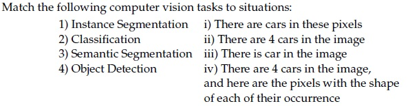

**Figure 1.** Source matching table for Question 159.

**Options**

**A.** 1→ iv, 2→ iii, 3→ ii, 4 → i  
*Option ID:* `6406532564195`

**B.** 1→ ii, 2→ iii, 3 → i, 4 →iv  
*Option ID:* `6406532564196`

**C.** 1→ iv, 2→ iii, 3→ i, 4 → ii  
*Option ID:* `6406532564197`

**D.** 1→ ii, 2→ iv, 3 → iii, 4→ i  
*Option ID:* `6406532564198`

**Correct answer:** **C** — 1→ iv, 2→ iii, 3→ i, 4 → ii  
**Source evidence:** Green option text (0x8000) and check icon (xref 18) for Option ID 6406532564197, PDF page 8.

---

---

**Source:** `da5006_2024T1_Q2_NA.md` · Quiz 2, 2024T1 · Question 160 · ID `640653766156`  
**Classification:** Week 5 — Intersection over Union, IoU, bounding box overlap, object detection evaluation, Jaccard index  
**Course evidence:** [## Module 5: CNNs for Object Detection](/Volumes/1700%20APFS/PERSONAL_PROGRAMMING_PROJECTS/Notes/Deep%20Learning%20for%20Computer%20Vision/month%202/week%205/week-5-report.md) · Related weeks: none

### Question 160

**Question ID:** `640653766156` · **Type:** MCQ · **Marks:** 2  
**PDF pages:** 8, 9

Consider two 10×10 bounding boxes (one on the upper left and one of the lower right) in an image with an overlapping region of 7×7. The Intersection over Union (IoU) score between the two boxes is (choose the closest value):

**Options**

**A.** 21%  
*Option ID:* `6406532564199`

**B.** 25%  
*Option ID:* `6406532564200`

**C.** 33%  
*Option ID:* `6406532564201`

**D.** 37%  
*Option ID:* `6406532564202`

**Correct answer:** **C** — 33%  
**Source evidence:** Green option text (0x8000) and check icon (xref 18) for Option ID 6406532564201, PDF page 9.

---

---

**Source:** `da5006_2024T1_Q2_NA.md` · Quiz 2, 2024T1 · Question 162 · ID `640653766158`  
**Classification:** Week 5 — Haar-like features, object detection, Viola-Jones detector, face detection  
**Course evidence:** [### 5.2 Pre-Deep Learning Baseline: The Viola-Jones Detector (2001)](/Volumes/1700%20APFS/PERSONAL_PROGRAMMING_PROJECTS/Notes/Deep%20Learning%20for%20Computer%20Vision/month%202/week%205/week-5-report.md) · Related weeks: 2

### Question 162

**Question ID:** `640653766158` · **Type:** MCQ · **Marks:** 2  
**PDF pages:** 10

What are Haar-like features primarily used for in computer vision?

**Options**

**A.** Object detection  
*Option ID:* `6406532564207`

**B.** Image segmentation  
*Option ID:* `6406532564208`

**C.** Texture analysis  
*Option ID:* `6406532564209`

**D.** Image denoising  
*Option ID:* `6406532564210`

**Correct answer:** **A** — Object detection  
**Source evidence:** Green option text (0x8000) and check icon (xref 18) for Option ID 6406532564207, PDF page 10.

---

---

**Source:** `da5006_2024T1_ET_AN.md` · End-term, 2024T1 · Question 168 · ID `640653821594`  
**Classification:** Week 5 — Depthwise Separable Convolutions, MobileNets, Spatial and Channel Factorization, Computational Complexity Reduction  
**Course evidence:** [### 2.5 MobileNets: Depthwise Separable Convolutions](/Volumes/1700%20APFS/PERSONAL_PROGRAMMING_PROJECTS/Notes/Deep%20Learning%20for%20Computer%20Vision/month%202/week%205/week-5-report.md) · Related weeks: 4

### Question 168

**Question ID:** `640653821594` · **Type:** MCQ · **Marks:** 2  
**PDF pages:** 8

What is the primary advantage of Depthwise Separable Convolutions compared to standard Convolutional Neural Network (CNN) convolutions?

**Options**

**A.** Depthwise Separable Convolutions reduce computational complexity and memory footprint by separating the spatial and channel-wise convolutions.  
*Option ID:* `6406532757320`

**B.** Depthwise Separable Convolutions introduce additional parameters to capture complex spatial relationships within feature maps.  
*Option ID:* `6406532757321`

**C.** Depthwise Separable Convolutions increase model capacity by performing convolutions across multiple layers of the network.  
*Option ID:* `6406532757322`

**D.** Depthwise Separable Convolutions enhance feature representation by incorporating multiscale convolutions within the same layer.  
*Option ID:* `6406532757323`

**Correct answer:** **A** — Depthwise Separable Convolutions reduce computational complexity and memory footprint by separating the spatial and channel-wise convolutions..  
**Source evidence:** Option ID 6406532757320 rendered in green text (#008000) and accompanied by checkmark icon (xref 19) at PDF page 8.

---

---

**Source:** `da5006_2024T1_ET_AN.md` · End-term, 2024T1 · Question 169 · ID `640653821595`  
**Classification:** Week 5 — Transfer Learning, Fine-Tuning Pretrained Models, Dropout Regularization, Overfitting Mitigation  
**Course evidence:** [## Module 3: Fine-Tuning and Transfer Learning in CNNs](/Volumes/1700%20APFS/PERSONAL_PROGRAMMING_PROJECTS/Notes/Deep%20Learning%20for%20Computer%20Vision/month%202/week%205/week-5-report.md) · Related weeks: 3

### Question 169

**Question ID:** `640653821595` · **Type:** MCQ · **Marks:** 2  
**PDF pages:** 8, 9

Which of the following strategies can help mitigate the risk of overfitting when fine-tuning pretrained models on a small dataset?

**Options**

**A.** Increasing the depth and width of the neural network architecture to capture more complex patterns in the data.  
*Option ID:* `6406532757324`

**B.** Applying dropout regularization to randomly deactivate neurons during training to prevent co-adaptation of features.  
*Option ID:* `6406532757325`

**C.** Decreasing the learning rate during fine-tuning to ensure more stable convergence and smoother optimization.  
*Option ID:* `6406532757326`

**D.** Increasing the batch size during fine-tuning to improve the stability of gradient estimation and accelerate convergence.  
*Option ID:* `6406532757327`

**Correct answer:** **B** — Applying dropout regularization to randomly deactivate neurons during training to prevent co-adaptation of features..  
**Source evidence:** Option ID 6406532757325 rendered in green text (#008000) and accompanied by checkmark icon (xref 19) at PDF page 9.

---

---

**Source:** `da5006_2024T1_ET_AN.md` · End-term, 2024T1 · Question 170 · ID `640653821596`  
**Classification:** Week 5 — CNN Interpretability, Maximally Activating Image Patches, Feature Visualization, Neuron Activation Analysis  
**Course evidence:** [### 4.2 Maximally Activating Image Patches](/Volumes/1700%20APFS/PERSONAL_PROGRAMMING_PROJECTS/Notes/Deep%20Learning%20for%20Computer%20Vision/month%202/week%205/week-5-report.md) · Related weeks: 4

### Question 170

**Question ID:** `640653821596` · **Type:** MCQ · **Marks:** 2  
**PDF pages:** 9

What is the primary advantage of visualizing patches of maximally activating neurons in neural network interpretation?

**Options**

**A.** It helps identify the specific input features that contribute most strongly to the model’s predictions.  
*Option ID:* `6406532757328`

**B.** It provides insights into the architectural design choices made in the neural network.  
*Option ID:* `6406532757329`

**C.** It quantifies the uncertainty associated with the model’s predictions.  
*Option ID:* `6406532757330`

**D.** It measures the computational resources required to activate the neurons.  
*Option ID:* `6406532757331`

**Correct answer:** **A** — It helps identify the specific input features that contribute most strongly to the model’s predictions..  
**Source evidence:** Option ID 6406532757328 rendered in green text (#008000) and accompanied by checkmark icon (xref 19) at PDF page 9.

---

---

**Source:** `da5006_2024T1_ET_AN.md` · End-term, 2024T1 · Question 171 · ID `640653821597`  
**Classification:** Week 5 — Grad-CAM, Convolutional Layers, Feature Maps, CNN Visualization, Class Discriminative Localization  
**Course evidence:** [## Module 4: Visualizing and Interpreting CNNs](/Volumes/1700%20APFS/PERSONAL_PROGRAMMING_PROJECTS/Notes/Deep%20Learning%20for%20Computer%20Vision/month%202/week%205/week-5-report.md) · Related weeks: 4

### Question 171

**Question ID:** `640653821597` · **Type:** MCQ · **Marks:** 2  
**PDF pages:** 9, 10

Which layer of the neural network does Grad-CAM typically operate on?

**Options**

**A.** The input layer.  
*Option ID:* `6406532757332`

**B.** The output layer.  
*Option ID:* `6406532757333`

**C.** The convolutional layers.  
*Option ID:* `6406532757334`

**D.** The fully connected layers.  
*Option ID:* `6406532757335`

**Correct answer:** **C** — The convolutional layers..  
**Source evidence:** Option ID 6406532757334 rendered in green text (#008000) and accompanied by checkmark icon (xref 19) at PDF page 10.

---

---

**Source:** `da5006_2024T1_ET_AN.md` · End-term, 2024T1 · Question 172 · ID `640653821598`  
**Classification:** Week 5 — Grad-CAM, Global Average Pooling, Feature Map Importance Weighting, Class Score Gradients  
**Course evidence:** [## Module 4: Visualizing and Interpreting CNNs](/Volumes/1700%20APFS/PERSONAL_PROGRAMMING_PROJECTS/Notes/Deep%20Learning%20for%20Computer%20Vision/month%202/week%205/week-5-report.md) · Related weeks: 4

### Question 172

**Question ID:** `640653821598` · **Type:** MCQ · **Marks:** 2  
**PDF pages:** 10

Which component of Grad-CAM is responsible for weighting the importance of each feature map?

**Options**

**A.** The class activation map (CAM).  
*Option ID:* `6406532757336`

**B.** The global average pooling layer.  
*Option ID:* `6406532757337`

**C.** The guided backpropagation algorithm.  
*Option ID:* `6406532757338`

**D.** The gradient of the target class score with respect to the feature maps.  
*Option ID:* `6406532757339`

**Correct answer:** **B** — The global average pooling layer..  
**Source evidence:** Option ID 6406532757337 rendered in green text (#008000) and accompanied by checkmark icon (xref 19) at PDF page 10.

---

---

**Source:** `da5006_2024T1_ET_AN.md` · End-term, 2024T1 · Question 174 · ID `640653821600`  
**Classification:** Week 5 — Non-Maximum Suppression (NMS), Object Detection Limitations, Bounding Box Overlap, Crowded Scenes, IoU Thresholding  
**Course evidence:** [## Module 5: CNNs for Object Detection](/Volumes/1700%20APFS/PERSONAL_PROGRAMMING_PROJECTS/Notes/Deep%20Learning%20for%20Computer%20Vision/month%202/week%205/week-5-report.md) · Related weeks: 2

### Question 174

**Question ID:** `640653821600` · **Type:** MCQ · **Marks:** 2  
**PDF pages:** 11

What is a potential limitation of non-maximum suppression (NMS) algorithms in object detection?

**Options**

**A.** They are computationally expensive and can significantly increase inference time.  
*Option ID:* `6406532757344`

**B.** They may fail to suppress redundant bounding boxes in cluttered scenes with multiple overlapping objects.  
*Option ID:* `6406532757345`

**C.** They require extensive hyperparameter tuning to achieve optimal performance across different datasets.  
*Option ID:* `6406532757346`

**D.** They are highly sensitive to variations in lighting conditions and viewpoints in the input images.  
*Option ID:* `6406532757347`

**Correct answer:** **B** — They may fail to suppress redundant bounding boxes in cluttered scenes with multiple overlapping objects..  
**Source evidence:** Option ID 6406532757345 rendered in green text (#008000) and accompanied by checkmark icon (xref 19) at PDF page 11.

---

---

**Source:** `da5006_2024T1_ET_AN.md` · End-term, 2024T1 · Question 189 · ID `640653821615`  
**Classification:** Week 5 — Faster R-CNN, Region Proposal Network (RPN), Bounding Box Regression Loss, Foreground Proposals, Multi-Task Loss  
**Course evidence:** [### 5.3 The Two-Stage R-CNN Architecture Family](/Volumes/1700%20APFS/PERSONAL_PROGRAMMING_PROJECTS/Notes/Deep%20Learning%20for%20Computer%20Vision/month%202/week%205/week-5-report.md) · Related weeks: 4

### Question 189

**Question ID:** `640653821615` · **Type:** SA · **Marks:** 2  
**PDF pages:** 20

Consider a Faster R-CNN object detection framework, which is being trained with a mini-batch size of 2. The RPN produces 512 proposals, out of which 10 and 12 of them are foreground proposals, corresponding to each image in the mini-batch. For a single mini-batch update, the bounding box regression loss will be computed _____________ times.

**Correct answer:** **22**  
**Source evidence:** Possible Answers field indicates 22 in green text (#008000) at PDF page 20.

---

---

**Source:** `da5006_2024T2_Q2_NA.md` · Quiz 2, 2024T2 · Question 118 · ID `640653856579`  
**Classification:** Week 5 — CNN feature hierarchy, feature map visualization, ResNet residual blocks, max pooling backpropagation, dilated convolution  
**Course evidence:** [### 4.1 Filter Weights & Feature Map Visualizations](/Volumes/1700%20APFS/PERSONAL_PROGRAMMING_PROJECTS/Notes/Deep%20Learning%20for%20Computer%20Vision/month%202/week%205/week-5-report.md) · Related weeks: 4

### Question 118

**Question ID:** `640653856579` · **Type:** MCQ · **Marks:** 2  
**PDF pages:** 3

Which one of the following statements is false?

**Options**

**A.** In a max pooling layer, the unit that gets selected (maximum entry) in forward propagation gets all the gradient during backpropagation.  
*Option ID:* `6406532878462`

**B.** Residual blocks are used in ResNets to avoid the vanishing gradient problem.  
*Option ID:* `6406532878463`

**C.** Feature maps of initial layers of a CNN capture more abstract concepts than the feature maps of final layers.  
*Option ID:* `6406532878464`

**D.** Dilated convolution increases the receptive field size when compared to the standard convolution operator.  
*Option ID:* `6406532878465`

**Correct answer:** **C** — Feature maps of initial layers of a CNN capture more abstract concepts than the feature maps of final layers..  
**Source evidence:** Green check icon beside option ID 6406532878464 on page 3.

---

---

**Source:** `da5006_2024T2_Q2_NA.md` · Quiz 2, 2024T2 · Question 119 · ID `640653856580`  
**Classification:** Week 5 — backpropagation-to-image, Class Activation Mapping (CAM), Grad-CAM++, Guided Grad-CAM, CNN interpretability and visualization, class-discriminative saliency  
**Course evidence:** [Module 4: Visualizing and Interpreting CNNs](/Volumes/1700%20APFS/PERSONAL_PROGRAMMING_PROJECTS/Notes/Deep%20Learning%20for%20Computer%20Vision/month%202/week%205/week-5-report.md) · Related weeks: 4

### Question 119

**Question ID:** `640653856580` · **Type:** MCQ · **Marks:** 2  
**PDF pages:** 3

Match the following:

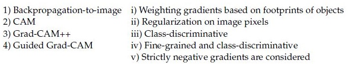

**Figure 2.** Source matching table for Question 119.

| Column 1 | Column 2 |
| :--- | :--- |
| 1) Backpropagation-to-image | i) Weighting gradients based on footprints of objects |
| 2) CAM | ii) Regularization on image pixels |
| 3) Grad-CAM++ | iii) Class-discriminative |
| 4) Guided Grad-CAM | iv) Fine-grained and class-discriminative |
| | v) Strictly negative gradients are considered |

**Options**

**A.** 1→ v, 2→ iv, 3→ ii, 4 → i  
*Option ID:* `6406532878466`

**B.** 1→ i, 2→ iv, 3 → iii, 4→ ii  
*Option ID:* `6406532878467`

**C.** 1→ i, 2→ v, 3 → iii, 4→ iv  
*Option ID:* `6406532878468`

**D.** 1→ ii, 2→ iii, 3 → i, 4 →iv  
*Option ID:* `6406532878469`

**Correct answer:** **D** — 1→ ii, 2→ iii, 3 → i, 4 →iv.  
**Source evidence:** Green check icon beside option ID 6406532878469 on page 3.

---

---

**Source:** `da5006_2024T2_Q2_NA.md` · Quiz 2, 2024T2 · Question 128 · ID `640653856603`  
**Classification:** Week 5 — bounding boxes, Intersection over Union (IoU), object detection evaluation, spatial overlap  
**Course evidence:** [Module 5: CNNs for Object Detection](/Volumes/1700%20APFS/PERSONAL_PROGRAMMING_PROJECTS/Notes/Deep%20Learning%20for%20Computer%20Vision/month%202/week%205/week-5-report.md) · Related weeks: none

### Question 128

**Question ID:** `640653856603` · **Type:** MCQ · **Marks:** 2  
**PDF pages:** 6

Consider two 10×10 bounding boxes(one on the upper left and one of the lower right) in an images with an overlapping region of 6 × 6. The Intersection over Union (IoU) between the two boxes is (choose the closest value):

**Options**

**A.** 21%  
*Option ID:* `6406532878521`

**B.** 25%  
*Option ID:* `6406532878522`

**C.** 33%  
*Option ID:* `6406532878523`

**D.** 37%  
*Option ID:* `6406532878524`

**Correct answer:** **A** — 21%.  
**Source evidence:** Green check icon beside option ID 6406532878521 on page 6.

---

---

**Source:** `da5006_2024T2_Q2_NA.md` · Quiz 2, 2024T2 · Question 130 · ID `640653856605`  
**Classification:** Week 5 — computer vision recognition hierarchy, image classification, object detection, semantic segmentation, instance segmentation  
**Course evidence:** [5.1 The Computer Vision Recognition Hierarchy](/Volumes/1700%20APFS/PERSONAL_PROGRAMMING_PROJECTS/Notes/Deep%20Learning%20for%20Computer%20Vision/month%202/week%205/week-5-report.md) · Related weeks: 2

### Question 130

**Question ID:** `640653856605` · **Type:** MCQ · **Marks:** 2  
**PDF pages:** 7

Match the following computer vision tasks to situations:

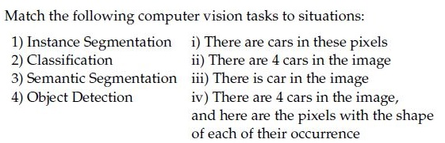

**Figure 3.** Matching table for Question 130.

| Computer vision task | Situation |
| :--- | :--- |
| 1) Instance Segmentation | i) There are cars in these pixels |
| 2) Classification | ii) There are 4 cars in the image |
| 3) Semantic Segmentation | iii) There is car in the image |
| 4) Object Detection | iv) There are 4 cars in the image, and here are the pixels with the shape of each of their occurrence |

**Options**

**A.** 1→ iv, 2→ iii, 3→ ii, 4 → i  
*Option ID:* `6406532878529`

**B.** 1→ ii, 2→ iii, 3 → i, 4 →iv  
*Option ID:* `6406532878530`

**C.** 1→ iv, 2→ iii, 3→ i, 4 → ii  
*Option ID:* `6406532878531`

**D.** 1→ ii, 2→ iv, 3 → iii, 4→ i  
*Option ID:* `6406532878532`

**Correct answer:** **C** — 1→ iv, 2→ iii, 3→ i, 4 → ii.  
**Source evidence:** Green check icon beside option ID 6406532878531 on page 7.

---

---

**Source:** `da5006_2024T2_Q2_NA.md` · Quiz 2, 2024T2 · Question 133 · ID `640653856581`  
**Classification:** Week 5 — Faster R-CNN, Region Proposal Network (RPN), foreground proposals, bounding box regression loss, mini-batch training  
**Course evidence:** [C. Faster R-CNN (Ren et al., 2015)](/Volumes/1700%20APFS/PERSONAL_PROGRAMMING_PROJECTS/Notes/Deep%20Learning%20for%20Computer%20Vision/month%202/week%205/week-5-report.md) · Related weeks: none

### Question 133

**Question ID:** `640653856581` · **Type:** SA · **Marks:** 2  
**PDF pages:** 8, 9

Consider a Faster R-CNN object detection framework, which is being trained with a mini-batch size of 2. The RPN produces 512 proposals, out of which 12 and 14 of them are foreground proposals,corresponding to each image in the mini-batch. For a single mini-batch update, the bounding box regression loss will be computed_____________________ times.

**Correct answer:** `26`.  
**Source evidence:** Possible Answers: 26 on page 9.

---

---

**Source:** `da5006_2024T2_ET_AN.md` · End-term, 2024T2 · Question 259 · ID `640653904330`  
**Classification:** Week 5 — Intersection over Union (IoU), bounding box overlap, object detection evaluation, Jaccard index  
**Course evidence:** [## Module 5: CNNs for Object Detection](/Volumes/1700%20APFS/PERSONAL_PROGRAMMING_PROJECTS/Notes/Deep%20Learning%20for%20Computer%20Vision/month%202/week%205/week-5-report.md) · Related weeks: none

### Question 259

**Question ID:** `640653904330` · **Type:** MCQ · **Marks:** 2  
**PDF pages:** 7

Consider two $10 \times 10$ bounding boxes (one on the upper left and one on the lower right) in an image with an overlapping region of $4 \times 4$. The Intersection over Union (IoU) between the two boxes is (choose the closest value):

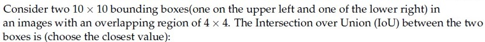

**Figure 4.** Source problem statement for Question 259.

**Options**

**A.** 21.3%  
*Option ID:* `6406533045082`

**B.** 12.8%  
*Option ID:* `6406533045083`

**C.** 11.5%  
*Option ID:* `6406533045084`

**D.** 8.7%  
*Option ID:* `6406533045085`

**Correct answer:** **D** — 8.7%  
**Source evidence:** Option 6406533045085 is rendered in green text (#008000) with a checkmark icon. (PDF page 7).

---

---

**Source:** `da5006_2024T2_ET_AN.md` · End-term, 2024T2 · Question 261 · ID `640653904324`  
**Classification:** Week 5 — integral image, summed-area table, Viola-Jones detector, pixel area summation, SURF descriptor  
**Course evidence:** [### 5.2 Pre-Deep Learning Baseline: The Viola-Jones Detector (2001)](/Volumes/1700%20APFS/PERSONAL_PROGRAMMING_PROJECTS/Notes/Deep%20Learning%20for%20Computer%20Vision/month%202/week%205/week-5-report.md) · Related weeks: none

### Question 261

**Question ID:** `640653904324` · **Type:** SA · **Marks:** 2  
**PDF pages:** 7, 8

For a 3-bit grayscale image, the integral image is given as follows:

$$\begin{bmatrix} 3 & 7 & 10 \\ 6 & 9 & 13 \\ 7 & 12 & 18 \end{bmatrix}$$

The sum of all the pixels for the corresponding grayscale image is

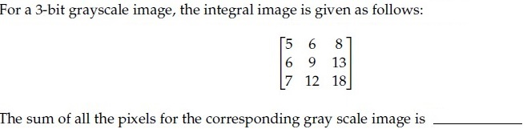

**Figure 5.** Source integral image matrix for Question 261.

**Correct answer:** `18`  
**Source evidence:** Official text specification: 'Possible Answers : 18'. (PDF page 8).

---

---

**Source:** `da5006_2024T2_ET_AN.md` · End-term, 2024T2 · Question 278 · ID `640653904332`  
**Classification:** Week 5 — Faster R-CNN, Region Proposal Network (RPN), bounding box regression loss, Smooth L1 loss, object detection  
**Course evidence:** [### 5.3 The Two-Stage R-CNN Architecture Family](/Volumes/1700%20APFS/PERSONAL_PROGRAMMING_PROJECTS/Notes/Deep%20Learning%20for%20Computer%20Vision/month%202/week%205/week-5-report.md) · Related weeks: 4

### Question 278

**Question ID:** `640653904332` · **Type:** SA · **Marks:** 1  
**PDF pages:** 15

Consider a Faster R-CNN object detection framework, which is being trained with a minibatch size of 2. The RPN produces 512 proposals, out of which 5 and 8 of them are foreground proposals, corresponding to each image in the mini-batch. For a single mini-batch update, the bounding box regression loss will be computed ______________________ times.

**Correct answer:** `13`  
**Source evidence:** Official text specification: 'Possible Answers : 13'. (PDF page 15).

---

---

**Source:** `da5006_2024T2_ET_AN.md` · End-term, 2024T2 · Question 279 · ID `640653904331`  
**Classification:** Week 5 — image classification, object detection, semantic segmentation, instance segmentation, computer vision task taxonomy  
**Course evidence:** [### 5.1 The Computer Vision Recognition Hierarchy](/Volumes/1700%20APFS/PERSONAL_PROGRAMMING_PROJECTS/Notes/Deep%20Learning%20for%20Computer%20Vision/month%202/week%205/week-5-report.md) · Related weeks: 2, 4

### Question 279

**Question ID:** `640653904331` · **Type:** MCQ · **Marks:** 1  
**PDF pages:** 15, 16

Match the following computer vision tasks to situations:

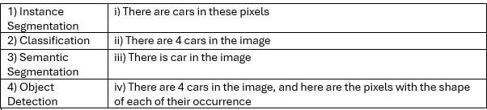

**Figure 6.** Source matching table for Question 279.

| Computer Vision Task | Situation |
| :--- | :--- |
| 1) Instance Segmentation | i) There are cars in these pixels |
| 2) Classification | ii) There are 4 cars in the image |
| 3) Semantic Segmentation | iii) There is car in the image |
| 4) Object Detection | iv) There are 4 cars in the image, and here are the pixels with the shape of each of their occurrence |

**Options**

**A.** 1→ iv, 2→ iii, 3→ ii, 4 → i  
*Option ID:* `6406533045086`

**B.** 1→ ii, 2→ iii, 3 → i, 4 →iv  
*Option ID:* `6406533045087`

**C.** 1→ iv, 2→ iii, 3→ i, 4 → ii  
*Option ID:* `6406533045088`

**D.** 1→ ii, 2→ iv, 3 → iii, 4→ i  
*Option ID:* `6406533045089`

**Correct answer:** **C** — 1→ iv, 2→ iii, 3→ i, 4 → ii  
**Source evidence:** Option 6406533045088 is rendered in green text (#008000) with a checkmark icon. (PDF page 16).

---

---

**Source:** `da5006_2024T3_Q2_NA.md` · Quiz 2, 2024T3 · Question 134 · ID `6406531031068`  
**Classification:** Week 5 — depthwise_separable_convolutions, depthwise_convolution, mobilenet, parameter_count  
**Course evidence:** [2.5 MobileNets: Depthwise Separable Convolutions](/Volumes/1700%20APFS/PERSONAL_PROGRAMMING_PROJECTS/Notes/Deep%20Learning%20for%20Computer%20Vision/month%202/week%205/week-5-report.md) · Related weeks: 4

### Question 134

**Question ID:** `6406531031068` · **Type:** Short Answer · **Marks:** 2  
**PDF pages:** 2, 3

**Context:** Let input have size $D_I \times D_I \times M$ where $D_I = 128$ and $M = 16$ and output feature map (after passing input through conv layer) has $D_I \times D_I \times N$ size where $N = 32$. Assume padded convolution. Let width of the square kernel in conv layer be $k$ where $k = 5$.

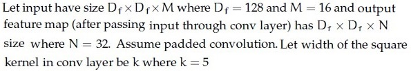

**Figure 7.** Depthwise separable convolution specifications for Questions 134 to 137.

Calculate the number of parameters and computational cost, but make use of Depthwise Seperable convolution and pointwise convolution instead of standard convolution.

Based on the above data, answer the given subquestion.

Number of parameters for depthwise convolution: ______________

**Correct answer:** `400`  
**Source evidence:** Green text `400` under Possible Answers, PDF page 3.

---

---

**Source:** `da5006_2024T3_Q2_NA.md` · Quiz 2, 2024T3 · Question 135 · ID `6406531031069`  
**Classification:** Week 5 — depthwise_separable_convolutions, depthwise_convolution, mobilenet, computational_cost, flops  
**Course evidence:** [2.5 MobileNets: Depthwise Separable Convolutions](/Volumes/1700%20APFS/PERSONAL_PROGRAMMING_PROJECTS/Notes/Deep%20Learning%20for%20Computer%20Vision/month%202/week%205/week-5-report.md) · Related weeks: 4

### Question 135

**Question ID:** `6406531031069` · **Type:** Short Answer · **Marks:** 2  
**PDF pages:** 2, 3

**Context:** Refer to the depthwise separable convolution specifications in Question 134.

Based on the above data, answer the given subquestion.

Computational Cost for depthwise convolution: ______________

**Correct answer:** `6553600`  
**Source evidence:** Green text `6553600` under Possible Answers, PDF page 3.

---

---

**Source:** `da5006_2024T3_Q2_NA.md` · Quiz 2, 2024T3 · Question 136 · ID `6406531031070`  
**Classification:** Week 5 — depthwise_separable_convolutions, pointwise_convolution, 1x1_convolution, mobilenet, parameter_count  
**Course evidence:** [2.5 MobileNets: Depthwise Separable Convolutions](/Volumes/1700%20APFS/PERSONAL_PROGRAMMING_PROJECTS/Notes/Deep%20Learning%20for%20Computer%20Vision/month%202/week%205/week-5-report.md) · Related weeks: 4

### Question 136

**Question ID:** `6406531031070` · **Type:** Short Answer · **Marks:** 2  
**PDF pages:** 2, 3, 4

**Context:** Refer to the depthwise separable convolution specifications in Question 134.

Based on the above data, answer the given subquestion.

Number of parameters for pointwise convolution: ______________

**Correct answer:** `512`  
**Source evidence:** Green text `512` under Possible Answers, PDF page 4.

---

---

**Source:** `da5006_2024T3_Q2_NA.md` · Quiz 2, 2024T3 · Question 137 · ID `6406531031071`  
**Classification:** Week 5 — depthwise_separable_convolutions, pointwise_convolution, 1x1_convolution, mobilenet, computational_cost, flops  
**Course evidence:** [2.5 MobileNets: Depthwise Separable Convolutions](/Volumes/1700%20APFS/PERSONAL_PROGRAMMING_PROJECTS/Notes/Deep%20Learning%20for%20Computer%20Vision/month%202/week%205/week-5-report.md) · Related weeks: 4

### Question 137

**Question ID:** `6406531031071` · **Type:** Short Answer · **Marks:** 2  
**PDF pages:** 2, 4

**Context:** Refer to the depthwise separable convolution specifications in Question 134.

Based on the above data, answer the given subquestion.

Computational cost for pointwise convolution: ______________

**Correct answer:** `8388608`  
**Source evidence:** Green text `8388608` under Possible Answers, PDF page 4.

---

---

**Source:** `da5006_2024T3_Q2_NA.md` · Quiz 2, 2024T3 · Question 138 · ID `6406531031072`  
**Classification:** Week 5 — integral_image, viola_jones_detector, haar_like_features, object_detection_baselines  
**Course evidence:** [5.2 Pre-Deep Learning Baseline: The Viola-Jones Detector (2001)](/Volumes/1700%20APFS/PERSONAL_PROGRAMMING_PROJECTS/Notes/Deep%20Learning%20for%20Computer%20Vision/month%202/week%205/week-5-report.md) · Related weeks: 1

### Question 138

**Question ID:** `6406531031072` · **Type:** MCQ · **Marks:** 2  
**PDF pages:** 4, 5

The integral image of the image $\begin{bmatrix} 3 & 7 & 2 \\ 5 & 4 & 6 \\ 8 & 1 & 9 \end{bmatrix}$ is?

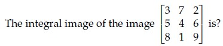

**Figure 8.** Source matrix specification for Question 138 integral image calculation.

**Options**

**A.** $\begin{bmatrix} 2 & 1 & 4 \\ 16 & 15 & 16 \\ 44 & 48 & 46 \end{bmatrix}$  
*Option ID:* `6406533487212`  
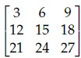  
**Figure 9.** Option A integral image candidate matrix.

**B.** $\begin{bmatrix} 3 & 10 & 12 \\ 8 & 19 & 27 \\ 16 & 28 & 45 \end{bmatrix}$  
*Option ID:* `6406533487213`  
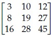  
**Figure 10.** Option B integral image candidate matrix.

**C.** $\begin{bmatrix} 2 & 7 & 12 \\ 8 & 15 & 25 \\ 16 & 28 & 45 \end{bmatrix}$  
*Option ID:* `6406533487214`  
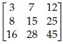  
**Figure 11.** Option C integral image candidate matrix.

**D.** $\begin{bmatrix} 9 & 1 & 2 \\ 8 & 3 & 4 \\ 7 & 1 & 1 \end{bmatrix}$  
*Option ID:* `6406533487215`  
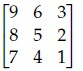  
**Figure 12.** Option D integral image candidate matrix.

**Correct answer:** **B** — $\begin{bmatrix} 3 & 10 & 12 \\ 8 & 19 & 27 \\ 16 & 28 & 45 \end{bmatrix}$  
**Source evidence:** Green check icon and green text on Option ID `6406533487213`, PDF page 4.

---

---

**Source:** `da5006_2024T3_Q2_NA.md` · Quiz 2, 2024T3 · Question 139 · ID `6406531031073`  
**Classification:** Week 5 — roi_pooling, fast_r_cnn, r_cnn_family, two_stage_detectors, object_detection  
**Course evidence:** [5.3 The Two-Stage R-CNN Architecture Family](/Volumes/1700%20APFS/PERSONAL_PROGRAMMING_PROJECTS/Notes/Deep%20Learning%20for%20Computer%20Vision/month%202/week%205/week-5-report.md) · Related weeks: 4

### Question 139

**Question ID:** `6406531031073` · **Type:** MCQ · **Marks:** 2  
**PDF pages:** 5

Which one of the following object detection networks uses an ROI pooling layer?

**Options**

**A.** Fast R-CNN  
*Option ID:* `6406533487216`

**B.** R-CNN  
*Option ID:* `6406533487217`

**C.** YOLO  
*Option ID:* `6406533487218`

**D.** All of these  
*Option ID:* `6406533487219`

**Correct answer:** **A** — Fast R-CNN  
**Source evidence:** Green check icon and green text on Option ID `6406533487216`, PDF page 5.

---

---

**Source:** `da5006_2024T3_Q2_NA.md` · Quiz 2, 2024T3 · Question 140 · ID `6406531031074`  
**Classification:** Week 5 — average_precision, mean_average_precision, 11_point_interpolation, precision_recall_curve, object_detection_metrics  
**Course evidence:** [Module 5: CNNs for Object Detection](/Volumes/1700%20APFS/PERSONAL_PROGRAMMING_PROJECTS/Notes/Deep%20Learning%20for%20Computer%20Vision/month%202/week%205/week-5-report.md) · Related weeks: none

### Question 140

**Question ID:** `6406531031074` · **Type:** MCQ · **Marks:** 2  
**PDF pages:** 5, 6

Consider an object detection system evaluated on a dataset consisting of 1000 images. The system makes 1500 predictions across these images, and for each image, there are annotated ground truth bounding boxes.

The system’s precision-recall curve is calculated, and the precision at different recall levels for one of the classes is as follows:

| Recall | Precision |
| :--- | :--- |
| 0.1 | 0.90 |
| 0.2 | 0.85 |
| 0.3 | 0.80 |
| 0.4 | 0.75 |
| 0.5 | 0.70 |
| 0.6 | 0.65 |
| 0.7 | 0.60 |
| 0.8 | 0.55 |
| 0.9 | 0.50 |
| 1.0 | 0.45 |

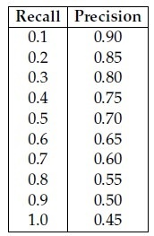

**Figure 13.** Precision-recall values for Question 140.

Calculate the Average Precision (AP) for this class using the 11-point interpolation method, which averages the precision values at recall levels {0.0, 0.1, 0.2, ..., 1.0}. The precision at recall 0.0 can be assumed to be 1.0.

Additionally, the system’s AP values for the other two classes are as follows:
- AP for class 2: 0.78
- AP for class 3: 0.72

Based on these AP values, what is the mean Average Precision (mAP) across all three classes?

**Options**

**A.** 0.70  
*Option ID:* `6406533487220`

**B.** 0.69  
*Option ID:* `6406533487221`

**C.** 0.73  
*Option ID:* `6406533487222`

**D.** 0.76  
*Option ID:* `6406533487223`

**Correct answer:** **C** — 0.73  
**Source evidence:** Green check icon and green text on Option ID `6406533487222`, PDF page 6.

---

---

**Source:** `da5006_2024T3_Q2_NA.md` · Quiz 2, 2024T3 · Question 141 · ID `6406531031075`  
**Classification:** Week 5 — vggnet, googlenet, resnet, efficientnet, 1x1_convolution, identity_mapping, depthwise_separable_convolutions, cnn_architectures  
**Course evidence:** [Module 1: Evolution of CNN Architectures (Inception & ResNet)](/Volumes/1700%20APFS/PERSONAL_PROGRAMMING_PROJECTS/Notes/Deep%20Learning%20for%20Computer%20Vision/month%202/week%205/week-5-report.md) · Related weeks: 4

### Question 141

**Question ID:** `6406531031075` · **Type:** MCQ · **Marks:** 2  
**PDF pages:** 6

Match the following:

| Network | Feature / Layer |
| :--- | :--- |
| 1) VGGNet | i) $1 \times 1$ convolution |
| 2) EfficientNet | ii) identity mapping |
| 3) GoogleNet | iii) $3 \times 3$ convolution |
| 4) ResNet | iv) $7 \times 7$ convolution |
| | v) depth-wise separable convolutions |

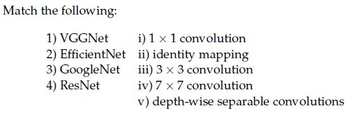

**Figure 14.** Architecture matching items for Question 141.

**Options**

**A.** 1→iv, 2→ii, 3→v, 4→i  
*Option ID:* `6406533487224`

**B.** 1→iv, 2→iii, 3→v, 4→ii  
*Option ID:* `6406533487225`

**C.** 1→iv, 2→v, 3→ii, 4→iii  
*Option ID:* `6406533487226`

**D.** 1→iii, 2→v, 3→i, 4→ii  
*Option ID:* `6406533487227`

**Correct answer:** **D** — 1→iii, 2→v, 3→i, 4→ii  
**Source evidence:** Green check icon and green text on Option ID `6406533487227`, PDF page 6.

---

---

**Source:** `da5006_2024T3_Q2_NA.md` · Quiz 2, 2024T3 · Question 142 · ID `6406531031076`  
**Classification:** Week 5 — feature_map_visualization, layer_abstraction_hierarchy, residual_connections, resnet, max_pooling_backpropagation, dilated_convolution  
**Course evidence:** [4.1 Filter Weights & Feature Map Visualizations](/Volumes/1700%20APFS/PERSONAL_PROGRAMMING_PROJECTS/Notes/Deep%20Learning%20for%20Computer%20Vision/month%202/week%205/week-5-report.md) · Related weeks: 4

### Question 142

**Question ID:** `6406531031076` · **Type:** MCQ · **Marks:** 2  
**PDF pages:** 6

Which one of the following statements is False?

**Options**

**A.** In a max pooling layer, the unit that gets selected (maximum entry) in forward propagation gets all the gradient during backpropagation.  
*Option ID:* `6406533487228`

**B.** Residual blocks are used in ResNets to avoid the vanishing gradient problem.  
*Option ID:* `6406533487229`

**C.** Feature maps of initial layers of a CNN capture more abstract concepts than the feature maps of final layers.  
*Option ID:* `6406533487230`

**D.** Dilated convolution increases the receptive field size when compared to the standard convolution operator.  
*Option ID:* `6406533487231`

**Correct answer:** **C** — Feature maps of initial layers of a CNN capture more abstract concepts than the feature maps of final layers.  
**Source evidence:** Green check icon and green text on Option ID `6406533487230`, PDF page 6.

---

---

**Source:** `da5006_2024T3_Q2_NA.md` · Quiz 2, 2024T3 · Question 145 · ID `6406531031081`  
**Classification:** Week 5 — intersection_over_union, iou, bounding_box_metrics, object_detection  
**Course evidence:** [Module 5: CNNs for Object Detection](/Volumes/1700%20APFS/PERSONAL_PROGRAMMING_PROJECTS/Notes/Deep%20Learning%20for%20Computer%20Vision/month%202/week%205/week-5-report.md) · Related weeks: none

### Question 145

**Question ID:** `6406531031081` · **Type:** MCQ · **Marks:** 2  
**PDF pages:** 7

Consider two 12×12 bounding boxes(one on the upper left and one of the lower right) in an images with an overlapping region of 8 × 8. The Intersection over Union (IoU) between the two boxes is (choose the closest value):

**Options**

**A.** 21%  
*Option ID:* `6406533487245`

**B.** 25%  
*Option ID:* `6406533487246`

**C.** 28%  
*Option ID:* `6406533487247`

**D.** 37%  
*Option ID:* `6406533487248`

**Correct answer:** **C** — 28%  
**Source evidence:** Green check icon and green text on Option ID `6406533487247`, PDF page 7.

---

---

**Source:** `da5006_2024T3_Q2_NA.md` · Quiz 2, 2024T3 · Question 147 · ID `6406531031083`  
**Classification:** Week 5 — computer_vision_recognition_hierarchy, image_classification, semantic_segmentation, object_detection, instance_segmentation  
**Course evidence:** [5.1 The Computer Vision Recognition Hierarchy](/Volumes/1700%20APFS/PERSONAL_PROGRAMMING_PROJECTS/Notes/Deep%20Learning%20for%20Computer%20Vision/month%202/week%205/week-5-report.md) · Related weeks: 2

### Question 147

**Question ID:** `6406531031083` · **Type:** MCQ · **Marks:** 2  
**PDF pages:** 8

Match the following computer vision tasks to situations:

| Task | Situation |
| :--- | :--- |
| 1) Instance Segmentation | i) There are cars in these pixels |
| 2) Classification | ii) There are 4 cars in the image |
| 3) Semantic Segmentation | iii) There is car in the image |
| 4) Object Detection | iv) There are 4 cars in the image, and here are the pixels with the shape of each of their occurrence |

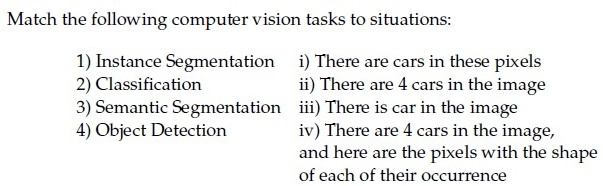

**Figure 15.** Computer vision tasks and situations matching table for Question 147.

**Options**

**A.** 1→ iv, 2→ iii, 3→ ii, 4 → i  
*Option ID:* `6406533487253`

**B.** 1→ ii, 2→ iii, 3 → i, 4 →iv  
*Option ID:* `6406533487254`

**C.** 1→ iv, 2→ iii, 3→ i, 4 → ii  
*Option ID:* `6406533487255`

**D.** 1→ ii, 2→ iv, 3 → iii, 4→ i  
*Option ID:* `6406533487256`

**Correct answer:** **C** — 1→ iv, 2→ iii, 3→ i, 4 → ii  
**Source evidence:** Green check icon and green text on Option ID `6406533487255`, PDF page 8.

---

---

**Source:** `da5006_2024T3_Q2_NA.md` · Quiz 2, 2024T3 · Question 150 · ID `6406531031080`  
**Classification:** Week 5 — cnn_interpretability, class_activation_mapping, saliency_maps, data_gradient_visualization, class_model_visualization, global_average_pooling  
**Course evidence:** [Module 4: Visualizing and Interpreting CNNs](/Volumes/1700%20APFS/PERSONAL_PROGRAMMING_PROJECTS/Notes/Deep%20Learning%20for%20Computer%20Vision/month%202/week%205/week-5-report.md) · Related weeks: 4

### Question 150

**Question ID:** `6406531031080` · **Type:** MSQ · **Marks:** 2  
**PDF pages:** 9

Which of the following are true:

**Options**

**A.** For generating an image of a required class, Deep Inside Convolutional Networks uses gradient descent with the following optimization : $\text{argmin}_I (S_c(I) - \lambda \|I\|_2^2)$ where $S_c$ is the scores vector for class $c$ before applying softmax.  
*Option ID:* `6406533487241`  
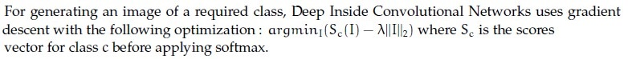  
**Figure 16.** Option A statement on class image generation optimization.

**B.** Visualizing the maximum of the data gradient across the channels provides insights into the image regions that have the most significant impact on generating high probability scores for a specific class.  
*Option ID:* `6406533487242`  
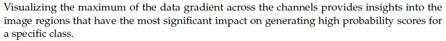  
**Figure 17.** Option B statement on data gradient visualization.

**C.** Global average Pooling refers to the average of all the pixels at a particular spatial location across all the channels.  
*Option ID:* `6406533487243`  
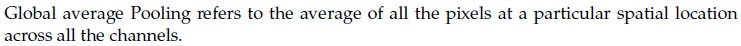  
**Figure 18.** Option C statement on global average pooling definition.

**D.** Class Activation Map (CAM) does not require a backward pass through the entire model.  
*Option ID:* `6406533487244`  
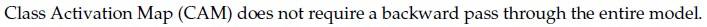  
**Figure 19.** Option D statement on Class Activation Map backward pass.

**Correct answer:** **B**, **D**  
**Source evidence:** Green check icons and green text on Option IDs `6406533487242` and `6406533487244`, PDF page 9.

---

---

**Source:** `da5006_2024T3_Q2_NA.md` · Quiz 2, 2024T3 · Question 152 · ID `6406531031077`  
**Classification:** Week 5 — faster_r_cnn, region_proposal_network, bounding_box_regression_loss, foreground_proposals, two_stage_detectors  
**Course evidence:** [C. Faster R-CNN (Ren et al., 2015)](/Volumes/1700%20APFS/PERSONAL_PROGRAMMING_PROJECTS/Notes/Deep%20Learning%20for%20Computer%20Vision/month%202/week%205/week-5-report.md) · Related weeks: none

### Question 152

**Question ID:** `6406531031077` · **Type:** Short Answer · **Marks:** 2  
**PDF pages:** 10

Consider a Faster R-CNN object detection framework, which is being trained with a mini-batch size of 2. The RPN produces 512 proposals, out of which 5 and 95 of them are foreground proposals, corresponding to each image in the mini-batch. For a single mini-batch update, the bounding box regression loss will be computed _____________ times.

**Correct answer:** `100`  
**Source evidence:** Green text `100` under Possible Answers, PDF page 10.

---

---

**Source:** `da5006_2024T3_ET_AN.md` · End-term, 2024T3 · Question 205 · ID `6406531046063`  
**Classification:** Week 5 — object detection training, ground truth bounding boxes, Faster R-CNN, YOLO, supervised learning  
**Course evidence:** [Module 5: CNNs for Object Detection](/Volumes/1700%20APFS/PERSONAL_PROGRAMMING_PROJECTS/Notes/Deep%20Learning%20for%20Computer%20Vision/month%202/week%205/week-5-report.md) · Related weeks: none

### Question 205

**Question ID:** `6406531046063` · **Type:** Multiple Choice Question (MCQ) · **Marks:** 2  
**PDF pages:** 5

State whether the given statement is True or False: While training an object detection algorithm, you need a training set that contains many pictures of the objects you want to detect. However, bounding boxes are not typically provided in the training set, since architectures like Faster-RCNN and YOLO can learn to detect the object by themselves.

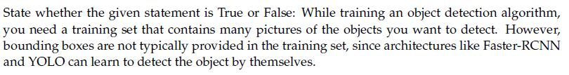
**Figure 20.** Source statement for Question 205.

**Options**

**A.** True  
*Option ID:* `6406533531372`

**B.** False  
*Option ID:* `6406533531373`

**Correct answer:** **B** — False.  
**Source evidence:** Option ID 6406533531373 is rendered in green (color #008000) with a checkmark icon.

---

---

**Source:** `da5006_2024T3_ET_AN.md` · End-term, 2024T3 · Question 207 · ID `6406531046070`  
**Classification:** Week 5 — bounding boxes, Intersection over Union (IoU), object detection evaluation, spatial overlap  
**Course evidence:** [Module 5: CNNs for Object Detection](/Volumes/1700%20APFS/PERSONAL_PROGRAMMING_PROJECTS/Notes/Deep%20Learning%20for%20Computer%20Vision/month%202/week%205/week-5-report.md) · Related weeks: none

### Question 207

**Question ID:** `6406531046070` · **Type:** Multiple Choice Question (MCQ) · **Marks:** 2  
**PDF pages:** 5, 6

Consider two 10×10 bounding boxes(one on the upper left and one of the lower right) in an images with an overlapping region of 6 × 6. The Intersection over Union (IoU) between the two boxes is (choose the closest value):

**Options**

**A.** 21%  
*Option ID:* `6406533531382`

**B.** 25%  
*Option ID:* `6406533531383`

**C.** 33%  
*Option ID:* `6406533531384`

**D.** 37%  
*Option ID:* `6406533531385`

**Correct answer:** **A** — 21%.  
**Source evidence:** Option ID 6406533531382 is rendered in green (color #008000) with a checkmark icon.

---

---

**Source:** `da5006_2024T3_ET_AN.md` · End-term, 2024T3 · Question 211 · ID `6406531046074`  
**Classification:** Week 5 — average_precision, mean_average_precision, precision_recall_curve, 11_point_interpolation, object_detection_metrics  
**Course evidence:** [Module 5: CNNs for Object Detection](/Volumes/1700%20APFS/PERSONAL_PROGRAMMING_PROJECTS/Notes/Deep%20Learning%20for%20Computer%20Vision/month%202/week%205/week-5-report.md) · Related weeks: none

### Question 211

**Question ID:** `6406531046074` · **Type:** Multiple Choice Question (MCQ) · **Marks:** 2  
**PDF pages:** 7, 8

Consider an object detection system evaluated on a dataset consisting of 1000 images. The system makes 1500 predictions across these images, and for each image, there are annotated ground truth bounding boxes.

The system’s precision-recall curve is calculated, and the precision at different recall levels for one of the classes is as follows:

| Recall | Precision |
| :--- | :--- |
| 0.1 | 0.90 |
| 0.2 | 0.85 |
| 0.3 | 0.80 |
| 0.4 | 0.75 |
| 0.5 | 0.70 |
| 0.6 | 0.65 |
| 0.7 | 0.60 |
| 0.8 | 0.55 |
| 0.9 | 0.50 |
| 1.0 | 0.45 |

Calculate the Average Precision (AP) for this class using the 11-point interpolation method, which averages the precision values at recall levels {0.0, 0.1, 0.2, ..., 1.0}. The precision at recall 0.0 can be assumed to be 1.0.

Additionally, the system’s AP values for the other two classes are as follows:

- AP for class 2: 0.78
- AP for class 3: 0.72

Based on these AP values, what is the mean Average Precision (mAP) across all three classes?

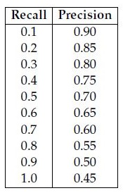
**Figure 21.** Source precision-recall table for Question 211.

**Options**

**A.** 0.70  
*Option ID:* `6406533531398`

**B.** 0.69  
*Option ID:* `6406533531399`

**C.** 0.73  
*Option ID:* `6406533531400`

**D.** 0.76  
*Option ID:* `6406533531401`

**Correct answer:** **C** — 0.73.  
**Source evidence:** Option ID 6406533531400 is rendered in green (color #008000) with a checkmark icon.

---

---

**Source:** `da5006_2024T3_ET_AN.md` · End-term, 2024T3 · Question 217 · ID `6406531046059`  
**Classification:** Week 5 — integral_image, pixel_intensity_reconstruction, mode_intensity, constant_time_box_sums  
**Course evidence:** [### 5.2 Pre-Deep Learning Baseline: The Viola-Jones Detector (2001)](/Volumes/1700%20APFS/PERSONAL_PROGRAMMING_PROJECTS/Notes/Deep%20Learning%20for%20Computer%20Vision/month%202/week%205/week-5-report.md) · Related weeks: none

### Question 217

**Question ID:** `6406531046059` · **Type:** Short Answer Question (SA) · **Marks:** 2  
**PDF pages:** 11

For a 3-bit grayscale image, the integral image is given as follows:

$$\begin{bmatrix} 5 & 6 & 8 \\ 6 & 9 & 13 \\ 7 & 12 & 18 \end{bmatrix}$$

The pixel intensity that occurs the most for the given grayscale image is _____ (enter an integer value)

Response Type : Numeric

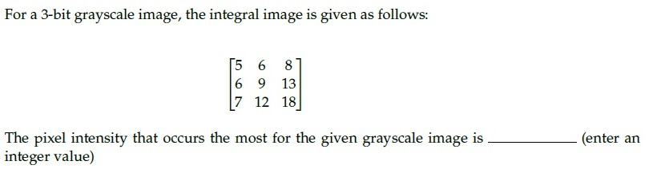
**Figure 22.** Source problem statement for Question 217.

**Correct answer:** **2**.  
**Source evidence:** Source key specifies Possible Answers : 2 (rendered in green #008000).

---

---

**Source:** `da5006_2025T1_Q2_NA.md` · Quiz 2, 2025T1 · Question 242 · ID `6406531168216`  
**Classification:** Week 5 — Integral Image, Summed-Area Table, Viola-Jones Detector, Object Detection Baseline  
**Course evidence:** [### 5.2 Pre-Deep Learning Baseline: The Viola-Jones Detector (2001)](/Volumes/1700%20APFS/PERSONAL_PROGRAMMING_PROJECTS/Notes/Deep%20Learning%20for%20Computer%20Vision/month%202/week%205/week-5-report.md) · Related weeks: 1

### Question 242

**Question ID:** `6406531168216` · **Type:** MCQ · **Marks:** 2  
**PDF pages:** 1, 2

The integral image of the image

$$\begin{bmatrix} 3 & 7 & 2 \\ 5 & 4 & 6 \\ 8 & 1 & 9 \end{bmatrix}$$

is?

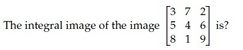

**Figure 23.** Source matrix for Question 242.

**Options**

**A.** $$\begin{bmatrix} 3 & 6 & 9 \\ 12 & 15 & 18 \\ 21 & 24 & 27 \end{bmatrix}$$

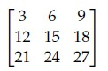

**Figure 24.** Option A candidate matrix for Question 242.  
*Option ID:* `6406533939944`

**B.** $$\begin{bmatrix} 3 & 10 & 12 \\ 8 & 19 & 27 \\ 16 & 28 & 45 \end{bmatrix}$$

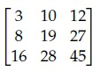

**Figure 25.** Option B candidate matrix for Question 242.  
*Option ID:* `6406533939945`

**C.** $$\begin{bmatrix} 3 & 7 & 12 \\ 8 & 15 & 25 \\ 16 & 28 & 45 \end{bmatrix}$$

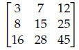

**Figure 26.** Option C candidate matrix for Question 242.  
*Option ID:* `6406533939946`

**D.** $$\begin{bmatrix} 9 & 6 & 3 \\ 8 & 5 & 2 \\ 7 & 4 & 1 \end{bmatrix}$$

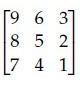

**Figure 27.** Option D candidate matrix for Question 242.  
*Option ID:* `6406533939947`

**Correct answer:** **B** — $$\begin{bmatrix} 3 & 10 & 12 \\ 8 & 19 & 27 \\ 16 & 28 & 45 \end{bmatrix}$$.  
**Source evidence:** Option 6406533939945 marked with green checkmark icon (xref 28) and green text (color 0x8000), PDF page 1.

---

---

**Source:** `da5006_2025T1_Q2_NA.md` · Quiz 2, 2025T1 · Question 243 · ID `6406531168217`  
**Classification:** Week 5 — Region of Interest (RoI) Pooling, Fast R-CNN, Two-Stage Object Detection, R-CNN Family  
**Course evidence:** [### 5.3 The Two-Stage R-CNN Architecture Family](/Volumes/1700%20APFS/PERSONAL_PROGRAMMING_PROJECTS/Notes/Deep%20Learning%20for%20Computer%20Vision/month%202/week%205/week-5-report.md) · Related weeks: 4

### Question 243

**Question ID:** `6406531168217` · **Type:** MCQ · **Marks:** 2  
**PDF pages:** 2

Which one of the following object detection networks uses an ROI pooling layer?

**Options**

**A.** Fast R-CNN  
*Option ID:* `6406533939948`

**B.** R-CNN  
*Option ID:* `6406533939949`

**C.** YOLO  
*Option ID:* `6406533939950`

**D.** All of these  
*Option ID:* `6406533939951`

**Correct answer:** **A** — Fast R-CNN.  
**Source evidence:** Option 6406533939948 marked with green checkmark icon and green text (color 0x8000), PDF page 2.

---

---

**Source:** `da5006_2025T1_Q2_NA.md` · Quiz 2, 2025T1 · Question 244 · ID `6406531168218`  
**Classification:** Week 5 — CNN Architectures, VGGNet, GoogLeNet, ResNet, EfficientNet, 1x1 Convolutions, Identity Mapping, Depthwise Separable Convolutions  
**Course evidence:** [## Module 1: Evolution of CNN Architectures (Inception & ResNet)](/Volumes/1700%20APFS/PERSONAL_PROGRAMMING_PROJECTS/Notes/Deep%20Learning%20for%20Computer%20Vision/month%202/week%205/week-5-report.md) · Related weeks: 4

### Question 244

**Question ID:** `6406531168218` · **Type:** MCQ · **Marks:** 2  
**PDF pages:** 2

Match the following:

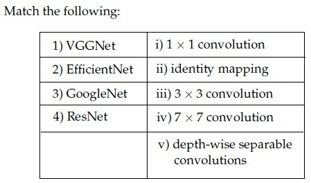

**Figure 28.** Source table for Question 244.

| Column 1 | Column 2 |
| :--- | :--- |
| 1) VGGNet | i) $1 \times 1$ convolution |
| 2) EfficientNet | ii) identity mapping |
| 3) GoogleNet | iii) $3 \times 3$ convolution |
| 4) ResNet | iv) $7 \times 7$ convolution |
| | v) depth-wise separable convolutions |

**Options**

**A.** 1→iv, 2→ii, 3→v, 4→i  
*Option ID:* `6406533939952`

**B.** 1→iv, 2→iii, 3→v, 4→ii  
*Option ID:* `6406533939953`

**C.** 1→iv, 2→v, 3→ii, 4→iii  
*Option ID:* `6406533939954`

**D.** 1→iii, 2→v, 3→i, 4→ii  
*Option ID:* `6406533939955`

**Correct answer:** **D** — 1→iii, 2→v, 3→i, 4→ii.  
**Source evidence:** Option 6406533939955 marked with green checkmark icon and green text (color 0x8000), PDF page 2.

---

---

**Source:** `da5006_2025T1_Q2_NA.md` · Quiz 2, 2025T1 · Question 245 · ID `6406531168219`  
**Classification:** Week 5 — Feature Map Visualization, CNN Hierarchy, ResNet Residual Blocks, Max Pooling Backpropagation, Dilated Convolution  
**Course evidence:** [### 4.1 Filter Weights & Feature Map Visualizations](/Volumes/1700%20APFS/PERSONAL_PROGRAMMING_PROJECTS/Notes/Deep%20Learning%20for%20Computer%20Vision/month%202/week%205/week-5-report.md) · Related weeks: 4

### Question 245

**Question ID:** `6406531168219` · **Type:** MCQ · **Marks:** 2  
**PDF pages:** 2, 3

Which one of the following statements is False?

**Options**

**A.** In a max pooling layer, the unit that gets selected (maximum entry) in forward propagation gets all the gradient during backpropagation.  
*Option ID:* `6406533939956`

**B.** Residual blocks are used in ResNets to avoid the vanishing gradient problem.  
*Option ID:* `6406533939957`

**C.** Feature maps of initial layers of a CNN capture more abstract concepts than the feature maps of final layers.  
*Option ID:* `6406533939958`

**D.** Dilated convolution increases the receptive field size when compared to the standard convolution operator.  
*Option ID:* `6406533939959`

**Correct answer:** **C** — Feature maps of initial layers of a CNN capture more abstract concepts than the feature maps of final layers..  
**Source evidence:** Option 6406533939958 marked with green checkmark icon and green text (color 0x8000), PDF page 3.

---

---

**Source:** `da5006_2025T1_Q2_NA.md` · Quiz 2, 2025T1 · Question 247 · ID `6406531168221`  
**Classification:** Week 5 — Object Detection Loss Functions, Confidence Scores, Binary Cross-Entropy Loss, YOLO Objectness Loss  
**Course evidence:** [### 5.4 Single-Stage Detectors: YOLO (You Only Look Once)](/Volumes/1700%20APFS/PERSONAL_PROGRAMMING_PROJECTS/Notes/Deep%20Learning%20for%20Computer%20Vision/month%202/week%205/week-5-report.md) · Related weeks: 3

### Question 247

**Question ID:** `6406531168221` · **Type:** MCQ · **Marks:** 2  
**PDF pages:** 3

In object detection using CNNs, which loss function is typically used to optimize the confidence scores assigned to predicted bounding boxes, aiming to ensure high confidence for correct detections and penalize false positives?

**Options**

**A.** Focal Loss  
*Option ID:* `6406533939964`

**B.** Smooth Ll Loss  
*Option ID:* `6406533939965`

**C.** Binary Cross-Entropy Loss  
*Option ID:* `6406533939966`

**D.** Mean Squared Error (MSE)  
*Option ID:* `6406533939967`

**Correct answer:** **C** — Binary Cross-Entropy Loss.  
**Source evidence:** Option 6406533939966 marked with green checkmark icon and green text (color 0x8000), PDF page 3.

---

---

**Source:** `da5006_2025T1_Q2_NA.md` · Quiz 2, 2025T1 · Question 248 · ID `6406531168222`  
**Classification:** Week 5 — Intersection over Union (IoU), Bounding Box Geometry, Object Detection Evaluation  
**Course evidence:** [## Module 5: CNNs for Object Detection](/Volumes/1700%20APFS/PERSONAL_PROGRAMMING_PROJECTS/Notes/Deep%20Learning%20for%20Computer%20Vision/month%202/week%205/week-5-report.md) · Related weeks: none

### Question 248

**Question ID:** `6406531168222` · **Type:** MCQ · **Marks:** 2  
**PDF pages:** 3, 4

Consider two 12 × 12 bounding boxes(one on the upper left and one of the lower right) in an images with an overlapping region of 8 × 8. The Intersection over Union (IoU) between the two boxes is (choose the closest value):

**Options**

**A.** 21%  
*Option ID:* `6406533939968`

**B.** 25%  
*Option ID:* `6406533939969`

**C.** 28%  
*Option ID:* `6406533939970`

**D.** 37%  
*Option ID:* `6406533939971`

**Correct answer:** **C** — 28%.  
**Source evidence:** Option 6406533939970 marked with green checkmark icon and green text (color 0x8000), PDF page 4.

---

---

**Source:** `da5006_2025T1_Q2_NA.md` · Quiz 2, 2025T1 · Question 249 · ID `6406531168223`  
**Classification:** Week 5 — Non-Maximum Suppression (NMS), Object Detection, Bounding Box Redundancy, YOLO Post-Processing  
**Course evidence:** [### 5.4 Single-Stage Detectors: YOLO (You Only Look Once)](/Volumes/1700%20APFS/PERSONAL_PROGRAMMING_PROJECTS/Notes/Deep%20Learning%20for%20Computer%20Vision/month%202/week%205/week-5-report.md) · Related weeks: 2

### Question 249

**Question ID:** `6406531168223` · **Type:** MCQ · **Marks:** 2  
**PDF pages:** 4

In object detection using CNNs, what is the challenge addressed by the non-maximum suppression (NMS) technique?

**Options**

**A.** Handling variations in object scale and aspect ratio  
*Option ID:* `6406533939972`

**B.** Improving the localization accuracy of detected objects  
*Option ID:* `6406533939973`

**C.** Reducing the computational complexity of the detection process  
*Option ID:* `6406533939974`

**D.** Removing redundant bounding box predictions for the same object  
*Option ID:* `6406533939975`

**Correct answer:** **D** — Removing redundant bounding box predictions for the same object.  
**Source evidence:** Option 6406533939975 marked with green checkmark icon and green text (color 0x8000), PDF page 4.

---

---

**Source:** `da5006_2025T1_Q2_NA.md` · Quiz 2, 2025T1 · Question 250 · ID `6406531168224`  
**Classification:** Week 5 — Computer Vision Recognition Hierarchy, Image Classification, Object Detection, Semantic Segmentation, Instance Segmentation  
**Course evidence:** [### 5.1 The Computer Vision Recognition Hierarchy](/Volumes/1700%20APFS/PERSONAL_PROGRAMMING_PROJECTS/Notes/Deep%20Learning%20for%20Computer%20Vision/month%202/week%205/week-5-report.md) · Related weeks: 1

### Question 250

**Question ID:** `6406531168224` · **Type:** MCQ · **Marks:** 2  
**PDF pages:** 4

Match the following computer vision tasks to situations:

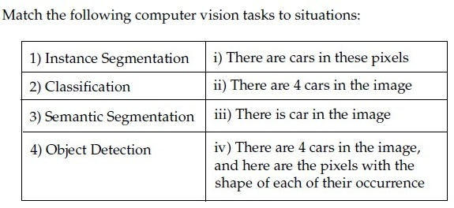

**Figure 29.** Source table for Question 250.

| Column 1 | Column 2 |
| :--- | :--- |
| 1) Instance Segmentation | i) There are cars in these pixels |
| 2) Classification | ii) There are 4 cars in the image |
| 3) Semantic Segmentation | iii) There is car in the image |
| 4) Object Detection | iv) There are 4 cars in the image, and here are the pixels with the shape of each of their occurrence |

**Options**

**A.** 1→ iv, 2→ iii, 3→ ii, 4 → i  
*Option ID:* `6406533939976`

**B.** 1→ ii, 2→ iii, 3 → i, 4 →iv  
*Option ID:* `6406533939977`

**C.** 1→ iv, 2→ iii, 3→ i, 4 → ii  
*Option ID:* `6406533939978`

**D.** 1→ ii, 2→ iv, 3 → iii, 4→ i  
*Option ID:* `6406533939979`

**Correct answer:** **C** — 1→ iv, 2→ iii, 3→ i, 4 → ii.  
**Source evidence:** Option 6406533939978 marked with green checkmark icon and green text (color 0x8000), PDF page 4.

---

---

**Source:** `da5006_2025T1_Q2_NA.md` · Quiz 2, 2025T1 · Question 254 · ID `6406531168229`  
**Classification:** Week 5 — Object Detection Training, Supervised Learning, Bounding Box Ground Truth, Faster R-CNN, YOLO  
**Course evidence:** [## Module 5: CNNs for Object Detection](/Volumes/1700%20APFS/PERSONAL_PROGRAMMING_PROJECTS/Notes/Deep%20Learning%20for%20Computer%20Vision/month%202/week%205/week-5-report.md) · Related weeks: none

### Question 254

**Question ID:** `6406531168229` · **Type:** MCQ · **Marks:** 2  
**PDF pages:** 6

State whether the given statement is True or False:

While training an object detection algorithm, you need a training set that contains many pictures of the objects you want to detect. However, bounding boxes are not typically provided in the training set, since architectures like Faster-RCNN and YOLO can learn to detect the object by themselves.

**Options**

**A.** True  
*Option ID:* `6406533939996`

**B.** False  
*Option ID:* `6406533939997`

**Correct answer:** **B** — False.  
**Source evidence:** Option 6406533939997 marked with green checkmark icon and green text (color 0x8000), PDF page 6.

---

---

**Source:** `da5006_2025T1_Q2_NA.md` · Quiz 2, 2025T1 · Question 255 · ID `6406531168230`  
**Classification:** Week 5 — Saliency Maps, CNN Interpretability, Gradient of Output w.r.t Input, Model Attribution  
**Course evidence:** [## Module 4: Visualizing and Interpreting CNNs](/Volumes/1700%20APFS/PERSONAL_PROGRAMMING_PROJECTS/Notes/Deep%20Learning%20for%20Computer%20Vision/month%202/week%205/week-5-report.md) · Related weeks: 4

### Question 255

**Question ID:** `6406531168230` · **Type:** MCQ · **Marks:** 2  
**PDF pages:** 6

How are saliency maps generated in the context of Convolutional Neural Networks (CNNs)?

**Options**

**A.** By applying a convolutional filter to the input image  
*Option ID:* `6406533939998`

**B.** By computing the gradient of the model’s output with respect to the input image  
*Option ID:* `6406533939999`

**C.** By randomly sampling regions of the image and assessing their importance  
*Option ID:* `6406533940000`

**D.** By measuring the similarity between the input image and pre-trained feature maps  
*Option ID:* `6406533940001`

**Correct answer:** **B** — By computing the gradient of the model’s output with respect to the input image.  
**Source evidence:** Option 6406533939999 marked with green checkmark icon and green text (color 0x8000), PDF page 6.

---

---

**Source:** `da5006_2025T1_Q2_NA.md` · Quiz 2, 2025T1 · Question 256 · ID `6406531168231`  
**Classification:** Week 5 — Mean Average Precision (mAP), Average Precision (AP), 11-Point Interpolation, Precision-Recall Curve, Object Detection Evaluation Metrics  
**Course evidence:** [## Module 5: CNNs for Object Detection](/Volumes/1700%20APFS/PERSONAL_PROGRAMMING_PROJECTS/Notes/Deep%20Learning%20for%20Computer%20Vision/month%202/week%205/week-5-report.md) · Related weeks: none

### Question 256

**Question ID:** `6406531168231` · **Type:** MCQ · **Marks:** 2  
**PDF pages:** 6, 7

Consider an object detection system evaluated on a dataset consisting of 1000 images. The system makes 1500 predictions across these images, and for each image, there are annotated ground truth bounding boxes.

The system’s precision-recall curve is calculated, and the precision at different recall levels for one of the classes is as follows:

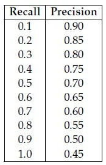

**Figure 30.** Source precision-recall table for Question 256.

| Recall | Precision |
| :--- | :--- |
| 0.1 | 0.90 |
| 0.2 | 0.85 |
| 0.3 | 0.80 |
| 0.4 | 0.75 |
| 0.5 | 0.70 |
| 0.6 | 0.65 |
| 0.7 | 0.60 |
| 0.8 | 0.55 |
| 0.9 | 0.50 |
| 1.0 | 0.45 |

Calculate the mean Average Precision (mAP) for this class using the 11-point interpolation method, which averages the precision values at recall levels {0.0, 0.1, 0.2, ..., 1.0}. The precision at recall 0.0 can be assumed to be 1.0.

Additionally, the system’s AP values for the other two classes are as follows:

- AP for class 2: 0.78
- AP for class 3: 0.72

Based on these AP values, what is the mean Average Precision (mAP) across all three classes?

**Options**

**A.** 0.70  
*Option ID:* `6406533940002`

**B.** 0.69  
*Option ID:* `6406533940003`

**C.** 0.73  
*Option ID:* `6406533940004`

**D.** 0.76  
*Option ID:* `6406533940005`

**Correct answer:** **C** — 0.73.  
**Source evidence:** Option 6406533940004 marked with green checkmark icon and green text (color 0x8000), PDF page 7.

---

---

**Source:** `da5006_2025T1_Q2_NA.md` · Quiz 2, 2025T1 · Question 260 · ID `6406531168234`  
**Classification:** Week 5 — CNN interpretability, Deep Inside Convolutional Networks, saliency maps via data gradient, Global Average Pooling (GAP), Class Activation Map (CAM)  
**Course evidence:** [Module 4: Visualizing and Interpreting CNNs](/Volumes/1700%20APFS/PERSONAL_PROGRAMMING_PROJECTS/Notes/Deep%20Learning%20for%20Computer%20Vision/month%202/week%205/week-5-report.md) · Related weeks: 4

### Question 260

**Question ID:** `6406531168234` · **Type:** MSQ · **Marks:** 2  
**PDF pages:** 8, 9

Which of the following are true?

**Options**

**A.** For generating an image of a required class, Deep Inside Convolutional Networks uses gradient descent with the following optimization: $\arg\min_I (S_c(I) - \lambda \|I\|_2^2)$ where $S_c$ is the scores vector for class $c$ before applying softmax.

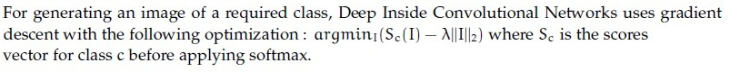

**Figure 31.** Option A statement for Question 260.  
*Option ID:* `6406533940014`

**B.** Visualizing the maximum of the data gradient across the channels provides insights into the image regions that have the most significant impact on generating high probability scores for a specific class.

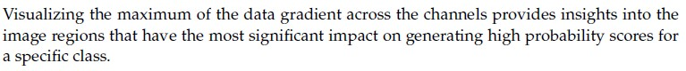

**Figure 32.** Option B statement for Question 260.  
*Option ID:* `6406533940015`

**C.** Global average Pooling refers to the average of all the pixels at a particular spatial location across all the channels.

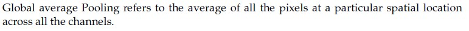

**Figure 33.** Option C statement for Question 260.  
*Option ID:* `6406533940016`

**D.** Class Activation Map (CAM) does not require a backward pass through the entire model.

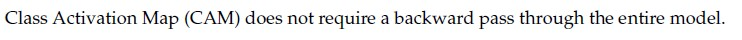

**Figure 34.** Option D statement for Question 260.  
*Option ID:* `6406533940017`

**Correct answer:** **B**, **D**  
**Source evidence:** Option 6406533940015 marked with green checkmark icon and green text (color 0x8000), PDF page 8.

---

---

**Source:** `da5006_2025T1_Q2_NA.md` · Quiz 2, 2025T1 · Question 261 · ID `6406531168235`  
**Classification:** Week 5 — Faster R-CNN, Region Proposal Network (RPN), bounding box regression loss, foreground proposal filtering, two-stage object detection  
**Course evidence:** [5.3 The Two-Stage R-CNN Architecture Family](/Volumes/1700%20APFS/PERSONAL_PROGRAMMING_PROJECTS/Notes/Deep%20Learning%20for%20Computer%20Vision/month%202/week%205/week-5-report.md) · Related weeks: none

### Question 261

**Question ID:** `6406531168235` · **Type:** SA · **Marks:** 3  
**PDF pages:** 9

Consider a Faster R-CNN object detection framework, which is being trained with a minibatch size of 2. The RPN produces 512 proposals, out of which 256 and 128 of them are foreground proposals, corresponding to each image in the mini-batch. For a single mini-batch update, the bounding box regression loss will be computed _______________ times.

**Correct answer:** `384`  
**Source evidence:** Official answer '384' in Possible Answers field with green text (color 0x8000), PDF page 9.

---

---

**Source:** `da5006_2025T1_Q2_NA.md` · Quiz 2, 2025T1 · Question 270 · ID `6406531168247`  
**Classification:** Week 5 — MobileNet, depthwise separable convolution, depthwise convolution parameters, efficient CNN architectures  
**Course evidence:** [2.5 MobileNets: Depthwise Separable Convolutions](/Volumes/1700%20APFS/PERSONAL_PROGRAMMING_PROJECTS/Notes/Deep%20Learning%20for%20Computer%20Vision/month%202/week%205/week-5-report.md) · Related weeks: 4

### Question 270

**Question ID:** `6406531168247` · **Type:** SA · **Marks:** 1.5  
**PDF pages:** 13

**Comprehension Context (Questions 270–273):**

> Let input have size $D_f \times D_f \times M$ where $D_f = 128$ and $M = 16$ and output feature map (after passing input through conv layer) has $D_f \times D_f \times N$ size where $N = 32$. Assume padded convolution. Let width of the square kernel in conv layer be $k$ where $k = 5$ (Ignore the bias term in the calculation).
> Calculate the number of parameters and computational cost, but make use of Depthwise Seperable convolution and pointwise convolution instead of standard convolution.
>
> 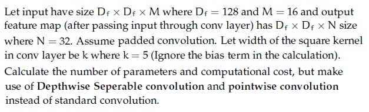
>
> **Figure 35.** Depthwise separable convolution specification for Comprehension Context 3 (Questions 270–273).
>
> Based on the above data, answer the given subquestions.

Number of parameters for depthwise convolution: __________________

**Correct answer:** `400`  
**Source evidence:** Official answer '400' in Possible Answers field with green text (color 0x8000), PDF page 13.

---

---

**Source:** `da5006_2025T1_Q2_NA.md` · Quiz 2, 2025T1 · Question 271 · ID `6406531168248`  
**Classification:** Week 5 — MobileNet, depthwise convolution computational cost, depthwise separable convolution, MAC / FLOP calculation  
**Course evidence:** [2.5 MobileNets: Depthwise Separable Convolutions](/Volumes/1700%20APFS/PERSONAL_PROGRAMMING_PROJECTS/Notes/Deep%20Learning%20for%20Computer%20Vision/month%202/week%205/week-5-report.md) · Related weeks: 4

### Question 271

**Question ID:** `6406531168248` · **Type:** SA · **Marks:** 1.5  
**PDF pages:** 13, 14

Computational Cost for depthwise convolution: ________________

**Correct answer:** `6553600`  
**Source evidence:** Official answer '6553600' in Possible Answers field with green text (color 0x8000), PDF page 14.

---

---

**Source:** `da5006_2025T1_Q2_NA.md` · Quiz 2, 2025T1 · Question 272 · ID `6406531168249`  
**Classification:** Week 5 — MobileNet, pointwise convolution parameters, 1x1 convolution, depthwise separable convolution  
**Course evidence:** [2.5 MobileNets: Depthwise Separable Convolutions](/Volumes/1700%20APFS/PERSONAL_PROGRAMMING_PROJECTS/Notes/Deep%20Learning%20for%20Computer%20Vision/month%202/week%205/week-5-report.md) · Related weeks: 4

### Question 272

**Question ID:** `6406531168249` · **Type:** SA · **Marks:** 1.5  
**PDF pages:** 14

Number of parameters for pointwise convolution: _________________

**Correct answer:** `512`  
**Source evidence:** Official answer '512' in Possible Answers field with green text (color 0x8000), PDF page 14.

---

---

**Source:** `da5006_2025T1_Q2_NA.md` · Quiz 2, 2025T1 · Question 273 · ID `6406531168250`  
**Classification:** Week 5 — MobileNet, pointwise convolution computational cost, 1x1 convolution FLOPs, depthwise separable convolution  
**Course evidence:** [2.5 MobileNets: Depthwise Separable Convolutions](/Volumes/1700%20APFS/PERSONAL_PROGRAMMING_PROJECTS/Notes/Deep%20Learning%20for%20Computer%20Vision/month%202/week%205/week-5-report.md) · Related weeks: 4

### Question 273

**Question ID:** `6406531168250` · **Type:** SA · **Marks:** 1.5  
**PDF pages:** 14

Computational cost for pointwise convolution: ___________________

**Correct answer:** `8388608`  
**Source evidence:** Official answer '8388608' in Possible Answers field with green text (color 0x8000), PDF page 14.

---

---

**Source:** `da5006_2025T2_Q2_NA.md` · Quiz 2, 2025T2 · Question 234 · ID `6406531333785`  
**Classification:** Week 5 — Integral Image, Summed-Area Table, Viola-Jones Detector, Object Detection Baseline  
**Course evidence:** [### 5.2 Pre-Deep Learning Baseline: The Viola-Jones Detector (2001)](/Volumes/1700%20APFS/PERSONAL_PROGRAMMING_PROJECTS/Notes/Deep%20Learning%20for%20Computer%20Vision/month%202/week%205/week-5-report.md) · Related weeks: 2

### Question 234

**Question ID:** `6406531333785` · **Type:** MCQ · **Marks:** 2  
**PDF pages:** 1, 2

The integral image of the image:

$$\begin{bmatrix} 4 & 5 & 2 & 1 \\ 0 & 9 & 3 & 2 \\ 5 & 6 & 8 & 1 \\ 2 & 3 & 0 & 0 \end{bmatrix}$$

is?

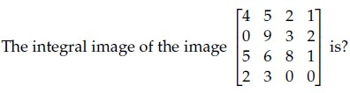

**Figure 36.** Source image matrix for Question 234.

**Options**

**A.** $$\begin{bmatrix} 4 & 9 & 11 & 12 \\ 4 & 18 & 23 & 26 \\ 9 & 29 & 42 & 46 \\ 11 & 34 & 47 & 51 \end{bmatrix}$$

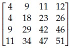

**Figure 37.** Option A matrix for Question 234.  
*Option ID:* `6406534459585`

**B.** $$\begin{bmatrix} 4 & 5 & 11 & 12 \\ 4 & 18 & 23 & 26 \\ 5 & 24 & 42 & 46 \\ 11 & 34 & 47 & 51 \end{bmatrix}$$

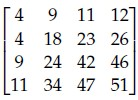

**Figure 38.** Option B matrix for Question 234.  
*Option ID:* `6406534459586`

**C.** $$\begin{bmatrix} 4 & 9 & 11 & 12 \\ 4 & 18 & 23 & 26 \\ 9 & 29 & 42 & 40 \\ 11 & 34 & 47 & 51 \end{bmatrix}$$

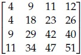

**Figure 39.** Option C matrix for Question 234.  
*Option ID:* `6406534459587`

**D.** $$\begin{bmatrix} 4 & 9 & 11 & 12 \\ 4 & 18 & 23 & 26 \\ 9 & 29 & 42 & 46 \\ 11 & 34 & 34 & 47 \end{bmatrix}$$

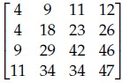

**Figure 40.** Option D matrix for Question 234.  
*Option ID:* `6406534459588`

**Correct answer:** **A** — Option A integral image matrix  
**Source evidence:** Green option ID text 6406534459585 with green check icon at [119.02, 615.18, 131.02, 627.18].

---

---

**Source:** `da5006_2025T2_Q2_NA.md` · Quiz 2, 2025T2 · Question 235 · ID `6406531333786`  
**Classification:** Week 5 — Region of Interest (RoI) Pooling, Fast R-CNN, Two-Stage Object Detection, R-CNN Family  
**Course evidence:** [### 5.3 The Two-Stage R-CNN Architecture Family](/Volumes/1700%20APFS/PERSONAL_PROGRAMMING_PROJECTS/Notes/Deep%20Learning%20for%20Computer%20Vision/month%202/week%205/week-5-report.md) · Related weeks: 4

### Question 235

**Question ID:** `6406531333786` · **Type:** MCQ · **Marks:** 2  
**PDF pages:** 2

Which of the following architectures introduced the ROI pooling layer for extracting fixed-size feature maps from variable-size region proposals?

**Options**

**A.** R-CNN  
*Option ID:* `6406534459589`

**B.** Fast R-CNN  
*Option ID:* `6406534459590`

**C.** Faster R-CNN  
*Option ID:* `6406534459591`

**D.** YOLO  
*Option ID:* `6406534459592`

**Correct answer:** **B** — Fast R-CNN  
**Source evidence:** Green option ID text 6406534459590 and option text 'Fast R-CNN' with green check icon at [119.02, 291.52, 131.02, 303.52].

---

---

**Source:** `da5006_2025T2_Q2_NA.md` · Quiz 2, 2025T2 · Question 236 · ID `6406531333787`  
**Classification:** Week 5 — Region Proposal Network (RPN), Faster R-CNN, Two-Stage Object Detection, Anchor Boxes  
**Course evidence:** [### 5.3 The Two-Stage R-CNN Architecture Family](/Volumes/1700%20APFS/PERSONAL_PROGRAMMING_PROJECTS/Notes/Deep%20Learning%20for%20Computer%20Vision/month%202/week%205/week-5-report.md) · Related weeks: none

### Question 236

**Question ID:** `6406531333787` · **Type:** MCQ · **Marks:** 2  
**PDF pages:** 2

Which object detection method first integrated a Region Proposal Network (RPN) to generate region proposals within the detection model?

**Options**

**A.** R-CNN  
*Option ID:* `6406534459593`

**B.** Fast R-CNN  
*Option ID:* `6406534459594`

**C.** Faster R-CNN  
*Option ID:* `6406534459595`

**D.** YOLO  
*Option ID:* `6406534459596`

**Correct answer:** **C** — Faster R-CNN  
**Source evidence:** Green option ID text 6406534459595 and option text 'Faster R-CNN' with green check icon at [119.02, 532.36, 131.02, 544.36].

---

---

**Source:** `da5006_2025T2_Q2_NA.md` · Quiz 2, 2025T2 · Question 237 · ID `6406531333788`  
**Classification:** Week 5 — YOLO (You Only Look Once), Single-Stage Detectors, Bounding Box Regression, Real-Time Object Detection  
**Course evidence:** [### 5.4 Single-Stage Detectors: YOLO (You Only Look Once)](/Volumes/1700%20APFS/PERSONAL_PROGRAMMING_PROJECTS/Notes/Deep%20Learning%20for%20Computer%20Vision/month%202/week%205/week-5-report.md) · Related weeks: none

### Question 237

**Question ID:** `6406531333788` · **Type:** MCQ · **Marks:** 2  
**PDF pages:** 2

Which architecture performs object detection as a single regression problem from image pixels to bounding boxes and class probabilities?

**Options**

**A.** R-CNN  
*Option ID:* `6406534459597`

**B.** Fast R-CNN  
*Option ID:* `6406534459598`

**C.** Faster R-CNN  
*Option ID:* `6406534459599`

**D.** YOLO  
*Option ID:* `6406534459600`

**Correct answer:** **D** — YOLO  
**Source evidence:** Green option ID text 6406534459600 and option text 'YOLO' with green check icon at [119.02, 773.20, 131.02, 785.20].

---

---

**Source:** `da5006_2025T2_Q2_NA.md` · Quiz 2, 2025T2 · Question 238 · ID `6406531333789`  
**Classification:** Week 5 — VGGNet, EfficientNet, GoogLeNet, ResNet, Skip-Connections, Depthwise Separable Convolutions, 1x1 Convolutions, 3x3 Convolutions  
**Course evidence:** [## Module 1: Evolution of CNN Architectures (Inception & ResNet)](/Volumes/1700%20APFS/PERSONAL_PROGRAMMING_PROJECTS/Notes/Deep%20Learning%20for%20Computer%20Vision/month%202/week%205/week-5-report.md) · Related weeks: 4

### Question 238

**Question ID:** `6406531333789` · **Type:** MCQ · **Marks:** 2  
**PDF pages:** 3

Match the following:

| Left Column | Right Column |
| :--- | :--- |
| 1) VGGNet | i) $1 \times 1$ convolution |
| 2) EfficientNet | ii) Skip-Connections |
| 3) GoogleNet | iii) $3 \times 3$ convolution |
| 4) ResNet | iv) $7 \times 7$ convolution |
| | v) depth-wise separable convolutions |

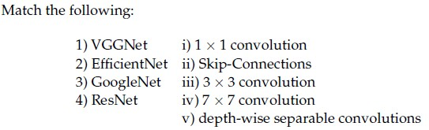

**Figure 41.** Matching table for Question 238.

**Options**

**A.** 1-v, 2-iii, 3-iv, 4-ii

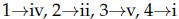

**Figure 42.** Option A for Question 238.  
*Option ID:* `6406534459601`

**B.** 1-iv, 2-iii, 3-i, 4-ii

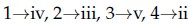

**Figure 43.** Option B for Question 238.  
*Option ID:* `6406534459602`

**C.** 1-iv, 2-v, 3-ii, 4-iii

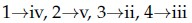

**Figure 44.** Option C for Question 238.  
*Option ID:* `6406534459603`

**D.** 1-iii, 2-v, 3-i, 4-ii

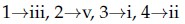

**Figure 45.** Option D for Question 238.  
*Option ID:* `6406534459604`

**Correct answer:** **D** — 1-iii, 2-v, 3-i, 4-ii  
**Source evidence:** Green option ID text 6406534459604 with green check icon at [119.02, 353.51, 131.02, 365.51].

---

---

**Source:** `da5006_2025T2_Q2_NA.md` · Quiz 2, 2025T2 · Question 240 · ID `6406531333791`  
**Classification:** Week 5 — Bounding Boxes, Intersection over Union (IoU), Object Detection Metrics, Coordinate Geometry  
**Course evidence:** [## Module 5: CNNs for Object Detection](/Volumes/1700%20APFS/PERSONAL_PROGRAMMING_PROJECTS/Notes/Deep%20Learning%20for%20Computer%20Vision/month%202/week%205/week-5-report.md) · Related weeks: 2

### Question 240

**Question ID:** `6406531333791` · **Type:** SA · **Marks:** 2  
**PDF pages:** 3, 4

Consider two bounding boxes in an image:
- Box A: top-left at (0, 0), bottom-right at (12, 12)
- Box B: top-left at (4, 4), bottom-right at (16, 16)

What is the Intersection over Union (IoU) between these two boxes ____________(in %)

**Correct answer:** `28`  
**Source evidence:** Official answer '28' in Possible Answers field on PDF page 4 with green text.

---

---

**Source:** `da5006_2025T2_Q2_NA.md` · Quiz 2, 2025T2 · Question 242 · ID `6406531333793`  
**Classification:** Week 5 — Computer Vision Recognition Hierarchy, Image Classification, Object Detection, Semantic Segmentation, Instance Segmentation  
**Course evidence:** [### 5.1 The Computer Vision Recognition Hierarchy](/Volumes/1700%20APFS/PERSONAL_PROGRAMMING_PROJECTS/Notes/Deep%20Learning%20for%20Computer%20Vision/month%202/week%205/week-5-report.md) · Related weeks: 1, 2

### Question 242

**Question ID:** `6406531333793` · **Type:** MCQ · **Marks:** 2  
**PDF pages:** 4, 5

Match the following computer vision tasks to situations:

| Tasks | Situations |
| :--- | :--- |
| 1) Instance Segmentation | i) There are cars in these pixels |
| 2) Classification | ii) There are 4 cars in the image |
| 3) Semantic Segmentation | iii) There is car in the image |
| 4) Object Detection | iv) There are 4 cars in the image, and here are the pixels with the shape of each of their occurrence |

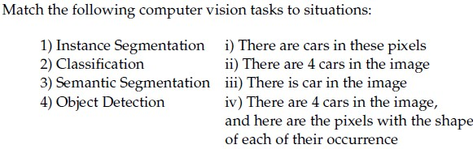

**Figure 46.** Matching table for Question 242.

**Options**

**A.** 1 -> iv, 2 -> iii, 3 -> ii, 4 -> i

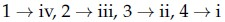

**Figure 47.** Option A for Question 242.  
*Option ID:* `6406534459614`

**B.** 1 -> ii, 2 -> iii, 3 -> i, 4 -> iv

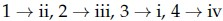

**Figure 48.** Option B for Question 242.  
*Option ID:* `6406534459615`

**C.** 1 -> iv, 2 -> iii, 3 -> i, 4 -> ii

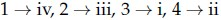

**Figure 49.** Option C for Question 242.  
*Option ID:* `6406534459616`

**D.** 1 -> i, 2 -> iii, 3 -> iv, 4 -> ii

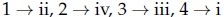

**Figure 50.** Option D for Question 242.  
*Option ID:* `6406534459617`

**Correct answer:** **C** — 1 -> iv, 2 -> iii, 3 -> i, 4 -> ii  
**Source evidence:** Green option ID text 6406534459616 on PDF page 5 with green check icon at [119.02, 41.32, 131.02, 53.32].

---

---

**Source:** `da5006_2025T2_Q2_NA.md` · Quiz 2, 2025T2 · Question 249 · ID `6406531333800`  
**Classification:** Week 5 — CNN Interpretability, Deep Inside Convolutional Networks, Saliency Maps, Global Average Pooling (GAP), Class Activation Map (CAM), Data Gradients  
**Course evidence:** [## Module 4: Visualizing and Interpreting CNNs](/Volumes/1700%20APFS/PERSONAL_PROGRAMMING_PROJECTS/Notes/Deep%20Learning%20for%20Computer%20Vision/month%202/week%205/week-5-report.md) · Related weeks: 4

### Question 249

**Question ID:** `6406531333800` · **Type:** MSQ · **Marks:** 3  
**PDF pages:** 7

Which of the following are true:

**Options**

**A.** For generating an image of a required class, Deep Inside Convolutional Networks uses gradient descent with the following optimization : $\text{argmin}_I (S_c(I) - \lambda \|I\|_2^2)$ where $S_c$ is the scores vector for class $c$ before applying softmax.

**Figure 51.** Option A for Question 249.  
*Option ID:* `6406534459642`

**B.** Visualizing the maximum of the data gradient across the channels provides insights into the image regions that have the most significant impact on generating high probability scores for a specific class.

**Figure 52.** Option B for Question 249.  
*Option ID:* `6406534459643`

**C.** Global average Pooling refers to the average of all the pixels at a particular spatial location across all the channels.

**Figure 53.** Option C for Question 249.  
*Option ID:* `6406534459644`

**D.** Class Activation Map (CAM) does not require a backward pass through the entire model.

**Figure 54.** Option D for Question 249.  
*Option ID:* `6406534459645`

**Correct answer:** **B, D** — Visualizing the maximum of the data gradient across the channels provides insights into the image regions that have the most significant impact on generating high probability scores for a specific class; Class Activation Map (CAM) does not require a backward pass through the entire model.  
**Source evidence:** Green option ID text 6406534459643 with green check icon at [119.02, 690.03, 131.02, 702.03].; Green option ID text 6406534459645 with green check icon at [119.02, 803.93, 131.02, 815.93].

---

---

**Source:** `da5006_2025T2_Q2_NA.md` · Quiz 2, 2025T2 · Question 250 · ID `6406531333801`  
**Classification:** Week 5 — Faster R-CNN, Region Proposal Network (RPN), Bounding Box Regression Loss, Foreground Proposals, Two-Stage Object Detection  
**Course evidence:** [### 5.3 The Two-Stage R-CNN Architecture Family](/Volumes/1700%20APFS/PERSONAL_PROGRAMMING_PROJECTS/Notes/Deep%20Learning%20for%20Computer%20Vision/month%202/week%205/week-5-report.md) · Related weeks: 4

### Question 250

**Question ID:** `6406531333801` · **Type:** SA · **Marks:** 2  
**PDF pages:** 8

Consider a Faster R-CNN object detection framework, which is being trained with a mini-batch size of 2. The RPN produces 512 proposals, out of which 256 and 128 of them are foreground proposals, corresponding to each image in the mini-batch. For a single mini-batch update, the bounding box regression loss will be computed_____________ times.

**Correct answer:** `384`  
**Source evidence:** Official answer '384' in Possible Answers field on PDF page 8 with green text.

---

---

**Source:** `da5006_2025T2_Q2_NA.md` · Quiz 2, 2025T2 · Question 261 · ID `6406531333816`  
**Classification:** Week 5 — MobileNet, Depthwise Separable Convolutions, Depthwise Convolution Parameters, Efficient CNN Architectures  
**Course evidence:** [### 2.5 MobileNets: Depthwise Separable Convolutions](/Volumes/1700%20APFS/PERSONAL_PROGRAMMING_PROJECTS/Notes/Deep%20Learning%20for%20Computer%20Vision/month%202/week%205/week-5-report.md) · Related weeks: 4

### Question 261

**Question ID:** `6406531333816` · **Type:** SA · **Marks:** 1  
**PDF pages:** 12, 13

**Comprehension:**

Let input have size $D_f \times D_f \times M$ where $D_f = 10$ and $M = 256$ and output feature map (after passing input through conv layer) has $D_f \times D_f \times N$ size where $N = 512$. Assume padded convolution. Let width of the square kernel in conv layer be $k$ where $k = 7$ (Ignore the bias term in the calculation), calculate the number of parameters and computational cost, but make use of Depthwise Seperable convolution and pointwise convolution instead of standard convolution.

Based on the above data, answer the given subquestions.

Number of parameters for depthwise seperable convolution:_______________

**Correct answer:** `12544`  
**Source evidence:** Official answer '12544' in Possible Answers field on PDF page 13 with green text.

---

---

**Source:** `da5006_2025T2_Q2_NA.md` · Quiz 2, 2025T2 · Question 262 · ID `6406531333817`  
**Classification:** Week 5 — MobileNet, Depthwise Convolution Computational Cost, Depthwise Separable Convolutions, FLOP / MAC Reduction  
**Course evidence:** [### 2.5 MobileNets: Depthwise Separable Convolutions](/Volumes/1700%20APFS/PERSONAL_PROGRAMMING_PROJECTS/Notes/Deep%20Learning%20for%20Computer%20Vision/month%202/week%205/week-5-report.md) · Related weeks: 4

### Question 262

**Question ID:** `6406531333817` · **Type:** SA · **Marks:** 1  
**PDF pages:** 13

**Comprehension:**

Let input have size $D_f \times D_f \times M$ where $D_f = 10$ and $M = 256$ and output feature map (after passing input through conv layer) has $D_f \times D_f \times N$ size where $N = 512$. Assume padded convolution. Let width of the square kernel in conv layer be $k$ where $k = 7$ (Ignore the bias term in the calculation), calculate the number of parameters and computational cost, but make use of Depthwise Seperable convolution and pointwise convolution instead of standard convolution.

Based on the above data, answer the given subquestions.

Computational Cost for depthwise seperable convolution:____________________

**Correct answer:** `1254400`  
**Source evidence:** Official answer '1254400' in Possible Answers field on PDF page 13 with green text.

---

---

**Source:** `da5006_2025T2_Q2_NA.md` · Quiz 2, 2025T2 · Question 263 · ID `6406531333818`  
**Classification:** Week 5 — MobileNet, Pointwise Convolution Parameters, 1x1 Convolution, Depthwise Separable Convolutions  
**Course evidence:** [### 2.5 MobileNets: Depthwise Separable Convolutions](/Volumes/1700%20APFS/PERSONAL_PROGRAMMING_PROJECTS/Notes/Deep%20Learning%20for%20Computer%20Vision/month%202/week%205/week-5-report.md) · Related weeks: 4

### Question 263

**Question ID:** `6406531333818` · **Type:** SA · **Marks:** 1  
**PDF pages:** 13

**Comprehension:**

Let input have size $D_f \times D_f \times M$ where $D_f = 10$ and $M = 256$ and output feature map (after passing input through conv layer) has $D_f \times D_f \times N$ size where $N = 512$. Assume padded convolution. Let width of the square kernel in conv layer be $k$ where $k = 7$ (Ignore the bias term in the calculation), calculate the number of parameters and computational cost, but make use of Depthwise Seperable convolution and pointwise convolution instead of standard convolution.

Based on the above data, answer the given subquestions.

Number of parameters for pointwise convolution:____________________

**Correct answer:** `131072`  
**Source evidence:** Official answer '131072' in Possible Answers field on PDF page 13 with green text.

---

---

**Source:** `da5006_2025T2_Q2_NA.md` · Quiz 2, 2025T2 · Question 264 · ID `6406531333819`  
**Classification:** Week 5 — MobileNet, Pointwise Convolution Computational Cost, 1x1 Convolution FLOPs, Depthwise Separable Convolutions  
**Course evidence:** [### 2.5 MobileNets: Depthwise Separable Convolutions](/Volumes/1700%20APFS/PERSONAL_PROGRAMMING_PROJECTS/Notes/Deep%20Learning%20for%20Computer%20Vision/month%202/week%205/week-5-report.md) · Related weeks: 4

### Question 264

**Question ID:** `6406531333819` · **Type:** SA · **Marks:** 1  
**PDF pages:** 13, 14

**Comprehension:**

Let input have size $D_f \times D_f \times M$ where $D_f = 10$ and $M = 256$ and output feature map (after passing input through conv layer) has $D_f \times D_f \times N$ size where $N = 512$. Assume padded convolution. Let width of the square kernel in conv layer be $k$ where $k = 7$ (Ignore the bias term in the calculation), calculate the number of parameters and computational cost, but make use of Depthwise Seperable convolution and pointwise convolution instead of standard convolution.

Based on the above data, answer the given subquestions.

Computational cost for pointwise convolution:____________________

**Correct answer:** `13107200`  
**Source evidence:** Official answer '13107200' in Possible Answers field on PDF page 14 with green text.

---

---

**Source:** `da5006_2025T2_ET_AN.md` · End-term, 2025T2 · Question 107 · ID `6406531431370`  
**Classification:** Week 5 — Integral Image, Summed-Area Table, Pixel Intensity Reconstruction, Mode Intensity, Viola-Jones Detector  
**Course evidence:** [### 5.2 Pre-Deep Learning Baseline: The Viola-Jones Detector (2001)](/Volumes/1700%20APFS/PERSONAL_PROGRAMMING_PROJECTS/Notes/Deep%20Learning%20for%20Computer%20Vision/month%202/week%205/week-5-report.md) · Related weeks: 2

### Question 107

**Question ID:** `6406531431370` · **Type:** SA · **Marks:** 2  
**PDF pages:** 11

For a 3-bit grayscale image, the integral image is given as follows:

$$\begin{bmatrix} 5 & 6 & 8 \\ 6 & 9 & 11 \\ 11 & 15 & 19 \end{bmatrix}$$

The pixel intensity that occurs the most for the given grayscale image is ______ (enter an integer value)

**Figure 55.** Source problem statement for Question 107.

**Correct answer:** 2  
**Source evidence:** Source key specifies Possible Answers : 2 (Answers Type : Equal).

---

---

**Source:** `da5006_2025T3_Q2_NA.md` · Quiz 2, 2025T3 · Question 130 · ID `6406531815722`  
**Classification:** Week 5 — Integral Image, Summed-Area Table, Viola-Jones Detector, 2D Cumulative Summation, Haar-like Features  
**Course evidence:** [### 5.2 Pre-Deep Learning Baseline: The Viola-Jones Detector (2001)](/Volumes/1700%20APFS/PERSONAL_PROGRAMMING_PROJECTS/Notes/Deep%20Learning%20for%20Computer%20Vision/month%202/week%205/week-5-report.md) · Related weeks: 1, 2

### Question 130

**Question ID:** `6406531815722` · **Type:** Multiple Choice Question · **Marks:** 2  
**PDF pages:** 2

The integral image (summed area table) of $\begin{bmatrix} 1 & 2 & 3 \\ 4 & 5 & 6 \\ 7 & 8 & 9 \end{bmatrix}$ is:

**Figure 56.** Input 3x3 matrix for Question 130.

**Options**

**A.** $\begin{bmatrix} 1 & 3 & 6 \\ 5 & 12 & 21 \\ 12 & 27 & 45 \end{bmatrix}$  

**Figure 57.** Option A matrix for Question 130.

*Option ID:* `6406535903082`

**B.** $\begin{bmatrix} 1 & 2 & 3 \\ 5 & 7 & 9 \\ 12 & 15 & 18 \end{bmatrix}$  

**Figure 58.** Option B matrix for Question 130.

*Option ID:* `6406535903083`

**C.** $\begin{bmatrix} 1 & 3 & 6 \\ 4 & 9 & 15 \\ 7 & 15 & 24 \end{bmatrix}$  

**Figure 59.** Option C matrix for Question 130.

*Option ID:* `6406535903084`

**D.** $\begin{bmatrix} 9 & 8 & 7 \\ 6 & 5 & 4 \\ 3 & 2 & 1 \end{bmatrix}$  

**Figure 60.** Option D matrix for Question 130.

*Option ID:* `6406535903085`

**Correct answer:** **A** — $\begin{bmatrix} 1 & 3 & 6 \\ 5 & 12 & 21 \\ 12 & 27 & 45 \end{bmatrix}$.  
**Source evidence:** Option ID 6406535903082 in green text (0x8000) with check icon, PDF page 2.

---

---

**Source:** `da5006_2025T3_Q2_NA.md` · Quiz 2, 2025T3 · Question 131 · ID `6406531815723`  
**Classification:** Week 5 — Fast R-CNN, RoI Pooling Layer, Region Proposals, Two-Stage Object Detection, Feature Map Sharing  
**Course evidence:** [### 5.3 The Two-Stage R-CNN Architecture Family](/Volumes/1700%20APFS/PERSONAL_PROGRAMMING_PROJECTS/Notes/Deep%20Learning%20for%20Computer%20Vision/month%202/week%205/week-5-report.md) · Related weeks: 4

### Question 131

**Question ID:** `6406531815723` · **Type:** Multiple Choice Question · **Marks:** 2  
**PDF pages:** 2

Which of the following architectures introduced the ROI pooling layer for extracting fixed-size feature maps from variable-size region proposals?

**Options**

**A.** R-CNN  
*Option ID:* `6406535903086`

**B.** Fast R-CNN  
*Option ID:* `6406535903087`

**C.** Faster R-CNN  
*Option ID:* `6406535903088`

**D.** YOLO  
*Option ID:* `6406535903089`

**Correct answer:** **B** — Fast R-CNN.  
**Source evidence:** Option B (6406535903087) in green text (0x8000) with check icon, PDF page 2.

---

---

**Source:** `da5006_2025T3_Q2_NA.md` · Quiz 2, 2025T3 · Question 132 · ID `6406531815724`  
**Classification:** Week 5 — Faster R-CNN, Region Proposal Network (RPN), Anchor Boxes, Two-Stage Object Detection, End-to-End Training  
**Course evidence:** [### 5.3 The Two-Stage R-CNN Architecture Family](/Volumes/1700%20APFS/PERSONAL_PROGRAMMING_PROJECTS/Notes/Deep%20Learning%20for%20Computer%20Vision/month%202/week%205/week-5-report.md) · Related weeks: 4

### Question 132

**Question ID:** `6406531815724` · **Type:** Multiple Choice Question · **Marks:** 2  
**PDF pages:** 3

Which object detection method first integrated a Region Proposal Network (RPN) to generate region proposals within the detection model?

**Options**

**A.** R-CNN  
*Option ID:* `6406535903090`

**B.** Fast R-CNN  
*Option ID:* `6406535903091`

**C.** Faster R-CNN  
*Option ID:* `6406535903092`

**D.** YOLO  
*Option ID:* `6406535903093`

**Correct answer:** **C** — Faster R-CNN.  
**Source evidence:** Option C (6406535903092) in green text (0x8000) with check icon, PDF page 3.

---

---

**Source:** `da5006_2025T3_Q2_NA.md` · Quiz 2, 2025T3 · Question 133 · ID `6406531815725`  
**Classification:** Week 5 — YOLO (You Only Look Once), Single-Stage Object Detection, Unified Regression Formulation, Grid Cell Predictions, Real-Time Object Detection  
**Course evidence:** [### 5.4 Single-Stage Detectors: YOLO (You Only Look Once)](/Volumes/1700%20APFS/PERSONAL_PROGRAMMING_PROJECTS/Notes/Deep%20Learning%20for%20Computer%20Vision/month%202/week%205/week-5-report.md) · Related weeks: 4

### Question 133

**Question ID:** `6406531815725` · **Type:** Multiple Choice Question · **Marks:** 2  
**PDF pages:** 3

Which architecture performs object detection as a single regression problem from image pixels to bounding boxes and class probabilities?

**Options**

**A.** R-CNN  
*Option ID:* `6406535903094`

**B.** Fast R-CNN  
*Option ID:* `6406535903095`

**C.** Faster R-CNN  
*Option ID:* `6406535903096`

**D.** YOLO  
*Option ID:* `6406535903097`

**Correct answer:** **D** — YOLO.  
**Source evidence:** Option D (6406535903097) in green text (0x8000) with check icon, PDF page 3.

---

---

**Source:** `da5006_2025T3_Q2_NA.md` · Quiz 2, 2025T3 · Question 134 · ID `6406531815726`  
**Classification:** Week 5 — AlexNet, MobileNet, DenseNet, ResNet, Depthwise Separable Convolutions, Skip Connections, Dense Connections, ReLU and Dropout  
**Course evidence:** [## Module 2: Modern CNN Paradigms (Beyond ResNet)](/Volumes/1700%20APFS/PERSONAL_PROGRAMMING_PROJECTS/Notes/Deep%20Learning%20for%20Computer%20Vision/month%202/week%205/week-5-report.md) · Related weeks: 4

### Question 134

**Question ID:** `6406531815726` · **Type:** Multiple Choice Question · **Marks:** 2  
**PDF pages:** 3

Match architectures to their characteristic ideas:

| Architecture | Characteristic idea |
| :--- | :--- |
| 1) AlexNet | i) Dense connections |
| 2) MobileNet | ii) Depthwise separable conv |
| 3) DenseNet | iii) Skip connection |
| 4) ResNet | iv) ReLU + Dropout + LRN |

**Figure 61.** Architecture matching table for Question 134.

**Options**

**A.** 1→iv, 2→ii, 3→i, 4→iii  
*Option ID:* `6406535903098`

**B.** 1→ii, 2→iv, 3→i, 4→iii  
*Option ID:* `6406535903099`

**C.** 1→iv, 2→i, 3→ii, 4→iii  
*Option ID:* `6406535903100`

**D.** 1→iii, 2→ii, 3→iv, 4→i  
*Option ID:* `6406535903101`

**Correct answer:** **A** — 1→iv, 2→ii, 3→i, 4→iii.  
**Source evidence:** Option A (6406535903098) in green text (0x8000) with check icon, PDF page 3.

---

---

**Source:** `da5006_2025T3_Q2_NA.md` · Quiz 2, 2025T3 · Question 136 · ID `6406531815728`  
**Classification:** Week 5 — Intersection over Union (IoU), Bounding Box Geometry, Jaccard Index, Object Detection Evaluation  
**Course evidence:** [## Module 5: CNNs for Object Detection](/Volumes/1700%20APFS/PERSONAL_PROGRAMMING_PROJECTS/Notes/Deep%20Learning%20for%20Computer%20Vision/month%202/week%205/week-5-report.md) · Related weeks: none

### Question 136

**Question ID:** `6406531815728` · **Type:** Multiple Choice Question · **Marks:** 2  
**PDF pages:** 4

Consider two bounding boxes in an image:

- Box A: top-left at (0, 0), bottom-right at (12, 12)
- Box B: top-left at (4, 4), bottom-right at (16, 16)

What is the Intersection over Union (IoU) between these two boxes ______________

**Options**

**A.** 21%  
*Option ID:* `6406535903106`

**B.** 28%  
*Option ID:* `6406535903107`

**C.** 36%  
*Option ID:* `6406535903108`

**D.** 44%  
*Option ID:* `6406535903109`

**Correct answer:** **B** — 28%.  
**Source evidence:** Option B (6406535903107) in green text (0x8000) with check icon, PDF page 4.

---

---

**Source:** `da5006_2025T3_Q2_NA.md` · Quiz 2, 2025T3 · Question 138 · ID `6406531815730`  
**Classification:** Week 5 — Computer Vision Recognition Hierarchy, Image Classification, Object Detection, Semantic Segmentation, Instance Segmentation  
**Course evidence:** [### 5.1 The Computer Vision Recognition Hierarchy](/Volumes/1700%20APFS/PERSONAL_PROGRAMMING_PROJECTS/Notes/Deep%20Learning%20for%20Computer%20Vision/month%202/week%205/week-5-report.md) · Related weeks: 1, 2

### Question 138

**Question ID:** `6406531815730` · **Type:** Multiple Choice Question · **Marks:** 2  
**PDF pages:** 5

Match the following computer vision tasks to situations:

| Task | Situation |
| :--- | :--- |
| 1) Instance Segmentation | i) There are cars in these pixels |
| 2) Classification | ii) There are 4 cars in the image |
| 3) Semantic Segmentation | iii) There is car in the image |
| 4) Object Detection | iv) There are 4 cars in the image, and here are the pixels with the shape of each of their occurrence |

**Figure 62.** Computer vision tasks matching table for Question 138.

**Options**

**A.** 1 → iv, 2 → iii, 3 → ii, 4 → i  
*Option ID:* `6406535903115`

**B.** 1 → ii, 2 → iii, 3 → i, 4 →iv  
*Option ID:* `6406535903116`

**C.** 1 → iv, 2→ iii, 3 → i, 4 → ii  
*Option ID:* `6406535903117`

**D.** 1 → ii, 2 → iv, 3 → iii, 4 → i  
*Option ID:* `6406535903118`

**Correct answer:** **C** — 1 → iv, 2→ iii, 3 → i, 4 → ii.  
**Source evidence:** Option C (6406535903117) in green text (0x8000) with check icon, PDF page 5.

---

---

**Source:** `da5006_2025T3_Q2_NA.md` · Quiz 2, 2025T3 · Question 144 · ID `6406531815739`  
**Classification:** Week 5 — Faster R-CNN, Region Proposal Network (RPN), bounding box regression loss, foreground proposal filtering, two-stage object detection  
**Course evidence:** [### 5.3 The Two-Stage R-CNN Architecture Family](/Volumes/1700%20APFS/PERSONAL_PROGRAMMING_PROJECTS/Notes/Deep%20Learning%20for%20Computer%20Vision/month%202/week%205/week-5-report.md) · Related weeks: 4

### Question 144

**Question ID:** `6406531815739` · **Type:** Short Answer · **Marks:** 2  
**PDF pages:** 7

Consider a Faster R-CNN object detection framework, which is being trained with a mini-batch size of 2. The RPN produces 512 proposals, out of which 256 and 128 of them are foreground proposals, corresponding to each image in the mini-batch. For a single mini-batch update, the bounding box regression loss will be computed ____ times.

**Figure 63.** Faster R-CNN question specification for Question 144.

**Correct answer:** `384`  
**Source evidence:** Green text (0x8000) under Possible Answers : 384, PDF page 7.

---

---

**Source:** `da5006_2025T3_Q2_NA.md` · Quiz 2, 2025T3 · Question 146 · ID `6406531815737`  
**Classification:** Week 5 — CNN interpretability, Deep Inside Convolutional Networks, saliency maps via data gradient, Global Average Pooling (GAP), Class Activation Map (CAM)  
**Course evidence:** [## Module 4: Visualizing and Interpreting CNNs](/Volumes/1700%20APFS/PERSONAL_PROGRAMMING_PROJECTS/Notes/Deep%20Learning%20for%20Computer%20Vision/month%202/week%205/week-5-report.md) · Related weeks: 4

### Question 146

**Question ID:** `6406531815737` · **Type:** Multiple Select Question · **Marks:** 3  
**PDF pages:** 8

Which of the following statements are correct regarding deep convolutional network interpretability and visualization?

**Options**

**A.** For generating an image of a required class, Deep Inside Convolutional Networks uses gradient descent with the following optimization : $\arg\min_I (S_c(I) - \lambda \|I\|_2^2)$ where $S_c$ is the scores vector for class $c$ before applying softmax.  

**Figure 64.** Option A optimization formula for Question 146.

*Option ID:* `6406535903143`

**B.** Visualizing the maximum of the data gradient across the channels provides insights into the image regions that have the most significant impact on generating high probability scores for a specific class.  

**Figure 65.** Option B data gradient visualization statement for Question 146.

*Option ID:* `6406535903144`

**C.** Global average Pooling refers to the average of all the pixels at a particular spatial location across all the channels.  

**Figure 66.** Option C Global Average Pooling statement for Question 146.

*Option ID:* `6406535903145`

**D.** Class Activation Map (CAM) does not require a backward pass through the entire model.  

**Figure 67.** Option D Class Activation Map statement for Question 146.

*Option ID:* `6406535903146`

**Correct answer:** **A**, **C** — For generating an image of a required class, Deep Inside Convolutional Networks uses gradient descent with the following optimization : $\arg\min_I (S_c(I) - \lambda \|I\|_2^2)$ where $S_c$ is the scores vector for class $c$ before applying softmax.; Global average Pooling refers to the average of all the pixels at a particular spatial location across all the channels..  
**Source evidence:** Option A (6406535903143) with check icon and green text marker, PDF page 8.

---

---

**Source:** `da5006_2025T3_Q2_NA.md` · Quiz 2, 2025T3 · Question 156 · ID `6406531815751`  
**Classification:** Week 5 — MobileNet, depthwise separable convolution, depthwise convolution parameters, efficient CNN architectures  
**Course evidence:** [### 2.5 MobileNets: Depthwise Separable Convolutions](/Volumes/1700%20APFS/PERSONAL_PROGRAMMING_PROJECTS/Notes/Deep%20Learning%20for%20Computer%20Vision/month%202/week%205/week-5-report.md) · Related weeks: 4

### Question 156

**Question ID:** `6406531815751` · **Type:** Short Answer · **Marks:** 1  
**PDF pages:** 12

Using the same dimensions specified in the previous question main data ($D_I = 10, M = 256, N = 512, k = 7$), calculate the number of parameters and computational cost, but make use of Depthwise Seperable convolution and pointwise convolution instead of standard convolution.

Based on the above data, answer the given subquestion.

Number of parameters for depthwise seperable convolution: __________

**Correct answer:** `12544`  
**Source evidence:** Green text (0x8000) under Possible Answers : 12544, PDF page 12.

---

---

**Source:** `da5006_2025T3_Q2_NA.md` · Quiz 2, 2025T3 · Question 157 · ID `6406531815752`  
**Classification:** Week 5 — MobileNet, depthwise convolution computational cost, depthwise separable convolution, MAC / FLOP calculation  
**Course evidence:** [### 2.5 MobileNets: Depthwise Separable Convolutions](/Volumes/1700%20APFS/PERSONAL_PROGRAMMING_PROJECTS/Notes/Deep%20Learning%20for%20Computer%20Vision/month%202/week%205/week-5-report.md) · Related weeks: 4

### Question 157

**Question ID:** `6406531815752` · **Type:** Short Answer · **Marks:** 1  
**PDF pages:** 12, 13

Refer to the specifications in Question 156.

Based on the above data, answer the given subquestion.

Computational Cost for depthwise seperable convolution: ____________

**Correct answer:** `1254400`  
**Source evidence:** Green text (0x8000) under Possible Answers : 1254400, PDF page 13.

---

---

**Source:** `da5006_2025T3_Q2_NA.md` · Quiz 2, 2025T3 · Question 158 · ID `6406531815753`  
**Classification:** Week 5 — MobileNet, pointwise convolution parameters, 1x1 convolution, depthwise separable convolution  
**Course evidence:** [### 2.5 MobileNets: Depthwise Separable Convolutions](/Volumes/1700%20APFS/PERSONAL_PROGRAMMING_PROJECTS/Notes/Deep%20Learning%20for%20Computer%20Vision/month%202/week%205/week-5-report.md) · Related weeks: 4

### Question 158

**Question ID:** `6406531815753` · **Type:** Short Answer · **Marks:** 1  
**PDF pages:** 13

Refer to the specifications in Question 156.

Based on the above data, answer the given subquestion.

Number of parameters for pointwise convolution: _____________

**Correct answer:** `131072`  
**Source evidence:** Green text (0x8000) under Possible Answers : 131072, PDF page 13.

---

---

**Source:** `da5006_2025T3_Q2_NA.md` · Quiz 2, 2025T3 · Question 159 · ID `6406531815754`  
**Classification:** Week 5 — MobileNet, pointwise convolution computational cost, 1x1 convolution FLOPs, depthwise separable convolution  
**Course evidence:** [### 2.5 MobileNets: Depthwise Separable Convolutions](/Volumes/1700%20APFS/PERSONAL_PROGRAMMING_PROJECTS/Notes/Deep%20Learning%20for%20Computer%20Vision/month%202/week%205/week-5-report.md) · Related weeks: 4

### Question 159

**Question ID:** `6406531815754` · **Type:** Short Answer · **Marks:** 1  
**PDF pages:** 13

Refer to the specifications in Question 156.

Based on the above data, answer the given subquestion.

Computational cost for pointwise convolution: ____________

**Correct answer:** `13107200`  
**Source evidence:** Green text (0x8000) under Possible Answers : 13107200, PDF page 13.

---

---

**Source:** `da5006_2025T3_ET_FN.md` · End-term, 2025T3 · Question 13 · ID `6406531862827`  
**Classification:** Week 5 — Integral Image, Summed-Area Table, Viola-Jones Detector, Rectangular Area Summation, Box Filter Evaluation  
**Course evidence:** [### 5.2 Pre-Deep Learning Baseline: The Viola-Jones Detector (2001)](/Volumes/1700%20APFS/PERSONAL_PROGRAMMING_PROJECTS/Notes/Deep%20Learning%20for%20Computer%20Vision/month%202/week%205/week-5-report.md) · Related weeks: none

### Question 13

**Question ID:** `6406531862827` · **Type:** SA · **Marks:** 1  
**PDF pages:** 6

Using the integral image $II$ below (1-indexed):

$$II = \begin{bmatrix} 4 & 9 & 12 \\ 10 & 20 & 30 \\ 15 & 33 & 50 \end{bmatrix}$$

Compute the sum of the original image over rectangle rows 2:3, cols 2:3.

**Figure 68.** Source integral image matrix and query for Question 13.

**Correct answer:** `27`  
**Source evidence:** Official answer '27' specified in Possible Answers field with green text (color 0x008000); calculation: II(3,3) - II(1,3) - II(3,1) + II(1,1) = 50 - 12 - 15 + 4 = 27.

---

---

**Source:** `da5006_2026T1_Q2_NA.md` · Quiz 2, 2026T1 · Question 2 · ID `6406532040089`  
**Classification:** Week 5 — ResNet, degradation problem, plain deep networks, skip connections, identity mapping, gradient flow  
**Course evidence:** [### 1.2 Residual Networks (ResNet)](/Volumes/1700%20APFS/PERSONAL_PROGRAMMING_PROJECTS/Notes/Deep%20Learning%20for%20Computer%20Vision/month%202/week%205/week-5-report.md) · Related weeks: 4, 3

### Question 2

**Question ID:** `6406532040089` · **Type:** MCQ · **Marks:** 1  
**PDF pages:** 2

Why do very deep plain CNNs (without skip connections) sometimes show higher training error than shallower CNNs?

**Options**

**A.** The increased capacity leads to severe overfitting on the training set before convergence can be reached.  
*Option ID:* `6406536642485`

**B.** Optimization becomes harder; skip connections make learning identity mappings easier and improve gradient flow.  
*Option ID:* `6406536642486`

**C.** The receptive field becomes excessively large, causing the network to lose fine-grained spatial information.  
*Option ID:* `6406536642487`

**D.** Saturated activations cause exploding gradients that cannot be mitigated by standard initialization techniques.  
*Option ID:* `6406536642488`

**Correct answer:** **B** — Optimization becomes harder; skip connections make learning identity mappings easier and improve gradient flow..  
**Source evidence:** Green option text (0x8000) and check icon (xref 1768) for Option ID 6406536642486, PDF page 2.

---

---

**Source:** `da5006_2026T1_Q2_NA.md` · Quiz 2, 2026T1 · Question 3 · ID `6406532040090`  
**Classification:** Week 5 — ResNet-50, bottleneck residual block, 1x1 convolution, 3x3 convolution, channel dimensionality reduction  
**Course evidence:** [### 1.2 Residual Networks (ResNet)](/Volumes/1700%20APFS/PERSONAL_PROGRAMMING_PROJECTS/Notes/Deep%20Learning%20for%20Computer%20Vision/month%202/week%205/week-5-report.md) · Related weeks: 4

### Question 3

**Question ID:** `6406532040090` · **Type:** MCQ · **Marks:** 1  
**PDF pages:** 2

In a standard ResNet-50 bottleneck block, the three convolutions are typically:

**Options**

**A.** 3×3, 1×1, 3×3  
*Option ID:* `6406536642489`

**B.** 1×1, 3×3, 1×1  
*Option ID:* `6406536642490`

**C.** 1×1, 5×5, 1×1  
*Option ID:* `6406536642491`

**D.** 3×3, 3×3, 3×3  
*Option ID:* `6406536642492`

**Correct answer:** **B** — 1×1, 3×3, 1×1.  
**Source evidence:** Green option text (0x8000) and check icon (xref 1768) for Option ID 6406536642490, PDF page 2.

---

---

**Source:** `da5006_2026T1_Q2_NA.md` · Quiz 2, 2026T1 · Question 4 · ID `6406532040091`  
**Classification:** Week 5 — Inception network, GoogLeNet, 1x1 bottleneck convolution, dimensionality reduction, multi-scale feature extraction  
**Course evidence:** [### 1.1 Inception Network (GoogLeNet / Inception-v1 to v3)](/Volumes/1700%20APFS/PERSONAL_PROGRAMMING_PROJECTS/Notes/Deep%20Learning%20for%20Computer%20Vision/month%202/week%205/week-5-report.md) · Related weeks: 4

### Question 4

**Question ID:** `6406532040091` · **Type:** MCQ · **Marks:** 1  
**PDF pages:** 2, 3

In Inception/GoogLeNet modules, the main purpose of 1×1 convolutions is to:

**Options**

**A.** Increase the receptive field of subsequent convolutional layers without downsampling.  
*Option ID:* `6406536642493`

**B.** Reduce channel dimensionality (bottleneck) and add non-linearity  
*Option ID:* `6406536642494`

**C.** Act as a differentiable substitute for max-pooling operations to preserve exact spatial hierarchies.  
*Option ID:* `6406536642495`

**D.** Project the feature maps into a higher-dimensional space to separate entangled features.  
*Option ID:* `6406536642496`

**Correct answer:** **B** — Reduce channel dimensionality (bottleneck) and add non-linearity.  
**Source evidence:** Green option text (0x8000) and check icon (xref 1768) for Option ID 6406536642494, PDF page 3.

---

---

**Source:** `da5006_2026T1_Q2_NA.md` · Quiz 2, 2026T1 · Question 5 · ID `6406532040092`  
**Classification:** Week 5 — MobileNetV1, depthwise separable convolution, depthwise convolution, pointwise convolution, efficient CNN architectures  
**Course evidence:** [### 2.5 MobileNets: Depthwise Separable Convolutions](/Volumes/1700%20APFS/PERSONAL_PROGRAMMING_PROJECTS/Notes/Deep%20Learning%20for%20Computer%20Vision/month%202/week%205/week-5-report.md) · Related weeks: 4

### Question 5

**Question ID:** `6406532040092` · **Type:** MCQ · **Marks:** 1  
**PDF pages:** 3

MobileNetV1 reduces computation primarily by using:

**Options**

**A.** Grouped convolutions followed by spatial pyramid pooling  
*Option ID:* `6406536642497`

**B.** Depthwise separable convolutions (depthwise + pointwise)  
*Option ID:* `6406536642498`

**C.** Asymmetric convolutions (e.g., factorizing a 3×3 into 3×1 followed by 1×3)  
*Option ID:* `6406536642499`

**D.** Low-rank matrix factorization of dense classification layers  
*Option ID:* `6406536642500`

**Correct answer:** **B** — Depthwise separable convolutions (depthwise + pointwise).  
**Source evidence:** Green option text (0x8000) and check icon (xref 1768) for Option ID 6406536642498, PDF page 3.

---

---

**Source:** `da5006_2026T1_Q2_NA.md` · Quiz 2, 2026T1 · Question 6 · ID `6406532040093`  
**Classification:** Week 5 — EfficientNet, compound scaling, depth scaling, width scaling, resolution scaling  
**Course evidence:** [## Module 2: Modern CNN Paradigms (Beyond ResNet)](/Volumes/1700%20APFS/PERSONAL_PROGRAMMING_PROJECTS/Notes/Deep%20Learning%20for%20Computer%20Vision/month%202/week%205/week-5-report.md) · Related weeks: 4

### Question 6

**Question ID:** `6406532040093` · **Type:** MCQ · **Marks:** 1  
**PDF pages:** 3

EfficientNet’s key scaling idea is:

**Options**

**A.** Scaling the network depth logarithmically while linearly increasing the input resolution  
*Option ID:* `6406536642501`

**B.** Utilizing neural architecture search (NAS) to independently optimize depth, width, and resolution for each block  
*Option ID:* `6406536642502`

**C.** Compound scaling of depth, width, and resolution using a single coefficient  
*Option ID:* `6406536642503`

**D.** Adjusting the channel multiplier dynamically based on the target device's hardware constraints  
*Option ID:* `6406536642504`

**Correct answer:** **C** — Compound scaling of depth, width, and resolution using a single coefficient.  
**Source evidence:** Green option text (0x8000) and check icon (xref 1768) for Option ID 6406536642503, PDF page 3.

---

---

**Source:** `da5006_2026T1_Q2_NA.md` · Quiz 2, 2026T1 · Question 7 · ID `6406532040094`  
**Classification:** Week 5 — transfer learning, pretrained CNN backbone, linear classifier baseline, freezing backbone weights, small dataset regime  
**Course evidence:** [## Module 5: CNNs for Object Detection](/Volumes/1700%20APFS/PERSONAL_PROGRAMMING_PROJECTS/Notes/Deep%20Learning%20for%20Computer%20Vision/month%202/week%205/week-5-report.md) · Related weeks: 4, 3

### Question 7

**Question ID:** `6406532040094` · **Type:** MCQ · **Marks:** 1  
**PDF pages:** 3, 4

You have a pretrained CNN backbone and only 500 labeled images for a new task. A strong first baseline is:

**Options**

**A.** Fine-tune the entire network immediately using a very small learning rate to preserve pre-trained features  
*Option ID:* `6406536642505`

**B.** Freeze backbone, train a new classifier head; optionally unfreeze later with smaller LR  
*Option ID:* `6406536642506`

**C.** Train a completely new architecture from scratch using heavy data augmentation to compensate for the lack of data  
*Option ID:* `6406536642507`

**D.** Unfreeze the backbone from the bottom layers upwards, gradually increasing the learning rate  
*Option ID:* `6406536642508`

**Correct answer:** **B** — Freeze backbone, train a new classifier head; optionally unfreeze later with smaller LR.  
**Source evidence:** Green option text (0x8000) and check icon (xref 1768) for Option ID 6406536642506, PDF page 4.

---

---

**Source:** `da5006_2026T1_Q2_NA.md` · Quiz 2, 2026T1 · Question 8 · ID `6406532040095`  
**Classification:** Week 5 — fine-tuning, differential learning rates, catastrophic forgetting, transfer learning, feature preservation  
**Course evidence:** [## Module 3: Fine-Tuning and Transfer Learning in CNNs](/Volumes/1700%20APFS/PERSONAL_PROGRAMMING_PROJECTS/Notes/Deep%20Learning%20for%20Computer%20Vision/month%202/week%205/week-5-report.md) · Related weeks: 3

### Question 8

**Question ID:** `6406532040095` · **Type:** MCQ · **Marks:** 1  
**PDF pages:** 4

When fine-tuning a model, what is a common way to prevent the new training from "overwriting" or destroying the useful features already learned during pre-training?

**Options**

**A.** Applying a high dropout rate exclusively to the newly initialized classification head  
*Option ID:* `6406536642509`

**B.** Use differential learning rates (small LR for the pre-trained backbone, larger LR for the new head)  
*Option ID:* `6406536642510`

**C.** Re-initializing the weights of the last convolutional block before training  
*Option ID:* `6406536642511`

**D.** Freezing the classification head and only fine-tuning the backbone features  
*Option ID:* `6406536642512`

**Correct answer:** **B** — Use differential learning rates (small LR for the pre-trained backbone, larger LR for the new head).  
**Source evidence:** Green option text (0x8000) and check icon (xref 1768) for Option ID 6406536642510, PDF page 4.

---

---

**Source:** `da5006_2026T1_Q2_NA.md` · Quiz 2, 2026T1 · Question 9 · ID `6406532040096`  
**Classification:** Week 5 — Grad-CAM, CNN Interpretability, Class Activation Mapping, Feature Map Weighting, Gradient-Weighted Heatmaps  
**Course evidence:** [## Module 4: Visualizing and Interpreting CNNs](/Volumes/1700%20APFS/PERSONAL_PROGRAMMING_PROJECTS/Notes/Deep%20Learning%20for%20Computer%20Vision/month%202/week%205/week-5-report.md) · Related weeks: 4

### Question 9

**Question ID:** `6406532040096` · **Type:** MCQ · **Marks:** 1  
**PDF pages:** 4

Which method produces a heatmap by weighting convolutional feature maps using gradients of a target class score?

**Options**

**A.** Guided Backpropagation  
*Option ID:* `6406536642513`

**B.** Grad-CAM  
*Option ID:* `6406536642514`

**C.** SmoothGrad  
*Option ID:* `6406536642515`

**D.** Integrated Gradients  
*Option ID:* `6406536642516`

**Correct answer:** **B** — Grad-CAM.  
**Source evidence:** Green option text (0x8000) and check icon (xref 1768) for Option ID 6406536642514, PDF page 4.

---

---

**Source:** `da5006_2026T1_Q2_NA.md` · Quiz 2, 2026T1 · Question 10 · ID `6406532040097`  
**Classification:** Week 5 — Faster R-CNN, Two-Stage Object Detection, Region Proposal Network (RPN), RoI Feature Extraction, Object Detection Architectures  
**Course evidence:** [### C. Faster R-CNN (Ren et al., 2015)](/Volumes/1700%20APFS/PERSONAL_PROGRAMMING_PROJECTS/Notes/Deep%20Learning%20for%20Computer%20Vision/month%202/week%205/week-5-report.md) · Related weeks: 4

### Question 10

**Question ID:** `6406532040097` · **Type:** MCQ · **Marks:** 1  
**PDF pages:** 4

Which detector is a classic two-stage detector with an RPN + ROI feature extraction?

**Options**

**A.** SSD  
*Option ID:* `6406536642517`

**B.** YOLO  
*Option ID:* `6406536642518`

**C.** Faster R-CNN  
*Option ID:* `6406536642519`

**D.** DETR  
*Option ID:* `6406536642520`

**Correct answer:** **C** — Faster R-CNN.  
**Source evidence:** Green option text (0x8000) and check icon (xref 1768) for Option ID 6406536642519, PDF page 4.

---

---

**Source:** `da5006_2026T1_Q2_NA.md` · Quiz 2, 2026T1 · Question 11 · ID `6406532040098`  
**Classification:** Week 5 — Two-Stage Object Detection, Single-Stage Object Detection, Region Proposals, Dense Prediction, Object Detection Taxonomy  
**Course evidence:** [## Module 5: CNNs for Object Detection](/Volumes/1700%20APFS/PERSONAL_PROGRAMMING_PROJECTS/Notes/Deep%20Learning%20for%20Computer%20Vision/month%202/week%205/week-5-report.md) · Related weeks: 4

### Question 11

**Question ID:** `6406532040098` · **Type:** MCQ · **Marks:** 1  
**PDF pages:** 5

Which statement is most accurate?

**Options**

**A.** Two-stage detectors optimize a single joint loss function for classification and localization, whereas single-stage uses decoupled losses.  
*Option ID:* `6406536642521`

**B.** Single-stage detectors rely on selective search for region generation, whereas two-stage detectors use a dedicated sub-network.  
*Option ID:* `6406536642522`

**C.** Two-stage detectors typically generate proposals then classify/refine; single-stage predicts boxes/classes densely.  
*Option ID:* `6406536642523`

**D.** Two-stage detectors process the entire image in one pass, while single-stage detectors evaluate crops sequentially.  
*Option ID:* `6406536642524`

**Correct answer:** **C** — Two-stage detectors typically generate proposals then classify/refine; single-stage predicts boxes/classes densely..  
**Source evidence:** Green option text (0x8000) and check icon (xref 1768) for Option ID 6406536642523, PDF page 5.

---

---

**Source:** `da5006_2026T1_Q2_NA.md` · Quiz 2, 2026T1 · Question 13 · ID `6406532040100`  
**Classification:** Week 5 — Semantic Segmentation, Instance Segmentation, Panoptic Segmentation, Pixel-Level Classification, Computer Vision Recognition Hierarchy  
**Course evidence:** [### 5.1 The Computer Vision Recognition Hierarchy](/Volumes/1700%20APFS/PERSONAL_PROGRAMMING_PROJECTS/Notes/Deep%20Learning%20for%20Computer%20Vision/month%202/week%205/week-5-report.md) · Related weeks: 2

### Question 13

**Question ID:** `6406532040100` · **Type:** MCQ · **Marks:** 1  
**PDF pages:** 5

A model that predicts a class label for every pixel without separating object instances is:

**Options**

**A.** Panoptic segmentation  
*Option ID:* `6406536642529`

**B.** Instance segmentation  
*Option ID:* `6406536642530`

**C.** Semantic segmentation  
*Option ID:* `6406536642531`

**D.** Image matting  
*Option ID:* `6406536642532`

**Correct answer:** **C** — Semantic segmentation.  
**Source evidence:** Green option text (0x8000) and check icon (xref 1768) for Option ID 6406536642531, PDF page 5.

---

---

**Source:** `da5006_2026T1_Q2_NA.md` · Quiz 2, 2026T1 · Question 16 · ID `6406532040103`  
**Classification:** Week 5 — Batch Normalization, Fine-Tuning, Running Statistics, Small Batch Sizes, Transfer Learning  
**Course evidence:** [## Module 3: Fine-Tuning and Transfer Learning in CNNs](/Volumes/1700%20APFS/PERSONAL_PROGRAMMING_PROJECTS/Notes/Deep%20Learning%20for%20Computer%20Vision/month%202/week%205/week-5-report.md) · Related weeks: 3, 4

### Question 16

**Question ID:** `6406532040103` · **Type:** MSQ · **Marks:** 1  
**PDF pages:** 6

Which statements can be true in practice when fine-tuning with small batch sizes?

**Options**

**A.** Freezing BatchNorm running statistics can improve stability.  
*Option ID:* `6406536642541`

**B.** If the new dataset distribution differs, re-estimating BN stats may help.  
*Option ID:* `6406536642542`

**C.** Setting BatchNorm to training mode with a batch size of 1 provides an unbiased estimate of the population variance.  
*Option ID:* `6406536642543`

**D.** Calling .eval() on a BatchNorm layer disables the application of the learned affine parameters (γ, β).  
*Option ID:* `6406536642544`

**Correct answer:** **A**, **B** — Freezing BatchNorm running statistics can improve stability; If the new dataset distribution differs, re-estimating BN stats may help..  
**Source evidence:** Green option text (0x8000) and check icon (xref 1768) for Option ID 6406536642541, PDF page 6; Green option text (0x8000) and check icon (xref 1768) for Option ID 6406536642542, PDF page 6.

---

---

**Source:** `da5006_2026T1_Q2_NA.md` · Quiz 2, 2026T1 · Question 21 · ID `6406532040108`  
**Classification:** Week 5 — ResNet Bottleneck Block, 1x1 Convolutions, 3x3 Convolutions, Parameter Counting, Residual Networks  
**Course evidence:** [### 1.2 Residual Networks (ResNet)](/Volumes/1700%20APFS/PERSONAL_PROGRAMMING_PROJECTS/Notes/Deep%20Learning%20for%20Computer%20Vision/month%202/week%205/week-5-report.md) · Related weeks: 4

### Question 21

**Question ID:** `6406532040108` · **Type:** SA · **Marks:** 1  
**PDF pages:** 8

A ResNet bottleneck block takes 256 channels in and uses:  
1×1 conv to 256 channels → 3×3 conv at 256 → 1×1 conv to 1024 channels. Ignore bias.  
Compute total parameters in these three convolutions (exclude projection shortcut).

**Correct answer:** 917504  
**Source evidence:** Green text in 'Possible Answers : 917504', PDF page 8.

---

---

**Source:** `da5006_2026T1_Q2_NA.md` · Quiz 2, 2026T1 · Question 22 · ID `6406532040109`  
**Classification:** Week 5 — Anchor Boxes, Feature Pyramid Levels, Object Detection Anchors, Multi-Scale Detection, Spatial Locations  
**Course evidence:** [### C. Faster R-CNN (Ren et al., 2015)](/Volumes/1700%20APFS/PERSONAL_PROGRAMMING_PROJECTS/Notes/Deep%20Learning%20for%20Computer%20Vision/month%202/week%205/week-5-report.md) · Related weeks: 2, 4

### Question 22

**Question ID:** `6406532040109` · **Type:** SA · **Marks:** 1  
**PDF pages:** 8, 9

A detector uses three pyramid levels: P3 = 80×80, P4 = 40×40, P5 = 20×20.  
At each location, it uses 9 anchors (3 scales × 3 aspect ratios).  
Compute total anchors per image.

**Correct answer:** 75600  
**Source evidence:** Green text in 'Possible Answers : 75600', PDF page 9.

---

---

**Source:** `da5006_2026T1_Q2_NA.md` · Quiz 2, 2026T1 · Question 23 · ID `6406532040110`  
**Classification:** Week 5 — Intersection over Union (IoU), Bounding Box Evaluation, Jaccard Index, Object Detection Metrics, Overlap Calculation  
**Course evidence:** [## Module 5: CNNs for Object Detection](/Volumes/1700%20APFS/PERSONAL_PROGRAMMING_PROJECTS/Notes/Deep%20Learning%20for%20Computer%20Vision/month%202/week%205/week-5-report.md) · Related weeks: none

### Question 23

**Question ID:** `6406532040110` · **Type:** SA · **Marks:** 1  
**PDF pages:** 9

Box A: top-left (2,2), bottom-right (10,12)  
Box B: top-left (6,5), bottom-right (14,15)  
Compute IoU rounded to 3 decimals.

**Correct answer:** 0.211 to 0.213  
**Source evidence:** Green text in 'Possible Answers : 0.211 to 0.213', PDF page 9.

---

---

**Source:** `da5006_2026T1_ET_FN.md` · End-term, 2026T1 · Question 13 · ID `6406532136828`  
**Classification:** Week 5 — Faster R-CNN, Region Proposal Network (RPN), objectness score, bounding box proposals, two-stage detector  
**Course evidence:** [### 5.3 The Two-Stage R-CNN Architecture Family](/Volumes/1700%20APFS/PERSONAL_PROGRAMMING_PROJECTS/Notes/Deep%20Learning%20for%20Computer%20Vision/month%202/week%205/week-5-report.md) · Related weeks: 4

### Question 13

**Question ID:** `6406532136828` · **Type:** MCQ · **Marks:** 2  
**PDF pages:** 5

In Faster R-CNN, the Region Proposal Network (RPN) outputs:

**Options**

**A.** Only class probabilities + pixel-wise masks  
*Option ID:* `6406536959521`

**B.** Objectness scores + bounding box proposals  
*Option ID:* `6406536959522`

**C.** Pixel-wise masks  
*Option ID:* `6406536959523`

**D.** Optical flow  
*Option ID:* `6406536959524`

**Correct answer:** **B** — Objectness scores + bounding box proposals.  
**Source evidence:** Option ID 6406536959522 rendered in green text (#008000) with checkmark icon (xref 1692) on PDF page 5.

---

---

**Source:** `da5006_2026T1_ET_FN.md` · End-term, 2026T1 · Question 19 · ID `6406532136834`  
**Classification:** Week 5 — Intersection over Union (IoU), bounding box coordinates, object detection evaluation, Jaccard index  
**Course evidence:** [## Module 5: CNNs for Object Detection](/Volumes/1700%20APFS/PERSONAL_PROGRAMMING_PROJECTS/Notes/Deep%20Learning%20for%20Computer%20Vision/month%202/week%205/week-5-report.md) · Related weeks: none

### Question 19

**Question ID:** `6406532136834` · **Type:** SA · **Marks:** 4  
**PDF pages:** 7

Box A: top-left (0,0), bottom-right (8,8).
Box B: top-left (4,4), bottom-right (12,12).
Compute IoU as a decimal.

**Correct answer:** `0.142 to 0.144`  
**Source evidence:** Official text specification: 'Possible Answers : 0.142 to 0.144' rendered in green text (#008000) on PDF page 7.

---

---

**Source:** `da5006_2026T1_ET_FN.md` · End-term, 2026T1 · Question 23 · ID `6406532136838`  
**Classification:** Week 5 — depthwise separable convolution, MobileNet, depthwise convolution, pointwise convolution, parameter count  
**Course evidence:** [### 2.5 MobileNets: Depthwise Separable Convolutions](/Volumes/1700%20APFS/PERSONAL_PROGRAMMING_PROJECTS/Notes/Deep%20Learning%20for%20Computer%20Vision/month%202/week%205/week-5-report.md) · Related weeks: 4

### Question 23

**Question ID:** `6406532136838` · **Type:** SA · **Marks:** 4  
**PDF pages:** 8

Input feature map has $M=64$ channels. You apply depthwise 3×3 followed by pointwise 1×1 to produce $N=128$ channels. Ignore bias. What is the Total parameters?

**Correct answer:** `8768`  
**Source evidence:** Official text specification: 'Possible Answers : 8768' rendered in green text (#008000) on PDF page 8.

---

---

**Source:** `da5006_2026T2_Q2_NA.md` · Quiz 2, 2026T2 · Question 2 · ID `6406532194382`  
**Classification:** Week 5 — ResNet, Degradation Problem, Skip Connections, Identity Mappings, Gradient Flow  
**Course evidence:** [### 1.2 Residual Networks (ResNet)](/Volumes/1700%20APFS/PERSONAL_PROGRAMMING_PROJECTS/Notes/Deep%20Learning%20for%20Computer%20Vision/month%202/week%205/week-5-report.md) · Related weeks: 3, 4

### Question 2

**Question ID:** `6406532194382` · **Type:** MCQ · **Marks:** 1  
**PDF pages:** 2

Why do very deep plain CNNs (without skip connections) sometimes show higher training error than shallower CNNs?

**Options**

**A.** They always overfit because parameter count increases.  
*Option ID:* `6406537126022`

**B.** Optimization becomes harder; skip connections make learning identity mappings easier and improve gradient flow.  
*Option ID:* `6406537126023`

**C.** BatchNorm guarantees this never happens.  
*Option ID:* `6406537126024`

**D.** Using sigmoid activations instead of ReLU always fixes it.  
*Option ID:* `6406537126025`

**Correct answer:** **B** — Optimization becomes harder; skip connections make learning identity mappings easier and improve gradient flow..  
**Source evidence:** Option B (6406537126023) is rendered in green font (#008000) with a checkmark icon (xref 1714).

---

---

**Source:** `da5006_2026T2_Q2_NA.md` · Quiz 2, 2026T2 · Question 3 · ID `6406532194385`  
**Classification:** Week 5 — MobileNetV1, Depthwise Separable Convolutions, Depthwise Convolution, Pointwise Convolution, Computational Efficiency  
**Course evidence:** [### 2.5 MobileNets: Depthwise Separable Convolutions](/Volumes/1700%20APFS/PERSONAL_PROGRAMMING_PROJECTS/Notes/Deep%20Learning%20for%20Computer%20Vision/month%202/week%205/week-5-report.md) · Related weeks: 4

### Question 3

**Question ID:** `6406532194385` · **Type:** MCQ · **Marks:** 1  
**PDF pages:** 2

MobileNetV1 reduces computation primarily by using:

**Options**

**A.** Dilated convolutions everywhere  
*Option ID:* `6406537126034`

**B.** Depthwise separable convolutions (depthwise + pointwise)  
*Option ID:* `6406537126035`

**C.** ROI pooling  
*Option ID:* `6406537126036`

**D.** Fully-connected layers instead of convolutions  
*Option ID:* `6406537126037`

**Correct answer:** **B** — Depthwise separable convolutions (depthwise + pointwise).  
**Source evidence:** Option B (6406537126035) is rendered in green font (#008000) with a checkmark icon (xref 1714).

---

---

**Source:** `da5006_2026T2_Q2_NA.md` · Quiz 2, 2026T2 · Question 4 · ID `6406532194386`  
**Classification:** Week 5 — EfficientNet, Compound Scaling, Depth Scaling, Width Scaling, Resolution Scaling  
**Course evidence:** [## Module 2: Modern CNN Paradigms (Beyond ResNet)](/Volumes/1700%20APFS/PERSONAL_PROGRAMMING_PROJECTS/Notes/Deep%20Learning%20for%20Computer%20Vision/month%202/week%205/week-5-report.md) · Related weeks: 4

### Question 4

**Question ID:** `6406532194386` · **Type:** MCQ · **Marks:** 1  
**PDF pages:** 2, 3

EfficientNet’s key scaling idea is:

**Options**

**A.** Only scale depth while keeping width and resolution fixed  
*Option ID:* `6406537126038`

**B.** Only scale resolution while keeping depth and width fixed  
*Option ID:* `6406537126039`

**C.** Compound scaling of depth, width, and resolution using a single coefficient  
*Option ID:* `6406537126040`

**D.** Scale width but reduce depth to keep parameters constant  
*Option ID:* `6406537126041`

**Correct answer:** **C** — Compound scaling of depth, width, and resolution using a single coefficient.  
**Source evidence:** Option C (6406537126040) is rendered in green font (#008000) with a checkmark icon (xref 1714).

---

---

**Source:** `da5006_2026T2_Q2_NA.md` · Quiz 2, 2026T2 · Question 5 · ID `6406532194387`  
**Classification:** Week 5 — Fine-Tuning, Catastrophic Forgetting, Differential Learning Rates, Transfer Learning, Backbone vs Head Learning Rates  
**Course evidence:** [## Module 3: Fine-Tuning and Transfer Learning in CNNs](/Volumes/1700%20APFS/PERSONAL_PROGRAMMING_PROJECTS/Notes/Deep%20Learning%20for%20Computer%20Vision/month%202/week%205/week-5-report.md) · Related weeks: 3

### Question 5

**Question ID:** `6406532194387` · **Type:** MCQ · **Marks:** 1  
**PDF pages:** 3

Which technique most directly helps reduce catastrophic forgetting early in fine-tuning?

**Options**

**A.** Use very high weight decay on the backbone  
*Option ID:* `6406537126042`

**B.** Use differential learning rates (small LR for backbone, larger LR for head)  
*Option ID:* `6406537126043`

**C.** Replace ReLU with sigmoid  
*Option ID:* `6406537126044`

**D.** Remove skip connections  
*Option ID:* `6406537126045`

**Correct answer:** **B** — Use differential learning rates (small LR for backbone, larger LR for head).  
**Source evidence:** Option B (6406537126043) is rendered in green font (#008000) with a checkmark icon (xref 1714).

---

---

**Source:** `da5006_2026T2_Q2_NA.md` · Quiz 2, 2026T2 · Question 6 · ID `6406532194388`  
**Classification:** Week 5 — Grad-CAM, CNN Visualization, Feature Map Weighting, Class Activation Mapping, Gradient-Weighted Class Localization  
**Course evidence:** [## Module 4: Visualizing and Interpreting CNNs](/Volumes/1700%20APFS/PERSONAL_PROGRAMMING_PROJECTS/Notes/Deep%20Learning%20for%20Computer%20Vision/month%202/week%205/week-5-report.md) · Related weeks: 4

### Question 6

**Question ID:** `6406532194388` · **Type:** MCQ · **Marks:** 1  
**PDF pages:** 3

Which method produces a heatmap by weighting convolutional feature maps using gradients of a target class score?

**Options**

**A.** PCA  
*Option ID:* `6406537126046`

**B.** Grad-CAM  
*Option ID:* `6406537126047`

**C.** Histogram equalization  
*Option ID:* `6406537126048`

**D.** t-SNE  
*Option ID:* `6406537126049`

**Correct answer:** **B** — Grad-CAM.  
**Source evidence:** Option B (6406537126047) is rendered in green font (#008000) with a checkmark icon (xref 1714).

---

---

**Source:** `da5006_2026T2_Q2_NA.md` · Quiz 2, 2026T2 · Question 7 · ID `6406532194389`  
**Classification:** Week 5 — Faster R-CNN, Two-Stage Detector, Region Proposal Network (RPN), RoI Feature Extraction, Object Detection Architectures  
**Course evidence:** [### C. Faster R-CNN (Ren et al., 2015)](/Volumes/1700%20APFS/PERSONAL_PROGRAMMING_PROJECTS/Notes/Deep%20Learning%20for%20Computer%20Vision/month%202/week%205/week-5-report.md) · Related weeks: 4

### Question 7

**Question ID:** `6406532194389` · **Type:** MCQ · **Marks:** 1  
**PDF pages:** 3

Which detector is a classic two-stage detector with an RPN + ROI feature extraction?

**Options**

**A.** SSD  
*Option ID:* `6406537126050`

**B.** YOLO  
*Option ID:* `6406537126051`

**C.** Faster R-CNN  
*Option ID:* `6406537126052`

**D.** RetinaNet  
*Option ID:* `6406537126053`

**Correct answer:** **C** — Faster R-CNN.  
**Source evidence:** Option C (6406537126052) is rendered in green font (#008000) with a checkmark icon (xref 1714).

---

---

**Source:** `da5006_2026T2_Q2_NA.md` · Quiz 2, 2026T2 · Question 9 · ID `6406532194392`  
**Classification:** Week 5 — Semantic Segmentation, Computer Vision Recognition Hierarchy, Pixel-Level Classification, Instance Segmentation vs Semantic Segmentation  
**Course evidence:** [### 5.1 The Computer Vision Recognition Hierarchy](/Volumes/1700%20APFS/PERSONAL_PROGRAMMING_PROJECTS/Notes/Deep%20Learning%20for%20Computer%20Vision/month%202/week%205/week-5-report.md) · Related weeks: 2

### Question 9

**Question ID:** `6406532194392` · **Type:** MCQ · **Marks:** 1  
**PDF pages:** 4

A model that predicts a class label for every pixel without separating object instances is:

**Options**

**A.** Object detection  
*Option ID:* `6406537126062`

**B.** Instance segmentation  
*Option ID:* `6406537126063`

**C.** Semantic segmentation  
*Option ID:* `6406537126064`

**D.** Captioning  
*Option ID:* `6406537126065`

**Correct answer:** **C** — Semantic segmentation.  
**Source evidence:** Option C (6406537126064) is rendered in green font (#008000) with a checkmark icon (xref 1714).

---

---

**Source:** `da5006_2026T2_Q2_NA.md` · Quiz 2, 2026T2 · Question 11 · ID `6406532194383`  
**Classification:** Week 5 — ResNet-50, Bottleneck Block, 1x1 Convolution, 3x3 Convolution, Dimensionality Reduction and Expansion  
**Course evidence:** [### 1.2 Residual Networks (ResNet)](/Volumes/1700%20APFS/PERSONAL_PROGRAMMING_PROJECTS/Notes/Deep%20Learning%20for%20Computer%20Vision/month%202/week%205/week-5-report.md) · Related weeks: 4

### Question 11

**Question ID:** `6406532194383` · **Type:** MCQ · **Marks:** 2  
**PDF pages:** 4

In a standard ResNet-50 bottleneck block, the three convolutions are typically:

**Options**

**A.** 3×3, 3×3, 3×3  
*Option ID:* `6406537126026`

**B.** 1×1, 3×3, 1×1  
*Option ID:* `6406537126027`

**C.** 5×5, 3×3, 1×1  
*Option ID:* `6406537126028`

**D.** 1×1, 1×1, 3×3  
*Option ID:* `6406537126029`

**Correct answer:** **B** — 1×1, 3×3, 1×1.  
**Source evidence:** Option B (6406537126027) is rendered in green font (#008000) with a checkmark icon (xref 1714).

---

---

**Source:** `da5006_2026T2_Q2_NA.md` · Quiz 2, 2026T2 · Question 12 · ID `6406532194384`  
**Classification:** Week 5 — Inception Module, GoogLeNet, 1x1 Convolutions, Dimensionality Reduction, Bottleneck Convolutions, Compute Explosion  
**Course evidence:** [### 1.1 Inception Network (GoogLeNet / Inception-v1 to v3)](/Volumes/1700%20APFS/PERSONAL_PROGRAMMING_PROJECTS/Notes/Deep%20Learning%20for%20Computer%20Vision/month%202/week%205/week-5-report.md) · Related weeks: 4

### Question 12

**Question ID:** `6406532194384` · **Type:** MCQ · **Marks:** 2  
**PDF pages:** 5

In Inception/GoogLeNet modules, the main purpose of 1×1 convolutions is to:

**Options**

**A.** Increase spatial resolution  
*Option ID:* `6406537126030`

**B.** Reduce channel dimensionality (bottleneck) and add non-linearity  
*Option ID:* `6406537126031`

**C.** Replace pooling  
*Option ID:* `6406537126032`

**D.** Implement residual learning  
*Option ID:* `6406537126033`

**Correct answer:** **B** — Reduce channel dimensionality (bottleneck) and add non-linearity.  
**Source evidence:** Option B (6406537126031) is rendered in green font (#008000) with a checkmark icon (xref 1714).

---

---

**Source:** `da5006_2026T2_Q2_NA.md` · Quiz 2, 2026T2 · Question 13 · ID `6406532194390`  
**Classification:** Week 5 — Two-Stage Detectors, Region Proposals, Classification and Bounding Box Refinement, Single-Stage vs Two-Stage Detectors, Object Detection Taxonomy  
**Course evidence:** [## Module 5: CNNs for Object Detection](/Volumes/1700%20APFS/PERSONAL_PROGRAMMING_PROJECTS/Notes/Deep%20Learning%20for%20Computer%20Vision/month%202/week%205/week-5-report.md) · Related weeks: none

### Question 13

**Question ID:** `6406532194390` · **Type:** MCQ · **Marks:** 2  
**PDF pages:** 5

Which statement is most accurate?

**Options**

**A.** Two-stage detectors do not use CNN backbones.  
*Option ID:* `6406537126054`

**B.** Single-stage detectors cannot regress bounding boxes.  
*Option ID:* `6406537126055`

**C.** Two-stage detectors typically generate proposals then classify/refine  
*Option ID:* `6406537126056`

**D.** Single-stage detectors require ROI pooling.  
*Option ID:* `6406537126057`

**Correct answer:** **C** — Two-stage detectors typically generate proposals then classify/refine.  
**Source evidence:** Option C (6406537126056) is rendered in green font (#008000) with a checkmark icon (xref 1714).

---

---

**Source:** `da5006_2026T2_Q2_NA.md` · Quiz 2, 2026T2 · Question 15 · ID `6406532194395`  
**Classification:** Week 5 — Batch Normalization (BatchNorm), Fine-Tuning, Small Batch Size Stability, Running Statistics, Transfer Learning Protocols  
**Course evidence:** [## Module 3: Fine-Tuning and Transfer Learning in CNNs](/Volumes/1700%20APFS/PERSONAL_PROGRAMMING_PROJECTS/Notes/Deep%20Learning%20for%20Computer%20Vision/month%202/week%205/week-5-report.md) · Related weeks: 3, 4

### Question 15

**Question ID:** `6406532194395` · **Type:** MSQ · **Marks:** 3  
**PDF pages:** 5, 6

Which statements can be true in practice when fine-tuning with small batch sizes?

**Options**

**A.** Freezing BatchNorm running statistics can improve stability.  
*Option ID:* `6406537126074`

**B.** If the new dataset distribution differs, re-estimating BN stats may help.  
*Option ID:* `6406537126075`

**C.** BN always improves performance even with batch size 1.  
*Option ID:* `6406537126076`

**D.** Setting BN to eval disables learned affine parameters (γ, β).  
*Option ID:* `6406537126077`

**Correct answer:** **A, B** — Freezing BatchNorm running statistics can improve stability. / If the new dataset distribution differs, re-estimating BN stats may help..  
**Source evidence:** Option A (6406537126074) is rendered in green font (#008000) with a checkmark icon (xref 1714).; Option B (6406537126075) is rendered in green font (#008000) with a checkmark icon (xref 1714).

---

---

**Source:** `da5006_2026T2_Q2_NA.md` · Quiz 2, 2026T2 · Question 20 · ID `6406532194400`  
**Classification:** Week 5 — ResNet Bottleneck Block, 1x1 Convolutions, 3x3 Convolutions, Parameter Counting, Residual Networks  
**Course evidence:** [### 1.2 Residual Networks (ResNet)](/Volumes/1700%20APFS/PERSONAL_PROGRAMMING_PROJECTS/Notes/Deep%20Learning%20for%20Computer%20Vision/month%202/week%205/week-5-report.md) · Related weeks: 4

### Question 20

**Question ID:** `6406532194400` · **Type:** SA · **Marks:** 4  
**PDF pages:** 7

A ResNet bottleneck block takes 256 channels in and uses: 

1×1 conv to 256 channels → 3×3 conv at 256 → 1×1 conv to 1024 channels. Ignore bias. 

Compute total parameters in these three convolutions (exclude projection shortcut).

**Response type:** Numeric  
**Evaluation required:** Yes  
**Answers type:** Equal  

**Correct answer:** 917504  
**Source evidence:** Source key specifies Possible Answers : 917504 (Answers Type : Equal, green font #008000).

---

---

**Source:** `da5006_2026T2_Q2_NA.md` · Quiz 2, 2026T2 · Question 21 · ID `6406532194401`  
**Classification:** Week 5 — Anchor Boxes, Feature Pyramid Levels, Object Detection Anchors, Multi-Scale Detection, Spatial Locations  
**Course evidence:** [#### C. Faster R-CNN (Ren et al., 2015)](/Volumes/1700%20APFS/PERSONAL_PROGRAMMING_PROJECTS/Notes/Deep%20Learning%20for%20Computer%20Vision/month%202/week%205/week-5-report.md) · Related weeks: 2, 4

### Question 21

**Question ID:** `6406532194401` · **Type:** SA · **Marks:** 4  
**PDF pages:** 7, 8

A detector uses three pyramid levels: P3 = 80×80, P4 = 40×40, P5 = 20×20. 

At each location, it uses 9 anchors (3 scales × 3 aspect ratios). 

Compute total anchors per image.

**Response type:** Numeric  
**Evaluation required:** Yes  
**Answers type:** Equal  

**Correct answer:** 75600  
**Source evidence:** Source key specifies Possible Answers : 75600 (Answers Type : Equal, green font #008000).

---

---

**Source:** `da5006_2026T2_Q2_NA.md` · Quiz 2, 2026T2 · Question 22 · ID `6406532194402`  
**Classification:** Week 5 — Intersection over Union (IoU), Bounding Box Evaluation, Jaccard Index, Object Detection Metrics, Overlap Calculation  
**Course evidence:** [## Module 5: CNNs for Object Detection](/Volumes/1700%20APFS/PERSONAL_PROGRAMMING_PROJECTS/Notes/Deep%20Learning%20for%20Computer%20Vision/month%202/week%205/week-5-report.md) · Related weeks: none

### Question 22

**Question ID:** `6406532194402` · **Type:** SA · **Marks:** 4  
**PDF pages:** 8

Box A: top-left (2,2), bottom-right (10,12) Box B: top-left (6,5), bottom-right (14,15) Compute IoU rounded to 3 decimals.

**Response type:** Numeric  
**Evaluation required:** Yes  
**Answers type:** Range  

**Correct answer:** 0.211 to 0.213  
**Source evidence:** Source key specifies Possible Answers : 0.211 to 0.213 (Answers Type : Range, green font #008000).

---

---

**Source:** `da5006_2026T2_ET_FN.md` · End-term, 2026T2 · Question 12 · ID `6406532270051`  
**Classification:** Week 5 — ResNet Identity Shortcuts, Residual Learning Hypothesis, Degradation Problem, Identity Mapping, Deep CNN Optimization  
**Course evidence:** [### 1.2 Residual Networks (ResNet)](/Volumes/1700%20APFS/PERSONAL_PROGRAMMING_PROJECTS/Notes/Deep%20Learning%20for%20Computer%20Vision/month%202/week%205/week-5-report.md) · Related weeks: 3, 4

### Question 12

**Question ID:** `6406532270051` · **Type:** MCQ · **Marks:** 2  
**PDF pages:** 5

**Figure 69.** Source diagram for Question 12.

For a residual block $y = \mathcal{F}(x) + x$ with matching dimensions, why can the identity shortcut help optimization?

**Options**

**A.** It forces $\mathcal{F}(x)$ to be constant  
*Option ID:* `6406537379043`

**B.** The block can approach an identity mapping when the residual $\mathcal{F}(x)$ approaches zero  
*Option ID:* `6406537379044`

**C.** It prevents gradients from entering the residual branch  
*Option ID:* `6406537379045`

**D.** It makes every convolution invertible  
*Option ID:* `6406537379046`

**Correct answer:** **B** — The block can approach an identity mapping when the residual $\mathcal{F}(x)$ approaches zero.  
**Source evidence:** Option ID 6406537379044 rendered in green text (#008000) with checkmark icon (xref 2581) on PDF page 5.

---

---

**Source:** `da5006_2026T2_ET_FN.md` · End-term, 2026T2 · Question 13 · ID `6406532270052`  
**Classification:** Week 5 — Depthwise-Separable Convolution, MobileNets, Spatial Filtering vs Channel Mixing, Convolution Factorization, Efficient CNN Architectures  
**Course evidence:** [### 2.5 MobileNets: Depthwise Separable Convolutions](/Volumes/1700%20APFS/PERSONAL_PROGRAMMING_PROJECTS/Notes/Deep%20Learning%20for%20Computer%20Vision/month%202/week%205/week-5-report.md) · Related weeks: 4

### Question 13

**Question ID:** `6406532270052` · **Type:** MCQ · **Marks:** 2  
**PDF pages:** 5

A depthwise-separable convolution first applies a spatial filter independently to each input channel and then uses a $1 \times 1$ convolution across channels. Its main computational advantage over a dense spatial convolution is that it:

**Options**

**A.** Eliminates channel mixing from the layer  
*Option ID:* `6406537379047`

**B.** Factorizes spatial filtering and channel mixing into cheaper operations  
*Option ID:* `6406537379048`

**C.** Uses a larger spatial kernel with the same parameter count  
*Option ID:* `6406537379049`

**D.** Forces the number of output channels to equal the number of input channels  
*Option ID:* `6406537379050`

**Correct answer:** **B** — Factorizes spatial filtering and channel mixing into cheaper operations.  
**Source evidence:** Option ID 6406537379048 rendered in green text (#008000) with checkmark icon (xref 2581) on PDF page 5.

---

---

**Source:** `da5006_2026T2_ET_FN.md` · End-term, 2026T2 · Question 14 · ID `6406532270053`  
**Classification:** Week 5 — Transfer Learning, Pretrained CNN Adaptation, Fine-Tuning, Small Target Datasets, Differential Learning Rates  
**Course evidence:** [## Module 3: Fine-Tuning and Transfer Learning in CNNs](/Volumes/1700%20APFS/PERSONAL_PROGRAMMING_PROJECTS/Notes/Deep%20Learning%20for%20Computer%20Vision/month%202/week%205/week-5-report.md) · Related weeks: 3, 4

### Question 14

**Question ID:** `6406532270053` · **Type:** MCQ · **Marks:** 2  
**PDF pages:** 5, 6

When adapting a pretrained CNN to a related task with a relatively small labeled dataset, which training choice is generally the more conservative starting point?

**Options**

**A.** Reinitialize the entire network and use a very large learning rate  
*Option ID:* `6406537379051`

**B.** Retain pretrained features and update them cautiously, often with a smaller learning rate than newly initialized layers  
*Option ID:* `6406537379052`

**C.** Freeze the newly added prediction head and update only the old classifier  
*Option ID:* `6406537379053`

**D.** Randomly permute pretrained channels before optimization  
*Option ID:* `6406537379054`

**Correct answer:** **B** — Retain pretrained features and update them cautiously, often with a smaller learning rate than newly initialized layers.  
**Source evidence:** Option ID 6406537379052 rendered in green text (#008000) with checkmark icon (xref 2581) on PDF page 6.

---

---

**Source:** `da5006_2026T2_ET_FN.md` · End-term, 2026T2 · Question 15 · ID `6406532270054`  
**Classification:** Week 5 — Two-Stage Object Detectors, Region Proposal Generation, R-CNN Family, Candidate Region Classification, Object Detection Paradigms  
**Course evidence:** [### 5.3 The Two-Stage R-CNN Architecture Family](/Volumes/1700%20APFS/PERSONAL_PROGRAMMING_PROJECTS/Notes/Deep%20Learning%20for%20Computer%20Vision/month%202/week%205/week-5-report.md) · Related weeks: 4

### Question 15

**Question ID:** `6406532270054` · **Type:** MCQ · **Marks:** 2  
**PDF pages:** 6

Which processing pattern is characteristic of a two-stage object detector?

**Options**

**A.** Dense prediction of final detections in one stage with no proposal-processing step  
*Option ID:* `6406537379055`

**B.** Generation of candidate regions followed by prediction on those candidate regions  
*Option ID:* `6406537379056`

**C.** Pixel-wise class prediction without object localization  
*Option ID:* `6406537379057`

**D.** Sequence-level prediction using recurrent hidden states  
*Option ID:* `6406537379058`

**Correct answer:** **B** — Generation of candidate regions followed by prediction on those candidate regions.  
**Source evidence:** Option ID 6406537379056 rendered in green text (#008000) with checkmark icon (xref 2581) on PDF page 6.

---

---

**Source:** `da5006_2026T2_ET_FN.md` · End-term, 2026T2 · Question 24 · ID `6406532270063`  
**Classification:** Week 5 — Weight Sharing in CNNs, Inception Multi-Branch Architecture, Residual Shortcut Connections, Fine-Tuning Pretrained Weights, CNN Architecture Evolution  
**Course evidence:** [## Module 1: Evolution of CNN Architectures (Inception & ResNet)](/Volumes/1700%20APFS/PERSONAL_PROGRAMMING_PROJECTS/Notes/Deep%20Learning%20for%20Computer%20Vision/month%202/week%205/week-5-report.md) · Related weeks: 4

### Question 24

**Question ID:** `6406532270063` · **Type:** MSQ · **Marks:** 3  
**PDF pages:** 8, 9

Select all correct statements.

**Options**

**A.** Weight sharing allows the same convolution kernel parameters to be used at multiple spatial locations.  
*Option ID:* `6406537379091`

**B.** Inception-style designs can use multiple processing branches.  
*Option ID:* `6406537379092`

**C.** Residual connections create shortcut paths across learned transformations.  
*Option ID:* `6406537379093`

**D.** Finetuning requires discarding all pretrained weights before optimization starts.  
*Option ID:* `6406537379094`

**Correct answer:** **A**, **B**, **C** — Weight sharing allows the same convolution kernel parameters to be used at multiple spatial locations.; Inception-style designs can use multiple processing branches.; Residual connections create shortcut paths across learned transformations..  
**Source evidence:** Option ID 6406537379091 rendered in green text (#008000) with checkmark icon (xref 2581) on PDF page 8.; Option ID 6406537379092 rendered in green text (#008000) with checkmark icon (xref 2581) on PDF page 8.; Option ID 6406537379093 rendered in green text (#008000) with checkmark icon (xref 2581) on PDF page 8.

---

---

**Source:** `da5006_2026T2_ET_FN.md` · End-term, 2026T2 · Question 25 · ID `6406532270064`  
**Classification:** Week 5 — Two-Stage Object Detectors, Single-Stage Object Detectors, Semantic Segmentation, Dense Spatial Predictions, Computer Vision Recognition Hierarchy  
**Course evidence:** [## Module 5: CNNs for Object Detection](/Volumes/1700%20APFS/PERSONAL_PROGRAMMING_PROJECTS/Notes/Deep%20Learning%20for%20Computer%20Vision/month%202/week%205/week-5-report.md) · Related weeks: 2, 4

### Question 25

**Question ID:** `6406532270064` · **Type:** MSQ · **Marks:** 3  
**PDF pages:** 9

Select all correct statements.

**Options**

**A.** Two-stage detectors separate candidate-region generation from later prediction on candidates.  
*Option ID:* `6406537379095`

**B.** Single-stage detectors can produce final detection predictions without a separate proposal-processing stage.  
*Option ID:* `6406537379096`

**C.** Segmentation is a dense prediction task with spatially resolved outputs.  
*Option ID:* `6406537379097`

**D.** Object detection and segmentation necessarily produce identical output representations.  
*Option ID:* `6406537379098`

**Correct answer:** **A**, **B**, **C** — Two-stage detectors separate candidate-region generation from later prediction on candidates.; Single-stage detectors can produce final detection predictions without a separate proposal-processing stage.; Segmentation is a dense prediction task with spatially resolved outputs..  
**Source evidence:** Option ID 6406537379095 rendered in green text (#008000) with checkmark icon (xref 2581) on PDF page 9.; Option ID 6406537379096 rendered in green text (#008000) with checkmark icon (xref 2581) on PDF page 9.; Option ID 6406537379097 rendered in green text (#008000) with checkmark icon (xref 2581) on PDF page 9.

---

---

**Source:** `da5006_2026T2_ET_FN.md` · End-term, 2026T2 · Question 34 · ID `6406532270073`  
**Classification:** Week 5 — Depthwise Separable Convolution, MobileNets, Depthwise Convolution, Pointwise Convolution, Parameter Efficiency  
**Course evidence:** [### 2.5 MobileNets: Depthwise Separable Convolutions](/Volumes/1700%20APFS/PERSONAL_PROGRAMMING_PROJECTS/Notes/Deep%20Learning%20for%20Computer%20Vision/month%202/week%205/week-5-report.md) · Related weeks: 4

### Question 34

**Question ID:** `6406532270073` · **Type:** SA · **Marks:** 4  
**PDF pages:** 12

A depthwise-separable convolution receives 32 channels. It uses a $3 \times 3$ depthwise convolution followed by a $1 \times 1$ pointwise convolution producing 64 output channels. Ignore biases. Compute the total number of weights.

**Correct answer:** `2336`  
**Source evidence:** Official text specification: 'Possible Answers : 2336' on PDF page 12.

---

## Source extraction notes

The following notes are reproduced from each included paper; figure numbers in these notes refer to the original paper.

### `da5006_2024T1_ET_AN.md`

- **Subject boundary reconciliation:** Physical page 1 begins with residual text from the preceding subject (Section 7, ending with Question 158). Section 8 (`DL(CV)`) starts on page 1 with Section ID `64065357859` and declares 37 questions and 72 marks. Question 159 on page 2 is the administrative subject confirmation question (YES/NO) and was omitted per contract.
- **Declared count reconciliation:** The 37 test delivery units in Section 8 comprise 1 administrative confirmation question + 25 MCQs (Q160–Q184) + 1 MSQ (Q185) + 5 standalone SA questions (Q186–Q190) + 5 comprehension parent passages (containing 13 subquestions: Q191–Q203). Total extracted academic questions: 44. Total score reconciles exactly to 72 marks.
- **Image-as-text questions preserved:** Questions 160, 178, 180, 181, 182, 185, 186, 187, 188, 194, 195, 196, 197, 198, 199 and comprehension contexts contain formulas/text embedded as images. All 30 images were cleanly extracted, saved to `assets/da5006_2024T1_ET_AN/`, transcribed into LaTeX/Markdown, visually inspected, and verified.
- **Status:** Extracted with all source academic content, formulas, option IDs, and answer evidence preserved; marked `needs-review` pending independent audit.

### `da5006_2024T1_Q2_NA.md`

1. **Reconciliation of Declared Count**: Section 10 declares 23 questions and 50 marks. The paper comprises:
   - 1 administrative confirmation question (Question 148, excluded from academic questions);
   - 19 standalone questions (Questions 149–167);
   - 3 comprehension question blocks containing 9 child questions:
     - Comprehension ID `640653766148` (Questions 168–170, 3 numerical SA questions);
     - Comprehension ID `640653766166` (Questions 171–174, 4 fill-in SA questions);
     - Comprehension ID `640653766172` (Questions 175–176, 2 numerical SA questions).
   Reconciliation: 1 administrative question + 19 standalone questions + 3 comprehension groups = 23 parent question items. Total extracted academic questions: 19 + 3 + 4 + 2 = 28 questions. Total marks: 12 (MSQ) + 4 (SA) + 22 (MCQ) + 5 (Comp 1) + 5 (Comp 2) + 2 (Comp 3) = 50 marks, matching the declared section total exactly.
2. **Subject Boundary**: The PDF opens with Question 147 (page 1), which pertains to pre-training datasets for Large Language Models and belongs to a preceding exam section. Section 10 "DL(CV)" begins on page 1 (`[271.17, 380.62, 329.96, 405.10]`). The DL(CV) section concludes on page 18 with Question 176. Page 19 introduces Section 11 "SPG" (Strategies for Professional Growth) starting with administrative question 177, which is excluded from scope.
3. **Question 150 (Grad-CAM MSQ)**: Although labeled as a Multiple Select Question (`MSQ`), the official source marks only Option A (`6406532564183`) in green text with a check icon, while Options B, C, and D are marked with red text and cross icons. Faithfully recorded as marked in the source key.
4. **Question 174 (KL Divergence for Bernoulli distributions)**: The source key specifies accepted answer `8` for parameter $d$ where $KL(P||Q) = c \times \log(d)$ with $P = \text{Bernoulli}(0.9)$ and $Q = \text{Bernoulli}(0.1)$, with $c = 0.9$ (from Question 173). Faithfully preserved from the official key.

### `da5006_2024T2_ET_AN.md`

1. **Scope and Reconciliation:** Section header specifies `DL(CV)` with 25 parent question units and 50 marks. Sub-section 1 contains Question 248 (Question Id: 640653904299), which is the standard administrative subject confirmation (administrative subject confirmation question) and is excluded. The academic exam consists of 11 standalone MCQs (Q249–Q259, 22 marks), 3 standalone numerical SAs (Q260–Q262, 6 marks), Comprehension Passage 1 (Q263–Q271, 9 marks across 9 subquestions), Comprehension Passage 2 (Q272–Q274, 2 marks across 3 subquestions), 3 MSQs (Q275–Q277, 6 marks), 1 SA (Q278, 1 mark), and 4 MCQs (Q279–Q282, 4 marks). Total: 34 academic questions evaluated, exactly totaling 50 marks.
2. **Subsequent Subject:** Section 11 (`SPG`, Section Id: 64065364139) starting on page 17 is out-of-scope and excluded.
3. **Image Options and Mathematical Transcription:** Questions 250, 255, 257, 276, and 282 have option text embedded as raster figures in the original PDF. All raster crops have been faithfully extracted to `assets/da5006_2024T2_ET_AN/`, verified for non-emptiness, and transcribed into standard Markdown LaTeX alongside the original figures.
4. **Answer Grounding:** Every question answer is grounded directly in the source PDF via font colors (#008000 green spans for correct options vs #ff0000 red spans for incorrect options), checkmark/cross icons, or explicit `Possible Answers` text fields. No answer has been guessed or inferred.

### `da5006_2024T2_Q2_NA.md`

1. **Section Boundaries and Exclusions:** The DL(CV) section declared 25 items on page 2. Physical examination confirms 1 excluded administrative confirmation question (Question 116), 16 MCQs (Questions 117–132), 3 Short Answer questions (Questions 133–135), 2 Comprehension parent blocks spanning 7 subquestions (Questions 136–142), and 3 MSQs (Questions 143–145), yielding 29 academic questions. Preceding subject material on page 1 and subsequent Algorithmic Thinking in Bioinformatics section on page 14 are strictly excluded.
2. **Question 134 Key Discrepancy:** The source answer key records `Possible Answers : -30` for Question 134. Standard triplet loss is $\max(0, d(a,p)^2 - d(a,n)^2 + \alpha)$ where squared Euclidean distances give $25 - 43 + 12 = -6$ (which would clip to 0 under standard hinge/margin definition). The source key's value of `-30` is preserved faithfully as required by the extraction protocol without unauthorized modification.
3. **Asset Preservation:** 25 graphical assets extracted natively at source resolution into `assets/da5006_2024T2_Q2_NA/`, covering matching tables (Q119, Q130, Q132), equation options (Q121, Q123, Q131, Q144), question stems (Q124, Q125, Q131, Q134), and comprehension shared contexts (Q136–138, Q139–142). Captions are sequential from Figure 1 to Figure 25.

### `da5006_2024T3_ET_AN.md`

- Scope confirmed from Section 9 "DL(CV)" (Page 1, y=197.6) to Section 10 "DLP" (Page 13, y=730.4).
- Administrative subject confirmation question (Question 197, Question ID `6406531046049`, 0 marks, YES/NO confirmation prompt) excluded per extraction prompt instructions.
- Declared section question count of 23 reconciled: 1 administrative confirmation question (Q197) + 15 standalone MCQs (Q198–Q212) + 2 MSQs (Q213–Q214) + 1 Comprehension parent block (Q215–Q216) + 3 standalone SAs (Q217–Q219) + 1 Comprehension parent block (Q220–Q222) = 1 + 15 + 2 + 1 + 3 + 1 = 23 declared units, yielding 25 scored academic questions (Q198–Q222).
- Comprehension blocks retain full shared context and parent diagrams in both child questions to ensure independent readability.
- All 30 image assets (stems, options, and comprehension shared figures) extracted at native resolution into `assets/da5006_2024T3_ET_AN/` with sequential figures (Figures 1–33 across 30 unique asset files on disk).
- Correct answers for MCQs/MSQs confirmed via green text color (#008000) and checkmark icons; correct answers for SA questions confirmed via official `Possible Answers` numeric key fields.

### `da5006_2024T3_Q2_NA.md`

1. **Administrative question exclusion:** Question 131 (ID `6406531031063`, 0 marks) is the administrative subject confirmation query (asking candidates to confirm their registered subject with YES/NO options). It has been excluded from academic questions in compliance with Section 4 of the Master Extraction Prompt.
2. **Reconciliation of declared counts:** Page 1 lists "Number of Questions : 19". In the exam system, comprehension blocks (Sub-Section 2 for Q132-133, Sub-Section 3 for Q134-137, Sub-Section 7 for Q153-157) count as 1 question unit each in the header metadata. Together with 1 administrative unit (Q131), 12 standalone MCQs (Q138-149), 2 MSQs (Q150-151), and 1 SA (Q152), this totals exactly $1 + 1 + 1 + 12 + 2 + 1 + 1 = 19$ parent question units. Scored academic questions total 26 (Questions 132 to 157).
3. **Source truncation at end of exam paper:** Physical page 12 terminates at y=814.03 immediately following the header for Question 157 (`Question Number : 157 Question Id : 6406531031092 Question Type : SA` and `Correct Marks : 2`). The specific weight matrix query (likely concerning hidden-to-output matrix $W$ or classification weights) and official `Possible Answers` were cut off during the original exam export. In accordance with Section 6 of the Master Extraction Prompt, this question is faithfully retained with its official ID and marked as `Answer not verifiable from the source PDF`.
4. **Source key ambiguity between Question 144 and Question 146:**
   - Both Question 144 and Question 146 share the identical four option texts:
     - A. Attention mechanisms cannot be applied to the bidirectional RNN model
     - B. An image captioning network cannot be trained end-to-end even though we are using 2 different modalities to train the network
     - C. One of the key components in the vanilla transformer are the recurrent connections that help them to deal with variable input length.
     - D. None of these
   - Question 144 asks: "Which one of the following statements is false?". In academic deep learning literature, statements A, B, and C are all factually false. Nonetheless, the source exam officially marks Option D (`None of these`) as correct with a green checkmark and green text.
   - Question 146 asks: "Which one of the following statements is true?". Here Option D (`None of these`) is marked with a green checkmark and green text, which is logically consistent since A, B, and C are false.
   - In accordance with the contract, the official source key is preserved exactly as published without alteration.
5. **Mathematical confirmations:**
   - **Q138 (Integral Image):** Source input matrix $I = \begin{bmatrix} 3 & 7 & 2 \\ 5 & 4 & 6 \\ 8 & 1 & 9 \end{bmatrix}$ yields cumulative integral image $S = \begin{bmatrix} 3 & 10 & 12 \\ 8 & 19 & 27 \\ 16 & 28 & 45 \end{bmatrix}$, matching Option B (`6406533487213`).
   - **Q140 (11-point AP and mAP):** Interpolated precision sum at recall levels $0.0, 0.1, \dots, 1.0$ is $1.0 + 0.90 + 0.85 + 0.80 + 0.75 + 0.70 + 0.65 + 0.60 + 0.55 + 0.50 + 0.45 = 7.75$. Class 1 AP $= 7.75 / 11 = 0.7045$. Overall $\text{mAP} = (0.7045 + 0.78 + 0.72) / 3 = 0.7348 \approx 0.73$, matching Option C.
   - **Q145 (IoU):** Two $12 \times 12$ boxes with $8 \times 8$ overlap: $\text{Intersection} = 64$, $\text{Union} = 144 + 144 - 64 = 224$, $\text{IoU} = 64/224 = 2/7 \approx 28.57\% \approx 28\%$, matching Option C.
   - **Q152 (Faster R-CNN loss updates):** Bounding box regression loss is computed only for foreground proposals ($5 + 95 = 100$), yielding exactly 100 computations.
   - **Q153–156 (RNN weights):** Input $X \in \mathbb{R}^{132}$, Hidden $D1 \in \mathbb{R}^{256}$, Hidden $D2 \in \mathbb{R}^{128}$. Input-to-hidden $U1 = 132 \times 256 = 33792$; recurrent $V1 = 256 \times 256 = 65536$; hidden-to-hidden $U2 = 256 \times 128 = 32768$; recurrent $V2 = 128 \times 128 = 16384$.

### `da5006_2025T1_Q2_NA.md`

- **Scope boundaries:** The DL(CV) examination spans the entire document from Page 1 to Page 17. Sub-Section 1 begins at the top of Page 1 with administrative subject confirmation, and Sub-Section 5 concludes at the end of Question 278 on Page 17.
- **Administrative confirmation excluded:** Question 241 on Page 1 (Question Id `6406531168215`, 0 marks), the administrative subject verification prompt with YES/NO options, is excluded in accordance with extraction requirements.
- **Question count reconciliation:** The examination paper contains 37 academic questions totaling 65 marks: 16 standalone MCQs (Q242–Q257, 2 marks each = 32 marks), 3 standalone MSQs (Q258–Q260, 2 marks each = 6 marks), 1 standalone SA (Q261, 3 marks), and 4 comprehension passages comprising 17 subquestions: Comprehension 1 (Q262–Q267, 6 SAs at 1 mark = 6 marks), Comprehension 2 (Q268–Q269, 2 SAs at 3 marks = 6 marks), Comprehension 3 (Q270–Q273, 4 SAs at 1.5 marks = 6 marks), and Comprehension 4 (Q274–Q278, 5 SAs at 1.2 marks = 6 marks). Total = 16 + 3 + 1 + 6 + 2 + 4 + 5 = 37 academic questions.
- **MSQ questions:** Question 258 has three correct options (B, C, D; Option A is incorrect). Question 259 has two correct options (A, D; Options B and C are incorrect). Question 260 has two correct options (B, D; Options A and C are incorrect). All marked correct options are preserved in exact source order.
- **Mathematical fidelity & figure preservation:** All equations, matrices, and architecture schematics have been faithfully preserved with exact LaTeX representations accompanied by source-cropped figures (Figures 1–25). All 25 figure files resolve to verified, decodable assets in `assets/da5006_2025T1_Q2_NA/`.

### `da5006_2025T2_ET_AN.md`

- Administrative confirmation Question 82 (Question Id `6406531431342`, Sub-Section 1) is excluded per MASTER_EXTRACTION_PROMPT.md.
- Section 6 'Mathematical Foundations of Generative AI' starting at page 20, y=682.0 pt is excluded as out-of-scope.
- In Question 88, source option C is printed as '69%' in green font (#008000) indicating the officially accepted answer.
- In Question 90, source option C ('One of the key components in the vanilla transformer is the recurrent connection that help them to deal with variable input length.') is printed in green font (#008000), while Option D ('All of these.') is printed in red font (#ff0000). The question queries for the incorrect statement; vanilla transformers do not possess recurrent connections, confirming Option C.
- In Question 91, source option A (`1 → Gaussian filter, 2 → Laplacian of Gaussian, 3 → First derivative of Gaussian, 4 → Sobel operator`) is printed in green font (#008000), confirming Option A.
- In Questions 109 and 110, derivative queries are confirmed from source computation graph and equation images to have output node $e$ in the numerator: $\frac{\partial e}{\partial a}$ and $\frac{\partial e}{\partial b}$.
- In Questions 119, 122, and 124, subquestion labels correspond to image prompt queries `\<CLS\> Prompt:`, `\<Decode\> Prompt:`, and `\<Encode\> Prompt:`, with brackets escaped to ensure clean Markdown rendering.
- In Comprehension Questions 126 to 131, the 4D input vector is restored to its complete form $x = [4, -5, -7, 10]$ as shown in Figure 25.

### `da5006_2025T2_Q2_NA.md`

- Administrative confirmation question 233 on Page 1 (Question ID 6406531333784, 0 marks, YES/NO subject verification) was semantically excluded per Section 4 of MASTER_EXTRACTION_PROMPT.md.
- No overall section header table is present at the start of Page 1; scope is established by the visible subject confirmation on Page 1 and sub-sections 2 to 8 spanning Pages 1 through 22.
- All mathematical matrices and vectors have been verified directly against original PDF raster crops and formulas.
- For multi-part comprehension passages (Passages 1 to 7), shared problem stems, figures, and formulations are fully preserved in each subquestion block to maintain independent comprehension.
- All 34 embedded content figures and source diagrams have been extracted at native resolution and inspected.

### `da5006_2025T3_ET_FN.md`

- **Scope boundaries:** The DL(CV) section begins on Page 1 at the `DL(CV)` section header (Section Id `640653124677`) and concludes on Page 9 at the end of Question 20. There are no preceding or trailing out-of-scope subjects in this question paper.
- **Administrative confirmation excluded:** Question 1 on Page 1 (Question Id `6406531862815`, 0 marks), the administrative subject verification prompt with YES/NO options, has been excluded in accordance with extraction requirements.
- **Question count and score reconciliation:** The Section header declares 20 questions and 19 section marks. Excluding the 0-mark administrative confirmation Question 1 leaves exactly 19 academic questions (Questions 2–20), each carrying 1 mark (total 19 marks), perfectly reconciling with the declared section marks.
- **Question types:** The paper consists of 7 Short Answer (SA) questions (Questions 2, 3, 13, 14, 15, 17, 20), 8 Multiple Choice Questions (MCQ) (Questions 4, 5, 6, 7, 8, 9, 16, 18), and 4 Multiple Select Questions (MSQ) (Questions 10, 11, 12, 19).
- **Embedded image stems:** Questions 2, 3, 4, 5, 7, 8, 13, 14, 15, 17, and 20 contain embedded source images in their stems. Each image has been faithfully transcribed in Markdown/LaTeX and accompanied by the exact source graphic asset (`assets/da5006_2025T3_ET_FN/qXX-stem-01-pYYY.png`) and sequential numbered caption.
- **MSQ questions:** Question 10 has 3 correct options (A, C, D); Question 11 has 2 correct options (A, C); Question 12 has 3 correct options (A, B, C); Question 19 has 3 correct options (A, B, C). All marked correct options are preserved with exact option IDs, green font color, and green checkmark evidence.
- **Numeric ranges and formulas:** Question 3 accepts range `92 to 94` (central element under linear contrast stretching); Question 17 accepts range `0.6 to 0.69` (softmax probability of class 1); Question 20 calculates $\frac{\partial l}{\partial w} = 6$ for $l = \frac{1}{2}(\hat{y} - y)^2$. All calculations and official keys have been independently verified.

### `da5006_2025T3_Q2_NA.md`

- **Administrative Confirmation Exclusion:** Question 129 (Question Id `6406531815721`, Sub-Section 1, PDF pages 1–2) was confirmed as the administrative subject confirmation question (YES/NO, 0 marks) and excluded from academic question count.
- **Scope Boundaries:** Lines 1–7 of PDF page 1 contain leftover option text from the preceding subject and were excluded. Academic content spans from Section 7 (DL(CV)) on page 1 through the end of Sub-Section 5 on page 21.
- **Declared Question Count Reconciliation:** Page 1 header declares 25 questions to be attempted. This corresponds to 1 administrative question (Q129), 14 standalone MCQs (Q130–143), 1 SA question (Q144), 3 MSQs (Q145–147), and 6 Comprehension blocks (Q148–153, Q154–155, Q156–159, Q160–164, Q165–172, Q173–179), totaling 1 + 14 + 1 + 3 + 6 = 25 parent question units. Excluding the administrative question yields exactly 50 academic questions.
- **Marks Reconciliation:** Section 7 declares 63 marks. The sum of actual question marks across all 50 academic questions is 62.5 marks (Q130–143: 14×2=28; Q144: 2; Q145–147: 3×3=9; Q148–153: 4; Q154–155: 4; Q156–159: 4; Q160–164: 4; Q165–172: 4; Q173–179: 3.5; Total = 62.5).
- **Source Answer Truncation (Question 179):** On PDF page 21, Question 179 terminates after the header `Possible Answers :` at y=808.97 with the numerical answer range truncated off the bottom of the page in the source PDF. This truncation is documented as a source defect.

### `da5006_2026T1_ET_FN.md`

1. **Section scope & exclusions:** The DL(CV) section encompasses the entire paper da5006_2026T1_ET_FN.pdf from physical PDF Page 1 to Page 8 (Section Id 640653139242, Section Number 1). Question 1 (Question Id 6406532136816) on Pages 1–2 is the administrative subject confirmation question (YES/NO options, 0 marks) and is excluded from academic questions. There are no other exam subjects or extraneous sections.
2. **Declared question count reconciliation:** Section metadata declares 23 questions and 57 marks. This reconciles exactly as follows:
   - Sub-section 1: Administrative confirmation (Question 1, 0 marks, excluded).
   - Sub-section 2: 14 MCQs Q2–Q15 (14 @ 2 marks = 28 marks).
   - Sub-section 3: 3 MSQs Q16–Q18 (3 @ 3 marks = 9 marks).
   - Sub-section 4: 5 SAs Q19–Q23 (5 @ 4 marks = 20 marks).
   - Total delivery units = 1 + 14 + 3 + 5 = 23 questions.
   - Total scored academic questions = 14 + 3 + 5 = 22 questions, totaling exactly 28 + 9 + 20 = 57 marks.
3. **Source answers & evidence:** All answers are evidenced directly from the official PDF using font color (#008000 green text) and checkmark icons (xref 1692) for MCQs and MSQs, or explicit official 'Possible Answers :' text specifications for short-answer questions. All 3 MSQs preserve multiple verified correct answers.
4. **Figure fidelity & option images:** Question 5 options are embedded raster images from the original PDF (xrefs 1694, 1695, 1696, 1697) preserved faithfully at native resolution in assets/da5006_2026T1_ET_FN/ and captioned sequentially as Figures 1–4.

### `da5006_2026T1_Q2_NA.md`

1. **Reconciliation of Declared Count**: Section 1 ('DL(CV)', Section Id `640653134551`) declares `Number of Questions: 24` and `Section Marks: 23`. The paper contains:
   - 1 administrative confirmation question (Question 1, Question Id `6406532040088`, Sub-Section 1, 0 marks, YES/NO confirmation of registered subject), excluded from academic questions as mandated;
   - 14 multiple choice questions (Questions 2–15, Sub-Section 2, 1 mark each);
   - 3 multiple select questions (Questions 16–18, Sub-Section 3, 1 mark each);
   - 6 short answer numerical questions (Questions 19–24, Sub-Section 4, 1 mark each).
   Reconciliation: 1 administrative question + 23 academic questions = 24 total exam units. Total extracted academic questions: 14 + 3 + 6 = 23 questions. Total academic marks: 14 + 3 + 6 = 23 marks, exactly matching the declared section total.
2. **Section Boundaries**: Section 1 begins on PDF page 1 (`[20.62, 341.44, 333.16, 385.24]`) and concludes at the end of Question 24 on PDF page 9 (`[22.87, 659.71, 96.36, 678.07]`). There are no preceding or subsequent subject sections in this document.
3. **Diagrams and Visual Assets**: The document contains no embedded raster figures or vector diagrams. All embedded images across pages are 16×16 pixel check (green) and cross (red) answer indicator icons, which are excluded from question figures per extraction guidelines. Vector paths correspond solely to table dividers and option bounding frames.
4. **Question 24 Attention Weight Range**: Question 24 specifies query $q = [1,2]^T$ and keys $k_1 = [1,0]^T, k_2 = [0,1]^T, k_3 = [1,1]^T$ with dot-product scores $s_1 = 1, s_2 = 2, s_3 = 3$, and softmax denominator $\exp(1) + \exp(2) + \exp(3) = 2.72 + 7.39 + 20.09 = 30.20$. The theoretical attention weight $\alpha_3 = 20.09 / 30.20 \approx 0.6652$. The official accepted range in the source PDF is `0.64 to 0.69`, which differs from other terms (such as 2026T2). Faithfully transcribed from the source key.

### `da5006_2026T2_ET_FN.md`

1. **Section scope & exclusions:** The DL(CV) section encompasses the entire paper `da5006_2026T2_ET_FN.pdf` from physical PDF Page 1 to Page 13 (Section Id 640653148370, Section Number 1). Question 1 (Question Id 6406532270040) on Pages 1–2 is the administrative subject confirmation question (YES/NO options, 0 marks) and is excluded from academic questions. There are no other exam subjects or extraneous sections.
2. **Declared question count reconciliation:** Section metadata declares 38 questions and 100 marks. This reconciles exactly as follows:
   - Sub-section 1: Administrative confirmation (Question 1, 0 marks, excluded).
   - Sub-section 2: 20 MCQs Q2–Q21 (20 @ 2 marks = 40 marks).
   - Sub-section 3: 8 MSQs Q22–Q29 (8 @ 3 marks = 24 marks).
   - Sub-section 4: 9 SAs Q30–Q38 (9 @ 4 marks = 36 marks).
   - Total delivery units = 1 + 20 + 8 + 9 = 38 questions.
   - Total scored academic questions = 20 + 8 + 9 = 37 questions, totaling exactly 40 + 24 + 36 = 100 marks.
3. **Source answers & evidence:** All answers are evidenced directly from the official PDF using font color (#008000 green text) and checkmark icons (xref 2581) for MCQs and MSQs, or explicit official 'Possible Answers :' text specifications for short-answer questions. In this paper export, option IDs are rendered in green (#008000) with checkmark icons, while option text is in standard font. All 8 MSQs (Questions 22–29) have verified correct options A, B, and C with full source evidence. Short-answer numerical questions Q36, Q37, and Q38 have verified ranges: Q36 = 0.730 to 0.732, Q37 = 0.817 to 0.819, Q38 = 1.363 to 1.365.
4. **Figure fidelity & option images:** All figures and raster option images are preserved at native resolution in `assets/da5006_2026T2_ET_FN/` and sequentially captioned as Figures 1–10:
   - Figures 1–4: Option images A, B, C, D for Question 5 (xrefs 2583, 2584, 2585, 2586).
   - Figure 5: Source residual block diagram for Question 12 (xref 2587).
   - Figure 6: Source scalar loss and derivative formulation for Question 32 (xref 2588).
   - Figure 7: Source recurrent layer formulation for Question 35 (xref 2589).
   - Figure 8: Source softmax attention formulation for Question 36 (xref 2590).
   - Figure 9: Source Gaussian KL-divergence formulation for Question 37 (xref 2591).
   - Figure 10: Source DDPM forward sampling formulation for Question 38 (xref 2592).
   Each image stem includes both the native crop and a fully verified source-faithful mathematical transcription.

### `da5006_2026T2_Q2_NA.md`

1. **Section Scope & Administrative Confirmation Exclusion**:
   - The examination paper consists entirely of Section 1 (`DL(CV)`, Section Id `640653143286`), spanning physical PDF Pages 1 through 8.
   - Sub-Section 1 (Id `640653405554`) contains Question 1 (Question Id `6406532194381`, 0 marks), which is the standard administrative subject confirmation question with YES/NO options. This is excluded from academic questions per the binding extraction prompt.
   - No extraneous or neighboring subjects (e.g., SPG, LLM) exist in this paper.
2. **Reconciliation of Declared Count & Marks**:
   - Declared section metadata: `Number of Questions : 23`, `Section Marks : 50`.
   - Sub-Section 1: 1 administrative question (Question 1, 0 marks, excluded).
   - Sub-Section 2 (Id `640653405555`): 9 single-mark MCQs (Questions 2–10, 1 mark each = 9 marks).
   - Sub-Section 3 (Id `640653405556`): 4 two-mark MCQs (Questions 11–14, 2 marks each = 8 marks).
   - Sub-Section 4 (Id `640653405557`): 3 three-mark MSQs (Questions 15–17, 3 marks each = 9 marks).
   - Sub-Section 5 (Id `640653405558`): 6 four-mark Short Answer numerical questions (Questions 18–23, 4 marks each = 24 marks).
   - Reconciliation: 1 administrative question + 22 academic questions = 23 total exam units. Total academic questions extracted: 9 + 4 + 3 + 6 = 22 questions. Total marks: 9 + 8 + 9 + 24 = 50 marks, exactly matching the declared section total.
3. **Diagrams & Visual Assets**:
   - All 68 embedded image placements in the source PDF correspond to 16×16 pixel checkmark (xref 1714) and cross (xref 1715) answer indicators (2 in the page 1 notation legend, 66 across option choices). Per the extraction specification, answer indicator icons are excluded from export as question diagrams.
   - No questions or options in this paper contain embedded raster diagrams, charts, or figures requiring external image assets.
4. **Multiple Select Questions (MSQ)**:
   - Questions 15, 16, and 17 are officially designated as Multiple Select Questions (`Question Type : MSQ`, `Correct Marks : 3 Max. Selectable Options : 0`).
   - Question 15: Two correct options marked in green font (#008000) and check icon: Option A (`6406537126074`) on Page 5 and Option B (`6406537126075`) on Page 6.
   - Question 16: Three correct options marked in green font (#008000) and check icon: Option A (`6406537126078`), Option B (`6406537126079`), and Option D (`6406537126081`) on Page 6.
   - Question 17: Three correct options marked in green font (#008000) and check icon: Option A (`6406537126082`), Option B (`6406537126083`), and Option D (`6406537126085`) on Page 6.
5. **Numerical Questions (SA) Calculations & Verified Ranges**:
   - Question 18: Convolution parameters for input 14×14×128, output 14×14×256, kernel 3×3 without bias. Parameters = 3 × 3 × 128 × 256 = 294,912. Source key specifies `294912`.
   - Question 19: Total MACs for the same convolution: output positions (14 × 14 = 196) × 294,912 = 57,802,752. Source key specifies `57802752`.
   - Question 20: ResNet bottleneck parameters for 256 input channels, 1×1 conv to 256, 3×3 conv to 256, and 1×1 conv to 1024 without bias. Conv1: 1 × 1 × 256 × 256 = 65,536; Conv2: 3 × 3 × 256 × 256 = 589,824; Conv3: 1 × 1 × 256 × 1024 = 262,144. Total parameters = 65,536 + 589,824 + 262,144 = 917,504. Source key specifies `917504`.
   - Question 21: Anchor count for pyramid levels P3 (80×80), P4 (40×40), P5 (20×20) with 9 anchors per location. Total locations = 6400 + 1600 + 400 = 8400. Total anchors = 8400 × 9 = 75,600. Source key specifies `75600`.
   - Question 22: Box A (2,2) to (10,12) (area 80) and Box B (6,5) to (14,15) (area 80). Intersection = [6,10] × [5,12] (area 4 × 7 = 28). Union = 80 + 80 - 28 = 132. IoU = 28 / 132 = 7 / 33 ≈ 0.21212. The source key specifies accepted range `0.211 to 0.213` (`Answers Type : Range`).
   - Question 23: Query q = [1,2]^T, keys k1 = [1,0]^T, k2 = [0,1]^T, k3 = [1,1]^T. Dot products: s1 = 1, s2 = 2, s3 = 3. Softmax exponents: exp(1) = 2.72, exp(2) = 7.39, exp(3) = 20.09. Sum = 2.72 + 7.39 + 20.09 = 30.20. Attention weight α3 = 20.09 / 30.20 ≈ 0.66523. The source key accepts range `0.6 to 0.69` (`Answers Type : Range`). Note: this range (`0.6 to 0.69`) is distinct from 2026T1 Q24 which accepted `0.64 to 0.69`.
6. **Source Grounding**:
   - Every MCQ and MSQ answer is directly grounded by green text (#008000) and official checkmark icon (xref 1714) in the source PDF.
   - Every Short Answer question is directly grounded by official `Possible Answers :` numeric fields in green font (#008000).
   - All questions marked as `extraction_status: "verified"` pending independent audit as mandated.

