# DL(CV) — da5006_2024T1_ET_AN

**Subject:** Deep Learning for Computer Vision  
**Source:** `da5006_2024T1_ET_AN.pdf` (original PDF omitted from this bundle)  
**Academic questions:** 44  
**Scope:** DL(CV) section; administrative subject confirmation excluded.

## Questions

### Question 160

**Question ID:** `640653821582` · **Type:** MCQ · **Marks:** 2  
**PDF pages:** 3

Given word embeddings for two words and weight matrix to generate queries, keys and values as below (in practice, these would be more complex or learned; for simplicity, we provide them here):

$Word_1 = [1\ 0\ 0]$, $Word_2 = [0\ 1\ 0]$

$$W_Q = \begin{bmatrix} 2 & 0 & 2 \\ 2 & 0 & 0 \\ 2 & 1 & 2 \end{bmatrix}, \quad W_K = \begin{bmatrix} 2 & 2 & 2 \\ 0 & 2 & 1 \\ 0 & 1 & 1 \end{bmatrix}, \quad W_V = \begin{bmatrix} 1 & 1 & 0 \\ 0 & 1 & 1 \\ 0 & 0 & 0 \end{bmatrix}$$

Calculate the query, key and value vectors for each word?

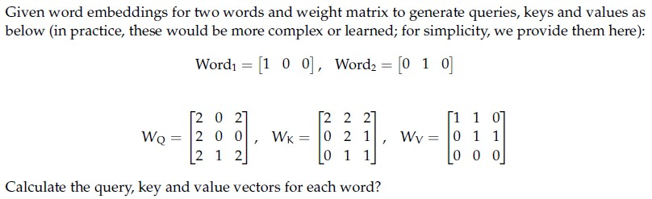

**Figure 1.** Source diagram for Question 160.

**Options**

**A.** $Q_1 = [2\ 0\ 2], K_1 = [2\ 2\ 2], V_1 = [1\ 1\ 0]$; $Q_2 = [2\ 0\ 0], K_2 = [0\ 2\ 1], V_2 = [0\ 1\ 1]$  
*Option ID:* `6406532757285`

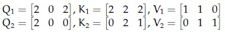

**Figure 2.** Source option graphic for Question 160, Option A.

**B.** $Q_1 = [2\ 0\ 0], K_1 = [2\ 1\ 2], V_1 = [1\ 1\ 0]$; $Q_2 = [2\ 0\ 0], K_2 = [0\ 2\ 1], V_2 = [0\ 1\ 1]$  
*Option ID:* `6406532757286`

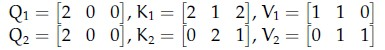

**Figure 3.** Source option graphic for Question 160, Option B.

**C.** $Q_1 = [2\ 0\ 2], K_1 = [2\ 2\ 2], V_1 = [1\ 1\ 0]$; $Q_2 = [2\ 0\ 1], K_2 = [1\ 0\ 1], V_2 = [0\ 1\ 1]$  
*Option ID:* `6406532757287`

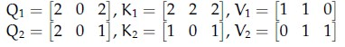

**Figure 4.** Source option graphic for Question 160, Option C.

**D.** None of these  
*Option ID:* `6406532757288`

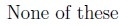

**Figure 5.** Source option graphic for Question 160, Option D.

**Correct answer:** **A** — $Q_1 = [2\ 0\ 2], K_1 = [2\ 2\ 2], V_1 = [1\ 1\ 0]$; $Q_2 = [2\ 0\ 0], K_2 = [0\ 2\ 1], V_2 = [0\ 1\ 1]$.  
**Source evidence:** Option ID 6406532757285 rendered in green text (#008000) and marked with checkmark icon (xref 19) at PDF page 3.

---

### Question 161

**Question ID:** `640653821587` · **Type:** MCQ · **Marks:** 2  
**PDF pages:** 3, 4

What is the role of the Gaussian blur in the Canny edge detection algorithm, and how does the choice of the standard deviation parameter affect the performance of edge detection? Which option do you think best describes the role of the Gaussian blur and its relationship with the standard deviation parameter in the Canny edge detection algorithm?

**Options**

**A.** The Gaussian blur helps to reduce noise in the image and smooth out pixel intensity variations. The standard deviation parameter controls the amount of blurring applied, with higher values resulting in more aggressive smoothing, which may lead to loss of edge detail.  
*Option ID:* `6406532757292`

**B.** The Gaussian blur enhances edge contrast in the image and amplifies pixel intensity gradients. The standard deviation parameter determines the width of the blur kernel, with larger values resulting in sharper edges and finer details preserved.  
*Option ID:* `6406532757293`

**C.** The Gaussian blur serves to highlight high-frequency components in the image and accentuate edge boundaries. The standard deviation parameter dictates the level of detail preserved, with smaller values preserving finer details but potentially amplifying noise.  
*Option ID:* `6406532757294`

**D.** The Gaussian blur functions to dilate edge regions in the image and expand the edge boundaries. The standard deviation parameter controls the extent of dilation, with higher values resulting in broader edge regions but also increasing the risk of false edge detections.  
*Option ID:* `6406532757295`

**Correct answer:** **A** — The Gaussian blur helps to reduce noise in the image and smooth out pixel intensity variations. The standard deviation parameter controls the amount of blurring applied, with higher values resulting in more aggressive smoothing, which may lead to loss of edge detail..  
**Source evidence:** Option ID 6406532757292 rendered in green text (#008000) and accompanied by checkmark icon (xref 19) at PDF page 4.

---

### Question 162

**Question ID:** `640653821588` · **Type:** MCQ · **Marks:** 2  
**PDF pages:** 4, 5

Which property of the SIFT descriptor is primarily responsible for its resilience to changes in scale, viewpoint, and illumination?

**Options**

**A.** Scale space representation  
*Option ID:* `6406532757296`

**B.** Histogram of gradients  
*Option ID:* `6406532757297`

**C.** Keypoint detection  
*Option ID:* `6406532757298`

**D.** Orientation assignment  
*Option ID:* `6406532757299`

**Correct answer:** **A** — Scale space representation.  
**Source evidence:** Option ID 6406532757296 rendered in green text (#008000) and accompanied by checkmark icon (xref 19) at PDF page 5.

---

### Question 163

**Question ID:** `640653821589` · **Type:** MCQ · **Marks:** 2  
**PDF pages:** 5

In the Maximally Stable External Regions (MSER) algorithm, how does the tree structure contribute to the efficiency of region stability analysis?

**Options**

**A.** By enabling quick access to all regions in constant time.  
*Option ID:* `6406532757300`

**B.** By allowing for parallel computation of stability measures across regions.  
*Option ID:* `6406532757301`

**C.** By organizing regions hierarchically based on stability, facilitating efficient stability analysis.  
*Option ID:* `6406532757302`

**D.** By providing a compact representation of pixel intensities within each region, reducing computational overhead.  
*Option ID:* `6406532757303`

**Correct answer:** **C** — By organizing regions hierarchically based on stability, facilitating efficient stability analysis..  
**Source evidence:** Option ID 6406532757302 rendered in green text (#008000) and accompanied by checkmark icon (xref 19) at PDF page 5.

---

### Question 164

**Question ID:** `640653821590` · **Type:** MCQ · **Marks:** 2  
**PDF pages:** 5, 6

In which scenarios is the Random Sample Consensus (RANSAC) algorithm more suitable compared to least squares?

**Options**

**A.** When the dataset contains a high percentage of outliers or erroneous data points.  
*Option ID:* `6406532757304`

**B.** When the dataset consists of noise-free and well-behaved data with minimal outliers.  
*Option ID:* `6406532757305`

**C.** When the computational resources are limited, and quick solutions are required.  
*Option ID:* `6406532757306`

**D.** When the dataset is small, and exact solutions are necessary without considering outliers.  
*Option ID:* `6406532757307`

**Correct answer:** **A** — When the dataset contains a high percentage of outliers or erroneous data points..  
**Source evidence:** Option ID 6406532757304 rendered in green text (#008000) and accompanied by checkmark icon (xref 19) at PDF page 6.

---

### Question 165

**Question ID:** `640653821591` · **Type:** MCQ · **Marks:** 2  
**PDF pages:** 6

In what way does VLAD (Vector of Locally Aggregated Descriptors) differ from Bag of Words (BoW) in representing visual features in images?

**Options**

**A.** VLAD captures spatial relationships between local descriptors, while BoW does not.  
*Option ID:* `6406532757308`

**B.** BoW captures spatial relationships between local descriptors, while VLAD does not.  
*Option ID:* `6406532757309`

**C.** VLAD and BoW both capture spatial relationships between local descriptors.  
*Option ID:* `6406532757310`

**D.** Neither VLAD nor BoW capture spatial relationships between local descriptors.  
*Option ID:* `6406532757311`

**Correct answer:** **A** — VLAD captures spatial relationships between local descriptors, while BoW does not..  
**Source evidence:** Option ID 6406532757308 rendered in green text (#008000) and accompanied by checkmark icon (xref 19) at PDF page 6.

---

### Question 166

**Question ID:** `640653821592` · **Type:** MCQ · **Marks:** 2  
**PDF pages:** 6, 7

How does pyramid matching differ from Speeded-Up Robust Features (SURF) in image matching?

**Options**

**A.** Pyramid matching matches images at multiple resolutions using multi-resolution representations, while SURF focuses on detecting and describing local features invariant to scale and rotation.  
*Option ID:* `6406532757312`

**B.** SURF relies on gradient-based descriptors for feature matching, whereas pyramid matching utilizes histogram-based representations.  
*Option ID:* `6406532757313`

**C.** Pyramid matching is computationally more efficient compared to SURF, which requires extensive feature extraction and matching procedures.  
*Option ID:* `6406532757314`

**D.** SURF is more suitable for matching images with complex patterns and cluttered backgrounds, while pyramid matching excels in scenarios where multi-scale matching is critical, such as image registration across different resolutions.  
*Option ID:* `6406532757315`

**Correct answer:** **A** — Pyramid matching matches images at multiple resolutions using multi-resolution representations, while SURF focuses on detecting and describing local features invariant to scale and rotation..  
**Source evidence:** Option ID 6406532757312 rendered in green text (#008000) and accompanied by checkmark icon (xref 19) at PDF page 7.

---

### Question 167

**Question ID:** `640653821593` · **Type:** MCQ · **Marks:** 2  
**PDF pages:** 7, 8

In the context of Convolutional Neural Networks (CNNs), what is the primary challenge associated with backpropagation compared to traditional feedforward neural networks?

**Options**

**A.** The increased number of parameters and layers in CNNs make backpropagation computationally intensive and prone to overfitting.  
*Option ID:* `6406532757316`

**B.** The presence of convolutional and pooling layers in CNNs requires the development of specialized backpropagation algorithms for efficient gradient computation.  
*Option ID:* `6406532757317`

**C.** The non-linear activation functions used in CNNs introduce discontinuities in the error surface, making it difficult to find the global minimum during backpropagation.  
*Option ID:* `6406532757318`

**D.** The spatial structure of CNNs results in weight sharing and local connectivity, requiring careful consideration of the error propagation process during backpropagation.  
*Option ID:* `6406532757319`

**Correct answer:** **D** — The spatial structure of CNNs results in weight sharing and local connectivity, requiring careful consideration of the error propagation process during backpropagation..  
**Source evidence:** Option ID 6406532757319 rendered in green text (#008000) and accompanied by checkmark icon (xref 19) at PDF page 8.

---

### Question 168

**Question ID:** `640653821594` · **Type:** MCQ · **Marks:** 2  
**PDF pages:** 8

What is the primary advantage of Depthwise Separable Convolutions compared to standard Convolutional Neural Network (CNN) convolutions?

**Options**

**A.** Depthwise Separable Convolutions reduce computational complexity and memory footprint by separating the spatial and channel-wise convolutions.  
*Option ID:* `6406532757320`

**B.** Depthwise Separable Convolutions introduce additional parameters to capture complex spatial relationships within feature maps.  
*Option ID:* `6406532757321`

**C.** Depthwise Separable Convolutions increase model capacity by performing convolutions across multiple layers of the network.  
*Option ID:* `6406532757322`

**D.** Depthwise Separable Convolutions enhance feature representation by incorporating multiscale convolutions within the same layer.  
*Option ID:* `6406532757323`

**Correct answer:** **A** — Depthwise Separable Convolutions reduce computational complexity and memory footprint by separating the spatial and channel-wise convolutions..  
**Source evidence:** Option ID 6406532757320 rendered in green text (#008000) and accompanied by checkmark icon (xref 19) at PDF page 8.

---

### Question 169

**Question ID:** `640653821595` · **Type:** MCQ · **Marks:** 2  
**PDF pages:** 8, 9

Which of the following strategies can help mitigate the risk of overfitting when fine-tuning pretrained models on a small dataset?

**Options**

**A.** Increasing the depth and width of the neural network architecture to capture more complex patterns in the data.  
*Option ID:* `6406532757324`

**B.** Applying dropout regularization to randomly deactivate neurons during training to prevent co-adaptation of features.  
*Option ID:* `6406532757325`

**C.** Decreasing the learning rate during fine-tuning to ensure more stable convergence and smoother optimization.  
*Option ID:* `6406532757326`

**D.** Increasing the batch size during fine-tuning to improve the stability of gradient estimation and accelerate convergence.  
*Option ID:* `6406532757327`

**Correct answer:** **B** — Applying dropout regularization to randomly deactivate neurons during training to prevent co-adaptation of features..  
**Source evidence:** Option ID 6406532757325 rendered in green text (#008000) and accompanied by checkmark icon (xref 19) at PDF page 9.

---

### Question 170

**Question ID:** `640653821596` · **Type:** MCQ · **Marks:** 2  
**PDF pages:** 9

What is the primary advantage of visualizing patches of maximally activating neurons in neural network interpretation?

**Options**

**A.** It helps identify the specific input features that contribute most strongly to the model’s predictions.  
*Option ID:* `6406532757328`

**B.** It provides insights into the architectural design choices made in the neural network.  
*Option ID:* `6406532757329`

**C.** It quantifies the uncertainty associated with the model’s predictions.  
*Option ID:* `6406532757330`

**D.** It measures the computational resources required to activate the neurons.  
*Option ID:* `6406532757331`

**Correct answer:** **A** — It helps identify the specific input features that contribute most strongly to the model’s predictions..  
**Source evidence:** Option ID 6406532757328 rendered in green text (#008000) and accompanied by checkmark icon (xref 19) at PDF page 9.

---

### Question 171

**Question ID:** `640653821597` · **Type:** MCQ · **Marks:** 2  
**PDF pages:** 9, 10

Which layer of the neural network does Grad-CAM typically operate on?

**Options**

**A.** The input layer.  
*Option ID:* `6406532757332`

**B.** The output layer.  
*Option ID:* `6406532757333`

**C.** The convolutional layers.  
*Option ID:* `6406532757334`

**D.** The fully connected layers.  
*Option ID:* `6406532757335`

**Correct answer:** **C** — The convolutional layers..  
**Source evidence:** Option ID 6406532757334 rendered in green text (#008000) and accompanied by checkmark icon (xref 19) at PDF page 10.

---

### Question 172

**Question ID:** `640653821598` · **Type:** MCQ · **Marks:** 2  
**PDF pages:** 10

Which component of Grad-CAM is responsible for weighting the importance of each feature map?

**Options**

**A.** The class activation map (CAM).  
*Option ID:* `6406532757336`

**B.** The global average pooling layer.  
*Option ID:* `6406532757337`

**C.** The guided backpropagation algorithm.  
*Option ID:* `6406532757338`

**D.** The gradient of the target class score with respect to the feature maps.  
*Option ID:* `6406532757339`

**Correct answer:** **B** — The global average pooling layer..  
**Source evidence:** Option ID 6406532757337 rendered in green text (#008000) and accompanied by checkmark icon (xref 19) at PDF page 10.

---

### Question 173

**Question ID:** `640653821599` · **Type:** MCQ · **Marks:** 2  
**PDF pages:** 10, 11

What is the primary role of the Gram matrix in neural style transfer?

**Options**

**A.** To compute the style loss by measuring the similarity between feature maps from the content and style images.  
*Option ID:* `6406532757340`

**B.** To generate high-resolution images by applying a series of convolutions and upsampling operations.  
*Option ID:* `6406532757341`

**C.** To regularize the optimization process by penalizing large gradients in the feature space.  
*Option ID:* `6406532757342`

**D.** To visualize the internal representations learned by the neural network during training.  
*Option ID:* `6406532757343`

**Correct answer:** **A** — To compute the style loss by measuring the similarity between feature maps from the content and style images..  
**Source evidence:** Option ID 6406532757340 rendered in green text (#008000) and accompanied by checkmark icon (xref 19) at PDF page 10/11.

---

### Question 174

**Question ID:** `640653821600` · **Type:** MCQ · **Marks:** 2  
**PDF pages:** 11

What is a potential limitation of non-maximum suppression (NMS) algorithms in object detection?

**Options**

**A.** They are computationally expensive and can significantly increase inference time.  
*Option ID:* `6406532757344`

**B.** They may fail to suppress redundant bounding boxes in cluttered scenes with multiple overlapping objects.  
*Option ID:* `6406532757345`

**C.** They require extensive hyperparameter tuning to achieve optimal performance across different datasets.  
*Option ID:* `6406532757346`

**D.** They are highly sensitive to variations in lighting conditions and viewpoints in the input images.  
*Option ID:* `6406532757347`

**Correct answer:** **B** — They may fail to suppress redundant bounding boxes in cluttered scenes with multiple overlapping objects..  
**Source evidence:** Option ID 6406532757345 rendered in green text (#008000) and accompanied by checkmark icon (xref 19) at PDF page 11.

---

### Question 175

**Question ID:** `640653821601` · **Type:** MCQ · **Marks:** 2  
**PDF pages:** 11, 12

What is a key feature of focal loss that distinguishes it from traditional loss functions in object detection?

**Options**

**A.** Focal loss introduces additional regularization terms to penalize large weights in the neural network.  
*Option ID:* `6406532757348`

**B.** Focal loss dynamically adjusts the loss weights based on the difficulty of each training example.  
*Option ID:* `6406532757349`

**C.** Focal loss computes the loss based on the Euclidean distance between predicted and groundtruth bounding boxes.  
*Option ID:* `6406532757350`

**D.** Focal loss prioritizes minimizing the overall loss across all classes equally.  
*Option ID:* `6406532757351`

**Correct answer:** **B** — Focal loss dynamically adjusts the loss weights based on the difficulty of each training example..  
**Source evidence:** Option ID 6406532757349 rendered in green text (#008000) and accompanied by checkmark icon (xref 19) at PDF page 12.

---

### Question 176

**Question ID:** `640653821602` · **Type:** MCQ · **Marks:** 2  
**PDF pages:** 12

What is a unique challenge faced by Siamese networks in comparison to traditional neural networks?

**Options**

**A.** Siamese networks require significantly larger datasets for training due to their complex architecture.  
*Option ID:* `6406532757352`

**B.** Siamese networks need to learn a similarity metric between pairs of input samples, which requires specialized loss functions and training procedures.  
*Option ID:* `6406532757353`

**C.** Siamese networks are computationally more intensive, making them less scalable for real-time applications.  
*Option ID:* `6406532757354`

**D.** Siamese networks tend to suffer from overfitting more frequently than traditional neural networks due to their increased model complexity.  
*Option ID:* `6406532757355`

**Correct answer:** **B** — Siamese networks need to learn a similarity metric between pairs of input samples, which requires specialized loss functions and training procedures..  
**Source evidence:** Option ID 6406532757353 rendered in green text (#008000) and accompanied by checkmark icon (xref 19) at PDF page 12.

---

### Question 177

**Question ID:** `640653821603` · **Type:** MCQ · **Marks:** 2  
**PDF pages:** 13

Consider the following assertion and reason, and state which of them is true. Assertion: ProgressiveGAN uses Minibatch Standard Deviation. Reason: This value will be different if the generated images do not have the same diversity as the actual images, and the discriminator will penalize it as a result.

**Options**

**A.** Both Assertion and Reason are True; Reason is a correct explanation of the Assertion  
*Option ID:* `6406532757356`

**B.** Both Assertion and Reason are True; but Reason is not a correct explanation of the Assertion  
*Option ID:* `6406532757357`

**C.** Assertion is True; Reason is False  
*Option ID:* `6406532757358`

**D.** Assertion is False by itself  
*Option ID:* `6406532757359`

**Correct answer:** **A** — Both Assertion and Reason are True; Reason is a correct explanation of the Assertion.  
**Source evidence:** Option ID 6406532757356 rendered in green text (#008000) and accompanied by checkmark icon (xref 19) at PDF page 13.

---

### Question 178

**Question ID:** `640653821616` · **Type:** MCQ · **Marks:** 2  
**PDF pages:** 13, 14

Match the following:

1) BLEU score  
2) Parameter sharing  
3) KL divergence  
4) Image captioning  

i) CNN  
ii) GAN  
iii) StyleNet  
iv) Evaluating CNN performance  
v) Evaluating RNN performance  
vi) VAE

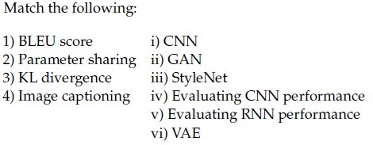

**Figure 6.** Source diagram for Question 178.

**Options**

**A.** 1 → ii, 2 → i, 3 → vi, 4 → iv  
*Option ID:* `6406532757370`

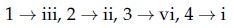

**Figure 7.** Source option graphic for Question 178, Option A.

**B.** 1 → v, 2 → i, 3 → vi, 4 → iii  
*Option ID:* `6406532757371`

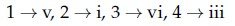

**Figure 8.** Source option graphic for Question 178, Option B.

**C.** 1 → i, 2 → iv, 3 → ii, 4 → iii  
*Option ID:* `6406532757372`

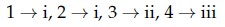

**Figure 9.** Source option graphic for Question 178, Option C.

**D.** 1 → iv, 2 → iii, 3 → ii, 4 → i  
*Option ID:* `6406532757373`

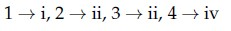

**Figure 10.** Source option graphic for Question 178, Option D.

**Correct answer:** **B** — 1 → v, 2 → i, 3 → vi, 4 → iii.  
**Source evidence:** Option ID 6406532757371 rendered in green text (#008000) and accompanied by checkmark icon (xref 19) at PDF page 14.

---

### Question 179

**Question ID:** `640653821617` · **Type:** MCQ · **Marks:** 2  
**PDF pages:** 14

Which of the following statements is false?

**Options**

**A.** Reparametrization trick is used in training VAEs to overcome the problem of non-differentiability of the objective function across a sampling step.  
*Option ID:* `6406532757374`

**B.** In denoising autoencoder, reconstructed output is compared against noise-free ground truth data point.  
*Option ID:* `6406532757375`

**C.** While training a GAN, Generator and Discriminator weights are not updated concurrently but updated sequentially.  
*Option ID:* `6406532757376`

**D.** When a GAN is completely trained, Discriminator D outputs very high probability (approximately 1) for images from Generator G, that is, D(G(z)) ≈ 1  
*Option ID:* `6406532757377`

**Correct answer:** **D** — When a GAN is completely trained, Discriminator D outputs very high probability (approximately 1) for images from Generator G, that is, D(G(z)) ≈ 1.  
**Source evidence:** Option ID 6406532757377 rendered in green text (#008000) and accompanied by checkmark icon (xref 19) at PDF page 14.

---

### Question 180

**Question ID:** `640653821618` · **Type:** MCQ · **Marks:** 2  
**PDF pages:** 14, 15

Match the following:

1) VAE  
2) GAN  
3) Reparametrization  
4) Generative models  

i) $z = \mu + \sigma \odot \epsilon; \quad \epsilon \sim \mathcal{N}(0, 1)$  
ii) Maximum Likelihood Estimation (MLE)  
iii) $\min \text{KL}(Q(z|X), p(z))$  
iv) $D(G(z)) = 0.5$

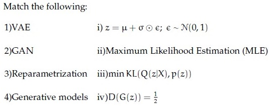

**Figure 11.** Source diagram for Question 180.

**Options**

**A.** 1 → i, 2 → ii, 3 → iii, 4 → iv  
*Option ID:* `6406532757378`

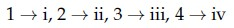

**Figure 12.** Source option graphic for Question 180, Option A.

**B.** 1 → ii, 2 → i, 3 → iv, 4 → iii  
*Option ID:* `6406532757379`

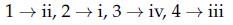

**Figure 13.** Source option graphic for Question 180, Option B.

**C.** 1 → iii, 2 → iv, 3 → i, 4 → ii  
*Option ID:* `6406532757380`

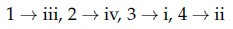

**Figure 14.** Source option graphic for Question 180, Option C.

**D.** 1 → iv, 2 → iii, 3 → ii, 4 → i  
*Option ID:* `6406532757381`

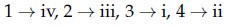

**Figure 15.** Source option graphic for Question 180, Option D.

**Correct answer:** **C** — 1 → iii, 2 → iv, 3 → i, 4 → ii.  
**Source evidence:** Option ID 6406532757380 rendered in green text (#008000) and accompanied by checkmark icon (xref 19) at PDF page 15.

---

### Question 181

**Question ID:** `640653821619` · **Type:** MCQ · **Marks:** 2  
**PDF pages:** 15, 16

Suppose 5,000 data points per class is available to train a classifier M and M is then tasked to generalize on unseen classes with 20 samples per class. Such a problem setting is common in:

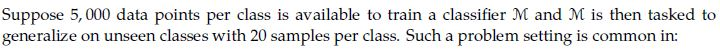

**Figure 16.** Source diagram for Question 181.

**Options**

**A.** Continual learning  
*Option ID:* `6406532757382`

**B.** Zero-shot learning  
*Option ID:* `6406532757383`

**C.** Few-shot learning  
*Option ID:* `6406532757384`

**D.** Unsupervised learning  
*Option ID:* `6406532757385`

**Correct answer:** **C** — Few-shot learning.  
**Source evidence:** Option ID 6406532757384 rendered in green text (#008000) and accompanied by checkmark icon (xref 19) at PDF page 16.

---

### Question 182

**Question ID:** `640653821620` · **Type:** MCQ · **Marks:** 2  
**PDF pages:** 16

In the context of VAE, if the encoder outputs $\mu = [0.2, 0.3, 0.1]$, $\sigma = [0.1, 0.2, 0.1]$ and $\epsilon \sim \mathcal{N}(0, 1)$ is equal to $[0.5, 0.2, 0.8]$, then the latent value $z = ?$

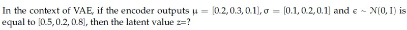

**Figure 17.** Source diagram for Question 182.

**Options**

**A.** [1.1, 2.06, 1.08]  
*Option ID:* `6406532757386`

**B.** [0.25, 0.34, 0.18]  
*Option ID:* `6406532757387`

**C.** [0.2, 0.3, 0.1]  
*Option ID:* `6406532757388`

**D.** [1.2, 2.3, 1.1]  
*Option ID:* `6406532757389`

**Correct answer:** **B** — [0.25, 0.34, 0.18].  
**Source evidence:** Option ID 6406532757387 rendered in green text (#008000) and accompanied by checkmark icon (xref 19) at PDF page 16.

---

### Question 183

**Question ID:** `640653821622` · **Type:** MCQ · **Marks:** 2  
**PDF pages:** 16, 17

What is the advantage of the progressive training methodology proposed in the Progressive GAN paper?

**Options**

**A.** It allows for generating high-resolution images with unlimited variation.  
*Option ID:* `6406532757396`

**B.** It eliminates the need for using mini-batches during training.  
*Option ID:* `6406532757397`

**C.** It enables the discovery of large-scale structures before finer-scale details.  
*Option ID:* `6406532757398`

**D.** It ensures all layers in the networks remain fixed throughout the training process.  
*Option ID:* `6406532757399`

**Correct answer:** **C** — It enables the discovery of large-scale structures before finer-scale details..  
**Source evidence:** Option ID 6406532757398 rendered in green text (#008000) and accompanied by checkmark icon (xref 19) at PDF page 16.

---

### Question 184

**Question ID:** `640653821630` · **Type:** MCQ · **Marks:** 2  
**PDF pages:** 17

Contrastive Language Image Pre-training (CLIP) Can be used as a zero-shot classifier.

**Options**

**A.** TRUE  
*Option ID:* `6406532757405`

**B.** FALSE  
*Option ID:* `6406532757406`

**Correct answer:** **A** — TRUE.  
**Source evidence:** Option ID 6406532757405 rendered in green text (#008000) and accompanied by checkmark icon (xref 19) at PDF page 17.

---

### Question 185

**Question ID:** `640653821621` · **Type:** MSQ · **Marks:** 2  
**PDF pages:** 17, 18

Consider a generative model whose parameters are learned by solving the following optimization problem:

$$\theta^* = \arg\min_\theta \text{dist}(p_\theta, p_{\text{data}})$$

If the distance function $\text{dist}$ is taken as the Kullback-Leibler divergence, the learned estimate is not equivalent to: (Select all possible correct options)

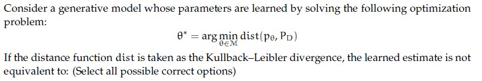

**Figure 18.** Source diagram for Question 185.

**Options**

**A.** Maximum likelihood estimate  
*Option ID:* `6406532757390`

**B.** Minimum likelihood estimate  
*Option ID:* `6406532757391`

**C.** Maximizing mean square error  
*Option ID:* `6406532757392`

**D.** Minimizing mean square error  
*Option ID:* `6406532757393`

**E.** Maximizing negative log likelihood  
*Option ID:* `6406532757394`

**F.** Minimizing negative log likelihood  
*Option ID:* `6406532757395`

**Correct answer:** **B**, **C**, **D**, **E** — Minimum likelihood estimate; Maximizing mean square error; Minimizing mean square error; Maximizing negative log likelihood.  
**Source evidence:** Option ID 6406532757391 rendered in green text (#008000) and accompanied by checkmark icon (xref 19) at PDF page 17.

---

### Question 186

**Question ID:** `640653821608` · **Type:** SA · **Marks:** 2  
**PDF pages:** 18

The cornerness score of the center pixel for the image represented by the matrix below is ___

$$\begin{bmatrix} 1 & 0 & 0 & 0 & 1 \\ 0 & 1 & 0 & 1 & 0 \\ 0 & 0 & 1 & 0 & 0 \\ 0 & 1 & 0 & 1 & 0 \\ 1 & 0 & 0 & 0 & 1 \end{bmatrix}$$

NOTE: Enter your answer in two decimal places.

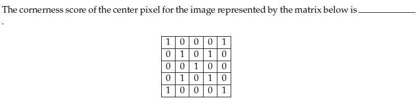

**Figure 19.** Source diagram for Question 186.

**Correct answer:** **6.56**  
**Source evidence:** Possible Answers field indicates 6.56 in green text (#008000) at PDF page 18.

---

### Question 187

**Question ID:** `640653821613` · **Type:** SA · **Marks:** 2  
**PDF pages:** 19

Consider a 3 x 3 grayscale image in terms of pixel intensities as shown in matrix form below.

$$\begin{bmatrix} 9 & 1 & 6 \\ 4 & 6 & 1 \\ 9 & 8 & 2 \end{bmatrix}$$

Assume that each pixel takes values from 1 to 9 (inclusive). After performing histogram equalization, the number of pixels with intensity value 6 are__?

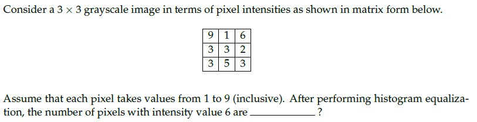

**Figure 20.** Source diagram for Question 187.

**Correct answer:** **4**  
**Source evidence:** Possible Answers field indicates 4 in green text (#008000) at PDF page 19.

---

### Question 188

**Question ID:** `640653821614` · **Type:** SA · **Marks:** 2  
**PDF pages:** 19, 20

Assume that you have been given an octave of scale-space representation of an image of size N x N that has been formed by convolving it with a Gaussian filter at different scales of $\sigma$, where $\sigma$ is varied from $k^0\sigma$ to $k^{s+2}\sigma$ and $k = 2^{1/s}$. The number of DoG (Difference-of-Gaussian) outputs obtained from the above octave is __.

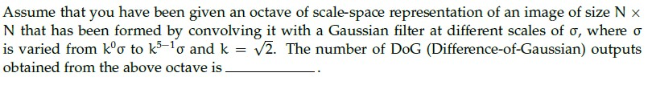

**Figure 21.** Source diagram for Question 188.

**Correct answer:** **4**  
**Source evidence:** Possible Answers field indicates 4 in green text (#008000) at PDF page 20.

---

### Question 189

**Question ID:** `640653821615` · **Type:** SA · **Marks:** 2  
**PDF pages:** 20

Consider a Faster R-CNN object detection framework, which is being trained with a mini-batch size of 2. The RPN produces 512 proposals, out of which 10 and 12 of them are foreground proposals, corresponding to each image in the mini-batch. For a single mini-batch update, the bounding box regression loss will be computed _____________ times.

**Correct answer:** **22**  
**Source evidence:** Possible Answers field indicates 22 in green text (#008000) at PDF page 20.

---

### Question 190

**Question ID:** `640653821623` · **Type:** SA · **Marks:** 2  
**PDF pages:** 20, 21

Transformer encoder requires a sequence of __________ as input.

**Correct answer:** **vectors**  
**Source evidence:** Possible Answers field indicates vectors in green text (#008000) at PDF page 21.

---

### Question 191

**Question ID:** `640653821584` · **Type:** SA · **Marks:** 0.7  
**PDF pages:** 21, 22

Given word embeddings for two words and weight matrix to generate queries, keys and values as below (in practice, these would be more complex or learned; for simplicity, we provide them here):

$Word_1 = [1\ 0\ 0]$, $Word_2 = [0\ 1\ 0]$

$$W_Q = \begin{bmatrix} 2 & 0 & 2 \\ 2 & 0 & 0 \\ 2 & 1 & 2 \end{bmatrix}, \quad W_K = \begin{bmatrix} 2 & 2 & 2 \\ 0 & 2 & 1 \\ 0 & 1 & 1 \end{bmatrix}, \quad W_V = \begin{bmatrix} 1 & 1 & 0 \\ 0 & 1 & 1 \\ 0 & 0 & 0 \end{bmatrix}$$

Calculate the query, key, and value to calculate z1. Consider only the first word for calculating the scores; remember that attention output is calculated by a weighted sum of all value vectors. Also, the key vector dimension dk = 3

Based on the above data, answer the given subquestion:

First element of attention vector is __________________

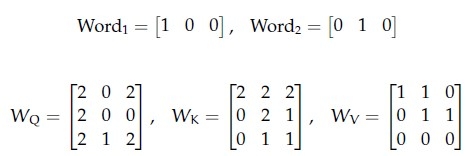

**Figure 22.** Shared context diagram for Questions 191–193.

**Correct answer:** **0.949 to 0.989**  
**Source evidence:** Possible Answers field indicates range 0.949 to 0.989 in green text (#008000) at PDF page 22.

---

### Question 192

**Question ID:** `640653821585` · **Type:** SA · **Marks:** 0.7  
**PDF pages:** 22, 23

Given word embeddings for two words and weight matrix to generate queries, keys and values as below (in practice, these would be more complex or learned; for simplicity, we provide them here):

$Word_1 = [1\ 0\ 0]$, $Word_2 = [0\ 1\ 0]$

$$W_Q = \begin{bmatrix} 2 & 0 & 2 \\ 2 & 0 & 0 \\ 2 & 1 & 2 \end{bmatrix}, \quad W_K = \begin{bmatrix} 2 & 2 & 2 \\ 0 & 2 & 1 \\ 0 & 1 & 1 \end{bmatrix}, \quad W_V = \begin{bmatrix} 1 & 1 & 0 \\ 0 & 1 & 1 \\ 0 & 0 & 0 \end{bmatrix}$$

Calculate the query, key, and value to calculate z1. Consider only the first word for calculating the scores; remember that attention output is calculated by a weighted sum of all value vectors. Also, the key vector dimension dk = 3

Based on the above data, answer the given subquestion:

Second element of attention vector is _____________

**Correct answer:** **0.98 to 1.02**  
**Source evidence:** Possible Answers field indicates range 0.98 to 1.02 in green text (#008000) at PDF page 23.

---

### Question 193

**Question ID:** `640653821586` · **Type:** SA · **Marks:** 0.6  
**PDF pages:** 23, 24

Given word embeddings for two words and weight matrix to generate queries, keys and values as below (in practice, these would be more complex or learned; for simplicity, we provide them here):

$Word_1 = [1\ 0\ 0]$, $Word_2 = [0\ 1\ 0]$

$$W_Q = \begin{bmatrix} 2 & 0 & 2 \\ 2 & 0 & 0 \\ 2 & 1 & 2 \end{bmatrix}, \quad W_K = \begin{bmatrix} 2 & 2 & 2 \\ 0 & 2 & 1 \\ 0 & 1 & 1 \end{bmatrix}, \quad W_V = \begin{bmatrix} 1 & 1 & 0 \\ 0 & 1 & 1 \\ 0 & 0 & 0 \end{bmatrix}$$

Calculate the query, key, and value to calculate z1. Consider only the first word for calculating the scores; remember that attention output is calculated by a weighted sum of all value vectors. Also, the key vector dimension dk = 3

Based on the above data, answer the given subquestion:

Third element of attention vector is _________________

**Correct answer:** **0.010 to 0.050**  
**Source evidence:** Possible Answers field indicates range 0.010 to 0.050 in green text (#008000) at PDF page 24.

---

### Question 194

**Question ID:** `640653821605` · **Type:** SA · **Marks:** 0.7  
**PDF pages:** 24, 25

Consider Fast Gradient Sign Method (FGSM) given by:

$$x^* = x + \epsilon \cdot \text{sign}(\nabla_x L(x, y_{\text{true}}))$$

Given $x = [3\ 7\ 5]$, $\nabla_x L(x, y_{\text{true}}) = [0.5\ -0.5\ 1]$ and $\epsilon = 0.01$, find the resulting adversarial perturbation / attack with FGSM, where $[x_1^*\ x_2^*\ x_3^*]$.

Based on the above data, answer the given subquestion:

$$x_1^* = \text{__________}$$

NOTE: Enter your answer in two decimal places.

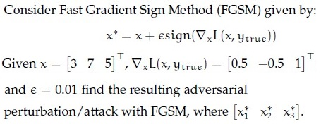

**Figure 23.** Shared context diagram for Questions 194–196.

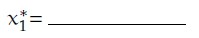

**Figure 24.** Source diagram for Question 194.

**Correct answer:** **3.01**  
**Source evidence:** Possible Answers field indicates 3.01 in green text (#008000) at PDF page 25.

---

### Question 195

**Question ID:** `640653821606` · **Type:** SA · **Marks:** 0.7  
**PDF pages:** 25

Consider Fast Gradient Sign Method (FGSM) given by:

$$x^* = x + \epsilon \cdot \text{sign}(\nabla_x L(x, y_{\text{true}}))$$

Given $x = [3\ 7\ 5]$, $\nabla_x L(x, y_{\text{true}}) = [0.5\ -0.5\ 1]$ and $\epsilon = 0.01$, find the resulting adversarial perturbation / attack with FGSM, where $[x_1^*\ x_2^*\ x_3^*]$.

Based on the above data, answer the given subquestion:

$$x_2^* = \text{__________}$$

NOTE: Enter your answer in two decimal places.

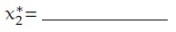

**Figure 25.** Source diagram for Question 195.

**Correct answer:** **6.99**  
**Source evidence:** Possible Answers field indicates 6.99 in green text (#008000) at PDF page 25.

---

### Question 196

**Question ID:** `640653821607` · **Type:** SA · **Marks:** 0.6  
**PDF pages:** 25, 26

Consider Fast Gradient Sign Method (FGSM) given by:

$$x^* = x + \epsilon \cdot \text{sign}(\nabla_x L(x, y_{\text{true}}))$$

Given $x = [3\ 7\ 5]$, $\nabla_x L(x, y_{\text{true}}) = [0.5\ -0.5\ 1]$ and $\epsilon = 0.01$, find the resulting adversarial perturbation / attack with FGSM, where $[x_1^*\ x_2^*\ x_3^*]$.

Based on the above data, answer the given subquestion:

$$x_3^* = \text{__________}$$

NOTE: Enter your answer in two decimal places.

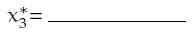

**Figure 26.** Source diagram for Question 196.

**Correct answer:** **5.01**  
**Source evidence:** Possible Answers field indicates 5.01 in green text (#008000) at PDF page 26.

---

### Question 197

**Question ID:** `640653821610` · **Type:** SA · **Marks:** 0.7  
**PDF pages:** 26, 27

Consider the equation represented by the following circuit:

Circuit: inputs $x, y$ go into addition $(+)$ giving $q = x + y$; $q$ and $z$ go into multiplication $(*)$ giving $f = q \cdot z$.
where $+$ and $*$ represent addition and multiplication.
If $x = -2, y = 5$ and $z = -4$,

Based on the above data, answer the given subquestion:

$$\frac{\partial f}{\partial x} = \text{__________}$$

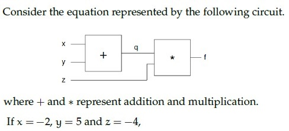

**Figure 27.** Shared context diagram for Questions 197–199.

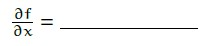

**Figure 28.** Source diagram for Question 197.

**Correct answer:** **-4**  
**Source evidence:** Possible Answers field indicates -4 in green text (#008000) at PDF page 27.

---

### Question 198

**Question ID:** `640653821611` · **Type:** SA · **Marks:** 0.7  
**PDF pages:** 27

Consider the equation represented by the following circuit:

Circuit: inputs $x, y$ go into addition $(+)$ giving $q = x + y$; $q$ and $z$ go into multiplication $(*)$ giving $f = q \cdot z$.
where $+$ and $*$ represent addition and multiplication.
If $x = -2, y = 5$ and $z = -4$,

Based on the above data, answer the given subquestion:

$$\frac{\partial f}{\partial y} = \text{__________}$$

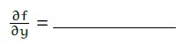

**Figure 29.** Source diagram for Question 198.

**Correct answer:** **-4**  
**Source evidence:** Possible Answers field indicates -4 in green text (#008000) at PDF page 27.

---

### Question 199

**Question ID:** `640653821612` · **Type:** SA · **Marks:** 0.6  
**PDF pages:** 27, 28

Consider the equation represented by the following circuit:

Circuit: inputs $x, y$ go into addition $(+)$ giving $q = x + y$; $q$ and $z$ go into multiplication $(*)$ giving $f = q \cdot z$.
where $+$ and $*$ represent addition and multiplication.
If $x = -2, y = 5$ and $z = -4$,

Based on the above data, answer the given subquestion:

$$\frac{\partial f}{\partial q} = \text{__________}$$

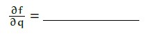

**Figure 30.** Source diagram for Question 199.

**Correct answer:** **-4**  
**Source evidence:** Possible Answers field indicates -4 in green text (#008000) at PDF page 27.

---

### Question 200

**Question ID:** `640653821625` · **Type:** SA · **Marks:** 1  
**PDF pages:** 28

In vision transformers, if treat each pixel as a token for an image of size 64 × 64 × 3, the number of parameters required for the self-attention calculation are ________blank(a)________ . What will be the number of parameters if consider patches of size 8 × 8 × 3 ________blank(b)________.

Based on the above data, answer the given subquestion:

Enter the correct answer for blank(a):

**Correct answer:** **12288**  
**Source evidence:** Possible Answers field indicates 12288 in green text (#008000) at PDF page 28.

---

### Question 201

**Question ID:** `640653821626` · **Type:** SA · **Marks:** 1  
**PDF pages:** 28, 29

In vision transformers, if treat each pixel as a token for an image of size 64 × 64 × 3, the number of parameters required for the self-attention calculation are ________blank(a)________ . What will be the number of parameters if consider patches of size 8 × 8 × 3 ________blank(b)________.

Based on the above data, answer the given subquestion:

Enter the correct answer for blank(b):

**Correct answer:** **64**  
**Source evidence:** Possible Answers field indicates 64 in green text (#008000) at PDF page 29.

---

### Question 202

**Question ID:** `640653821628` · **Type:** SA · **Marks:** 1  
**PDF pages:** 29, 30

In a ViT, all blocks have same ________blank(a)________ and number of ________blank(b)________

Based on the above data, answer the given subquestion:

Enter the correct answer for blank(a):

**Correct answer:** **resolution**  
**Source evidence:** Possible Answers field indicates resolution in green text (#008000) at PDF page 30.

---

### Question 203

**Question ID:** `640653821629` · **Type:** SA · **Marks:** 1  
**PDF pages:** 30

In a ViT, all blocks have same ________blank(a)________ and number of ________blank(b)________

Based on the above data, answer the given subquestion:

Enter the correct answer for blank(b):

**Correct answer:** **channels**  
**Source evidence:** Possible Answers field indicates channels in green text (#008000) at PDF page 30.

---

## Answer key

| Source question | Question ID | Correct answer | PDF page(s) |
| :--- | :--- | :--- | :--- |
| 160 | `640653821582` | A | 3 |
| 161 | `640653821587` | A | 3, 4 |
| 162 | `640653821588` | A | 4, 5 |
| 163 | `640653821589` | C | 5 |
| 164 | `640653821590` | A | 5, 6 |
| 165 | `640653821591` | A | 6 |
| 166 | `640653821592` | A | 6, 7 |
| 167 | `640653821593` | D | 7, 8 |
| 168 | `640653821594` | A | 8 |
| 169 | `640653821595` | B | 8, 9 |
| 170 | `640653821596` | A | 9 |
| 171 | `640653821597` | C | 9, 10 |
| 172 | `640653821598` | B | 10 |
| 173 | `640653821599` | A | 10, 11 |
| 174 | `640653821600` | B | 11 |
| 175 | `640653821601` | B | 11, 12 |
| 176 | `640653821602` | B | 12 |
| 177 | `640653821603` | A | 13 |
| 178 | `640653821616` | B | 13, 14 |
| 179 | `640653821617` | D | 14 |
| 180 | `640653821618` | C | 14, 15 |
| 181 | `640653821619` | C | 15, 16 |
| 182 | `640653821620` | B | 16 |
| 183 | `640653821622` | C | 16, 17 |
| 184 | `640653821630` | A | 17 |
| 185 | `640653821621` | B, C, D, E | 17, 18 |
| 186 | `640653821608` | 6.56 | 18 |
| 187 | `640653821613` | 4 | 19 |
| 188 | `640653821614` | 4 | 19, 20 |
| 189 | `640653821615` | 22 | 20 |
| 190 | `640653821623` | vectors | 20, 21 |
| 191 | `640653821584` | 0.949 to 0.989 | 21, 22 |
| 192 | `640653821585` | 0.98 to 1.02 | 22, 23 |
| 193 | `640653821586` | 0.010 to 0.050 | 23, 24 |
| 194 | `640653821605` | 3.01 | 24, 25 |
| 195 | `640653821606` | 6.99 | 25 |
| 196 | `640653821607` | 5.01 | 25, 26 |
| 197 | `640653821610` | -4 | 26, 27 |
| 198 | `640653821611` | -4 | 27 |
| 199 | `640653821612` | -4 | 27, 28 |
| 200 | `640653821625` | 12288 | 28 |
| 201 | `640653821626` | 64 | 28, 29 |
| 202 | `640653821628` | resolution | 29, 30 |
| 203 | `640653821629` | channels | 30 |

## Extraction notes

- **Subject boundary reconciliation:** Physical page 1 begins with residual text from the preceding subject (Section 7, ending with Question 158). Section 8 (`DL(CV)`) starts on page 1 with Section ID `64065357859` and declares 37 questions and 72 marks. Question 159 on page 2 is the administrative subject confirmation question (YES/NO) and was omitted per contract.
- **Declared count reconciliation:** The 37 test delivery units in Section 8 comprise 1 administrative confirmation question + 25 MCQs (Q160–Q184) + 1 MSQ (Q185) + 5 standalone SA questions (Q186–Q190) + 5 comprehension parent passages (containing 13 subquestions: Q191–Q203). Total extracted academic questions: 44. Total score reconciles exactly to 72 marks.
- **Image-as-text questions preserved:** Questions 160, 178, 180, 181, 182, 185, 186, 187, 188, 194, 195, 196, 197, 198, 199 and comprehension contexts contain formulas/text embedded as images. All 30 images were cleanly extracted, saved to `assets/da5006_2024T1_ET_AN/`, transcribed into LaTeX/Markdown, visually inspected, and verified.
- **Status:** Extracted with all source academic content, formulas, option IDs, and answer evidence preserved; marked `needs-review` pending independent audit.
