# DL(CV) — da5006_2024T1_Q1_NA

**Subject:** Deep Learning for Computer Vision  
**Source:** `da5006_2024T1_Q1_NA.pdf` (original PDF omitted from this bundle)  
**Academic questions:** 23  
**Scope:** DL(CV) section; administrative subject confirmation excluded.

## Questions

### Question 159

**Question ID:** `640653739731` · **Type:** MCQ · **Marks:** 2  
**PDF pages:** 2, 3

Match the following:

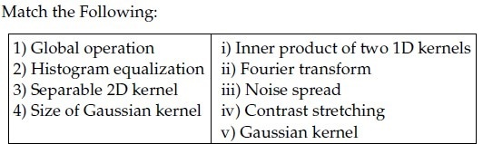

**Figure 1.** Source table for Question 159.

| Column 1 | Column 2 |
| :--- | :--- |
| 1) Global operation | i) Inner product of two 1D kernels |
| 2) Histogram equalization | ii) Fourier transform |
| 3) Separable 2D kernel | iii) Noise spread |
| 4) Size of Gaussian kernel | iv) Contrast stretching |
| | v) Gaussian kernel |

**Options**

**A.** 1→ ii, 2→ ii, 3 → iv, 4→ i  
*Option ID:* `6406532474450`

**B.** 1→ ii, 2→iv, 3 → i, 4→ iii  
*Option ID:* `6406532474451`

**C.** 1→ ii, 2→ ii, 3 → iv, 4→ iii  
*Option ID:* `6406532474452`

**D.** 1→ ii, 2→ iv, 3 → v, 4→ iii  
*Option ID:* `6406532474453`

**Correct answer:** **D** — 1→ ii, 2→ iv, 3 → v, 4→ iii.  
**Source evidence:** Option 6406532474453 rendered in green font (color 0x8000) with green checkmark icon in source PDF.

---

### Question 160

**Question ID:** `640653739735` · **Type:** MCQ · **Marks:** 2  
**PDF pages:** 3

Which of the following statements is true regarding filtering operation?

**Options**

**A.** Gaussian filter is Separable filter because it is non linear.  
*Option ID:* `6406532474460`

**B.** Median filter is a non separable filter  
*Option ID:* `6406532474461`

**C.** Gaussian filter is a High Pass filter.  
*Option ID:* `6406532474462`

**D.** Mean filter is a non separable filter because it is non linear  
*Option ID:* `6406532474463`

**Correct answer:** **B** — Median filter is a non separable filter.  
**Source evidence:** Option 6406532474461 rendered in green font (color 0x8000) with green checkmark icon in source PDF.

---

### Question 161

**Question ID:** `640653739736` · **Type:** MCQ · **Marks:** 2  
**PDF pages:** 3, 4

Which of the following statements is false regarding SIFT and SURF?

**Options**

**A.** SIFT and SURF are two most useful approaches to detect and match features because they are invariant to scale, rotation, translation, illumination, and blur  
*Option ID:* `6406532474464`

**B.** SURF is better than SIFT in rotation invariance, blur and warp transform  
*Option ID:* `6406532474465`

**C.** SURF is 3 times faster than SIFT because of its use of integral image and box filter  
*Option ID:* `6406532474466`

**D.** descriptors with dimensions lower than 128 perform pretty well across a range of matching tasks  
*Option ID:* `6406532474467`

**Correct answer:** **D** — descriptors with dimensions lower than 128 perform pretty well across a range of matching tasks.  
**Source evidence:** Option 6406532474467 rendered in green font (color 0x8000) across pages 3 and 4 with green checkmark icon in source PDF.

---

### Question 162

**Question ID:** `640653739737` · **Type:** MCQ · **Marks:** 2  
**PDF pages:** 4

Identify the correct sequence of steps in a Canny edge detection pipeline. Steps listed below:

1. Compute gradient magnitude and direction
2. Connect individual components
3. Smoothen the image
4. Non-maximum suppression along the edge
5. Threshold into strong, weak or no edge
6. Non-maximum suppression perpendicular to the edge

**Options**

**A.** 3→ 1→ 4→ 5 → 2  
*Option ID:* `6406532474468`

**B.** 3→ 5→ 1→ 4 → 2  
*Option ID:* `6406532474469`

**C.** 3→ 1→ 6→ 5 → 2  
*Option ID:* `6406532474470`

**D.** 3→ 1→ 5→ 6 → 2  
*Option ID:* `6406532474471`

**Correct answer:** **C** — 3→ 1→ 6→ 5 → 2.  
**Source evidence:** Option 6406532474470 rendered in green font (color 0x8000) with green checkmark icon in source PDF.

---

### Question 163

**Question ID:** `640653739742` · **Type:** MCQ · **Marks:** 2  
**PDF pages:** 4, 5

Match the following with the corresponding eigenvalues (assume that $\lambda_1$ measures change across a row of the image or the x — axis, and $\lambda_2$ measures change across a column or y — axis):

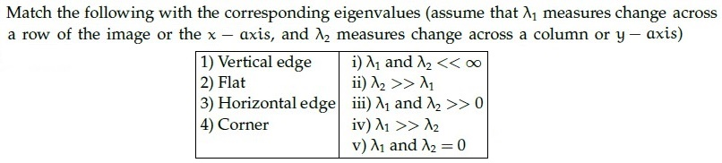

**Figure 2.** Source table for Question 163.

| Feature | Eigenvalue condition |
| :--- | :--- |
| 1) Vertical edge | i) $\lambda_1$ and $\lambda_2 \ll \infty$ |
| 2) Flat | ii) $\lambda_2 \gg \lambda_1$ |
| 3) Horizontal edge | iii) $\lambda_1$ and $\lambda_2 \gg 0$ |
| 4) Corner | iv) $\lambda_1 \gg \lambda_2$ |
| | v) $\lambda_1$ and $\lambda_2 \approx 0$ |

**Options**

**A.** 1→iii, 2 → iv, 3→ i,4→ v  
*Option ID:* `6406532474479`

**B.** 1→ii, 2→i, 3→iv,4→iii  
*Option ID:* `6406532474480`

**C.** 1→iii, 2→i, 3→iv,4→ii  
*Option ID:* `6406532474481`

**D.** 1→iv, 2→i, 3→iii,4→ii  
*Option ID:* `6406532474482`

**Correct answer:** **D** — 1→iv, 2→i, 3→iii,4→ii.  
**Source evidence:** Option 6406532474482 rendered in green font (color 0x8000) with green checkmark icon in source PDF.

---

### Question 164

**Question ID:** `640653739748` · **Type:** MCQ · **Marks:** 2  
**PDF pages:** 5

In RANSAC, what is the probability that the algorithm never selects a whole set of inliers from 20 data points (which has 5 inliers in total) for k = 2 time steps? Here, n = 2 is the minimum number of samples to fit a model.

**Options**

**A.** 0.2  
*Option ID:* `6406532474487`

**B.** 0.93  
*Option ID:* `6406532474488`

**C.** 0.87  
*Option ID:* `6406532474489`

**D.** 0  
*Option ID:* `6406532474490`

**Correct answer:** **C** — 0.87.  
**Source evidence:** Option 6406532474489 rendered in green font (color 0x8000) with green checkmark icon in source PDF.

---

### Question 165

**Question ID:** `640653739749` · **Type:** MCQ · **Marks:** 2  
**PDF pages:** 5, 6

Suppose we have a codebook of 2048 SIFT visual words. We extract 1000 SIFT descriptors (SIFT is a 128-dimensional feature) from a new image. What is the dimensionality of the BoW (Bag-of-Words) descriptor?

**Options**

**A.** 1000  
*Option ID:* `6406532474491`

**B.** 128  
*Option ID:* `6406532474492`

**C.** 128 × 2048  
*Option ID:* `6406532474493`

**D.** 2048  
*Option ID:* `6406532474494`

**Correct answer:** **D** — 2048.  
**Source evidence:** Option 6406532474494 rendered in green font (color 0x8000) with green checkmark icon in source PDF.

---

### Question 166

**Question ID:** `640653739750` · **Type:** MCQ · **Marks:** 2  
**PDF pages:** 6

Match the following:

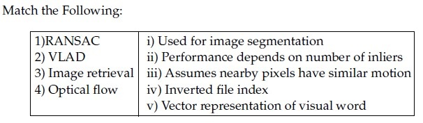

**Figure 3.** Source table for Question 166.

| Column 1 | Column 2 |
| :--- | :--- |
| 1) RANSAC | i) Used for image segmentation |
| 2) VLAD | ii) Performance depends on number of inliers |
| 3) Image retrieval | iii) Assumes nearby pixels have similar motion |
| 4) Optical flow | iv) Inverted file index |
| | v) Vector representation of visual word |

**Options**

**A.** 1→ iii, 2→ ii, 3 → iv, 4→ i  
*Option ID:* `6406532474495`

**B.** 1→ v, 2→i, 3 → iv, 4→ iii  
*Option ID:* `6406532474496`

**C.** 1→ iii, 2→ i, 3 → ii, 4 →v  
*Option ID:* `6406532474497`

**D.** 1→ ii, 2→ v, 3 → iv, 4→ iii  
*Option ID:* `6406532474498`

**Correct answer:** **D** — 1→ ii, 2→ v, 3 → iv, 4→ iii.  
**Source evidence:** Option 6406532474498 rendered in green font (color 0x8000) with green checkmark icon in source PDF.

---

### Question 167

**Question ID:** `640653739734` · **Type:** MSQ · **Marks:** 2  
**PDF pages:** 7

Which of the following linear filters will leave the central value of the given matrix unchanged.

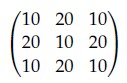

**Figure 4.** Source matrix for Question 167.

$$\begin{bmatrix} 10 & 20 & 10 \\ 20 & 10 & 20 \\ 10 & 20 & 10 \end{bmatrix}$$

**Options**

**A.** Linear filter kernel shown in Figure 5.

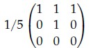

**Figure 5.** Filter matrix for Option A.

*Option ID:* `6406532474456`

**B.** Linear filter kernel shown in Figure 6.

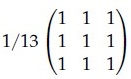

**Figure 6.** Filter matrix for Option B.

*Option ID:* `6406532474457`

**C.** Linear filter kernel shown in Figure 7.

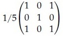

**Figure 7.** Filter matrix for Option C.

*Option ID:* `6406532474458`

**D.** Linear filter kernel shown in Figure 8.

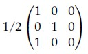

**Figure 8.** Filter matrix for Option D.

*Option ID:* `6406532474459`

**Correct answer:** **A**, **B**, **C** — A, B, C.  
**Source evidence:** Option A (6406532474456) rendered in green font (color 0x8000) with green checkmark icon in source PDF; Option B (6406532474457) rendered in green font (color 0x8000) with green checkmark icon in source PDF; Option C (6406532474458) rendered in green font (color 0x8000) with green checkmark icon in source PDF.

---

### Question 168

**Question ID:** `640653739741` · **Type:** MSQ · **Marks:** 2  
**PDF pages:** 8

Which of the following statements are True?

**Options**

**A.** LoG Filter is not appropriate to be used for blob detection.  
*Option ID:* `6406532474475`

**B.** Image patches with large contrast changes (gradients) are easier to localize.  
*Option ID:* `6406532474476`

**C.** Gradients in at least two (significantly) different orientations are the hardest (e.g., corners) to detect.  
*Option ID:* `6406532474477`

**D.** In case of ‘Hysteresis Thresholding’, if gradient at a pixel is greater than high threshold that means it is an edge pixel.  
*Option ID:* `6406532474478`

**Correct answer:** **B**, **D** — B, D.  
**Source evidence:** Option B (6406532474476) rendered in green font (color 0x8000) with green checkmark icon in source PDF; Option D (6406532474478) rendered in green font (color 0x8000) with green checkmark icon in source PDF.

---

### Question 169

**Question ID:** `640653739732` · **Type:** SA · **Marks:** 2  
**PDF pages:** 8, 9

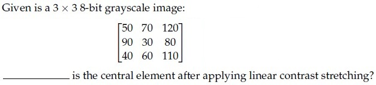

**Figure 9.** Source matrix and question text for Question 169.

Given is a 3 x 3 8-bit grayscale image:

$$\begin{bmatrix} 50 & 70 & 120 \\ 90 & 30 & 80 \\ 40 & 60 & 110 \end{bmatrix}$$

___________ is the central element after applying linear contrast stretching?

**Correct answer:** `0`  
**Source evidence:** Official answer '0' in Possible Answers field with green text (color 0x8000).

---

### Question 170

**Question ID:** `640653739733` · **Type:** SA · **Marks:** 2  
**PDF pages:** 9

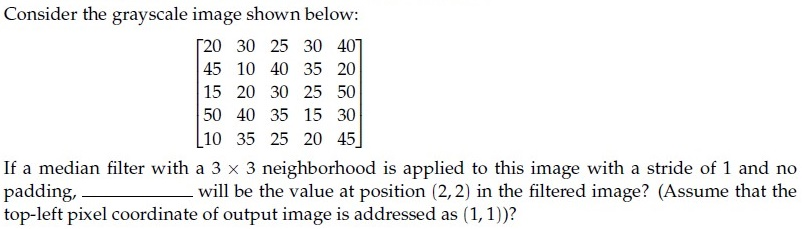

**Figure 10.** Source image and question text for Question 170.

Consider the grayscale image shown below:

$$\begin{bmatrix} 20 & 30 & 25 & 30 & 40 \\ 45 & 10 & 40 & 35 & 20 \\ 15 & 20 & 30 & 25 & 50 \\ 50 & 40 & 35 & 15 & 30 \\ 10 & 35 & 25 & 20 & 45 \end{bmatrix}$$

If a median filter with a 3 x 3 neighborhood is applied to this image with a stride of 1 and no padding, _____ will be the value at position (2, 2) in the filtered image? (Assume that the top-left pixel coordinate of output image is addressed as (1, 1))?

**Correct answer:** `30`  
**Source evidence:** Official answer '30' in Possible Answers field with green text (color 0x8000).

---

### Question 171

**Question ID:** `640653739738` · **Type:** SA · **Marks:** 2  
**PDF pages:** 9, 10

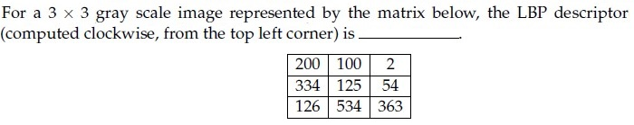

**Figure 11.** Source matrix and question text for Question 171.

For a 3 x 3 gray scale image represented by the matrix below, the LBP descriptor (computed clockwise, from the top left corner) is __

| | | |
| :---: | :---: | :---: |
| 200 | 100 | 2 |
| 334 | 125 | 54 |
| 126 | 534 | 363 |

**Correct answer:** `143`  
**Source evidence:** Official answer '143' in Possible Answers field with green text (color 0x8000).

---

### Question 172

**Question ID:** `640653739739` · **Type:** SA · **Marks:** 2  
**PDF pages:** 10

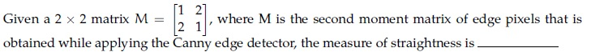

**Figure 12.** Source matrix equation and question text for Question 172.

Given a 2 x 2 matrix $M = \begin{bmatrix} 1 & 2 \\ 2 & 1 \end{bmatrix}$, where M is the second moment matrix of edge pixels that is obtained while applying the Canny edge detector, the measure of straightness is —___

**Correct answer:** `-0.4 to -0.3`  
**Source evidence:** Official accepted answer range '-0.4 to -0.3' in Possible Answers field with green text (color 0x8000).

---

### Question 173

**Question ID:** `640653739740` · **Type:** SA · **Marks:** 2  
**PDF pages:** 10, 11

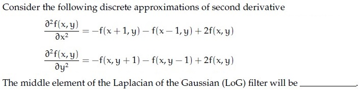

**Figure 13.** Discrete second derivative approximations and question text for Question 173.

Consider the following discrete approximations of second derivative:

$$\frac{\partial^2 F(x, y)}{\partial x^2} = F(x+1, y) - 2F(x, y) + F(x-1, y)$$

$$\frac{\partial^2 F(x, y)}{\partial y^2} = F(x, y+1) - 2F(x, y) + F(x, y-1)$$

The middle element of the Laplacian of the Gaussian (LoG) filter will be

**Correct answer:** `4`  
**Source evidence:** Official answer '4' in Possible Answers field with green text (color 0x8000).

---

### Question 174

**Question ID:** `640653739729` · **Type:** SA · **Marks:** 1  
**PDF pages:** 11, 12

**Comprehension Context (Questions 174–175):**

> In case of template matching by using correlation, even if template is not identical to some subimage in the scene, match can be meaningful, if (a) _____________ , (b) _____________ and general appearance is right.
>
> Based on the above data, answer the given subquestions.

Enter the correct answer for Blank (a) ______________ .

**Correct answer:** `scale (or orientation)`  
**Source evidence:** Official accepted answer set ['scale', 'orientation'] in Possible Answers field with green text (color 0x8000).

---

### Question 175

**Question ID:** `640653739730` · **Type:** SA · **Marks:** 1  
**PDF pages:** 12

**Comprehension Context (Questions 174–175):**

> In case of template matching by using correlation, even if template is not identical to some subimage in the scene, match can be meaningful, if (a) _____________ , (b) _____________ and general appearance is right.
>
> Based on the above data, answer the given subquestions.

Enter the correct answer for Blank (b) ______________ .

**Correct answer:** `orientation (or scale)`  
**Source evidence:** Official accepted answer set ['orientation', 'scale'] in Possible Answers field with green text (color 0x8000).

---

### Question 176

**Question ID:** `640653739744` · **Type:** SA · **Marks:** 0.5  
**PDF pages:** 12, 13

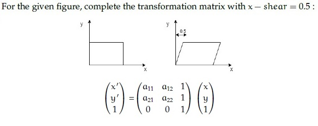

**Figure 14.** Shear transformation diagram and transformation matrix for Questions 176–179.

**Comprehension Context (Questions 176–179):**

> For the given figure, complete the transformation matrix with x — shear = 0.5 :
>
> $$\begin{bmatrix} x' \\ y' \\ 1 \end{bmatrix} = \begin{bmatrix} a_{11} & a_{12} & 0 \\ a_{21} & a_{22} & 0 \\ 0 & 0 & 1 \end{bmatrix} \begin{bmatrix} x \\ y \\ 1 \end{bmatrix}$$
>
> Based on the above data, answer the given subquestions.

$a_{11}$ = ____________

**Correct answer:** `1`  
**Source evidence:** Official answer '1' in Possible Answers field with green text (color 0x8000).

---

### Question 177

**Question ID:** `640653739745` · **Type:** SA · **Marks:** 0.5  
**PDF pages:** 13, 14

**Comprehension Context (Questions 176–179):**

> For the given figure, complete the transformation matrix with x — shear = 0.5 :
>
> $$\begin{bmatrix} x' \\ y' \\ 1 \end{bmatrix} = \begin{bmatrix} a_{11} & a_{12} & 0 \\ a_{21} & a_{22} & 0 \\ 0 & 0 & 1 \end{bmatrix} \begin{bmatrix} x \\ y \\ 1 \end{bmatrix}$$
>
> Based on the above data, answer the given subquestions.

$a_{12}$ = ____________

**Correct answer:** `0.5`  
**Source evidence:** Official answer '0.5' in Possible Answers field with green text (color 0x8000).

---

### Question 178

**Question ID:** `640653739746` · **Type:** SA · **Marks:** 0.5  
**PDF pages:** 14

**Comprehension Context (Questions 176–179):**

> For the given figure, complete the transformation matrix with x — shear = 0.5 :
>
> $$\begin{bmatrix} x' \\ y' \\ 1 \end{bmatrix} = \begin{bmatrix} a_{11} & a_{12} & 0 \\ a_{21} & a_{22} & 0 \\ 0 & 0 & 1 \end{bmatrix} \begin{bmatrix} x \\ y \\ 1 \end{bmatrix}$$
>
> Based on the above data, answer the given subquestions.

$a_{21}$ = ____________

**Correct answer:** `0`  
**Source evidence:** Official answer '0' in Possible Answers field with green text (color 0x8000).

---

### Question 179

**Question ID:** `640653739747` · **Type:** SA · **Marks:** 0.5  
**PDF pages:** 14, 15

**Comprehension Context (Questions 176–179):**

> For the given figure, complete the transformation matrix with x — shear = 0.5 :
>
> $$\begin{bmatrix} x' \\ y' \\ 1 \end{bmatrix} = \begin{bmatrix} a_{11} & a_{12} & 0 \\ a_{21} & a_{22} & 0 \\ 0 & 0 & 1 \end{bmatrix} \begin{bmatrix} x \\ y \\ 1 \end{bmatrix}$$
>
> Based on the above data, answer the given subquestions.

$a_{22}$ = ____________

**Correct answer:** `1`  
**Source evidence:** Official answer '1' in Possible Answers field with green text (color 0x8000).

---

### Question 180

**Question ID:** `640653739752` · **Type:** SA · **Marks:** 1  
**PDF pages:** 15

**Comprehension Context (Questions 180–181):**

> The degrees of freedom for translation and affine transformations are (a) __________ and (b) ___________ respectively.
>
> Based on the above data, answer the given subquestions.

Enter the correct answer for blank (a) __________.

**Correct answer:** `2`  
**Source evidence:** Official answer '2' in Possible Answers field with green text (color 0x8000).

---

### Question 181

**Question ID:** `640653739753` · **Type:** SA · **Marks:** 1  
**PDF pages:** 16

**Comprehension Context (Questions 180–181):**

> The degrees of freedom for translation and affine transformations are (a) __________ and (b) ___________ respectively.
>
> Based on the above data, answer the given subquestions.

Enter the correct answer for blank (b) __________.

**Correct answer:** `6`  
**Source evidence:** Official answer '6' in Possible Answers field with green text (color 0x8000).

---

## Answer key

| Source question | Question ID | Correct answer | PDF page(s) |
| :--- | :--- | :--- | :--- |
| 159 | `640653739731` | D | 2, 3 |
| 160 | `640653739735` | B | 3 |
| 161 | `640653739736` | D | 3, 4 |
| 162 | `640653739737` | C | 4 |
| 163 | `640653739742` | D | 4, 5 |
| 164 | `640653739748` | C | 5 |
| 165 | `640653739749` | D | 5, 6 |
| 166 | `640653739750` | D | 6 |
| 167 | `640653739734` | A, B, C | 7 |
| 168 | `640653739741` | B, D | 8 |
| 169 | `640653739732` | 0 | 8, 9 |
| 170 | `640653739733` | 30 | 9 |
| 171 | `640653739738` | 143 | 9, 10 |
| 172 | `640653739739` | -0.4 to -0.3 | 10 |
| 173 | `640653739740` | 4 | 10, 11 |
| 174 | `640653739729` | scale (or orientation) | 11, 12 |
| 175 | `640653739730` | orientation (or scale) | 12 |
| 176 | `640653739744` | 1 | 12, 13 |
| 177 | `640653739745` | 0.5 | 13, 14 |
| 178 | `640653739746` | 0 | 14 |
| 179 | `640653739747` | 1 | 14, 15 |
| 180 | `640653739752` | 2 | 15 |
| 181 | `640653739753` | 6 | 16 |

## Extraction notes

- **Scope boundaries:** The DL(CV) section begins on Page 1 at the `DL(CV)` section header (Section Id 64065351460, Section Number 11) and concludes on Page 16 at the end of Question 181. The Section 10 remnant lines at the top of Page 1 and the Section 12 LLM material starting on Page 16 have been strictly excluded.
- **Administrative confirmation excluded:** Question 158 on Pages 1–2 (Question Id 640653739727, 0 marks), the administrative subject verification prompt, is excluded in accordance with extraction requirements.
- **Question count reconciliation:** The Section 11 header declares 19 questions. This corresponds to 1 excluded confirmation question, 15 standalone questions (Q159–Q173), and 3 comprehension passages (treated as parent units). Inside the comprehension passages are 8 subquestions (Q174–Q175, Q176–Q179, Q180–Q181), resulting in exactly 23 academic questions summing to the declared 36 marks.
- **MSQ questions:** Question 167 has three correct options (A, B, C); Option D is incorrect. Question 168 has two correct options (B, D); Options A and C are incorrect. All marked correct options are preserved.
- **Mathematical / Range answer:** Question 172 specifies an official accepted answer range of `-0.4 to -0.3` (corresponding to the ratio $\lambda_2 / \lambda_1 = -1/3 \approx -0.333$ for $M = \begin{bmatrix} 1 & 2 \\ 2 & 1 \end{bmatrix}$), which is preserved exactly as given in the source key.
