# DL(CV) — da5006_2024T1_Q2_NA

**Subject:** Deep Learning for Computer Vision  
**Source:** `da5006_2024T1_Q2_NA.pdf` (original PDF omitted from this bundle)  
**Academic questions:** 28  
**Scope:** DL(CV) section; administrative subject confirmation excluded.

## Questions

### Question 149

**Question ID:** `640653766144` · **Type:** MSQ · **Marks:** 2  
**PDF pages:** 2, 3

Which of the following statements are true?

**Options**

**A.** Tanh activation function can be represented as below in terms of sigmoid activation function: $\tanh(x) = 2\sigma(2x) - 1$, where $\sigma$ = sigmoid activation function  
*Option ID:* `6406532564170`

**B.** The derivative of the Sigmoid activation function is symmetric around the origin.  
*Option ID:* `6406532564171`

**C.** Gradient of sigmoid neuron at saturation explodes  
*Option ID:* `6406532564172`

**D.** sigmoid activation is centered around 0.5 whereas tanh activation is centered around 0.  
*Option ID:* `6406532564173`

**Correct answer:** **A**, **D** — Tanh activation function can be represented as below in terms of sigmoid activation function: $\tanh(x) = 2\sigma(2x) - 1$, where $\sigma$ = sigmoid activation function; sigmoid activation is centered around 0.5 whereas tanh activation is centered around 0.  
**Source evidence:** Green option text (0x8000) and check icon (xref 18) for Option ID 6406532564170, PDF page 3; Green option text (0x8000) and check icon (xref 18) for Option ID 6406532564173, PDF page 3.

---

### Question 150

**Question ID:** `640653766152` · **Type:** MSQ · **Marks:** 2  
**PDF pages:** 3

Which of the below properties are not exhibited by the gradient-based explanation generation method, Grad-CAM? (Select all that apply)

**Options**

**A.** Grad-CAM saliency map only computes gradients for important pixels while calculating weights, so pixels that contribute more to a specific class are considered  
*Option ID:* `6406532564183`

**B.** Grad-CAM can’t generate explanation directly from the given CNN and needs additional retraining  
*Option ID:* `6406532564184`

**C.** Grad-CAM is very reliable at identifying multiple instances of objects with occlusions  
*Option ID:* `6406532564185`

**D.** Grad-CAM can help localize objects without positional supervision  
*Option ID:* `6406532564186`

**Correct answer:** **A** — Grad-CAM saliency map only computes gradients for important pixels while calculating weights, so pixels that contribute more to a specific class are considered  
**Source evidence:** Green option text (0x8000) and check icon (xref 18) for Option ID 6406532564183. Options B, C, D marked with red text and cross icons., PDF page 3.

---

### Question 151

**Question ID:** `640653766153` · **Type:** MSQ · **Marks:** 2  
**PDF pages:** 3, 4

Which of the following statements accurately describes the visualization techniques used in Convolutional Neural Networks (CNNs)? (Select all that apply)

**Options**

**A.** Activation maximization methods identify input image region that maximally activates specific neurons in the network.  
*Option ID:* `6406532564187`

**B.** Filter visualization techniques display the learned weights of convolutional filters in the network.  
*Option ID:* `6406532564188`

**C.** Kernel visualization involves directly observing the values of convolutional filters during network training.  
*Option ID:* `6406532564189`

**D.** Principal Component Analysis (PCA) is commonly employed to reduce the dimensionality of feature maps for visualization purposes.  
*Option ID:* `6406532564190`

**Correct answer:** **A**, **B** — Activation maximization methods identify input image region that maximally activates specific neurons in the network.; Filter visualization techniques display the learned weights of convolutional filters in the network.  
**Source evidence:** Green option text (0x8000) and check icon (xref 18) for Option ID 6406532564187, PDF page 4; Green option text (0x8000) and check icon (xref 18) for Option ID 6406532564188, PDF page 4.

---

### Question 152

**Question ID:** `640653766159` · **Type:** MSQ · **Marks:** 2  
**PDF pages:** 4

Which of the following is true regarding Hard Attention and Soft Attention?

**Options**

**A.** Soft Attention is smooth and differentiable  
*Option ID:* `6406532564211`

**B.** Variance reduction techniques are used to train Hard Attention models  
*Option ID:* `6406532564212`

**C.** Soft Attention is computationally cheaper than Hard Attention when the source input is large  
*Option ID:* `6406532564213`

**D.** The inference (test time) overhead is low in Hard Attention when compared to Soft Attention models  
*Option ID:* `6406532564214`

**Correct answer:** **A**, **B**, **D** — Soft Attention is smooth and differentiable; Variance reduction techniques are used to train Hard Attention models; The inference (test time) overhead is low in Hard Attention when compared to Soft Attention models  
**Source evidence:** Green option text (0x8000) and check icon (xref 18) for Option ID 6406532564211, PDF page 4; Green option text (0x8000) and check icon (xref 18) for Option ID 6406532564212, PDF page 4; Green option text (0x8000) and check icon (xref 18) for Option ID 6406532564214, PDF page 4.

---

### Question 153

**Question ID:** `640653766163` · **Type:** MSQ · **Marks:** 2  
**PDF pages:** 5

Frechet Inception Distance (FID) is used for measuring the feature distance between real and generated images to evaluate the goodness of image generation in deep generative models such as GANs. Select the limitations of FID from the given below options:
(Select all possible correct options)

**Options**

**A.** May not capture all features  
*Option ID:* `6406532564227`

**B.** Needs small sample size  
*Option ID:* `6406532564228`

**C.** Slow to run  
*Option ID:* `6406532564229`

**D.** None of these  
*Option ID:* `6406532564230`

**Correct answer:** **A**, **C** — May not capture all features; Slow to run  
**Source evidence:** Green option text (0x8000) and check icon (xref 18) for Option ID 6406532564227, PDF page 5; Green option text (0x8000) and check icon (xref 18) for Option ID 6406532564229, PDF page 5.

---

### Question 154

**Question ID:** `640653766164` · **Type:** MSQ · **Marks:** 2  
**PDF pages:** 5

If $x$ is an input feature vector and $y$ is the corresponding output/label, which distributions are modeled in a vanilla Generative Adversarial Network (GAN)?
(Select all possible correct options)

**Options**

**A.** $p(x)$  
*Option ID:* `6406532564231`

**B.** $p(x|y)$  
*Option ID:* `6406532564232`

**C.** $p(y|x)$  
*Option ID:* `6406532564233`

**D.** $p(x, y)$  
*Option ID:* `6406532564234`

**Correct answer:** **A**, **D** — $p(x)$; $p(x, y)$  
**Source evidence:** Green option text (0x8000) and check icon (xref 18) for Option ID 6406532564231, PDF page 5; Green option text (0x8000) and check icon (xref 18) for Option ID 6406532564234, PDF page 5.

---

### Question 155

**Question ID:** `640653766145` · **Type:** SA · **Marks:** 2  
**PDF pages:** 6

What is the size of the feature map after applying two successive convolution operations with given parameters? Image size = 64 x 64, Kernel size = 6 x 6, Padding = 1 and Stride = 2. (In calculation, take floor(x) whenever x is non-integer. If the answer is FxF, write F in the answer).

**Correct answer:** `14`  
**Source evidence:** Green text in 'Possible Answers : 14', PDF page 6.

---

### Question 156

**Question ID:** `640653766146` · **Type:** SA · **Marks:** 2  
**PDF pages:** 6, 7

Let an input to a convolutional layer in a CNN have size $D_I \times D_I \times M$ where $D_I = 64$ and $M = 16$, and output feature map (after passing input through conv layer) has $D_I \times D_I \times N$ size where $N = 8$. Let the kernel in the conv layer be $k \times k$ where $k = 3$. Calculate the number of parameters for this convolution layer. (Assume appropriate padding is applied for all convolutions so the input and output sizes are equal. Ignore the bias term in the calculation).

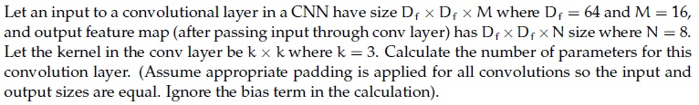

**Figure 1.** Source diagram for Question 156.

**Correct answer:** `1152`  
**Source evidence:** Green text in 'Possible Answers : 1152', PDF page 7.

---

### Question 157

**Question ID:** `640653766147` · **Type:** MCQ · **Marks:** 2  
**PDF pages:** 7

Match the derivative of activation functions $f(x)$ with their counterparts on the right column accordingly.

| Left Column | Right Column |
| :--- | :--- |
| 1) Leaky ReLU | i) $f(x)(1 - f(x))$ |
| 2) Tanh | ii) $0 \text{ if } x < 0 \text{ and } 1 \text{ if } x > 0$ |
| 3) ReLU | iii) $1 - f(x)^2$ |
| 4) Sigmoid | iv) $0.01 \text{ if } x < 0 \text{ and } 1 \text{ if } x > 0$ |
| | v) $0 \text{ if } x > 0 \text{ and } 1 \text{ if } x < 0$ |
| | vi) $0.01 \text{ if } x > 0 \text{ and } 1 \text{ if } x < 0$ |

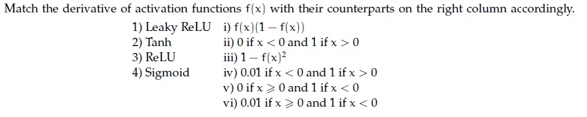

**Figure 2.** Source matching table for Question 157.

**Options**

**A.** 1→ vi, 2→ iii, 3→ v, 4 → i  
*Option ID:* `6406532564176`

**B.** 1→ i, 2→ iv, 3 → iii, 4→ ii  
*Option ID:* `6406532564177`

**C.** 1→ i, 2→ v, 3 → iii, 4→ iv  
*Option ID:* `6406532564178`

**D.** 1→ iv, 2→ iii, 3→ ii, 4 → i  
*Option ID:* `6406532564179`

**Correct answer:** **D** — 1→ iv, 2→ iii, 3→ ii, 4 → i  
**Source evidence:** Green option text (0x8000) and check icon (xref 18) for Option ID 6406532564179, PDF page 7.

---

### Question 158

**Question ID:** `640653766154` · **Type:** MCQ · **Marks:** 2  
**PDF pages:** 7, 8

Which method is commonly used to explain Convolutional Neural Networks (CNNs) through visualization?

**Options**

**A.** Feature Concatenation  
*Option ID:* `6406532564191`

**B.** Dimension Reduction  
*Option ID:* `6406532564192`

**C.** Gradient-weighted Class Activation Mapping (Grad-CAM)  
*Option ID:* `6406532564193`

**D.** Random Initialization  
*Option ID:* `6406532564194`

**Correct answer:** **C** — Gradient-weighted Class Activation Mapping (Grad-CAM)  
**Source evidence:** Green option text (0x8000) and check icon (xref 18) for Option ID 6406532564193, PDF page 8.

---

### Question 159

**Question ID:** `640653766155` · **Type:** MCQ · **Marks:** 2  
**PDF pages:** 8

Match the following computer vision tasks to situations:

| Computer Vision Task | Situation |
| :--- | :--- |
| 1) Instance Segmentation | i) There are cars in these pixels |
| 2) Classification | ii) There are 4 cars in the image |
| 3) Semantic Segmentation | iii) There is car in the image |
| 4) Object Detection | iv) There are 4 cars in the image, and here are the pixels with the shape of each of their occurrence |

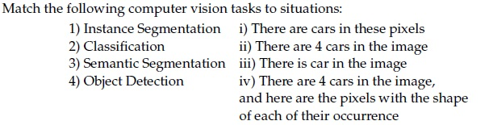

**Figure 3.** Source matching table for Question 159.

**Options**

**A.** 1→ iv, 2→ iii, 3→ ii, 4 → i  
*Option ID:* `6406532564195`

**B.** 1→ ii, 2→ iii, 3 → i, 4 →iv  
*Option ID:* `6406532564196`

**C.** 1→ iv, 2→ iii, 3→ i, 4 → ii  
*Option ID:* `6406532564197`

**D.** 1→ ii, 2→ iv, 3 → iii, 4→ i  
*Option ID:* `6406532564198`

**Correct answer:** **C** — 1→ iv, 2→ iii, 3→ i, 4 → ii  
**Source evidence:** Green option text (0x8000) and check icon (xref 18) for Option ID 6406532564197, PDF page 8.

---

### Question 160

**Question ID:** `640653766156` · **Type:** MCQ · **Marks:** 2  
**PDF pages:** 8, 9

Consider two 10×10 bounding boxes (one on the upper left and one of the lower right) in an image with an overlapping region of 7×7. The Intersection over Union (IoU) score between the two boxes is (choose the closest value):

**Options**

**A.** 21%  
*Option ID:* `6406532564199`

**B.** 25%  
*Option ID:* `6406532564200`

**C.** 33%  
*Option ID:* `6406532564201`

**D.** 37%  
*Option ID:* `6406532564202`

**Correct answer:** **C** — 33%  
**Source evidence:** Green option text (0x8000) and check icon (xref 18) for Option ID 6406532564201, PDF page 9.

---

### Question 161

**Question ID:** `640653766157` · **Type:** MCQ · **Marks:** 2  
**PDF pages:** 9, 10

Which one of the following statements is true?

**Options**

**A.** The goal of triplet loss is to ensure that the distance between the anchor and the negative sample is at least ’margin’ less than the distance between anchor and positive sample.  
*Option ID:* `6406532564203`

**B.** Face identification is a multi-class classification problem whereas face verification is a binary classification problem  
*Option ID:* `6406532564204`

**C.** Both the goal of triplet loss is to ensure that the distance between the anchor and the negative sample is at least ’margin’ less than the distance between anchor and positive sample & Face identification is a multi-class classification problem whereas face verification is a binary classification problem  
*Option ID:* `6406532564205`

**D.** None of these  
*Option ID:* `6406532564206`

**Correct answer:** **B** — Face identification is a multi-class classification problem whereas face verification is a binary classification problem  
**Source evidence:** Green option text (0x8000) and check icon (xref 18) for Option ID 6406532564204, PDF page 9.

---

### Question 162

**Question ID:** `640653766158` · **Type:** MCQ · **Marks:** 2  
**PDF pages:** 10

What are Haar-like features primarily used for in computer vision?

**Options**

**A.** Object detection  
*Option ID:* `6406532564207`

**B.** Image segmentation  
*Option ID:* `6406532564208`

**C.** Texture analysis  
*Option ID:* `6406532564209`

**D.** Image denoising  
*Option ID:* `6406532564210`

**Correct answer:** **A** — Object detection  
**Source evidence:** Green option text (0x8000) and check icon (xref 18) for Option ID 6406532564207, PDF page 10.

---

### Question 163

**Question ID:** `640653766160` · **Type:** MCQ · **Marks:** 2  
**PDF pages:** 10, 11

Consider an attention model for the image captioning task. At a particular time step $t$, the context vector $z$ is obtained from the feature map of the final layer of the CNN and attention weights obtained from RNN. If RNN’s attention output is $\begin{pmatrix} 0.25 & 0 \\ 0.75 & 0 \end{pmatrix}$ and the feature map has values $\begin{pmatrix} v_1 & v_2 \\ v_3 & v_4 \end{pmatrix}$ where $v_1, v_2, v_3, v_4$ are $d$-dimensional vectors, what is the value of the context vector $z$ under soft and hard attention mechanisms respectively?

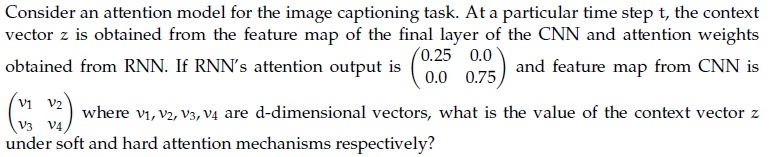

**Figure 4.** Source diagram and formulation for Question 163.

**Options**

**A.** $\frac{v_1 + 3v_3}{4}, v_3$  
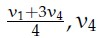

**Figure 5.** Option A for Question 163.
*Option ID:* `6406532564215`

**B.** $\frac{2v_1 + v_2 + 2v_3}{4}, \frac{2v_1 + v_2 + 2v_3}{4}$  
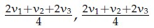

**Figure 6.** Option B for Question 163.
*Option ID:* `6406532564216`

**C.** $\frac{v_1 + v_2 + v_3 + v_4}{4}, \frac{2v_2 + v_3}{3}$  
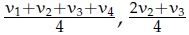

**Figure 7.** Option C for Question 163.
*Option ID:* `6406532564217`

**D.** $\frac{3v_1 + v_3}{4}, v_1$  
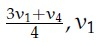

**Figure 8.** Option D for Question 163.
*Option ID:* `6406532564218`

**Correct answer:** **A** — $\frac{v_1 + 3v_3}{4}, v_3$  
**Source evidence:** Green check icon (xref 18) next to Option ID 6406532564215, PDF page 10.

---

### Question 164

**Question ID:** `640653766161` · **Type:** MCQ · **Marks:** 2  
**PDF pages:** 11

Let us suppose that you want to build an encoder-decoder recurrent model with attention. We know that the context vector for the model is given by $c_t = \sum_{j=1}^T \alpha_{tj} h_j$, where $\alpha_{tj}$ refers to the degree of alignment between decoder state $s_{t-1}$ and encoder state $h_j$. Then, $\alpha_{tj}$ is computed as:

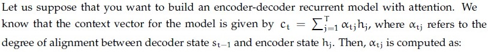

**Figure 9.** Source formulation for Question 164.

**Options**

**A.** Sigmoid of alignment scores  
*Option ID:* `6406532564219`

**B.** Softmax of alignment scores  
*Option ID:* `6406532564220`

**C.** ReLU of alignment scores  
*Option ID:* `6406532564221`

**D.** None of these  
*Option ID:* `6406532564222`

**Correct answer:** **B** — Softmax of alignment scores  
**Source evidence:** Green option text (0x8000) and check icon (xref 18) for Option ID 6406532564220, PDF page 11.

---

### Question 165

**Question ID:** `640653766162` · **Type:** MCQ · **Marks:** 2  
**PDF pages:** 11, 12

Which of the following is not a component of a Transformer network?

**Options**

**A.** Encoder  
*Option ID:* `6406532564223`

**B.** Decoder  
*Option ID:* `6406532564224`

**C.** Positional Encoding  
*Option ID:* `6406532564225`

**D.** Recurrent Connections  
*Option ID:* `6406532564226`

**Correct answer:** **D** — Recurrent Connections  
**Source evidence:** Green option text (0x8000) and check icon (xref 18) for Option ID 6406532564226, PDF page 12.

---

### Question 166

**Question ID:** `640653766165` · **Type:** MCQ · **Marks:** 2  
**PDF pages:** 12

Consider the following assertion and the reason for the assertion below :

* Assertion: The images generated by VAEs exhibit a lack of sharpness or clarity.
* Reason: The blurriness observed in the generated images of VAEs arises from the underlying assumptions and limitations of the model. VAEs aim to learn the data distribution by fitting it into a multivariate Gaussian. However, this assumption of conditional independence among samples given latent variables does not hold for many realistic distributions, such as natural images.

Now, pick one among the options below:

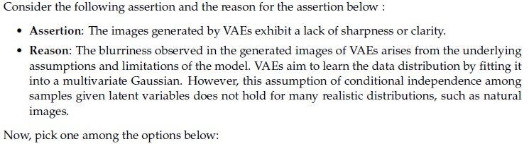

**Figure 10.** Source assertion and reason text for Question 166.

**Options**

**A.** Both assertion and reason are true, and the reason is the correct explanation of assertion  
*Option ID:* `6406532564235`

**B.** Both assertion and reason are true, but the reason is not the correct explanation of assertion  
*Option ID:* `6406532564236`

**C.** Assertion is true, the reason is false  
*Option ID:* `6406532564237`

**D.** Both assertion and reason are false  
*Option ID:* `6406532564238`

**Correct answer:** **A** — Both assertion and reason are true, and the reason is the correct explanation of assertion  
**Source evidence:** Green option text (0x8000) and check icon (xref 18) for Option ID 6406532564235, PDF page 12.

---

### Question 167

**Question ID:** `640653766171` · **Type:** MCQ · **Marks:** 2  
**PDF pages:** 12, 13

Match the following:

| Term | Description / Application |
| :--- | :--- |
| 1) BLEU score | i) CNN |
| 2) Parameter sharing | ii) GAN |
| 3) KL divergence | iii) StyleNet |
| 4) Image captioning | iv) Evaluating CNN performance |
| | v) Evaluating RNN performance |
| | vi) VAE |

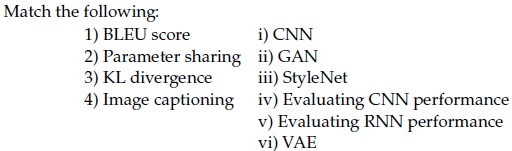

**Figure 11.** Source matching table for Question 167.

**Options**

**A.** 1→ iii, 2→ ii, 3 → vi, 4→ i  
*Option ID:* `6406532564243`

**B.** 1→ v, 2→i, 3 → vi, 4→ iii  
*Option ID:* `6406532564244`

**C.** 1→ ii, 2→ i, 3 → ii, 4 → iii  
*Option ID:* `6406532564245`

**D.** 1→ i, 2 →ii, 3 → vi, 4→ iv  
*Option ID:* `6406532564246`

**Correct answer:** **B** — 1→ v, 2→i, 3 → vi, 4→ iii  
**Source evidence:** Green option text (0x8000) and check icon (xref 18) for Option ID 6406532564244, PDF page 13.

---

### Question 168

**Question ID:** `640653766149` · **Type:** SA · **Marks:** 2  
**PDF pages:** 13, 14

**Shared Comprehension Context (Questions 168–170):**
A four-dimensional input $x = [3, 4, 1, 2]$ is passed to a hidden layer with a single neuron and an activation function $a(\cdot)$ to obtain $z$. Assume that the corresponding weights (from input to hidden layer) are $[0.3, 0, -0.4, 0.5]$ and bias is $0.2$.
Consider the corresponding activation functions and give the corresponding value of $z$.
Based on the above data, answer the given subquestions.

**Subquestion 168:**
Linear______________

**Correct answer:** `1.7`  
**Source evidence:** Green text in 'Possible Answers : 1.7', PDF page 14.

---

### Question 169

**Question ID:** `640653766150` · **Type:** SA · **Marks:** 2  
**PDF pages:** 14

**Shared Comprehension Context (Questions 168–170):**
A four-dimensional input $x = [3, 4, 1, 2]$ is passed to a hidden layer with a single neuron and an activation function $a(\cdot)$ to obtain $z$. Assume that the corresponding weights (from input to hidden layer) are $[0.3, 0, -0.4, 0.5]$ and bias is $0.2$.
Consider the corresponding activation functions and give the corresponding value of $z$.
Based on the above data, answer the given subquestions.

**Subquestion 169:**
Indicator function____________

**Correct answer:** `1`  
**Source evidence:** Green text in 'Possible Answers : 1', PDF page 14.

---

### Question 170

**Question ID:** `640653766151` · **Type:** SA · **Marks:** 1  
**PDF pages:** 14, 15

**Shared Comprehension Context (Questions 168–170):**
A four-dimensional input $x = [3, 4, 1, 2]$ is passed to a hidden layer with a single neuron and an activation function $a(\cdot)$ to obtain $z$. Assume that the corresponding weights (from input to hidden layer) are $[0.3, 0, -0.4, 0.5]$ and bias is $0.2$.
Consider the corresponding activation functions and give the corresponding value of $z$.
Based on the above data, answer the given subquestions.

**Subquestion 170:**
Leaky-ReLU_____________

**Correct answer:** `1.7`  
**Source evidence:** Green text in 'Possible Answers : 1.7', PDF page 15.

---

### Question 171

**Question ID:** `640653766167` · **Type:** SA · **Marks:** 2  
**PDF pages:** 15, 16

**Shared Comprehension Context (Questions 171–174):**
Fill in the blanks for the given sub questions.

**Subquestion 171:**
KL divergence is not a distance metric because $KL(P||Q)$ is___________ to $KL(Q||P)$.

NOTE: Enter the exact answer without any extra space in the beginning or at the end.

**Correct answer:** `not equal`  
**Source evidence:** Green text in 'Possible Answers : not equal', PDF page 16.

---

### Question 172

**Question ID:** `640653766168` · **Type:** SA · **Marks:** 1  
**PDF pages:** 16

**Shared Comprehension Context (Questions 171–174):**
Fill in the blanks for the given sub questions.

**Subquestion 172:**
Also KL divergence is always greater than equal to _____________

**Correct answer:** `0`  
**Source evidence:** Green text in 'Possible Answers : 0', PDF page 16.

---

### Question 173

**Question ID:** `640653766169` · **Type:** SA · **Marks:** 1  
**PDF pages:** 16, 17

**Shared Comprehension Context (Questions 171–174):**
Fill in the blanks for the given sub questions.

**Subquestion 173:**
Suppose P := Bernoulli(0.9) and Q := Bernoulli(0.1), then $KL(P||Q) = c \times \log(d)$.
The value for c is_________ 

**Correct answer:** `0.9`  
**Source evidence:** Green text in 'Possible Answers : 0.9', PDF page 17.

---

### Question 174

**Question ID:** `640653766170` · **Type:** SA · **Marks:** 1  
**PDF pages:** 17

**Shared Comprehension Context (Questions 171–174):**
Fill in the blanks for the given sub questions.

**Subquestion 174:**
Suppose P := Bernoulli(0.9) and Q := Bernoulli(0.1), then $KL(P||Q) = c \times \log(d)$.
The value for d is_________ 

**Correct answer:** `8`  
**Source evidence:** Green text in 'Possible Answers : 8', PDF page 17.

---

### Question 175

**Question ID:** `640653766173` · **Type:** SA · **Marks:** 1  
**PDF pages:** 17, 18

**Shared Comprehension Context (Questions 175–176):**
While training a Generative Adversarial Network, a generator network G(.) and a discriminative network D(.) plays a zero-sum adversarial game.
Based on the above data, answer the given subquestions.

**Subquestion 175:**
The values of D(G(z)) during the initial phase of training_____________

**Correct answer:** `0`  
**Source evidence:** Green text in 'Possible Answers : 0', PDF page 18.

---

### Question 176

**Question ID:** `640653766174` · **Type:** SA · **Marks:** 1  
**PDF pages:** 18

**Shared Comprehension Context (Questions 175–176):**
While training a Generative Adversarial Network, a generator network G(.) and a discriminative network D(.) plays a zero-sum adversarial game.
Based on the above data, answer the given subquestions.

**Subquestion 176:**
After successfully training the GAN__________

**Correct answer:** `0.5`  
**Source evidence:** Green text in 'Possible Answers : 0.5', PDF page 18.

---

## Answer key

| Source question | Question ID | Correct answer | PDF page(s) |
| :--- | :--- | :--- | :--- |
| 149 | `640653766144` | A, D | 2, 3 |
| 150 | `640653766152` | A | 3 |
| 151 | `640653766153` | A, B | 3, 4 |
| 152 | `640653766159` | A, B, D | 4 |
| 153 | `640653766163` | A, C | 5 |
| 154 | `640653766164` | A, D | 5 |
| 155 | `640653766145` | 14 | 6 |
| 156 | `640653766146` | 1152 | 6, 7 |
| 157 | `640653766147` | D | 7 |
| 158 | `640653766154` | C | 7, 8 |
| 159 | `640653766155` | C | 8 |
| 160 | `640653766156` | C | 8, 9 |
| 161 | `640653766157` | B | 9, 10 |
| 162 | `640653766158` | A | 10 |
| 163 | `640653766160` | A | 10, 11 |
| 164 | `640653766161` | B | 11 |
| 165 | `640653766162` | D | 11, 12 |
| 166 | `640653766165` | A | 12 |
| 167 | `640653766171` | B | 12, 13 |
| 168 | `640653766149` | 1.7 | 13, 14 |
| 169 | `640653766150` | 1 | 14 |
| 170 | `640653766151` | 1.7 | 14, 15 |
| 171 | `640653766167` | not equal | 15, 16 |
| 172 | `640653766168` | 0 | 16 |
| 173 | `640653766169` | 0.9 | 16, 17 |
| 174 | `640653766170` | 8 | 17 |
| 175 | `640653766173` | 0 | 17, 18 |
| 176 | `640653766174` | 0.5 | 18 |

## Extraction notes

1. **Reconciliation of Declared Count**: Section 10 declares 23 questions and 50 marks. The paper comprises:
   - 1 administrative confirmation question (Question 148, excluded from academic questions);
   - 19 standalone questions (Questions 149–167);
   - 3 comprehension question blocks containing 9 child questions:
     - Comprehension ID `640653766148` (Questions 168–170, 3 numerical SA questions);
     - Comprehension ID `640653766166` (Questions 171–174, 4 fill-in SA questions);
     - Comprehension ID `640653766172` (Questions 175–176, 2 numerical SA questions).
   Reconciliation: 1 administrative question + 19 standalone questions + 3 comprehension groups = 23 parent question items. Total extracted academic questions: 19 + 3 + 4 + 2 = 28 questions. Total marks: 12 (MSQ) + 4 (SA) + 22 (MCQ) + 5 (Comp 1) + 5 (Comp 2) + 2 (Comp 3) = 50 marks, matching the declared section total exactly.
2. **Subject Boundary**: The PDF opens with Question 147 (page 1), which pertains to pre-training datasets for Large Language Models and belongs to a preceding exam section. Section 10 "DL(CV)" begins on page 1 (`[271.17, 380.62, 329.96, 405.10]`). The DL(CV) section concludes on page 18 with Question 176. Page 19 introduces Section 11 "SPG" (Strategies for Professional Growth) starting with administrative question 177, which is excluded from scope.
3. **Question 150 (Grad-CAM MSQ)**: Although labeled as a Multiple Select Question (`MSQ`), the official source marks only Option A (`6406532564183`) in green text with a check icon, while Options B, C, and D are marked with red text and cross icons. Faithfully recorded as marked in the source key.
4. **Question 174 (KL Divergence for Bernoulli distributions)**: The source key specifies accepted answer `8` for parameter $d$ where $KL(P||Q) = c \times \log(d)$ with $P = \text{Bernoulli}(0.9)$ and $Q = \text{Bernoulli}(0.1)$, with $c = 0.9$ (from Question 173). Faithfully preserved from the official key.
