# DL(CV) — da5006_2024T2_ET_AN

**Subject:** Deep Learning for Computer Vision  
**Source:** `da5006_2024T2_ET_AN.pdf` (original PDF omitted from this bundle)  
**Academic questions:** 34  
**Scope:** DL(CV) section; administrative subject confirmation excluded.

## Questions

### Question 249

**Question ID:** `640653904300` · **Type:** MCQ · **Marks:** 2  
**PDF pages:** 2

What is the role of the Gaussian blur in the Canny edge detection algorithm, and how does the choice of the standard deviation parameter affect the performance of edge detection? Which option do you think best describes the role of the Gaussian blur and its relationship with the standard deviation parameter in the Canny edge detection algorithm?

**Options**

**A.** The Gaussian blur helps to reduce noise in the image and smooth out pixel intensity variations.The standard deviation parameter controls the amount of blurring applied, with higher values resulting in more aggressive smoothing, which may lead to loss of edge detail.  
*Option ID:* `6406533045014`

**B.** The Gaussian blur enhances edge contrast in the image and amplifies pixel intensity gradients. The standard deviation parameter determines the width of the blur kernel, with larger values resulting in sharper edges and finer details preserved.  
*Option ID:* `6406533045015`

**C.** The Gaussian blur serves to highlight high-frequency components in the image and accentuate edge boundaries. The standard deviation parameter dictates the level of detail preserved, with smaller values preserving finer details but potentially amplifying noise.  
*Option ID:* `6406533045016`

**D.** The Gaussian blur functions to dilate edge regions in the image and expand the edge boundaries.The standard deviation parameter controls the extent of dilation, with higher values resulting in broader edge regions but also increasing the risk of false edge detections.  
*Option ID:* `6406533045017`

**Correct answer:** **A** — The Gaussian blur helps to reduce noise in the image and smooth out pixel intensity variations.The standard deviation parameter controls the amount of blurring applied, with higher values resulting in more aggressive smoothing, which may lead to loss of edge detail.  
**Source evidence:** Option 6406533045014 is rendered in green text (#008000) with a checkmark icon. (PDF page 2).

---

### Question 250

**Question ID:** `640653904302` · **Type:** MCQ · **Marks:** 2  
**PDF pages:** 2, 3

Consider the following orientation of edges s:

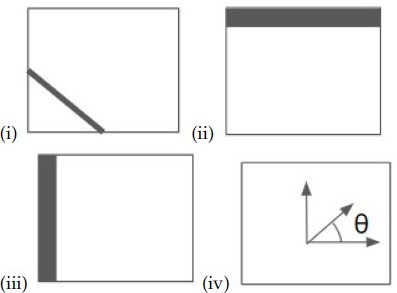

**Figure 1.** Source diagram of edge orientations for Question 250.

Choose the correct matching:

**Options**

**A.** (i) = tan⁻¹((∂f/∂y) / (∂f/∂x)), (ii) = (∂f/∂x, 0), (iii) = (0, ∂f/∂y), (iv) = (∂f/∂x, ∂f/∂y)  
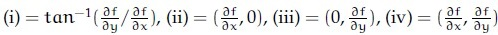

**Figure 2.** Option A image for Question 250.
*Option ID:* `6406533045019`

**B.** (i) = tan⁻¹((∂f/∂y) / (∂f/∂x)), (ii) = (0, ∂f/∂y), (iii) = (∂f/∂x, 0), (iv) = (∂f/∂x, ∂f/∂y)  
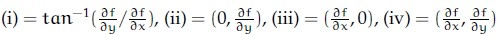

**Figure 3.** Option B image for Question 250.
*Option ID:* `6406533045020`

**C.** (i) = (∂f/∂x, ∂f/∂y), (ii) = (∂f/∂x, 0), (iii) = (0, ∂f/∂y), (iv) = tan⁻¹((∂f/∂y) / (∂f/∂x))  
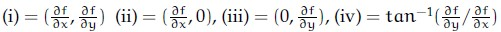

**Figure 4.** Option C image for Question 250.
*Option ID:* `6406533045021`

**D.** (i) = (∂f/∂x, ∂f/∂y), (ii) = (0, ∂f/∂y), (iii) = (∂f/∂x, 0), (iv) = tan⁻¹((∂f/∂y) / (∂f/∂x))  
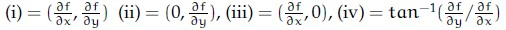

**Figure 5.** Option D image for Question 250.
*Option ID:* `6406533045022`

**Correct answer:** **D** — (i) = (∂f/∂x, ∂f/∂y), (ii) = (0, ∂f/∂y), (iii) = (∂f/∂x, 0), (iv) = tan⁻¹((∂f/∂y) / (∂f/∂x))  
**Source evidence:** Option 6406533045022 is rendered with green label (#008000) and checkmark icon. (PDF page 3).

---

### Question 251

**Question ID:** `640653904303` · **Type:** MCQ · **Marks:** 2  
**PDF pages:** 3, 4

Match the following:

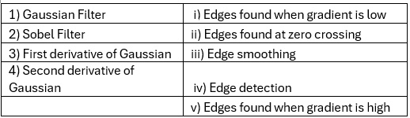

**Figure 6.** Source matching table of filters and edge properties for Question 251.

| Filter | Edge property |
| :--- | :--- |
| 1) Gaussian Filter | i) Edges found when gradient is low |
| 2) Sobel Filter | ii) Edges found at zero crossing |
| 3) First derivative of Gaussian | iii) Edge smoothing |
| 4) Second derivative of Gaussian | iv) Edge detection |
| | v) Edges found when gradient is high |

**Options**

**A.** 1→ iii, 2→ iv, 3 →i, 4 → ii  
*Option ID:* `6406533045023`

**B.** 1→ iii, 2→ i, 3 → ii, 4 → v  
*Option ID:* `6406533045024`

**C.** 1→ iii, 2→ iv, 3 →v, 4 → ii  
*Option ID:* `6406533045025`

**D.** 1→ iv, 2→ iii, 3 → i, 4→ ii  
*Option ID:* `6406533045026`

**Correct answer:** **C** — 1→ iii, 2→ iv, 3 →v, 4 → ii  
**Source evidence:** Option 6406533045025 is rendered in green text (#008000) with a checkmark icon. (PDF page 3).

---

### Question 252

**Question ID:** `640653904304` · **Type:** MCQ · **Marks:** 2  
**PDF pages:** 4

Consider the following statements and choose the correct option:

(i) Grad-CAM overcame the problems of previous works to work better in images with occlusion and multiple instances of objects.

(ii) Grad-CAM ++ uses a weighted average of pixels to solve the problem of activation maps with lesser spatial footprint getting suppressed.

**Options**

**A.** Only statement (i) is True  
*Option ID:* `6406533045027`

**B.** Only statement (ii) is True  
*Option ID:* `6406533045028`

**C.** Both the statements are True  
*Option ID:* `6406533045029`

**D.** None of the statements is True  
*Option ID:* `6406533045030`

**Correct answer:** **D** — None of the statements is True  
**Source evidence:** Option 6406533045030 is rendered in green text (#008000) with a checkmark icon. (PDF page 4).

---

### Question 253

**Question ID:** `640653904305` · **Type:** MCQ · **Marks:** 2  
**PDF pages:** 4

Which one of the following statements regarding hyperparameter tuning is True?

**Options**

**A.** Test set performance, with hyperparameters tuned on the validation set, would be a realistic measure of how the model will generalize to new data.  
*Option ID:* `6406533045031`

**B.** Train set is the best choice for tuning hyperparameters  
*Option ID:* `6406533045032`

**C.** Picking hyperparameters that perform the best on the validation set leads to overfitting  
*Option ID:* `6406533045033`

**D.** Tuning hyperparameters on the test set is an acceptable approach to find the most powerful model for generalization performance  
*Option ID:* `6406533045034`

**Correct answer:** **A** — Test set performance, with hyperparameters tuned on the validation set, would be a realistic measure of how the model will generalize to new data.  
**Source evidence:** Option 6406533045031 is rendered in green text (#008000) with a checkmark icon. (PDF page 4).

---

### Question 254

**Question ID:** `640653904306` · **Type:** MCQ · **Marks:** 2  
**PDF pages:** 4, 5

Which of the following is the correct sequence of steps of the SIFT algorithm? 
1. Using the Taylor series expansion of the scale-space function, localize the key points. 
2. Estimate the orientation of keypoints using the local image gradients. 
3. Find the edge points using the eigenvalues of the Hessian and reject these points. 
4. Find a raw SIFT descriptor vector using the gradient orientations of the neighborhood around the key points. 
5. Detect extreme points in scale space using an approximation of the Laplacian of Gaussian.

**Options**

**A.** 5, 2, 1, 3, 4  
*Option ID:* `6406533045035`

**B.** 5, 1, 3, 2, 4  
*Option ID:* `6406533045036`

**C.** 1, 3, 2, 4, 5  
*Option ID:* `6406533045037`

**D.** 1, 5, 3, 2, 4  
*Option ID:* `6406533045038`

**Correct answer:** **B** — 5, 1, 3, 2, 4  
**Source evidence:** Option 6406533045036 is rendered in green text (#008000) with a checkmark icon. (PDF page 5).

---

### Question 255

**Question ID:** `640653904307` · **Type:** MCQ · **Marks:** 2  
**PDF pages:** 5

For certain filters, we can speed up the convolution operation by separating convolution kernels from $k^2$ operations to $2k$ operations. Given the 2D Kernel below, what are the separated 1D kernels $v$ and $h$ for it?

$$\frac{1}{16} \begin{bmatrix} 1 & 2 & 1 \\ 2 & 4 & 2 \\ 1 & 2 & 1 \end{bmatrix}$$

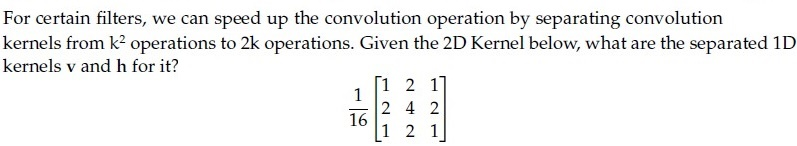

**Figure 7.** Source 2D convolution kernel for Question 255.

**Options**

**A.** $v = \frac{1}{4} \begin{bmatrix} 1 \\ 2 \\ 1 \end{bmatrix}, \quad h = \frac{1}{4} \begin{bmatrix} 1 \\ 2 \\ 1 \end{bmatrix}$  
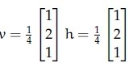

**Figure 8.** Option A image for Question 255.
*Option ID:* `6406533045039`

**B.** $v = \frac{1}{4} \begin{bmatrix} 1 \\ 2 \\ 1 \end{bmatrix}, \quad h = \frac{1}{4} \begin{bmatrix} 1 \\ 2 \\ 2 \end{bmatrix}$  
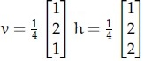

**Figure 9.** Option B image for Question 255.
*Option ID:* `6406533045040`

**C.** $v = \frac{1}{3} \begin{bmatrix} 4 \\ 2 \\ 3 \end{bmatrix}, \quad h = \frac{1}{2} \begin{bmatrix} 1 \\ 2 \\ 4 \end{bmatrix}$  
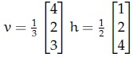

**Figure 10.** Option C image for Question 255.
*Option ID:* `6406533045041`

**D.** $v = \frac{1}{2} \begin{bmatrix} 1 \\ 1 \\ 1 \end{bmatrix}, \quad h = \frac{1}{2} \begin{bmatrix} 1 \\ 0 \\ 1 \end{bmatrix}$  
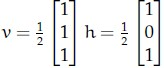

**Figure 11.** Option D image for Question 255.
*Option ID:* `6406533045042`

**Correct answer:** **A** — $v = \frac{1}{4} \begin{bmatrix} 1 \\ 2 \\ 1 \end{bmatrix}, \quad h = \frac{1}{4} \begin{bmatrix} 1 \\ 2 \\ 1 \end{bmatrix}$  
**Source evidence:** Option 6406533045039 is rendered in green text (#008000) with a checkmark icon. (PDF page 5).

---

### Question 256

**Question ID:** `640653904310` · **Type:** MCQ · **Marks:** 2  
**PDF pages:** 5, 6

Which one of the following distance measures is used to compare two images in dense registration through optical flow?

**Options**

**A.** Weighted squared difference  
*Option ID:* `6406533045051`

**B.** Weighted absolute difference  
*Option ID:* `6406533045052`

**C.** KL divergence  
*Option ID:* `6406533045053`

**D.** Cosine similarity  
*Option ID:* `6406533045054`

**Correct answer:** **A** — Weighted squared difference  
**Source evidence:** Option 6406533045051 is rendered in green text (#008000) with a checkmark icon. (PDF page 5).

---

### Question 257

**Question ID:** `640653904321` · **Type:** MCQ · **Marks:** 2  
**PDF pages:** 6

Which one of the following statements is false?

**Options**

**A.** Real-world RGB images can be thought of as matrices in continuous space on $\mathbb{R}^3$, but the images we store on a computer are discrete.  
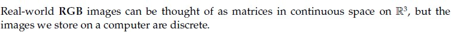

**Figure 12.** Option A image for Question 257.
*Option ID:* `6406533045064`

**B.** We can represent an RGB image as a function of the form $f : \mathbb{R}^3 \to \mathbb{R}$ where $\mathbb{R}^3$ represents image coordinates (channel, height, width) and $\mathbb{R}$ represents intensity.  
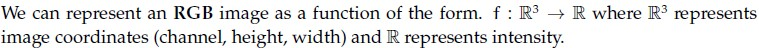

**Figure 13.** Option B image for Question 257.
*Option ID:* `6406533045065`

**C.** The transformation $I(x, y) = I(x, -y)$ flips the image $I$ upside down.  
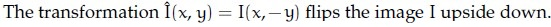

**Figure 14.** Option C image for Question 257.
*Option ID:* `6406533045066`

**D.** Denoising an image through the moving average filter is an example of a global operation as opposed to point or local operations.  
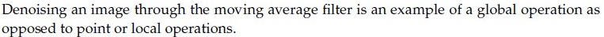

**Figure 15.** Option D image for Question 257.
*Option ID:* `6406533045067`

**Correct answer:** **D** — Denoising an image through the moving average filter is an example of a global operation as opposed to point or local operations.  
**Source evidence:** Option 6406533045067 is rendered with green label (#008000) and checkmark icon. (PDF page 6).

---

### Question 258

**Question ID:** `640653904323` · **Type:** MCQ · **Marks:** 2  
**PDF pages:** 6

What can we do with a generative model?
Match the following (select one among the options provided below):

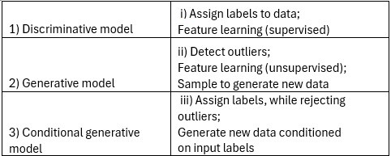

**Figure 16.** Source matching table for Question 258.

| Model Type | Purpose / Capability |
| :--- | :--- |
| 1) Discriminative model | i) Assign labels to data; Feature learning (supervised) |
| 2) Generative model | ii) Detect outliers; Feature learning (unsupervised); Sample to generate new data |
| 3) Conditional generative model | iii) Assign labels, while rejecting outliers; Generate new data conditioned on input labels |

**Options**

**A.** 1→iii,2→i, 3→ii  
*Option ID:* `6406533045073`

**B.** 1→i,2→iii, 3→ii  
*Option ID:* `6406533045074`

**C.** 1→ii,2→iii, 3→i  
*Option ID:* `6406533045075`

**D.** 1→i,2→ii, 3→iii  
*Option ID:* `6406533045076`

**Correct answer:** **D** — 1→i,2→ii, 3→iii  
**Source evidence:** Option 6406533045076 is rendered in green text (#008000) with a checkmark icon. (PDF page 6).

---

### Question 259

**Question ID:** `640653904330` · **Type:** MCQ · **Marks:** 2  
**PDF pages:** 7

Consider two $10 \times 10$ bounding boxes (one on the upper left and one on the lower right) in an image with an overlapping region of $4 \times 4$. The Intersection over Union (IoU) between the two boxes is (choose the closest value):

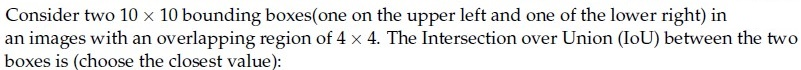

**Figure 17.** Source problem statement for Question 259.

**Options**

**A.** 21.3%  
*Option ID:* `6406533045082`

**B.** 12.8%  
*Option ID:* `6406533045083`

**C.** 11.5%  
*Option ID:* `6406533045084`

**D.** 8.7%  
*Option ID:* `6406533045085`

**Correct answer:** **D** — 8.7%  
**Source evidence:** Option 6406533045085 is rendered in green text (#008000) with a checkmark icon. (PDF page 7).

---

### Question 260

**Question ID:** `640653904301` · **Type:** SA · **Marks:** 2  
**PDF pages:** 7

Assume that you have been given an octave of scale-space representation of an image of size $N \times N$ that has been formed by convolving it with a Gaussian filter at different scales of $\sigma$, where $\sigma$ is varied from $k^0 \sigma_0$ to $k^4 \sigma_0$ and $k = \sqrt{2}$. The number of DoG (Difference-of-Gaussian) outputs obtained from the above octave is

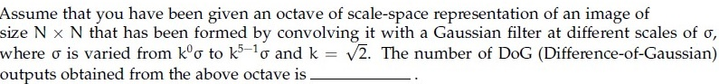

**Figure 18.** Source problem statement for Question 260.

**Correct answer:** `4`  
**Source evidence:** Official text specification: 'Possible Answers : 4'. (PDF page 7).

---

### Question 261

**Question ID:** `640653904324` · **Type:** SA · **Marks:** 2  
**PDF pages:** 7, 8

For a 3-bit grayscale image, the integral image is given as follows:

$$\begin{bmatrix} 3 & 7 & 10 \\ 6 & 9 & 13 \\ 7 & 12 & 18 \end{bmatrix}$$

The sum of all the pixels for the corresponding grayscale image is

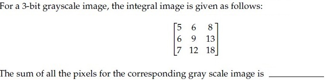

**Figure 19.** Source integral image matrix for Question 261.

**Correct answer:** `18`  
**Source evidence:** Official text specification: 'Possible Answers : 18'. (PDF page 8).

---

### Question 262

**Question ID:** `640653904325` · **Type:** SA · **Marks:** 2  
**PDF pages:** 8

What is the size of the feature map after applying two successive convolution operations with given parameters? Image size = $64 \times 64$, Kernel size = $6 \times 6$, Padding = 1 and Stride = 2. (In calculation, take $\lfloor x \rfloor$ whenever $x$ is non-integer. If the answer is $F \times F$, write $F$ in the blank).

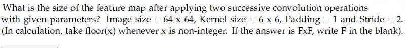

**Figure 20.** Source convolution parameters for Question 262.

**Correct answer:** `14`  
**Source evidence:** Official text specification: 'Possible Answers : 14'. (PDF page 8).

---

### Shared Context: Questions 263 to 271

**Comprehension ID:** `640653904311` · **Sub-Section:** 4 · **Total Marks:** 9 (9 subquestions × 1 mark)

Consider a vanilla transformer network at time step 't' shown below:

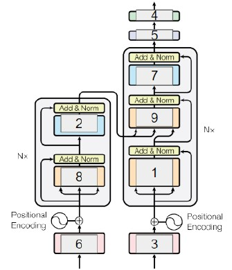

**Figure 21.** Vanilla transformer architecture at time step $t$ for Questions 263–271.

For each of the entities above, enter the appropriate Model component from the figure that corresponds to it:

Based on the above data, answer the given subquestions.

---

### Question 263

**Question ID:** `640653904312` · **Type:** SA · **Marks:** 1  
**PDF pages:** 9

Enter the answer for Model component 1

NOTE: Enter the exact answer without any space in the beginning or at the end.

*(Refer to Figure 21 for Model component labels)*

**Correct answer:** `Decoder Masked Multi-Head Attention`  
**Source evidence:** Official text specification: 'Possible Answers : Decoder Masked Multi-Head Attention'. (PDF page 9).

---

### Question 264

**Question ID:** `640653904313` · **Type:** SA · **Marks:** 1  
**PDF pages:** 9, 10

Enter the answer for Model component 2

NOTE: Enter the exact answer without any space in the beginning or at the end.

*(Refer to Figure 21 for Model component labels)*

**Correct answer:** `Encoder Feed Forward Layer`  
**Source evidence:** Official text specification: 'Possible Answers : Encoder Feed Forward Layer'. (PDF page 10).

---

### Question 265

**Question ID:** `640653904314` · **Type:** SA · **Marks:** 1  
**PDF pages:** 10

Enter the answer for Model component 3

NOTE: Enter the exact answer without any space in the beginning or at the end.

*(Refer to Figure 21 for Model component labels)*

**Correct answer:** `Output Embedding`  
**Source evidence:** Official text specification: 'Possible Answers : Output Embedding'. (PDF page 10).

---

### Question 266

**Question ID:** `640653904315` · **Type:** SA · **Marks:** 1  
**PDF pages:** 10

Enter the answer for Model component 4

NOTE: Enter the exact answer without any space in the beginning or at the end.

*(Refer to Figure 21 for Model component labels)*

**Correct answer:** `Softmax`  
**Source evidence:** Official text specification: 'Possible Answers : Softmax'. (PDF page 10).

---

### Question 267

**Question ID:** `640653904316` · **Type:** SA · **Marks:** 1  
**PDF pages:** 10, 11

Enter the answer for Model component 5

NOTE: Enter the exact answer without any space in the beginning or at the end.

*(Refer to Figure 21 for Model component labels)*

**Correct answer:** `Linear projection`  
**Source evidence:** Official text specification: 'Possible Answers : Linear projection'. (PDF page 11).

---

### Question 268

**Question ID:** `640653904317` · **Type:** SA · **Marks:** 1  
**PDF pages:** 11

Enter the answer for Model component 6

NOTE: Enter the exact answer without any space in the beginning or at the end.

*(Refer to Figure 21 for Model component labels)*

**Correct answer:** `Input Embedding`  
**Source evidence:** Official text specification: 'Possible Answers : Input Embedding'. (PDF page 11).

---

### Question 269

**Question ID:** `640653904318` · **Type:** SA · **Marks:** 1  
**PDF pages:** 11

Enter the answer for Model component 7

NOTE: Enter the exact answer without any space in the beginning or at the end.

*(Refer to Figure 21 for Model component labels)*

**Correct answer:** `Decoder Feed Forward Layer`  
**Source evidence:** Official text specification: 'Possible Answers : Decoder Feed Forward Layer'. (PDF page 11).

---

### Question 270

**Question ID:** `640653904319` · **Type:** SA · **Marks:** 1  
**PDF pages:** 12

Enter the answer for Model component 8

NOTE: Enter the exact answer without any space in the beginning or at the end.

*(Refer to Figure 21 for Model component labels)*

**Correct answer:** `Encoder Multi-Head Attention`  
**Source evidence:** Official text specification: 'Possible Answers : Encoder Multi-Head Attention'. (PDF page 12).

---

### Question 271

**Question ID:** `640653904320` · **Type:** SA · **Marks:** 1  
**PDF pages:** 12

Enter the answer for Model component 9

NOTE: Enter the exact answer without any space in the beginning or at the end.

*(Refer to Figure 21 for Model component labels)*

**Correct answer:** `Decoder Multi-Head Attention`  
**Source evidence:** Official text specification: 'Possible Answers : Decoder Multi-Head Attention'. (PDF page 12).

---

### Shared Context: Questions 272 to 274

**Comprehension ID:** `640653904326` · **Sub-Section:** 5 · **Total Marks:** 2 (0.67 + 0.67 + 0.66 marks)

In the context of VAE, if the encoder outputs $\mu = [0.3, 0.2, 0.1]$, $\sigma = [0.01, 0.5, 0.5]$ and $\epsilon \sim \mathcal{N}(0, I)$ is equal to $[0.1, 0.2, 0.3]$, then the latent vector $z = [z_1, z_2, z_3]$. Give the values upto 2 decimal places.

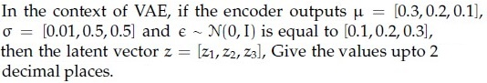

**Figure 22.** VAE encoder outputs and latent vector setup for Questions 272–274.

Based on the above data, answer the given subquestions.

---

### Question 272

**Question ID:** `640653904327` · **Type:** SA · **Marks:** 0.67  
**PDF pages:** 13

Find the value of $z_1$:

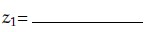

**Figure 23.** Prompt equation for Question 272.

*(Formula: $z_1 = \mu_1 + \sigma_1 \cdot \epsilon_1 = 0.3 + 0.01 \times 0.1 = 0.301$)*

**Correct answer:** `0.301`  
**Source evidence:** Official text specification: 'Possible Answers : 0.301'. (PDF page 13).

---

### Question 273

**Question ID:** `640653904328` · **Type:** SA · **Marks:** 0.67  
**PDF pages:** 13

Find the value of $z_2$:

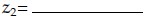

**Figure 24.** Prompt equation for Question 273.

*(Formula: $z_2 = \mu_2 + \sigma_2 \cdot \epsilon_2 = 0.2 + 0.5 \times 0.2 = 0.3$)*

**Correct answer:** `0.3`  
**Source evidence:** Official text specification: 'Possible Answers : 0.3'. (PDF page 13).

---

### Question 274

**Question ID:** `640653904329` · **Type:** SA · **Marks:** 0.66  
**PDF pages:** 13, 14

Find the value of $z_3$:

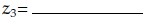

**Figure 25.** Prompt equation for Question 274.

*(Formula: $z_3 = \mu_3 + \sigma_3 \cdot \epsilon_3 = 0.1 + 0.5 \times 0.3 = 0.25$)*

**Correct answer:** `0.25`  
**Source evidence:** Official text specification: 'Possible Answers : 0.25'. (PDF page 14).

---

### Question 275

**Question ID:** `640653904308` · **Type:** MSQ · **Marks:** 2  
**PDF pages:** 14

Which one of the following statements is true?

**Options**

**A.** Attention mechanisms cannot be applied to the bidirectional RNN model  
*Option ID:* `6406533045043`

**B.** An image captioning network cannot be trained end-to-end even though we are using 2 different modalities to train the network  
*Option ID:* `6406533045044`

**C.** One of the key components in the vanilla transformer are the recurrent connections that help them to deal with variable input length.  
*Option ID:* `6406533045045`

**D.** None of these  
*Option ID:* `6406533045046`

**Correct answer:** **D** — None of these  
**Source evidence:** Option 6406533045046 is rendered in green text (#008000) with a checkmark icon. (PDF page 14).

---

### Question 276

**Question ID:** `640653904309` · **Type:** MSQ · **Marks:** 2  
**PDF pages:** 14

Which of the following statements are true? (Select all possible correct options)

**Options**

**A.** To apply attention on images, we can take the feature map from CNN of dimension $m \times n \times c$ and then unroll it into $m \times n$ vectors of dimensions $1 \times 1 \times c$ and apply attention to each of these $m \times n$ vectors  
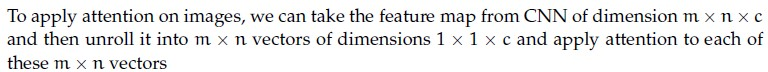

**Figure 26.** Option A image for Question 276.
*Option ID:* `6406533045047`

**B.** Autoencoder can be equivalent to Principal Component Analysis (PCA) provided we make use of non-linear activation functions  
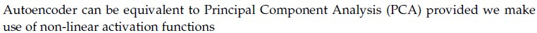

**Figure 27.** Option B image for Question 276.
*Option ID:* `6406533045048`

**C.** Explainability can be obtained as a byproduct of attention  
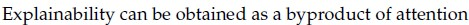

**Figure 28.** Option C image for Question 276.
*Option ID:* `6406533045049`

**D.** In the denoising autoencoder, we aim to reconstruct the noisy input as it is  
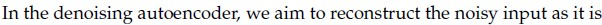

**Figure 29.** Option D image for Question 276.
*Option ID:* `6406533045050`

**Correct answer:** **A**, **C** — A, C  
**Source evidence:** Option 6406533045047 has green label (#008000) and checkmark icon. (PDF page 14).

---

### Question 277

**Question ID:** `640653904322` · **Type:** MSQ · **Marks:** 2  
**PDF pages:** 14, 15

In adversarial robustness literature, which of the following are white box attacks?

**Options**

**A.** Carlini and Wagner (C&W) attack  
*Option ID:* `6406533045068`

**B.** Projected Gradient Descent (PGD)  
*Option ID:* `6406533045069`

**C.** Random Input Transformation  
*Option ID:* `6406533045070`

**D.** Zeroth-Order Optimization (ZOO)  
*Option ID:* `6406533045071`

**E.** Opt-Attack  
*Option ID:* `6406533045072`

**Correct answer:** **A**, **B** — A, B — Carlini and Wagner (C&W) attack; Projected Gradient Descent (PGD)  
**Source evidence:** Option 6406533045068 is rendered in green text (#008000) with a checkmark icon. (PDF page 15).

---

### Question 278

**Question ID:** `640653904332` · **Type:** SA · **Marks:** 1  
**PDF pages:** 15

Consider a Faster R-CNN object detection framework, which is being trained with a minibatch size of 2. The RPN produces 512 proposals, out of which 5 and 8 of them are foreground proposals, corresponding to each image in the mini-batch. For a single mini-batch update, the bounding box regression loss will be computed ______________________ times.

**Correct answer:** `13`  
**Source evidence:** Official text specification: 'Possible Answers : 13'. (PDF page 15).

---

### Question 279

**Question ID:** `640653904331` · **Type:** MCQ · **Marks:** 1  
**PDF pages:** 15, 16

Match the following computer vision tasks to situations:

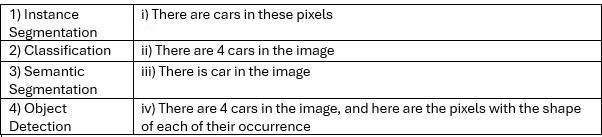

**Figure 30.** Source matching table for Question 279.

| Computer Vision Task | Situation |
| :--- | :--- |
| 1) Instance Segmentation | i) There are cars in these pixels |
| 2) Classification | ii) There are 4 cars in the image |
| 3) Semantic Segmentation | iii) There is car in the image |
| 4) Object Detection | iv) There are 4 cars in the image, and here are the pixels with the shape of each of their occurrence |

**Options**

**A.** 1→ iv, 2→ iii, 3→ ii, 4 → i  
*Option ID:* `6406533045086`

**B.** 1→ ii, 2→ iii, 3 → i, 4 →iv  
*Option ID:* `6406533045087`

**C.** 1→ iv, 2→ iii, 3→ i, 4 → ii  
*Option ID:* `6406533045088`

**D.** 1→ ii, 2→ iv, 3 → iii, 4→ i  
*Option ID:* `6406533045089`

**Correct answer:** **C** — 1→ iv, 2→ iii, 3→ i, 4 → ii  
**Source evidence:** Option 6406533045088 is rendered in green text (#008000) with a checkmark icon. (PDF page 16).

---

### Question 280

**Question ID:** `640653904333` · **Type:** MCQ · **Marks:** 1  
**PDF pages:** 16

Which of the following tasks are the Vision Language tasks?

**Options**

**A.** Image retrieval from text  
*Option ID:* `6406533045091`

**B.** Object detection from image and text  
*Option ID:* `6406533045092`

**C.** Visual Question Answering  
*Option ID:* `6406533045093`

**D.** All of these  
*Option ID:* `6406533045094`

**Correct answer:** **D** — All of these  
**Source evidence:** Option 6406533045094 is rendered in green text (#008000) with a checkmark icon. (PDF page 16).

---

### Question 281

**Question ID:** `640653904334` · **Type:** MCQ · **Marks:** 1  
**PDF pages:** 16

Generative Adversarial Networks (GANs) are widely used to generate new images. Many GAN-based architectures have been developed over the years to improve the quality of generation. Progressive GAN, a popular architecture among many others, uses a technique called progressive growing. Which one of the options below is the purpose for progressive growing?

**Options**

**A.** To grow the range of loss function  
*Option ID:* `6406533045095`

**B.** To gradually train the generator by increasing the resolution of images being generated in iterations  
*Option ID:* `6406533045096`

**C.** To iteratively train the generator to create 3D images from 2D ones  
*Option ID:* `6406533045097`

**D.** To shrink the size of the generator model so generator become faster  
*Option ID:* `6406533045098`

**Correct answer:** **B** — To gradually train the generator by increasing the resolution of images being generated in iterations  
**Source evidence:** Option 6406533045096 is rendered in green text (#008000) with a checkmark icon. (PDF page 16).

---

### Question 282

**Question ID:** `640653904335` · **Type:** MCQ · **Marks:** 1  
**PDF pages:** 16, 17

Which of the following is not a self-supervised learning method?

**Options**

**A.** Using triplet loss to ensure that embeddings from different viewpoints of an object at time $t$ share similar embeddings, while embeddings are different for time steps $t_i \neq t$.  
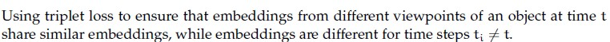

**Figure 31.** Option A image for Question 282.
*Option ID:* `6406533045099`

**B.** Training a class-conditional Variational Auto-Encoder.  
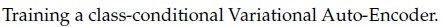

**Figure 32.** Option B image for Question 282.
*Option ID:* `6406533045100`

**C.** Using contrastive loss to enforce similarity between augmented versions of an image and dis-similarity between other images.  
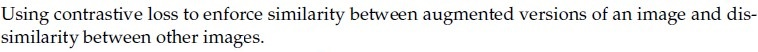

**Figure 33.** Option C image for Question 282.
*Option ID:* `6406533045101`

**D.** Predicting whether a set of frames from a video clip is in sequence.  
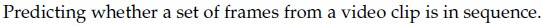

**Figure 34.** Option D image for Question 282.
*Option ID:* `6406533045102`

**Correct answer:** **B** — Training a class-conditional Variational Auto-Encoder.  
**Source evidence:** Option 6406533045100 is rendered with green label (#008000) and checkmark icon. (PDF page 16).

---

## Answer key

| Source question | Question ID | Correct answer | PDF page(s) |
| :--- | :--- | :--- | :--- |
| 249 | `640653904300` | A | 2 |
| 250 | `640653904302` | D | 2, 3 |
| 251 | `640653904303` | C | 3, 4 |
| 252 | `640653904304` | D | 4 |
| 253 | `640653904305` | A | 4 |
| 254 | `640653904306` | B | 4, 5 |
| 255 | `640653904307` | A | 5 |
| 256 | `640653904310` | A | 5, 6 |
| 257 | `640653904321` | D | 6 |
| 258 | `640653904323` | D | 6 |
| 259 | `640653904330` | D | 7 |
| 260 | `640653904301` | 4 | 7 |
| 261 | `640653904324` | 18 | 7, 8 |
| 262 | `640653904325` | 14 | 8 |
| 263 | `640653904312` | Decoder Masked Multi-Head Attention | 9 |
| 264 | `640653904313` | Encoder Feed Forward Layer | 9, 10 |
| 265 | `640653904314` | Output Embedding | 10 |
| 266 | `640653904315` | Softmax | 10 |
| 267 | `640653904316` | Linear projection | 10, 11 |
| 268 | `640653904317` | Input Embedding | 11 |
| 269 | `640653904318` | Decoder Feed Forward Layer | 11 |
| 270 | `640653904319` | Encoder Multi-Head Attention | 12 |
| 271 | `640653904320` | Decoder Multi-Head Attention | 12 |
| 272 | `640653904327` | 0.301 | 13 |
| 273 | `640653904328` | 0.3 | 13 |
| 274 | `640653904329` | 0.25 | 13, 14 |
| 275 | `640653904308` | D | 14 |
| 276 | `640653904309` | A, C | 14 |
| 277 | `640653904322` | A, B | 14, 15 |
| 278 | `640653904332` | 13 | 15 |
| 279 | `640653904331` | C | 15, 16 |
| 280 | `640653904333` | D | 16 |
| 281 | `640653904334` | B | 16 |
| 282 | `640653904335` | B | 16, 17 |

## Extraction notes

1. **Scope and Reconciliation:** Section header specifies `DL(CV)` with 25 parent question units and 50 marks. Sub-section 1 contains Question 248 (Question Id: 640653904299), which is the standard administrative subject confirmation (administrative subject confirmation question) and is excluded. The academic exam consists of 11 standalone MCQs (Q249–Q259, 22 marks), 3 standalone numerical SAs (Q260–Q262, 6 marks), Comprehension Passage 1 (Q263–Q271, 9 marks across 9 subquestions), Comprehension Passage 2 (Q272–Q274, 2 marks across 3 subquestions), 3 MSQs (Q275–Q277, 6 marks), 1 SA (Q278, 1 mark), and 4 MCQs (Q279–Q282, 4 marks). Total: 34 academic questions evaluated, exactly totaling 50 marks.
2. **Subsequent Subject:** Section 11 (`SPG`, Section Id: 64065364139) starting on page 17 is out-of-scope and excluded.
3. **Image Options and Mathematical Transcription:** Questions 250, 255, 257, 276, and 282 have option text embedded as raster figures in the original PDF. All raster crops have been faithfully extracted to `assets/da5006_2024T2_ET_AN/`, verified for non-emptiness, and transcribed into standard Markdown LaTeX alongside the original figures.
4. **Answer Grounding:** Every question answer is grounded directly in the source PDF via font colors (#008000 green spans for correct options vs #ff0000 red spans for incorrect options), checkmark/cross icons, or explicit `Possible Answers` text fields. No answer has been guessed or inferred.
