# DL(CV) — da5006_2024T2_Q1_NA

**Subject:** Deep Learning for Computer Vision  
**Source:** `da5006_2024T2_Q1_NA.pdf` (original PDF omitted from this bundle)  
**Academic questions:** 29  
**Scope:** DL(CV) section (Questions 81–109); administrative subject confirmation (Question 80) excluded.

## Questions

### Question 81

**Question ID:** `640653829644` · **Type:** MSQ · **Marks:** 2  
**PDF pages:** 2–3

Which of the following linear filters will leave the central value of the given matrix unchanged?

$$\begin{bmatrix} 10 & 20 & 10 \\ 20 & 10 & 20 \\ 10 & 20 & 10 \end{bmatrix}$$

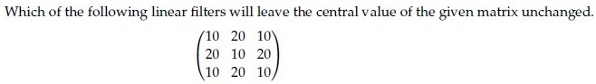

**Figure 1.** Source question stem matrix for Question 81.

**Options**

**A.** Filter kernel with central weight 1/5:

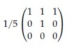

**Figure 2.** Option A filter kernel for Question 81.

*Option ID:* `6406532786640`

**B.** Filter kernel:

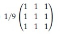

**Figure 3.** Option B filter kernel for Question 81.

*Option ID:* `6406532786641`

**C.** Filter kernel with central weight 1/5:

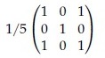

**Figure 4.** Option C filter kernel for Question 81.

*Option ID:* `6406532786642`

**D.** Filter kernel:

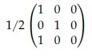

**Figure 5.** Option D filter kernel for Question 81.

*Option ID:* `6406532786643`

**Correct answer:** **A**, **C** — Filter kernels with option IDs `6406532786640` and `6406532786642`.  
**Source evidence:** Green check mark icons beside Option A (y=647.6) and Option C (y=796.8) on PDF page 2; red cross icons beside Option B (page 2) and Option D (page 3).

---

### Question 82

**Question ID:** `640653829647` · **Type:** MSQ · **Marks:** 2  
**PDF pages:** 3

Certain 2D kernel $K$ can be decomposed into two 1D kernels ($v$ and $h$) to reduce the computation cost such as $K = vh^T$. The 2D kernel is called as Separable Kernel.  
Consider the following 2D kernels. Which of the given kernels are separable?

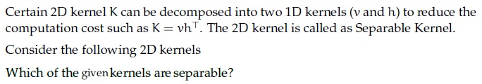

**Figure 6.** Source question stem for Question 82.

**Options**

**A.** 2D kernel:

$$\begin{bmatrix} 2 & 4 & 6 \\ 3 & 6 & 9 \\ 1 & 2 & 3 \end{bmatrix}$$

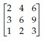

**Figure 7.** Option A 2D kernel for Question 82.

*Option ID:* `6406532786649`

**B.** 2D kernel:

$$\begin{bmatrix} 2 & 4 & 6 \\ 3 & 6 & 9 \\ 2 & 3 & 4 \end{bmatrix}$$

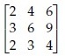

**Figure 8.** Option B 2D kernel for Question 82.

*Option ID:* `6406532786650`

**C.** 2D kernel:

$$\begin{bmatrix} 5 & 0 & -5 \\ 10 & 0 & 10 \\ 5 & 0 & 5 \end{bmatrix}$$

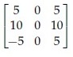

**Figure 9.** Option C 2D kernel for Question 82.

*Option ID:* `6406532786651`

**D.** 2D kernel:

$$\begin{bmatrix} 5 & 0 & -5 \\ 10 & 0 & -10 \\ 5 & 0 & -5 \end{bmatrix}$$

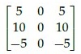

**Figure 10.** Option D 2D kernel for Question 82.

*Option ID:* `6406532786652`

**Correct answer:** **A**, **D** — Option A (rank-1 matrix) and Option D (rank-1 matrix).  
**Source evidence:** Green check mark icons beside Option A (y=354.0) and Option D (y=579.2) on PDF page 3; red cross icons beside Option B (y=426.3) and Option C (y=504.7).

---

### Question 83

**Question ID:** `640653829673` · **Type:** MSQ · **Marks:** 2  
**PDF pages:** 3–4

Which of the following are true? (Select all that apply)

**Options**

**A.** To get the output with the same size as that of the input after a convolution with kernel size $k \times k$ ($k$ is odd) and stride 1, padding used is $\frac{k-1}{2}$.

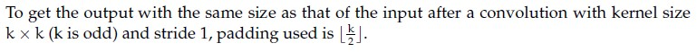

**Figure 11.** Option A statement for Question 83.

*Option ID:* `6406532786699`

**B.** Derivative of loss w.r.t. input image $X$, where $Y = X * W$ is $\frac{\partial L}{\partial X} = \frac{\partial L}{\partial Y} \star W$, where $*$ represents convolution and $\star$ represents correlation.

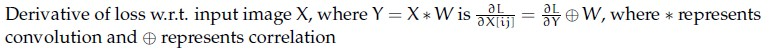

**Figure 12.** Option B statement for Question 83.

*Option ID:* `6406532786700`

**C.** The number of learnable parameters in a pooling layer is not 0.

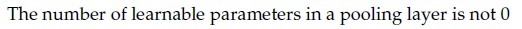

**Figure 13.** Option C statement for Question 83.

*Option ID:* `6406532786701`

**D.** The number of feature maps obtained after a convolution operation depends on the depth of the input but not on the number of filters.

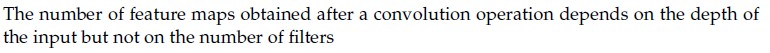

**Figure 14.** Option D statement for Question 83.

*Option ID:* `6406532786702`

**Correct answer:** **A**, **B**  
**Source evidence:** Green check mark icons beside Option A (page 3, y=767.5) and Option B (page 3, y=804.6); red cross icons beside Option C (page 4, y=91.3) and Option D (page 4, y=155.4).

---

### Question 84

**Question ID:** `640653829645` · **Type:** MCQ · **Marks:** 2  
**PDF pages:** 4

Which of the following statements is True?

**Options**

**A.** Gaussian filter is Separable filter because it is non linear.  
*Option ID:* `6406532786644`

**B.** Median filter is a non separable filter  
*Option ID:* `6406532786645`

**C.** Gaussian filter is a High Pass filter.  
*Option ID:* `6406532786646`

**D.** Mean filter is a non separable filter because it is non linear  
*Option ID:* `6406532786647`

**Correct answer:** **B** — Median filter is a non separable filter.  
**Source evidence:** Green check mark icon beside Option B on PDF page 4 (y=391.7); red cross icons beside Option A (y=370.9), Option C (y=412.6), and Option D (y=433.4).

---

### Question 85

**Question ID:** `640653829648` · **Type:** MCQ · **Marks:** 2  
**PDF pages:** 4

In Bilateral filtering, we do not reject the pixels whose values differ too much from the central pixel value.

**Options**

**A.** TRUE  
*Option ID:* `6406532786653`

**B.** FALSE  
*Option ID:* `6406532786654`

**Correct answer:** **B** — FALSE.  
**Source evidence:** Green check mark icon beside Option B on PDF page 4 (y=611.8); red cross icon beside Option A (y=590.9).

---

### Question 86

**Question ID:** `640653829649` · **Type:** MCQ · **Marks:** 2  
**PDF pages:** 4–6

Which of the following is the Fourier image of the given intensity image?

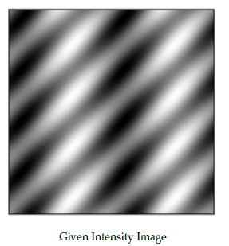

**Figure 15.** Given intensity image for Question 86.

**Options**

**A.** Fourier image candidate A:

**Figure 16.** Option A Fourier image for Question 86.

*Option ID:* `6406532786655`

**B.** Fourier image candidate B:

**Figure 17.** Option B Fourier image for Question 86.

*Option ID:* `6406532786656`

**C.** Fourier image candidate C:

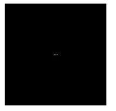

**Figure 18.** Option C Fourier image for Question 86.

*Option ID:* `6406532786657`

**D.** Fourier image candidate D:

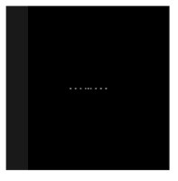

**Figure 19.** Option D Fourier image for Question 86.

*Option ID:* `6406532786658`

**Correct answer:** **B** — Fourier image candidate B (Option ID `6406532786656`).  
**Source evidence:** Green check mark icon beside Option B on PDF page 5 (y=568.7); red cross icons beside Option A (page 5, y=404.8), Option C (page 5, y=734.7), and Option D (page 5, y=771.9).

---

### Question 87

**Question ID:** `640653829654` · **Type:** MCQ · **Marks:** 2  
**PDF pages:** 6

Identify the correct sequence of steps in Scale Invariant Feature Transform (SIFT) method. Steps listed below:  

1. Keypoint Descriptor  
2. Keypoint Localization  
3. Scale-space Extrema Detection  
4. Orientation Estimation

**Options**

**A.** 4→ 2→ 1→ 3  
*Option ID:* `6406532786662`

**B.** 3→ 2→ 4→ 1  
*Option ID:* `6406532786663`

**C.** 3→ 1→ 2→ 4  
*Option ID:* `6406532786664`

**D.** None of these  
*Option ID:* `6406532786665`

**Correct answer:** **B** — 3→ 2→ 4→ 1.  
**Source evidence:** Green check mark icon beside Option B on PDF page 6 (y=431.8); red cross icons beside Option A (y=411.0), Option C (y=452.6), and Option D (y=473.4).

---

### Question 88

**Question ID:** `640653829655` · **Type:** MCQ · **Marks:** 2  
**PDF pages:** 6

Match the Following:  

| Left Column | Right Column |
| :--- | :--- |
| 1) Keypoint Descriptor | i) Assign orientation to each local keypoint using image gradients |
| 2) Keypoint Localization | ii) Extract local image gradients at selected scale around keypoint |
| 3) Scale-space Extrema Detection | iii) Determine location and scale at each candidate location |
| 4) Orientation Estimation | iv) Detect interesting points using DOG. |

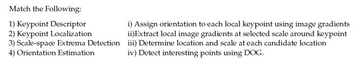

**Figure 20.** Source matching table for Question 88.

**Options**

**A.** 1→iii, 2 → ii , 3→ i , 4 → iv  
*Option ID:* `6406532786666`

**B.** 1→iv, 2→ i , 3 → ii , 4→ iii  
*Option ID:* `6406532786667`

**C.** 1→ii, 2 → iii , 3→ iv , 4→ i  
*Option ID:* `6406532786668`

**D.** None of these  
*Option ID:* `6406532786669`

**Correct answer:** **C** — 1→ii, 2 → iii , 3→ iv , 4→ i.  
**Source evidence:** Green check mark icon beside Option C on PDF page 6 (y=741.8); red cross icons beside Option A (y=700.1), Option B (y=720.9), and Option D (y=762.6).

---

### Question 89

**Question ID:** `640653829663` · **Type:** MCQ · **Marks:** 2  
**PDF pages:** 6–7

Match the Following:  

| Left Column | Right Column |
| :--- | :--- |
| 1) Flat region in the image | i) No Change along the edge direction |
| 2) Edge pixel | ii) Significant change in all directions |
| 3) Corner pixel | iii) No Change in all directions |

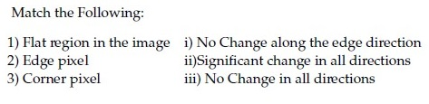

**Figure 21.** Source matching table for Question 89.

**Options**

**A.** 1→ iii, 2→ i, 3 → ii  
*Option ID:* `6406532786675`

**B.** 1→ iii, 2→ ii, 3 → i  
*Option ID:* `6406532786676`

**C.** 1→ ii, 2→ iii, 3 → i  
*Option ID:* `6406532786677`

**D.** None of these  
*Option ID:* `6406532786678`

**Correct answer:** **A** — 1→ iii, 2→ i, 3 → ii.  
**Source evidence:** Green check mark icon beside Option A on PDF page 7 (y=169.0); red cross icons beside Option B (y=189.8), Option C (y=210.7), and Option D (y=231.5).

---

### Question 90

**Question ID:** `640653829669` · **Type:** MCQ · **Marks:** 2  
**PDF pages:** 7

In RANSAC, what is the probability that the algorithm never selects a whole set of inliers from 20 data points (which has 5 inliers in total) for k = 2 time steps? Here, n = 2 is the minimum number of samples to fit a model.

**Options**

**A.** 0.2  
*Option ID:* `6406532786683`

**B.** 0.93  
*Option ID:* `6406532786684`

**C.** 0.87  
*Option ID:* `6406532786685`

**D.** 0  
*Option ID:* `6406532786686`

**Correct answer:** **C** — 0.87.  
**Source evidence:** Green check mark icon beside Option C on PDF page 7 (y=447.0); red cross icons beside Option A (y=405.4), Option B (y=426.2), and Option D (y=467.8).

---

### Question 91

**Question ID:** `640653829670` · **Type:** MCQ · **Marks:** 2  
**PDF pages:** 7

Suppose we have a codebook of 2048 SIFT visual words. We extract 1000 SIFT descriptors (SIFT is a 128-dimensional feature) from a new image. What is the dimensionality of the BoW (Bag-of-Words) descriptor?

**Options**

**A.** 1000  
*Option ID:* `6406532786687`

**B.** 128  
*Option ID:* `6406532786688`

**C.** 128 × 2048  
*Option ID:* `6406532786689`

**D.** 2048  
*Option ID:* `6406532786690`

**Correct answer:** **D** — 2048.  
**Source evidence:** Green check mark icon beside Option D on PDF page 7 (y=704.2); red cross icons beside Option A (y=641.7), Option B (y=662.5), and Option C (y=683.3).

---

### Question 92

**Question ID:** `640653829671` · **Type:** MCQ · **Marks:** 2  
**PDF pages:** 7–8

Match the Following:  

| Left Column | Right Column |
| :--- | :--- |
| 1) RANSAC | i) Used for image segmentation |
| 2) VLAD | ii) Performance depends on number of inliers |
| 3) Image retrieval | iii) Assumes nearby pixels have similar motion |
| 4) Optical flow | iv) Inverted file index |
| | v) Vector representation of visual word |

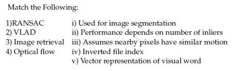

**Figure 22.** Source matching table for Question 92.

**Options**

**A.** 1→ iii, 2→ ii, 3 → vi, 4→ i  
*Option ID:* `6406532786691`

**B.** 1→ v, 2→i, 3 → vi, 4→ iii  
*Option ID:* `6406532786692`

**C.** 1→ iii, 2→ i, 3 → ii, 4 → v  
*Option ID:* `6406532786693`

**D.** 1→ ii, 2→ v, 3 → iv, 4→ iii  
*Option ID:* `6406532786694`

**Correct answer:** **D** — 1→ ii, 2→ v, 3 → iv, 4→ iii.  
**Source evidence:** Green check mark icon beside Option D on PDF page 8 (y=216.8); red cross icons beside Option A (y=154.4), Option B (y=175.2), and Option C (y=196.0).

---

### Question 93

**Question ID:** `640653829672` · **Type:** MCQ · **Marks:** 2  
**PDF pages:** 8

Match the derivative of activation functions $f(x)$ with their counterparts on the right column accordingly.  

| Left Column | Right Column |
| :--- | :--- |
| 1) Leaky ReLU | i) $f(x)(1 - f(x))$ |
| 2) Tanh | ii) $0$ if $x < 0$ and $1$ if $x > 0$ |
| 3) ReLU | iii) $1 - f(x)^2$ |
| 4) Sigmoid | iv) $0.01$ if $x < 0$ and $1$ if $x > 0$ |
| | v) $0$ if $x > 0$ and $1$ if $x < 0$ |
| | vi) $0.01$ if $x > 0$ and $1$ if $x < 0$ |

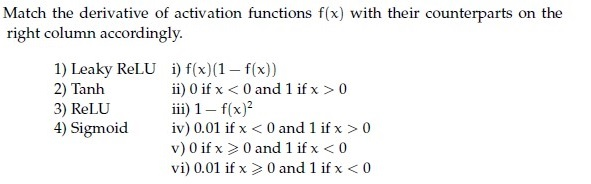

**Figure 23.** Source matching table for Question 93.

**Options**

**A.** 1→ vi, 2→ iii, 3→ v, 4 → i  
*Option ID:* `6406532786695`

**B.** 1→ i, 2→ iv, 3 → iii, 4→ ii  
*Option ID:* `6406532786696`

**C.** 1→ i, 2→ v, 3 → iii, 4→ iv  
*Option ID:* `6406532786697`

**D.** 1→ iv, 2→ iii, 3→ ii, 4 → i  
*Option ID:* `6406532786698`

**Correct answer:** **D** — 1→ iv, 2→ iii, 3→ ii, 4 → i.  
**Source evidence:** Green check mark icon beside Option D on PDF page 8 (y=545.7); red cross icons beside Option A (y=483.3), Option B (y=504.1), and Option C (y=524.9).

---

### Question 94

**Question ID:** `640653829676` · **Type:** MCQ · **Marks:** 2  
**PDF pages:** 8–9

Consider a Convolutional Neural Network which processes an RGB image. It has 128 kernels each of spatial dimension 5 × 5 in the first layer. They are convolved with a stride 1. This is followed by a max-pooling layer with stride 2 and kernel size 5 × 5. What would be the receptive field size of a single neuron in the pooling layer? (Recap: A receptive field is the size of the region in the input image, which influences the activation of that specific neuron.)

**Options**

**A.** 5 × 5  
*Option ID:* `6406532786705`

**B.** 7 × 7  
*Option ID:* `6406532786706`

**C.** 9 × 9  
*Option ID:* `6406532786707`

**D.** 3 × 3  
*Option ID:* `6406532786708`

**Correct answer:** **C** — 9 × 9.  
**Source evidence:** Green check mark icon beside Option C on PDF page 8 (y=793.9); red cross icons beside Option A (page 8, y=752.2), Option B (page 8, y=773.1), and Option D (page 9, y=18.3).

---

### Question 95

**Question ID:** `640653829646` · **Type:** SA · **Marks:** 2  
**PDF pages:** 9

Consider the grayscale image shown below:

$$\begin{bmatrix} 0 & 30 & 25 & 30 & 40 \\ 45 & 10 & 40 & 35 & 20 \\ 15 & 20 & 30 & 25 & 50 \\ 50 & 40 & 35 & 15 & 30 \\ 10 & 35 & 25 & 20 & 45 \end{bmatrix}$$

If a median filter with a 3 × 3 neighborhood is applied to this image with a stride of 1 and no padding, ______ will be the value at position (2, 2) in the filtered image? (Assume that the top-left pixel coordinate of output image is addressed as (1,1))?

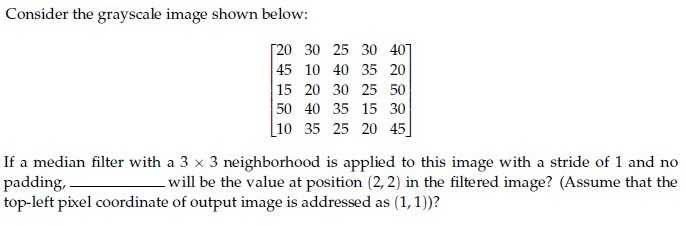

**Figure 24.** Source grayscale matrix for Question 95.

**Correct answer:** `30`  
**Source evidence:** Explicit official answer in `Possible Answers: 30` on PDF page 9.

---

### Question 96

**Question ID:** `640653829653` · **Type:** SA · **Marks:** 2  
**PDF pages:** 9

Given a 2 × 2 matrix $M = \begin{bmatrix} 1 & 2 \\ 2 & 1 \end{bmatrix}$ where $M$ is the second moment matrix of edge pixels that is obtained while applying the Canny edge detector, the measure of straightness is —____  

NOTE: Enter your answer in two decimal places.

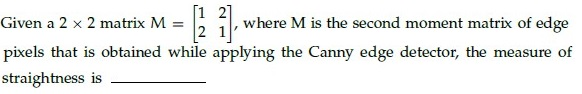

**Figure 25.** Source question stem for Question 96.

**Correct answer:** `-0.33`  
**Source evidence:** Explicit official answer in `Possible Answers: -0.33` on PDF page 9.

---

### Question 97

**Question ID:** `640653829674` · **Type:** SA · **Marks:** 2  
**PDF pages:** 10

What is the size of the feature map after applying two successive convolution operations with given parameters? Image size = 64 x 64, Kernel size = 6 x 6, Padding = 1 and Stride = 2. (In calculation, take floor(x) whenever x is non-integer. If the answer is FxF, write F in the blank). ___________

**Correct answer:** `14`  
**Source evidence:** Explicit official answer in `Possible Answers: 14` on PDF page 10.

---

### Question 98

**Question ID:** `640653829675` · **Type:** SA · **Marks:** 2  
**PDF pages:** 10

Let an input to a convolutional layer in a CNN have size Df × Df × M where Df = 64 and M = 16, and output feature map (after passing input through conv layer) has Df × Df × N size where N = 8. Let the kernel in the conv layer be k × k where k = 3. Calculate the number of parameters for this convolution layer. (Assume appropriate padding is applied for all convolutions so the input and output sizes are equal. Ignore the bias term in the calculation).

**Correct answer:** `1152`  
**Source evidence:** Explicit official answer in `Possible Answers: 1152` on PDF page 10.

---

### Question 99

**Question ID:** `640653829651` · **Type:** SA · **Marks:** 1  
**PDF pages:** 10–11

**Context:** For a 3-bit grayscale image, the integral image is given as follows:

$$\begin{bmatrix} 5 & 6 & 8 \\ 6 & 9 & 13 \\ 7 & 12 & 18 \end{bmatrix}$$

The pixel intensity that occurs the most (a) ____ and least (b) ____ for the corresponding grayscale image. (Enter an integer value).  
Based on the above data, answer the given subquestions.

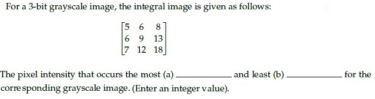

**Figure 26.** Source comprehension integral image for Questions 99–100.

**Subquestion:** Fill in the blank for (a)________________

**Correct answer:** `2`  
**Source evidence:** Explicit official answer in `Possible Answers: 2` on PDF page 11.

---

### Question 100

**Question ID:** `640653829652` · **Type:** SA · **Marks:** 1  
**PDF pages:** 10–11

**Context:** For a 3-bit grayscale image, the integral image is given as follows:

$$\begin{bmatrix} 5 & 6 & 8 \\ 6 & 9 & 13 \\ 7 & 12 & 18 \end{bmatrix}$$

The pixel intensity that occurs the most (a) ____ and least (b) ____ for the corresponding grayscale image. (Enter an integer value).  
Based on the above data, answer the given subquestions.

**Subquestion:** Fill in the blank for (b)_____________________

**Correct answer:** `5`  
**Source evidence:** Explicit official answer in `Possible Answers: 5` on PDF page 11.

---

### Question 101

**Question ID:** `640653829657` · **Type:** SA · **Marks:** 2  
**PDF pages:** 11–12

**Context:** The gradient of an image I, points in the direction of most rapid change in intensity, taking image derivatives accentuates (a) ____ frequencies and hence amplifies noise, since the proportion of noise to signal is larger at (b) frequencies. The solution to this is (c) ______ the image prior to computing gradients.  
Based on the above data, answer the given subquestions.

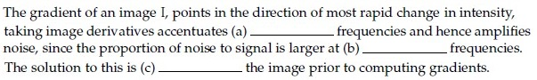

**Figure 27.** Source comprehension passage for Questions 101–103.

**Subquestion:** Fill in the blank for (a)_____________________

**Correct answer:** `high`  
**Source evidence:** Explicit official answer in `Possible Answers: high` on PDF page 12.

---

### Question 102

**Question ID:** `640653829658` · **Type:** SA · **Marks:** 1  
**PDF pages:** 11–12

**Context:** The gradient of an image I, points in the direction of most rapid change in intensity, taking image derivatives accentuates (a) ____ frequencies and hence amplifies noise, since the proportion of noise to signal is larger at (b) frequencies. The solution to this is (c) ______ the image prior to computing gradients.  
Based on the above data, answer the given subquestions.

**Subquestion:** Fill in the blank for (b) _____________________

**Correct answer:** `high`  
**Source evidence:** Explicit official answer in `Possible Answers: high` on PDF page 12.

---

### Question 103

**Question ID:** `640653829659` · **Type:** SA · **Marks:** 1  
**PDF pages:** 11–13

**Context:** The gradient of an image I, points in the direction of most rapid change in intensity, taking image derivatives accentuates (a) ____ frequencies and hence amplifies noise, since the proportion of noise to signal is larger at (b) frequencies. The solution to this is (c) ______ the image prior to computing gradients.  
Based on the above data, answer the given subquestions.

**Subquestion:** Fill in the blank for (c) _____________________

**Correct answer:** `smooth`  
**Source evidence:** Explicit official answer in `Possible Answers: smooth` on PDF page 13.

---

### Question 104

**Question ID:** `640653829661` · **Type:** SA · **Marks:** 2  
**PDF pages:** 13

**Context:** In Canny edge detection, large value of the Gaussian kernel spread, $\sigma$ leads to (a) edges, and small value of $\sigma$ leads to (b) edges.  
Based on the above data, answer the given subquestions.

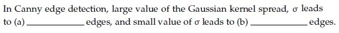

**Figure 28.** Source comprehension passage for Questions 104–105.

**Subquestion:** Fill in the blank for (a):

**Correct answer:** `thick` (accepted alternatives: `coarse`, `large scale`)  
**Source evidence:** Explicit official accepted answer set in `Possible Answers: thick / coarse / large scale` on PDF page 13.

---

### Question 105

**Question ID:** `640653829662` · **Type:** SA · **Marks:** 2  
**PDF pages:** 13–14

**Context:** In Canny edge detection, large value of the Gaussian kernel spread, $\sigma$ leads to (a) edges, and small value of $\sigma$ leads to (b) edges.  
Based on the above data, answer the given subquestions.

**Subquestion:** Fill in the blank for (b):

**Correct answer:** `fine`  
**Source evidence:** Explicit official answer in `Possible Answers: fine` on PDF page 14.

---

### Question 106

**Question ID:** `640653829665` · **Type:** SA · **Marks:** 1  
**PDF pages:** 14

**Context:** For the given figure, complete the transformation matrix with x — shear = 0.5:

$$\begin{bmatrix} x' \\ y' \\ 1 \end{bmatrix} = \begin{bmatrix} a_{11} & a_{12} & 0 \\ a_{21} & a_{22} & 0 \\ 0 & 0 & 1 \end{bmatrix} \begin{bmatrix} x \\ y \\ 1 \end{bmatrix}$$

Based on the above data, answer the given subquestions.

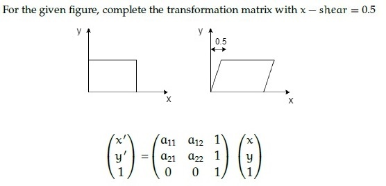

**Figure 29.** Source comprehension transformation diagram for Questions 106–109.

**Subquestion:** $a_{11} =$ ________

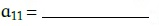

**Figure 30.** Source subquestion expression for Question 106.

**Correct answer:** `1`  
**Source evidence:** Explicit official answer in `Possible Answers: 1` on PDF page 14.

---

### Question 107

**Question ID:** `640653829666` · **Type:** SA · **Marks:** 1  
**PDF pages:** 14–15

**Context:** For the given figure, complete the transformation matrix with x — shear = 0.5:

$$\begin{bmatrix} x' \\ y' \\ 1 \end{bmatrix} = \begin{bmatrix} a_{11} & a_{12} & 0 \\ a_{21} & a_{22} & 0 \\ 0 & 0 & 1 \end{bmatrix} \begin{bmatrix} x \\ y \\ 1 \end{bmatrix}$$

Based on the above data, answer the given subquestions.

**Subquestion:** $a_{12} =$ ________

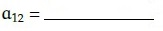

**Figure 31.** Source subquestion expression for Question 107.

**Correct answer:** `0.5`  
**Source evidence:** Explicit official answer in `Possible Answers: 0.5` on PDF page 15.

---

### Question 108

**Question ID:** `640653829667` · **Type:** SA · **Marks:** 1  
**PDF pages:** 15

**Context:** For the given figure, complete the transformation matrix with x — shear = 0.5:

$$\begin{bmatrix} x' \\ y' \\ 1 \end{bmatrix} = \begin{bmatrix} a_{11} & a_{12} & 0 \\ a_{21} & a_{22} & 0 \\ 0 & 0 & 1 \end{bmatrix} \begin{bmatrix} x \\ y \\ 1 \end{bmatrix}$$

Based on the above data, answer the given subquestions.

**Subquestion:** $a_{21} =$ ________

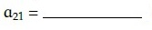

**Figure 32.** Source subquestion expression for Question 108.

**Correct answer:** `0`  
**Source evidence:** Explicit official answer in `Possible Answers: 0` on PDF page 15.

---

### Question 109

**Question ID:** `640653829668` · **Type:** SA · **Marks:** 1  
**PDF pages:** 15

**Context:** For the given figure, complete the transformation matrix with x — shear = 0.5:

$$\begin{bmatrix} x' \\ y' \\ 1 \end{bmatrix} = \begin{bmatrix} a_{11} & a_{12} & 0 \\ a_{21} & a_{22} & 0 \\ 0 & 0 & 1 \end{bmatrix} \begin{bmatrix} x \\ y \\ 1 \end{bmatrix}$$

Based on the above data, answer the given subquestions.

**Subquestion:** $a_{22} =$ ________

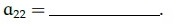

**Figure 33.** Source subquestion expression for Question 109.

**Correct answer:** `1`  
**Source evidence:** Explicit official answer in `Possible Answers: 1` on PDF page 15.

## Answer key

| Source question | Question ID | Correct answer | PDF page(s) |
| :--- | :--- | :--- | :--- |
| 81 | `640653829644` | A, C | 2–3 |
| 82 | `640653829647` | A, D | 3 |
| 83 | `640653829673` | A, B | 3–4 |
| 84 | `640653829645` | B | 4 |
| 85 | `640653829648` | B | 4 |
| 86 | `640653829649` | B | 4–6 |
| 87 | `640653829654` | B | 6 |
| 88 | `640653829655` | C | 6 |
| 89 | `640653829663` | A | 6–7 |
| 90 | `640653829669` | C | 7 |
| 91 | `640653829670` | D | 7 |
| 92 | `640653829671` | D | 7–8 |
| 93 | `640653829672` | D | 8 |
| 94 | `640653829676` | C | 8–9 |
| 95 | `640653829646` | 30 | 9 |
| 96 | `640653829653` | -0.33 | 9 |
| 97 | `640653829674` | 14 | 10 |
| 98 | `640653829675` | 1152 | 10 |
| 99 | `640653829651` | 2 | 10–11 |
| 100 | `640653829652` | 5 | 10–11 |
| 101 | `640653829657` | high | 11–12 |
| 102 | `640653829658` | high | 11–12 |
| 103 | `640653829659` | smooth | 11–13 |
| 104 | `640653829661` | thick (or coarse, large scale) | 13 |
| 105 | `640653829662` | fine | 13–14 |
| 106 | `640653829665` | 1 | 14 |
| 107 | `640653829666` | 0.5 | 14–15 |
| 108 | `640653829667` | 0 | 15 |
| 109 | `640653829668` | 1 | 15 |

## Extraction notes

- Question 80 (administrative subject confirmation) has been excluded in accordance with the extraction contract.
- Declared question count in section header is 23, representing 23 parent question items (1 administrative item + 18 standalone questions + 4 comprehension groups). The total number of individually scored academic questions is 29 (Questions 81 to 109).
- All 33 images (question stems, math formulas, matching tables, and image options) have been extracted natively at original resolution, verified, and embedded with sequential figure numbers and captions.
- Every correct answer is backed by visible source evidence from green check mark icons or explicit 'Possible Answers' scoring entries.
