# DL(CV) — da5006_2024T2_Q2_NA

**Subject:** Deep Learning for Computer Vision  
**Source:** `da5006_2024T2_Q2_NA.pdf` (original PDF omitted from this bundle)  
**Academic questions:** 29  
**Scope:** DL(CV) section; administrative subject confirmation excluded.

## Questions

### Question 117

**Question ID:** `640653856578` · **Type:** MCQ · **Marks:** 2  
**PDF pages:** 2, 3

Which one of the below statements is incorrect?

**Options**

**A.** Global Average Pooling (GAP) technique is used in both CAM and Grad-CAM.  
*Option ID:* `6406532878458`

**B.** The purpose of GAP is to find an importance score for every feature map, which represents how much that feature map contributes to generate the explanation.  
*Option ID:* `6406532878459`

**C.** For both CAM and Grad-CAM, explanation can be generated with respect to any layer of a CNN.  
*Option ID:* `6406532878460`

**D.** For every pixel in the feature map, Grad-CAM++ assigns different weightage, whereas Grad-CAM gives the same weightage.  
*Option ID:* `6406532878461`

**Correct answer:** **C** — For both CAM and Grad-CAM, explanation can be generated with respect to any layer of a CNN..  
**Source evidence:** Green check icon beside option ID 6406532878460 on page 3.

---

### Question 118

**Question ID:** `640653856579` · **Type:** MCQ · **Marks:** 2  
**PDF pages:** 3

Which one of the following statements is false?

**Options**

**A.** In a max pooling layer, the unit that gets selected (maximum entry) in forward propagation gets all the gradient during backpropagation.  
*Option ID:* `6406532878462`

**B.** Residual blocks are used in ResNets to avoid the vanishing gradient problem.  
*Option ID:* `6406532878463`

**C.** Feature maps of initial layers of a CNN capture more abstract concepts than the feature maps of final layers.  
*Option ID:* `6406532878464`

**D.** Dilated convolution increases the receptive field size when compared to the standard convolution operator.  
*Option ID:* `6406532878465`

**Correct answer:** **C** — Feature maps of initial layers of a CNN capture more abstract concepts than the feature maps of final layers..  
**Source evidence:** Green check icon beside option ID 6406532878464 on page 3.

---

### Question 119

**Question ID:** `640653856580` · **Type:** MCQ · **Marks:** 2  
**PDF pages:** 3

Match the following:

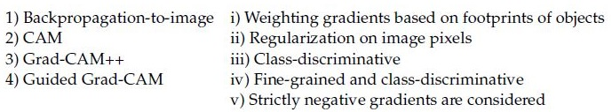

**Figure 1.** Source matching table for Question 119.

| Column 1 | Column 2 |
| :--- | :--- |
| 1) Backpropagation-to-image | i) Weighting gradients based on footprints of objects |
| 2) CAM | ii) Regularization on image pixels |
| 3) Grad-CAM++ | iii) Class-discriminative |
| 4) Guided Grad-CAM | iv) Fine-grained and class-discriminative |
| | v) Strictly negative gradients are considered |

**Options**

**A.** 1→ v, 2→ iv, 3→ ii, 4 → i  
*Option ID:* `6406532878466`

**B.** 1→ i, 2→ iv, 3 → iii, 4→ ii  
*Option ID:* `6406532878467`

**C.** 1→ i, 2→ v, 3 → iii, 4→ iv  
*Option ID:* `6406532878468`

**D.** 1→ ii, 2→ iii, 3 → i, 4 →iv  
*Option ID:* `6406532878469`

**Correct answer:** **D** — 1→ ii, 2→ iii, 3 → i, 4 →iv.  
**Source evidence:** Green check icon beside option ID 6406532878469 on page 3.

---

### Question 120

**Question ID:** `640653856584` · **Type:** MCQ · **Marks:** 2  
**PDF pages:** 3, 4

Identify the true statement regarding different loss functions:

**Options**

**A.** The objective of ranking loss is to predict relative distances between inputs.  
*Option ID:* `6406532878473`

**B.** The contrastive loss takes an anchor example and brings negative examples closer while pushing away positive examples.  
*Option ID:* `6406532878474`

**C.** The triplet loss always uses a non-negative margin to compare distances of sample representations.  
*Option ID:* `6406532878475`

**D.** The hinge loss only considers pairwise examples at a time.  
*Option ID:* `6406532878476`

**Correct answer:** **A** — The objective of ranking loss is to predict relative distances between inputs..  
**Source evidence:** Green check icon beside option ID 6406532878473 on page 3.

---

### Question 121

**Question ID:** `640653856589` · **Type:** MCQ · **Marks:** 2  
**PDF pages:** 4

In the context of Variational Autoencoders, the idea of variational inference solves the problem of

**Options**

**A.** 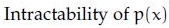

**Figure 2.** Option A mathematical expression for Question 121.

Intractability of $p(x)$  
*Option ID:* `6406532878480`

**B.** 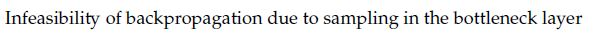

**Figure 3.** Option B mathematical expression for Question 121.

Infeasibility of backpropagation due to sampling in the bottleneck layer  
*Option ID:* `6406532878481`

**C.** 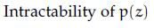

**Figure 4.** Option C mathematical expression for Question 121.

Intractability of $p(z)$  
*Option ID:* `6406532878482`

**D.** 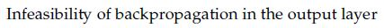

**Figure 5.** Option D mathematical expression for Question 121.

Infeasibility of backpropagation in the output layer  
*Option ID:* `6406532878483`

**Correct answer:** **A** — Intractability of $p(x)$.  
**Source evidence:** Green check icon beside option ID 6406532878480 on page 4.

---

### Question 122

**Question ID:** `640653856590` · **Type:** MCQ · **Marks:** 2  
**PDF pages:** 4

Which of the following is incorrect for the reparametrization trick used in a Variational AutoEncoder (VAE)?

**Options**

**A.** This technique is used, since the expected reconstruction error requires estimation by sampling which has very high variance.  
*Option ID:* `6406532878484`

**B.** It can be applied to any “location-scale” family of distributions where the location (mean) and scale (variance) of the standard version is 0 and 1.  
*Option ID:* `6406532878485`

**C.** The reparametrization trick is applicable to continuous distributions as well as discrete distributions.  
*Option ID:* `6406532878486`

**D.** It allows the random variable to be expressed as a different transformation of auxiliary variables which helps the gradient estimation with only one sample  
*Option ID:* `6406532878487`

**Correct answer:** **C** — The reparametrization trick is applicable to continuous distributions as well as discrete distributions..  
**Source evidence:** Green check icon beside option ID 6406532878486 on page 4.

---

### Question 123

**Question ID:** `640653856597` · **Type:** MCQ · **Marks:** 2  
**PDF pages:** 4, 5

In an image classification problem, which of the following is the quantity of interest in a generative model?

**Options**

**A.** 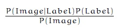

**Figure 6.** Option A formula for Question 123.

$$\frac{P(\text{Image} \mid \text{Label}) P(\text{Label})}{P(\text{Image})}$$  
*Option ID:* `6406532878497`

**B.** 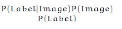

**Figure 7.** Option B formula for Question 123.

$$\frac{P(\text{Label} \mid \text{Image}) P(\text{Image})}{P(\text{Label})}$$  
*Option ID:* `6406532878498`

**C.** 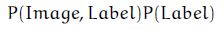

**Figure 8.** Option C formula for Question 123.

$$P(\text{Image}, \text{Label}) P(\text{Label})$$  
*Option ID:* `6406532878499`

**D.** 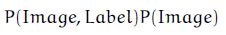

**Figure 9.** Option D formula for Question 123.

$$P(\text{Image}, \text{Label}) P(\text{Image})$$  
*Option ID:* `6406532878500`

**Correct answer:** **A** — \frac{P(\text{Image} \mid \text{Label}) P(\text{Label})}{P(\text{Image})}.  
**Source evidence:** Green check icon beside option ID 6406532878497 on page 5.

---

### Question 124

**Question ID:** `640653856598` · **Type:** MCQ · **Marks:** 2  
**PDF pages:** 5

Imagine you trained a CNN for dog (vs) cat classifier. From your dataset, you found that $P(\text{class} = \text{Dog}) = 0.4$ and $P(\text{class} = \text{Cat}) = 0.6$. After training the model, a new image $I$ is input through the network. What is the value of $P(\text{class} = \text{Cat} \mid I)$ given that $P(I \mid \text{class} = \text{Dog}) = 0.02$ and $P(I \mid \text{class} = \text{Cat}) = 0.06$?

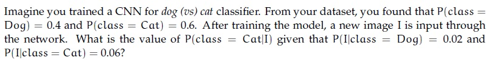

**Figure 10.** Source problem formulation for Question 124.

**Options**

**A.** 0.5151  
*Option ID:* `6406532878501`

**B.** 0.6161  
*Option ID:* `6406532878502`

**C.** 0.7171  
*Option ID:* `6406532878503`

**D.** 0.8181  
*Option ID:* `6406532878504`

**Correct answer:** **D** — 0.8181.  
**Source evidence:** Green check icon beside option ID 6406532878504 on page 5.

---

### Question 125

**Question ID:** `640653856599` · **Type:** MCQ · **Marks:** 2  
**PDF pages:** 5

Let us suppose that you want to build an encoder-decoder recurrent model with attention. We know that the context vector for the model is given by $c_i = \sum_{j=1}^{T_x} \alpha_{ij} h_j$, where $\alpha_{ij}$ refers to the degree of alignment between decoder state $s_{i-1}$ and encoder state $h_j$. Then, $\alpha_{ij}$ is computed as:

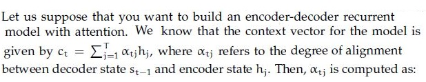

**Figure 11.** Source mathematical context for Question 125.

**Options**

**A.** Sigmoid of alignment scores  
*Option ID:* `6406532878505`

**B.** Softmax of alignment scores  
*Option ID:* `6406532878506`

**C.** ReLU of alignment scores  
*Option ID:* `6406532878507`

**D.** None of these  
*Option ID:* `6406532878508`

**Correct answer:** **B** — Softmax of alignment scores.  
**Source evidence:** Green check icon beside option ID 6406532878506 on page 5.

---

### Question 126

**Question ID:** `640653856600` · **Type:** MCQ · **Marks:** 2  
**PDF pages:** 6

Which one of the following statements is true?

**Options**

**A.** The goal of triplet loss is to ensure that the distance between the anchor and the negative sample is at least ’margin’ less than the distance between anchor and positive sample.  
*Option ID:* `6406532878509`

**B.** Face identification is a multi-class classification problem whereas face verification is a binary classification problem  
*Option ID:* `6406532878510`

**C.** Both the goal of triplet loss is to ensure that the distance between the anchor and the negative sample is at least ’margin’ less than the distance between anchor and positive sample. & Face identification is a multi-class classification problem whereas face verification is a binary classification problem  
*Option ID:* `6406532878511`

**D.** None of these  
*Option ID:* `6406532878512`

**Correct answer:** **B** — Face identification is a multi-class classification problem whereas face verification is a binary classification problem.  
**Source evidence:** Green check icon beside option ID 6406532878510 on page 6.

---

### Question 127

**Question ID:** `640653856601` · **Type:** MCQ · **Marks:** 2  
**PDF pages:** 6

Which one of the following statements is false?

**Options**

**A.** Attention mechanisms cannot be applied to the bidirectional RNN model  
*Option ID:* `6406532878513`

**B.** An image captioning network cannot be trained end-to-end even though we are using 2 different modalities to train the network  
*Option ID:* `6406532878514`

**C.** One of the key components in the vanilla transformer are the recurrent connections that help them to deal with variable input length.  
*Option ID:* `6406532878515`

**D.** All of these  
*Option ID:* `6406532878516`

**Correct answer:** **D** — All of these.  
**Source evidence:** Green check icon beside option ID 6406532878516 on page 6.

---

### Question 128

**Question ID:** `640653856603` · **Type:** MCQ · **Marks:** 2  
**PDF pages:** 6

Consider two 10×10 bounding boxes(one on the upper left and one of the lower right) in an images with an overlapping region of 6 × 6. The Intersection over Union (IoU) between the two boxes is (choose the closest value):

**Options**

**A.** 21%  
*Option ID:* `6406532878521`

**B.** 25%  
*Option ID:* `6406532878522`

**C.** 33%  
*Option ID:* `6406532878523`

**D.** 37%  
*Option ID:* `6406532878524`

**Correct answer:** **A** — 21%.  
**Source evidence:** Green check icon beside option ID 6406532878521 on page 6.

---

### Question 129

**Question ID:** `640653856604` · **Type:** MCQ · **Marks:** 2  
**PDF pages:** 7

A four-dimensional input vector $x = [5, 3, -1, 2]$ is passed to a hidden layer with a single neuron and an activation function $a(.)$ to obtain $z$. Assume that the corresponding weights (from input to hidden layer) are $[0.4, 0.6, 0.8, -0.2]$ and bias is $0.4$. If the activation function $a(.)$ is Sigmoid, Linear, Indicator function, Softplus, ReLU and Leaky-ReLU, what are the corresponding values of $z$? (Note that Indicator function returns 1 for a positive input, and 0 otherwise. Softplus is defined as: $\ln(1 + \exp(z))$).

**Options**

**A.** 0.95, 3, 1, 0.35, 3, 3  
*Option ID:* `6406532878525`

**B.** 0.95, 3, 0, 3.05, 3, 3  
*Option ID:* `6406532878526`

**C.** 0.92, 3, 1, 3.5, 3, 3  
*Option ID:* `6406532878527`

**D.** 0.95, 3, 1, 3.05, 3, 3  
*Option ID:* `6406532878528`

**Correct answer:** **D** — 0.95, 3, 1, 3.05, 3, 3.  
**Source evidence:** Green check icon beside option ID 6406532878528 on page 7.

---

### Question 130

**Question ID:** `640653856605` · **Type:** MCQ · **Marks:** 2  
**PDF pages:** 7

Match the following computer vision tasks to situations:

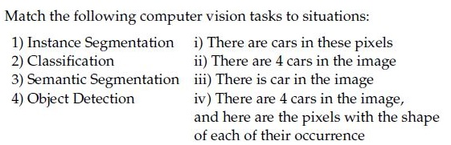

**Figure 12.** Matching table for Question 130.

| Computer vision task | Situation |
| :--- | :--- |
| 1) Instance Segmentation | i) There are cars in these pixels |
| 2) Classification | ii) There are 4 cars in the image |
| 3) Semantic Segmentation | iii) There is car in the image |
| 4) Object Detection | iv) There are 4 cars in the image, and here are the pixels with the shape of each of their occurrence |

**Options**

**A.** 1→ iv, 2→ iii, 3→ ii, 4 → i  
*Option ID:* `6406532878529`

**B.** 1→ ii, 2→ iii, 3 → i, 4 →iv  
*Option ID:* `6406532878530`

**C.** 1→ iv, 2→ iii, 3→ i, 4 → ii  
*Option ID:* `6406532878531`

**D.** 1→ ii, 2→ iv, 3 → iii, 4→ i  
*Option ID:* `6406532878532`

**Correct answer:** **C** — 1→ iv, 2→ iii, 3→ i, 4 → ii.  
**Source evidence:** Green check icon beside option ID 6406532878531 on page 7.

---

### Question 131

**Question ID:** `640653856607` · **Type:** MCQ · **Marks:** 2  
**PDF pages:** 7, 8

Consider an attention model for the image captioning task. At a particular time step $t$, the context vector $z$ is obtained from the feature map of the final layer of the CNN and attention weights obtained from RNN. If RNN’s attention output is $\begin{pmatrix} 0.75 & 0.0 \\ 0.0 & 0.25 \end{pmatrix}$ and feature map from CNN is $\begin{pmatrix} v_1 & v_2 \\ v_3 & v_4 \end{pmatrix}$, where $v_1, v_2, v_3, v_4$ are $d$-dimensional vectors, what is the value of the context vector $z$ under soft and hard attention mechanisms respectively?

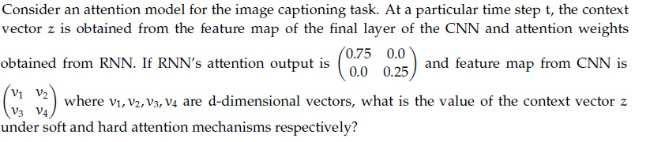

**Figure 13.** Source problem specification for Question 131.

**Options**

**A.** 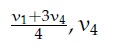

**Figure 14.** Option A formula for Question 131.

$$\frac{v_1 + 3v_4}{4}, v_4$$  
*Option ID:* `6406532878537`

**B.** 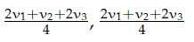

**Figure 15.** Option B formula for Question 131.

$$\frac{2v_1 + v_2 + 2v_3}{4}, \frac{2v_1 + v_2 + 2v_3}{4}$$  
*Option ID:* `6406532878538`

**C.** 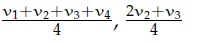

**Figure 16.** Option C formula for Question 131.

$$\frac{v_1 + v_2 + v_3 + v_4}{4}, \frac{2v_2 + v_3}{4}$$  
*Option ID:* `6406532878539`

**D.** 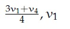

**Figure 17.** Option D formula for Question 131.

$$\frac{3v_1 + v_4}{4}, v_1$$  
*Option ID:* `6406532878540`

**Correct answer:** **D** — \frac{3v_1 + v_4}{4}, v_1.  
**Source evidence:** Green check icon beside option ID 6406532878540 on page 8.

---

### Question 132

**Question ID:** `640653856608` · **Type:** MCQ · **Marks:** 2  
**PDF pages:** 8

Match the following:

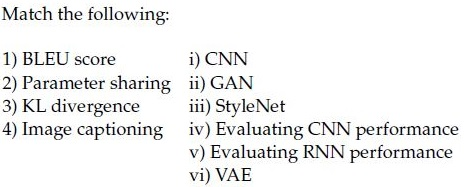

**Figure 18.** Source matching table for Question 132.

| Column 1 | Column 2 |
| :--- | :--- |
| 1) BLEU score | i) CNN |
| 2) Parameter sharing | ii) GAN |
| 3) KL divergence | iii) StyleNet |
| 4) Image captioning | iv) Evaluating CNN performance |
| | v) Evaluating RNN performance |
| | vi) VAE |

**Options**

**A.** 1→ iii, 2→ ii, 3 → vi, 4→ i  
*Option ID:* `6406532878541`

**B.** 1→ v, 2→i, 3 → vi, 4→ iii  
*Option ID:* `6406532878542`

**C.** 1→ ii, 2→ i, 3 → ii, 4 → iii  
*Option ID:* `6406532878543`

**D.** 1→ i, 2 →ii, 3 → vi, 4→ iv  
*Option ID:* `6406532878544`

**Correct answer:** **B** — 1→ v, 2→i, 3 → vi, 4→ iii.  
**Source evidence:** Green check icon beside option ID 6406532878542 on page 8.

---

### Question 133

**Question ID:** `640653856581` · **Type:** SA · **Marks:** 2  
**PDF pages:** 8, 9

Consider a Faster R-CNN object detection framework, which is being trained with a mini-batch size of 2. The RPN produces 512 proposals, out of which 12 and 14 of them are foreground proposals,corresponding to each image in the mini-batch. For a single mini-batch update, the bounding box regression loss will be computed_____________________ times.

**Correct answer:** `26`.  
**Source evidence:** Possible Answers: 26 on page 9.

---

### Question 134

**Question ID:** `640653856582` · **Type:** SA · **Marks:** 2  
**PDF pages:** 9

The feature embeddings obtained from a neural network for an anchor sample, positive sample and negative sample are as given below:
* Anchor Sample: [4, 5, 3, 7, 1]
* Positive Sample: [8, 5, 6, 7, 1]
* Negative Sample: [9, 1, 3, 8, 0]
The triplet loss given that margin $\alpha = 12$ will be
(Hint; Triplet loss uses squared euclidean distance.)

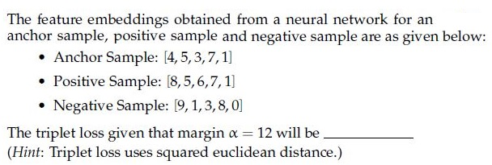

**Figure 19.** Source embeddings and parameters for Question 134.

**Correct answer:** `-30`.  
**Source evidence:** Possible Answers: -30 on page 9.

---

### Question 135

**Question ID:** `640653856583` · **Type:** SA · **Marks:** 2  
**PDF pages:** 9, 10

A Siamese network is trained for face verification. The face image to be verified is passed through the first branch and the anchor image is passed through the second branch. There are 73286 parameters in each of the branches. Triplet loss is used to learn the overall Siamese network. The total number of trainable parameters in the network (assuming there are no other layers or modules) are________________(write your answer as a number).

**Correct answer:** `73286`.  
**Source evidence:** Possible Answers: 73286 on page 10.

---

### Question 136

**Question ID:** `640653856586` · **Type:** SA · **Marks:** 0.67  
**PDF pages:** 10

**Shared Comprehension Data (Questions 136–138, Comprehension ID: `640653856585`):**
In the context of VAE, if the encoder outputs $\mu = [0.3, 0.2, 0.1]$, $\sigma = [0.1, 0.2, 0.1]$ and $\epsilon \sim \mathcal{N}(0, 1)$ is equal to $[0.5, 0.2, 0.8]$, then the latent vector $z = [z_1, z_2, z_3]$. Give the following values upto 2 decimal places. Based on the above data, answer the given subquestions.

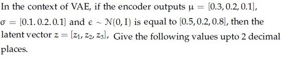

**Figure 20.** Shared passage parameters for Questions 136–138.

**Subquestion 136:**
z1=_________________

**Correct answer:** `0.35`.  
**Source evidence:** Possible Answers: 0.35 on page 10.

---

### Question 137

**Question ID:** `640653856587` · **Type:** SA · **Marks:** 0.67  
**PDF pages:** 10

*(Shared Comprehension Context: VAE latent vector $z = \mu + \sigma \odot \epsilon$, with $\mu = [0.3, 0.2, 0.1]$, $\sigma = [0.1, 0.2, 0.1]$, $\epsilon = [0.5, 0.2, 0.8]$)*

z2=____________________

**Correct answer:** `0.24`.  
**Source evidence:** Possible Answers: 0.24 on page 10.

---

### Question 138

**Question ID:** `640653856588` · **Type:** SA · **Marks:** 0.66  
**PDF pages:** 11

*(Shared Comprehension Context: VAE latent vector $z = \mu + \sigma \odot \epsilon$, with $\mu = [0.3, 0.2, 0.1]$, $\sigma = [0.1, 0.2, 0.1]$, $\epsilon = [0.5, 0.2, 0.8]$)*

z3=_______________

**Correct answer:** `0.18`.  
**Source evidence:** Possible Answers: 0.18 on page 11.

---

### Question 139

**Question ID:** `640653856592` · **Type:** SA · **Marks:** 0.5  
**PDF pages:** 11, 12

**Shared Comprehension Data (Questions 139–142, Comprehension ID: `640653856591`):**
KL divergence is not a distance metric because $KL(P \| Q)$ is (a) _____ to $KL(Q \| P)$. And KL divergence is always $\ge$ (b) _____.
Suppose $P \sim \text{Bernoulli}(0.8)$ and $Q \sim \text{Bernoulli}(0.2)$ then (c) $KL(P \| Q) =$ _____ nats and (d) $KL(Q \| P) =$ _____ nats.
Hint: You can use these values of natural log: $\ln(2) = 0.69, \ln(4) = 1.38, \ln(0.6) = -0.510, \ln(8) = 2.079, \ln(0.4) = -0.91$.
Answer upto two decimal places. Based on the above data, answer the given subquestions.

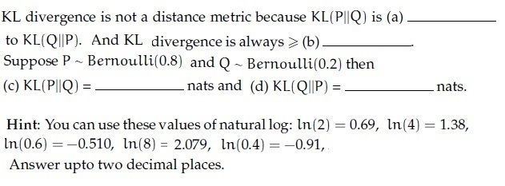

**Figure 21.** Shared context and hints for Questions 139–142.

**Subquestion 139:**
Enter the correct answer for (a)

NOTE:Enter the exact answer without any space in the beginning or at the end.

**Correct answer:** `not equal`.  
**Source evidence:** Possible Answers: not equal on page 12.

---

### Question 140

**Question ID:** `640653856593` · **Type:** SA · **Marks:** 0.5  
**PDF pages:** 12

*(Shared Comprehension Context: KL divergence properties and Bernoulli(0.8), Bernoulli(0.2))*  
KL divergence is always $\ge$ (b) _____.

Enter the correct answer for (b)

**Correct answer:** `0`.  
**Source evidence:** Possible Answers: 0 on page 12.

---

### Question 141

**Question ID:** `640653856594` · **Type:** SA · **Marks:** 0.5  
**PDF pages:** 12

*(Shared Comprehension Context: $P \sim \text{Bernoulli}(0.8)$, $Q \sim \text{Bernoulli}(0.2)$)*  
(c) $KL(P \| Q) =$ _____ nats.

Enter the correct answer for (c)

**Correct answer:** `0.83`.  
**Source evidence:** Possible Answers: 0.83 on page 12.

---

### Question 142

**Question ID:** `640653856595` · **Type:** SA · **Marks:** 0.5  
**PDF pages:** 12

*(Shared Comprehension Context: $P \sim \text{Bernoulli}(0.8)$, $Q \sim \text{Bernoulli}(0.2)$)*  
(d) $KL(Q \| P) =$ _____ nats.

Enter the correct answer for (d)

**Correct answer:** `0.83`.  
**Source evidence:** Possible Answers: 0.83 on page 12.

---

### Question 143

**Question ID:** `640653856596` · **Type:** MSQ · **Marks:** 2  
**PDF pages:** 13

Consider generative and discriminative models for a classification task. Generative models learn the data-generating mechanism by modeling class-conditional and prior distributions before making predictions. Discriminative models make predictions based on patterns learned in the training set. Which one of the following is an example of a generative model? Select all that are correct.

**Options**

**A.** Convolutional Neural Network  
*Option ID:* `6406532878492`

**B.** Naive-Bayes  
*Option ID:* `6406532878493`

**C.** Logistic Regression  
*Option ID:* `6406532878494`

**D.** Support Vector Machine  
*Option ID:* `6406532878495`

**E.** Quadratic Discriminant Analysis  
*Option ID:* `6406532878496`

**Correct answer:** **B**, **E** — Naive-Bayes; Quadratic Discriminant Analysis.  
**Source evidence:** Green check icon beside option ID 6406532878493 on page 13; Green check icon beside option ID 6406532878496 on page 13.

---

### Question 144

**Question ID:** `640653856602` · **Type:** MSQ · **Marks:** 2  
**PDF pages:** 13

Which of the following are true:

**Options**

**A.** 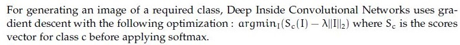

**Figure 22.** Option A statement for Question 144.

For generating an image of a required class, Deep Inside Convolutional Networks uses gradient descent with the following optimization : $\arg\min_I (S_c(I) - \lambda \|I\|_2^2)$ where $S_c$ is the scores vector for class $c$ before applying softmax.  
*Option ID:* `6406532878517`

**B.** 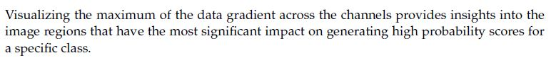

**Figure 23.** Option B statement for Question 144.

Visualizing the maximum of the data gradient across the channels provides insights into the image regions that have the most significant impact on generating high probability scores for a specific class.  
*Option ID:* `6406532878518`

**C.** 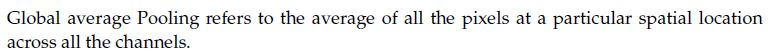

**Figure 24.** Option C statement for Question 144.

Global average Pooling refers to the average of all the pixels at a particular spatial location across all the channels.  
*Option ID:* `6406532878519`

**D.** 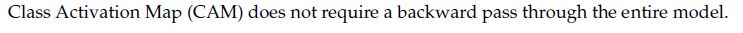

**Figure 25.** Option D statement for Question 144.

Class Activation Map (CAM) does not require a backward pass through the entire model.  
*Option ID:* `6406532878520`

**Correct answer:** **B**, **D** — Visualizing the maximum of the data gradient across the channels provides insights into the image regions that have the most significant impact on generating high probability scores for a specific class.; Class Activation Map (CAM) does not require a backward pass through the entire model..  
**Source evidence:** Green check icon beside option ID 6406532878518 on page 13; Green check icon beside option ID 6406532878520 on page 13.

---

### Question 145

**Question ID:** `640653856606` · **Type:** MSQ · **Marks:** 2  
**PDF pages:** 13, 14

Which of the following is true regarding Hard Attention and Soft Attention?

**Options**

**A.** Soft Attention is smooth and differentiable  
*Option ID:* `6406532878533`

**B.** Variance reduction techniques are used to train Soft Attention models  
*Option ID:* `6406532878534`

**C.** Soft Attention is computationally cheaper than Hard Attention when the source input is large  
*Option ID:* `6406532878535`

**D.** The inference (test time) overhead is low in Hard Attention when compared to Soft Attention models  
*Option ID:* `6406532878536`

**Correct answer:** **A**, **C** — Soft Attention is smooth and differentiable; Soft Attention is computationally cheaper than Hard Attention when the source input is large.  
**Source evidence:** Green check icon beside option ID 6406532878533 on page 13; Green check icon beside option ID 6406532878535 on page 14.

---

## Answer key

| Source question | Question ID | Correct answer | PDF page(s) |
| :--- | :--- | :--- | :--- |
| 117 | `640653856578` | C | 2, 3 |
| 118 | `640653856579` | C | 3 |
| 119 | `640653856580` | D | 3 |
| 120 | `640653856584` | A | 3, 4 |
| 121 | `640653856589` | A | 4 |
| 122 | `640653856590` | C | 4 |
| 123 | `640653856597` | A | 4, 5 |
| 124 | `640653856598` | D | 5 |
| 125 | `640653856599` | B | 5 |
| 126 | `640653856600` | B | 6 |
| 127 | `640653856601` | D | 6 |
| 128 | `640653856603` | A | 6 |
| 129 | `640653856604` | D | 7 |
| 130 | `640653856605` | C | 7 |
| 131 | `640653856607` | D | 7, 8 |
| 132 | `640653856608` | B | 8 |
| 133 | `640653856581` | 26 | 8, 9 |
| 134 | `640653856582` | -30 | 9 |
| 135 | `640653856583` | 73286 | 9, 10 |
| 136 | `640653856586` | 0.35 | 10 |
| 137 | `640653856587` | 0.24 | 10 |
| 138 | `640653856588` | 0.18 | 11 |
| 139 | `640653856592` | not equal | 11, 12 |
| 140 | `640653856593` | 0 | 12 |
| 141 | `640653856594` | 0.83 | 12 |
| 142 | `640653856595` | 0.83 | 12 |
| 143 | `640653856596` | B, E | 13 |
| 144 | `640653856602` | B, D | 13 |
| 145 | `640653856606` | A, C | 13, 14 |

## Extraction notes

1. **Section Boundaries and Exclusions:** The DL(CV) section declared 25 items on page 2. Physical examination confirms 1 excluded administrative confirmation question (Question 116), 16 MCQs (Questions 117–132), 3 Short Answer questions (Questions 133–135), 2 Comprehension parent blocks spanning 7 subquestions (Questions 136–142), and 3 MSQs (Questions 143–145), yielding 29 academic questions. Preceding subject material on page 1 and subsequent Algorithmic Thinking in Bioinformatics section on page 14 are strictly excluded.
2. **Question 134 Key Discrepancy:** The source answer key records `Possible Answers : -30` for Question 134. Standard triplet loss is $\max(0, d(a,p)^2 - d(a,n)^2 + \alpha)$ where squared Euclidean distances give $25 - 43 + 12 = -6$ (which would clip to 0 under standard hinge/margin definition). The source key's value of `-30` is preserved faithfully as required by the extraction protocol without unauthorized modification.
3. **Asset Preservation:** 25 graphical assets extracted natively at source resolution into `assets/da5006_2024T2_Q2_NA/`, covering matching tables (Q119, Q130, Q132), equation options (Q121, Q123, Q131, Q144), question stems (Q124, Q125, Q131, Q134), and comprehension shared contexts (Q136–138, Q139–142). Captions are sequential from Figure 1 to Figure 25.