# DL(CV) — da5006_2024T3_ET_AN

**Subject:** Deep Learning for Computer Vision  
**Source:** `da5006_2024T3_ET_AN.pdf` (original PDF omitted from this bundle)  
**Academic questions:** 25  
**Scope:** DL(CV) section; administrative subject confirmation excluded.

## Questions

### Question 198

**Question ID:** `6406531046050` · **Type:** Multiple Choice Question (MCQ) · **Marks:** 2  
**PDF pages:** 2

What is the correct order of operations for processing an image through a Vision Transformer (ViT)?

**Options**

**A.** Image patching → Positional embedding → Linear projection of flattened patches → Transformer encoder→ Classification head  
*Option ID:* `6406533531331`

**B.** Image patching → Linear projection of flattened patches → Positional embedding → Transformer encoder→ Classification head  
*Option ID:* `6406533531332`

**C.** Positional embedding → Image patching → Linear projection of flattened patches → Transformer encoder→ Classification head  
*Option ID:* `6406533531333`

**D.** Linear projection of Images → Image patching → Positional embedding → Transformer encoder → Classification head  
*Option ID:* `6406533531334`

**E.** Linear projection of Images → Image patching → Positional embedding → Transformer encoder→ Transformer decoder→ Classification head  
*Option ID:* `6406533531335`

**Correct answer:** **B** — Image patching → Linear projection of flattened patches → Positional embedding → Transformer encoder→ Classification head.  
**Source evidence:** Option ID 6406533531332 is rendered in green (color #008000) with a checkmark icon.

---

### Question 199

**Question ID:** `6406531046051` · **Type:** Multiple Choice Question (MCQ) · **Marks:** 2  
**PDF pages:** 2, 3

Vector Quantized Variational Autoencoder (VQ-VAE) utilizes a discrete latent representation as opposed to continuous latent spaces used in traditional VAEs. One of the key components of a VQ-VAE is the codebook, which consists of a set of learnable vectors. What is the primary role of the codebook in VQ-VAE?

**Options**

**A.** It performs the non-linear transformation of the input data to a higher dimensional space.  
*Option ID:* `6406533531336`

**B.** It regularizes the encoder by penalizing complex encodings.  
*Option ID:* `6406533531337`

**C.** It provides a finite set of vectors which the encoder’s outputs are mapped to, effectively quantizing the latent space.  
*Option ID:* `6406533531338`

**D.** It decodes the quantized vectors back into the reconstructed input space.  
*Option ID:* `6406533531339`

**Correct answer:** **C** — It provides a finite set of vectors which the encoder’s outputs are mapped to, effectively quantizing the latent space..  
**Source evidence:** Option ID 6406533531338 is rendered in green (color #008000) with a checkmark icon across pages 2-3.

---

### Question 200

**Question ID:** `6406531046053` · **Type:** Multiple Choice Question (MCQ) · **Marks:** 2  
**PDF pages:** 3

Consider a reverse process in a diffusion model where the goal is to reconstruct the original data from the noise. If the model correctly reduces the variance of the noise by 0.02 in each reverse step, and starts with a noise variance of 1.0 at timestep T = 50, how many steps are required to reduce the noise variance to 0.1?

**Options**

**A.** 45  
*Option ID:* `6406533531344`

**B.** 50  
*Option ID:* `6406533531345`

**C.** 40  
*Option ID:* `6406533531346`

**D.** 30  
*Option ID:* `6406533531347`

**Correct answer:** **A** — 45.  
**Source evidence:** Option ID 6406533531344 is rendered in green (color #008000) with a checkmark icon.

---

### Question 201

**Question ID:** `6406531046054` · **Type:** Multiple Choice Question (MCQ) · **Marks:** 2  
**PDF pages:** 3

In the forward process of a diffusion model, the data is incrementally corrupted by adding noise across $T$ timesteps. If the variance of the noise added at each step $t$ is $\beta_t$, which decreases linearly from 0.03 at the first step to 0.02 at the last step over 150 timesteps, calculate the total variance of the noise added over 150 timesteps. (Hint: Calculate average variance per step to calculate total variance)

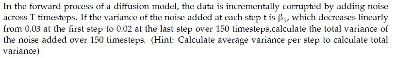
**Figure 1.** Source problem statement for Question 201.

**Options**

**A.** 3.25  
*Option ID:* `6406533531348`

**B.** 4.5  
*Option ID:* `6406533531349`

**C.** 7.5  
*Option ID:* `6406533531350`

**D.** 3.75  
*Option ID:* `6406533531351`

**Correct answer:** **D** — 3.75.  
**Source evidence:** Option ID 6406533531351 is rendered in green (color #008000) with a checkmark icon.

---

### Question 202

**Question ID:** `6406531046055` · **Type:** Multiple Choice Question (MCQ) · **Marks:** 2  
**PDF pages:** 3, 4

Given two normalized embeddings from CLIP, $I = [0.2, -0.5, 0.3, 0.4]$ for an image and $T = [-0.1, 0.6, -0.3]$, for a text description, compute the $\text{CLIPScore}(I, T)$.

**Options**

**A.** −69%  
*Option ID:* `6406533531352`

**B.** 0%  
*Option ID:* `6406533531353`

**C.** −30%  
*Option ID:* `6406533531354`

**D.** 50%  
*Option ID:* `6406533531355`

**Correct answer:** **B** — 0%.  
**Source evidence:** Option ID 6406533531353 is rendered in green (color #008000) with a checkmark icon.

---

### Question 203

**Question ID:** `6406531046060` · **Type:** Multiple Choice Question (MCQ) · **Marks:** 2  
**PDF pages:** 4

Consider the following unrolled RNN:

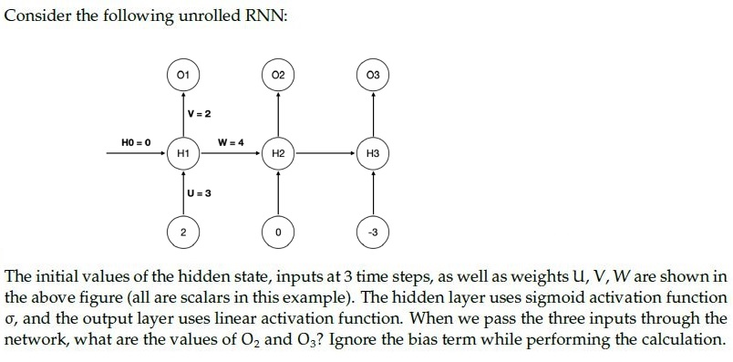
**Figure 2.** Unrolled recurrent neural network architecture for Question 203.

The initial values of the hidden state, inputs at 3 time steps, as well as weights $U, V, W$ are shown in the above figure (all are scalars in this example). The hidden layer uses sigmoid activation function $\sigma$, and the output layer uses linear activation function. When we pass the three inputs through the network, what are the values of $O_2$ and $O_3$? Ignore the bias term while performing the calculation.

**Options**

**A.** $8 \times \sigma(6), 2\sigma(4 \times \sigma(6) - 9)$  
*Option ID:* `6406533531359`

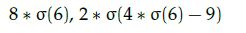
**Figure 3.** Question 203 Option A diagram.

**B.** $2\sigma(4 \times \sigma(6)), 2 \times \sigma(4 \times \sigma(4 \times \sigma(6)) - 9)$  
*Option ID:* `6406533531360`

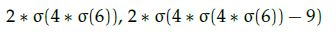
**Figure 4.** Question 203 Option B diagram.

**C.** $2 \times \sigma(6), 2 \times \sigma(4 \times \sigma(6) - 9)$  
*Option ID:* `6406533531361`

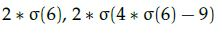
**Figure 5.** Question 203 Option C diagram.

**D.** $8 \times \sigma(6), \sigma(4 \times \sigma(6) - 9)$  
*Option ID:* `6406533531362`

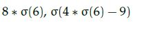
**Figure 6.** Question 203 Option D diagram.

**Correct answer:** **B** — $2\sigma(4 \times \sigma(6)), 2 \times \sigma(4 \times \sigma(4 \times \sigma(6)) - 9)$.  
**Source evidence:** Option ID 6406533531360 is highlighted in green with a checkmark icon.

---

### Question 204

**Question ID:** `6406531046061` · **Type:** Multiple Choice Question (MCQ) · **Marks:** 2  
**PDF pages:** 4, 5

Which one of the following statements is false? (Pick the most appropriate one.)

**Options**

**A.** Attention mechanisms cannot be applied to the bidirectional RNN model  
*Option ID:* `6406533531363`

**B.** An image captioning network cannot be trained end-to-end even though we are using 2 different modalities to train the network  
*Option ID:* `6406533531364`

**C.** One of the key components in the vanilla transformer is the recurrent connection that help them to deal with variable input length.  
*Option ID:* `6406533531365`

**D.** All of these  
*Option ID:* `6406533531366`

**Correct answer:** **D** — All of these.  
**Source evidence:** Option ID 6406533531366 is rendered in green (color #008000) with a checkmark icon.

---

### Question 205

**Question ID:** `6406531046063` · **Type:** Multiple Choice Question (MCQ) · **Marks:** 2  
**PDF pages:** 5

State whether the given statement is True or False: While training an object detection algorithm, you need a training set that contains many pictures of the objects you want to detect. However, bounding boxes are not typically provided in the training set, since architectures like Faster-RCNN and YOLO can learn to detect the object by themselves.

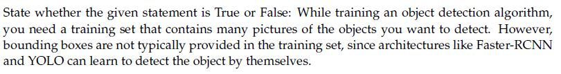
**Figure 7.** Source statement for Question 205.

**Options**

**A.** True  
*Option ID:* `6406533531372`

**B.** False  
*Option ID:* `6406533531373`

**Correct answer:** **B** — False.  
**Source evidence:** Option ID 6406533531373 is rendered in green (color #008000) with a checkmark icon.

---

### Question 206

**Question ID:** `6406531046064` · **Type:** Multiple Choice Question (MCQ) · **Marks:** 2  
**PDF pages:** 5

Match the following:

1) Gaussian Filter
2) Sobel Filter
3) First derivative of Gaussian
4) Second derivative of Gaussian

i) Edges found when gradient is low
ii) Edges found at zero crossing
iii) Edge smoothing
iv) Edge detection
v) Edges found when gradient is high

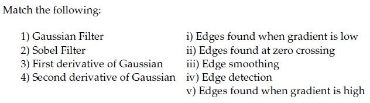
**Figure 8.** Source matching table for Question 206.

**Options**

**A.** 1→ iii, 2→ iv, 3→ i, 4 → ii  
*Option ID:* `6406533531374`

**B.** 1→ iii, 2→ i, 3 → ii, 4 →v  
*Option ID:* `6406533531375`

**C.** 1→ iii, 2→ iv, 3→ v, 4 → ii  
*Option ID:* `6406533531376`

**D.** 1→ iv, 2→ iii, 3→ i, 4 → ii  
*Option ID:* `6406533531377`

**Correct answer:** **C** — 1→ iii, 2→ iv, 3→ v, 4 → ii.  
**Source evidence:** Option ID 6406533531376 is rendered in green (color #008000) with a checkmark icon.

---

### Question 207

**Question ID:** `6406531046070` · **Type:** Multiple Choice Question (MCQ) · **Marks:** 2  
**PDF pages:** 5, 6

Consider two 10×10 bounding boxes(one on the upper left and one of the lower right) in an images with an overlapping region of 6 × 6. The Intersection over Union (IoU) between the two boxes is (choose the closest value):

**Options**

**A.** 21%  
*Option ID:* `6406533531382`

**B.** 25%  
*Option ID:* `6406533531383`

**C.** 33%  
*Option ID:* `6406533531384`

**D.** 37%  
*Option ID:* `6406533531385`

**Correct answer:** **A** — 21%.  
**Source evidence:** Option ID 6406533531382 is rendered in green (color #008000) with a checkmark icon.

---

### Question 208

**Question ID:** `6406531046071` · **Type:** Multiple Choice Question (MCQ) · **Marks:** 2  
**PDF pages:** 6

For certain filters, we can speed up the convolution operation by separating convolution kernels from $K^2$ operations to $2K$ operations. Given the 2D Kernel below, what are the separated 1D kernels $v$ and $h$ for it?

$$\frac{1}{16} \begin{bmatrix} 1 & 2 & 1 \\ 2 & 4 & 2 \\ 1 & 2 & 1 \end{bmatrix}$$

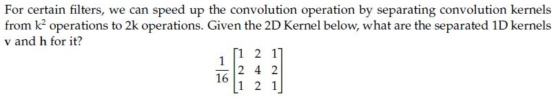
**Figure 9.** Source 2D convolution kernel for Question 208.

**Options**

**A.** $v = \frac{1}{4}\begin{bmatrix} 1 \\ 2 \\ 1 \end{bmatrix}, h = \frac{1}{4}\begin{bmatrix} 1 & 2 & 1 \end{bmatrix}$  
*Option ID:* `6406533531386`

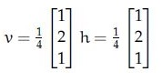
**Figure 10.** Question 208 Option A diagram.

**B.** $v = \frac{1}{2}\begin{bmatrix} 1 \\ 2 \\ 1 \end{bmatrix}, h = \frac{1}{4}\begin{bmatrix} 1 & 2 & 1 \end{bmatrix}$  
*Option ID:* `6406533531387`

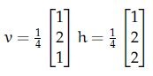
**Figure 11.** Question 208 Option B diagram.

**C.** $v = \frac{1}{4}\begin{bmatrix} 1 \\ 2 \\ 1 \end{bmatrix}, h = \frac{1}{2}\begin{bmatrix} 1 & 2 & 1 \end{bmatrix}$  
*Option ID:* `6406533531388`

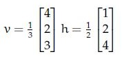
**Figure 12.** Question 208 Option C diagram.

**D.** $v = \frac{1}{2}\begin{bmatrix} 1 \\ 2 \\ 1 \end{bmatrix}, h = \frac{1}{2}\begin{bmatrix} 1 & 2 & 1 \end{bmatrix}$  
*Option ID:* `6406533531389`

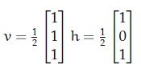
**Figure 13.** Question 208 Option D diagram.

**Correct answer:** **A** — $v = \frac{1}{4}\begin{bmatrix} 1 \\ 2 \\ 1 \end{bmatrix}, h = \frac{1}{4}\begin{bmatrix} 1 & 2 & 1 \end{bmatrix}$.  
**Source evidence:** Option ID 6406533531386 is highlighted in green with a checkmark icon.

---

### Question 209

**Question ID:** `6406531046072` · **Type:** Multiple Choice Question (MCQ) · **Marks:** 2  
**PDF pages:** 6, 7

A four-dimensional input vector $x = [1, -2, 3, -4]$ is passed to a hidden layer with a single neuron and an activation function $a(\cdot)$ to obtain $z$. Assume that the corresponding weights (from input to hidden layer) are $[0.5, -0.3, 0.8, 1.2]$ and bias is $-0.2$. If the activation function $a(\cdot)$ is Sigmoid, Linear, Indicator function, Softplus, ReLU and Leaky-ReLU, what are the corresponding values of $z$? (Note that Indicator function returns 1 for a positive input, and 0 otherwise. Softplus is defined as: $\ln(1 + \exp(z))$).

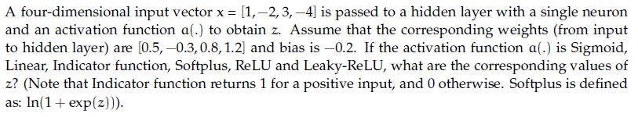
**Figure 14.** Source problem statement for Question 209.

**Options**

**A.** 0.18, 1.5, 1.5, 0.20,−1.5,−0.015  
*Option ID:* `6406533531390`

**B.** 0.92, 2.5, 1, 2.5, 2.5, 1  
*Option ID:* `6406533531391`

**C.** 0.18,−1.5, 0, 0.20, 0,−0.015  
*Option ID:* `6406533531392`

**D.** 0.91, 1, 0, 0.2, 1, 1.7  
*Option ID:* `6406533531393`

**Correct answer:** **C** — 0.18,−1.5, 0, 0.20, 0,−0.015.  
**Source evidence:** Option ID 6406533531392 is rendered in green (color #008000) with a checkmark icon.

---

### Question 210

**Question ID:** `6406531046073` · **Type:** Multiple Choice Question (MCQ) · **Marks:** 2  
**PDF pages:** 7

Identify the correct sequence of steps in a Canny edge detection pipeline. Steps are listed below:

1. Compute gradient magnitude and direction
2. Connect individual components
3. Smoothen the image
4. Threshold into strong, weak, or no edge
5. Gaussian Filter and Hysteresis
6. Non-maximum suppression
7. Apply derivative to get edges

**Options**

**A.** 6→ 1→ 4→ 5 → 2  
*Option ID:* `6406533531394`

**B.** 3→ 1→ 6→ 4 → 2  
*Option ID:* `6406533531395`

**C.** 3→ 5→ 1→ 4 → 2  
*Option ID:* `6406533531396`

**D.** 6→ 8→ 5→ 7 → 2  
*Option ID:* `6406533531397`

**Correct answer:** **B** — 3→ 1→ 6→ 4 → 2.  
**Source evidence:** Option ID 6406533531395 is rendered in green (color #008000) with a checkmark icon.

---

### Question 211

**Question ID:** `6406531046074` · **Type:** Multiple Choice Question (MCQ) · **Marks:** 2  
**PDF pages:** 7, 8

Consider an object detection system evaluated on a dataset consisting of 1000 images. The system makes 1500 predictions across these images, and for each image, there are annotated ground truth bounding boxes.

The system’s precision-recall curve is calculated, and the precision at different recall levels for one of the classes is as follows:

| Recall | Precision |
| :--- | :--- |
| 0.1 | 0.90 |
| 0.2 | 0.85 |
| 0.3 | 0.80 |
| 0.4 | 0.75 |
| 0.5 | 0.70 |
| 0.6 | 0.65 |
| 0.7 | 0.60 |
| 0.8 | 0.55 |
| 0.9 | 0.50 |
| 1.0 | 0.45 |

Calculate the Average Precision (AP) for this class using the 11-point interpolation method, which averages the precision values at recall levels {0.0, 0.1, 0.2, ..., 1.0}. The precision at recall 0.0 can be assumed to be 1.0.

Additionally, the system’s AP values for the other two classes are as follows:

- AP for class 2: 0.78
- AP for class 3: 0.72

Based on these AP values, what is the mean Average Precision (mAP) across all three classes?

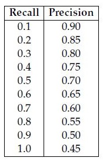
**Figure 15.** Source precision-recall table for Question 211.

**Options**

**A.** 0.70  
*Option ID:* `6406533531398`

**B.** 0.69  
*Option ID:* `6406533531399`

**C.** 0.73  
*Option ID:* `6406533531400`

**D.** 0.76  
*Option ID:* `6406533531401`

**Correct answer:** **C** — 0.73.  
**Source evidence:** Option ID 6406533531400 is rendered in green (color #008000) with a checkmark icon.

---

### Question 212

**Question ID:** `6406531046076` · **Type:** Multiple Choice Question (MCQ) · **Marks:** 2  
**PDF pages:** 8, 9

Match the derivative of activation functions $f(x)$ with their counterparts on the right column accordingly.

1) Leaky ReLU
2) Tanh
3) ReLU
4) Sigmoid

i) $f(x)(1 - f(x))$
ii) 0 if $x < 0$ and 1 if $x > 0$
iii) $1 - f(x)^2$
iv) 0.01 if $x < 0$ and 1 if $x > 0$
v) 0 if $x > 0$ and 1 if $x < 0$
vi) 0.01 if $x > 0$ and 1 if $x < 0$

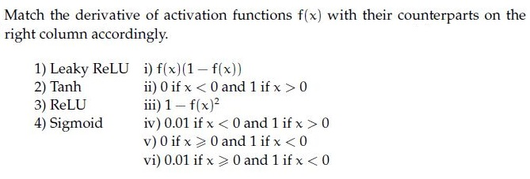
**Figure 16.** Source activation function derivatives matching table for Question 212.

**Options**

**A.** 1→ vi, 2→ iii, 3→ v, 4 → i  
*Option ID:* `6406533531403`

**B.** 1→ i, 2 →iv, 3 → iii, 4→ ii  
*Option ID:* `6406533531404`

**C.** 1→ i, 2 →v, 3 → iii, 4→ iv  
*Option ID:* `6406533531405`

**D.** 1→ iv, 2→ iii, 3→ ii, 4 → i  
*Option ID:* `6406533531406`

**Correct answer:** **D** — 1→ iv, 2→ iii, 3→ ii, 4 → i.  
**Source evidence:** Option ID 6406533531406 is rendered in green (color #008000) with a checkmark icon.

---

### Question 213

**Question ID:** `6406531046052` · **Type:** Multiple Select Question (MSQ) · **Marks:** 2  
**PDF pages:** 9

Classifier-free guidance is a technique used in diffusion models to improve sample quality without the explicit use of a classifier. This technique involves modifying the sampling process based on a control parameter. If the control parameter, denoted as $\gamma$, is set to zero, what effect does this have on the generation process?

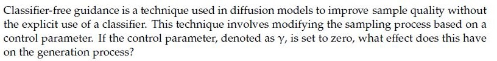
**Figure 17.** Source statement for Question 213.

**Options**

**A.** It fails to generate realistic samples  
*Option ID:* `6406533531340`

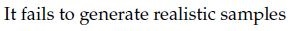
**Figure 18.** Question 213 Option A diagram.

**B.** It removes all guidance, effectively making the process equivalent to the unconditional generation.  
*Option ID:* `6406533531341`

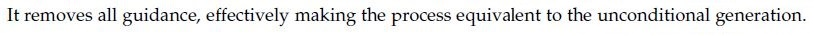
**Figure 19.** Question 213 Option B diagram.

**C.** It maximizes the influence of the classifier, leading to highly detailed generations.  
*Option ID:* `6406533531342`

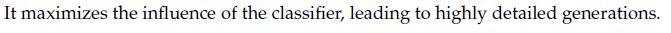
**Figure 20.** Question 213 Option C diagram.

**D.** It can lead to more diverse samples compared to higher values of $\gamma$, as the generation process is less constrained by the conditional information.  
*Option ID:* `6406533531343`

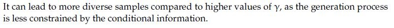
**Figure 21.** Question 213 Option D diagram.

**Correct answer:** **B**, **D** — B — It removes all guidance, effectively making the process equivalent to the unconditional generation; D — It can lead to more diverse samples compared to higher values of $\gamma$, as the generation process is less constrained by the conditional information..  
**Source evidence:** Option ID 6406533531341 is highlighted in green with a checkmark icon.; Option ID 6406533531343 is highlighted in green with a checkmark icon.

---

### Question 214

**Question ID:** `6406531046062` · **Type:** Multiple Select Question (MSQ) · **Marks:** 2  
**PDF pages:** 9, 10

Which of the following statements are true? (Select all possible correct options)

**Options**

**A.** Autoencoder can be equivalent to Principal Component Analysis (PCA) provided we make use of non-linear activation functions  
*Option ID:* `6406533531367`

**B.** When using global attention on temporal data, alignment weights are learnt for encoder hidden representations for all time steps  
*Option ID:* `6406533531368`

**C.** Positional encoding is an important component of the trans-former architecture as it conveys information about order in a given sequence  
*Option ID:* `6406533531369`

**D.** It is not possible to generate different captions for the same image that have similar meaning but different tone/style  
*Option ID:* `6406533531370`

**E.** Autoencoders can not be used for data compression as its input and output dimensions are different  
*Option ID:* `6406533531371`

**Correct answer:** **B**, **C** — B — When using global attention on temporal data, alignment weights are learnt for encoder hidden representations for all time steps; C — Positional encoding is an important component of the trans-former architecture as it conveys information about order in a given sequence..  
**Source evidence:** Option ID 6406533531368 is rendered in green (color #008000) with a checkmark icon.; Option ID 6406533531369 is rendered in green (color #008000) with a checkmark icon.

---

### Question 215

**Question ID:** `6406531046057` · **Type:** Short Answer Question (SA) · **Marks:** 2  
**PDF pages:** 10

**Shared Comprehension Context (Question ID: `6406531046056`):**

Consider the computation graph given below:

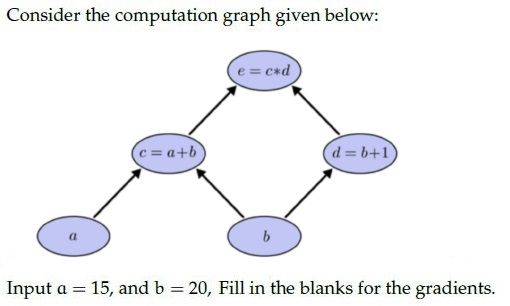
**Figure 22.** Computation graph diagram for Comprehension Questions 215–216.

Input $a = 15$, and $b = 20$, Fill in the blanks for the gradients.

Based on the above data, answer the given subquestions.

**Subquestion:**

The value for $\frac{\partial e}{\partial a} = $ _____

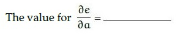
**Figure 23.** Source formula for Question 215.

Response Type : Numeric

**Correct answer:** **21**.  
**Source evidence:** Source key specifies Possible Answers : 21 (rendered in green #008000).

---

### Question 216

**Question ID:** `6406531046058` · **Type:** Short Answer Question (SA) · **Marks:** 2  
**PDF pages:** 10, 11

**Shared Comprehension Context (Question ID: `6406531046056`):**

Consider the computation graph given below:

**Figure 24.** Computation graph diagram for Comprehension Questions 215–216.

Input $a = 15$, and $b = 20$, Fill in the blanks for the gradients.

Based on the above data, answer the given subquestions.

**Subquestion:**

The value for $\frac{\partial e}{\partial b} = $ _____

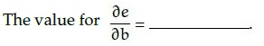
**Figure 25.** Source formula for Question 216.

Response Type : Numeric

**Correct answer:** **56**.  
**Source evidence:** Source key specifies Possible Answers : 56 (rendered in green #008000).

---

### Question 217

**Question ID:** `6406531046059` · **Type:** Short Answer Question (SA) · **Marks:** 2  
**PDF pages:** 11

For a 3-bit grayscale image, the integral image is given as follows:

$$\begin{bmatrix} 5 & 6 & 8 \\ 6 & 9 & 13 \\ 7 & 12 & 18 \end{bmatrix}$$

The pixel intensity that occurs the most for the given grayscale image is _____ (enter an integer value)

Response Type : Numeric

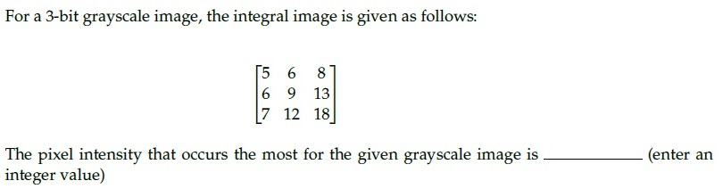
**Figure 26.** Source problem statement for Question 217.

**Correct answer:** **2**.  
**Source evidence:** Source key specifies Possible Answers : 2 (rendered in green #008000).

---

### Question 218

**Question ID:** `6406531046065` · **Type:** Short Answer Question (SA) · **Marks:** 2  
**PDF pages:** 11, 12

What is the size of the feature map after applying two successive convolution operations with given parameters? Image size = 64 x 64, Kernel size = 6 x 6, Padding = 1 and Stride = 2. (In calculation, take floor(x) whenever x is non-integer. If the answer is FxF, write F in the blank).
______________________

Response Type : Numeric

**Correct answer:** **14**.  
**Source evidence:** Source key specifies Possible Answers : 14 (rendered in green #008000).

---

### Question 219

**Question ID:** `6406531046075` · **Type:** Short Answer Question (SA) · **Marks:** 2  
**PDF pages:** 12

Given is a 3 x 3 8-bit grayscale image:

$$\begin{bmatrix} 50 & 70 & 120 \\ 90 & 30 & 80 \\ 40 & 60 & 110 \end{bmatrix}$$

_________ is the central element after applying linear contrast stretching?

Response Type : Numeric

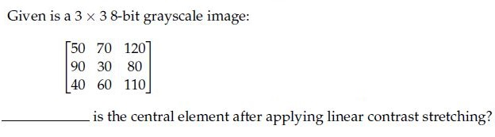
**Figure 27.** Source problem statement for Question 219.

**Correct answer:** **0**.  
**Source evidence:** Source key specifies Possible Answers : 0 (rendered in green #008000).

---

### Question 220

**Question ID:** `6406531046067` · **Type:** Short Answer Question (SA) · **Marks:** 2  
**PDF pages:** 12, 13

**Shared Comprehension Context (Question ID: `6406531046066`):**

In the context of VAE, if the encoder outputs $\mu = [0.3, 0.2, 0.1]$, $\sigma = [0.1, 0.2, 0.1]$ and $\epsilon \sim \mathcal{N}(0, 1)$ is equal to $[0.5, 0.2, 0.8]$, then the latent vector $z = [z_1, z_2, z_3]$, Give the values upto 2 decimal places.

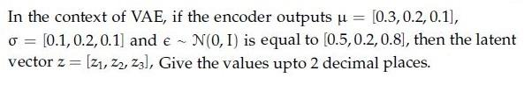
**Figure 28.** VAE latent vector formulation for Comprehension Questions 220–222.

Based on the above data, answer the given subquestions.

**Subquestion:**

$z_1 = $ _____

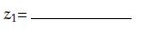
**Figure 29.** Source subquestion formula for Question 220.

Response Type : Numeric

**Correct answer:** **0.35**.  
**Source evidence:** Source key specifies Possible Answers : 0.35 (rendered in green #008000).

---

### Question 221

**Question ID:** `6406531046068` · **Type:** Short Answer Question (SA) · **Marks:** 2  
**PDF pages:** 13

**Shared Comprehension Context (Question ID: `6406531046066`):**

In the context of VAE, if the encoder outputs $\mu = [0.3, 0.2, 0.1]$, $\sigma = [0.1, 0.2, 0.1]$ and $\epsilon \sim \mathcal{N}(0, 1)$ is equal to $[0.5, 0.2, 0.8]$, then the latent vector $z = [z_1, z_2, z_3]$, Give the values upto 2 decimal places.

**Figure 30.** VAE latent vector formulation for Comprehension Questions 220–222.

Based on the above data, answer the given subquestions.

**Subquestion:**

$z_2 = $ _____

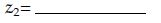
**Figure 31.** Source subquestion formula for Question 221.

Response Type : Numeric

**Correct answer:** **0.24**.  
**Source evidence:** Source key specifies Possible Answers : 0.24 (rendered in green #008000).

---

### Question 222

**Question ID:** `6406531046069` · **Type:** Short Answer Question (SA) · **Marks:** 2  
**PDF pages:** 13

**Shared Comprehension Context (Question ID: `6406531046066`):**

In the context of VAE, if the encoder outputs $\mu = [0.3, 0.2, 0.1]$, $\sigma = [0.1, 0.2, 0.1]$ and $\epsilon \sim \mathcal{N}(0, 1)$ is equal to $[0.5, 0.2, 0.8]$, then the latent vector $z = [z_1, z_2, z_3]$, Give the values upto 2 decimal places.

**Figure 32.** VAE latent vector formulation for Comprehension Questions 220–222.

Based on the above data, answer the given subquestions.

**Subquestion:**

$z_3 = $ _____

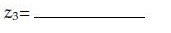
**Figure 33.** Source subquestion formula for Question 222.

Response Type : Numeric

**Correct answer:** **0.18**.  
**Source evidence:** Source key specifies Possible Answers : 0.18 (rendered in green #008000).

---

## Answer key

| Source question | Question ID | Correct answer | PDF page(s) |
| :--- | :--- | :--- | :--- |
| 198 | `6406531046050` | B | 2 |
| 199 | `6406531046051` | C | 2, 3 |
| 200 | `6406531046053` | A | 3 |
| 201 | `6406531046054` | D | 3 |
| 202 | `6406531046055` | B | 3, 4 |
| 203 | `6406531046060` | B | 4 |
| 204 | `6406531046061` | D | 4, 5 |
| 205 | `6406531046063` | B | 5 |
| 206 | `6406531046064` | C | 5 |
| 207 | `6406531046070` | A | 5, 6 |
| 208 | `6406531046071` | A | 6 |
| 209 | `6406531046072` | C | 6, 7 |
| 210 | `6406531046073` | B | 7 |
| 211 | `6406531046074` | C | 7, 8 |
| 212 | `6406531046076` | D | 8, 9 |
| 213 | `6406531046052` | B, D | 9 |
| 214 | `6406531046062` | B, C | 9, 10 |
| 215 | `6406531046057` | 21 | 10 |
| 216 | `6406531046058` | 56 | 10, 11 |
| 217 | `6406531046059` | 2 | 11 |
| 218 | `6406531046065` | 14 | 11, 12 |
| 219 | `6406531046075` | 0 | 12 |
| 220 | `6406531046067` | 0.35 | 12, 13 |
| 221 | `6406531046068` | 0.24 | 13 |
| 222 | `6406531046069` | 0.18 | 13 |

## Extraction notes

- Scope confirmed from Section 9 "DL(CV)" (Page 1, y=197.6) to Section 10 "DLP" (Page 13, y=730.4).
- Administrative subject confirmation question (Question 197, Question ID `6406531046049`, 0 marks, YES/NO confirmation prompt) excluded per extraction prompt instructions.
- Declared section question count of 23 reconciled: 1 administrative confirmation question (Q197) + 15 standalone MCQs (Q198–Q212) + 2 MSQs (Q213–Q214) + 1 Comprehension parent block (Q215–Q216) + 3 standalone SAs (Q217–Q219) + 1 Comprehension parent block (Q220–Q222) = 1 + 15 + 2 + 1 + 3 + 1 = 23 declared units, yielding 25 scored academic questions (Q198–Q222).
- Comprehension blocks retain full shared context and parent diagrams in both child questions to ensure independent readability.
- All 30 image assets (stems, options, and comprehension shared figures) extracted at native resolution into `assets/da5006_2024T3_ET_AN/` with sequential figures (Figures 1–33 across 30 unique asset files on disk).
- Correct answers for MCQs/MSQs confirmed via green text color (#008000) and checkmark icons; correct answers for SA questions confirmed via official `Possible Answers` numeric key fields.
