# DL(CV) — da5006_2024T3_Q1_NA

**Subject:** Deep Learning for Computer Vision  
**Source:** `da5006_2024T3_Q1_NA.pdf` (original PDF omitted from this bundle)  
**Academic questions:** 30  
**Scope:** DL(CV) section; administrative subject confirmation excluded.

## Questions

### Question 143

**Question ID:** `640653994479` · **Type:** MCQ · **Marks:** 2  
**PDF pages:** 1

Given is a 3 × 3 8-bit grayscale image:

$$\begin{bmatrix} 50 & 70 & 120 \\ 90 & 30 & 80 \\ 40 & 60 & 110 \end{bmatrix}$$

What is the central element after applying linear contrast stretching?

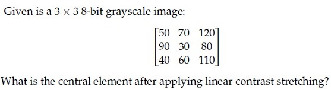

**Figure 1.** Source matrix and question for Question 143.

**Options**

**A.** 54  
*Option ID:* `6406533358191`

**B.** 10  
*Option ID:* `6406533358192`

**C.** 0  
*Option ID:* `6406533358193`

**D.** 18  
*Option ID:* `6406533358194`

**Correct answer:** **C** — 0.  
**Source evidence:** Option C (Option ID 6406533358193) is marked with green text and a checkmark icon in the source PDF.

---

### Question 144

**Question ID:** `640653994480` · **Type:** MCQ · **Marks:** 2  
**PDF pages:** 1–2

Which of the following statements is false?

**Options**

**A.** Linear contrast stretching is a point operation.  
*Option ID:* `6406533358195`

**B.** Moving average is an example of local operation.  
*Option ID:* `6406533358196`

**C.** Convolution in the spatial domain can be obtained through addition in the frequency domain.  
*Option ID:* `6406533358197`

**D.** All of these.  
*Option ID:* `6406533358198`

**Correct answer:** **C** — Convolution in the spatial domain can be obtained through addition in the frequency domain..  
**Source evidence:** Option C (Option ID 6406533358197) is marked with green text and a checkmark icon in the source PDF.

---

### Question 145

**Question ID:** `640653994483` · **Type:** MCQ · **Marks:** 2  
**PDF pages:** 2

Which of the following statements is True

**Options**

**A.** Gaussian filter is Separable filter because it is non linear.  
*Option ID:* `6406533358207`

**B.** Median filter is a non separable filter  
*Option ID:* `6406533358208`

**C.** Gaussian filter is a High Pass filter.  
*Option ID:* `6406533358209`

**D.** Mean filter is a non separable filter because it is non linear  
*Option ID:* `6406533358210`

**Correct answer:** **B** — Median filter is a non separable filter.  
**Source evidence:** Option B (Option ID 6406533358208) is marked with green text and a checkmark icon in the source PDF.

---

### Question 146

**Question ID:** `640653994486` · **Type:** MCQ · **Marks:** 2  
**PDF pages:** 2

A four-dimensional input vector $\mathbf{x} = [1, -2, 3, -4]$ is passed to a hidden layer with a single neuron and an activation function $a(\cdot)$ to obtain $z$. Assume that the corresponding weights (from input to hidden layer) are $[0.5, -0.3, 0.8, 1.2]$ and bias is $-0.2$. If the activation function $a(\cdot)$ is Sigmoid, Linear, Indicator function, Softplus, ReLU and Leaky-ReLU, what are the corresponding values of $z$? (Note that Indicator function returns 1 for a positive input, and 0 otherwise. Softplus is defined as: $\ln(1 + \exp(z)))$. 

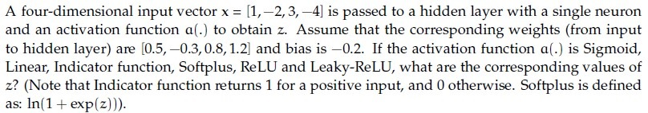

**Figure 2.** Source problem statement and parameters for Question 146.

**Options**

**A.** 0.18, 1.5, 1.5, 0.20,−1.5,−0.015  
*Option ID:* `6406533358216`

**B.** 0.92, 2.5, 1, 2.5, 2.5, 1  
*Option ID:* `6406533358217`

**C.** 0.18,−1.5, 0, 0.20, 0,−0.015  
*Option ID:* `6406533358218`

**D.** 0.91, 1, 0, 0.2, 1, 1.7  
*Option ID:* `6406533358219`

**Correct answer:** **C** — 0.18,−1.5, 0, 0.20, 0,−0.015.  
**Source evidence:** Option C (Option ID 6406533358218) is marked with green text and a checkmark icon in the source PDF.

---

### Question 147

**Question ID:** `640653994487` · **Type:** MCQ · **Marks:** 2  
**PDF pages:** 2–3

Identify the correct sequence of steps in a Canny edge detection pipeline. Steps are listed below:

1. Compute gradient magnitude and direction
2. Connect individual components
3. Smoothen the image
4. Threshold into strong, weak, or no edge
5. Gaussian Filter and Hysteresis
6. Non-maximum suppression
7. Apply derivative to get edges

**Options**

**A.** 6→ 1→ 4→ 5 → 2  
*Option ID:* `6406533358220`

**B.** 3→ 1→ 6→ 4 → 2  
*Option ID:* `6406533358221`

**C.** 3→ 5→ 1→ 4 → 2  
*Option ID:* `6406533358222`

**D.** 6→ 8→ 5→ 7 → 2  
*Option ID:* `6406533358223`

**Correct answer:** **B** — 3→ 1→ 6→ 4 → 2.  
**Source evidence:** Option B (Option ID 6406533358221) is marked with green text and a checkmark icon in the source PDF.

---

### Question 148

**Question ID:** `640653994490` · **Type:** MCQ · **Marks:** 2  
**PDF pages:** 3

Identify the correct sequence of steps in Scale Invariant Feature Transform (SIFT) method. Steps listed below:

1. Keypoint Descriptor
2. Keypoint Localization
3. Scale-space Extrema Detection
4. Orientation Estimation

**Options**

**A.** 4→ 2→ 1→ 3  
*Option ID:* `6406533358229`

**B.** 3→ 2→ 4→ 1  
*Option ID:* `6406533358230`

**C.** 3→ 1→ 2→ 4  
*Option ID:* `6406533358231`

**D.** None of these.  
*Option ID:* `6406533358232`

**Correct answer:** **B** — 3→ 2→ 4→ 1.  
**Source evidence:** Option B (Option ID 6406533358230) is marked with green text and a checkmark icon in the source PDF.

---

### Question 149

**Question ID:** `640653994498` · **Type:** MCQ · **Marks:** 2  
**PDF pages:** 3

Match the Following:

1) Flat region in the image — i) No Change along the edge direction  
2) Edge pixel — ii) Significant change in all directions  
3) Corner pixel — iii) No Change in all directions

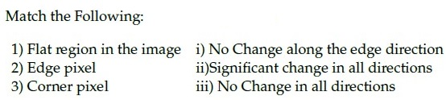

**Figure 3.** Matching table for Question 149.

**Options**

**A.** 1→ iii, 2→ i, 3 → ii  
*Option ID:* `6406533358238`

**B.** 1→ iii, 2→ ii, 3 → i  
*Option ID:* `6406533358239`

**C.** 1→ ii, 2→ iii, 3 → i  
*Option ID:* `6406533358240`

**D.** None of these.  
*Option ID:* `6406533358241`

**Correct answer:** **A** — 1→ iii, 2→ i, 3 → ii.  
**Source evidence:** Option A (Option ID 6406533358238) is marked with green text and a checkmark icon in the source PDF.

---

### Question 150

**Question ID:** `640653994504` · **Type:** MCQ · **Marks:** 2  
**PDF pages:** 3–4

Suppose we have a codebook of 2048 SIFT visual words. We extract 1000 SIFT descriptors (SIFT is a 128-dimensional feature) from a new image. What is the dimensionality of the BoW (Bag-of-Words) descriptor?

**Options**

**A.** 1000  
*Option ID:* `6406533358246`

**B.** 128  
*Option ID:* `6406533358247`

**C.** 128 × 2048  
*Option ID:* `6406533358248`

**D.** 2048  
*Option ID:* `6406533358249`

**Correct answer:** **D** — 2048.  
**Source evidence:** Option D (Option ID 6406533358249) is marked with green text and a checkmark icon in the source PDF.

---

### Question 151

**Question ID:** `640653994505` · **Type:** MCQ · **Marks:** 2  
**PDF pages:** 4

Match the derivative of activation functions $f(x)$ with their counterparts on the right column accordingly.

1) Leaky ReLU — i) $f(x)(1 - f(x))$  
2) Tanh — ii) $0\text{ if } x < 0\text{ and } 1\text{ if } x > 0$  
3) ReLU — iii) $1 - f(x)^2$  
4) Sigmoid — iv) $0.01\text{ if } x < 0\text{ and } 1\text{ if } x > 0$  
v) $0\text{ if } x > 0\text{ and } 1\text{ if } x < 0$  
vi) $0.01\text{ if } x > 0\text{ and } 1\text{ if } x < 0$

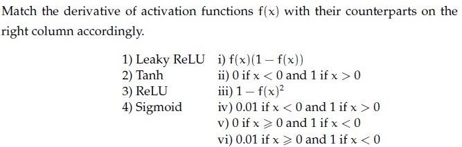

**Figure 4.** Matching table for activation functions and derivatives for Question 151.

**Options**

**A.** 1→ vi, 2→ iii, 3→ v, 4 → i  
*Option ID:* `6406533358250`

**B.** 1→ i, 2 →iv, 3 → iii, 4→ ii  
*Option ID:* `6406533358251`

**C.** 1→ i, 2 →v, 3 → iii, 4→ iv  
*Option ID:* `6406533358252`

**D.** 1→ iv, 2→ iii, 3→ ii, 4 → i  
*Option ID:* `6406533358253`

**Correct answer:** **D** — 1→ iv, 2→ iii, 3→ ii, 4 → i.  
**Source evidence:** Option D (Option ID 6406533358253) is marked with green text and a checkmark icon in the source PDF.

---

### Question 152

**Question ID:** `640653994509` · **Type:** MCQ · **Marks:** 2  
**PDF pages:** 4

Consider a Convolutional Neural Network which processes an RGB image. It has 128 kernels each of spatial dimension 5 × 5 in the first layer. They are convolved with a stride 1. This is followed by a max-pooling layer with stride 2 and kernel size 5 × 5. What would be the receptive field size of a single neuron in the pooling layer? (Recap: A receptive field is the size of the region in the input image, which influences the activation of that specific neuron.)

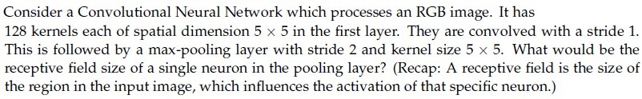

**Figure 5.** Source problem statement for Question 152.

**Options**

**A.** 5 × 5  
*Option ID:* `6406533358260`

**B.** 7 × 7  
*Option ID:* `6406533358261`

**C.** 9 × 9  
*Option ID:* `6406533358262`

**D.** 3 × 3  
*Option ID:* `6406533358263`

**Correct answer:** **C** — 9 × 9.  
**Source evidence:** Option C (Option ID 6406533358262) is marked with green text and a checkmark icon in the source PDF.

---

### Question 153

**Question ID:** `640653994481` · **Type:** MSQ · **Marks:** 2  
**PDF pages:** 5

Which of the following statements are false?

**Options**

**A.** Momentum in optimization can cause oscillations around minima when encountering flat regions or saddle points due to the dominance of the momentum term over the small gradient.  
*Option ID:* `6406533358199`

**B.** Stochastic Gradient Descent (SGD) with its inherent noise can be beneficial in escaping local minima and saddle points, provided that there is enough gradient information in the neighborhood.  
*Option ID:* `6406533358200`

**C.** Adagrad is an optimization algorithm introduced to overcome the diminishing learning rate problem in techniques like RMSProp.  
*Option ID:* `6406533358201`

**D.** ADAM is introduced to solve problems in RMSProp by combining RMSProp and Adagrad techniques.  
*Option ID:* `6406533358202`

**Correct answer:** **C**, **D** — C: Adagrad is an optimization algorithm introduced to overcome the diminishing learning rate problem in techniques like RMSProp.; D: ADAM is introduced to solve problems in RMSProp by combining RMSProp and Adagrad techniques..  
**Source evidence:** Option C (Option ID 6406533358201) is marked with green text and a checkmark icon in the source PDF.; Option D (Option ID 6406533358202) is marked with green text and a checkmark icon in the source PDF.

---

### Question 154

**Question ID:** `640653994482` · **Type:** MSQ · **Marks:** 2  
**PDF pages:** 5

Which of the following linear filters will leave the central value of the given matrix unchanged.

$$\begin{bmatrix} 10 & 20 & 10 \\ 20 & 10 & 20 \\ 10 & 20 & 10 \end{bmatrix}$$

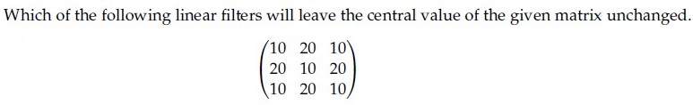

**Figure 6.** Source matrix for Question 154.

**Options**

**A.** 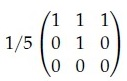

**Figure 7.** Filter kernel for Option A of Question 154.  
*Option ID:* `6406533358203`

**B.** 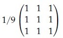

**Figure 8.** Filter kernel for Option B of Question 154.  
*Option ID:* `6406533358204`

**C.** 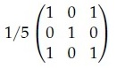

**Figure 9.** Filter kernel for Option C of Question 154.  
*Option ID:* `6406533358205`

**D.** 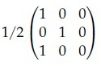

**Figure 10.** Filter kernel for Option D of Question 154.  
*Option ID:* `6406533358206`

**Correct answer:** **A**, **C** — A, C.  
**Source evidence:** Option A (Option ID 6406533358203) is marked with green text and a checkmark icon in the source PDF.; Option C (Option ID 6406533358205) is marked with green text and a checkmark icon in the source PDF.

---

### Question 155

**Question ID:** `640653994485` · **Type:** MSQ · **Marks:** 2  
**PDF pages:** 6

Certain 2D kernel $K$ can be decomposed into two 1D kernels ($v$ and $h$) to reduce the computation cost such as $K = vh^T$. The 2D kernel is called as Separable Kernel.

Consider the following 2D kernels

Which of the below kernels are separable?

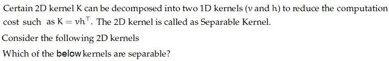

**Figure 11.** Problem description for separable 2D kernels for Question 155.

**Options**

**A.** 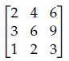

**Figure 12.** 2D kernel for Option A of Question 155.  
*Option ID:* `6406533358212`

**B.** 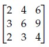

**Figure 13.** 2D kernel for Option B of Question 155.  
*Option ID:* `6406533358213`

**C.** 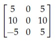

**Figure 14.** 2D kernel for Option C of Question 155.  
*Option ID:* `6406533358214`

**D.** 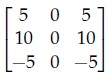

**Figure 15.** 2D kernel for Option D of Question 155.  
*Option ID:* `6406533358215`

**Correct answer:** **A**, **D** — A, D.  
**Source evidence:** Option A (Option ID 6406533358212) is marked with green text and a checkmark icon in the source PDF.; Option D (Option ID 6406533358215) is marked with green text and a checkmark icon in the source PDF.

---

### Question 156

**Question ID:** `640653994488` · **Type:** MSQ · **Marks:** 2  
**PDF pages:** 6–7

Which of the following statements are true? (Select all that apply)

**Options**

**A.** tanh activation function can be represented as below in terms of sigmoid activation function:

$$\tanh(x) = 2\sigma(2x) - 1, \text{ where } \sigma = \text{sigmoid activation function}$$

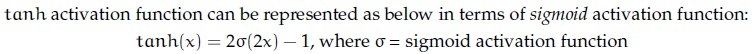

**Figure 16.** Mathematical statement for Option A of Question 156.  
*Option ID:* `6406533358224`

**B.** The derivative of the Sigmoid activation function is symmetric around the origin.

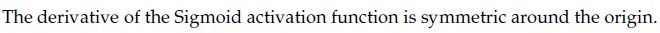

**Figure 17.** Statement for Option B of Question 156.  
*Option ID:* `6406533358225`

**C.** Gradient of sigmoid neuron at saturation explodes

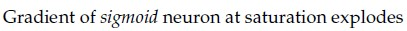

**Figure 18.** Statement for Option C of Question 156.  
*Option ID:* `6406533358226`

**D.** sigmoid activation is centered around 0.5 whereas tanh activation is centered around 0.

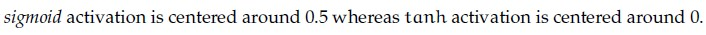

**Figure 19.** Statement for Option D of Question 156.  
*Option ID:* `6406533358227`

**Correct answer:** **A**, **D** — A: tanh(x) = 2σ(2x) - 1; D: sigmoid activation is centered around 0.5 whereas tanh activation is centered around 0..  
**Source evidence:** Option A (Option ID 6406533358224) is marked with green text and a checkmark icon in the source PDF.; Option D (Option ID 6406533358227) is marked with green text and a checkmark icon in the source PDF.

---

### Question 157

**Question ID:** `640653994506` · **Type:** MSQ · **Marks:** 2  
**PDF pages:** 7

Which of the following are true? (Select all that apply)

**Options**

**A.** To get the output with the same size as that of the input after a convolution with kernel size $k \times k$ ($k$ is odd) and stride 1, padding used is $\lfloor \frac{k}{2} \rfloor$.

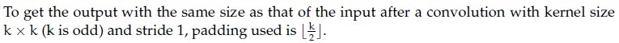

**Figure 20.** Statement and formula for Option A of Question 157.  
*Option ID:* `6406533358254`

**B.** Derivative of loss w.r.t. input image $X$, where $Y = X * W$ is $\frac{\partial L}{\partial X} = \frac{\partial L}{\partial Y} \odot W$, where $*$ represents convolution and $\odot$ represents correlation

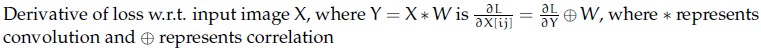

**Figure 21.** Statement and formula for Option B of Question 157.  
*Option ID:* `6406533358255`

**C.** The number of learnable parameters in a pooling layer is not 0

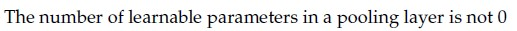

**Figure 22.** Statement for Option C of Question 157.  
*Option ID:* `6406533358256`

**D.** The number of feature maps obtained after a convolution operation depends on the depth of the input but not on the number of filters

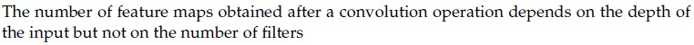

**Figure 23.** Statement for Option D of Question 157.  
*Option ID:* `6406533358257`

**Correct answer:** **A**, **B** — A, B.  
**Source evidence:** Option A (Option ID 6406533358254) is marked with green text and a checkmark icon in the source PDF.; Option B (Option ID 6406533358255) is marked with green text and a checkmark icon in the source PDF.

---

### Question 158

**Question ID:** `640653994492` · **Type:** SA · **Marks:** 0.5  
**PDF pages:** 7–8

**Comprehension Context (Questions 158 to 160):**

The gradient of an image I, points in the direction of most rapid change in intensity, taking image derivatives accentuates (a) ____________ frequencies and hence amplifies noise, since the proportion of noise to signal is larger at (b) __________ frequencies. The solution to this is (c) _________ the image prior to computing gradients.

Based on the above data, answer the given subquestions.

**Subquestion:**

Enter the correct answer for (a).

NOTE: Enter the exact answer without any space in the beginning or at the end.

Response Type : Alphanumeric  
Answers Type : Equal  
Answers Case Sensitive : No

**Correct answer:** high  
**Source evidence:** Official Possible Answers field displays 'high' in green text on page 8.

---

### Question 159

**Question ID:** `640653994493` · **Type:** SA · **Marks:** 0.5  
**PDF pages:** 8

*(Context: Refer to Comprehension passage above Question 158)*

Enter the correct answer for (b).

NOTE: Enter the exact answer without any space in the beginning or at the end.

Response Type : Alphanumeric  
Answers Type : Equal  
Answers Case Sensitive : No

**Correct answer:** high  
**Source evidence:** Official Possible Answers field displays 'high' in green text on page 8.

---

### Question 160

**Question ID:** `640653994494` · **Type:** SA · **Marks:** 1  
**PDF pages:** 8

*(Context: Refer to Comprehension passage above Question 158)*

Enter the correct answer for (c).

NOTE: Enter the exact answer without any space in the beginning or at the end.

Response Type : Alphanumeric  
Answers Type : Equal  
Answers Case Sensitive : No

**Correct answer:** smooth  
**Source evidence:** Official Possible Answers field displays 'smooth' in green text on page 8.

---

### Question 161

**Question ID:** `640653994496` · **Type:** SA · **Marks:** 1  
**PDF pages:** 8–9

**Comprehension Context (Questions 161 to 162):**

In Canny edge detection, large value of the Gaussian kernel spread, $\sigma$ leads to (a) __________ edges, and small value of $\sigma$ leads to (b) __________ edges.

Based on the above data, answer the given subquestions.

**Subquestion:**

Enter the correct answer for (a).

NOTE: Enter the exact answer without any space in the beginning or at the end.

Response Type : Alphanumeric  
Answers Type : Set  
Answers Case Sensitive : No

**Correct answer:** thick (Accepted alternatives: coarse, large scale)  
**Source evidence:** Official Possible Answers set contains 'thick', 'coarse', and 'large scale' in green text on page 9.

---

### Question 162

**Question ID:** `640653994497` · **Type:** SA · **Marks:** 1  
**PDF pages:** 9

*(Context: Refer to Comprehension passage above Question 161)*

Enter the correct answer for (b) .

NOTE: Enter the exact answer without any space in the beginning or at the end.

Response Type : Alphanumeric  
Answers Type : Equal  
Answers Case Sensitive : No

**Correct answer:** fine  
**Source evidence:** Official Possible Answers field displays 'fine' in green text on page 9.

---

### Question 163

**Question ID:** `640653994500` · **Type:** SA · **Marks:** 0.5  
**PDF pages:** 10

**Comprehension Context (Questions 163 to 166):**

For the given figure, complete the transformation matrix with $x$-shear = 0.5:

$$\begin{bmatrix} x' \\ y' \\ 1 \end{bmatrix} = \begin{bmatrix} a_{11} & a_{12} & 0 \\ a_{21} & a_{22} & 0 \\ 0 & 0 & 1 \end{bmatrix} \begin{bmatrix} x \\ y \\ 1 \end{bmatrix}$$

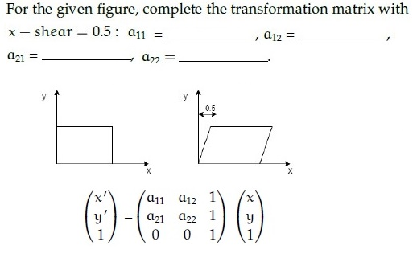

**Figure 24.** Shear transformation diagram and coordinate mapping matrix for Questions 163–166.

Based on the above data, answer the given subquestions.

**Subquestion:**

Enter the correct answer for $a_{11}$

Response Type : Numeric  
Answers Type : Equal

**Correct answer:** 1  
**Source evidence:** Official Possible Answers field displays '1' in green text on page 10.

---

### Question 164

**Question ID:** `640653994501` · **Type:** SA · **Marks:** 0.5  
**PDF pages:** 10–11

*(Context: Refer to Comprehension passage and Figure 24 above Question 163)*

Enter the correct answer for $a_{12}$

Response Type : Numeric  
Answers Type : Equal

**Correct answer:** 0.5  
**Source evidence:** Official Possible Answers field displays '0.5' in green text on page 11.

---

### Question 165

**Question ID:** `640653994502` · **Type:** SA · **Marks:** 0.5  
**PDF pages:** 11

*(Context: Refer to Comprehension passage and Figure 24 above Question 163)*

Enter the correct answer for $a_{21}$

Response Type : Numeric  
Answers Type : Equal

**Correct answer:** 0  
**Source evidence:** Official Possible Answers field displays '0' in green text on page 11.

---

### Question 166

**Question ID:** `640653994503` · **Type:** SA · **Marks:** 0.5  
**PDF pages:** 11

*(Context: Refer to Comprehension passage and Figure 24 above Question 163)*

Enter the correct answer for $a_{22}$

Response Type : Numeric  
Answers Type : Equal

**Correct answer:** 1  
**Source evidence:** Official Possible Answers field displays '1' in green text on page 11.

---

### Question 167

**Question ID:** `640653994477` · **Type:** SA · **Marks:** 2  
**PDF pages:** 11–12

Consider the following numpy array:

```python
arr = np.array([[0, 1], [2, 3], [4, 5]])
```

Now consider the following operations:

```python
flattened_arr = arr.flatten()
flattened_arr[0] = 10
```

Write the value of `arr[0]`

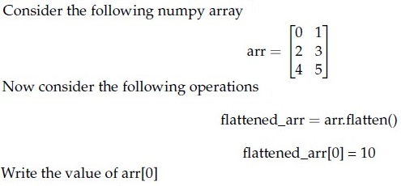

**Figure 25.** NumPy array operations snippet for Question 167.

Response Type : Numeric  
Answers Type : Equal

**Correct answer:** 0  
**Source evidence:** Official Possible Answers field displays '0' in green text on page 12.

---

### Question 168

**Question ID:** `640653994478` · **Type:** SA · **Marks:** 2  
**PDF pages:** 12

Consider the following numpy array:

```python
arr = np.array([[0, 1], [2, 3], [4, 5]])
```

Now consider the following operations:

```python
raveled_arr = arr.ravel()
raveled_arr[0] = 10
```

Write the value of `arr[0]`

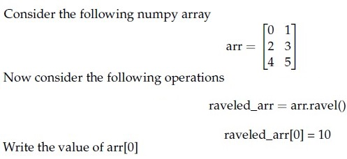

**Figure 26.** NumPy array operations snippet for Question 168.

Response Type : Numeric  
Answers Type : Equal

**Correct answer:** 10  
**Source evidence:** Official Possible Answers field displays '10' in green text on page 12.

---

### Question 169

**Question ID:** `640653994484` · **Type:** SA · **Marks:** 2  
**PDF pages:** 12–13

Consider the grayscale image shown below:

$$\begin{bmatrix} 20 & 30 & 25 & 30 & 40 \\ 45 & 10 & 40 & 35 & 20 \\ 15 & 20 & 30 & 25 & 50 \\ 50 & 40 & 35 & 15 & 30 \\ 10 & 35 & 25 & 20 & 45 \end{bmatrix}$$

If a median filter with a 3 × 3 neighborhood is applied to this image with a stride of 1 and no padding, _____ will be the value at position (2, 2) in the filtered image? (Assume that the top-left pixel coordinate of output image is addressed as (1, 1))?

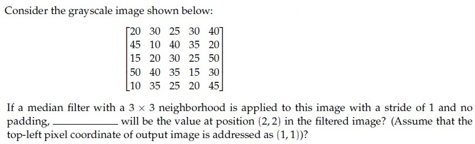

**Figure 27.** Grayscale pixel matrix and question for Question 169.

Response Type : Numeric  
Answers Type : Equal

**Correct answer:** 30  
**Source evidence:** Official Possible Answers field displays '30' in green text on page 13.

---

### Question 170

**Question ID:** `640653994489` · **Type:** SA · **Marks:** 2  
**PDF pages:** 13

Given a 2 × 2 matrix $M = \begin{bmatrix} E & F \\ F & G \end{bmatrix}$ where $M$ is the second moment matrix of edge pixels that is obtained while applying the Canny edge detector, the measure of straightness is _________

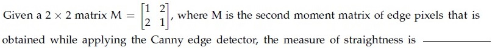

**Figure 28.** Second moment matrix definition for Question 170.

Response Type : Numeric  
Answers Type : Range

**Correct answer:** -0.34 to -0.29  
**Source evidence:** Official Possible Answers range displays '-0.34 to -0.29' in green text on page 13.

---

### Question 171

**Question ID:** `640653994507` · **Type:** SA · **Marks:** 2  
**PDF pages:** 13

What is the size of the feature map after applying two successive convolution operations with given parameters? Image size = 64 × 64, Kernel size = 6 × 6, Padding = 1 and Stride = 2. (In calculation, take $\text{floor}(x)$ whenever $x$ is non-integer. If the answer is $F \times F$, write $F$ in the blank).

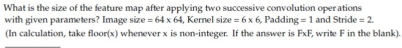

**Figure 29.** Feature map size question and parameters for Question 171.

Response Type : Numeric  
Answers Type : Equal

**Correct answer:** 14  
**Source evidence:** Official Possible Answers field displays '14' in green text on page 13.

---

### Question 172

**Question ID:** `640653994508` · **Type:** SA · **Marks:** 2  
**PDF pages:** 13

[Question stem truncated in source PDF: Question 172 header appears at the bottom of physical page 13 without question body or answer fields before PDF termination.]

**Correct answer:** Answer not verifiable from the source PDF  
**Source evidence:** Source PDF ends at physical page 13 immediately after Question 172 metadata header. Question body, response fields, and answer evidence are truncated.

---

## Answer key

| Source question | Question ID | Correct answer | PDF page(s) |
| :--- | :--- | :--- | :--- |
| 143 | `640653994479` | C | 1 |
| 144 | `640653994480` | C | 1–2 |
| 145 | `640653994483` | B | 2 |
| 146 | `640653994486` | C | 2 |
| 147 | `640653994487` | B | 2–3 |
| 148 | `640653994490` | B | 3 |
| 149 | `640653994498` | A | 3 |
| 150 | `640653994504` | D | 3–4 |
| 151 | `640653994505` | D | 4 |
| 152 | `640653994509` | C | 4 |
| 153 | `640653994481` | C, D | 5 |
| 154 | `640653994482` | A, C | 5 |
| 155 | `640653994485` | A, D | 6 |
| 156 | `640653994488` | A, D | 6–7 |
| 157 | `640653994506` | A, B | 7 |
| 158 | `640653994492` | high | 7–8 |
| 159 | `640653994493` | high | 8 |
| 160 | `640653994494` | smooth | 8 |
| 161 | `640653994496` | thick (Accepted alternatives: coarse, large scale) | 8–9 |
| 162 | `640653994497` | fine | 9 |
| 163 | `640653994500` | 1 | 10 |
| 164 | `640653994501` | 0.5 | 10–11 |
| 165 | `640653994502` | 0 | 11 |
| 166 | `640653994503` | 1 | 11 |
| 167 | `640653994477` | 0 | 11–12 |
| 168 | `640653994478` | 10 | 12 |
| 169 | `640653994484` | 30 | 12–13 |
| 170 | `640653994489` | -0.34 to -0.29 | 13 |
| 171 | `640653994507` | 14 | 13 |
| 172 | `640653994508` | Answer not verifiable from the source PDF | 13 |

## Extraction notes

1. **Administrative Question Exclusion:** The administrative subject confirmation question (Question ID unnumbered/0 marks, options YES/NO) at the top of physical page 1 has been excluded per instructions.
2. **Sequential Figure Numbering:** All 29 embedded visual assets have been extracted at native resolution, visually inspected, and sequentially captioned as Figures 1 through 29.
3. **Source Cutoff at Question 172:** The source PDF terminates at physical page 13 immediately following the Question 172 header (`Question Number : 172 Question Id : 640653994508 Question Type : SA Correct Marks : 2`). The question body, response fields, and answer key are truncated in the source PDF. This has been faithfully recorded as `Answer not verifiable from the source PDF`.
