# DL(CV) — da5006_2024T3_Q2_NA

**Subject:** Deep Learning for Computer Vision  
**Source:** `da5006_2024T3_Q2_NA.pdf` (original PDF omitted from this bundle)  
**Academic questions:** 26  
**Scope:** DL(CV) section; administrative subject confirmation excluded.

## Questions

### Question 132

**Question ID:** `6406531031065` · **Type:** Short Answer · **Marks:** 2  
**PDF pages:** 1, 2

**Context:** Let input have size $D_I \times D_I \times M$ where $D_I = 128$ and $M = 16$ and output feature map (after passing input through conv layer) has $D_I \times D_I \times N$ size where $N = 32$. Assume padded convolution. Let width of the square kernel in conv layer be $k$ where $k = 5$ (Ignore the bias term in the calculation). Calculate the number of parameters and computational cost for this convolution layer.

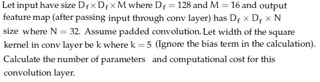

**Figure 1.** Convolutional layer specifications for Questions 132 and 133.

Based on the above data, answer the given subquestion.

Number of Parameters: ______________

**Correct answer:** `12800`  
**Source evidence:** Green text `12800` under Possible Answers, PDF page 2.

---

### Question 133

**Question ID:** `6406531031066` · **Type:** Short Answer · **Marks:** 2  
**PDF pages:** 1, 2

**Context:** Refer to the specifications in Question 132.

Based on the above data, answer the given subquestion.

Computational Cost: ______________

**Correct answer:** `209715200`  
**Source evidence:** Green text `209715200` under Possible Answers, PDF page 2.

---

### Question 134

**Question ID:** `6406531031068` · **Type:** Short Answer · **Marks:** 2  
**PDF pages:** 2, 3

**Context:** Let input have size $D_I \times D_I \times M$ where $D_I = 128$ and $M = 16$ and output feature map (after passing input through conv layer) has $D_I \times D_I \times N$ size where $N = 32$. Assume padded convolution. Let width of the square kernel in conv layer be $k$ where $k = 5$.

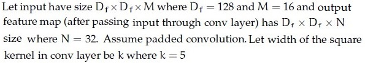

**Figure 2.** Depthwise separable convolution specifications for Questions 134 to 137.

Calculate the number of parameters and computational cost, but make use of Depthwise Seperable convolution and pointwise convolution instead of standard convolution.

Based on the above data, answer the given subquestion.

Number of parameters for depthwise convolution: ______________

**Correct answer:** `400`  
**Source evidence:** Green text `400` under Possible Answers, PDF page 3.

---

### Question 135

**Question ID:** `6406531031069` · **Type:** Short Answer · **Marks:** 2  
**PDF pages:** 2, 3

**Context:** Refer to the depthwise separable convolution specifications in Question 134.

Based on the above data, answer the given subquestion.

Computational Cost for depthwise convolution: ______________

**Correct answer:** `6553600`  
**Source evidence:** Green text `6553600` under Possible Answers, PDF page 3.

---

### Question 136

**Question ID:** `6406531031070` · **Type:** Short Answer · **Marks:** 2  
**PDF pages:** 2, 3, 4

**Context:** Refer to the depthwise separable convolution specifications in Question 134.

Based on the above data, answer the given subquestion.

Number of parameters for pointwise convolution: ______________

**Correct answer:** `512`  
**Source evidence:** Green text `512` under Possible Answers, PDF page 4.

---

### Question 137

**Question ID:** `6406531031071` · **Type:** Short Answer · **Marks:** 2  
**PDF pages:** 2, 4

**Context:** Refer to the depthwise separable convolution specifications in Question 134.

Based on the above data, answer the given subquestion.

Computational cost for pointwise convolution: ______________

**Correct answer:** `8388608`  
**Source evidence:** Green text `8388608` under Possible Answers, PDF page 4.

---

### Question 138

**Question ID:** `6406531031072` · **Type:** MCQ · **Marks:** 2  
**PDF pages:** 4, 5

The integral image of the image $\begin{bmatrix} 3 & 7 & 2 \\ 5 & 4 & 6 \\ 8 & 1 & 9 \end{bmatrix}$ is?

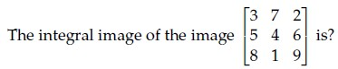

**Figure 3.** Source matrix specification for Question 138 integral image calculation.

**Options**

**A.** $\begin{bmatrix} 2 & 1 & 4 \\ 16 & 15 & 16 \\ 44 & 48 & 46 \end{bmatrix}$  
*Option ID:* `6406533487212`  
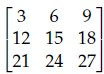  
**Figure 4.** Option A integral image candidate matrix.

**B.** $\begin{bmatrix} 3 & 10 & 12 \\ 8 & 19 & 27 \\ 16 & 28 & 45 \end{bmatrix}$  
*Option ID:* `6406533487213`  
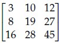  
**Figure 5.** Option B integral image candidate matrix.

**C.** $\begin{bmatrix} 2 & 7 & 12 \\ 8 & 15 & 25 \\ 16 & 28 & 45 \end{bmatrix}$  
*Option ID:* `6406533487214`  
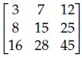  
**Figure 6.** Option C integral image candidate matrix.

**D.** $\begin{bmatrix} 9 & 1 & 2 \\ 8 & 3 & 4 \\ 7 & 1 & 1 \end{bmatrix}$  
*Option ID:* `6406533487215`  
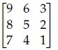  
**Figure 7.** Option D integral image candidate matrix.

**Correct answer:** **B** — $\begin{bmatrix} 3 & 10 & 12 \\ 8 & 19 & 27 \\ 16 & 28 & 45 \end{bmatrix}$  
**Source evidence:** Green check icon and green text on Option ID `6406533487213`, PDF page 4.

---

### Question 139

**Question ID:** `6406531031073` · **Type:** MCQ · **Marks:** 2  
**PDF pages:** 5

Which one of the following object detection networks uses an ROI pooling layer?

**Options**

**A.** Fast R-CNN  
*Option ID:* `6406533487216`

**B.** R-CNN  
*Option ID:* `6406533487217`

**C.** YOLO  
*Option ID:* `6406533487218`

**D.** All of these  
*Option ID:* `6406533487219`

**Correct answer:** **A** — Fast R-CNN  
**Source evidence:** Green check icon and green text on Option ID `6406533487216`, PDF page 5.

---

### Question 140

**Question ID:** `6406531031074` · **Type:** MCQ · **Marks:** 2  
**PDF pages:** 5, 6

Consider an object detection system evaluated on a dataset consisting of 1000 images. The system makes 1500 predictions across these images, and for each image, there are annotated ground truth bounding boxes.

The system’s precision-recall curve is calculated, and the precision at different recall levels for one of the classes is as follows:

| Recall | Precision |
| :--- | :--- |
| 0.1 | 0.90 |
| 0.2 | 0.85 |
| 0.3 | 0.80 |
| 0.4 | 0.75 |
| 0.5 | 0.70 |
| 0.6 | 0.65 |
| 0.7 | 0.60 |
| 0.8 | 0.55 |
| 0.9 | 0.50 |
| 1.0 | 0.45 |

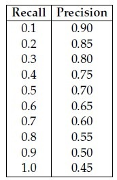

**Figure 8.** Precision-recall values for Question 140.

Calculate the Average Precision (AP) for this class using the 11-point interpolation method, which averages the precision values at recall levels {0.0, 0.1, 0.2, ..., 1.0}. The precision at recall 0.0 can be assumed to be 1.0.

Additionally, the system’s AP values for the other two classes are as follows:
- AP for class 2: 0.78
- AP for class 3: 0.72

Based on these AP values, what is the mean Average Precision (mAP) across all three classes?

**Options**

**A.** 0.70  
*Option ID:* `6406533487220`

**B.** 0.69  
*Option ID:* `6406533487221`

**C.** 0.73  
*Option ID:* `6406533487222`

**D.** 0.76  
*Option ID:* `6406533487223`

**Correct answer:** **C** — 0.73  
**Source evidence:** Green check icon and green text on Option ID `6406533487222`, PDF page 6.

---

### Question 141

**Question ID:** `6406531031075` · **Type:** MCQ · **Marks:** 2  
**PDF pages:** 6

Match the following:

| Network | Feature / Layer |
| :--- | :--- |
| 1) VGGNet | i) $1 \times 1$ convolution |
| 2) EfficientNet | ii) identity mapping |
| 3) GoogleNet | iii) $3 \times 3$ convolution |
| 4) ResNet | iv) $7 \times 7$ convolution |
| | v) depth-wise separable convolutions |

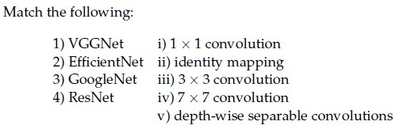

**Figure 9.** Architecture matching items for Question 141.

**Options**

**A.** 1→iv, 2→ii, 3→v, 4→i  
*Option ID:* `6406533487224`

**B.** 1→iv, 2→iii, 3→v, 4→ii  
*Option ID:* `6406533487225`

**C.** 1→iv, 2→v, 3→ii, 4→iii  
*Option ID:* `6406533487226`

**D.** 1→iii, 2→v, 3→i, 4→ii  
*Option ID:* `6406533487227`

**Correct answer:** **D** — 1→iii, 2→v, 3→i, 4→ii  
**Source evidence:** Green check icon and green text on Option ID `6406533487227`, PDF page 6.

---

### Question 142

**Question ID:** `6406531031076` · **Type:** MCQ · **Marks:** 2  
**PDF pages:** 6

Which one of the following statements is False?

**Options**

**A.** In a max pooling layer, the unit that gets selected (maximum entry) in forward propagation gets all the gradient during backpropagation.  
*Option ID:* `6406533487228`

**B.** Residual blocks are used in ResNets to avoid the vanishing gradient problem.  
*Option ID:* `6406533487229`

**C.** Feature maps of initial layers of a CNN capture more abstract concepts than the feature maps of final layers.  
*Option ID:* `6406533487230`

**D.** Dilated convolution increases the receptive field size when compared to the standard convolution operator.  
*Option ID:* `6406533487231`

**Correct answer:** **C** — Feature maps of initial layers of a CNN capture more abstract concepts than the feature maps of final layers.  
**Source evidence:** Green check icon and green text on Option ID `6406533487230`, PDF page 6.

---

### Question 143

**Question ID:** `6406531031078` · **Type:** MCQ · **Marks:** 2  
**PDF pages:** 6, 7

Let us suppose that you want to build an encoder-decoder recurrent model with attention. We know that the context vector for the model is given by $c_i = \sum_{j=1}^T \alpha_{ij} h_j$, where $\alpha_{ij}$ refers to the degree of alignment between decoder state $s_{i-1}$ and encoder state $h_j$. Then, $\alpha_{ij}$ is computed as:

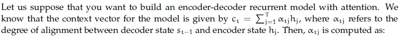

**Figure 10.** Attention model formulation for Question 143.

**Options**

**A.** Sigmoid of alignment scores  
*Option ID:* `6406533487233`

**B.** Softmax of alignment scores  
*Option ID:* `6406533487234`

**C.** ReLU of alignment scores  
*Option ID:* `6406533487235`

**D.** None of these  
*Option ID:* `6406533487236`

**Correct answer:** **B** — Softmax of alignment scores  
**Source evidence:** Green check icon and green text on Option ID `6406533487234`, PDF page 7.

---

### Question 144

**Question ID:** `6406531031079` · **Type:** MCQ · **Marks:** 2  
**PDF pages:** 7

Which one of the following statements is false?

**Options**

**A.** Attention mechanisms cannot be applied to the bidirectional RNN model  
*Option ID:* `6406533487237`

**B.** An image captioning network cannot be trained end-to-end even though we are using 2 different modalities to train the network  
*Option ID:* `6406533487238`

**C.** One of the key components in the vanilla transformer are the recurrent connections that help them to deal with variable input length.  
*Option ID:* `6406533487239`

**D.** None of these  
*Option ID:* `6406533487240`

**Correct answer:** **D** — None of these  
**Source evidence:** Green check icon and green text on Option ID `6406533487240`, PDF page 7.

---

### Question 145

**Question ID:** `6406531031081` · **Type:** MCQ · **Marks:** 2  
**PDF pages:** 7

Consider two 12×12 bounding boxes(one on the upper left and one of the lower right) in an images with an overlapping region of 8 × 8. The Intersection over Union (IoU) between the two boxes is (choose the closest value):

**Options**

**A.** 21%  
*Option ID:* `6406533487245`

**B.** 25%  
*Option ID:* `6406533487246`

**C.** 28%  
*Option ID:* `6406533487247`

**D.** 37%  
*Option ID:* `6406533487248`

**Correct answer:** **C** — 28%  
**Source evidence:** Green check icon and green text on Option ID `6406533487247`, PDF page 7.

---

### Question 146

**Question ID:** `6406531031082` · **Type:** MCQ · **Marks:** 2  
**PDF pages:** 7, 8

Which one of the following statements is true?

**Options**

**A.** Attention mechanisms cannot be applied to the bidirectional RNN model  
*Option ID:* `6406533487249`

**B.** An image captioning network cannot be trained end-to-end even though we are using 2 different modalities to train the network  
*Option ID:* `6406533487250`

**C.** One of the key components in the vanilla transformer are the recurrent connections that help them to deal with variable input length.  
*Option ID:* `6406533487251`

**D.** None of these  
*Option ID:* `6406533487252`

**Correct answer:** **D** — None of these  
**Source evidence:** Green check icon and green text on Option ID `6406533487252`, PDF page 8.

---

### Question 147

**Question ID:** `6406531031083` · **Type:** MCQ · **Marks:** 2  
**PDF pages:** 8

Match the following computer vision tasks to situations:

| Task | Situation |
| :--- | :--- |
| 1) Instance Segmentation | i) There are cars in these pixels |
| 2) Classification | ii) There are 4 cars in the image |
| 3) Semantic Segmentation | iii) There is car in the image |
| 4) Object Detection | iv) There are 4 cars in the image, and here are the pixels with the shape of each of their occurrence |

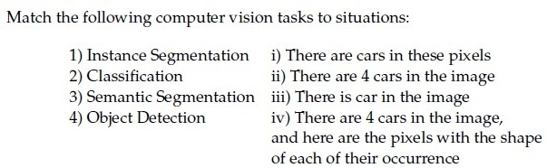

**Figure 11.** Computer vision tasks and situations matching table for Question 147.

**Options**

**A.** 1→ iv, 2→ iii, 3→ ii, 4 → i  
*Option ID:* `6406533487253`

**B.** 1→ ii, 2→ iii, 3 → i, 4 →iv  
*Option ID:* `6406533487254`

**C.** 1→ iv, 2→ iii, 3→ i, 4 → ii  
*Option ID:* `6406533487255`

**D.** 1→ ii, 2→ iv, 3 → iii, 4→ i  
*Option ID:* `6406533487256`

**Correct answer:** **C** — 1→ iv, 2→ iii, 3→ i, 4 → ii  
**Source evidence:** Green check icon and green text on Option ID `6406533487255`, PDF page 8.

---

### Question 148

**Question ID:** `6406531031085` · **Type:** MCQ · **Marks:** 2  
**PDF pages:** 8

Match the following:

| Architecture | Application |
| :--- | :--- |
| 1) One-to-many RNN architecture | i) Sentiment analysis of Netflix reviews |
| 2) Many-to-one RNN architecture | ii) Convert English sentence to Hindi |
| 3) Many-to-many RNN architecture with equal number of inputs and outputs | iii) Named entity recognition |
| 4) Many-to-many RNN architecture with unequal number of inputs and outputs (Encoder and Decoder model) | iv) Music generation |

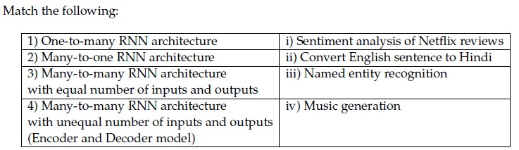

**Figure 12.** Recurrent neural network architectures matching table for Question 148.

**Options**

**A.** 1→ iii, 2→ iv, 3→ ii, 4 → i  
*Option ID:* `6406533487261`

**B.** 1→ iv, 2→ i, 3 → iii, 4→ ii  
*Option ID:* `6406533487262`

**C.** 1→ i, 2→ ii, 3 → iii, 4→ iv  
*Option ID:* `6406533487263`

**D.** 1→ i, 2→ iii, 3 → ii, 4→ iv  
*Option ID:* `6406533487264`

**Correct answer:** **B** — 1→ iv, 2→ i, 3 → iii, 4→ ii  
**Source evidence:** Green check icon and green text on Option ID `6406533487262`, PDF page 8.

---

### Question 149

**Question ID:** `6406531031086` · **Type:** MCQ · **Marks:** 2  
**PDF pages:** 8, 9

Match the following attention mechanisms to their corresponding alignment score functions:

| Attention Mechanism | Alignment Score Function |
| :--- | :--- |
| (1) General Attention | (i) $v_a^T \tanh(W_a [s_t; h_i])$ |
| (2) Content-Based Attention | (ii) $\alpha_{t,i} = \text{softmax}(W_a s_t)$ |
| (3) Dot-Product Attention | (iii) $s_t^T h_i$ |
| (4) Additive Attention | (iv) $\cos(s_t, h_i)$ |
| (5) Location-Based Attention | (v) $s_t^T W_a h_i$ |

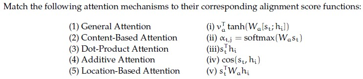

**Figure 13.** Attention mechanisms and alignment score functions for Question 149.

**Options**

**A.** 1→iii, 2→ii, 3→v, 4→iv, 5→i  
*Option ID:* `6406533487265`

**B.** 1→iii, 2→iv, 3→i, 4→ii, 5→v  
*Option ID:* `6406533487266`

**C.** 1→i, 2→iii, 3→iv, 4→ii, 5→v  
*Option ID:* `6406533487267`

**D.** 1→v, 2→iv, 3→iii, 4→i, 5→ii  
*Option ID:* `6406533487268`

**Correct answer:** **D** — 1→v, 2→iv, 3→iii, 4→i, 5→ii  
**Source evidence:** Green check icon and green text on Option ID `6406533487268`, PDF page 9.

---

### Question 150

**Question ID:** `6406531031080` · **Type:** MSQ · **Marks:** 2  
**PDF pages:** 9

Which of the following are true:

**Options**

**A.** For generating an image of a required class, Deep Inside Convolutional Networks uses gradient descent with the following optimization : $\text{argmin}_I (S_c(I) - \lambda \|I\|_2^2)$ where $S_c$ is the scores vector for class $c$ before applying softmax.  
*Option ID:* `6406533487241`  
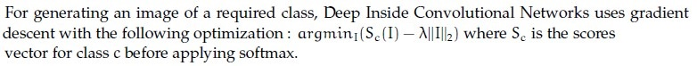  
**Figure 14.** Option A statement on class image generation optimization.

**B.** Visualizing the maximum of the data gradient across the channels provides insights into the image regions that have the most significant impact on generating high probability scores for a specific class.  
*Option ID:* `6406533487242`  
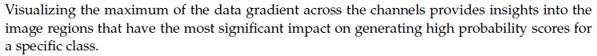  
**Figure 15.** Option B statement on data gradient visualization.

**C.** Global average Pooling refers to the average of all the pixels at a particular spatial location across all the channels.  
*Option ID:* `6406533487243`  
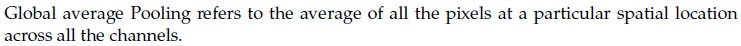  
**Figure 16.** Option C statement on global average pooling definition.

**D.** Class Activation Map (CAM) does not require a backward pass through the entire model.  
*Option ID:* `6406533487244`  
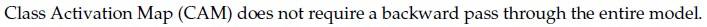  
**Figure 17.** Option D statement on Class Activation Map backward pass.

**Correct answer:** **B**, **D**  
**Source evidence:** Green check icons and green text on Option IDs `6406533487242` and `6406533487244`, PDF page 9.

---

### Question 151

**Question ID:** `6406531031084` · **Type:** MSQ · **Marks:** 2  
**PDF pages:** 9, 10

Which of the following is true regarding Hard Attention and Soft Attention?

**Options**

**A.** Soft Attention is smooth and differentiable  
*Option ID:* `6406533487257`

**B.** Variance reduction techniques are used to train Soft Attention models  
*Option ID:* `6406533487258`

**C.** Soft Attention is computationally cheaper than Hard Attention when the source input is large  
*Option ID:* `6406533487259`

**D.** The inference (test time) overhead is low in Hard Attention when compared to Soft Attention models  
*Option ID:* `6406533487260`

**Correct answer:** **A**, **D**  
**Source evidence:** Green check icons and green text on Option IDs `6406533487257` and `6406533487260`, PDF page 10.

---

### Question 152

**Question ID:** `6406531031077` · **Type:** Short Answer · **Marks:** 2  
**PDF pages:** 10

Consider a Faster R-CNN object detection framework, which is being trained with a mini-batch size of 2. The RPN produces 512 proposals, out of which 5 and 95 of them are foreground proposals, corresponding to each image in the mini-batch. For a single mini-batch update, the bounding box regression loss will be computed _____________ times.

**Correct answer:** `100`  
**Source evidence:** Green text `100` under Possible Answers, PDF page 10.

---

### Question 153

**Question ID:** `6406531031088` · **Type:** Short Answer · **Marks:** 2  
**PDF pages:** 10, 11, 12

**Context:** The RNN given below is used for classification:

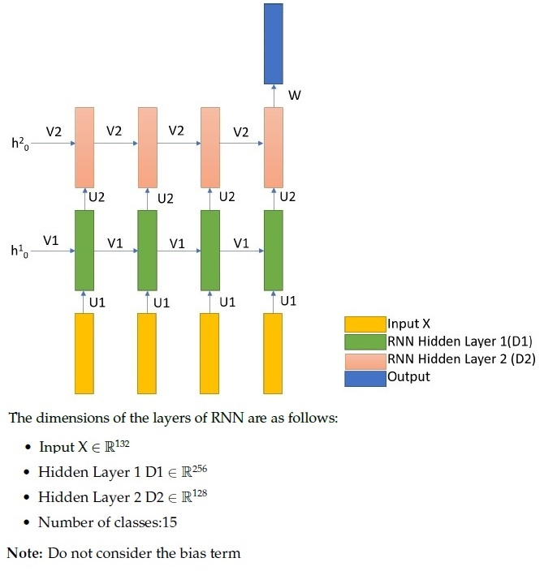

**Figure 18.** Two-layer RNN architecture diagram and layer dimensions for Questions 153 to 157.

The dimensions of the layers of RNN are as follows:
- Input $X \in \mathbb{R}^{132}$
- Hidden Layer 1 $D1 \in \mathbb{R}^{256}$
- Hidden Layer 2 $D2 \in \mathbb{R}^{128}$
- Number of classes: 15
Note: Do not consider the bias term.

Based on the above data, answer the given subquestion.

Number of weights in Weight Matrix U1 is: ______________

**Correct answer:** `33792`  
**Source evidence:** Green text `33792` under Possible Answers, PDF page 12.

---

### Question 154

**Question ID:** `6406531031089` · **Type:** Short Answer · **Marks:** 2  
**PDF pages:** 10, 11, 12

**Context:** Refer to the RNN specifications and diagram in Question 153.

Based on the above data, answer the given subquestion.

Number of weights in Weight Matrix V1 is: ______________

**Correct answer:** `65536`  
**Source evidence:** Green text `65536` under Possible Answers, PDF page 12.

---

### Question 155

**Question ID:** `6406531031090` · **Type:** Short Answer · **Marks:** 2  
**PDF pages:** 10, 11, 12

**Context:** Refer to the RNN specifications and diagram in Question 153.

Based on the above data, answer the given subquestion.

Number of weights in Weight Matrix U2 is: ______________

**Correct answer:** `32768`  
**Source evidence:** Green text `32768` under Possible Answers, PDF page 12.

---

### Question 156

**Question ID:** `6406531031091` · **Type:** Short Answer · **Marks:** 2  
**PDF pages:** 10, 11, 12

**Context:** Refer to the RNN specifications and diagram in Question 153.

Based on the above data, answer the given subquestion.

Number of weights in Weight Matrix V2 is: ______________

**Correct answer:** `16384`  
**Source evidence:** Green text `16384` under Possible Answers, PDF page 12.

---

### Question 157

**Question ID:** `6406531031092` · **Type:** Short Answer · **Marks:** 2  
**PDF pages:** 10, 11, 12

**Context:** Refer to the RNN specifications and diagram in Question 153.

Based on the above data, answer the given subquestion.

[Question text truncated in source PDF: The source exam export terminates at the bottom of physical page 12 directly after 'Correct Marks : 2'. Stem text, question label, text areas, and official possible answers are cut off in the source document.]

**Correct answer:** **Answer not verifiable from the source PDF**  
**Source evidence:** Physical page 12 bottom margin terminates at y=814.03 immediately after `Correct Marks : 2`. Stem and possible answers are truncated in source document.

---

## Answer key

| Source question | Question ID | Correct answer | PDF page(s) |
| :--- | :--- | :--- | :--- |
| 132 | `6406531031065` | 12800 | 1, 2 |
| 133 | `6406531031066` | 209715200 | 1, 2 |
| 134 | `6406531031068` | 400 | 2, 3 |
| 135 | `6406531031069` | 6553600 | 2, 3 |
| 136 | `6406531031070` | 512 | 2, 3, 4 |
| 137 | `6406531031071` | 8388608 | 2, 4 |
| 138 | `6406531031072` | B | 4, 5 |
| 139 | `6406531031073` | A | 5 |
| 140 | `6406531031074` | C | 5, 6 |
| 141 | `6406531031075` | D | 6 |
| 142 | `6406531031076` | C | 6 |
| 143 | `6406531031078` | B | 6, 7 |
| 144 | `6406531031079` | D | 7 |
| 145 | `6406531031081` | C | 7 |
| 146 | `6406531031082` | D | 7, 8 |
| 147 | `6406531031083` | C | 8 |
| 148 | `6406531031085` | B | 8 |
| 149 | `6406531031086` | D | 8, 9 |
| 150 | `6406531031080` | B, D | 9 |
| 151 | `6406531031084` | A, D | 9, 10 |
| 152 | `6406531031077` | 100 | 10 |
| 153 | `6406531031088` | 33792 | 10, 11, 12 |
| 154 | `6406531031089` | 65536 | 10, 11, 12 |
| 155 | `6406531031090` | 32768 | 10, 11, 12 |
| 156 | `6406531031091` | 16384 | 10, 11, 12 |
| 157 | `6406531031092` | Answer not verifiable from the source PDF | 10, 11, 12 |

## Extraction notes

1. **Administrative question exclusion:** Question 131 (ID `6406531031063`, 0 marks) is the administrative subject confirmation query (asking candidates to confirm their registered subject with YES/NO options). It has been excluded from academic questions in compliance with Section 4 of the Master Extraction Prompt.
2. **Reconciliation of declared counts:** Page 1 lists "Number of Questions : 19". In the exam system, comprehension blocks (Sub-Section 2 for Q132-133, Sub-Section 3 for Q134-137, Sub-Section 7 for Q153-157) count as 1 question unit each in the header metadata. Together with 1 administrative unit (Q131), 12 standalone MCQs (Q138-149), 2 MSQs (Q150-151), and 1 SA (Q152), this totals exactly $1 + 1 + 1 + 12 + 2 + 1 + 1 = 19$ parent question units. Scored academic questions total 26 (Questions 132 to 157).
3. **Source truncation at end of exam paper:** Physical page 12 terminates at y=814.03 immediately following the header for Question 157 (`Question Number : 157 Question Id : 6406531031092 Question Type : SA` and `Correct Marks : 2`). The specific weight matrix query (likely concerning hidden-to-output matrix $W$ or classification weights) and official `Possible Answers` were cut off during the original exam export. In accordance with Section 6 of the Master Extraction Prompt, this question is faithfully retained with its official ID and marked as `Answer not verifiable from the source PDF`.
4. **Source key ambiguity between Question 144 and Question 146:**
   - Both Question 144 and Question 146 share the identical four option texts:
     - A. Attention mechanisms cannot be applied to the bidirectional RNN model
     - B. An image captioning network cannot be trained end-to-end even though we are using 2 different modalities to train the network
     - C. One of the key components in the vanilla transformer are the recurrent connections that help them to deal with variable input length.
     - D. None of these
   - Question 144 asks: "Which one of the following statements is false?". In academic deep learning literature, statements A, B, and C are all factually false. Nonetheless, the source exam officially marks Option D (`None of these`) as correct with a green checkmark and green text.
   - Question 146 asks: "Which one of the following statements is true?". Here Option D (`None of these`) is marked with a green checkmark and green text, which is logically consistent since A, B, and C are false.
   - In accordance with the contract, the official source key is preserved exactly as published without alteration.
5. **Mathematical confirmations:**
   - **Q138 (Integral Image):** Source input matrix $I = \begin{bmatrix} 3 & 7 & 2 \\ 5 & 4 & 6 \\ 8 & 1 & 9 \end{bmatrix}$ yields cumulative integral image $S = \begin{bmatrix} 3 & 10 & 12 \\ 8 & 19 & 27 \\ 16 & 28 & 45 \end{bmatrix}$, matching Option B (`6406533487213`).
   - **Q140 (11-point AP and mAP):** Interpolated precision sum at recall levels $0.0, 0.1, \dots, 1.0$ is $1.0 + 0.90 + 0.85 + 0.80 + 0.75 + 0.70 + 0.65 + 0.60 + 0.55 + 0.50 + 0.45 = 7.75$. Class 1 AP $= 7.75 / 11 = 0.7045$. Overall $\text{mAP} = (0.7045 + 0.78 + 0.72) / 3 = 0.7348 \approx 0.73$, matching Option C.
   - **Q145 (IoU):** Two $12 \times 12$ boxes with $8 \times 8$ overlap: $\text{Intersection} = 64$, $\text{Union} = 144 + 144 - 64 = 224$, $\text{IoU} = 64/224 = 2/7 \approx 28.57\% \approx 28\%$, matching Option C.
   - **Q152 (Faster R-CNN loss updates):** Bounding box regression loss is computed only for foreground proposals ($5 + 95 = 100$), yielding exactly 100 computations.
   - **Q153–156 (RNN weights):** Input $X \in \mathbb{R}^{132}$, Hidden $D1 \in \mathbb{R}^{256}$, Hidden $D2 \in \mathbb{R}^{128}$. Input-to-hidden $U1 = 132 \times 256 = 33792$; recurrent $V1 = 256 \times 256 = 65536$; hidden-to-hidden $U2 = 256 \times 128 = 32768$; recurrent $V2 = 128 \times 128 = 16384$.
