# DL(CV) — da5006_2025T1_Q1_NA

**Subject:** Deep Learning for Computer Vision  
**Source:** `da5006_2025T1_Q1_NA.pdf` (original PDF omitted from this bundle)  
**Academic questions:** 36  
**Scope:** DL(CV) section; administrative subject confirmation excluded.

## Questions

### Question 154

**Question ID:** `6406531130610` · **Type:** SA · **Marks:** 2  
**PDF pages:** 2

Consider the following numpy array:

```python
arr = np.array([[0, 1], [2, 3], [4, 5]])
```

Now consider the following operations:

```python
flattened_arr = arr.flatten()
flattened_arr[2] = 10
```

Write the value of `arr[2]` (or the element at index 2).

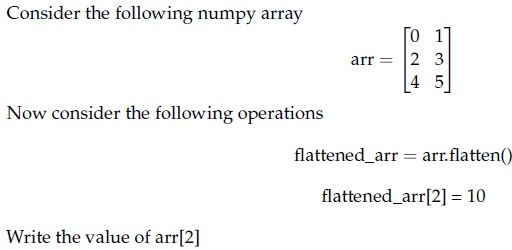

**Figure 1.** Source numpy array and operations for Question 154.

**Correct answer:** `2`  
**Source evidence:** Official answer '2' specified in Possible Answers field with green text (color 0x8000).

---

### Question 155

**Question ID:** `6406531130611` · **Type:** SA · **Marks:** 2  
**PDF pages:** 3

Consider the following numpy array:

```python
arr = np.array([[0, 1], [2, 3], [4, 5]])
```

Now consider the following operations:

```python
raveled_arr = arr.ravel()
raveled_arr[2] = 20
```

Write the value of `arr[2]` (or the element at index 2).

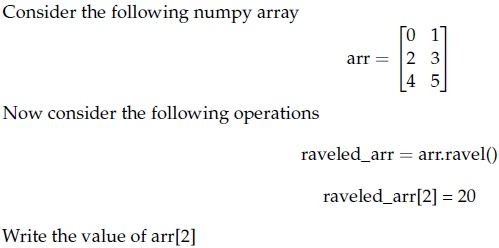

**Figure 2.** Source numpy array and operations for Question 155.

**Correct answer:** `20`  
**Source evidence:** Official answer '20' specified in Possible Answers field with green text (color 0x8000).

---

### Question 156

**Question ID:** `6406531130617` · **Type:** SA · **Marks:** 2  
**PDF pages:** 3

Consider the grayscale image shown below:

$$\begin{bmatrix} 20 & 30 & 25 & 30 & 40 \\ 45 & 10 & 40 & 35 & 20 \\ 15 & 20 & 30 & 25 & 50 \\ 50 & 40 & 35 & 15 & 30 \\ 10 & 35 & 25 & 20 & 45 \end{bmatrix}$$

If a median filter with a $3 \times 3$ neighborhood is applied to this image with a stride of 1 and no padding, _____ will be the value at position (2, 2) in the filtered image? (Assume that the top-left pixel coordinate of output image is addressed as (1, 1))?

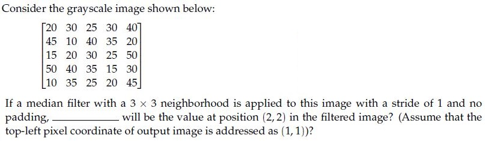

**Figure 3.** Source grayscale pixel matrix for Question 156.

**Correct answer:** `30`  
**Source evidence:** Official answer '30' specified in Possible Answers field with green text (color 0x8000).

---

### Question 157

**Question ID:** `6406531130622` · **Type:** SA · **Marks:** 2  
**PDF pages:** 4

Given a $2 \times 2$ matrix $M = \begin{bmatrix} 1 & 2 \\ 2 & 1 \end{bmatrix}$ where $M$ is the second moment matrix of edge pixels that is obtained while applying the Canny edge detector, the measure of straightness is _________

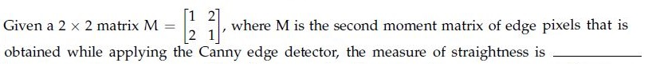

**Figure 4.** Second moment matrix equation for Question 157.

**Correct answer:** `-0.34 to -0.33`  
**Source evidence:** Official accepted answer range '-0.34 to -0.33' in Possible Answers field with green text (color 0x8000).

---

### Question 158

**Question ID:** `6406531130639` · **Type:** SA · **Marks:** 2  
**PDF pages:** 4

What is the size of the feature map after applying two successive convolution operations with given parameters? Image size = 64 x 64, Kernel size = 3 x 3, Padding = 2 and Stride = 3. (In calculation, take floor(x) whenever x is non-integer. If the answer is FxF, write F in the blank).

**Correct answer:** `8`  
**Source evidence:** Official answer '8' specified in Possible Answers field with green text (color 0x8000).

---

### Question 159

**Question ID:** `6406531130640` · **Type:** SA · **Marks:** 2  
**PDF pages:** 4, 5

Let an input to a convolutional layer in a CNN have size $D_f \times D_f \times M$ where $D_f = 32$ and $M = 100$, and output feature map (after passing input through conv layer) has $D_f \times D_f \times N$ size where $N = 64$. Let the kernel in the conv layer be $k \times k$ where $k = 5$. Calculate the number of parameters for this convolution layer. (Assume appropriate padding is applied for all convolutions so the input and output sizes are equal. Ignore the bias term in the calculation)._________________

**Correct answer:** `160000`  
**Source evidence:** Official answer '160000' specified in Possible Answers field with green text (color 0x8000) on PDF page 5.

---

### Question 160

**Question ID:** `6406531130645` · **Type:** SA · **Marks:** 2  
**PDF pages:** 5

Using momentum-based gradient descent, find the new value of the parameter $\theta_{t+1}$, given that the old value $\theta_t = 0.5$, gradient of loss function $\nabla_{\theta_t} L(\theta_t) = 0.2$, velocity term $V_{t-1} = 0.7$, learning rate $\alpha = 0.75$ and momentum term $\gamma = 0.8$ (Round decimal point till 3 places) [Note: Assume that there is no bias].

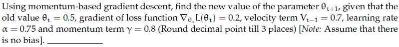

**Figure 5.** Momentum-based gradient descent parameter statement for Question 160.

**Correct answer:** `-0.260 to -0.210`  
**Source evidence:** Official accepted answer range '-0.260 to -0.210' in Possible Answers field with green text (color 0x8000).

---

### Question 161

**Question ID:** `6406531130612` · **Type:** MCQ · **Marks:** 2  
**PDF pages:** 5

Given is a $3 \times 3$ 8-bit grayscale image:

$$\begin{bmatrix} 50 & 70 & 120 \\ 90 & 30 & 80 \\ 40 & 60 & 110 \end{bmatrix}$$

What is the mean of transformed pixels of after applying linear contrast stretching? Linear contrast stretching is an image enhancement technique used to improve the contrast in an image. This is achieved by linearly scaling the pixel values so that they span a desired range (0 to 255 for an 8-bit grayscale image).

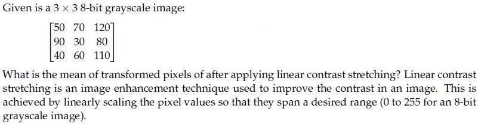

**Figure 6.** Grayscale pixel matrix and question statement for Question 161.

**Options**

**A.** 119.33  
*Option ID:* `6406533822672`

**B.** 110.5  
*Option ID:* `6406533822673`

**C.** 134.25  
*Option ID:* `6406533822674`

**D.** 0  
*Option ID:* `6406533822675`

**Correct answer:** **A** — 119.33.  
**Source evidence:** Option 6406533822672 rendered in green font (color 0x8000) with green checkmark icon in source PDF.

---

### Question 162

**Question ID:** `6406531130616` · **Type:** MCQ · **Marks:** 2  
**PDF pages:** 5, 6

Which of the following statements is True ?

**Options**

**A.** Gaussian filter is Separable filter because it is non linear.  
*Option ID:* `6406533822688`

**B.** Median filter is a non separable filter  
*Option ID:* `6406533822689`

**C.** Gaussian filter is a High Pass filter.  
*Option ID:* `6406533822690`

**D.** Mean filter is a non separable filter because it is non linear  
*Option ID:* `6406533822691`

**Correct answer:** **B** — Median filter is a non separable filter.  
**Source evidence:** Option 6406533822689 rendered in green font (color 0x8000) with green checkmark icon in source PDF.

---

### Question 163

**Question ID:** `6406531130619` · **Type:** MCQ · **Marks:** 2  
**PDF pages:** 6

A four-dimensional input vector $\mathbf{x} = [1, -2, 3, -4]$ is passed to a hidden layer with a single neuron and an activation function $a(\cdot)$ to obtain $z$. Assume that the corresponding weights (from input to hidden layer) are $[0.5, -0.3, 0.8, 1.2]$ and bias is $-0.2$. If the activation function $a(\cdot)$ is Sigmoid, Linear, Indicator function, Softplus, ReLU and Leaky-ReLU, what are the corresponding values of $z$? (Note that Indicator function returns 1 for a positive input, and 0 otherwise. Softplus is defined as: $\ln(1 + \exp(z)))$.

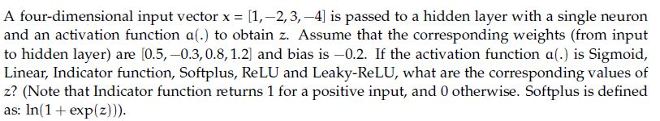

**Figure 7.** Input vector and activation function problem statement for Question 163.

**Options**

**A.** 0.18, 1.5, 1.5, 0.20,−1.5,−0.015  
*Option ID:* `6406533822697`

**B.** 0.92, 2.5, 1, 2.5, 2.5, 1  
*Option ID:* `6406533822698`

**C.** 0.18,−1.5, 0, 0.20, 0,−0.015  
*Option ID:* `6406533822699`

**D.** 0.91, 1, 0, 0.2, 1, 1.7  
*Option ID:* `6406533822700`

**Correct answer:** **C** — 0.18,−1.5, 0, 0.20, 0,−0.015.  
**Source evidence:** Option 6406533822699 rendered in green font (color 0x8000) with green checkmark icon in source PDF.

---

### Question 164

**Question ID:** `6406531130620` · **Type:** MCQ · **Marks:** 2  
**PDF pages:** 6

Identify the correct sequence of steps in a Canny edge detection pipeline. Steps are listed below:

1. Compute gradient magnitude and direction
2. Connect individual components
3. Smoothen the image
4. Threshold into strong, weak, or no edge
5. Gaussian Filter and Hysteresis
6. Non-maximum suppression
7. Apply derivative to get edges

**Options**

**A.** 6→ 1→ 4→ 5 → 2  
*Option ID:* `6406533822701`

**B.** 3→ 1→ 6→ 4 → 2  
*Option ID:* `6406533822702`

**C.** 3→ 5→ 1→ 4 → 2  
*Option ID:* `6406533822703`

**D.** 6→ 1→ 5→ 7 → 2  
*Option ID:* `6406533822704`

**Correct answer:** **B** — 3→ 1→ 6→ 4 → 2.  
**Source evidence:** Option 6406533822702 rendered in green font (color 0x8000) with green checkmark icon in source PDF.

---

### Question 165

**Question ID:** `6406531130623` · **Type:** MCQ · **Marks:** 2  
**PDF pages:** 7

Identify the correct sequence of steps in Scale Invariant Feature Transform (SIFT) method. Steps listed below:

1. Keypoint Descriptor
2. Keypoint Localization
3. Scale-space Extrema Detection
4. Orientation Estimation

**Options**

**A.** 4→ 2→ 1→ 3  
*Option ID:* `6406533822710`

**B.** 3→ 2→ 4→ 1  
*Option ID:* `6406533822711`

**C.** 3→ 1→ 2→ 4  
*Option ID:* `6406533822712`

**D.** None of these.  
*Option ID:* `6406533822713`

**Correct answer:** **B** — 3→ 2→ 4→ 1.  
**Source evidence:** Option B (6406533822711) rendered in green font (color 0x8000) with green checkmark icon in source PDF.

---

### Question 166

**Question ID:** `6406531130630` · **Type:** MCQ · **Marks:** 2  
**PDF pages:** 7

Match the Following:

| Column 1 | Column 2 |
| :--- | :--- |
| 1) Flat region in the image | i) No Change along the edge direction |
| 2) Edge pixel | ii) Significant change in all directions |
| 3) Corner pixel | iii) No Change in all directions |

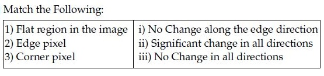

**Figure 8.** Source table for Question 166.

**Options**

**A.** 1→ iii, 2→ i, 3 → ii  
*Option ID:* `6406533822718`

**B.** 1→ iii, 2→ ii, 3 → i  
*Option ID:* `6406533822719`

**C.** 1→ ii, 2→ iii, 3 → ii  
*Option ID:* `6406533822720`

**D.** None of these  
*Option ID:* `6406533822721`

**Correct answer:** **A** — 1→ iii, 2→ i, 3 → ii.  
**Source evidence:** Option 6406533822718 rendered in green font (color 0x8000) with green checkmark icon in source PDF.

---

### Question 167

**Question ID:** `6406531130636` · **Type:** MCQ · **Marks:** 2  
**PDF pages:** 7

Suppose we have a codebook of 2048 SIFT visual words. We extract 1000 SIFT descriptors (SIFT is a 128-dimensional feature) from a new image. What is the dimensionality of the BoW (Bag-of-Words) descriptor?

**Options**

**A.** 1000  
*Option ID:* `6406533822726`

**B.** 128  
*Option ID:* `6406533822727`

**C.** 128 × 2048  
*Option ID:* `6406533822728`

**D.** 2048  
*Option ID:* `6406533822729`

**Correct answer:** **D** — 2048.  
**Source evidence:** Option D (6406533822729) rendered in green font (color 0x8000) with green checkmark icon in source PDF.

---

### Question 168

**Question ID:** `6406531130637` · **Type:** MCQ · **Marks:** 2  
**PDF pages:** 8

Match the derivative of activation functions $f(x)$ with their counterparts on the right column accordingly.

| Column 1 | Column 2 |
| :--- | :--- |
| 1) Leaky ReLU | i) $f(x)(1 - f(x))$ |
| 2) Tanh | ii) 0 if $x < 0$ and 1 if $x > 0$ |
| 3) ReLU | iii) $1 - f(x)^2$ |
| 4) Sigmoid | iv) 0.01 if $x < 0$ and 1 if $x > 0$ |
| | v) 0 if $x > 0$ and 1 if $x < 0$ |
| | vi) 0.01 if $x > 0$ and 1 if $x < 0$ |

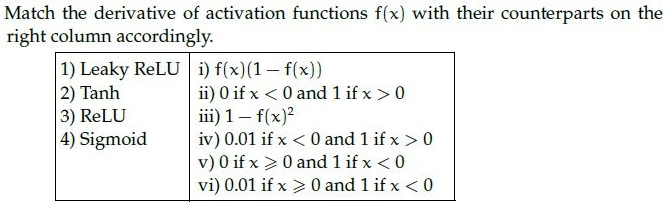

**Figure 9.** Activation function derivatives matching table for Question 168.

**Options**

**A.** 1→ vi, 2→ iii, 3→ v, 4 → i  
*Option ID:* `6406533822730`

**B.** 1→ i, 2→ iv, 3 → iii, 4→ ii  
*Option ID:* `6406533822731`

**C.** 1→ i, 2→ v, 3 → iii, 4→ iv  
*Option ID:* `6406533822732`

**D.** 1→ iv, 2→ iii, 3→ ii, 4 → i  
*Option ID:* `6406533822733`

**Correct answer:** **D** — 1→ iv, 2→ iii, 3→ ii, 4 → i.  
**Source evidence:** Option 6406533822733 rendered in green font (color 0x8000) with green checkmark icon in source PDF.

---

### Question 169

**Question ID:** `6406531130641` · **Type:** MCQ · **Marks:** 2  
**PDF pages:** 8

Consider a Convolutional Neural Network which processes an RGB image. It has 128 kernels each of spatial dimension 5 × 5 in the first layer. They are convolved with a stride 1. This is followed by a max-pooling layer with stride 2 and kernel size 5 × 5. What would be the receptive field size of a single neuron in the pooling layer? (Recap: A receptive field is the size of the region in the input image, which influences the activation of that specific neuron.)

**Options**

**A.** 5 × 5  
*Option ID:* `6406533822740`

**B.** 7 × 7  
*Option ID:* `6406533822741`

**C.** 9 × 9  
*Option ID:* `6406533822742`

**D.** 3 × 3  
*Option ID:* `6406533822743`

**Correct answer:** **C** — 9 × 9.  
**Source evidence:** Option 6406533822742 rendered in green font (color 0x8000) with green checkmark icon in source PDF.

---

### Question 170

**Question ID:** `6406531130642` · **Type:** MCQ · **Marks:** 2  
**PDF pages:** 8, 9

Consider the following two statements. Which of the following statements are true?

(a) Convolution operator is both commutative and associative.
(b) Fourier transform of a convolved image FT (a * b), is not the product of the Fourier transform of the constituent images FT(a) x FT(b)

**Options**

**A.** a and b  
*Option ID:* `6406533822744`

**B.** not a but b  
*Option ID:* `6406533822745`

**C.** a but not b  
*Option ID:* `6406533822746`

**D.** Neither a nor b  
*Option ID:* `6406533822747`

**Correct answer:** **C** — a but not b.  
**Source evidence:** Option 6406533822746 rendered in green font (color 0x8000) with green checkmark icon in source PDF on page 9.

---

### Question 171

**Question ID:** `6406531130643` · **Type:** MCQ · **Marks:** 2  
**PDF pages:** 9

A 3x3 kernel generates an output image of dimension 20x20 after convolution. The (approximate) number of computations performed to obtain this output image is:

**Options**

**A.** 3600  
*Option ID:* `6406533822748`

**B.** 180  
*Option ID:* `6406533822749`

**C.** 400  
*Option ID:* `6406533822750`

**D.** 9  
*Option ID:* `6406533822751`

**Correct answer:** **A** — 3600.  
**Source evidence:** Option 6406533822748 rendered in green font (color 0x8000) with green checkmark icon in source PDF.

---

### Question 172

**Question ID:** `6406531130644` · **Type:** MCQ · **Marks:** 2  
**PDF pages:** 9

Which of the following statements are True?

**Options**

**A.** Vanilla Gradient Descent converges faster than Momentum-based GD.  
*Option ID:* `6406533822752`

**B.** Momentum based GD oscillates around minima before convergence.  
*Option ID:* `6406533822753`

**C.** Noise in Stochastic Gradient descent weight updates – can lead to faster convergence.  
*Option ID:* `6406533822754`

**D.** None of these  
*Option ID:* `6406533822755`

**Correct answer:** **B** — Momentum based GD oscillates around minima before convergence..  
**Source evidence:** Option 6406533822753 rendered in green font (color 0x8000) with green checkmark icon in source PDF.

---

### Question 173

**Question ID:** `6406531130649` · **Type:** MCQ · **Marks:** 2  
**PDF pages:** 9, 10

Match the following:

| Column 1 | Column 2 |
| :--- | :--- |
| 1) Gaussian Filter | i) Edges found when gradient is low |
| 2) Sobel Filter | ii) Edges found at zero crossing |
| 3) First derivative of Gaussian | iii) Edge smoothing |
| 4) Second derivative of Gaussian | iv) Edge detection |
| | v) Edges found when gradient is high |

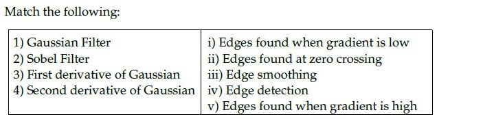

**Figure 10.** Filter and edge operation matching table for Question 173.

**Options**

**A.** 1→ iii, 2→ iv, 3→ i, 4 → ii  
*Option ID:* `6406533822759`

**B.** 1→ iii, 2→ i, 3 → ii, 4 →v  
*Option ID:* `6406533822760`

**C.** 1→ iii, 2→ iv, 3→ v, 4 → ii  
*Option ID:* `6406533822761`

**D.** 1→ iv, 2→ iii, 3→ i, 4 → ii  
*Option ID:* `6406533822762`

**Correct answer:** **C** — 1→ iii, 2→ iv, 3→ v, 4 → ii.  
**Source evidence:** Option C (6406533822761) rendered in green font (color 0x8000) with green checkmark icon in source PDF on page 10.

---

### Question 174

**Question ID:** `6406531130613` · **Type:** MSQ · **Marks:** 2  
**PDF pages:** 10

Which of the following statements is false?

**Options**

**A.** Linear contrast stretching is a local operation.  
*Option ID:* `6406533822676`

**B.** Moving average is an example of local operation.  
*Option ID:* `6406533822677`

**C.** Convolution in the spatial domain can be obtained through addition in the frequency domain.  
*Option ID:* `6406533822678`

**D.** All of these.  
*Option ID:* `6406533822679`

**Correct answer:** **A**, **C** — Linear contrast stretching is a local operation. ; Convolution in the spatial domain can be obtained through addition in the frequency domain..  
**Source evidence:** Option A (6406533822676) rendered in green font (color 0x8000) with green checkmark icon in source PDF; Option C (6406533822678) rendered in green font (color 0x8000) with green checkmark icon in source PDF.

---

### Question 175

**Question ID:** `6406531130614` · **Type:** MSQ · **Marks:** 2  
**PDF pages:** 10

Which of the following statements are false?

**Options**

**A.** Momentum in optimization can cause oscillations around minima when encountering flat regions or saddle points due to the dominance of the momentum term over the small gradient.  
*Option ID:* `6406533822680`

**B.** Stochastic Gradient Descent (SGD) with its inherent noise can be beneficial in escaping local minima and saddle points, provided that there is enough gradient information in the neighborhood.  
*Option ID:* `6406533822681`

**C.** Adagrad is an optimization algorithm introduced to overcome the diminishing learning rate problem in techniques like RMSProp.  
*Option ID:* `6406533822682`

**D.** ADAM is introduced to solve problems in RMSProp by combining RMSProp and Adagrad techniques.  
*Option ID:* `6406533822683`

**Correct answer:** **C**, **D** — Adagrad is an optimization algorithm introduced to overcome the diminishing learning rate problem in techniques like RMSProp. ; ADAM is introduced to solve problems in RMSProp by combining RMSProp and Adagrad techniques..  
**Source evidence:** Option C (6406533822682) rendered in green font (color 0x8000) with green checkmark icon in source PDF; Option D (6406533822683) rendered in green font (color 0x8000) with green checkmark icon in source PDF.

---

### Question 176

**Question ID:** `6406531130615` · **Type:** MSQ · **Marks:** 2  
**PDF pages:** 10, 11

Which of the following linear filters will leave the central value of the given matrix unchanged.

$$\begin{bmatrix} 20 & 10 & 20 \\ 10 & 20 & 10 \\ 5 & 5 & 5 \end{bmatrix}$$

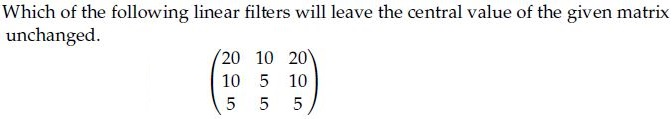

**Figure 11.** Source matrix for Question 176.

**Options**

**A.** Linear filter kernel shown in Figure 12:

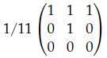

**Figure 12.** Filter kernel for Option A.

*Option ID:* `6406533822684`

**B.** Linear filter kernel shown in Figure 13:

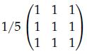

**Figure 13.** Filter kernel for Option B.

*Option ID:* `6406533822685`

**C.** Linear filter kernel shown in Figure 14:

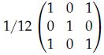

**Figure 14.** Filter kernel for Option C.

*Option ID:* `6406533822686`

**D.** Linear filter kernel shown in Figure 15:

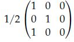

**Figure 15.** Filter kernel for Option D.

*Option ID:* `6406533822687`

**Correct answer:** **A** — Linear filter kernel shown in Figure 12.  
**Source evidence:** Option A (6406533822684) rendered in green font (color 0x8000) with green checkmark icon in source PDF on page 11.

---

### Question 177

**Question ID:** `6406531130618` · **Type:** MSQ · **Marks:** 2  
**PDF pages:** 11, 12

Certain 2D kernel $K$ can be decomposed into two 1D kernels ($v$ and $h$) to reduce the computation cost such as $K = vh^T$. The 2D kernel is called as Separable Kernel.

Consider the following 2D kernels:

$$\text{(a) } \begin{bmatrix} 2 & 4 & 6 \\ 3 & 6 & 9 \\ 1 & 2 & 3 \end{bmatrix} \quad \text{(b) } \begin{bmatrix} 2 & 4 & 6 \\ 3 & 6 & 9 \\ 2 & 3 & 4 \end{bmatrix}$$

$$\text{(c) } \begin{bmatrix} 5 & 0 & 5 \\ 10 & 0 & 10 \\ 5 & 0 & 5 \end{bmatrix} \quad \text{(d) } \begin{bmatrix} 5 & 0 & -5 \\ 10 & 0 & -10 \\ 5 & 0 & -5 \end{bmatrix}$$

Which of the above kernels are separable?

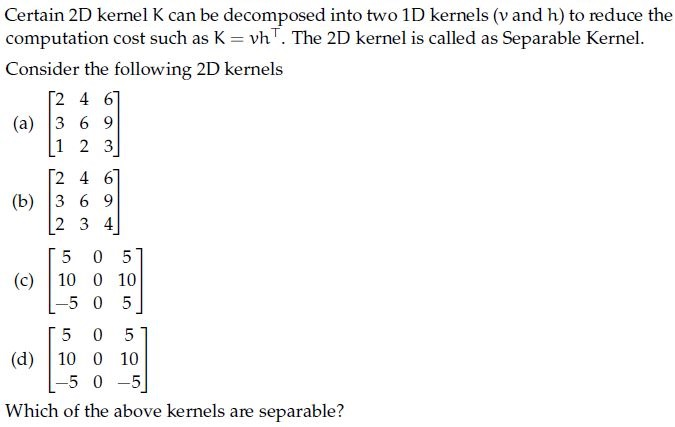

**Figure 16.** 2D kernels (a), (b), (c), and (d) for Question 177.

**Options**

**A.** (a)  
*Option ID:* `6406533822693`

**B.** (b)  
*Option ID:* `6406533822694`

**C.** (c)  
*Option ID:* `6406533822695`

**D.** (d)  
*Option ID:* `6406533822696`

**Correct answer:** **A**, **D** — (a) ; (d).  
**Source evidence:** Option A (6406533822693) on page 11 rendered in green font (color 0x8000) with green checkmark icon in source PDF; Option D (6406533822696) on page 12 rendered in green font (color 0x8000) with green checkmark icon in source PDF.

---

### Question 178

**Question ID:** `6406531130621` · **Type:** MSQ · **Marks:** 2  
**PDF pages:** 12

Which of the following statements are true ? (Select all that apply)

**Options**

**A.** tanh activation function can be represented as below in terms of sigmoid activation function: $\tanh(x) = 2\sigma(2x) - 1$, where $\sigma$ = sigmoid activation function

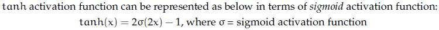

**Figure 17.** Statement for Option A.

*Option ID:* `6406533822705`

**B.** The derivative of the Sigmoid activation function is symmetric around the origin.

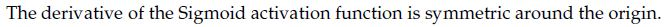

**Figure 18.** Statement for Option B.

*Option ID:* `6406533822706`

**C.** Gradient of sigmoid neuron at saturation explodes

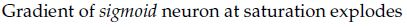

**Figure 19.** Statement for Option C.

*Option ID:* `6406533822707`

**D.** sigmoid activation is centered around 0.5 whereas tanh activation is centered around 0.

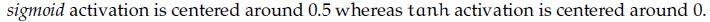

**Figure 20.** Statement for Option D.

*Option ID:* `6406533822708`

**Correct answer:** **A**, **D** — tanh activation function can be represented as below in terms of sigmoid activation function: tanh(x) = 2sigma(2x) - 1, where sigma = sigmoid activation function ; sigmoid activation is centered around 0.5 whereas tanh activation is centered around 0..  
**Source evidence:** Option A (6406533822705) rendered in green font (color 0x8000) with green checkmark icon in source PDF; Option D (6406533822708) rendered in green font (color 0x8000) with green checkmark icon in source PDF.

---

### Question 179

**Question ID:** `6406531130638` · **Type:** MSQ · **Marks:** 2  
**PDF pages:** 12

Which of the following are true ? (Select all that apply)

**Options**

**A.** To get the output with the same size as that of the input after a convolution with kernel size $k \times k$ ($k$ is odd) and stride 1, padding used is $\lfloor \frac{k}{2} \rfloor$.

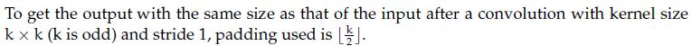

**Figure 21.** Statement for Option A.

*Option ID:* `6406533822734`

**B.** Derivative of loss w.r.t. input image X, where $Y = X * W$ is convolution and $\otimes$ represents correlation: $\frac{\partial L}{\partial X} = \frac{\partial L}{\partial Y} \otimes W$, where $*$ represents convolution and $\otimes$ represents correlation

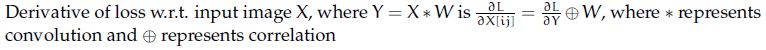

**Figure 22.** Statement for Option B.

*Option ID:* `6406533822735`

**C.** The number of learnable parameters in a pooling layer is not 0

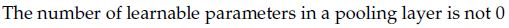

**Figure 23.** Statement for Option C.

*Option ID:* `6406533822736`

**D.** The number of feature maps obtained after a convolution operation depends on the depth of the input but not on the number of filters

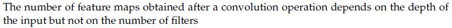

**Figure 24.** Statement for Option D.

*Option ID:* `6406533822737`

**Correct answer:** **A**, **B** — To get the output with the same size as that of the input after a convolution with kernel size k x k (k is odd) and stride 1, padding used is floor(k/2). ; Derivative of loss w.r.t. input image X, where Y = X * W is convolution and correlation represents correlation: dL/dX = dL/dY corr W.  
**Source evidence:** Option A (6406533822734) rendered in green font (color 0x8000) with green checkmark icon in source PDF; Option B (6406533822735) rendered in green font (color 0x8000) with green checkmark icon in source PDF.

---

### Question 180

**Question ID:** `6406531130625` · **Type:** SA · **Marks:** 1  
**PDF pages:** 13

**Shared Comprehension Context (Question ID: `6406531130624`):**

> The gradient of an image I, points in the direction of most rapid change in intensity, taking image derivatives accentuates (a) _______ frequencies and hence amplifies noise, since the proportion of noise to signal is larger at (b) _______ frequencies. The solution to this is smooth the image prior to computing gradients.
>
> Based on the above data, answer the given subquestions.

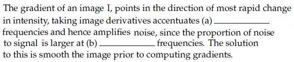

**Figure 25.** Source text passage for Comprehension Questions 180–181.

Enter the correct answer for blank (a) ____________

NOTE: Enter the exact answer without any extra space in the beginning or at the end.

**Correct answer:** `high`  
**Evaluation conditions:** Alphanumeric; Equal; case insensitive.

**Source evidence:** Official answer 'high' in Possible Answers field with green text (color 0x8000).

---

### Question 181

**Question ID:** `6406531130626` · **Type:** SA · **Marks:** 1  
**PDF pages:** 13

**Shared Comprehension Context (Question ID: `6406531130624`):**

> The gradient of an image I, points in the direction of most rapid change in intensity, taking image derivatives accentuates (a) _______ frequencies and hence amplifies noise, since the proportion of noise to signal is larger at (b) _______ frequencies. The solution to this is smooth the image prior to computing gradients.
>
> Based on the above data, answer the given subquestions.

Enter the correct answer for blank (b) ____________

NOTE: Enter the exact answer without any extra space in the beginning or at the end.

**Correct answer:** `high`  
**Evaluation conditions:** Alphanumeric; Equal; case insensitive.

**Source evidence:** Official answer 'high' in Possible Answers field with green text (color 0x8000).

---

### Question 182

**Question ID:** `6406531130628` · **Type:** SA · **Marks:** 1  
**PDF pages:** 14

**Shared Comprehension Context (Question ID: `6406531130627`):**

> In Canny edge detection, large value of the Gaussian kernel spread, $\sigma$ leads to (a) ____ edges, and small value of $\sigma$ leads to (b) ____ edges.
>
> Based on the above data, answer the given subquestions.

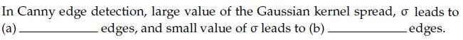

**Figure 26.** Source text passage for Comprehension Questions 182–183.

Enter the correct answer for blank (a) ____________

NOTE: Enter the exact answer without any extra space in the beginning or at the end.

**Correct answer:** `thick` / `coarse` / `large scale`  
**Evaluation conditions:** Alphanumeric; Set; case insensitive.

**Source evidence:** Official accepted alternatives ['thick', 'coarse', 'large scale'] in Possible Answers field with green text (color 0x8000).

---

### Question 183

**Question ID:** `6406531130629` · **Type:** SA · **Marks:** 1  
**PDF pages:** 14

**Shared Comprehension Context (Question ID: `6406531130627`):**

> In Canny edge detection, large value of the Gaussian kernel spread, $\sigma$ leads to (a) ____ edges, and small value of $\sigma$ leads to (b) ____ edges.
>
> Based on the above data, answer the given subquestions.

Enter the correct answer for blank (b) ____________

NOTE: Enter the exact answer without any extra space in the beginning or at the end.

**Correct answer:** `fine`  
**Evaluation conditions:** Alphanumeric; Equal; case insensitive.

**Source evidence:** Official answer 'fine' in Possible Answers field with green text (color 0x8000).

---

### Question 184

**Question ID:** `6406531130632` · **Type:** SA · **Marks:** 0.5  
**PDF pages:** 15

**Shared Comprehension Context (Question ID: `6406531130631`):**

> For the given figure, complete the transformation matrix with x — shear = 0.5 :
>
> $$\begin{bmatrix} x' \\ y' \\ 1 \end{bmatrix} = \begin{bmatrix} a_{11} & a_{12} & 1 \\ a_{21} & a_{22} & 1 \\ 0 & 0 & 1 \end{bmatrix} \begin{bmatrix} x \\ y \\ 1 \end{bmatrix}$$
>
> Based on the above data, answer the given subquestions.

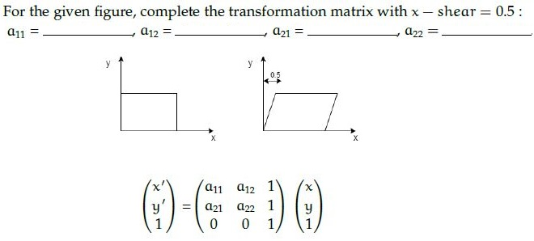

**Figure 27.** Shear transformation diagram and transformation matrix for Questions 184–187.

a11= ____________

**Correct answer:** `1`  
**Source evidence:** Official answer '1' in Possible Answers field with green text (color 0x8000).

---

### Question 185

**Question ID:** `6406531130633` · **Type:** SA · **Marks:** 0.5  
**PDF pages:** 15, 16

**Shared Comprehension Context (Question ID: `6406531130631`):**

> For the given figure, complete the transformation matrix with x — shear = 0.5 :
>
> $$\begin{bmatrix} x' \\ y' \\ 1 \end{bmatrix} = \begin{bmatrix} a_{11} & a_{12} & 1 \\ a_{21} & a_{22} & 1 \\ 0 & 0 & 1 \end{bmatrix} \begin{bmatrix} x \\ y \\ 1 \end{bmatrix}$$
>
> Based on the above data, answer the given subquestions.

a12= ____________

**Correct answer:** `0.5`  
**Source evidence:** Official answer '0.5' in Possible Answers field with green text (color 0x8000) on PDF page 16.

---

### Question 186

**Question ID:** `6406531130634` · **Type:** SA · **Marks:** 0.5  
**PDF pages:** 16

**Shared Comprehension Context (Question ID: `6406531130631`):**

> For the given figure, complete the transformation matrix with x — shear = 0.5 :
>
> $$\begin{bmatrix} x' \\ y' \\ 1 \end{bmatrix} = \begin{bmatrix} a_{11} & a_{12} & 1 \\ a_{21} & a_{22} & 1 \\ 0 & 0 & 1 \end{bmatrix} \begin{bmatrix} x \\ y \\ 1 \end{bmatrix}$$
>
> Based on the above data, answer the given subquestions.

a21= ____________

**Correct answer:** `0`  
**Source evidence:** Official answer '0' in Possible Answers field with green text (color 0x8000).

---

### Question 187

**Question ID:** `6406531130635` · **Type:** SA · **Marks:** 0.5  
**PDF pages:** 16

**Shared Comprehension Context (Question ID: `6406531130631`):**

> For the given figure, complete the transformation matrix with x — shear = 0.5 :
>
> $$\begin{bmatrix} x' \\ y' \\ 1 \end{bmatrix} = \begin{bmatrix} a_{11} & a_{12} & 1 \\ a_{21} & a_{22} & 1 \\ 0 & 0 & 1 \end{bmatrix} \begin{bmatrix} x \\ y \\ 1 \end{bmatrix}$$
>
> Based on the above data, answer the given subquestions.

a22= ____________

**Correct answer:** `1`  
**Source evidence:** Official answer '1' in Possible Answers field with green text (color 0x8000).

---

### Question 188

**Question ID:** `6406531130647` · **Type:** SA · **Marks:** 1  
**PDF pages:** 16, 17

**Shared Comprehension Context (Question ID: `6406531130646`):**

> Consider the computation graph and given answer the subquestions.
>
> Based on the above data, answer the given subquestions.

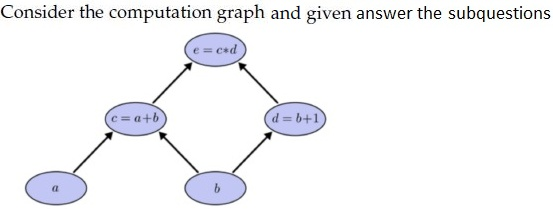

**Figure 28.** Computation graph diagram for Comprehension Questions 188–189.

Input $a = 50$, and $b = 2$, The value for $\frac{\partial e}{\partial a} = $ _____  
Fill in the blank for the gradients.

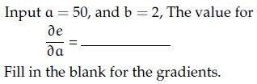

**Figure 29.** Partial derivative formula for Question 188.

**Correct answer:** `3`  
**Source evidence:** Official answer '3' in Possible Answers field with green text (color 0x8000) on PDF page 17.

---

### Question 189

**Question ID:** `6406531130648` · **Type:** SA · **Marks:** 1  
**PDF pages:** 17

**Shared Comprehension Context (Question ID: `6406531130646`):**

> Consider the computation graph and given answer the subquestions.
>
> Based on the above data, answer the given subquestions.

Input $a = 50$, and $b = 2$, The value for $\frac{\partial e}{\partial b} = $ _____  
Fill in the blank for the gradients.

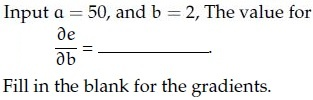

**Figure 30.** Partial derivative formula for Question 189.

**Correct answer:** `55`  
**Source evidence:** Official answer '55' in Possible Answers field with green text (color 0x8000) on PDF page 17.

---

## Answer key

| Source question | Question ID | Correct answer | PDF page(s) |
| :--- | :--- | :--- | :--- |
| 154 | `6406531130610` | 2 | 2 |
| 155 | `6406531130611` | 20 | 3 |
| 156 | `6406531130617` | 30 | 3 |
| 157 | `6406531130622` | -0.34 to -0.33 | 4 |
| 158 | `6406531130639` | 8 | 4 |
| 159 | `6406531130640` | 160000 | 4, 5 |
| 160 | `6406531130645` | -0.260 to -0.210 | 5 |
| 161 | `6406531130612` | A | 5 |
| 162 | `6406531130616` | B | 5, 6 |
| 163 | `6406531130619` | C | 6 |
| 164 | `6406531130620` | B | 6 |
| 165 | `6406531130623` | B | 7 |
| 166 | `6406531130630` | A | 7 |
| 167 | `6406531130636` | D | 7 |
| 168 | `6406531130637` | D | 8 |
| 169 | `6406531130641` | C | 8 |
| 170 | `6406531130642` | C | 8, 9 |
| 171 | `6406531130643` | A | 9 |
| 172 | `6406531130644` | B | 9 |
| 173 | `6406531130649` | C | 9, 10 |
| 174 | `6406531130613` | A, C | 10 |
| 175 | `6406531130614` | C, D | 10 |
| 176 | `6406531130615` | A | 10, 11 |
| 177 | `6406531130618` | A, D | 11, 12 |
| 178 | `6406531130621` | A, D | 12 |
| 179 | `6406531130638` | A, B | 12 |
| 180 | `6406531130625` | high | 13 |
| 181 | `6406531130626` | high | 13 |
| 182 | `6406531130628` | thick / coarse / large scale | 14 |
| 183 | `6406531130629` | fine | 14 |
| 184 | `6406531130632` | 1 | 15 |
| 185 | `6406531130633` | 0.5 | 15, 16 |
| 186 | `6406531130634` | 0 | 16 |
| 187 | `6406531130635` | 1 | 16 |
| 188 | `6406531130647` | 3 | 16, 17 |
| 189 | `6406531130648` | 55 | 17 |

## Extraction notes

- **Scope boundaries:** The DL(CV) section begins on Page 1 at the `DL(CV)` section header (Section Id 64065379956, Section Number 9) and concludes on Page 17 at the end of Question 189. The Section 8 NLP remnant text at the top of Page 1 (IDs 6406533822651, 6406533822652, and Question 152) and the Section 10 RL material starting on Page 17 (Section Id 64065379957) have been strictly excluded.
- **Administrative confirmation excluded:** Question 153 on Page 2 (Question Id 6406531130609, 0 marks), the administrative subject verification prompt, is excluded in accordance with extraction requirements.
- **Question count reconciliation:** The Section 9 header declares 31 questions. This corresponds to 1 excluded confirmation question, 26 standalone questions (Q154–Q160 SA, Q161–Q173 MCQ, Q174–Q179 MSQ), and 4 comprehension passages (treated as parent units). Inside the comprehension passages are 10 subquestions (Q180–Q181, Q182–Q183, Q184–Q187, Q188–Q189), resulting in exactly 36 academic questions summing to the declared 60 marks.
- **MSQ questions and stem polarities:** Questions 174 and 175 in the source exam explicitly ask 'Which of the following statements is/are false?'. In Question 174, false statements A and C are marked correct in the official exam key. In Question 175, false statements C and D are marked correct in the official exam key. Question 176 has one correct option (A); Question 177 has two correct options (A, D); Question 178 has two correct options (A, D); Question 179 has two correct options (A, B). All marked correct options are preserved with exact option IDs and source evidence.
- **Accepted ranges and alternatives:** Question 157 has accepted range `-0.34 to -0.33` (straightness measure $\lambda_2 / \lambda_1 = -1/3$ for second moment matrix $\begin{bmatrix} 1 & 2 \\ 2 & 1 \end{bmatrix}$); Question 160 has accepted range `-0.260 to -0.210` (momentum update); Question 182 accepts `thick`, `coarse`, or `large scale`. All source alternatives and conditions are faithfully preserved.
- **Comprehension 3 matrix transcription:** In Figure 27 (Comprehension 3, Questions 184–187), the source exam figure displays the affine transformation matrix with column 3 rows 1–2 as explicitly `1` and `1` (i.e. $\begin{bmatrix} a_{11} & a_{12} & 1 \\ a_{21} & a_{22} & 1 \\ 0 & 0 & 1 \end{bmatrix}$). The source formula has been faithfully preserved with `1` and `1` in accordance with the source PDF, preserving authorial authenticity rather than silently normalizing to zeros.
- **Comprehension 4 partial derivative notation:** In Figure 29 (Question 188) and Figure 30 (Question 189), the source exam explicitly queries the partial derivatives of output variable $e$ with respect to inputs $a$ and $b$, i.e. $\frac{\partial e}{\partial a}$ and $\frac{\partial e}{\partial b}$ (where computation graph evaluates $c = a + b$, $d = b + 1$, $e = c \times d$), verified against the original PDF and native assets.

