# DL(CV) — da5006_2025T1_Q2_NA

**Subject:** Deep Learning for Computer Vision  
**Source:** `da5006_2025T1_Q2_NA.pdf` (original PDF omitted from this bundle)  
**Academic questions:** 37  
**Scope:** DL(CV) section; administrative subject confirmation excluded.

## Questions

### Question 242

**Question ID:** `6406531168216` · **Type:** MCQ · **Marks:** 2  
**PDF pages:** 1, 2

The integral image of the image

$$\begin{bmatrix} 3 & 7 & 2 \\ 5 & 4 & 6 \\ 8 & 1 & 9 \end{bmatrix}$$

is?

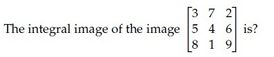

**Figure 1.** Source matrix for Question 242.

**Options**

**A.** $$\begin{bmatrix} 3 & 6 & 9 \\ 12 & 15 & 18 \\ 21 & 24 & 27 \end{bmatrix}$$

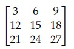

**Figure 2.** Option A candidate matrix for Question 242.  
*Option ID:* `6406533939944`

**B.** $$\begin{bmatrix} 3 & 10 & 12 \\ 8 & 19 & 27 \\ 16 & 28 & 45 \end{bmatrix}$$

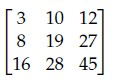

**Figure 3.** Option B candidate matrix for Question 242.  
*Option ID:* `6406533939945`

**C.** $$\begin{bmatrix} 3 & 7 & 12 \\ 8 & 15 & 25 \\ 16 & 28 & 45 \end{bmatrix}$$

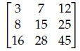

**Figure 4.** Option C candidate matrix for Question 242.  
*Option ID:* `6406533939946`

**D.** $$\begin{bmatrix} 9 & 6 & 3 \\ 8 & 5 & 2 \\ 7 & 4 & 1 \end{bmatrix}$$

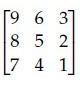

**Figure 5.** Option D candidate matrix for Question 242.  
*Option ID:* `6406533939947`

**Correct answer:** **B** — $$\begin{bmatrix} 3 & 10 & 12 \\ 8 & 19 & 27 \\ 16 & 28 & 45 \end{bmatrix}$$.  
**Source evidence:** Option 6406533939945 marked with green checkmark icon (xref 28) and green text (color 0x8000), PDF page 1.

---

### Question 243

**Question ID:** `6406531168217` · **Type:** MCQ · **Marks:** 2  
**PDF pages:** 2

Which one of the following object detection networks uses an ROI pooling layer?

**Options**

**A.** Fast R-CNN  
*Option ID:* `6406533939948`

**B.** R-CNN  
*Option ID:* `6406533939949`

**C.** YOLO  
*Option ID:* `6406533939950`

**D.** All of these  
*Option ID:* `6406533939951`

**Correct answer:** **A** — Fast R-CNN.  
**Source evidence:** Option 6406533939948 marked with green checkmark icon and green text (color 0x8000), PDF page 2.

---

### Question 244

**Question ID:** `6406531168218` · **Type:** MCQ · **Marks:** 2  
**PDF pages:** 2

Match the following:

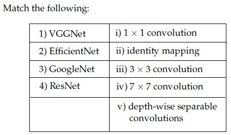

**Figure 6.** Source table for Question 244.

| Column 1 | Column 2 |
| :--- | :--- |
| 1) VGGNet | i) $1 \times 1$ convolution |
| 2) EfficientNet | ii) identity mapping |
| 3) GoogleNet | iii) $3 \times 3$ convolution |
| 4) ResNet | iv) $7 \times 7$ convolution |
| | v) depth-wise separable convolutions |

**Options**

**A.** 1→iv, 2→ii, 3→v, 4→i  
*Option ID:* `6406533939952`

**B.** 1→iv, 2→iii, 3→v, 4→ii  
*Option ID:* `6406533939953`

**C.** 1→iv, 2→v, 3→ii, 4→iii  
*Option ID:* `6406533939954`

**D.** 1→iii, 2→v, 3→i, 4→ii  
*Option ID:* `6406533939955`

**Correct answer:** **D** — 1→iii, 2→v, 3→i, 4→ii.  
**Source evidence:** Option 6406533939955 marked with green checkmark icon and green text (color 0x8000), PDF page 2.

---

### Question 245

**Question ID:** `6406531168219` · **Type:** MCQ · **Marks:** 2  
**PDF pages:** 2, 3

Which one of the following statements is False?

**Options**

**A.** In a max pooling layer, the unit that gets selected (maximum entry) in forward propagation gets all the gradient during backpropagation.  
*Option ID:* `6406533939956`

**B.** Residual blocks are used in ResNets to avoid the vanishing gradient problem.  
*Option ID:* `6406533939957`

**C.** Feature maps of initial layers of a CNN capture more abstract concepts than the feature maps of final layers.  
*Option ID:* `6406533939958`

**D.** Dilated convolution increases the receptive field size when compared to the standard convolution operator.  
*Option ID:* `6406533939959`

**Correct answer:** **C** — Feature maps of initial layers of a CNN capture more abstract concepts than the feature maps of final layers..  
**Source evidence:** Option 6406533939958 marked with green checkmark icon and green text (color 0x8000), PDF page 3.

---

### Question 246

**Question ID:** `6406531168220` · **Type:** MCQ · **Marks:** 2  
**PDF pages:** 3

Let us suppose that you want to build an encoder-decoder recurrent model with attention. We know that the context vector for the model is given by $c_t = \sum_{j=1}^{T} \alpha_{tj} h_j$, where $\alpha_{tj}$ refers to the degree of alignment between decoder state $s_{t-1}$ and encoder state $h_j$. Then, $\alpha_{tj}$ is computed as:

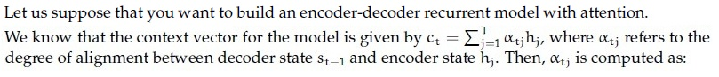

**Figure 7.** Source equation for Question 246.

**Options**

**A.** Sigmoid of alignment scores  
*Option ID:* `6406533939960`

**B.** Softmax of alignment scores  
*Option ID:* `6406533939961`

**C.** ReLU of alignment scores  
*Option ID:* `6406533939962`

**D.** None of these  
*Option ID:* `6406533939963`

**Correct answer:** **B** — Softmax of alignment scores.  
**Source evidence:** Option 6406533939961 marked with green checkmark icon and green text (color 0x8000), PDF page 3.

---

### Question 247

**Question ID:** `6406531168221` · **Type:** MCQ · **Marks:** 2  
**PDF pages:** 3

In object detection using CNNs, which loss function is typically used to optimize the confidence scores assigned to predicted bounding boxes, aiming to ensure high confidence for correct detections and penalize false positives?

**Options**

**A.** Focal Loss  
*Option ID:* `6406533939964`

**B.** Smooth Ll Loss  
*Option ID:* `6406533939965`

**C.** Binary Cross-Entropy Loss  
*Option ID:* `6406533939966`

**D.** Mean Squared Error (MSE)  
*Option ID:* `6406533939967`

**Correct answer:** **C** — Binary Cross-Entropy Loss.  
**Source evidence:** Option 6406533939966 marked with green checkmark icon and green text (color 0x8000), PDF page 3.

---

### Question 248

**Question ID:** `6406531168222` · **Type:** MCQ · **Marks:** 2  
**PDF pages:** 3, 4

Consider two 12 × 12 bounding boxes(one on the upper left and one of the lower right) in an images with an overlapping region of 8 × 8. The Intersection over Union (IoU) between the two boxes is (choose the closest value):

**Options**

**A.** 21%  
*Option ID:* `6406533939968`

**B.** 25%  
*Option ID:* `6406533939969`

**C.** 28%  
*Option ID:* `6406533939970`

**D.** 37%  
*Option ID:* `6406533939971`

**Correct answer:** **C** — 28%.  
**Source evidence:** Option 6406533939970 marked with green checkmark icon and green text (color 0x8000), PDF page 4.

---

### Question 249

**Question ID:** `6406531168223` · **Type:** MCQ · **Marks:** 2  
**PDF pages:** 4

In object detection using CNNs, what is the challenge addressed by the non-maximum suppression (NMS) technique?

**Options**

**A.** Handling variations in object scale and aspect ratio  
*Option ID:* `6406533939972`

**B.** Improving the localization accuracy of detected objects  
*Option ID:* `6406533939973`

**C.** Reducing the computational complexity of the detection process  
*Option ID:* `6406533939974`

**D.** Removing redundant bounding box predictions for the same object  
*Option ID:* `6406533939975`

**Correct answer:** **D** — Removing redundant bounding box predictions for the same object.  
**Source evidence:** Option 6406533939975 marked with green checkmark icon and green text (color 0x8000), PDF page 4.

---

### Question 250

**Question ID:** `6406531168224` · **Type:** MCQ · **Marks:** 2  
**PDF pages:** 4

Match the following computer vision tasks to situations:

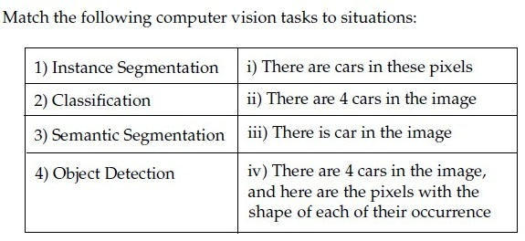

**Figure 8.** Source table for Question 250.

| Column 1 | Column 2 |
| :--- | :--- |
| 1) Instance Segmentation | i) There are cars in these pixels |
| 2) Classification | ii) There are 4 cars in the image |
| 3) Semantic Segmentation | iii) There is car in the image |
| 4) Object Detection | iv) There are 4 cars in the image, and here are the pixels with the shape of each of their occurrence |

**Options**

**A.** 1→ iv, 2→ iii, 3→ ii, 4 → i  
*Option ID:* `6406533939976`

**B.** 1→ ii, 2→ iii, 3 → i, 4 →iv  
*Option ID:* `6406533939977`

**C.** 1→ iv, 2→ iii, 3→ i, 4 → ii  
*Option ID:* `6406533939978`

**D.** 1→ ii, 2→ iv, 3 → iii, 4→ i  
*Option ID:* `6406533939979`

**Correct answer:** **C** — 1→ iv, 2→ iii, 3→ i, 4 → ii.  
**Source evidence:** Option 6406533939978 marked with green checkmark icon and green text (color 0x8000), PDF page 4.

---

### Question 251

**Question ID:** `6406531168225` · **Type:** MCQ · **Marks:** 2  
**PDF pages:** 4, 5

Match the following:

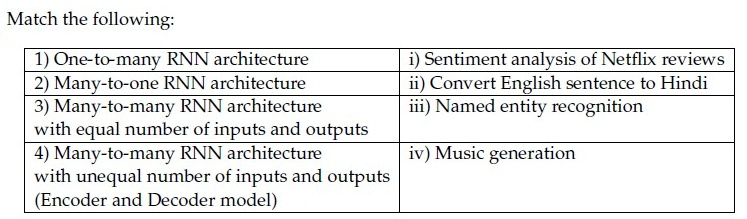

**Figure 9.** Source table for Question 251.

| Column 1 | Column 2 |
| :--- | :--- |
| 1) One-to-many RNN architecture | i) Sentiment analysis of Netflix reviews |
| 2) Many-to-one RNN architecture | ii) Convert English sentence to Hindi |
| 3) Many-to-many RNN architecture with equal number of inputs and outputs | iii) Named entity recognition |
| 4) Many-to-many RNN architecture with unequal number of inputs and outputs (Encoder and Decoder model) | iv) Music generation |

**Options**

**A.** 1→ iii, 2→ iv, 3→ ii, 4 → i  
*Option ID:* `6406533939980`

**B.** 1→ iv, 2→ i, 3 → iii, 4→ ii  
*Option ID:* `6406533939981`

**C.** 1→ i, 2→ ii, 3 → iii, 4→ iv  
*Option ID:* `6406533939982`

**D.** 1→ i, 2→ iii, 3 → ii, 4→ iv  
*Option ID:* `6406533939983`

**Correct answer:** **B** — 1→ iv, 2→ i, 3 → iii, 4→ ii.  
**Source evidence:** Option 6406533939981 marked with green checkmark icon and green text (color 0x8000), PDF page 5.

---

### Question 252

**Question ID:** `6406531168226` · **Type:** MCQ · **Marks:** 2  
**PDF pages:** 5

Match the following attention mechanisms to their corresponding alignment score functions:

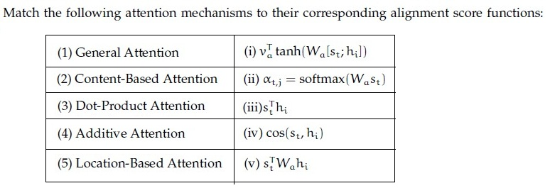

**Figure 10.** Source table for Question 252.

| Column 1 | Column 2 |
| :--- | :--- |
| (1) General Attention | (i) $v_a^T \tanh(W_a [s_t; h_i])$ |
| (2) Content-Based Attention | (ii) $\alpha_{t,j} = \text{softmax}(W_a s_t)$ |
| (3) Dot-Product Attention | (iii) $s_t^T h_i$ |
| (4) Additive Attention | (iv) $\cos(s_t, h_i)$ |
| (5) Location-Based Attention | (v) $s_t^T W_a h_i$ |

**Options**

**A.** 1→iii, 2→ii, 3→v, 4→iv, 5→i  
*Option ID:* `6406533939984`

**B.** 1→iii, 2→iv, 3→i, 4→ii, 5→v  
*Option ID:* `6406533939985`

**C.** 1→i, 2→iii, 3→iv, 4→ii, 5→v  
*Option ID:* `6406533939986`

**D.** 1→v, 2→iv, 3→iii, 4→i, 5→ii  
*Option ID:* `6406533939987`

**Correct answer:** **D** — 1→v, 2→iv, 3→iii, 4→i, 5→ii.  
**Source evidence:** Option 6406533939987 marked with green checkmark icon and green text (color 0x8000), PDF page 5.

---

### Question 253

**Question ID:** `6406531168227` · **Type:** MCQ · **Marks:** 2  
**PDF pages:** 5, 6

Which of the following techniques help control the exploding or vanishing gradient problem in recurrent neural networks?

1. Gradient clipping
2. Use ReLU activation funtion to control exploding gradient and sigmoid activation to control vanishing gradients
3. Use Long Short-Term Memory (LSTM)
4. Use data augmentation methods (for example, reversing the input sequence)

**Options**

**A.** 1, 2, and 3; but not 4  
*Option ID:* `6406533939988`

**B.** 1, 3, and 4; but not 2  
*Option ID:* `6406533939989`

**C.** All of these  
*Option ID:* `6406533939990`

**D.** Only 1 and 3  
*Option ID:* `6406533939991`

**Correct answer:** **B** — 1, 3, and 4; but not 2.  
**Source evidence:** Option 6406533939989 marked with green checkmark icon and green text (color 0x8000), PDF page 6.

---

### Question 254

**Question ID:** `6406531168229` · **Type:** MCQ · **Marks:** 2  
**PDF pages:** 6

State whether the given statement is True or False:

While training an object detection algorithm, you need a training set that contains many pictures of the objects you want to detect. However, bounding boxes are not typically provided in the training set, since architectures like Faster-RCNN and YOLO can learn to detect the object by themselves.

**Options**

**A.** True  
*Option ID:* `6406533939996`

**B.** False  
*Option ID:* `6406533939997`

**Correct answer:** **B** — False.  
**Source evidence:** Option 6406533939997 marked with green checkmark icon and green text (color 0x8000), PDF page 6.

---

### Question 255

**Question ID:** `6406531168230` · **Type:** MCQ · **Marks:** 2  
**PDF pages:** 6

How are saliency maps generated in the context of Convolutional Neural Networks (CNNs)?

**Options**

**A.** By applying a convolutional filter to the input image  
*Option ID:* `6406533939998`

**B.** By computing the gradient of the model’s output with respect to the input image  
*Option ID:* `6406533939999`

**C.** By randomly sampling regions of the image and assessing their importance  
*Option ID:* `6406533940000`

**D.** By measuring the similarity between the input image and pre-trained feature maps  
*Option ID:* `6406533940001`

**Correct answer:** **B** — By computing the gradient of the model’s output with respect to the input image.  
**Source evidence:** Option 6406533939999 marked with green checkmark icon and green text (color 0x8000), PDF page 6.

---

### Question 256

**Question ID:** `6406531168231` · **Type:** MCQ · **Marks:** 2  
**PDF pages:** 6, 7

Consider an object detection system evaluated on a dataset consisting of 1000 images. The system makes 1500 predictions across these images, and for each image, there are annotated ground truth bounding boxes.

The system’s precision-recall curve is calculated, and the precision at different recall levels for one of the classes is as follows:

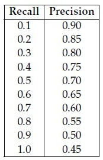

**Figure 11.** Source precision-recall table for Question 256.

| Recall | Precision |
| :--- | :--- |
| 0.1 | 0.90 |
| 0.2 | 0.85 |
| 0.3 | 0.80 |
| 0.4 | 0.75 |
| 0.5 | 0.70 |
| 0.6 | 0.65 |
| 0.7 | 0.60 |
| 0.8 | 0.55 |
| 0.9 | 0.50 |
| 1.0 | 0.45 |

Calculate the mean Average Precision (mAP) for this class using the 11-point interpolation method, which averages the precision values at recall levels {0.0, 0.1, 0.2, ..., 1.0}. The precision at recall 0.0 can be assumed to be 1.0.

Additionally, the system’s AP values for the other two classes are as follows:

- AP for class 2: 0.78
- AP for class 3: 0.72

Based on these AP values, what is the mean Average Precision (mAP) across all three classes?

**Options**

**A.** 0.70  
*Option ID:* `6406533940002`

**B.** 0.69  
*Option ID:* `6406533940003`

**C.** 0.73  
*Option ID:* `6406533940004`

**D.** 0.76  
*Option ID:* `6406533940005`

**Correct answer:** **C** — 0.73.  
**Source evidence:** Option 6406533940004 marked with green checkmark icon and green text (color 0x8000), PDF page 7.

---

### Question 257

**Question ID:** `6406531168232` · **Type:** MCQ · **Marks:** 2  
**PDF pages:** 7

Which one of the following statements is false? (Pick the most appropriate one.)

**Options**

**A.** Attention mechanisms cannot be applied to the bidirectional RNN model  
*Option ID:* `6406533940006`

**B.** An image captioning network cannot be trained end-to-end even though we are using 2 different modalities to train the network  
*Option ID:* `6406533940007`

**C.** One of the key components in the vanilla transformer is the recurrent connection that help them to deal with variable input length.  
*Option ID:* `6406533940008`

**D.** All of these  
*Option ID:* `6406533940009`

**Correct answer:** **D** — All of these.  
**Source evidence:** Option 6406533940009 marked with green checkmark icon and green text (color 0x8000), PDF page 7.

---

### Question 258

**Question ID:** `6406531168228` · **Type:** MSQ · **Marks:** 2  
**PDF pages:** 8

Which of the following statements is True (select all that apply):

**Options**

**A.** The number of learnable parameters in an RNN grows exponentially with input sequence length considered  
*Option ID:* `6406533939992`

**B.** Long sentences give rise to the vanishing gradient problem  
*Option ID:* `6406533939993`

**C.** Electrocardiogram signal classification is a sequence learning problem  
*Option ID:* `6406533939994`

**D.** RNNs can have more than one hidden layer  
*Option ID:* `6406533939995`

**Correct answer:** **B**, **C**, **D**  
**Source evidence:** Options 6406533939993, 6406533939994, and 6406533939995 marked with green checkmark icons and green text (color 0x8000), PDF page 8.

---

### Question 259

**Question ID:** `6406531168233` · **Type:** MSQ · **Marks:** 2  
**PDF pages:** 8

Which of the following is true regarding Hard Attention and Soft Attention?

**Options**

**A.** Soft Attention is smooth and differentiable  
*Option ID:* `6406533940010`

**B.** Variance reduction techniques are used to train Soft Attention models  
*Option ID:* `6406533940011`

**C.** Soft Attention is computationally cheaper than Hard Attention when the source input is large  
*Option ID:* `6406533940012`

**D.** The inference (test time) overhead is low in Hard Attention when compared to Soft Attention models  
*Option ID:* `6406533940013`

**Correct answer:** **A**, **D**  
**Source evidence:** Options 6406533940010 and 6406533940013 marked with green checkmark icons and green text (color 0x8000), PDF page 8.

---

### Question 260

**Question ID:** `6406531168234` · **Type:** MSQ · **Marks:** 2  
**PDF pages:** 8, 9

Which of the following are true?

**Options**

**A.** For generating an image of a required class, Deep Inside Convolutional Networks uses gradient descent with the following optimization: $\arg\min_I (S_c(I) - \lambda \|I\|_2^2)$ where $S_c$ is the scores vector for class $c$ before applying softmax.

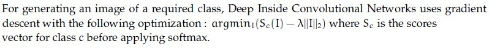

**Figure 12.** Option A statement for Question 260.  
*Option ID:* `6406533940014`

**B.** Visualizing the maximum of the data gradient across the channels provides insights into the image regions that have the most significant impact on generating high probability scores for a specific class.

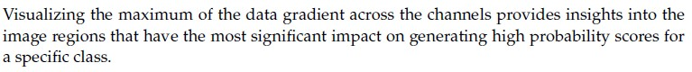

**Figure 13.** Option B statement for Question 260.  
*Option ID:* `6406533940015`

**C.** Global average Pooling refers to the average of all the pixels at a particular spatial location across all the channels.

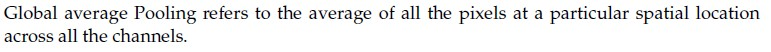

**Figure 14.** Option C statement for Question 260.  
*Option ID:* `6406533940016`

**D.** Class Activation Map (CAM) does not require a backward pass through the entire model.

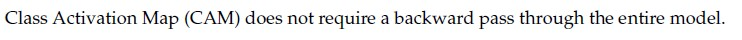

**Figure 15.** Option D statement for Question 260.  
*Option ID:* `6406533940017`

**Correct answer:** **B**, **D**  
**Source evidence:** Option 6406533940015 marked with green checkmark icon and green text (color 0x8000), PDF page 8.

---

### Question 261

**Question ID:** `6406531168235` · **Type:** SA · **Marks:** 3  
**PDF pages:** 9

Consider a Faster R-CNN object detection framework, which is being trained with a minibatch size of 2. The RPN produces 512 proposals, out of which 256 and 128 of them are foreground proposals, corresponding to each image in the mini-batch. For a single mini-batch update, the bounding box regression loss will be computed _______________ times.

**Correct answer:** `384`  
**Source evidence:** Official answer '384' in Possible Answers field with green text (color 0x8000), PDF page 9.

---

### Question 262

**Question ID:** `6406531168237` · **Type:** SA · **Marks:** 1  
**PDF pages:** 10

**Comprehension Context (Questions 262–267):**

> Consider a Gated Recurrent Unit (GRU) cell at time step $t$.
> For each of the entities given in the subquestions, enter the appropriate number from the figure that corresponds to it:
>
> 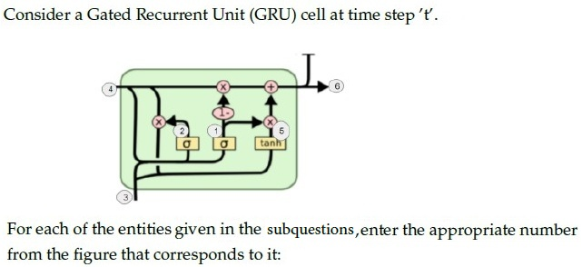
>
> **Figure 16.** GRU cell schematic diagram for Comprehension Context 1 (Questions 262–267).
>
> Based on the above data, answer the given subquestions.

Hidden state $h_{t-1}$ —

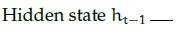

**Figure 17.** Entity label for Question 262.

**Correct answer:** `4`  
**Source evidence:** Official answer '4' in Possible Answers field with green text (color 0x8000), PDF page 10.

---

### Question 263

**Question ID:** `6406531168238` · **Type:** SA · **Marks:** 1  
**PDF pages:** 10

Hidden state $h_t$ —

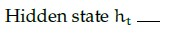

**Figure 18.** Entity label for Question 263.

**Correct answer:** `6`  
**Source evidence:** Official answer '6' in Possible Answers field with green text (color 0x8000), PDF page 10.

---

### Question 264

**Question ID:** `6406531168239` · **Type:** SA · **Marks:** 1  
**PDF pages:** 10, 11

Current Input $x_t$ —

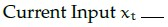

**Figure 19.** Entity label for Question 264.

**Correct answer:** `3`  
**Source evidence:** Official answer '3' in Possible Answers field with green text (color 0x8000), PDF page 11.

---

### Question 265

**Question ID:** `6406531168240` · **Type:** SA · **Marks:** 1  
**PDF pages:** 11

Update gate $z_t$ —

**Figure 20.** Entity label for Question 265.

**Correct answer:** `1`  
**Source evidence:** Official answer '1' in Possible Answers field with green text (color 0x8000), PDF page 11.

---

### Question 266

**Question ID:** `6406531168241` · **Type:** SA · **Marks:** 1  
**PDF pages:** 11

Reset gate $r_t$ —

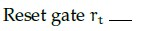

**Figure 21.** Entity label for Question 266.

**Correct answer:** `2`  
**Source evidence:** Official answer '2' in Possible Answers field with green text (color 0x8000), PDF page 11.

---

### Question 267

**Question ID:** `6406531168242` · **Type:** SA · **Marks:** 1  
**PDF pages:** 11, 12

New hidden state content $\tilde{h}_t$ —

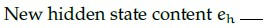

**Figure 22.** Entity label for Question 267.

**Correct answer:** `5`  
**Source evidence:** Official answer '5' in Possible Answers field with green text (color 0x8000), PDF page 12.

---

### Question 268

**Question ID:** `6406531168244` · **Type:** SA · **Marks:** 3  
**PDF pages:** 12

**Comprehension Context (Questions 268–269):**

> Let input have size $D_f \times D_f \times M$ where $D_f = 128$ and $M = 16$ and output feature map (after passing input through conv layer) has $D_f \times D_f \times N$ size where $N = 32$. Assume padded convolution. Let width of the square kernel in conv layer be $k$ where $k = 5$ (Ignore the bias term in the calculation).
> Calculate the number of parameters and computational cost for this convolution layer.
>
> 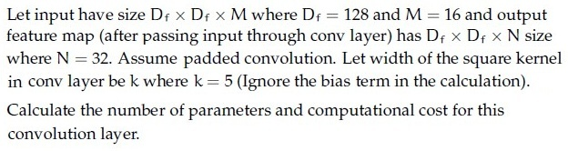
>
> **Figure 23.** Standard convolution specification for Comprehension Context 2 (Questions 268–269).
>
> Based on the above data, answer the given subquestions.

Number of Parameters: __________________

**Correct answer:** `12800`  
**Source evidence:** Official answer '12800' in Possible Answers field with green text (color 0x8000), PDF page 12.

---

### Question 269

**Question ID:** `6406531168245` · **Type:** SA · **Marks:** 3  
**PDF pages:** 12, 13

Computational Cost: __________________

**Correct answer:** `209715200`  
**Source evidence:** Official answer '209715200' in Possible Answers field with green text (color 0x8000), PDF page 13.

---

### Question 270

**Question ID:** `6406531168247` · **Type:** SA · **Marks:** 1.5  
**PDF pages:** 13

**Comprehension Context (Questions 270–273):**

> Let input have size $D_f \times D_f \times M$ where $D_f = 128$ and $M = 16$ and output feature map (after passing input through conv layer) has $D_f \times D_f \times N$ size where $N = 32$. Assume padded convolution. Let width of the square kernel in conv layer be $k$ where $k = 5$ (Ignore the bias term in the calculation).
> Calculate the number of parameters and computational cost, but make use of Depthwise Seperable convolution and pointwise convolution instead of standard convolution.
>
> 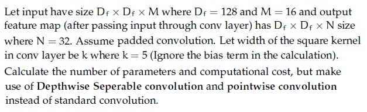
>
> **Figure 24.** Depthwise separable convolution specification for Comprehension Context 3 (Questions 270–273).
>
> Based on the above data, answer the given subquestions.

Number of parameters for depthwise convolution: __________________

**Correct answer:** `400`  
**Source evidence:** Official answer '400' in Possible Answers field with green text (color 0x8000), PDF page 13.

---

### Question 271

**Question ID:** `6406531168248` · **Type:** SA · **Marks:** 1.5  
**PDF pages:** 13, 14

Computational Cost for depthwise convolution: ________________

**Correct answer:** `6553600`  
**Source evidence:** Official answer '6553600' in Possible Answers field with green text (color 0x8000), PDF page 14.

---

### Question 272

**Question ID:** `6406531168249` · **Type:** SA · **Marks:** 1.5  
**PDF pages:** 14

Number of parameters for pointwise convolution: _________________

**Correct answer:** `512`  
**Source evidence:** Official answer '512' in Possible Answers field with green text (color 0x8000), PDF page 14.

---

### Question 273

**Question ID:** `6406531168250` · **Type:** SA · **Marks:** 1.5  
**PDF pages:** 14

Computational cost for pointwise convolution: ___________________

**Correct answer:** `8388608`  
**Source evidence:** Official answer '8388608' in Possible Answers field with green text (color 0x8000), PDF page 14.

---

### Question 274

**Question ID:** `6406531168252` · **Type:** SA · **Marks:** 1.2  
**PDF pages:** 15, 16

**Comprehension Context (Questions 274–278):**

> The RNN given below is used for classification:
>
> 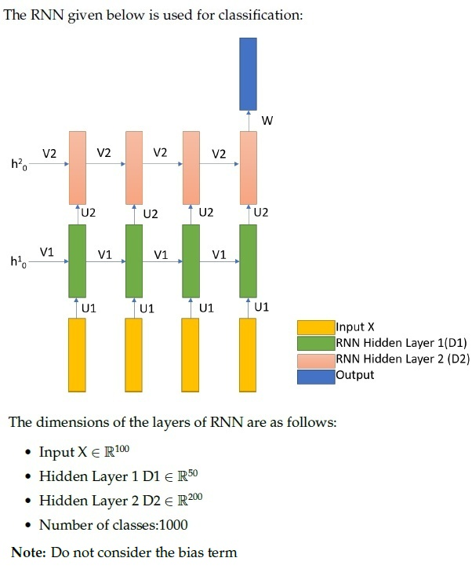
>
> **Figure 25.** Multi-layer RNN architecture diagram for Comprehension Context 4 (Questions 274–278).
>
> The dimensions of the layers of RNN are as follows:
> - Input $x \in \mathbb{R}^{100}$
> - Hidden Layer 1 $D_1 \in \mathbb{R}^{50}$
> - Hidden Layer 2 $D_2 \in \mathbb{R}^{200}$
> - Number of classes: 1000
>
> Note: Do not consider the bias term
>
> Based on the above data, answer the given subquestions.

Number of weights in Weight Matrix U1 is: ______________

**Correct answer:** `5000`  
**Source evidence:** Official answer '5000' in Possible Answers field with green text (color 0x8000), PDF page 16.

---

### Question 275

**Question ID:** `6406531168253` · **Type:** SA · **Marks:** 1.2  
**PDF pages:** 16

Number of weights in Weight Matrix V1 is: _______________

**Correct answer:** `2500`  
**Source evidence:** Official answer '2500' in Possible Answers field with green text (color 0x8000), PDF page 16.

---

### Question 276

**Question ID:** `6406531168254` · **Type:** SA · **Marks:** 1.2  
**PDF pages:** 16

Number of weights in Weight Matrix U2 is: ________________

**Correct answer:** `10000`  
**Source evidence:** Official answer '10000' in Possible Answers field with green text (color 0x8000), PDF page 16.

---

### Question 277

**Question ID:** `6406531168255` · **Type:** SA · **Marks:** 1.2  
**PDF pages:** 16

Number of weights in Weight Matrix V2 is: ______________

**Correct answer:** `40000`  
**Source evidence:** Official answer '40000' in Possible Answers field with green text (color 0x8000), PDF page 16.

---

### Question 278

**Question ID:** `6406531168256` · **Type:** SA · **Marks:** 1.2  
**PDF pages:** 16, 17

Number of weights in Weight Matrix W is: ________________

**Correct answer:** `200000`  
**Source evidence:** Official answer '200000' in Possible Answers field with green text (color 0x8000), PDF page 17.

---

## Answer key

| Source question | Question ID | Correct answer | PDF page(s) |
| :--- | :--- | :--- | :--- |
| 242 | `6406531168216` | B | 1, 2 |
| 243 | `6406531168217` | A | 2 |
| 244 | `6406531168218` | D | 2 |
| 245 | `6406531168219` | C | 2, 3 |
| 246 | `6406531168220` | B | 3 |
| 247 | `6406531168221` | C | 3 |
| 248 | `6406531168222` | C | 3, 4 |
| 249 | `6406531168223` | D | 4 |
| 250 | `6406531168224` | C | 4 |
| 251 | `6406531168225` | B | 4, 5 |
| 252 | `6406531168226` | D | 5 |
| 253 | `6406531168227` | B | 5, 6 |
| 254 | `6406531168229` | B | 6 |
| 255 | `6406531168230` | B | 6 |
| 256 | `6406531168231` | C | 6, 7 |
| 257 | `6406531168232` | D | 7 |
| 258 | `6406531168228` | B, C, D | 8 |
| 259 | `6406531168233` | A, D | 8 |
| 260 | `6406531168234` | B, D | 8, 9 |
| 261 | `6406531168235` | 384 | 9 |
| 262 | `6406531168237` | 4 | 10 |
| 263 | `6406531168238` | 6 | 10 |
| 264 | `6406531168239` | 3 | 10, 11 |
| 265 | `6406531168240` | 1 | 11 |
| 266 | `6406531168241` | 2 | 11 |
| 267 | `6406531168242` | 5 | 11, 12 |
| 268 | `6406531168244` | 12800 | 12 |
| 269 | `6406531168245` | 209715200 | 12, 13 |
| 270 | `6406531168247` | 400 | 13 |
| 271 | `6406531168248` | 6553600 | 13, 14 |
| 272 | `6406531168249` | 512 | 14 |
| 273 | `6406531168250` | 8388608 | 14 |
| 274 | `6406531168252` | 5000 | 15, 16 |
| 275 | `6406531168253` | 2500 | 16 |
| 276 | `6406531168254` | 10000 | 16 |
| 277 | `6406531168255` | 40000 | 16 |
| 278 | `6406531168256` | 200000 | 16, 17 |

## Extraction notes

- **Scope boundaries:** The DL(CV) examination spans the entire document from Page 1 to Page 17. Sub-Section 1 begins at the top of Page 1 with administrative subject confirmation, and Sub-Section 5 concludes at the end of Question 278 on Page 17.
- **Administrative confirmation excluded:** Question 241 on Page 1 (Question Id `6406531168215`, 0 marks), the administrative subject verification prompt with YES/NO options, is excluded in accordance with extraction requirements.
- **Question count reconciliation:** The examination paper contains 37 academic questions totaling 65 marks: 16 standalone MCQs (Q242–Q257, 2 marks each = 32 marks), 3 standalone MSQs (Q258–Q260, 2 marks each = 6 marks), 1 standalone SA (Q261, 3 marks), and 4 comprehension passages comprising 17 subquestions: Comprehension 1 (Q262–Q267, 6 SAs at 1 mark = 6 marks), Comprehension 2 (Q268–Q269, 2 SAs at 3 marks = 6 marks), Comprehension 3 (Q270–Q273, 4 SAs at 1.5 marks = 6 marks), and Comprehension 4 (Q274–Q278, 5 SAs at 1.2 marks = 6 marks). Total = 16 + 3 + 1 + 6 + 2 + 4 + 5 = 37 academic questions.
- **MSQ questions:** Question 258 has three correct options (B, C, D; Option A is incorrect). Question 259 has two correct options (A, D; Options B and C are incorrect). Question 260 has two correct options (B, D; Options A and C are incorrect). All marked correct options are preserved in exact source order.
- **Mathematical fidelity & figure preservation:** All equations, matrices, and architecture schematics have been faithfully preserved with exact LaTeX representations accompanied by source-cropped figures (Figures 1–25). All 25 figure files resolve to verified, decodable assets in `assets/da5006_2025T1_Q2_NA/`.
