# DL(CV) — da5006_2025T2_ET_AN

**Subject:** Deep Learning for Computer Vision  
**Source:** `da5006_2025T2_ET_AN.pdf` (original PDF omitted from this bundle)  
**Academic questions:** 49  
**Scope:** DL(CV) section; administrative subject confirmation excluded.

## Questions

### Question 83

**Question ID:** `6406531431343` · **Type:** MCQ · **Marks:** 2  
**PDF pages:** 1, 2

Why does DETR typically exhibit poor performance in detecting small objects compared to larger ones? Choose the best answer in your opinion.

**Options**

**A.** The CNN backbone used in DETR has a fixed receptive field that’s too large for small objects.  
*Option ID:* `6406534780241`

**B.** The global self-attention mechanism in DETR tends to dilute the signal from small objects across all image locations.  
*Option ID:* `6406534780242`

**C.** DETR’s loss function actively discards all detections smaller than 50 × 50 pixels.  
*Option ID:* `6406534780243`

**D.** The object queries in DETR are programmed to ignore any object smaller than 10% of the image size.  
*Option ID:* `6406534780244`

**E.** DETR’s encoder-decoder architecture was specifically designed to only detect objects larger than a cat.  
*Option ID:* `6406534780245`

**Correct answer:** **B** — The global self-attention mechanism in DETR tends to dilute the signal from small objects across all image locations..  
**Source evidence:** Option B (6406534780242) rendered in green font (#008000) indicating the officially accepted answer in the source key. (PDF page 1).

---

### Question 84

**Question ID:** `6406531431344` · **Type:** MCQ · **Marks:** 2  
**PDF pages:** 2

Consider the following Pytorch code:

```python
1. x = torch.tensor([[-3., 2., 3.], [4., -5., 7.], [20., 3., 2.]])
2. print(torch.mean(x, dim=0, keepdim=True))
```

The output of the code is:

**Options**

**A.** tensor([ 7., 0., 4.])  
*Option ID:* `6406534780246`

**B.** tensor([[ -7., 10., -4.]])  
*Option ID:* `6406534780247`

**C.** tensor([[ -7.],[7.],[4.]])  
*Option ID:* `6406534780248`

**D.** tensor([ -7., 7., 3.])  
*Option ID:* `6406534780249`

**E.** tensor([[7., 0., 4.]])  
*Option ID:* `6406534780250`

**F.** tensor([[ 0.],[7.],[4.]])  
*Option ID:* `6406534780251`

**Correct answer:** **E** — tensor([[7., 0., 4.]]).  
**Source evidence:** Option E (6406534780250) rendered in green font (#008000) indicating the officially accepted answer in the source key. (PDF page 2).

---

### Question 85

**Question ID:** `6406531431345` · **Type:** MCQ · **Marks:** 2  
**PDF pages:** 2

Which one of the following statements is false?

**Options**

**A.** Linear contrast stretching is a point operation.  
*Option ID:* `6406534780252`

**B.** Moving average is an example of a local operation.  
*Option ID:* `6406534780253`

**C.** Convolution in the spatial domain cannot be obtained through addition in the frequency domain.  
*Option ID:* `6406534780254`

**D.** All of these.  
*Option ID:* `6406534780255`

**Correct answer:** **D** — All of these..  
**Source evidence:** Option D (6406534780255) rendered in green font (#008000) indicating the officially accepted answer in the source key. (PDF page 2).

---

### Question 86

**Question ID:** `6406531431346` · **Type:** MCQ · **Marks:** 2  
**PDF pages:** 2, 3

What is the correct order of operations for processing an image through a Vision Transformer (ViT)?

**Options**

**A.** Image patching → Positional embedding → Linear projection of flattened patches → Transformer encoder→ Classification head  
*Option ID:* `6406534780256`

**B.** Image patching → Linear projection of flattened patches → Positional embedding → Transformer encoder→ Classification head  
*Option ID:* `6406534780257`

**C.** Positional embedding → Image patching → Linear projection of flattened patches → Transformer encoder→ Classification head  
*Option ID:* `6406534780258`

**D.** Linear projection of Images → Image patching → Positional embedding → Transformer encoder → Classification head  
*Option ID:* `6406534780259`

**E.** Linear projection of Images → Image patching → Positional embedding → Transformer encoder → Transformer decoder→ Classification head  
*Option ID:* `6406534780260`

**Correct answer:** **B** — Image patching → Linear projection of flattened patches → Positional embedding → Transformer encoder→ Classification head.  
**Source evidence:** Option B (6406534780257) rendered in green font (#008000) indicating the officially accepted answer in the source key. (PDF page 3).

---

### Question 87

**Question ID:** `6406531431347` · **Type:** MCQ · **Marks:** 2  
**PDF pages:** 3

Vector Quantized Variational Autoencoder (VQ-VAE) utilizes a discrete latent representation as opposed to continuous latent spaces used in traditional VAEs. One of the key components of a VQ-VAE is the codebook, which consists of a set of learnable vectors. What is the primary role of the codebook in VQ-VAE?

**Options**

**A.** It performs the non-linear transformation of the input data to a higher dimensional space.  
*Option ID:* `6406534780261`

**B.** It regularizes the encoder by penalizing complex encodings.  
*Option ID:* `6406534780262`

**C.** It provides a finite set of vectors which the encoder’s outputs are mapped to, effectively quantizing the latent space.  
*Option ID:* `6406534780263`

**D.** It decodes the quantized vectors back into the reconstructed input space.  
*Option ID:* `6406534780264`

**Correct answer:** **C** — It provides a finite set of vectors which the encoder’s outputs are mapped to, effectively quantizing the latent space..  
**Source evidence:** Option C (6406534780263) rendered in green font (#008000) indicating the officially accepted answer in the source key. (PDF page 3).

---

### Question 88

**Question ID:** `6406531431348` · **Type:** MCQ · **Marks:** 2  
**PDF pages:** 3

Given two normalized embeddings from CLIP, $I = [0.2, 0.5, 0.3, 0.4]$ for an image and $T = [0.1, 0.6, 0.3, 0.7]$ for a text description, compute the $\text{CLIPScore}(I, T)$.

**Options**

**A.** − 69%  
*Option ID:* `6406534780265`

**B.** 0%  
*Option ID:* `6406534780266`

**C.** 69%  
*Option ID:* `6406534780267`

**D.** 50%  
*Option ID:* `6406534780268`

**Correct answer:** **C** — 69%.  
**Source evidence:** Option C (6406534780267) rendered in green font (#008000) indicating the officially accepted answer in the source key. (PDF page 3).

---

### Question 89

**Question ID:** `6406531431349` · **Type:** MCQ · **Marks:** 2  
**PDF pages:** 3, 4

Which one of the following statements regarding hyperparameter tuning is false?

**Options**

**A.** Validation set is the best choice for tuning hyperparameters  
*Option ID:* `6406534780269`

**B.** Picking hyperparameters that perform the best on the training set leads to overfitting  
*Option ID:* `6406534780270`

**C.** Tuning hyperparameters on the test set is an acceptable approach to find the most powerful model for generalization performance  
*Option ID:* `6406534780271`

**D.** Test set performance, with hyperparameters tuned on the validation set, would be a realistic measure of how the model will generalize to new data.  
*Option ID:* `6406534780272`

**Correct answer:** **C** — Tuning hyperparameters on the test set is an acceptable approach to find the most powerful model for generalization performance.  
**Source evidence:** Option C (6406534780271) rendered in green font (#008000) indicating the officially accepted answer in the source key. (PDF page 4).

---

### Question 90

**Question ID:** `6406531431350` · **Type:** MCQ · **Marks:** 2  
**PDF pages:** 4

Which one of the following statements is false? (Pick the most appropriate one.)

**Options**

**A.** Attention mechanisms can be applied to the bidirectional RNN model  
*Option ID:* `6406534780273`

**B.** An image captioning network can be trained end-to-end even though we are using 2 different modalities to train the network  
*Option ID:* `6406534780274`

**C.** One of the key components in the vanilla transformer is the recurrent connection that help them to deal with variable input length.  
*Option ID:* `6406534780275`

**D.** All of these.  
*Option ID:* `6406534780276`

**Correct answer:** **C** — One of the key components in the vanilla transformer is the recurrent connection that help them to deal with variable input length..  
**Source evidence:** Option C (6406534780275) rendered in green font (#008000) indicating the officially accepted answer in the source key. (PDF page 4).

---

### Question 91

**Question ID:** `6406531431351` · **Type:** MCQ · **Marks:** 2  
**PDF pages:** 4

You are designing an edge detection pipeline for noisy grayscale images. For each of the following goals, choose the most appropriate filter or method: 1. Smooth out noise before any edge detection step 2. Detect edges by finding zero-crossings in the second derivative 3. Highlight regions with a strong intensity gradient 4. Perform basic edge detection with a simple directional gradient filter

**Options**

**A.** 1 → Gaussian filter, 2 → Laplacian of Gaussian, 3 → First derivative of Gaussian, 4 → Sobel operator  
*Option ID:* `6406534780277`

**B.** 1 → Sobel operator, 2 → Gaussian filter, 3 → Laplacian of Gaussian, 4 → First derivative of Gaussian  
*Option ID:* `6406534780278`

**C.** 1 → First derivative of Gaussian, 2 → Sobel operator, 3 → Gaussian filter, 4 → Laplacian of Gaussian  
*Option ID:* `6406534780279`

**D.** 1→Laplacian of Gaussian, 2→First derivative of Gaussian, 3→Sobel operator, 4→Gaussian filter  
*Option ID:* `6406534780280`

**Correct answer:** **A** — 1 → Gaussian filter, 2 → Laplacian of Gaussian, 3 → First derivative of Gaussian, 4 → Sobel operator.  
**Source evidence:** Option A (6406534780277) rendered in green font (#008000) indicating the officially accepted answer in the source key. (PDF page 4).

---

### Question 92

**Question ID:** `6406531431352` · **Type:** MCQ · **Marks:** 2  
**PDF pages:** 4, 5

For certain filters, we can speed up the convolution operation by separating convolution kernels from $k^2$ operations to $2k$ operations. Given the 2D Kernel below, what are the separated 1D kernels $v$ and $h$ for it?

$$\begin{bmatrix} 1 & 2 & 1 \\ 2 & 4 & 2 \\ 1 & 2 & 1 \end{bmatrix}$$

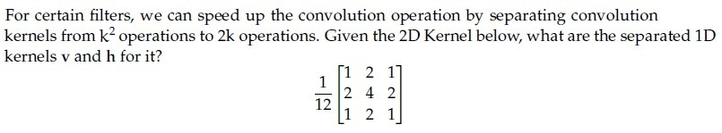

**Figure 1.** Source 2D kernel for Question 92.

**Options**

**A.** 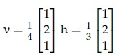

**Figure 2.** Option A separated 1D kernels for Question 92.  
*Option ID:* `6406534780281`

**B.** 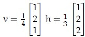

**Figure 3.** Option B separated 1D kernels for Question 92.  
*Option ID:* `6406534780282`

**C.** 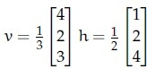

**Figure 4.** Option C separated 1D kernels for Question 92.  
*Option ID:* `6406534780283`

**D.** 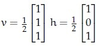

**Figure 5.** Option D separated 1D kernels for Question 92.  
*Option ID:* `6406534780284`

**Correct answer:** **A** — Option A ($v = [1, 2, 1]^T, h = [1, 2, 1]$).  
**Source evidence:** Option 6406534780281 is rendered in green text (#008000) with a checkmark icon. (PDF page 5).

---

### Question 93

**Question ID:** `6406531431353` · **Type:** MCQ · **Marks:** 2  
**PDF pages:** 5, 6

Match the following:

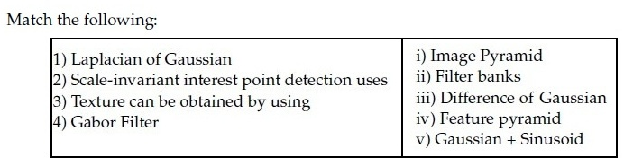

**Figure 6.** Source matching table for Question 93.

| List 1 | List 2 |
| :--- | :--- |
| 1) Laplacian of Gaussian | i) Image Pyramid |
| 2) Scale-invariant interest point detection uses | ii) Filter banks |
| 3) Texture can be obtained by using | iii) Difference of Gaussian |
| 4) Gabor Filter | iv) Feature pyramid |
| | v) Gaussian + Sinusoid |

**Options**

**A.** 1→ iii, 2→ iv, 3→ ii, 4 → i  
*Option ID:* `6406534780285`

**B.** 1→ i, 2→ iv, 3 → iii, 4→ ii  
*Option ID:* `6406534780286`

**C.** 1→ iv, 2→ iii, 3→ ii, 4 → i  
*Option ID:* `6406534780287`

**D.** 1→ iii, 2→ i, 3 → ii, 4 →v  
*Option ID:* `6406534780288`

**Correct answer:** **D** — 1→ iii, 2→ i, 3 → ii, 4 →v.  
**Source evidence:** Option D (6406534780288) rendered in green font (#008000) indicating the officially accepted answer in the source key. (PDF page 6).

---

### Question 94

**Question ID:** `6406531431354` · **Type:** MCQ · **Marks:** 2  
**PDF pages:** 6

Match the following:

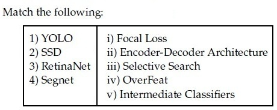

**Figure 7.** Source matching table for Question 94.

| List 1 | List 2 |
| :--- | :--- |
| 1) YOLO | i) Focal Loss |
| 2) SSD | ii) Encoder-Decoder Architecture |
| 3) RetinaNet | iii) Selective Search |
| 4) Segnet | iv) OverFeat |
| | v) Intermediate Classifiers |

**Options**

**A.** 1→ iv, 2→ v, 3→ i, 4 → ii  
*Option ID:* `6406534780289`

**B.** 1→ iii, 2→ i, 3 → v, 4→ ii  
*Option ID:* `6406534780290`

**C.** 1→ iv, 2→ iii, 3→ ii, 4 → i  
*Option ID:* `6406534780291`

**D.** 1→ iii, 2→ i, 3 → ii, 4→ v  
*Option ID:* `6406534780292`

**Correct answer:** **A** — 1→ iv, 2→ v, 3→ i, 4 → ii.  
**Source evidence:** Option A (6406534780289) rendered in green font (#008000) indicating the officially accepted answer in the source key. (PDF page 6).

---

### Question 95

**Question ID:** `6406531431355` · **Type:** MCQ · **Marks:** 2  
**PDF pages:** 6

In which one of the following applications would you use a many- to-one RNN architecture? Choose the most appropriate answer.

**Options**

**A.** Input is a review of a movie and output is the sentiment of the given review  
*Option ID:* `6406534780293`

**B.** Input is an image and output is the textual description of the given image  
*Option ID:* `6406534780294`

**C.** Input is an image and output is the class to which the given image belongs  
*Option ID:* `6406534780295`

**D.** Input is a sentence in English language and output is the same sentence translated to Hindi language  
*Option ID:* `6406534780296`

**Correct answer:** **A** — Input is a review of a movie and output is the sentiment of the given review.  
**Source evidence:** Option A (6406534780293) rendered in green font (#008000) indicating the officially accepted answer in the source key. (PDF page 6).

---

### Question 96

**Question ID:** `6406531431356` · **Type:** MCQ · **Marks:** 2  
**PDF pages:** 6

Why might Segment Anything (SAM) be particularly useful in data annotation tasks compared to traditional segmentation models?

**Options**

**A.** It produces perfect segmentation masks.  
*Option ID:* `6406534780297`

**B.** It can adapt to segment any object, even those not seen during training  
*Option ID:* `6406534780298`

**C.** It requires less computational resources  
*Option ID:* `6406534780299`

**D.** It automatically labels all objects in an image without user input  
*Option ID:* `6406534780300`

**Correct answer:** **B** — It can adapt to segment any object, even those not seen during training.  
**Source evidence:** Option 6406534780298 is rendered in green text (#008000) with a checkmark icon. (PDF page 6).

---

### Question 97

**Question ID:** `6406531431357` · **Type:** MSQ · **Marks:** 2  
**PDF pages:** 7

Which of the following statements are true? (Select all possible correct options)

**Options**

**A.** Variational AutoEncoders (VAE) generate sharper images compared to Generative adversarial networks (GANs)  
*Option ID:* `6406534780301`

**B.** GAN is an example of an implicit density estimation model  
*Option ID:* `6406534780302`

**C.** Fully connected layers in mapping network of Style-GAN change the dimension of its input  
*Option ID:* `6406534780303`

**D.** In a GAN, the generator and discriminator are trained in an alternating fashion, each using the other’s output to improve.  
*Option ID:* `6406534780304`

**Correct answer:** **B, D** — GAN is an example of an implicit density estimation model; In a GAN, the generator and discriminator are trained in an alternating fashion, each using the other’s output to improve..  
**Source evidence:** Option B (6406534780302) rendered in green font (#008000) indicating an accepted option in the source key. (PDF page 7).

---

### Question 98

**Question ID:** `6406531431358` · **Type:** MSQ · **Marks:** 2  
**PDF pages:** 7

Classifier-free guidance is a technique used in diffusion models to improve sample quality without the explicit use of a classifier. This technique involves modifying the sampling process based on a control parameter. If the control parameter, denoted as γ, is set to zero, what effect does this have on the generation process?

**Options**

**A.** It fails to generate realistic samples  
*Option ID:* `6406534780305`

**B.** It removes all guidance, effectively making the process equivalent to the unconditional generation.  
*Option ID:* `6406534780306`

**C.** It maximizes the influence of the classifier, leading to highly detailed generations.  
*Option ID:* `6406534780307`

**D.** It can lead to more diverse samples compared to higher values of γ, as the generation process is less constrained by the conditional information.  
*Option ID:* `6406534780308`

**Correct answer:** **B, D** — It removes all guidance, effectively making the process equivalent to the unconditional generation.; It can lead to more diverse samples compared to higher values of γ, as the generation process is less constrained by the conditional information..  
**Source evidence:** Option B (6406534780306) rendered in green font (#008000) indicating an accepted option in the source key. (PDF page 7).

---

### Question 99

**Question ID:** `6406531431359` · **Type:** MSQ · **Marks:** 2  
**PDF pages:** 7, 8

Which of the following statements are true? (Select all possible correct options)

**Options**

**A.** Autoencoder are equivalent to Principal Component Analysis (PCA) provided we don’t use of non-linear activation functions  
*Option ID:* `6406534780309`

**B.** When using global attention on temporal data, alignment weights are learnt for encoder hidden representations for all time steps  
*Option ID:* `6406534780310`

**C.** Positional encoding is an important component of the trans- former architecture as it conveys information about order in a given sequence  
*Option ID:* `6406534780311`

**D.** It is not possible to generate different captions for the same image that have similar meaning but different tone/style  
*Option ID:* `6406534780312`

**E.** Autoencoders can not be used for data compression as its input and output dimensions are different  
*Option ID:* `6406534780313`

**Correct answer:** **A, B, C** — Autoencoder are equivalent to Principal Component Analysis (PCA) provided we don’t use of non-linear activation functions; When using global attention on temporal data, alignment weights are learnt for encoder hidden representations for all time steps; Positional encoding is an important component of the trans- former architecture as it conveys information about order in a given sequence.  
**Source evidence:** Option 6406534780309 is rendered in green text (#008000) with a checkmark icon. (PDF page 7).

---

### Question 100

**Question ID:** `6406531431360` · **Type:** MSQ · **Marks:** 2  
**PDF pages:** 8

Which of the following statements about CLIP are TRUE? (Select ALL that apply)

**Options**

**A.** CLIP uses a cross-entropy loss function to align text and image embeddings.  
*Option ID:* `6406534780314`

**B.** CLIP requires image labels for training.  
*Option ID:* `6406534780315`

**C.** CLIP is trained to maximize cosine similarity between embeddings of matching text-image pairs.  
*Option ID:* `6406534780316`

**D.** CLIP model is trained with pretext tasks such as rotation prediction and inpainting to learn effective feature representations.  
*Option ID:* `6406534780317`

**E.** To use the CLIP model for image classification, it is imperative to finetune it on downstream datasets.  
*Option ID:* `6406534780318`

**Correct answer:** **C** — CLIP is trained to maximize cosine similarity between embeddings of matching text-image pairs..  
**Source evidence:** Option 6406534780316 is rendered in green text (#008000) with a checkmark icon. (PDF page 8).

---

### Question 101

**Question ID:** `6406531431361` · **Type:** MSQ · **Marks:** 2  
**PDF pages:** 8

Which one of the following statements is true:

**Options**

**A.** Weight change criterion is a method of ‘early stopping’ that checks whether or not the error is dropping over epochs to decide whether to continue training or stop.  
*Option ID:* `6406534780319`

**B.** L1 norm tends to create more sparse weights than L2 norm.  
*Option ID:* `6406534780320`

**C.** During the training phase, for each iteration, Dropout ignores a random fraction, p, of nodes, and accounts for it in the test phase by scaling down the activations by a factor of p.  
*Option ID:* `6406534780321`

**D.** A single McCulloch-Pitts neuron is capable of modeling AND, OR, XOR, NOR, and NAND functions.  
*Option ID:* `6406534780322`

**Correct answer:** **B, C** — L1 norm tends to create more sparse weights than L2 norm.; During the training phase, for each iteration, Dropout ignores a random fraction, p, of nodes, and accounts for it in the test phase by scaling down the activations by a factor of p..  
**Source evidence:** Option 6406534780320 is rendered in green text (#008000) with a checkmark icon. (PDF page 8).

---

### Question 102

**Question ID:** `6406531431362` · **Type:** MSQ · **Marks:** 2  
**PDF pages:** 8, 9

Which of the following are examples of a high-pass filter?

**Options**

**A.** 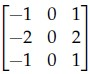

**Figure 8.** Option A filter kernel for Question 102.  
*Option ID:* `6406534780323`

**B.** 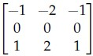

**Figure 9.** Option B filter kernel for Question 102.  
*Option ID:* `6406534780324`

**C.** 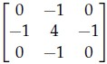

**Figure 10.** Option C filter kernel for Question 102.  
*Option ID:* `6406534780325`

**D.** 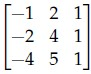

**Figure 11.** Option D filter kernel for Question 102.  
*Option ID:* `6406534780326`

**Correct answer:** **A, B, C** — Options A, B, and C.  
**Source evidence:** Option 6406534780323 is rendered in green text (#008000) with a checkmark icon. (PDF page 8).

---

### Question 103

**Question ID:** `6406531431363` · **Type:** SA · **Marks:** 2  
**PDF pages:** 9

Given is a 3 × 3 8-bit grayscale image:

$$\begin{bmatrix} 10 & 50 & 200 \\ 70 & 100 & 150 \\ 20 & 80 & 255 \end{bmatrix}$$

What is the central element after applying linear contrast stretching (from the range $[I_{min}, I_{max}]$ to $[0, 255]$) ?

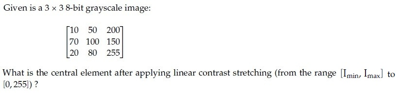

**Figure 12.** Source problem statement for Question 103.

**Correct answer:** 93 to 94  
**Source evidence:** Source key specifies Possible Answers : 93 to 94 (Answers Type : Equal).

---

### Question 104

**Question ID:** `6406531431364` · **Type:** SA · **Marks:** 2  
**PDF pages:** 9, 10

Using momentum-based gradient descent, find the new value of the parameter $\theta_{t+1}$, given that the old value $\theta_t = 1.20$, gradient of loss function $\nabla_{\theta_t} L(\theta_t) = -0.05$, velocity term $V_{t-1} = 0.30$, learning rate $\alpha = 0.10$ and momentum term $\gamma = 0.90$. (Round decimal point till 3 places) [Note: Assume that there is no bias].

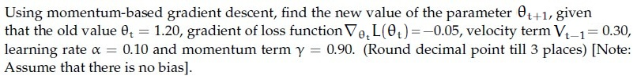

**Figure 13.** Source problem statement for Question 104.

**Correct answer:** 0.930 to 0.940  
**Source evidence:** Source key specifies Possible Answers : 0.930 to 0.940 (Answers Type : Equal).

---

### Question 105

**Question ID:** `6406531431365` · **Type:** SA · **Marks:** 2  
**PDF pages:** 10

In a diffusion model reverse process the model reduces the noise variance by 0.02 at each reverse step. If it starts with a noise variance of 0.90 at timestep $T = 60$, how many steps are required to reduce the noise variance to 0.05?

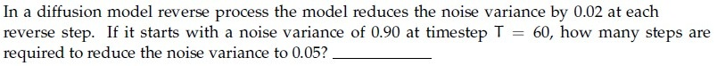

**Figure 14.** Source problem statement for Question 105.

**Correct answer:** 43  
**Source evidence:** Source key specifies Possible Answers : 43 (Answers Type : Equal).

---

### Question 106

**Question ID:** `6406531431366` · **Type:** SA · **Marks:** 2  
**PDF pages:** 10, 11

In the forward process of a diffusion model, the data is incrementally corrupted by adding noise across $T$ timesteps. If the variance of the noise added at each step $t$ is $\beta_t$, which decreases linearly from 0.03 at the first step to 0.02 at the last step over 150 timesteps, calculate the total variance of the noise added over 150 timesteps ___. (Round decimal point till 2 places) (Hint: Calculate average variance per step to calculate total variance)

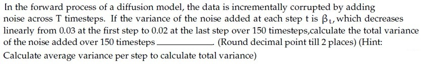

**Figure 15.** Source problem statement for Question 106.

**Correct answer:** 3.75  
**Source evidence:** Source key specifies Possible Answers : 3.75 (Answers Type : Equal).

---

### Question 107

**Question ID:** `6406531431370` · **Type:** SA · **Marks:** 2  
**PDF pages:** 11

For a 3-bit grayscale image, the integral image is given as follows:

$$\begin{bmatrix} 5 & 6 & 8 \\ 6 & 9 & 11 \\ 11 & 15 & 19 \end{bmatrix}$$

The pixel intensity that occurs the most for the given grayscale image is ______ (enter an integer value)

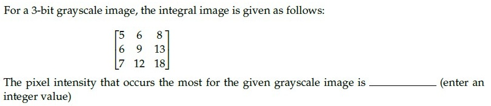

**Figure 16.** Source problem statement for Question 107.

**Correct answer:** 2  
**Source evidence:** Source key specifies Possible Answers : 2 (Answers Type : Equal).

---

### Question 108

**Question ID:** `6406531431371` · **Type:** SA · **Marks:** 2  
**PDF pages:** 11

What is the size of the feature map after applying two successive convolution operations with given parameters? Image size = 72×72, Kernel size = 5×5, Padding = 2 and Stride = 3. (In calculation, take floor(x) whenever x is non-integer.If the answer is N × N, write just one value N in the blank) __________________ .

**Correct answer:** 8  
**Source evidence:** Source key specifies Possible Answers : 8 (Answers Type : Equal).

---

### Question 109

**Question ID:** `6406531431368` · **Type:** SA · **Marks:** 1  
**PDF pages:** 12

**Shared Comprehension Context (Question ID: `6406531431367`):**

Consider the computation graph given below:
Input $a = 10$, and $b = -3$,
Fill in the blanks for the gradients.

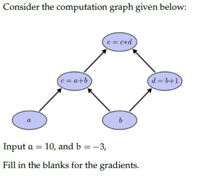

**Figure 17.** Source computation graph for Comprehension Questions 109–110.

**Subquestion:**

The value for $\frac{\partial e}{\partial a}$

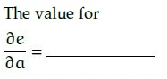

**Figure 18.** Source gradient query for Question 109.

**Correct answer:** -2  
**Source evidence:** Source key specifies Possible Answers : -2 (Answers Type : Equal).

---

### Question 110

**Question ID:** `6406531431369` · **Type:** SA · **Marks:** 1  
**PDF pages:** 12, 13

**Shared Comprehension Context (Question ID: `6406531431367`):**

Consider the computation graph given below:
Input $a = 10$, and $b = -3$,
Fill in the blanks for the gradients.

Refer to Figure 17 (Source computation graph for Comprehension Questions 109–110).

**Subquestion:**

The value for $\frac{\partial e}{\partial b}$

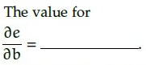

**Figure 19.** Source gradient query for Question 110.

**Correct answer:** 5  
**Source evidence:** Source key specifies Possible Answers : 5 (Answers Type : Equal).

---

### Question 111

**Question ID:** `6406531431373` · **Type:** SA · **Marks:** 2  
**PDF pages:** 13

**Shared Comprehension Context (Question ID: `6406531431372`):**

In a VAE, if the encoder outputs $\mu = [0.4, 0.2, 0.1, 0.5]$ and $\sigma = [0.1, 0.7, 0.02, 0.03]$, and $\epsilon$ sampled from $\mathcal{N}(0, I)$ is $[0.9, 0.5, 0.2, 0.1]$, what is the value of the latent vector $z = \mu + \sigma \odot \epsilon$?

[Note: Enter round-off values till 2 decimal places]

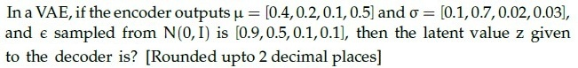

**Figure 20.** Source VAE problem statement for Comprehension Questions 111–114.

**Subquestion:**

Element 1:___________

**Correct answer:** 0.49  
**Source evidence:** Source key specifies Possible Answers : 0.49 (Answers Type : Equal).

---

### Question 112

**Question ID:** `6406531431374` · **Type:** SA · **Marks:** 2  
**PDF pages:** 13, 14

**Shared Comprehension Context (Question ID: `6406531431372`):**

In a VAE, if the encoder outputs $\mu = [0.4, 0.2, 0.1, 0.5]$ and $\sigma = [0.1, 0.7, 0.02, 0.03]$, and $\epsilon$ sampled from $\mathcal{N}(0, I)$ is $[0.9, 0.5, 0.2, 0.1]$, what is the value of the latent vector $z = \mu + \sigma \odot \epsilon$?

[Note: Enter round-off values till 2 decimal places]

Refer to Figure 20 (Source VAE problem statement for Comprehension Questions 111–114).

**Subquestion:**

Element 2:___________

**Correct answer:** 0.55  
**Source evidence:** Source key specifies Possible Answers : 0.55 (Answers Type : Equal).

---

### Question 113

**Question ID:** `6406531431375` · **Type:** SA · **Marks:** 1  
**PDF pages:** 14

**Shared Comprehension Context (Question ID: `6406531431372`):**

In a VAE, if the encoder outputs $\mu = [0.4, 0.2, 0.1, 0.5]$ and $\sigma = [0.1, 0.7, 0.02, 0.03]$, and $\epsilon$ sampled from $\mathcal{N}(0, I)$ is $[0.9, 0.5, 0.2, 0.1]$, what is the value of the latent vector $z = \mu + \sigma \odot \epsilon$?

[Note: Enter round-off values till 2 decimal places]

Refer to Figure 20 (Source VAE problem statement for Comprehension Questions 111–114).

**Subquestion:**

Element 3:___________

**Correct answer:** 0.10  
**Source evidence:** Source key specifies Possible Answers : 0.10 (Answers Type : Equal).

---

### Question 114

**Question ID:** `6406531431376` · **Type:** SA · **Marks:** 1  
**PDF pages:** 14

**Shared Comprehension Context (Question ID: `6406531431372`):**

In a VAE, if the encoder outputs $\mu = [0.4, 0.2, 0.1, 0.5]$ and $\sigma = [0.1, 0.7, 0.02, 0.03]$, and $\epsilon$ sampled from $\mathcal{N}(0, I)$ is $[0.9, 0.5, 0.2, 0.1]$, what is the value of the latent vector $z = \mu + \sigma \odot \epsilon$?

[Note: Enter round-off values till 2 decimal places]

Refer to Figure 20 (Source VAE problem statement for Comprehension Questions 111–114).

**Subquestion:**

Element 4:___________

**Correct answer:** 0.50  
**Source evidence:** Source key specifies Possible Answers : 0.50 (Answers Type : Equal).

---

### Question 115

**Question ID:** `6406531431378` · **Type:** SA · **Marks:** 1  
**PDF pages:** 14, 15

**Shared Comprehension Context (Question ID: `6406531431377`):**

Consider the BLIP model architecture with an input (image-text pair) as shown below:
For each of the entities given, enter the appropriate number matching the diagram.

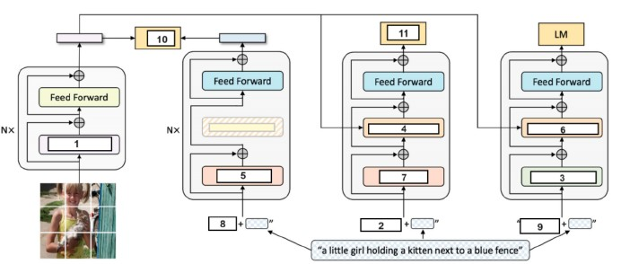

**Figure 21.** BLIP model architecture diagram for Comprehension Questions 115–125.

**Subquestion:**

Self-Attention _______________

**Correct answer:** 1  
**Source evidence:** Source key specifies Possible Answers : 1 (Answers Type : Equal).

---

### Question 116

**Question ID:** `6406531431379` · **Type:** SA · **Marks:** 0.5  
**PDF pages:** 15, 16

**Shared Comprehension Context (Question ID: `6406531431377`):**

Consider the BLIP model architecture with an input (image-text pair) as shown below:
For each of the entities given, enter the appropriate number matching the diagram.

Refer to Figure 21 (BLIP model architecture diagram for Comprehension Questions 115–125).

**Subquestion:**

BERT Text Encoder Bi Self Attention:__________________

**Correct answer:** 5  
**Source evidence:** Source key specifies Possible Answers : 5 (Answers Type : Equal).

---

### Question 117

**Question ID:** `6406531431380` · **Type:** SA · **Marks:** 0.5  
**PDF pages:** 16

**Shared Comprehension Context (Question ID: `6406531431377`):**

Consider the BLIP model architecture with an input (image-text pair) as shown below:
For each of the entities given, enter the appropriate number matching the diagram.

Refer to Figure 21 (BLIP model architecture diagram for Comprehension Questions 115–125).

**Subquestion:**

Image-Text Matching Loss ($L_{ITM}$):__________________

**Correct answer:** 11  
**Source evidence:** Source key specifies Possible Answers : 11 (Answers Type : Equal).

---

### Question 118

**Question ID:** `6406531431381` · **Type:** SA · **Marks:** 0.5  
**PDF pages:** 16

**Shared Comprehension Context (Question ID: `6406531431377`):**

Consider the BLIP model architecture with an input (image-text pair) as shown below:
For each of the entities given, enter the appropriate number matching the diagram.

Refer to Figure 21 (BLIP model architecture diagram for Comprehension Questions 115–125).

**Subquestion:**

Image Grounded Text Encoder Bi Self Attention: ___________________

**Correct answer:** 7  
**Source evidence:** Source key specifies Possible Answers : 7 (Answers Type : Equal).

---

### Question 119

**Question ID:** `6406531431382` · **Type:** SA · **Marks:** 0.5  
**PDF pages:** 16

**Shared Comprehension Context (Question ID: `6406531431377`):**

Consider the BLIP model architecture with an input (image-text pair) as shown below:
For each of the entities given, enter the appropriate number matching the diagram.

Refer to Figure 21 (BLIP model architecture diagram for Comprehension Questions 115–125).

**Subquestion:**

\<CLS\> Prompt: ___________________

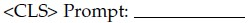

**Figure 22.** Source entity prompt for Question 119.

**Correct answer:** 8  
**Source evidence:** Source key specifies Possible Answers : 8 (Answers Type : Equal).

---

### Question 120

**Question ID:** `6406531431383` · **Type:** SA · **Marks:** 0.5  
**PDF pages:** 16, 17

**Shared Comprehension Context (Question ID: `6406531431377`):**

Consider the BLIP model architecture with an input (image-text pair) as shown below:
For each of the entities given, enter the appropriate number matching the diagram.

Refer to Figure 21 (BLIP model architecture diagram for Comprehension Questions 115–125).

**Subquestion:**

Image Grounded Text Encoder Cross Attention: _________________

**Correct answer:** 4  
**Source evidence:** Source key specifies Possible Answers : 4 (Answers Type : Equal).

---

### Question 121

**Question ID:** `6406531431384` · **Type:** SA · **Marks:** 0.5  
**PDF pages:** 17

**Shared Comprehension Context (Question ID: `6406531431377`):**

Consider the BLIP model architecture with an input (image-text pair) as shown below:
For each of the entities given, enter the appropriate number matching the diagram.

Refer to Figure 21 (BLIP model architecture diagram for Comprehension Questions 115–125).

**Subquestion:**

Image-Text Contrastive Loss ($L_{ITC}$): ____________

**Correct answer:** 10  
**Source evidence:** Source key specifies Possible Answers : 10 (Answers Type : Equal).

---

### Question 122

**Question ID:** `6406531431385` · **Type:** SA · **Marks:** 0.5  
**PDF pages:** 17

**Shared Comprehension Context (Question ID: `6406531431377`):**

Consider the BLIP model architecture with an input (image-text pair) as shown below:
For each of the entities given, enter the appropriate number matching the diagram.

Refer to Figure 21 (BLIP model architecture diagram for Comprehension Questions 115–125).

**Subquestion:**

\<Decode\> Prompt: _________________

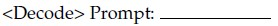

**Figure 23.** Source entity prompt for Question 122.

**Correct answer:** 9  
**Source evidence:** Source key specifies Possible Answers : 9 (Answers Type : Equal).

---

### Question 123

**Question ID:** `6406531431386` · **Type:** SA · **Marks:** 0.5  
**PDF pages:** 17, 18

**Shared Comprehension Context (Question ID: `6406531431377`):**

Consider the BLIP model architecture with an input (image-text pair) as shown below:
For each of the entities given, enter the appropriate number matching the diagram.

Refer to Figure 21 (BLIP model architecture diagram for Comprehension Questions 115–125).

**Subquestion:**

Causal Self Attention: _____________

**Correct answer:** 3  
**Source evidence:** Source key specifies Possible Answers : 3 (Answers Type : Equal).

---

### Question 124

**Question ID:** `6406531431387` · **Type:** SA · **Marks:** 0.5  
**PDF pages:** 18

**Shared Comprehension Context (Question ID: `6406531431377`):**

Consider the BLIP model architecture with an input (image-text pair) as shown below:
For each of the entities given, enter the appropriate number matching the diagram.

Refer to Figure 21 (BLIP model architecture diagram for Comprehension Questions 115–125).

**Subquestion:**

\<Encode\> Prompt: _________________

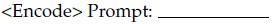

**Figure 24.** Source entity prompt for Question 124.

**Correct answer:** 2  
**Source evidence:** Source key specifies Possible Answers : 2 (Answers Type : Equal).

---

### Question 125

**Question ID:** `6406531431388` · **Type:** SA · **Marks:** 0.5  
**PDF pages:** 18

**Shared Comprehension Context (Question ID: `6406531431377`):**

Consider the BLIP model architecture with an input (image-text pair) as shown below:
For each of the entities given, enter the appropriate number matching the diagram.

Refer to Figure 21 (BLIP model architecture diagram for Comprehension Questions 115–125).

**Subquestion:**

Image Grounded Text Decoder Cross Attention: _____________

**Correct answer:** 6  
**Source evidence:** Source key specifies Possible Answers : 6 (Answers Type : Equal).

---

### Question 126

**Question ID:** `6406531431390` · **Type:** SA · **Marks:** 1  
**PDF pages:** 18, 19

**Shared Comprehension Context (Question ID: `6406531431389`):**

A four-dimensional input vector $x = [4, -5, -7, 10]$ is passed to a hidden layer with a single neuron and an activation function $a(z)$. The weights and bias for this neuron are $w = [2, 1, -3, 1]^T$ and $b = 1$, respectively. The output is calculated as $\hat{y} = a(z)$, where $z = w^T x + b$. Calculate the output $\hat{y}$ (enter the value in blank) for the following activation functions.

[Note: Enter round-off values till 2 decimal places]

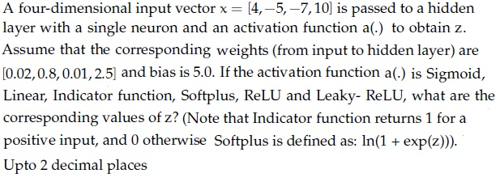

**Figure 25.** Source activation function problem statement for Comprehension Questions 126–131.

**Subquestion:**

Sigmoid ______________

**Correct answer:** 0.99  
**Source evidence:** Source key specifies Possible Answers : 0.99 (Answers Type : Equal).

---

### Question 127

**Question ID:** `6406531431391` · **Type:** SA · **Marks:** 1  
**PDF pages:** 19

**Shared Comprehension Context (Question ID: `6406531431389`):**

A four-dimensional input vector $x = [4, -5, -7, 10]$ is passed to a hidden layer with a single neuron and an activation function $a(z)$. The weights and bias for this neuron are $w = [2, 1, -3, 1]^T$ and $b = 1$, respectively. The output is calculated as $\hat{y} = a(z)$, where $z = w^T x + b$. Calculate the output $\hat{y}$ (enter the value in blank) for the following activation functions.

[Note: Enter round-off values till 2 decimal places]

Refer to Figure 25 (Source activation function problem statement for Comprehension Questions 126–131).

**Subquestion:**

Linear ______________

**Correct answer:** 26.01  
**Source evidence:** Source key specifies Possible Answers : 26.01 (Answers Type : Equal).

---

### Question 128

**Question ID:** `6406531431392` · **Type:** SA · **Marks:** 1  
**PDF pages:** 19

**Shared Comprehension Context (Question ID: `6406531431389`):**

A four-dimensional input vector $x = [4, -5, -7, 10]$ is passed to a hidden layer with a single neuron and an activation function $a(z)$. The weights and bias for this neuron are $w = [2, 1, -3, 1]^T$ and $b = 1$, respectively. The output is calculated as $\hat{y} = a(z)$, where $z = w^T x + b$. Calculate the output $\hat{y}$ (enter the value in blank) for the following activation functions.

[Note: Enter round-off values till 2 decimal places]

Refer to Figure 25 (Source activation function problem statement for Comprehension Questions 126–131).

**Subquestion:**

Indicator Function ______________

**Correct answer:** 1  
**Source evidence:** Source key specifies Possible Answers : 1 (Answers Type : Equal).

---

### Question 129

**Question ID:** `6406531431393` · **Type:** SA · **Marks:** 1  
**PDF pages:** 19, 20

**Shared Comprehension Context (Question ID: `6406531431389`):**

A four-dimensional input vector $x = [4, -5, -7, 10]$ is passed to a hidden layer with a single neuron and an activation function $a(z)$. The weights and bias for this neuron are $w = [2, 1, -3, 1]^T$ and $b = 1$, respectively. The output is calculated as $\hat{y} = a(z)$, where $z = w^T x + b$. Calculate the output $\hat{y}$ (enter the value in blank) for the following activation functions.

[Note: Enter round-off values till 2 decimal places]

Refer to Figure 25 (Source activation function problem statement for Comprehension Questions 126–131).

**Subquestion:**

Softplus _____________

**Correct answer:** 26.01  
**Source evidence:** Source key specifies Possible Answers : 26.01 (Answers Type : Equal).

---

### Question 130

**Question ID:** `6406531431394` · **Type:** SA · **Marks:** 1  
**PDF pages:** 20

**Shared Comprehension Context (Question ID: `6406531431389`):**

A four-dimensional input vector $x = [4, -5, -7, 10]$ is passed to a hidden layer with a single neuron and an activation function $a(z)$. The weights and bias for this neuron are $w = [2, 1, -3, 1]^T$ and $b = 1$, respectively. The output is calculated as $\hat{y} = a(z)$, where $z = w^T x + b$. Calculate the output $\hat{y}$ (enter the value in blank) for the following activation functions.

[Note: Enter round-off values till 2 decimal places]

Refer to Figure 25 (Source activation function problem statement for Comprehension Questions 126–131).

**Subquestion:**

ReLU _______________

**Correct answer:** 26.01  
**Source evidence:** Source key specifies Possible Answers : 26.01 (Answers Type : Equal).

---

### Question 131

**Question ID:** `6406531431395` · **Type:** SA · **Marks:** 1  
**PDF pages:** 20

**Shared Comprehension Context (Question ID: `6406531431389`):**

A four-dimensional input vector $x = [4, -5, -7, 10]$ is passed to a hidden layer with a single neuron and an activation function $a(z)$. The weights and bias for this neuron are $w = [2, 1, -3, 1]^T$ and $b = 1$, respectively. The output is calculated as $\hat{y} = a(z)$, where $z = w^T x + b$. Calculate the output $\hat{y}$ (enter the value in blank) for the following activation functions.

[Note: Enter round-off values till 2 decimal places]

Refer to Figure 25 (Source activation function problem statement for Comprehension Questions 126–131).

**Subquestion:**

Leaky-ReLU _____________

**Correct answer:** 26.01  
**Source evidence:** Source key specifies Possible Answers : 26.01 (Answers Type : Equal).

---

## Answer key

| Source question | Question ID | Correct answer | PDF page(s) |
| :--- | :--- | :--- | :--- |
| 83 | `6406531431343` | B | 1, 2 |
| 84 | `6406531431344` | E | 2 |
| 85 | `6406531431345` | D | 2 |
| 86 | `6406531431346` | B | 2, 3 |
| 87 | `6406531431347` | C | 3 |
| 88 | `6406531431348` | C | 3 |
| 89 | `6406531431349` | C | 3, 4 |
| 90 | `6406531431350` | C | 4 |
| 91 | `6406531431351` | A | 4 |
| 92 | `6406531431352` | A | 4, 5 |
| 93 | `6406531431353` | D | 5, 6 |
| 94 | `6406531431354` | A | 6 |
| 95 | `6406531431355` | A | 6 |
| 96 | `6406531431356` | B | 6 |
| 97 | `6406531431357` | B, D | 7 |
| 98 | `6406531431358` | B, D | 7 |
| 99 | `6406531431359` | A, B, C | 7, 8 |
| 100 | `6406531431360` | C | 8 |
| 101 | `6406531431361` | B, C | 8 |
| 102 | `6406531431362` | A, B, C | 8, 9 |
| 103 | `6406531431363` | 93 to 94 | 9 |
| 104 | `6406531431364` | 0.930 to 0.940 | 9, 10 |
| 105 | `6406531431365` | 43 | 10 |
| 106 | `6406531431366` | 3.75 | 10, 11 |
| 107 | `6406531431370` | 2 | 11 |
| 108 | `6406531431371` | 8 | 11 |
| 109 | `6406531431368` | -2 | 12 |
| 110 | `6406531431369` | 5 | 12, 13 |
| 111 | `6406531431373` | 0.49 | 13 |
| 112 | `6406531431374` | 0.55 | 13, 14 |
| 113 | `6406531431375` | 0.10 | 14 |
| 114 | `6406531431376` | 0.50 | 14 |
| 115 | `6406531431378` | 1 | 14, 15 |
| 116 | `6406531431379` | 5 | 15, 16 |
| 117 | `6406531431380` | 11 | 16 |
| 118 | `6406531431381` | 7 | 16 |
| 119 | `6406531431382` | 8 | 16 |
| 120 | `6406531431383` | 4 | 16, 17 |
| 121 | `6406531431384` | 10 | 17 |
| 122 | `6406531431385` | 9 | 17 |
| 123 | `6406531431386` | 3 | 17, 18 |
| 124 | `6406531431387` | 2 | 18 |
| 125 | `6406531431388` | 6 | 18 |
| 126 | `6406531431390` | 0.99 | 18, 19 |
| 127 | `6406531431391` | 26.01 | 19 |
| 128 | `6406531431392` | 1 | 19 |
| 129 | `6406531431393` | 26.01 | 19, 20 |
| 130 | `6406531431394` | 26.01 | 20 |
| 131 | `6406531431395` | 26.01 | 20 |

## Extraction notes

- Administrative confirmation Question 82 (Question Id `6406531431342`, Sub-Section 1) is excluded per MASTER_EXTRACTION_PROMPT.md.
- Section 6 'Mathematical Foundations of Generative AI' starting at page 20, y=682.0 pt is excluded as out-of-scope.
- In Question 88, source option C is printed as '69%' in green font (#008000) indicating the officially accepted answer.
- In Question 90, source option C ('One of the key components in the vanilla transformer is the recurrent connection that help them to deal with variable input length.') is printed in green font (#008000), while Option D ('All of these.') is printed in red font (#ff0000). The question queries for the incorrect statement; vanilla transformers do not possess recurrent connections, confirming Option C.
- In Question 91, source option A (`1 → Gaussian filter, 2 → Laplacian of Gaussian, 3 → First derivative of Gaussian, 4 → Sobel operator`) is printed in green font (#008000), confirming Option A.
- In Questions 109 and 110, derivative queries are confirmed from source computation graph and equation images to have output node $e$ in the numerator: $\frac{\partial e}{\partial a}$ and $\frac{\partial e}{\partial b}$.
- In Questions 119, 122, and 124, subquestion labels correspond to image prompt queries `\<CLS\> Prompt:`, `\<Decode\> Prompt:`, and `\<Encode\> Prompt:`, with brackets escaped to ensure clean Markdown rendering.
- In Comprehension Questions 126 to 131, the 4D input vector is restored to its complete form $x = [4, -5, -7, 10]$ as shown in Figure 25.
