# DL(CV) — da5006_2025T2_ET_FN

**Subject:** Deep Learning for Computer Vision  
**Source:** `da5006_2025T2_ET_FN.pdf` (original PDF omitted from this bundle)  
**Academic questions:** 52  
**Scope:** DL(CV) section; administrative subject confirmation excluded.

## Questions

### Question 156

**Question ID:** `6406531422535` · **Type:** MCQ · **Marks:** 2  
**PDF pages:** 2, 3

Consider the following orientation of edges:

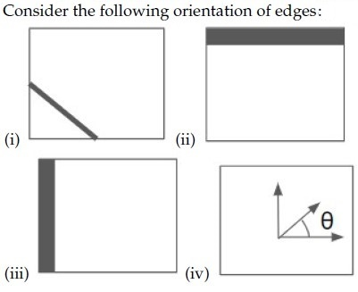

**Figure 1.** Question 156, source diagram of edge orientations.

Choose the correct matching:

**Options**

**A.** (i) = tan⁻¹(∂I/∂y / ∂I/∂x), (ii) = (∂I/∂x, 0), (iii) = (0, ∂I/∂y), (iv) = (∂I/∂x, ∂I/∂y)  
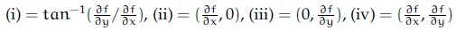
**Figure 2.** Option A image for Question 156.
*Option ID:* `6406534756356`

**B.** (i) = tan⁻¹(∂I/∂x / ∂I/∂y), (ii) = (0, ∂I/∂x), (iii) = (∂I/∂y, 0), (iv) = (∂I/∂x, ∂I/∂y)  
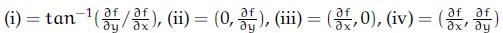
**Figure 3.** Option B image for Question 156.
*Option ID:* `6406534756357`

**C.** (i) = (∂I/∂x, ∂I/∂y), (ii) = (∂I/∂x, 0), (iii) = (0, ∂I/∂y), (iv) = tan⁻¹(∂I/∂y / ∂I/∂x)  
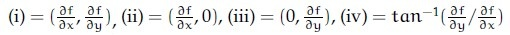
**Figure 4.** Option C image for Question 156.
*Option ID:* `6406534756358`

**D.** (i) = (∂I/∂x, ∂I/∂y), (ii) = (0, ∂I/∂y), (iii) = (∂I/∂x, 0), (iv) = tan⁻¹(∂I/∂y / ∂I/∂x)  
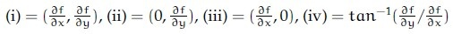
**Figure 5.** Option D image for Question 156.
*Option ID:* `6406534756359`

**Correct answer:** **D** — (i) = (∂I/∂x, ∂I/∂y), (ii) = (0, ∂I/∂y), (iii) = (∂I/∂x, 0), (iv) = tan⁻¹(∂I/∂y / ∂I/∂x).  
**Source evidence:** Option 6406534756359 is rendered in green text (#008000) with a checkmark icon. (PDF page 3).

---

### Question 157

**Question ID:** `6406531422536` · **Type:** MCQ · **Marks:** 2  
**PDF pages:** 3

Match the following:

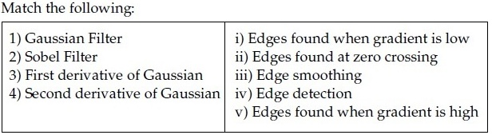

**Figure 6.** Question 157, source matching table.

**Options**

**A.** 1→ iii, 2→ iv, 3→ i, 4 → ii  
*Option ID:* `6406534756360`

**B.** 1→ iii, 2→ i, 3 → ii, 4 → v  
*Option ID:* `6406534756361`

**C.** 1→ iii, 2→ iv, 3→ v, 4 → ii  
*Option ID:* `6406534756362`

**D.** 1→ iv, 2→ iii, 3→ i, 4 → ii  
*Option ID:* `6406534756363`

**Correct answer:** **C** — 1→ iii, 2→ iv, 3→ v, 4 → ii.  
**Source evidence:** Option 6406534756362 is rendered in green text (#008000) with a checkmark icon. (PDF page 3).

---

### Question 158

**Question ID:** `6406531422537` · **Type:** MCQ · **Marks:** 2  
**PDF pages:** 3

Identify the correct sequence of steps in a Canny edge detection pipeline. Steps are listed below:

1. Compute gradient magnitude and direction
2. Connect individual components
3. Smoothen the image
4. Threshold into strong, weak, or no edge
5. Gaussian Filter and Hysteresis
6. Non-maximum suppression
7. Apply derivative to get edges

**Options**

**A.** 6→ 1→ 4→ 5 → 2  
*Option ID:* `6406534756364`

**B.** 3→ 1→ 6→ 4 → 2  
*Option ID:* `6406534756365`

**C.** 3→ 5→ 1→ 4 → 2  
*Option ID:* `6406534756366`

**D.** 6→ 3→ 5→ 7 → 2  
*Option ID:* `6406534756367`

**Correct answer:** **B** — 3→ 1→ 6→ 4 → 2.  
**Source evidence:** Option 6406534756365 is rendered in green text (#008000) with a checkmark icon. (PDF page 3).

---

### Question 159

**Question ID:** `6406531422538` · **Type:** MCQ · **Marks:** 2  
**PDF pages:** 4

Consider the following statements P and Q regarding AlexNet and choose the correct option:

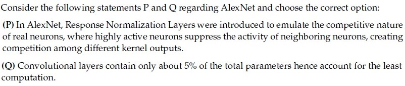

**Figure 7.** Question 159, statements P and Q.

(P) In AlexNet, Response Normalization Layers were introduced to emulate the competitive nature of real neurons, where highly active neurons suppress the activity of neighboring neurons, creating competition among different kernel outputs.

(Q) Convolutional layers contain only about 5% of the total parameters hence account for the least computation.

**Options**

**A.** Only statement P is true  
*Option ID:* `6406534756368`

**B.** Only statement Q is true  
*Option ID:* `6406534756369`

**C.** Both statements are true  
*Option ID:* `6406534756370`

**D.** None of these statements is true  
*Option ID:* `6406534756371`

**Correct answer:** **A** — Only statement P is true.  
**Source evidence:** Option 6406534756368 is rendered in green text (#008000) with a checkmark icon. (PDF page 4).

---

### Question 160

**Question ID:** `6406531422539` · **Type:** MCQ · **Marks:** 2  
**PDF pages:** 4

Match the derivative of activation functions f(x) with their counterparts on the right column accordingly.

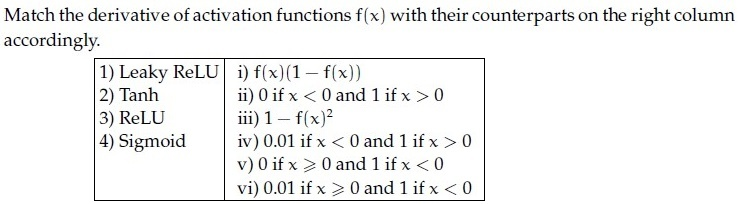

**Figure 8.** Question 160, matching table of activation function derivatives.

**Options**

**A.** 1→ vi, 2→ iii, 3 →v, 4 → i  
*Option ID:* `6406534756372`

**B.** 1→ i, 2→ iv, 3 → iii, 4→ ii  
*Option ID:* `6406534756373`

**C.** 1→ i, 2→ v, 3 → iii, 4→ iv  
*Option ID:* `6406534756374`

**D.** 1→ iv, 2→ iii, 3→ ii, 4 → i  
*Option ID:* `6406534756375`

**Correct answer:** **D** — 1→ iv, 2→ iii, 3→ ii, 4 → i.  
**Source evidence:** Option 6406534756375 is rendered in green text (#008000) with a checkmark icon. (PDF page 4).

---

### Question 161

**Question ID:** `6406531422540` · **Type:** MCQ · **Marks:** 2  
**PDF pages:** 4, 5

Which of the following is the correct sequence of steps of the SIFT algorithm?

1. Using the Taylor series expansion of the scale-space function, lo-calize the key points.
2. Estimate the orientation of keypoints using the local image gra-dients.
3. Find the edge points using the eigenvalues of the Hessian and reject these points.
4. Find a raw SIFT descriptor vector using the gradient orientations of the neighborhood around the key points.
5. Detect extreme points in scale space using an approximation of the Laplacian of Gaussian.

**Options**

**A.** 5, 2, 1, 3, 4  
*Option ID:* `6406534756376`

**B.** 5, 1, 3, 2, 4  
*Option ID:* `6406534756377`

**C.** 1, 3, 2, 4, 5  
*Option ID:* `6406534756378`

**D.** 1, 5, 3, 2, 4  
*Option ID:* `6406534756379`

**Correct answer:** **B** — 5, 1, 3, 2, 4.  
**Source evidence:** Option 6406534756377 is rendered in green text (#008000) with a checkmark icon. (PDF page 5).

---

### Question 162

**Question ID:** `6406531422541` · **Type:** MCQ · **Marks:** 2  
**PDF pages:** 5

Let us suppose that you want to build an encoder-decoder recurrent model with attention. We know that the context vector for the model is given by $c_i = \sum_j \alpha_{ij} h_j$, where $\alpha_{ij}$ refers to the degree of alignment between decoder state $s_{i-1}$ and encoder state $h_j$. Then $\alpha_{ij}$ is computed as:

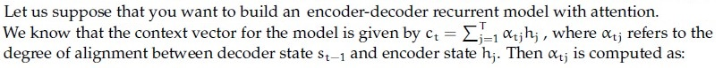

**Figure 9.** Question 162, attention context vector equation.

**Options**

**A.** Sigmoid of alignment scores  
*Option ID:* `6406534756380`

**B.** ReLU of alignment scores  
*Option ID:* `6406534756381`

**C.** Softmax of alignment scores  
*Option ID:* `6406534756382`

**D.** Linear projections of alignment scores  
*Option ID:* `6406534756383`

**Correct answer:** **C** — Softmax of alignment scores.  
**Source evidence:** Option 6406534756382 is rendered in green text (#008000) with a checkmark icon. (PDF page 5).

---

### Question 163

**Question ID:** `6406531422542` · **Type:** MCQ · **Marks:** 2  
**PDF pages:** 5

Which one of the following statements is true?

**Options**

**A.** Attention mechanisms cannot be applied to the bidirectional RNN model  
*Option ID:* `6406534756384`

**B.** An image captioning network cannot be trained end-to-end even though we are using 2 different modalities to train the network  
*Option ID:* `6406534756385`

**C.** One of the key components in the vanilla transformer are the recurrent connections that help them to deal with variable input length.  
*Option ID:* `6406534756386`

**D.** None of these  
*Option ID:* `6406534756387`

**Correct answer:** **D** — None of these.  
**Source evidence:** Option 6406534756387 is rendered in green text (#008000) with a checkmark icon. (PDF page 5).

---

### Question 164

**Question ID:** `6406531422543` · **Type:** MCQ · **Marks:** 2  
**PDF pages:** 5, 6

Consider the Upsampling stage in Segnet architecture given below:

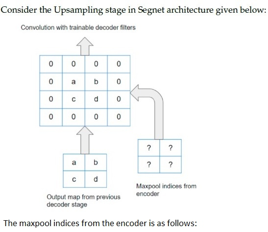

**Figure 10.** Question 164, source diagram of SegNet upsampling stage.

The maxpool indices from the encoder is as follows:

**Options**

**A.** 11 10
01 11  
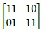
**Figure 11.** Option A image for Question 164.
*Option ID:* `6406534756388`

**B.** 11 01
10 00  
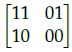
**Figure 12.** Option B image for Question 164.
*Option ID:* `6406534756389`

**C.** 11 01
10 11  
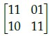
**Figure 13.** Option C image for Question 164.
*Option ID:* `6406534756390`

**D.** 11 10
01 00  
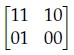
**Figure 14.** Option D image for Question 164.
*Option ID:* `6406534756391`

**Correct answer:** **D** — 11 10
01 00.  
**Source evidence:** Option 6406534756391 is rendered in green text (#008000) with a checkmark icon. (PDF page 6).

---

### Question 165

**Question ID:** `6406531422544` · **Type:** MCQ · **Marks:** 2  
**PDF pages:** 6, 7

Which one of the following statements regarding hyperparameter tuning is false?

**Options**

**A.** Validation set is the best choice for tuning hyperparameters  
*Option ID:* `6406534756392`

**B.** Picking hyperparameters that perform the best on the training set leads to overfitting  
*Option ID:* `6406534756393`

**C.** Tuning hyperparameters on the test set is an acceptable approach to find the most powerful model for generalization performance  
*Option ID:* `6406534756394`

**D.** Test set performance, with hyperparameters tuned on the validation set, would be a realistic measure of how the model will generalize to new data.  
*Option ID:* `6406534756395`

**Correct answer:** **C** — Tuning hyperparameters on the test set is an acceptable approach to find the most powerful model for generalization performance.  
**Source evidence:** Option 6406534756394 is rendered in green text (#008000) with a checkmark icon. (PDF page 7).

---

### Question 166

**Question ID:** `6406531422545` · **Type:** MCQ · **Marks:** 2  
**PDF pages:** 7

For certain filters, we can speed up the convolution operation by separating convolution kernels from k² operations to 2k operations. Given the 2D Kernel below, what are the separated 1D kernels v and h for it?

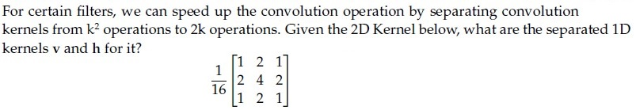

**Figure 15.** Question 166, 2D convolution kernel.

**Options**

**A.** v = [1, 2, 1]ᵀ, h = [1, 2, 1]  
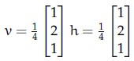
**Figure 16.** Option A image for Question 166.
*Option ID:* `6406534756396`

**B.** v = [1, 2, 1]ᵀ, h = [2, 1, 2]  
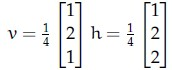
**Figure 17.** Option B image for Question 166.
*Option ID:* `6406534756397`

**C.** v = [1, 2, 1]ᵀ, h = [1, 4, 1]  
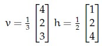
**Figure 18.** Option C image for Question 166.
*Option ID:* `6406534756398`

**D.** v = [2, 1, 2]ᵀ, h = [1, 2, 1]  
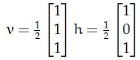
**Figure 19.** Option D image for Question 166.
*Option ID:* `6406534756399`

**Correct answer:** **A** — v = [1, 2, 1]ᵀ, h = [1, 2, 1].  
**Source evidence:** Option 6406534756396 is rendered in green text (#008000) with a checkmark icon. (PDF page 7).

---

### Question 167

**Question ID:** `6406531422546` · **Type:** MCQ · **Marks:** 2  
**PDF pages:** 7, 8

Match the following:

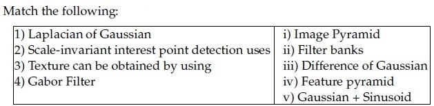

**Figure 20.** Question 167, source matching table.

**Options**

**A.** 1→ iii, 2→ iv, 3→ ii, 4 → i  
*Option ID:* `6406534756400`

**B.** 1→ i, 2→ iv, 3 → iii, 4→ ii  
*Option ID:* `6406534756401`

**C.** 1→ iv, 2→ iii, 3→ ii, 4 → i  
*Option ID:* `6406534756402`

**D.** 1→ iii, 2→ i, 3 → ii, 4 →v  
*Option ID:* `6406534756403`

**Correct answer:** **D** — 1→ iii, 2→ i, 3 → ii, 4 →v.  
**Source evidence:** Option 6406534756403 is rendered in green text (#008000) with a checkmark icon. (PDF page 8).

---

### Question 168

**Question ID:** `6406531422547` · **Type:** MCQ · **Marks:** 2  
**PDF pages:** 8

Match the following:

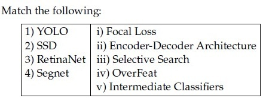

**Figure 21.** Question 168, source matching table.

**Options**

**A.** 1→ iv, 2→ v, 3→ i, 4 → ii  
*Option ID:* `6406534756404`

**B.** 1→ iii, 2→ i, 3 → v, 4→ ii  
*Option ID:* `6406534756405`

**C.** 1→ iv, 2→ iii, 3→ ii, 4 → i  
*Option ID:* `6406534756406`

**D.** 1→ iii, 2→ i, 3 → ii, 4→ v  
*Option ID:* `6406534756407`

**Correct answer:** **A** — 1→ iv, 2→ v, 3→ i, 4 → ii.  
**Source evidence:** Option 6406534756404 is rendered in green text (#008000) with a checkmark icon. (PDF page 8).

---

### Question 169

**Question ID:** `6406531422548` · **Type:** MCQ · **Marks:** 2  
**PDF pages:** 8

What makes the Segment Anything Model (SAM) particularly advantageous for image annotation tasks compared to conventional segmentation approaches?

**Options**

**A.** It has perfect segmentation accuracy  
*Option ID:* `6406534756408`

**B.** It has minimal hardware requirements for operation  
*Option ID:* `6406534756409`

**C.** It can generalize to segment objects it wasn’t specifically trained on  
*Option ID:* `6406534756410`

**D.** It automatically identifies and labels all objects in an image without user prompts  
*Option ID:* `6406534756411`

**Correct answer:** **C** — It can generalize to segment objects it wasn’t specifically trained on.  
**Source evidence:** Option 6406534756410 is rendered in green text (#008000) with a checkmark icon. (PDF page 8).

---

### Question 170

**Question ID:** `6406531422549` · **Type:** MCQ · **Marks:** 2  
**PDF pages:** 9

Statement 1: The Segment Anything Model (SAM) demonstrates zero-shot generalization capabilities across various downstream tasks.

Statement 2: SAM’s training involves a largescale, diverse mask dataset using a prompt-based segmentation approach. Which one of the following options is most appropriate?

**Options**

**A.** Both statements are correct, and Statement 2 correctly explains Statement 1.  
*Option ID:* `6406534756412`

**B.** Both statements are correct, but Statement 2 does not correctly explain Statement 1.  
*Option ID:* `6406534756413`

**C.** Statement 1 is correct, but Statement 2 is incorrect.  
*Option ID:* `6406534756414`

**D.** Statement 1 is incorrect, but Statement 2 is correct.  
*Option ID:* `6406534756415`

**E.** Both statements are incorrect.  
*Option ID:* `6406534756416`

**Correct answer:** **A** — Both statements are correct, and Statement 2 correctly explains Statement 1..  
**Source evidence:** Option 6406534756412 is rendered in green text (#008000) with a checkmark icon. (PDF page 9).

---

### Question 171

**Question ID:** `6406531422550` · **Type:** MCQ · **Marks:** 2  
**PDF pages:** 9

Why does DETR typically exhibit poor performance in detecting small objects compared to larger ones?

**Options**

**A.** The CNN backbone used in DETR has a fixed receptive field that’s too large for small objects  
*Option ID:* `6406534756417`

**B.** The global self-attention mechanism in DETR tends to dilute the signal from small objects across all image locations  
*Option ID:* `6406534756418`

**C.** DETR’s loss function actively discards all detections smaller than 50x50 pixels  
*Option ID:* `6406534756419`

**D.** The object queries in DETR are programmed to ignore any object smaller than 10  
*Option ID:* `6406534756420`

**E.** DETR’s encoder-decoder architecture was specifically designed to only detect large objects  
*Option ID:* `6406534756421`

**Correct answer:** **B** — The global self-attention mechanism in DETR tends to dilute the signal from small objects across all image locations.  
**Source evidence:** Option 6406534756418 is rendered in green text (#008000) with a checkmark icon. (PDF page 9).

---

### Question 172

**Question ID:** `6406531422551` · **Type:** MSQ · **Marks:** 2  
**PDF pages:** 9, 10

Which of the following statements are false? (Select all that apply)

**Options**

**A.** Generative adversarial networks (GANs) generate sharper images compared to Variational AutoEncoders (VAE)  
*Option ID:* `6406534756422`

**B.** GAN is an example of an implicit density estimation model  
*Option ID:* `6406534756423`

**C.** Fully connected layers in mapping network of Style-GAN do not change the dimension of its input  
*Option ID:* `6406534756424`

**D.** The generator and discriminator are always trained together in a GAN  
*Option ID:* `6406534756425`

**Correct answer:** **C**, **D** — Fully connected layers in mapping network of Style-GAN do not change the dimension of its input; The generator and discriminator are always trained together in a GAN.  
**Source evidence:** Option 6406534756424 is rendered in green text (#008000) with a checkmark icon. Option 6406534756425 is rendered in green text (#008000) with a checkmark icon. (PDF page 10).

---

### Question 173

**Question ID:** `6406531422552` · **Type:** MSQ · **Marks:** 2  
**PDF pages:** 10

Which of the following statements are true? (Select all possible correct options)

**Options**

**A.** Autoencoder are equivalent to Principal Component Analysis (PCA) provided we don’t use of non-linear activation functions  
*Option ID:* `6406534756426`

**B.** When using global attention on temporal data, alignment weights are learnt for encoder hidden representations for all time steps  
*Option ID:* `6406534756427`

**C.** Positional encoding is an important component of the transformer architecture as it conveys information about order in a given sequence  
*Option ID:* `6406534756428`

**D.** It is not possible to generate different captions for the same image that have similar meaning but different tone/style  
*Option ID:* `6406534756429`

**E.** Autoencoders can not be used for data compression as its input and output dimensions are different  
*Option ID:* `6406534756430`

**Correct answer:** **A**, **B**, **C** — Autoencoder are equivalent to Principal Component Analysis (PCA) provided we don’t use of non-linear activation functions; When using global attention on temporal data, alignment weights are learnt for encoder hidden representations for all time steps; Positional encoding is an important component of the transformer architecture as it conveys information about order in a given sequence.  
**Source evidence:** Option 6406534756426 is rendered in green text (#008000) with a checkmark icon. Option 6406534756427 is rendered in green text (#008000) with a checkmark icon. Option 6406534756428 is rendered in green text (#008000) with a checkmark icon. (PDF page 10).

---

### Question 174

**Question ID:** `6406531422553` · **Type:** MSQ · **Marks:** 2  
**PDF pages:** 10

Which of the following statements about CLIP are TRUE? (Select ALL that apply)

**Options**

**A.** CLIP uses a contrastive loss function to align text and image embeddings.  
*Option ID:* `6406534756431`

**B.** CLIP requires image labels for training.  
*Option ID:* `6406534756432`

**C.** CLIP is trained to maximize cosine similarity between embeddings of matching text-image pairs.  
*Option ID:* `6406534756433`

**D.** CLIP model is trained with pretext tasks such as rotation prediction and inpainting to learn effective feature representations.  
*Option ID:* `6406534756434`

**E.** To use the CLIP model for image classification, it is imperative to finetune it on downstream datasets.  
*Option ID:* `6406534756435`

**Correct answer:** **A**, **C** — CLIP uses a contrastive loss function to align text and image embeddings.; CLIP is trained to maximize cosine similarity between embeddings of matching text-image pairs..  
**Source evidence:** Option 6406534756431 is rendered in green text (#008000) with a checkmark icon. Option 6406534756433 is rendered in green text (#008000) with a checkmark icon. (PDF page 10).

---

### Question 175

**Question ID:** `6406531422554` · **Type:** MSQ · **Marks:** 2  
**PDF pages:** 10, 11

Which one of the following statements is true:

**Options**

**A.** Weight change criterion is a method of ‘early stopping’ that checks whether or not the error is dropping over epochs to decide whether to continue training or stop.  
*Option ID:* `6406534756436`

**B.** L1 norm tends to create more sparse weights than L2 norm.  
*Option ID:* `6406534756437`

**C.** During the training phase, for each iteration, Dropout ignores a random fraction, p, of nodes, and accounts for it in the test phase by scaling down the activations by a factor of p.  
*Option ID:* `6406534756438`

**D.** A single McCulloch-Pitts neuron is capable of modeling AND, OR, XOR, NOR, and NAND functions.  
*Option ID:* `6406534756439`

**Correct answer:** **B**, **C** — L1 norm tends to create more sparse weights than L2 norm.; During the training phase, for each iteration, Dropout ignores a random fraction, p, of nodes, and accounts for it in the test phase by scaling down the activations by a factor of p..  
**Source evidence:** Option 6406534756437 is rendered in green text (#008000) with a checkmark icon. Option 6406534756438 is rendered in green text (#008000) with a checkmark icon. (PDF page 11).

---

### Question 176

**Question ID:** `6406531422555` · **Type:** MSQ · **Marks:** 2  
**PDF pages:** 11

Which of the following are examples of a high-pass filter?

**Options**

**A.** [-1 0 1; -2 0 2; -1 0 1]  
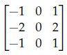
**Figure 22.** Option A image for Question 176.
*Option ID:* `6406534756440`

**B.** [-1 -2 -1; 0 0 0; 1 2 1]  
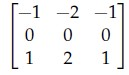
**Figure 23.** Option B image for Question 176.
*Option ID:* `6406534756441`

**C.** [0 -1 0; -1 4 -1; 0 -1 0]  
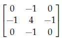
**Figure 24.** Option C image for Question 176.
*Option ID:* `6406534756442`

**D.** [-1 0 1; -1 0 1; -1 0 1]  
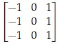
**Figure 25.** Option D image for Question 176.
*Option ID:* `6406534756443`

**Correct answer:** **A**, **B**, **C**, **D** — [-1 0 1; -2 0 2; -1 0 1]; [-1 -2 -1; 0 0 0; 1 2 1]; [0 -1 0; -1 4 -1; 0 -1 0]; [-1 0 1; -1 0 1; -1 0 1].  
**Source evidence:** Option 6406534756440 is rendered in green text (#008000) with a checkmark icon. Option 6406534756441 is rendered in green text (#008000) with a checkmark icon. Option 6406534756442 is rendered in green text (#008000) with a checkmark icon. Option 6406534756443 is rendered in green text (#008000) with a checkmark icon. (PDF page 11).

---

### Question 177

**Question ID:** `6406531422556` · **Type:** MSQ · **Marks:** 2  
**PDF pages:** 11, 12

Which of the following statements are true? (Select all that apply)

**Options**

**A.** Sigmoid activation function σ(.) can be represented in terms of tanh activation function as below: σ(x) = (tanh(x/2) - 1)/2  
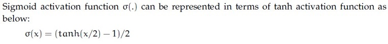
**Figure 26.** Option A image for Question 177.
*Option ID:* `6406534756444`

**B.** The derivative of the sigmoid activation function is symmetric around the y-axis.  
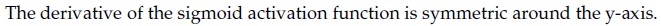
**Figure 27.** Option B image for Question 177.
*Option ID:* `6406534756445`

**C.** Gradient of a sigmoid neuron vanishes at saturation.  
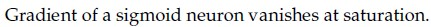
**Figure 28.** Option C image for Question 177.
*Option ID:* `6406534756446`

**D.** Sigmoid activation is centered around 0 whereas tanh activation is centered around 0.5  
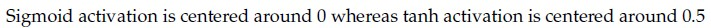
**Figure 29.** Option D image for Question 177.
*Option ID:* `6406534756447`

**Correct answer:** **B**, **C** — The derivative of the sigmoid activation function is symmetric around the y-axis.; Gradient of a sigmoid neuron vanishes at saturation..  
**Source evidence:** Option 6406534756445 is rendered in green text (#008000) with a checkmark icon. Option 6406534756446 is rendered in green text (#008000) with a checkmark icon. (PDF page 11, 12).

---

### Question 178

**Question ID:** `6406531422557` · **Type:** MSQ · **Marks:** 2  
**PDF pages:** 12

Which of the following techniques help control the exploding or vanishing gradient problem in recurrent neural networks?

**Options**

**A.** Gradient clipping  
*Option ID:* `6406534756448`

**B.** Use ReLU activation funtion to control exploding gradient and sigmoid activation to control vanishing gradients  
*Option ID:* `6406534756449`

**C.** Use Long Short-Term Memory (LSTM)  
*Option ID:* `6406534756450`

**D.** Use data augmentation methods (for example, reversing the input sequence)  
*Option ID:* `6406534756451`

**Correct answer:** **A**, **C**, **D** — Gradient clipping; Use Long Short-Term Memory (LSTM); Use data augmentation methods (for example, reversing the input sequence).  
**Source evidence:** Option 6406534756448 is rendered in green text (#008000) with a checkmark icon. Option 6406534756450 is rendered in green text (#008000) with a checkmark icon. Option 6406534756451 is rendered in green text (#008000) with a checkmark icon. (PDF page 12).

---

### Question 179

**Question ID:** `6406531422558` · **Type:** SA · **Marks:** 2  
**PDF pages:** 12, 13

Given is a 3 x 3 8-bit grayscale image:

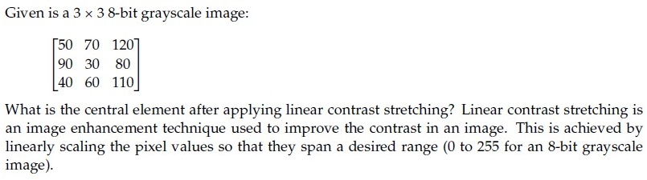

**Figure 30.** Question 179, source grayscale image matrix and problem statement.

$$\begin{bmatrix} 50 & 70 & 120 \\ 90 & 30 & 80 \\ 40 & 60 & 110 \end{bmatrix}$$

What is the central element after applying linear contrast stretching? Linear contrast stretching is an image enhancement technique used to improve the contrast in an image. This is achieved by linearly scaling the pixel values so that they span a desired range (0 to 255 for an 8-bit grayscale image).

**Correct answer:** `0`  
**Source evidence:** Official text specification: 'Possible Answers : 0' rendered in green text (#008000). (PDF page 13).

---

### Question 180

**Question ID:** `6406531422559` · **Type:** SA · **Marks:** 2  
**PDF pages:** 13

Consider the grayscale image shown below as a 5 x 5 matrix:

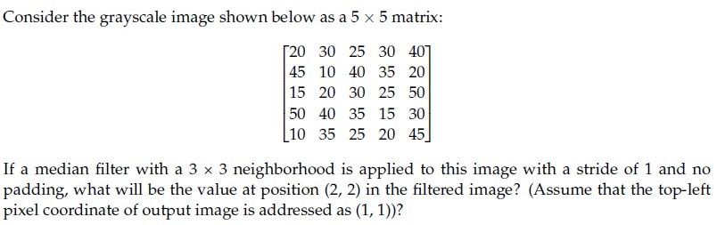

**Figure 31.** Question 180, 5x5 matrix image.

$$\begin{bmatrix} 20 & 30 & 25 & 30 & 40 \\ 45 & 10 & 40 & 35 & 20 \\ 15 & 20 & 30 & 25 & 50 \\ 50 & 40 & 35 & 15 & 30 \\ 10 & 35 & 25 & 20 & 45 \end{bmatrix}$$

If a median filter with a 3 x 3 neighborhood is applied to this image with a stride of 1 and no padding, what will be the value at position (2, 2) in the filtered image? (Assume that the top-left pixel coordinate of output image is addressed as (1, 1))?

**Correct answer:** `30`  
**Source evidence:** Official text specification: 'Possible Answers : 30' rendered in green text (#008000). (PDF page 13).

---

### Question 181

**Question ID:** `6406531422560` · **Type:** SA · **Marks:** 2  
**PDF pages:** 13

Using momentum-based gradient descent, find the new value of the parameter θ_{t+1}, given that the old value θ_t = 0.5, gradient of loss function ∇_{θ_t} L(θ_t) = 0.2, velocity term V_{t-1} = 0.7, learning rate α = 0.75 and momentum term γ = 0.8 (Round decimal point till 3 places) [Note: Assume that there is no bias].

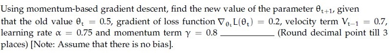

**Figure 32.** Question 181, momentum-based gradient descent statement.

**Correct answer:** `-0.215 to -0.205`  
**Source evidence:** Official text specification: 'Possible Answers : -0.215 to -0.205' rendered in green text (#008000). (PDF page 13).

---

### Question 182

**Question ID:** `6406531422561` · **Type:** SA · **Marks:** 2  
**PDF pages:** 13, 14

Consider a reverse process in a diffusion model where the goal is to reconstruct the original data from the noise. If the model correctly reduces the variance of the noise by 0.02 in each reverse step, and starts with a noise variance of 1.0 at timestep T = 50, how many steps are required to reduce the noise variance to 0.1____?

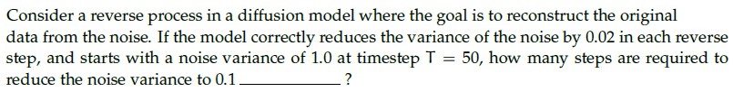

**Figure 33.** Question 182, diffusion reverse process problem.

**Correct answer:** `45`  
**Source evidence:** Official text specification: 'Possible Answers : 45' rendered in green text (#008000). (PDF page 14).

---

### Question 183

**Question ID:** `6406531422562` · **Type:** SA · **Marks:** 2  
**PDF pages:** 14

In the forward process of a diffusion model, the data is incrementally corrupted by adding noise across T timesteps. If the variance of the noise added at each step t is β_t, which decreases linearly from 0.03 at the first step to 0.02 at the last step over 150 timesteps,calculate the total variance of the noise added over 150 timesteps ___. (Round decimal point till 2 places)

(Hint: Calculate average variance per step to calculate total variance)

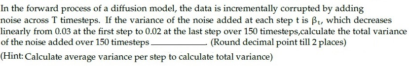

**Figure 34.** Question 183, diffusion forward process variance problem.

**Correct answer:** `3.75`  
**Source evidence:** Official text specification: 'Possible Answers : 3.75' rendered in green text (#008000). (PDF page 14).

---

### Question 184

**Question ID:** `6406531422573` · **Type:** SA · **Marks:** 2  
**PDF pages:** 14, 15

What is the size of the feature map after applying two successive convolution operations with given parameters? Image size = 64 x 64, Kernel size = 6 x 6, Padding = 1 and Stride = 2.(In calculation, take floor(x) whenever x is non-integer. If the answer is N x N, enter just one value N in the blank)

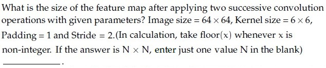

**Figure 35.** Question 184, convolution feature map size problem.

**Correct answer:** `100`  
**Source evidence:** Official text specification: 'Possible Answers : 100' rendered in green text (#008000). (PDF page 15).

---

### Question 185

**Question ID:** `6406531422564` · **Type:** SA · **Marks:** 1  
**PDF pages:** 15

**Shared context (Comprehension Question ID: `6406531422563`, Subquestions: 185 to 186):**

Consider the computation graph given below:
Input a = 10, and b = -3.
Fill in the blanks for the gradients, given in the subquestions.

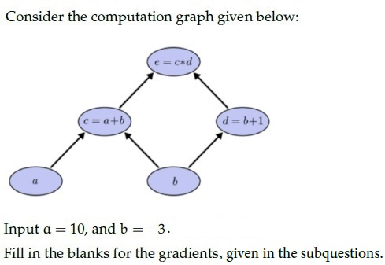

**Figure 36.** Comprehension 6406531422563, computation graph diagram.

Based on the above data, answer the given subquestion:

The value of ∂e/∂a = ______

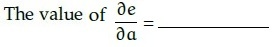

**Figure 37.** Question 185, gradient ∂e/∂a equation.

**Correct answer:** `-2`  
**Source evidence:** Official text specification: 'Possible Answers : -2' rendered in green text (#008000). (PDF page 15).

---

### Question 186

**Question ID:** `6406531422565` · **Type:** SA · **Marks:** 1  
**PDF pages:** 16

**Shared context (Comprehension Question ID: `6406531422563`, Subquestions: 185 to 186):**

Consider the computation graph given in Figure 36 (Input a = 10, b = -3).

Based on the above data, answer the given subquestion:

The value of ∂e/∂b = ______

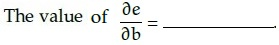

**Figure 38.** Question 186, gradient ∂e/∂b equation.

**Correct answer:** `5`  
**Source evidence:** Official text specification: 'Possible Answers : 5' rendered in green text (#008000). (PDF page 16).

---

### Question 187

**Question ID:** `6406531422575` · **Type:** SA · **Marks:** 1  
**PDF pages:** 16

**Shared context (Comprehension Question ID: `6406531422574`, Subquestions: 187 to 190):**

In a VAE, if the encoder outputs μ = [0.4, 0.2, 0.1, 0.5] and σ = [0.2, 0.5, 0.3, 0.4], and ε sampled from N(0,1) is [0.7, 0.1, 0.3, 0.2], then the latent value z given to the decoder is? [Rounded upto 2 decimal places]

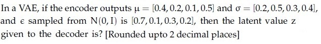

**Figure 39.** Comprehension 6406531422574, VAE latent vector problem statement.

Based on the above data, answer the given subquestions.

Element 1: _______________

**Correct answer:** `0.54`  
**Source evidence:** Official text specification: 'Possible Answers : 0.54' rendered in green text (#008000). (PDF page 16).

---

### Question 188

**Question ID:** `6406531422576` · **Type:** SA · **Marks:** 1  
**PDF pages:** 16, 17

**Shared context (Comprehension Question ID: `6406531422574`, Subquestions: 187 to 190):**

In a VAE, latent value z = μ + σ ⊙ ε with μ = [0.4, 0.2, 0.1, 0.5], σ = [0.2, 0.5, 0.3, 0.4], ε = [0.7, 0.1, 0.3, 0.2].

Based on the above data, answer the given subquestions.

Element 2: _______________

**Correct answer:** `0.25`  
**Source evidence:** Official text specification: 'Possible Answers : 0.25' rendered in green text (#008000). (PDF page 17).

---

### Question 189

**Question ID:** `6406531422577` · **Type:** SA · **Marks:** 1  
**PDF pages:** 17

**Shared context (Comprehension Question ID: `6406531422574`, Subquestions: 187 to 190):**

In a VAE, latent value z = μ + σ ⊙ ε with μ = [0.4, 0.2, 0.1, 0.5], σ = [0.2, 0.5, 0.3, 0.4], ε = [0.7, 0.1, 0.3, 0.2].

Based on the above data, answer the given subquestions.

Element 3: _______________

**Correct answer:** `0.19`  
**Source evidence:** Official text specification: 'Possible Answers : 0.19' rendered in green text (#008000). (PDF page 17).

---

### Question 190

**Question ID:** `6406531422578` · **Type:** SA · **Marks:** 1  
**PDF pages:** 17

**Shared context (Comprehension Question ID: `6406531422574`, Subquestions: 187 to 190):**

In a VAE, latent value z = μ + σ ⊙ ε with μ = [0.4, 0.2, 0.1, 0.5], σ = [0.2, 0.5, 0.3, 0.4], ε = [0.7, 0.1, 0.3, 0.2].

Based on the above data, answer the given subquestions.

Element 4: _______________

**Correct answer:** `0.58`  
**Source evidence:** Official text specification: 'Possible Answers : 0.58' rendered in green text (#008000). (PDF page 17).

---

### Question 191

**Question ID:** `6406531422567` · **Type:** SA · **Marks:** 1  
**PDF pages:** 17, 18

**Shared context (Comprehension Question ID: `6406531422566`, Subquestions: 191 to 196):**

A 4-dimensional input vector x = [5, 3, 1, 2] is passed to a hidden layer with a single neuron and an activation function a(.) to obtain z. Assume that the corresponding weights (from input to hidden layer) are [0.4, 0.6, 0.8, -0.2] and bias is 0.4. If the activation function a(.) is Sigmoid, Linear, Indicator function, Softplus, ReLU and Leaky-ReLU, what are the corresponding values of z? (Note that Indicator function returns 1 for a positive input, and 0 otherwise. Softplus is defined as: ln(1 + exp(z)).

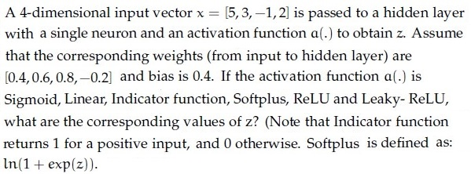

**Figure 40.** Comprehension 6406531422566, single-neuron activation problem statement.

Based on the above data, answer the given subquestions.

Sigmoid _______________

**Correct answer:** `0.95`  
**Source evidence:** Official text specification: 'Possible Answers : 0.95' rendered in green text (#008000). (PDF page 18).

---

### Question 192

**Question ID:** `6406531422568` · **Type:** SA · **Marks:** 1  
**PDF pages:** 18

**Shared context (Comprehension Question ID: `6406531422566`, Subquestions: 191 to 196):**

Single-neuron activation values with pre-activation u = 3 (from Figure 40).

Based on the above data, answer the given subquestions.

Linear _______________

**Correct answer:** `3`  
**Source evidence:** Official text specification: 'Possible Answers : 3' rendered in green text (#008000). (PDF page 18).

---

### Question 193

**Question ID:** `6406531422569` · **Type:** SA · **Marks:** 1  
**PDF pages:** 18, 19

**Shared context (Comprehension Question ID: `6406531422566`, Subquestions: 191 to 196):**

Single-neuron activation values with pre-activation u = 3 (from Figure 40).

Based on the above data, answer the given subquestions.

Indicator Function _______________

**Correct answer:** `1`  
**Source evidence:** Official text specification: 'Possible Answers : 1' rendered in green text (#008000). (PDF page 19).

---

### Question 194

**Question ID:** `6406531422570` · **Type:** SA · **Marks:** 1  
**PDF pages:** 19

**Shared context (Comprehension Question ID: `6406531422566`, Subquestions: 191 to 196):**

Single-neuron activation values with pre-activation u = 3 (from Figure 40).

Based on the above data, answer the given subquestions.

Softplus _______________

**Correct answer:** `3.05`  
**Source evidence:** Official text specification: 'Possible Answers : 3.05' rendered in green text (#008000). (PDF page 19).

---

### Question 195

**Question ID:** `6406531422571` · **Type:** SA · **Marks:** 1  
**PDF pages:** 19

**Shared context (Comprehension Question ID: `6406531422566`, Subquestions: 191 to 196):**

Single-neuron activation values with pre-activation u = 3 (from Figure 40).

Based on the above data, answer the given subquestions.

ReLu _______________

**Correct answer:** `3`  
**Source evidence:** Official text specification: 'Possible Answers : 3' rendered in green text (#008000). (PDF page 19).

---

### Question 196

**Question ID:** `6406531422572` · **Type:** SA · **Marks:** 1  
**PDF pages:** 19, 20

**Shared context (Comprehension Question ID: `6406531422566`, Subquestions: 191 to 196):**

Single-neuron activation values with pre-activation u = 3 (from Figure 40).

Based on the above data, answer the given subquestions.

Leaky-ReLu _______________

**Correct answer:** `3`  
**Source evidence:** Official text specification: 'Possible Answers : 3' rendered in green text (#008000). (PDF page 20).

---

### Question 197

**Question ID:** `6406531422580` · **Type:** SA · **Marks:** 0.55  
**PDF pages:** 20

**Shared context (Comprehension Question ID: `6406531422579`, Subquestions: 197 to 207):**

Consider the BLIP model architecture with an input (image-text pair) as shown below:

For each of the given entities, enter the appropriate number from the figure that corresponds to it:

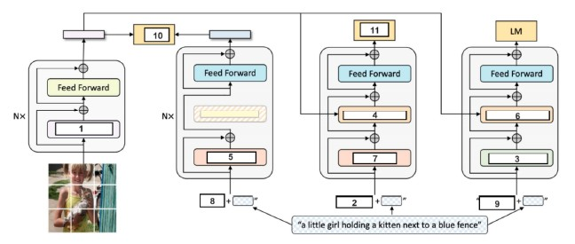

**Figure 41.** Comprehension 6406531422579, BLIP model architecture.

Based on the above data, answer the given subquestions.

Self-Attention

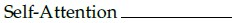

**Figure 42.** Question 197, Self-Attention entity label.

**Correct answer:** `1`  
**Source evidence:** Official text specification: 'Possible Answers : 1' rendered in green text (#008000). (PDF page 20).

---

### Question 198

**Question ID:** `6406531422581` · **Type:** SA · **Marks:** 0.55  
**PDF pages:** 20, 21

**Shared context (Comprehension Question ID: `6406531422579`, Subquestions: 197 to 207):**

BLIP model architecture (Figure 41).

Based on the above data, answer the given subquestion:

BERT Text Encoder Bi Self Attention:

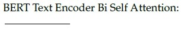

**Figure 43.** Question 198, BERT Text Encoder Bi Self Attention entity label.

**Correct answer:** `5`  
**Source evidence:** Official text specification: 'Possible Answers : 5' rendered in green text (#008000). (PDF page 21).

---

### Question 199

**Question ID:** `6406531422582` · **Type:** SA · **Marks:** 0.55  
**PDF pages:** 21

**Shared context (Comprehension Question ID: `6406531422579`, Subquestions: 197 to 207):**

BLIP model architecture (Figure 41).

Based on the above data, answer the given subquestion:

Image-Text Matching Loss (LITM ):

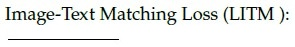

**Figure 44.** Question 199, Image-Text Matching Loss entity label.

**Correct answer:** `11`  
**Source evidence:** Official text specification: 'Possible Answers : 11' rendered in green text (#008000). (PDF page 21).

---

### Question 200

**Question ID:** `6406531422583` · **Type:** SA · **Marks:** 0.55  
**PDF pages:** 21

**Shared context (Comprehension Question ID: `6406531422579`, Subquestions: 197 to 207):**

BLIP model architecture (Figure 41).

Based on the above data, answer the given subquestion:

Image Grounded Text Encoder Bi Self Attention: —_—

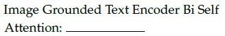

**Figure 45.** Question 200, Image Grounded Text Encoder Bi Self Attention entity label.

**Correct answer:** `7`  
**Source evidence:** Official text specification: 'Possible Answers : 7' rendered in green text (#008000). (PDF page 21).

---

### Question 201

**Question ID:** `6406531422584` · **Type:** SA · **Marks:** 0.55  
**PDF pages:** 21, 22

**Shared context (Comprehension Question ID: `6406531422579`, Subquestions: 197 to 207):**

BLIP model architecture (Figure 41).

Based on the above data, answer the given subquestion:

<CLS> Prompt: —

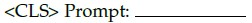

**Figure 46.** Question 201, CLS Prompt entity label.

**Correct answer:** `8`  
**Source evidence:** Official text specification: 'Possible Answers : 8' rendered in green text (#008000). (PDF page 22).

---

### Question 202

**Question ID:** `6406531422585` · **Type:** SA · **Marks:** 0.55  
**PDF pages:** 22

**Shared context (Comprehension Question ID: `6406531422579`, Subquestions: 197 to 207):**

BLIP model architecture (Figure 41).

Based on the above data, answer the given subquestion:

Image Grounded Text Encoder Cross Attention:

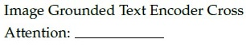

**Figure 47.** Question 202, Image Grounded Text Encoder Cross Attention entity label.

**Correct answer:** `4`  
**Source evidence:** Official text specification: 'Possible Answers : 4' rendered in green text (#008000). (PDF page 22).

---

### Question 203

**Question ID:** `6406531422586` · **Type:** SA · **Marks:** 0.54  
**PDF pages:** 22

**Shared context (Comprehension Question ID: `6406531422579`, Subquestions: 197 to 207):**

BLIP model architecture (Figure 41).

Based on the above data, answer the given subquestion:

Image-Text Contrastive Loss (LITC):

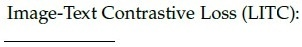

**Figure 48.** Question 203, Image-Text Contrastive Loss entity label.

**Correct answer:** `10`  
**Source evidence:** Official text specification: 'Possible Answers : 10' rendered in green text (#008000). (PDF page 22).

---

### Question 204

**Question ID:** `6406531422587` · **Type:** SA · **Marks:** 0.54  
**PDF pages:** 22, 23

**Shared context (Comprehension Question ID: `6406531422579`, Subquestions: 197 to 207):**

BLIP model architecture (Figure 41).

Based on the above data, answer the given subquestion:

<Decode> Prompt;

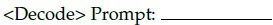

**Figure 49.** Question 204, Decode Prompt entity label.

**Correct answer:** `9`  
**Source evidence:** Official text specification: 'Possible Answers : 9' rendered in green text (#008000). (PDF page 23).

---

### Question 205

**Question ID:** `6406531422588` · **Type:** SA · **Marks:** 0.54  
**PDF pages:** 23

**Shared context (Comprehension Question ID: `6406531422579`, Subquestions: 197 to 207):**

BLIP model architecture (Figure 41).

Based on the above data, answer the given subquestion:

Causal Self Attention: —____

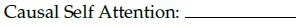

**Figure 50.** Question 205, Causal Self Attention entity label.

**Correct answer:** `3`  
**Source evidence:** Official text specification: 'Possible Answers : 3' rendered in green text (#008000). (PDF page 23).

---

### Question 206

**Question ID:** `6406531422589` · **Type:** SA · **Marks:** 0.54  
**PDF pages:** 23

**Shared context (Comprehension Question ID: `6406531422579`, Subquestions: 197 to 207):**

BLIP model architecture (Figure 41).

Based on the above data, answer the given subquestion:

<Encode> Prompt: ——____

**Figure 51.** Question 206, Encode Prompt entity label.

**Correct answer:** `2`  
**Source evidence:** Official text specification: 'Possible Answers : 2' rendered in green text (#008000). (PDF page 23).

---

### Question 207

**Question ID:** `6406531422590` · **Type:** SA · **Marks:** 0.54  
**PDF pages:** 23, 24

**Shared context (Comprehension Question ID: `6406531422579`, Subquestions: 197 to 207):**

BLIP model architecture (Figure 41).

Based on the above data, answer the given subquestion:

Image Grounded Text Decoder Cross Attention:

**Figure 52.** Question 207, Image Grounded Text Decoder Cross Attention entity label.

**Correct answer:** `6`  
**Source evidence:** Official text specification: 'Possible Answers : 6' rendered in green text (#008000). (PDF page 24).

---

## Answer key

| Source question | Question ID | Correct answer | PDF page(s) |
| :--- | :--- | :--- | :--- |
| 156 | `6406531422535` | D | 2, 3 |
| 157 | `6406531422536` | C | 3 |
| 158 | `6406531422537` | B | 3 |
| 159 | `6406531422538` | A | 4 |
| 160 | `6406531422539` | D | 4 |
| 161 | `6406531422540` | B | 4, 5 |
| 162 | `6406531422541` | C | 5 |
| 163 | `6406531422542` | D | 5 |
| 164 | `6406531422543` | D | 5, 6 |
| 165 | `6406531422544` | C | 6, 7 |
| 166 | `6406531422545` | A | 7 |
| 167 | `6406531422546` | D | 7, 8 |
| 168 | `6406531422547` | A | 8 |
| 169 | `6406531422548` | C | 8 |
| 170 | `6406531422549` | A | 9 |
| 171 | `6406531422550` | B | 9 |
| 172 | `6406531422551` | C, D | 9, 10 |
| 173 | `6406531422552` | A, B, C | 10 |
| 174 | `6406531422553` | A, C | 10 |
| 175 | `6406531422554` | B, C | 10, 11 |
| 176 | `6406531422555` | A, B, C, D | 11 |
| 177 | `6406531422556` | B, C | 11, 12 |
| 178 | `6406531422557` | A, C, D | 12 |
| 179 | `6406531422558` | 0 | 12, 13 |
| 180 | `6406531422559` | 30 | 13 |
| 181 | `6406531422560` | -0.215 to -0.205 | 13 |
| 182 | `6406531422561` | 45 | 13, 14 |
| 183 | `6406531422562` | 3.75 | 14 |
| 184 | `6406531422573` | 100 | 14, 15 |
| 185 | `6406531422564` | -2 | 15 |
| 186 | `6406531422565` | 5 | 16 |
| 187 | `6406531422575` | 0.54 | 16 |
| 188 | `6406531422576` | 0.25 | 16, 17 |
| 189 | `6406531422577` | 0.19 | 17 |
| 190 | `6406531422578` | 0.58 | 17 |
| 191 | `6406531422567` | 0.95 | 17, 18 |
| 192 | `6406531422568` | 3 | 18 |
| 193 | `6406531422569` | 1 | 18, 19 |
| 194 | `6406531422570` | 3.05 | 19 |
| 195 | `6406531422571` | 3 | 19 |
| 196 | `6406531422572` | 3 | 19, 20 |
| 197 | `6406531422580` | 1 | 20 |
| 198 | `6406531422581` | 5 | 20, 21 |
| 199 | `6406531422582` | 11 | 21 |
| 200 | `6406531422583` | 7 | 21 |
| 201 | `6406531422584` | 8 | 21, 22 |
| 202 | `6406531422585` | 4 | 22 |
| 203 | `6406531422586` | 10 | 22 |
| 204 | `6406531422587` | 9 | 22, 23 |
| 205 | `6406531422588` | 3 | 23 |
| 206 | `6406531422589` | 2 | 23 |
| 207 | `6406531422590` | 6 | 23, 24 |

## Extraction notes

1. **Section scope & exclusions:** The DL(CV) section begins on PDF Page 1 (Section Id 64065399798, Section Number 7). Preceding content on Page 1 belongs to the previous exam subject and is excluded. Question 155 (Question Id 6406531422534) on Page 2 is the administrative subject confirmation question (YES/NO options, 0 marks) and is excluded from academic questions. The exam paper terminates DL(CV) on Page 24; Page 25 begins the next subject 'Mathematical Foundations of Generative AI' (Section Id 64065399800, Section Number 9) and is excluded as out-of-scope.
2. **Declared question count reconciliation:** The section metadata declares 34 questions and 76 marks. This reconciles exactly with the source structure:
   - Sub-section 1: Administrative confirmation (1 parent unit, 0 marks, excluded).
   - Sub-section 2: 16 MCQs Q156–Q171 (16 parent units, 32 marks).
   - Sub-section 3: 7 MSQs Q172–Q178 (7 parent units, 14 marks).
   - Sub-section 4: 6 SAs Q179–Q184 (6 parent units, 12 marks).
   - Sub-section 5: Comprehension passage Id 6406531422563 (1 parent unit) containing 2 SA subquestions Q185–Q186 (2 marks).
   - Sub-section 6: Comprehension passage Id 6406531422574 (1 parent unit) containing 4 SA subquestions Q187–Q190 (4 marks).
   - Sub-section 7: Comprehension passage Id 6406531422566 (1 parent unit) containing 6 SA subquestions Q191–Q196 (6 marks).
   - Sub-section 8: Comprehension passage Id 6406531422579 (1 parent unit) containing 11 SA subquestions Q197–Q207 (6 marks total: 6 @ 0.55 marks = 3.30 + 5 @ 0.54 marks = 2.70 marks).
   - Total parent units = 1 + 16 + 7 + 6 + 1 + 1 + 1 + 1 = 34 questions.
   - Total scored academic questions = 16 + 7 + 6 + 2 + 4 + 6 + 11 = 52 questions, totaling exactly 76.0 marks.
3. **Source answers:** All answers are evidenced directly from font color (#008000 green text / checkmark icons) for MCQs and MSQs, or explicit official 'Possible Answers :' text specifications for short-answer questions. Every MSQ has multiple verified answers preserved. Question 172 asks 'Which of the following statements are false? (Select all that apply)' and has verified official key C, D. Short-answer Question 184 has verified source Possible Answers '100', preserved despite academic suspicion regarding convolution padding arithmetic.
4. **Figure fidelity:** All 52 assets are extracted from the original PDF at native resolution and referenced with sequential figure captions (Figures 1 to 52).
