# DL(CV) — da5006_2025T2_Q1_NA

**Subject:** Deep Learning for Computer Vision  
**Source:** `da5006_2025T2_Q1_NA.pdf` (original PDF omitted from this bundle)  
**Academic questions:** 34  
**Scope:** DL(CV) section; administrative subject confirmation excluded.

## Questions

### Question 157

**Question ID:** `6406531279499` · **Type:** MCQ · **Marks:** 2  
**PDF pages:** 2

What is the mean of transformed pixels after applying linear contrast stretching to the following 3x3 image?

$$\begin{bmatrix} 52 & 55 & 61 \\ 59 & 79 & 61 \\ 76 & 61 & 64 \end{bmatrix}$$

$$\text{Image} =$$

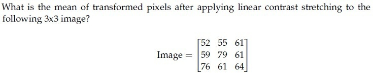

**Figure 1.** 3x3 pixel matrix and linear contrast stretching problem statement for Question 157.

**Options**

**A.** 104.94  
*Option ID:* `6406534313841`

**B.** 100.25  
*Option ID:* `6406534313842`

**C.** 110.56  
*Option ID:* `6406534313843`

**D.** 98.78  
*Option ID:* `6406534313844`

**Correct answer:** **A** — 104.94.  
**Source evidence:** Option 6406534313841 rendered in green text (color 0x8000) with checkmark icon on PDF page 2.

---

### Question 158

**Question ID:** `6406531279500` · **Type:** MCQ · **Marks:** 2  
**PDF pages:** 3

Which of the following statements is false?

**Options**

**A.** Histogram equalization is a global operation.  
*Option ID:* `6406534313845`

**B.** Gaussian filtering is a local operation.  
*Option ID:* `6406534313846`

**C.** Convolution in the spatial domain corresponds to multiplication in the frequency domain.  
*Option ID:* `6406534313847`

**D.** Median filtering is a global operation.  
*Option ID:* `6406534313848`

**Correct answer:** **D** — Median filtering is a global operation..  
**Source evidence:** Option 6406534313848 rendered in green text (color 0x8000) on PDF page 3.

---

### Question 159

**Question ID:** `6406531279501` · **Type:** MCQ · **Marks:** 2  
**PDF pages:** 3

Which of the following statements is True?

**Options**

**A.** Gaussian filter is a separable filter because it is linear.  
*Option ID:* `6406534313849`

**B.** Median filter is a non-separable filter.  
*Option ID:* `6406534313850`

**C.** Gaussian filter is a high-pass filter.  
*Option ID:* `6406534313851`

**D.** Mean filter is a non-separable filter because it is non-linear.  
*Option ID:* `6406534313852`

**Correct answer:** **A** — Gaussian filter is a separable filter because it is linear..  
**Source evidence:** Option 6406534313849 rendered in green text (color 0x8000) on PDF page 3.

---

### Question 160

**Question ID:** `6406531279502` · **Type:** MCQ · **Marks:** 2  
**PDF pages:** 4

Which of the following linear filters will leave the central value of the given matrix unchanged after convolution?

$$\begin{bmatrix} 12 & 15 & 14 \\ 9 & 8 & 7 \\ 5 & 6 & 4 \end{bmatrix}$$

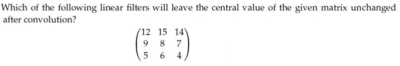

**Figure 2.** Source matrix and convolution problem statement for Question 160.

**Options**

**A.** $$\frac{1}{7}\begin{bmatrix} 0 & 1 & 0 \\ 1 & 3 & 1 \\ 0 & 1 & 0 \end{bmatrix}$$

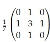

**Figure 3.** Option A filter matrix for Question 160.  
*Option ID:* `6406534313853`

**B.** $$\frac{1}{9}\begin{bmatrix} 1 & 1 & 1 \\ 1 & 1 & 1 \\ 1 & 1 & 1 \end{bmatrix}$$

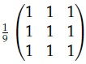

**Figure 4.** Option B filter matrix for Question 160.  
*Option ID:* `6406534313854`

**C.** $$\frac{1}{5}\begin{bmatrix} 0 & 0 & 1 \\ 0 & 3 & 0 \\ 1 & 0 & 0 \end{bmatrix}$$

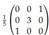

**Figure 5.** Option C filter matrix for Question 160.  
*Option ID:* `6406534313855`

**D.** $$\frac{1}{6}\begin{bmatrix} 0 & 1 & 0 \\ 1 & 2 & 1 \\ 0 & 1 & 0 \end{bmatrix}$$

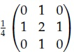

**Figure 6.** Option D filter matrix for Question 160.  
*Option ID:* `6406534313856`

**Correct answer:** **A** — $$\frac{1}{7}\begin{bmatrix} 0 & 1 & 0 \\ 1 & 3 & 1 \\ 0 & 1 & 0 \end{bmatrix}$$.  
**Source evidence:** Option 6406534313853 rendered in green text (color 0x8000) with checkmark icon on PDF page 4.

---

### Question 161

**Question ID:** `6406531279503` · **Type:** MCQ · **Marks:** 2  
**PDF pages:** 5

A four-dimensional input vector $x = [2, -1, 0, 3]^T$ is passed to a hidden layer with a single neuron and an activation function $\sigma(\cdot)$ to obtain $z$. Assume the corresponding weights are $[0.4, -0.6, 0.3, 0.9]$ and the bias is $-0.1$. If the activation function $\sigma(\cdot)$ is Sigmoid, Linear, Indicator, Softplus, ReLU, and Leaky-ReLU (with leak coefficient 0.01), what are the corresponding values of $z$? [Note: Indicator function returns 1 for positive input, 0 otherwise; Softplus is defined as $\ln(1 + e^x)$].

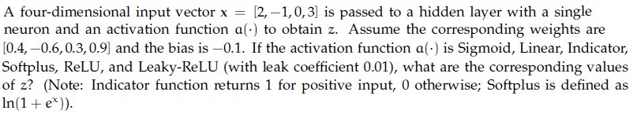

**Figure 7.** Input vector and activation function problem statement for Question 161.

**Options**

**A.** 0.9820, 4.00, 1, 4.02, 4.00, 4.00  
*Option ID:* `6406534313857`

**B.** 0.8808, 3.50, 1, 3.54, 3.50, 3.50  
*Option ID:* `6406534313858`

**C.** 0.7311, 2.00, 1, 2.13, 2.00, 2.00  
*Option ID:* `6406534313859`

**D.** 0.5000, 0.00, 0, 0.69, 0.00, 0.00  
*Option ID:* `6406534313860`

**Correct answer:** **A** — 0.9820, 4.00, 1, 4.02, 4.00, 4.00.  
**Source evidence:** Option 6406534313857 rendered in green text (color 0x8000) on PDF page 5.

---

### Question 162

**Question ID:** `6406531279504` · **Type:** MCQ · **Marks:** 2  
**PDF pages:** 5

Identify the correct sequence of steps in a Canny edge detection pipeline. Steps are listed below:

1. Compute gradient magnitude and direction  
2. Connect individual components  
3. Smoothen the image  
4. Threshold into strong, weak, or no edge  
5. Gaussian Filter and Hysteresis  
6. Non-maximum suppression  
7. Apply derivative to get edges  

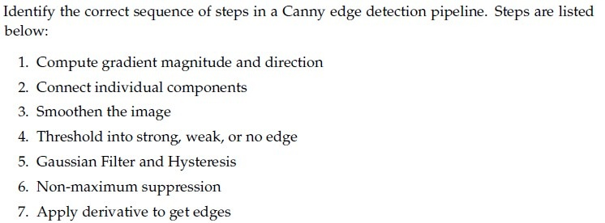

**Figure 8.** Canny edge detection pipeline steps for Question 162.

**Options**

**A.** 6 -> 1 -> 4 -> 5 -> 2

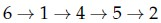

**Figure 9.** Option A candidate sequence for Question 162.  
*Option ID:* `6406534313861`

**B.** 3 -> 1 -> 6 -> 4 -> 2

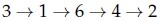

**Figure 10.** Option B candidate sequence for Question 162.  
*Option ID:* `6406534313862`

**C.** 3 -> 7 -> 6 -> 4 -> 2

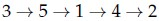

**Figure 11.** Option C candidate sequence for Question 162.  
*Option ID:* `6406534313863`

**D.** 6 -> 1 -> 5 -> 7 -> 2

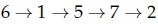

**Figure 12.** Option D candidate sequence for Question 162.  
*Option ID:* `6406534313864`

**Correct answer:** **B** — 3 -> 1 -> 6 -> 4 -> 2.  
**Source evidence:** Option 6406534313862 rendered in green text (color 0x8000) on PDF page 5.

---

### Question 163

**Question ID:** `6406531279505` · **Type:** MCQ · **Marks:** 2  
**PDF pages:** 6

Identify the correct sequence of steps in Scale Invariant Feature Transform (SIFT) method. Steps listed below:

1. Keypoint Descriptor  
2. Keypoint Localization  
3. Scale-space Extrema Detection  
4. Orientation Estimation  

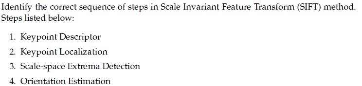

**Figure 13.** SIFT pipeline steps for Question 163.

**Options**

**A.** 4 -> 2 -> 1 -> 3

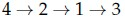

**Figure 14.** Option A candidate sequence for Question 163.  
*Option ID:* `6406534313865`

**B.** 3 -> 2 -> 4 -> 1

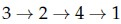

**Figure 15.** Option B candidate sequence for Question 163.  
*Option ID:* `6406534313866`

**C.** 3 -> 1 -> 2 -> 4

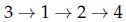

**Figure 16.** Option C candidate sequence for Question 163.  
*Option ID:* `6406534313867`

**D.** None of these.

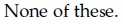

**Figure 17.** Option D statement for Question 163.  
*Option ID:* `6406534313868`

**Correct answer:** **B** — 3 -> 2 -> 4 -> 1.  
**Source evidence:** Option 6406534313866 rendered in green text (color 0x8000) on PDF page 6.

---

### Question 164

**Question ID:** `6406531279506` · **Type:** MCQ · **Marks:** 2  
**PDF pages:** 6

During the double thresholding step in Canny edge detection, the high threshold is set at 100 and the low threshold is 40. A pixel gradient magnitude of 65 will be classified as:

**Options**

**A.** Strong edge  
*Option ID:* `6406534313869`

**B.** Weak edge  
*Option ID:* `6406534313870`

**C.** Non-edge  
*Option ID:* `6406534313871`

**D.** Ambiguous edge  
*Option ID:* `6406534313872`

**Correct answer:** **B** — Weak edge.  
**Source evidence:** Option 6406534313870 rendered in green text (color 0x8000) on PDF page 6.

---

### Question 165

**Question ID:** `6406531279507` · **Type:** MCQ · **Marks:** 2  
**PDF pages:** 7

Match the derivative of activation functions $f(x)$ with their counterparts on the right column accordingly.

1) Leaky ReLU  
2) Tanh  
3) ReLU  
4) Sigmoid  

Right column:

i) $f(x)(1 - f(x))$  
ii) $0 \text{ if } x < 0 \text{ and } 1 \text{ if } x > 0$  
iii) $1 - f(x)^2$  
iv) $0.01 \text{ if } x < 0 \text{ and } 1 \text{ if } x > 0$  
v) $0 \text{ if } x > 0 \text{ and } 1 \text{ if } x < 0$  
vi) $0.01 \text{ if } x > 0 \text{ and } 1 \text{ if } x < 0$  

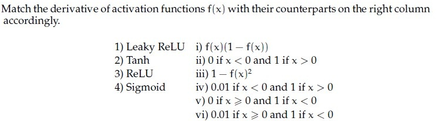

**Figure 18.** Activation function derivative matching problem statement for Question 165.

**Options**

**A.** 1 -> vi, 2 -> iii, 3 -> v, 4 -> i

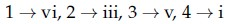

**Figure 19.** Option A candidate mapping for Question 165.  
*Option ID:* `6406534313873`

**B.** 1 -> i, 2 -> iv, 3 -> iii, 4 -> ii

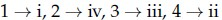

**Figure 20.** Option B candidate mapping for Question 165.  
*Option ID:* `6406534313874`

**C.** 1 -> i, 2 -> v, 3 -> iii, 4 -> iv

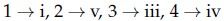

**Figure 21.** Option C candidate mapping for Question 165.  
*Option ID:* `6406534313875`

**D.** 1 -> iv, 2 -> iii, 3 -> ii, 4 -> i

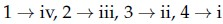

**Figure 22.** Option D candidate mapping for Question 165.  
*Option ID:* `6406534313876`

**Correct answer:** **D** — 1 -> iv, 2 -> iii, 3 -> ii, 4 -> i.  
**Source evidence:** Option 6406534313876 rendered in green text (color 0x8000) on PDF page 7.

---

### Question 166

**Question ID:** `6406531279508` · **Type:** MCQ · **Marks:** 2  
**PDF pages:** 7

Consider a Convolutional Neural Network which processes an RGB image. It has 128 kernels each of spatial dimension 5 x 5 in the first layer. They are convolved with a stride 1. This is followed by a max-pooling layer with stride 2 and kernel size 5 x 5. What would be the receptive field size of a single neuron in the pooling layer? (Recap: A receptive field is the size of the region in the input image, which influences the activation of that specific neuron.)

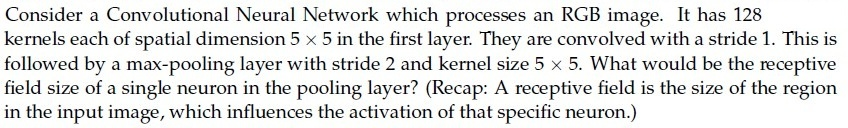

**Figure 23.** CNN receptive field problem statement for Question 166.

**Options**

**A.** 5x5

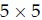

**Figure 24.** Option A receptive field size for Question 166.  
*Option ID:* `6406534313877`

**B.** 7x7

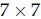

**Figure 25.** Option B receptive field size for Question 166.  
*Option ID:* `6406534313878`

**C.** 9x9

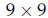

**Figure 26.** Option C receptive field size for Question 166.  
*Option ID:* `6406534313879`

**D.** 3x3

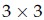

**Figure 27.** Option D receptive field size for Question 166.  
*Option ID:* `6406534313880`

**Correct answer:** **C** — 9x9.  
**Source evidence:** Option 6406534313879 rendered in green text (color 0x8000) on PDF page 7.

---

### Question 167

**Question ID:** `6406531279509` · **Type:** MCQ · **Marks:** 2  
**PDF pages:** 8

Which of the following statements are True?

**Options**

**A.** Vanilla Gradient Descent converges faster than Momentum-based GD.  
*Option ID:* `6406534313881`

**B.** Momentum based GD oscillates around minima before convergence.  
*Option ID:* `6406534313882`

**C.** Noise in Stochastic Gradient descent weight updates – can lead to faster convergence.  
*Option ID:* `6406534313883`

**D.** None of these  
*Option ID:* `6406534313884`

**Correct answer:** **B** — Momentum based GD oscillates around minima before convergence..  
**Source evidence:** Option 6406534313882 rendered in green text (color 0x8000) on PDF page 8.

---

### Question 168

**Question ID:** `6406531279510` · **Type:** MCQ · **Marks:** 2  
**PDF pages:** 8

In the Gaussian smoothing step of the Canny edge detector, a Gaussian kernel of size 5 x 5 with standard deviation $\sigma$ is used to reduce noise. If the standard deviation $\sigma = 1.0$, what is the approximate value of the center weight in the Gaussian kernel? [Use the formula for Gaussian kernel weight at the center: $G(0, 0) = \frac{1}{2\pi \sigma^2}$].

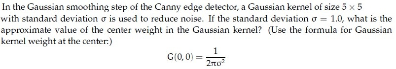

**Figure 28.** Gaussian kernel center weight problem statement for Question 168.

**Options**

**A.** 0.16  
*Option ID:* `6406534313885`

**B.** 0.08  
*Option ID:* `6406534313886`

**C.** 0.20  
*Option ID:* `6406534313887`

**D.** 0.12  
*Option ID:* `6406534313888`

**Correct answer:** **A** — 0.16.  
**Source evidence:** Option 6406534313885 rendered in green text (color 0x8000) on PDF page 8.

---

### Question 169

**Question ID:** `6406531279511` · **Type:** MCQ · **Marks:** 2  
**PDF pages:** 9

Match the following.

1) Gaussian Filter  
2) Sobel Filter  
3) First derivative of Gaussian  
4) Second derivative of Gaussian  

Right column:

i) Edges found when gradient is low  
ii) Edges found at zero crossing  
iii) Edge smoothing  
iv) Edge detection  
v) Edges found when gradient is high  

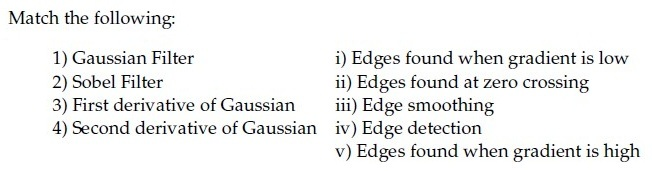

**Figure 29.** Filter type and property matching table for Question 169.

**Options**

**A.** 1 -> iii, 2 -> iv, 3 -> i, 4 -> ii

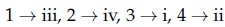

**Figure 30.** Option A candidate mapping for Question 169.  
*Option ID:* `6406534313889`

**B.** 1 -> iii, 2 -> i, 3 -> ii, 4 -> v

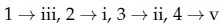

**Figure 31.** Option B candidate mapping for Question 169.  
*Option ID:* `6406534313890`

**C.** 1 -> iii, 2 -> iv, 3 -> v, 4 -> ii

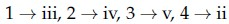

**Figure 32.** Option C candidate mapping for Question 169.  
*Option ID:* `6406534313891`

**D.** 1 -> iv, 2 -> iii, 3 -> i, 4 -> ii

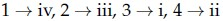

**Figure 33.** Option D candidate mapping for Question 169.  
*Option ID:* `6406534313892`

**Correct answer:** **C** — 1 -> iii, 2 -> iv, 3 -> v, 4 -> ii.  
**Source evidence:** Option 6406534313891 rendered in green text (color 0x8000) on PDF page 9.

---

### Question 170

**Question ID:** `6406531279512` · **Type:** MCQ · **Marks:** 2  
**PDF pages:** 9

Match the Following.

1) Flat region in the image  
2) Edge pixel  
3) Corner pixel  

Right column:

i) No Change along the edge direction  
ii) Significant change in all directions  
iii) No Change in all directions  

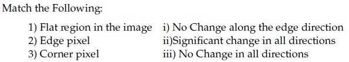

**Figure 34.** Image region feature matching table for Question 170.

**Options**

**A.** 1 -> iii, 2 -> i, 3 -> ii

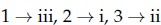

**Figure 35.** Option A candidate mapping for Question 170.  
*Option ID:* `6406534313893`

**B.** 1 -> iii, 2 -> ii, 3 -> i

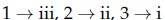

**Figure 36.** Option B candidate mapping for Question 170.  
*Option ID:* `6406534313894`

**C.** 1 -> ii, 2 -> iii, 3 -> ii

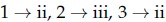

**Figure 37.** Option C candidate mapping for Question 170.  
*Option ID:* `6406534313895`

**D.** None of these.

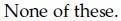

**Figure 38.** Option D statement for Question 170.  
*Option ID:* `6406534313896`

**Correct answer:** **A** — 1 -> iii, 2 -> i, 3 -> ii.  
**Source evidence:** Option 6406534313893 rendered in green text (color 0x8000) on PDF page 9.

---

### Question 171

**Question ID:** `6406531279513` · **Type:** MSQ · **Marks:** 3  
**PDF pages:** 10

Which of the following statements are true?(Select all that apply)

**Options**

**A.** tanh activation function can be expressed in terms of the sigmoid activation function as: $\tanh(x) = 2\sigma(2x) - 1$, where $\sigma$ is the sigmoid activation function.

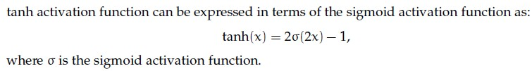

**Figure 39.** Option A candidate statement for Question 171.  
*Option ID:* `6406534313897`

**B.** The derivative of the sigmoid activation function is symmetric around the origin.

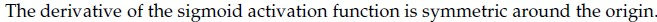

**Figure 40.** Option B candidate statement for Question 171.  
*Option ID:* `6406534313898`

**C.** The gradient of a sigmoid neuron at saturation tends to explode.

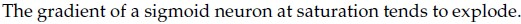

**Figure 41.** Option C candidate statement for Question 171.  
*Option ID:* `6406534313899`

**D.** The sigmoid activation function is centered around 0.5, whereas the tanh activation function is centered around 0.

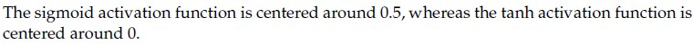

**Figure 42.** Option D candidate statement for Question 171.  
*Option ID:* `6406534313900`

**Correct answer:** **A, D**  
**Source evidence:** Option 6406534313897 rendered in green text (color 0x8000) on PDF page 10; Option 6406534313900 rendered in green text (color 0x8000) on PDF page 10.

---

### Question 172

**Question ID:** `6406531279514` · **Type:** MSQ · **Marks:** 3  
**PDF pages:** 10

Which of the following statements are true ?(Select all that apply)

**Options**

**A.** To obtain an output of the same spatial size as the input after a convolution with kernel size $k \times k$ (where $k$ is odd) and stride 1, the padding used should be $\frac{k-1}{2}$.

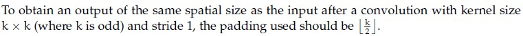

**Figure 43.** Option A candidate statement for Question 172.  
*Option ID:* `6406534313901`

**B.** The derivative of the loss $L$ with respect to the input image $X$, where $Y = X * W$, is given by $\frac{\partial L}{\partial X}[i, j] = \frac{\partial L}{\partial Y} \star W$, where $*$ denotes convolution and $\star$ denotes correlation.

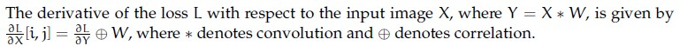

**Figure 44.** Option B candidate statement for Question 172.  
*Option ID:* `6406534313902`

**C.** The number of learnable parameters in a pooling layer is not zero.

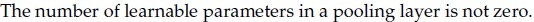

**Figure 45.** Option C candidate statement for Question 172.  
*Option ID:* `6406534313903`

**D.** The number of feature maps obtained after a convolution operation depends on the depth of the input but not on the number of filters.

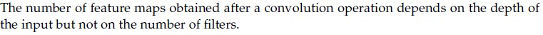

**Figure 46.** Option D candidate statement for Question 172.  
*Option ID:* `6406534313904`

**Correct answer:** **A, B**  
**Source evidence:** Option 6406534313901 rendered in green text (color 0x8000) on PDF page 10; Option 6406534313902 rendered in green text (color 0x8000) on PDF page 10.

---

### Question 173

**Question ID:** `6406531279515` · **Type:** MSQ · **Marks:** 3  
**PDF pages:** 11

Consider the following statements. Which of the following statements are true?

**Options**

**A.** Convolution operator is both commutative and associative.

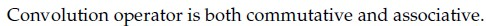

**Figure 47.** Option A candidate statement for Question 173.  
*Option ID:* `6406534313905`

**B.** Fourier transform of a convolved image $\mathcal{F}\{a * b\}$ is not the product of the Fourier transforms of the constituent images $\mathcal{F}\{a\} \times \mathcal{F}\{b\}$.

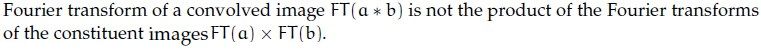

**Figure 48.** Option B candidate statement for Question 173.  
*Option ID:* `6406534313906`

**C.** Convolution in the spatial domain corresponds to multiplication in the frequency domain.

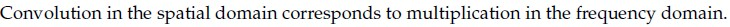

**Figure 49.** Option C candidate statement for Question 173.  
*Option ID:* `6406534313907`

**D.** The Fourier transform of a convolution is equal to the product of the individual Fourier transforms only for linear, time-invariant systems.

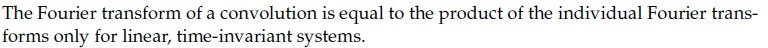

**Figure 50.** Option D candidate statement for Question 173.  
*Option ID:* `6406534313908`

**E.** Correlation and convolution are the same if one of the signals/images is symmetric.


**Figure 51.** Option E candidate statement for Question 173.  
*Option ID:* `6406534313909`

**F.** The Fourier transform is a linear operator.


**Figure 52.** Option F candidate statement for Question 173.  
*Option ID:* `6406534313910`

**Correct answer:** **A, C, E, F**  
**Source evidence:** Option 6406534313905 rendered in green text (color 0x8000) on PDF page 11; Option 6406534313907 rendered in green text (color 0x8000) on PDF page 11; Option 6406534313909 rendered in green text (color 0x8000) on PDF page 11; Option 6406534313910 rendered in green text (color 0x8000) on PDF page 11.

---

### Question 174

**Question ID:** `6406531279516` · **Type:** MSQ · **Marks:** 3  
**PDF pages:** 12

Certain 2D kernel $K$ can be decomposed into two 1D kernels ($v$ and $h^T$) to reduce the computation cost such as $K = v h^T$. The 2D kernel is called as Separable Kernel.

Consider the following 2D kernels:

Which of the below kernels are separable?


**Figure 53.** Separable kernel problem statement for Question 174.

**Options**

**A.** $$\begin{bmatrix} 2 & 4 & 6 \\ 3 & 6 & 9 \\ 1 & 2 & 3 \end{bmatrix}$$


**Figure 54.** Option A kernel matrix for Question 174.  
*Option ID:* `6406534313911`

**B.** $$\begin{bmatrix} 2 & 4 & 6 \\ 3 & 6 & 9 \\ 2 & 3 & 4 \end{bmatrix}$$


**Figure 55.** Option B kernel matrix for Question 174.  
*Option ID:* `6406534313912`

**C.** $$\begin{bmatrix} 5 & 0 & 5 \\ 10 & 0 & 10 \\ -5 & 0 & 5 \end{bmatrix}$$


**Figure 56.** Option C kernel matrix for Question 174.  
*Option ID:* `6406534313913`

**D.** $$\begin{bmatrix} 5 & 0 & 5 \\ 10 & 0 & 10 \\ -5 & 0 & -5 \end{bmatrix}$$


**Figure 57.** Option D kernel matrix for Question 174.  
*Option ID:* `6406534313914`

**Correct answer:** **A, D**  
**Source evidence:** Option 6406534313911 rendered in green text (color 0x8000) on PDF page 12; Option 6406534313914 rendered in green text (color 0x8000) on PDF page 12.

---

### Question 175

**Question ID:** `6406531279517` · **Type:** MSQ · **Marks:** 3  
**PDF pages:** 12

Which of the following statements are false?

**Options**

**A.** Momentum in optimization can cause oscillations around minima when encountering flat regions or saddle points due to the dominance of the momentum term over the small gradient.  
*Option ID:* `6406534313915`

**B.** Stochastic Gradient Descent (SGD) with its inherent noise can be beneficial in escaping local minima and saddle points, provided that there is enough gradient information in the neighborhood.  
*Option ID:* `6406534313916`

**C.** Adagrad is an optimization algorithm introduced to overcome the diminishing learning rate problem in techniques like RMSProp.  
*Option ID:* `6406534313917`

**D.** ADAM is introduced to solve problems in RMSProp by combining RMSProp and Adagrad techniques.  
*Option ID:* `6406534313918`

**Correct answer:** **C, D**  
**Source evidence:** Option 6406534313917 rendered in green text (color 0x8000) on PDF page 12; Option 6406534313918 rendered in green text (color 0x8000) on PDF page 12.

---

### Question 176

**Question ID:** `6406531279518` · **Type:** SA · **Marks:** 3  
**PDF pages:** 13

Consider the grayscale image shown below:

$$\begin{bmatrix} 12 & 18 & 22 & 25 & 30 \\ 20 & 15 & 17 & 21 & 23 \\ 25 & 19 & 20 & 24 & 28 \\ 27 & 22 & 23 & 18 & 20 \\ 30 & 24 & 21 & 19 & 25 \end{bmatrix}$$

If a median filter with a $3 \times 3$ neighborhood is applied to this image with a stride of 1 and no padding, _____ will be the value at position (3, 3) in the filtered image? (Assume that the top-left pixel coordinate of the output image is addressed as (1, 1)).


**Figure 58.** Grayscale pixel matrix for Question 176.

**Correct answer:** `20`  
**Source evidence:** Official answer '20' specified in Possible Answers field with green text (color 0x8000) on PDF page 13.

---

### Question 177

**Question ID:** `6406531279519` · **Type:** SA · **Marks:** 3  
**PDF pages:** 14

Consider the following discrete approximations of second derivative:

$$\frac{\partial^2 f(x, y)}{\partial x^2} = - f(x+1, y) - f(x-1, y) + 2 f(x, y)$$

$$\frac{\partial^2 f(x, y)}{\partial y^2} = - f(x, y+1) - f(x, y-1) + 2 f(x, y)$$

The middle element of the Laplacian of the Gaussian (LoG) filter will be _____?


**Figure 59.** Second derivative discrete approximations for Question 177.

**Correct answer:** `4`  
**Source evidence:** Official answer '4' specified in Possible Answers field with green text (color 0x8000) on PDF page 14.

---

### Question 178

**Question ID:** `6406531279520` · **Type:** SA · **Marks:** 3  
**PDF pages:** 14

Given a 2 x 2 second moment matrix of edge pixel $M = \begin{bmatrix} 1 & 2 \\ 2 & 1 \end{bmatrix}$ obtained during the Canny edge detection process, compute the measure of straightness defined as:

$$\text{Straightness} = \frac{\lambda_{\min} - \lambda_{\max}}{\lambda_{\max} + \lambda_{\min}}$$

where $\lambda_{\max}$ and $\lambda_{\min}$ are the maximum and minimum eigenvalues of $M$ respectively.

The value of the straightness is _____?


**Figure 60.** Second moment matrix and straightness formula for Question 178.

**Correct answer:** `-2`  
**Source evidence:** Official answer '-2' specified in Possible Answers field with green text (color 0x8000) on PDF page 14.

---

### Question 179

**Question ID:** `6406531279530` · **Type:** SA · **Marks:** 3  
**PDF pages:** 15

In backpropagation through a convolutional layer, if the gradient of the loss with respect to the output feature map $\frac{\partial L}{\partial Y}$ is known, and the filter weights $W$ have size $3 \times 3$, stride 1, and no padding, what is the size of the gradient with respect to the input $\frac{\partial L}{\partial X}$, given that $\frac{\partial L}{\partial Y}$ has dimensions $26 \times 26 \times 5$?

Assume if the size of gradient is $F \times F \times d$, then give the value of $F$.


**Figure 61.** Convolution backpropagation gradient dimension problem statement for Question 179.

**Correct answer:** `28`  
**Source evidence:** Official answer '28' specified in Possible Answers field with green text (color 0x8000) on PDF page 15.

---

### Question 180

**Question ID:** `6406531279531` · **Type:** SA · **Marks:** 3  
**PDF pages:** 15

What is the size of the feature map after applying two successive convolution operations with the following parameters? Input image size = $128 \times 128$, Kernel size = $5 \times 5$, Padding = 1, Stride = 4. (In calculation, take $\lfloor x \rfloor$ whenever $x$ is non-integer. If the answer is $F \times F$, write only $F$ in the blank.)


**Figure 62.** Successive convolution feature map size problem statement for Question 180.

**Correct answer:** `8`  
**Source evidence:** Official answer '8' specified in Possible Answers field with green text (color 0x8000) on PDF page 15.

---

### Question 181

**Question ID:** `6406531279532` · **Type:** SA · **Marks:** 3  
**PDF pages:** 16

Let an input to a convolutional layer in a CNN have size $D_f \times D_f \times M$, where $D_f = 28$ and $M = 120$. The output feature map after the convolution has size $D_f \times D_f \times N$, where $N = 80$. The kernel size of the convolution layer is $k \times k$, with $k = 3$.

Calculate the number of parameters for this convolution layer. (Assume appropriate padding is applied so that input and output spatial sizes remain the same. Ignore bias terms.)


**Figure 63.** CNN convolution layer parameter calculation problem statement for Question 181.

**Correct answer:** `86400`  
**Source evidence:** Official answer '86400' specified in Possible Answers field with green text (color 0x8000) on PDF page 16.

---

### Question 182

**Question ID:** `6406531279533` · **Type:** SA · **Marks:** 3  
**PDF pages:** 16

Using momentum-based gradient descent, find the new value of the parameter $\theta_{t+1}$, given that the old value $\theta_t = 0.5$, gradient of loss function $\nabla_{\theta_t} L(\theta_t) = 0.2$, velocity term $V_{t-1} = 0.7$, learning rate $\alpha = 0.75$ and momentum term $\gamma = 0.8$ (Round decimal point till 3 places) [Note: Assume that there is no bias].


**Figure 64.** Momentum-based gradient descent parameter update for Question 182.

**Correct answer:** `-0.260 to -0.210`  
**Source evidence:** Official accepted answer range '-0.260 to -0.210' specified in Possible Answers field with green text (color 0x8000) on PDF page 16.

---

### Question 183

**Question ID:** `6406531279534` · **Type:** SA · **Marks:** 3  
**PDF pages:** 17

Consider the following numpy array:

```python
arr = np.array([[5, 6], [7, 8]])
```

Now consider the following operations:

```python
copied_arr = arr.copy()
copied_arr[0, 0] = 100
```

Write the value of `arr[0, 0]`.


**Figure 65.** Numpy array copy operation for Question 183.

**Correct answer:** `5`  
**Source evidence:** Official answer '5' specified in Possible Answers field with green text (color 0x8000) on PDF page 17.

---

### Question 184

**Question ID:** `6406531279535` · **Type:** SA · **Marks:** 3  
**PDF pages:** 18

Consider the following numpy array:

```python
arr = np.array([[1, 2], [3, 4]])
```

Now consider the following operations:

```python
viewed_arr = arr.view()
viewed_arr[0, 1] = 99
```

Write the value of `arr[0, 1]`.


**Figure 66.** Numpy array view operation for Question 184.

**Correct answer:** `99`  
**Source evidence:** Official answer '99' specified in Possible Answers field with green text (color 0x8000) on PDF page 18.

---

### Question 185

**Question ID:** `6406531279522` · **Type:** SA · **Marks:** 1.5  
**PDF pages:** 19

**Shared Comprehension Context (Question ID: `6406531279521`):**

> The gradient of an image I points in the direction of the most rapid change in intensity. Taking image derivatives accentuates (a)_________________ frequencies and hence amplifies noise, since the proportion of noise to signal is larger at (b) _________________frequencies. The common solution is to smooth the image prior to computing gradients.
>
> Based on the above data, answer the given subquestions.

Enter the correct answer for Blank (a):

NOTE: Enter the exact answer without any extra space in the beginning or at the end.

**Correct answer:** `high, higher, large, largest` (accepted set; case-insensitive)  
**Source evidence:** Official accepted answer set 'high', 'higher', 'large', 'largest' (Evaluation Required: Yes, Answers Type: Set, Case Sensitive: No) specified in Possible Answers field with green text (color 0x8000) on PDF page 19.

---

### Question 186

**Question ID:** `6406531279523` · **Type:** SA · **Marks:** 1.5  
**PDF pages:** 19, 20

**Shared Comprehension Context (Question ID: `6406531279521`):**

> The gradient of an image I points in the direction of the most rapid change in intensity. Taking image derivatives accentuates (a)_________________ frequencies and hence amplifies noise, since the proportion of noise to signal is larger at (b) _________________frequencies. The common solution is to smooth the image prior to computing gradients.
>
> Based on the above data, answer the given subquestions.

Enter the correct answer for Blank (b):

NOTE: Enter the exact answer without any extra space in the beginning or at the end.

**Correct answer:** `high, higher, large, largest` (accepted set; case-insensitive)  
**Source evidence:** Official accepted answer set 'high', 'higher', 'large', 'largest' (Evaluation Required: Yes, Answers Type: Set, Case Sensitive: No) specified in Possible Answers field with green text (color 0x8000) on PDF page 20.

---

### Question 187

**Question ID:** `6406531279525` · **Type:** SA · **Marks:** 1.5  
**PDF pages:** 21

**Shared Comprehension Context (Question ID: `6406531279524`):**

> In Canny edge detection, a large value of the Gaussian kernel spread $\sigma$ leads to (a)________________ edges, while a small value of $\sigma$ leads to (b)_________________ edges.
>
> Based on the above data, answer the given subquestions.

Enter the correct answer for Blank (a) :

NOTE: Enter the exact answer without any extra space in the beginning or at the end.

**Correct answer:** `thick, coarse, large-scale` (accepted set; case-insensitive)  
**Source evidence:** Official accepted answer set 'thick', 'coarse', 'large-scale' (Evaluation Required: Yes, Answers Type: Set, Case Sensitive: No) specified in Possible Answers field with green text (color 0x8000) on PDF page 21.

---

### Question 188

**Question ID:** `6406531279526` · **Type:** SA · **Marks:** 1.5  
**PDF pages:** 21

**Shared Comprehension Context (Question ID: `6406531279524`):**

> In Canny edge detection, a large value of the Gaussian kernel spread $\sigma$ leads to (a)________________ edges, while a small value of $\sigma$ leads to (b)_________________ edges.
>
> Based on the above data, answer the given subquestions.

Enter the correct answer for Blank (b) :

NOTE: Enter the exact answer without any extra space in the beginning or at the end.

**Correct answer:** `fine, thin` (accepted set; case-insensitive)  
**Source evidence:** Official accepted answer set 'fine', 'thin' (Evaluation Required: Yes, Answers Type: Set, Case Sensitive: No) specified in Possible Answers field with green text (color 0x8000) on PDF page 21.

---

### Question 189

**Question ID:** `6406531279528` · **Type:** SA · **Marks:** 1.5  
**PDF pages:** 22

**Shared Comprehension Context (Question ID: `6406531279527`):**

> You have a visual codebook with 1500 visual words. From a test image, you extract 1200 SIFT descriptors, each of 128 dimensions. After assigning each descriptor to its nearest visual word, you compute the Bag-of-Words histogram by counting descriptor assignments.
>
> Based on the above data, answer the given subquestions.

What is the dimensionality of the Bag-of-Words (BoW) feature vector for this image?________________

**Correct answer:** `1500`  
**Source evidence:** Official answer '1500' specified in Possible Answers field with green text (color 0x8000) on PDF page 22.

---

### Question 190

**Question ID:** `6406531279529` · **Type:** SA · **Marks:** 1.5  
**PDF pages:** 22

**Shared Comprehension Context (Question ID: `6406531279527`):**

> You have a visual codebook with 1500 visual words. From a test image, you extract 1200 SIFT descriptors, each of 128 dimensions. After assigning each descriptor to its nearest visual word, you compute the Bag-of-Words histogram by counting descriptor assignments.
>
> Based on the above data, answer the given subquestions.

If instead, you concatenate all the 1200 descriptors into a single vector (without using BoW), what will be the dimensionality of that vector?__________________

**Correct answer:** `153600`  
**Source evidence:** Official answer '153600' specified in Possible Answers field with green text (color 0x8000) on PDF page 22.

---

## Answer key

| Source question | Question ID | Correct answer | PDF page(s) |
| :--- | :--- | :--- | :--- |
| 157 | `6406531279499` | A | 2 |
| 158 | `6406531279500` | D | 3 |
| 159 | `6406531279501` | A | 3 |
| 160 | `6406531279502` | A | 4 |
| 161 | `6406531279503` | A | 5 |
| 162 | `6406531279504` | B | 5 |
| 163 | `6406531279505` | B | 6 |
| 164 | `6406531279506` | B | 6 |
| 165 | `6406531279507` | D | 7 |
| 166 | `6406531279508` | C | 7 |
| 167 | `6406531279509` | B | 8 |
| 168 | `6406531279510` | A | 8 |
| 169 | `6406531279511` | C | 9 |
| 170 | `6406531279512` | A | 9 |
| 171 | `6406531279513` | A, D | 10 |
| 172 | `6406531279514` | A, B | 10 |
| 173 | `6406531279515` | A, C, E, F | 11 |
| 174 | `6406531279516` | A, D | 12 |
| 175 | `6406531279517` | C, D | 12 |
| 176 | `6406531279518` | 20 | 13 |
| 177 | `6406531279519` | 4 | 14 |
| 178 | `6406531279520` | -2 | 14 |
| 179 | `6406531279530` | 28 | 15 |
| 180 | `6406531279531` | 8 | 15 |
| 181 | `6406531279532` | 86400 | 16 |
| 182 | `6406531279533` | -0.260 to -0.210 | 16 |
| 183 | `6406531279534` | 5 | 17 |
| 184 | `6406531279535` | 99 | 18 |
| 185 | `6406531279522` | high, higher, large, largest | 19 |
| 186 | `6406531279523` | high, higher, large, largest | 19, 20 |
| 187 | `6406531279525` | thick, coarse, large-scale | 21 |
| 188 | `6406531279526` | fine, thin | 21 |
| 189 | `6406531279528` | 1500 | 22 |
| 190 | `6406531279529` | 153600 | 22 |

## Extraction notes

- **Scope boundaries:** The DL(CV) section begins on Page 1 at the `DL(CV)` section header (Section Id 64065391702, Section Number 9) and concludes on Page 22 at the end of Question 190. The Section 8 NLP remnant text at the top of Page 1 (Question 155 ID 6406531279497) and the Section 10 Mathematical Foundations of Generative AI material starting on Page 22 at bottom (Section Id 64065391703) have been strictly excluded.
- **Administrative confirmation excluded:** Question 156 on Page 2 (Question Id 6406531279498, 0 marks), the administrative subject verification prompt, is excluded in accordance with extraction requirements.
- **Question count reconciliation:** The Section 9 header declares 32 questions and 79 marks. This corresponds to 1 excluded confirmation question, 28 standalone questions (Q157–Q170 MCQ at 2 marks = 28 marks; Q171–Q175 MSQ at 3 marks = 15 marks; Q176–Q184 SA at 3 marks = 27 marks), and 3 comprehension passages (treated as parent units toward the 32 declared count). Inside the 3 comprehension passages are 6 subquestions (Q185–Q186, Q187–Q188, Q189–Q190 at 1.5 marks each = 9 marks), resulting in exactly 34 academic questions summing to 28 + 15 + 27 + 9 = 79 marks, exactly matching declared section marks.
- **MSQ questions:** Question 171 has two correct options (A, D); Question 172 has two correct options (A, B); Question 173 has four correct options (A, C, E, F); Question 174 has two correct options (A, D); Question 175 has two correct options (C, D). All marked correct options are preserved with exact option IDs and source evidence.
- **Accepted ranges and alternatives:** Question 182 accepts range `-0.260 to -0.210` (momentum parameter update); Question 185 and 186 accept `high`, `higher`, `large`, or `largest`; Question 187 accepts `thick`, `coarse`, or `large-scale`; Question 188 accepts `fine` or `thin`. All source alternatives and conditions are faithfully preserved.
- **Figure preservation & mathematical fidelity:** All 66 embedded raster diagrams, matching tables, and candidate options have been extracted at native resolution, saved to assets/da5006_2025T2_Q1_NA/, sequentially captioned (Figure 1 to Figure 66), and visually verified against original PDF renders.
