# DL(CV) — da5006_2025T2_Q2_NA

**Subject:** Deep Learning for Computer Vision  
**Source:** `da5006_2025T2_Q2_NA.pdf` (original PDF omitted from this bundle)  
**Academic questions:** 52  
**Scope:** DL(CV) section; administrative subject confirmation excluded.

## Questions

### Question 234

**Question ID:** `6406531333785` · **Type:** MCQ · **Marks:** 2  
**PDF pages:** 1, 2

The integral image of the image:

$$\begin{bmatrix} 4 & 5 & 2 & 1 \\ 0 & 9 & 3 & 2 \\ 5 & 6 & 8 & 1 \\ 2 & 3 & 0 & 0 \end{bmatrix}$$

is?

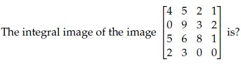

**Figure 1.** Source image matrix for Question 234.

**Options**

**A.** $$\begin{bmatrix} 4 & 9 & 11 & 12 \\ 4 & 18 & 23 & 26 \\ 9 & 29 & 42 & 46 \\ 11 & 34 & 47 & 51 \end{bmatrix}$$

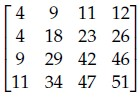

**Figure 2.** Option A matrix for Question 234.  
*Option ID:* `6406534459585`

**B.** $$\begin{bmatrix} 4 & 5 & 11 & 12 \\ 4 & 18 & 23 & 26 \\ 5 & 24 & 42 & 46 \\ 11 & 34 & 47 & 51 \end{bmatrix}$$

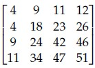

**Figure 3.** Option B matrix for Question 234.  
*Option ID:* `6406534459586`

**C.** $$\begin{bmatrix} 4 & 9 & 11 & 12 \\ 4 & 18 & 23 & 26 \\ 9 & 29 & 42 & 40 \\ 11 & 34 & 47 & 51 \end{bmatrix}$$

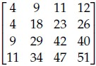

**Figure 4.** Option C matrix for Question 234.  
*Option ID:* `6406534459587`

**D.** $$\begin{bmatrix} 4 & 9 & 11 & 12 \\ 4 & 18 & 23 & 26 \\ 9 & 29 & 42 & 46 \\ 11 & 34 & 34 & 47 \end{bmatrix}$$

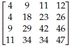

**Figure 5.** Option D matrix for Question 234.  
*Option ID:* `6406534459588`

**Correct answer:** **A** — Option A integral image matrix  
**Source evidence:** Green option ID text 6406534459585 with green check icon at [119.02, 615.18, 131.02, 627.18].

---

### Question 235

**Question ID:** `6406531333786` · **Type:** MCQ · **Marks:** 2  
**PDF pages:** 2

Which of the following architectures introduced the ROI pooling layer for extracting fixed-size feature maps from variable-size region proposals?

**Options**

**A.** R-CNN  
*Option ID:* `6406534459589`

**B.** Fast R-CNN  
*Option ID:* `6406534459590`

**C.** Faster R-CNN  
*Option ID:* `6406534459591`

**D.** YOLO  
*Option ID:* `6406534459592`

**Correct answer:** **B** — Fast R-CNN  
**Source evidence:** Green option ID text 6406534459590 and option text 'Fast R-CNN' with green check icon at [119.02, 291.52, 131.02, 303.52].

---

### Question 236

**Question ID:** `6406531333787` · **Type:** MCQ · **Marks:** 2  
**PDF pages:** 2

Which object detection method first integrated a Region Proposal Network (RPN) to generate region proposals within the detection model?

**Options**

**A.** R-CNN  
*Option ID:* `6406534459593`

**B.** Fast R-CNN  
*Option ID:* `6406534459594`

**C.** Faster R-CNN  
*Option ID:* `6406534459595`

**D.** YOLO  
*Option ID:* `6406534459596`

**Correct answer:** **C** — Faster R-CNN  
**Source evidence:** Green option ID text 6406534459595 and option text 'Faster R-CNN' with green check icon at [119.02, 532.36, 131.02, 544.36].

---

### Question 237

**Question ID:** `6406531333788` · **Type:** MCQ · **Marks:** 2  
**PDF pages:** 2

Which architecture performs object detection as a single regression problem from image pixels to bounding boxes and class probabilities?

**Options**

**A.** R-CNN  
*Option ID:* `6406534459597`

**B.** Fast R-CNN  
*Option ID:* `6406534459598`

**C.** Faster R-CNN  
*Option ID:* `6406534459599`

**D.** YOLO  
*Option ID:* `6406534459600`

**Correct answer:** **D** — YOLO  
**Source evidence:** Green option ID text 6406534459600 and option text 'YOLO' with green check icon at [119.02, 773.20, 131.02, 785.20].

---

### Question 238

**Question ID:** `6406531333789` · **Type:** MCQ · **Marks:** 2  
**PDF pages:** 3

Match the following:

| Left Column | Right Column |
| :--- | :--- |
| 1) VGGNet | i) $1 \times 1$ convolution |
| 2) EfficientNet | ii) Skip-Connections |
| 3) GoogleNet | iii) $3 \times 3$ convolution |
| 4) ResNet | iv) $7 \times 7$ convolution |
| | v) depth-wise separable convolutions |

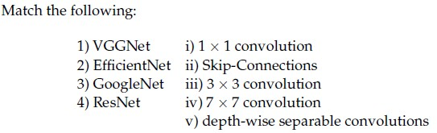

**Figure 6.** Matching table for Question 238.

**Options**

**A.** 1-v, 2-iii, 3-iv, 4-ii

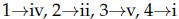

**Figure 7.** Option A for Question 238.  
*Option ID:* `6406534459601`

**B.** 1-iv, 2-iii, 3-i, 4-ii

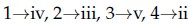

**Figure 8.** Option B for Question 238.  
*Option ID:* `6406534459602`

**C.** 1-iv, 2-v, 3-ii, 4-iii

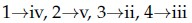

**Figure 9.** Option C for Question 238.  
*Option ID:* `6406534459603`

**D.** 1-iii, 2-v, 3-i, 4-ii

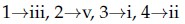

**Figure 10.** Option D for Question 238.  
*Option ID:* `6406534459604`

**Correct answer:** **D** — 1-iii, 2-v, 3-i, 4-ii  
**Source evidence:** Green option ID text 6406534459604 with green check icon at [119.02, 353.51, 131.02, 365.51].

---

### Question 239

**Question ID:** `6406531333790` · **Type:** MCQ · **Marks:** 2  
**PDF pages:** 3

Consider the following statements P and Q regarding AlexNet and choose the correct option:

(P) In AlexNet, a trainable Local Response Normalization Layers were introduced to emulate the competitive nature of real neurons, where highly active neurons suppress the activity of neighboring neurons, creating competition among different kernel outputs.

(Q) In AlexNet, a total of 8 Convolutional layers contain only about 6-7% of the total parameters hence account for the least computation.

**Options**

**A.** Only statement P is true  
*Option ID:* `6406534459605`

**B.** Only statement Q is true  
*Option ID:* `6406534459606`

**C.** Both statements are true  
*Option ID:* `6406534459607`

**D.** None of these statements is true  
*Option ID:* `6406534459608`

**Correct answer:** **D** — None of these statements is true  
**Source evidence:** Green option ID text 6406534459608 and option text 'None of these statements is true' with green check icon at [119.02, 687.77, 131.02, 699.77].

---

### Question 240

**Question ID:** `6406531333791` · **Type:** SA · **Marks:** 2  
**PDF pages:** 3, 4

Consider two bounding boxes in an image:
- Box A: top-left at (0, 0), bottom-right at (12, 12)
- Box B: top-left at (4, 4), bottom-right at (16, 16)

What is the Intersection over Union (IoU) between these two boxes ____________(in %)

**Correct answer:** `28`  
**Source evidence:** Official answer '28' in Possible Answers field on PDF page 4 with green text.

---

### Question 241

**Question ID:** `6406531333792` · **Type:** MCQ · **Marks:** 2  
**PDF pages:** 4

Which one of the following statements is True?

**Options**

**A.** Attention mechanisms can be applied to the bidirectional RNN model  
*Option ID:* `6406534459610`

**B.** An image captioning network cannot be trained end-to-end even though we are using 2 different modalities to train the network  
*Option ID:* `6406534459611`

**C.** One of the key components in the vanilla transformer are the recurrent connections that help them to deal with variable input length.  
*Option ID:* `6406534459612`

**D.** All of these.  
*Option ID:* `6406534459613`

**Correct answer:** **A** — Attention mechanisms can be applied to the bidirectional RNN model  
**Source evidence:** Green option ID text 6406534459610 and text 'Attention mechanisms can be applied to the bidirectional RNN model' with green check icon at [119.02, 405.26, 131.02, 417.26].

---

### Question 242

**Question ID:** `6406531333793` · **Type:** MCQ · **Marks:** 2  
**PDF pages:** 4, 5

Match the following computer vision tasks to situations:

| Tasks | Situations |
| :--- | :--- |
| 1) Instance Segmentation | i) There are cars in these pixels |
| 2) Classification | ii) There are 4 cars in the image |
| 3) Semantic Segmentation | iii) There is car in the image |
| 4) Object Detection | iv) There are 4 cars in the image, and here are the pixels with the shape of each of their occurrence |

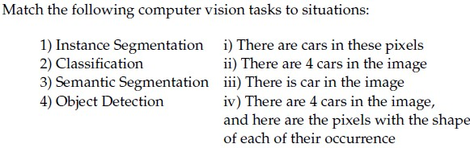

**Figure 11.** Matching table for Question 242.

**Options**

**A.** 1 -> iv, 2 -> iii, 3 -> ii, 4 -> i

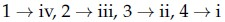

**Figure 12.** Option A for Question 242.  
*Option ID:* `6406534459614`

**B.** 1 -> ii, 2 -> iii, 3 -> i, 4 -> iv

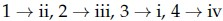

**Figure 13.** Option B for Question 242.  
*Option ID:* `6406534459615`

**C.** 1 -> iv, 2 -> iii, 3 -> i, 4 -> ii

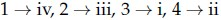

**Figure 14.** Option C for Question 242.  
*Option ID:* `6406534459616`

**D.** 1 -> i, 2 -> iii, 3 -> iv, 4 -> ii

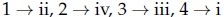

**Figure 15.** Option D for Question 242.  
*Option ID:* `6406534459617`

**Correct answer:** **C** — 1 -> iv, 2 -> iii, 3 -> i, 4 -> ii  
**Source evidence:** Green option ID text 6406534459616 on PDF page 5 with green check icon at [119.02, 41.32, 131.02, 53.32].

---

### Question 243

**Question ID:** `6406531333794` · **Type:** MCQ · **Marks:** 2  
**PDF pages:** 5

Match the following:

| Architectures | Applications |
| :--- | :--- |
| 1) One-to-many RNN architecture | i) Sentiment analysis |
| 2) Many-to-one RNN architecture | ii) Machine translation |
| 3) Many-to-many RNN architecture with equal number of inputs and outputs | iii) Named entity recognition |
| 4) Many-to-many RNN architecture with unequal number of inputs and outputs (Encoder and Decoder model) | iv) Music generation / Image captioning |

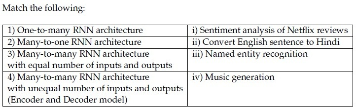

**Figure 16.** Matching table for Question 243.

**Options**

**A.** 1 -> iii, 2 -> iv, 3 -> ii, 4 -> i

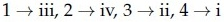

**Figure 17.** Option A for Question 243.  
*Option ID:* `6406534459618`

**B.** 1 -> iv, 2 -> i, 3 -> iii, 4 -> ii

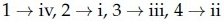

**Figure 18.** Option B for Question 243.  
*Option ID:* `6406534459619`

**C.** 1 -> i, 2 -> ii, 3 -> iii, 4 -> iv

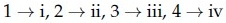

**Figure 19.** Option C for Question 243.  
*Option ID:* `6406534459620`

**D.** 1 -> ii, 2 -> iv, 3 -> i, 4 -> iii

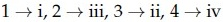

**Figure 20.** Option D for Question 243.  
*Option ID:* `6406534459621`

**Correct answer:** **B** — 1 -> iv, 2 -> i, 3 -> iii, 4 -> ii  
**Source evidence:** Green option ID text 6406534459619 on PDF page 5 with green check icon at [119.02, 432.71, 131.02, 444.71].

---

### Question 244

**Question ID:** `6406531333795` · **Type:** MCQ · **Marks:** 2  
**PDF pages:** 5, 6

Match the following attention mechanisms to their corresponding alignment score functions:

| Attention Mechanism | Alignment Score Function |
| :--- | :--- |
| (1) General Attention | (i) $v_a^T \tanh(W_a [s_t; h_i])$ |
| (2) Content-Based Attention | (ii) $a_{ti} = \text{softmax}(W_a s_t)$ |
| (3) Dot-Product Attention | (iii) $s_t^T h_i$ |
| (4) Additive Attention | (iv) $\cos(s_t, h_i)$ |
| (5) Location-Based Attention | (v) $s_t^T W_a h_i$ |

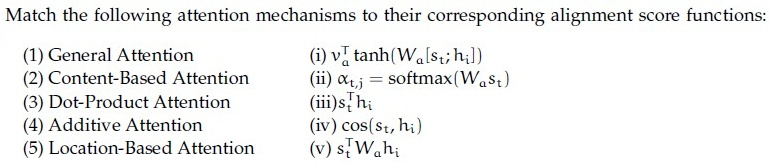

**Figure 21.** Matching table for Question 244.

**Options**

**A.** 1-iii, 2-ii, 3-i, 4-iv, 5-v

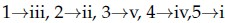

**Figure 22.** Option A for Question 244.  
*Option ID:* `6406534459622`

**B.** 1-iii, 2-iv, 3-i, 4-ii, 5-v

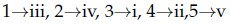

**Figure 23.** Option B for Question 244.  
*Option ID:* `6406534459623`

**C.** 1-i, 2-iii, 3-iv, 4-ii, 5-v

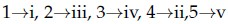

**Figure 24.** Option C for Question 244.  
*Option ID:* `6406534459624`

**D.** 1-v, 2-iv, 3-iii, 4-i, 5-ii

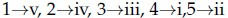

**Figure 25.** Option D for Question 244.  
*Option ID:* `6406534459625`

**Correct answer:** **D** — 1-v, 2-iv, 3-iii, 4-i, 5-ii  
**Source evidence:** Green option ID text 6406534459625 on PDF page 6 with green check icon at [119.02, 103.65, 131.02, 115.65].

---

### Question 245

**Question ID:** `6406531333796` · **Type:** MCQ · **Marks:** 2  
**PDF pages:** 6

Which of the following techniques help mitigate the vanishing gradient problem in recurrent neural networks?
1. Gradient clipping
2. Use of ReLU activation to preserve gradient flow
3. Use of LSTM units
4. Data augmentation (e.g., reversing input sequence)

**Options**

**A.** 1 and 2 only  
*Option ID:* `6406534459626`

**B.** 2 and 3 only  
*Option ID:* `6406534459627`

**C.** 3 and 4 only  
*Option ID:* `6406534459628`

**D.** 1, 2, and 3 only  
*Option ID:* `6406534459629`

**Correct answer:** **B** — 2 and 3 only  
**Source evidence:** Green option ID text 6406534459627 and text '2 and 3 only' with green check icon at [119.02, 363.63, 131.02, 375.63].

---

### Question 246

**Question ID:** `6406531333797` · **Type:** MCQ · **Marks:** 2  
**PDF pages:** 6

Which of the following techniques help mitigate the exploding gradient problem in recurrent neural networks?
1. Gradient clipping
2. Use of Sigmoid activation to prevent gradient growth
3. Use of LSTM units
4. Data augmentation (e.g., reversing input sequence)

**Options**

**A.** 1 and 2 only  
*Option ID:* `6406534459630`

**B.** 1 and 3 only  
*Option ID:* `6406534459631`

**C.** 1, 2, and 3  
*Option ID:* `6406534459632`

**D.** All of these  
*Option ID:* `6406534459633`

**Correct answer:** **B** — 1 and 3 only  
**Source evidence:** Green option ID text 6406534459631 and text '1 and 3 only' with green check icon at [119.02, 648.93, 131.02, 660.93].

---

### Question 247

**Question ID:** `6406531333798` · **Type:** MCQ · **Marks:** 2  
**PDF pages:** 6, 7

Which one of the following statements is false? (Pick the most appropriate one.)

**Options**

**A.** Attention mechanisms cannot be applied to the bidirectional RNN model  
*Option ID:* `6406534459634`

**B.** An image captioning network cannot be trained end-to-end even though we are using 2 different modalities to train the network  
*Option ID:* `6406534459635`

**C.** One of the key components in the vanilla transformer is the recurrent connection that help them to deal with variable input length.  
*Option ID:* `6406534459636`

**D.** All of these  
*Option ID:* `6406534459637`

**Correct answer:** **D** — All of these  
**Source evidence:** Green option ID text 6406534459637 and text 'All of these' with green check icon at [119.02, 132.74, 131.02, 144.74].

---

### Question 248

**Question ID:** `6406531333799` · **Type:** MSQ · **Marks:** 3  
**PDF pages:** 7

Which of the following is true regarding Hard Attention and Soft Attention?

**Options**

**A.** Soft Attention is smooth and differentiable  
*Option ID:* `6406534459638`

**B.** Variance reduction techniques are used to train Soft Attention models  
*Option ID:* `6406534459639`

**C.** Soft Attention is computationally cheaper than Hard Attention when the source input is large  
*Option ID:* `6406534459640`

**D.** The inference (test time) overhead is low in Hard Attention when compared to Soft Attention models  
*Option ID:* `6406534459641`

**Correct answer:** **A, C, D** — Soft Attention is smooth and differentiable; Soft Attention is computationally cheaper than Hard Attention when the source input is large; The inference (test time) overhead is low in Hard Attention when compared to Soft Attention models.  
**Source evidence:** Green option ID text 6406534459638 and text 'Soft Attention is smooth and differentiable' with green check icon at [119.02, 331.94, 131.02, 343.94].; Green option ID text 6406534459640 and text 'Soft Attention is computationally cheaper than Hard Attention when the source input is large' with green check icon at [119.02, 373.58, 131.02, 385.58].; Green option ID text 6406534459641 and text 'The inference (test time) overhead is low in Hard Attention when compared to Soft Attention models' with green check icon at [119.02, 410.72, 131.02, 422.72].

---

### Question 249

**Question ID:** `6406531333800` · **Type:** MSQ · **Marks:** 3  
**PDF pages:** 7

Which of the following are true:

**Options**

**A.** For generating an image of a required class, Deep Inside Convolutional Networks uses gradient descent with the following optimization : $\text{argmin}_I (S_c(I) - \lambda \|I\|_2^2)$ where $S_c$ is the scores vector for class $c$ before applying softmax.

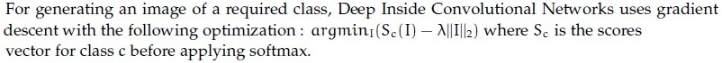

**Figure 26.** Option A for Question 249.  
*Option ID:* `6406534459642`

**B.** Visualizing the maximum of the data gradient across the channels provides insights into the image regions that have the most significant impact on generating high probability scores for a specific class.

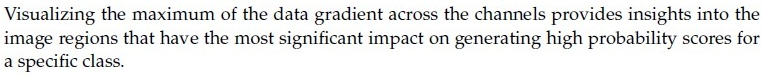

**Figure 27.** Option B for Question 249.  
*Option ID:* `6406534459643`

**C.** Global average Pooling refers to the average of all the pixels at a particular spatial location across all the channels.

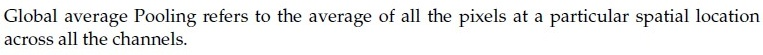

**Figure 28.** Option C for Question 249.  
*Option ID:* `6406534459644`

**D.** Class Activation Map (CAM) does not require a backward pass through the entire model.

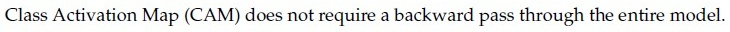

**Figure 29.** Option D for Question 249.  
*Option ID:* `6406534459645`

**Correct answer:** **B, D** — Visualizing the maximum of the data gradient across the channels provides insights into the image regions that have the most significant impact on generating high probability scores for a specific class; Class Activation Map (CAM) does not require a backward pass through the entire model.  
**Source evidence:** Green option ID text 6406534459643 with green check icon at [119.02, 690.03, 131.02, 702.03].; Green option ID text 6406534459645 with green check icon at [119.02, 803.93, 131.02, 815.93].

---

### Question 250

**Question ID:** `6406531333801` · **Type:** SA · **Marks:** 2  
**PDF pages:** 8

Consider a Faster R-CNN object detection framework, which is being trained with a mini-batch size of 2. The RPN produces 512 proposals, out of which 256 and 128 of them are foreground proposals, corresponding to each image in the mini-batch. For a single mini-batch update, the bounding box regression loss will be computed_____________ times.

**Correct answer:** `384`  
**Source evidence:** Official answer '384' in Possible Answers field on PDF page 8 with green text.

---

### Question 251

**Question ID:** `6406531333803` · **Type:** SA · **Marks:** 1  
**PDF pages:** 8, 9

**Comprehension:**

Suppose you want to build an encoder-decoder recurrent model with attention. The context vector at time step $t$ is given by:

$$c_t = \sum_{j=1}^{T_x} \alpha_{tj} h_j$$

where $\alpha_{tj}$ refers to the alignment score between the decoder state at time $t$ _____________ and the encoder state at time _____________. Note: Please write your answer using variables.

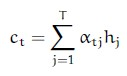

**Figure 30.** Context vector equation for Passage 1 (Questions 251–252).

Based on the above data, answer the given subquestions.

Decoder state at time t : _______________

**Correct answer:** `-1`  
**Source evidence:** Official answer '-1' in Possible Answers field on PDF page 9 with green text.

---

### Question 252

**Question ID:** `6406531333804` · **Type:** SA · **Marks:** 1  
**PDF pages:** 9

**Comprehension:**

Suppose you want to build an encoder-decoder recurrent model with attention. The context vector at time step $t$ is given by:

$$c_t = \sum_{j=1}^{T_x} \alpha_{tj} h_j$$

where $\alpha_{tj}$ refers to the alignment score between the decoder state at time $t$ _____________ and the encoder state at time _____________. Note: Please write your answer using variables. *(Refer to Figure 30 in Question 251).*

Based on the above data, answer the given subquestions.

Encoder state at time: _______________

**Correct answer:** `j`  
**Source evidence:** Official answer 'j' in Possible Answers field on PDF page 9 with green text.

---

### Question 253

**Question ID:** `6406531333806` · **Type:** SA · **Marks:** 0.66  
**PDF pages:** 10

**Comprehension:**

Consider a Gated Recurrent Unit (GRU) cell at time step '$t$'.

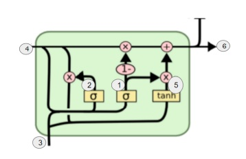

**Figure 31.** Gated Recurrent Unit (GRU) cell diagram for Passage 2 (Questions 253–258).

For each of the entities in the given subquestions, enter the appropriate number from the figure that corresponds to it:

Hidden state ht−1______________

**Correct answer:** `4`  
**Source evidence:** Official answer '4' in Possible Answers field on PDF page 10 with green text.

---

### Question 254

**Question ID:** `6406531333807` · **Type:** SA · **Marks:** 0.66  
**PDF pages:** 10

**Comprehension:**

Consider a Gated Recurrent Unit (GRU) cell at time step '$t$'. *(Refer to Figure 31 in Question 253).*

For each of the entities in the given subquestions, enter the appropriate number from the figure that corresponds to it:

Hidden state ht_____________

**Correct answer:** `6`  
**Source evidence:** Official answer '6' in Possible Answers field on PDF page 10 with green text.

---

### Question 255

**Question ID:** `6406531333808` · **Type:** SA · **Marks:** 0.67  
**PDF pages:** 10

**Comprehension:**

Consider a Gated Recurrent Unit (GRU) cell at time step '$t$'. *(Refer to Figure 31 in Question 253).*

For each of the entities in the given subquestions, enter the appropriate number from the figure that corresponds to it:

Current Input xt________________

**Correct answer:** `3`  
**Source evidence:** Official answer '3' in Possible Answers field on PDF page 10 with green text.

---

### Question 256

**Question ID:** `6406531333809` · **Type:** SA · **Marks:** 0.67  
**PDF pages:** 10, 11

**Comprehension:**

Consider a Gated Recurrent Unit (GRU) cell at time step '$t$'. *(Refer to Figure 31 in Question 253).*

For each of the entities in the given subquestions, enter the appropriate number from the figure that corresponds to it:

Update gate zt_______________

**Correct answer:** `1`  
**Source evidence:** Official answer '1' in Possible Answers field on PDF page 11 with green text.

---

### Question 257

**Question ID:** `6406531333810` · **Type:** SA · **Marks:** 0.67  
**PDF pages:** 11

**Comprehension:**

Consider a Gated Recurrent Unit (GRU) cell at time step '$t$'. *(Refer to Figure 31 in Question 253).*

For each of the entities in the given subquestions, enter the appropriate number from the figure that corresponds to it:

Reset gate rt ______________

**Correct answer:** `2`  
**Source evidence:** Official answer '2' in Possible Answers field on PDF page 11 with green text.

---

### Question 258

**Question ID:** `6406531333811` · **Type:** SA · **Marks:** 0.67  
**PDF pages:** 11

**Comprehension:**

Consider a Gated Recurrent Unit (GRU) cell at time step '$t$'. *(Refer to Figure 31 in Question 253).*

For each of the entities in the given subquestions, enter the appropriate number from the figure that corresponds to it:

New hidden state content eh____________

**Correct answer:** `5`  
**Source evidence:** Official answer '5' in Possible Answers field on PDF page 11 with green text.

---

### Question 259

**Question ID:** `6406531333813` · **Type:** SA · **Marks:** 2  
**PDF pages:** 11, 12

**Comprehension:**

Let input have size $D_f \times D_f \times M$ where $D_f = 10$ and $M = 256$ and output feature map (after passing input through conv layer) has $D_f \times D_f \times N$ size where $N = 512$. Assume padded convolution. Let width of the square kernel in conv layer be $k$ where $k = 7$ (Ignore the bias term in the calculation). Calculate the number of parameters and computational cost for this convolution layer.

Based on the above data, answer the given subquestions.

Number of Parameters:_____________

**Correct answer:** `6422528`  
**Source evidence:** Official answer '6422528' in Possible Answers field on PDF page 12 with green text.

---

### Question 260

**Question ID:** `6406531333814` · **Type:** SA · **Marks:** 2  
**PDF pages:** 12

**Comprehension:**

Let input have size $D_f \times D_f \times M$ where $D_f = 10$ and $M = 256$ and output feature map (after passing input through conv layer) has $D_f \times D_f \times N$ size where $N = 512$. Assume padded convolution. Let width of the square kernel in conv layer be $k$ where $k = 7$ (Ignore the bias term in the calculation). Calculate the number of parameters and computational cost for this convolution layer.

Based on the above data, answer the given subquestions.

Computational Cost:___________________

**Correct answer:** `642252800`  
**Source evidence:** Official answer '642252800' in Possible Answers field on PDF page 12 with green text.

---

### Question 261

**Question ID:** `6406531333816` · **Type:** SA · **Marks:** 1  
**PDF pages:** 12, 13

**Comprehension:**

Let input have size $D_f \times D_f \times M$ where $D_f = 10$ and $M = 256$ and output feature map (after passing input through conv layer) has $D_f \times D_f \times N$ size where $N = 512$. Assume padded convolution. Let width of the square kernel in conv layer be $k$ where $k = 7$ (Ignore the bias term in the calculation), calculate the number of parameters and computational cost, but make use of Depthwise Seperable convolution and pointwise convolution instead of standard convolution.

Based on the above data, answer the given subquestions.

Number of parameters for depthwise seperable convolution:_______________

**Correct answer:** `12544`  
**Source evidence:** Official answer '12544' in Possible Answers field on PDF page 13 with green text.

---

### Question 262

**Question ID:** `6406531333817` · **Type:** SA · **Marks:** 1  
**PDF pages:** 13

**Comprehension:**

Let input have size $D_f \times D_f \times M$ where $D_f = 10$ and $M = 256$ and output feature map (after passing input through conv layer) has $D_f \times D_f \times N$ size where $N = 512$. Assume padded convolution. Let width of the square kernel in conv layer be $k$ where $k = 7$ (Ignore the bias term in the calculation), calculate the number of parameters and computational cost, but make use of Depthwise Seperable convolution and pointwise convolution instead of standard convolution.

Based on the above data, answer the given subquestions.

Computational Cost for depthwise seperable convolution:____________________

**Correct answer:** `1254400`  
**Source evidence:** Official answer '1254400' in Possible Answers field on PDF page 13 with green text.

---

### Question 263

**Question ID:** `6406531333818` · **Type:** SA · **Marks:** 1  
**PDF pages:** 13

**Comprehension:**

Let input have size $D_f \times D_f \times M$ where $D_f = 10$ and $M = 256$ and output feature map (after passing input through conv layer) has $D_f \times D_f \times N$ size where $N = 512$. Assume padded convolution. Let width of the square kernel in conv layer be $k$ where $k = 7$ (Ignore the bias term in the calculation), calculate the number of parameters and computational cost, but make use of Depthwise Seperable convolution and pointwise convolution instead of standard convolution.

Based on the above data, answer the given subquestions.

Number of parameters for pointwise convolution:____________________

**Correct answer:** `131072`  
**Source evidence:** Official answer '131072' in Possible Answers field on PDF page 13 with green text.

---

### Question 264

**Question ID:** `6406531333819` · **Type:** SA · **Marks:** 1  
**PDF pages:** 13, 14

**Comprehension:**

Let input have size $D_f \times D_f \times M$ where $D_f = 10$ and $M = 256$ and output feature map (after passing input through conv layer) has $D_f \times D_f \times N$ size where $N = 512$. Assume padded convolution. Let width of the square kernel in conv layer be $k$ where $k = 7$ (Ignore the bias term in the calculation), calculate the number of parameters and computational cost, but make use of Depthwise Seperable convolution and pointwise convolution instead of standard convolution.

Based on the above data, answer the given subquestions.

Computational cost for pointwise convolution:____________________

**Correct answer:** `13107200`  
**Source evidence:** Official answer '13107200' in Possible Answers field on PDF page 14 with green text.

---

### Question 265

**Question ID:** `6406531333821` · **Type:** SA · **Marks:** 0.8  
**PDF pages:** 14, 15

**Comprehension:**

The RNN given below is used for classification:

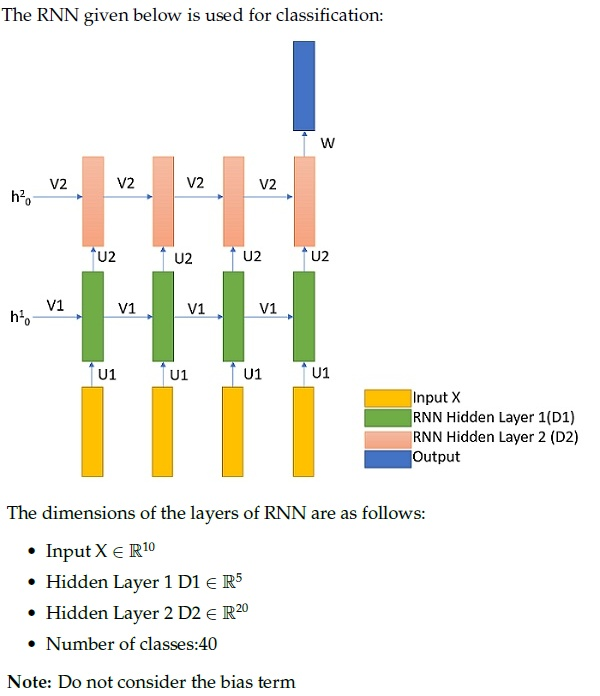

**Figure 32.** 2-layer RNN classification architecture for Passage 5 (Questions 265–269).

The dimensions of the layers of RNN are as follows:
- Input $X \in \mathbb{R}^{10}$
- Hidden Layer 1 $D_1 \in \mathbb{R}^5$
- Hidden Layer 2 $D_2 \in \mathbb{R}^{20}$
- Number of classes: 40

Note: Do not consider the bias term.

Based on the above data, answer the given subquestions.

Number of weights in Weight Matrix U1 is:_______________

**Correct answer:** `50`  
**Source evidence:** Official answer '50' in Possible Answers field on PDF page 15 with green text.

---

### Question 266

**Question ID:** `6406531333822` · **Type:** SA · **Marks:** 0.8  
**PDF pages:** 15

**Comprehension:**

The RNN given below is used for classification:
The dimensions of the layers of RNN are as follows:
- Input $X \in \mathbb{R}^{10}$
- Hidden Layer 1 $D_1 \in \mathbb{R}^5$
- Hidden Layer 2 $D_2 \in \mathbb{R}^{20}$
- Number of classes: 40
Note: Do not consider the bias term. *(Refer to Figure 32 in Question 265).*

Based on the above data, answer the given subquestions.

Number of weights in Weight Matrix V1 is:_______________

**Correct answer:** `25`  
**Source evidence:** Official answer '25' in Possible Answers field on PDF page 15 with green text.

---

### Question 267

**Question ID:** `6406531333823` · **Type:** SA · **Marks:** 0.8  
**PDF pages:** 15

**Comprehension:**

The RNN given below is used for classification:
The dimensions of the layers of RNN are as follows:
- Input $X \in \mathbb{R}^{10}$
- Hidden Layer 1 $D_1 \in \mathbb{R}^5$
- Hidden Layer 2 $D_2 \in \mathbb{R}^{20}$
- Number of classes: 40
Note: Do not consider the bias term. *(Refer to Figure 32 in Question 265).*

Based on the above data, answer the given subquestions.

Number of weights in Weight Matrix U2 is:_______________

**Correct answer:** `100`  
**Source evidence:** Official answer '100' in Possible Answers field on PDF page 15 with green text.

---

### Question 268

**Question ID:** `6406531333824` · **Type:** SA · **Marks:** 0.8  
**PDF pages:** 15, 16

**Comprehension:**

The RNN given below is used for classification:
The dimensions of the layers of RNN are as follows:
- Input $X \in \mathbb{R}^{10}$
- Hidden Layer 1 $D_1 \in \mathbb{R}^5$
- Hidden Layer 2 $D_2 \in \mathbb{R}^{20}$
- Number of classes: 40
Note: Do not consider the bias term. *(Refer to Figure 32 in Question 265).*

Based on the above data, answer the given subquestions.

Number of weights in Weight Matrix V2 is:_______________

**Correct answer:** `400`  
**Source evidence:** Official answer '400' in Possible Answers field on PDF page 16 with green text.

---

### Question 269

**Question ID:** `6406531333825` · **Type:** SA · **Marks:** 0.8  
**PDF pages:** 16

**Comprehension:**

The RNN given below is used for classification:
The dimensions of the layers of RNN are as follows:
- Input $X \in \mathbb{R}^{10}$
- Hidden Layer 1 $D_1 \in \mathbb{R}^5$
- Hidden Layer 2 $D_2 \in \mathbb{R}^{20}$
- Number of classes: 40
Note: Do not consider the bias term. *(Refer to Figure 32 in Question 265).*

Based on the above data, answer the given subquestions.

Number of weights in Weight Matrix W is:_______________

**Correct answer:** `800`  
**Source evidence:** Official answer '800' in Possible Answers field on PDF page 16 with green text.

---

### Question 270

**Question ID:** `6406531333827` · **Type:** SA · **Marks:** 0.5  
**PDF pages:** 16, 17

**Comprehension:**

You are given the encoder hidden states $h_1, h_2, h_3 \in \mathbb{R}^2$ and the decoder hidden state $s_2 \in \mathbb{R}^2$ at time step $t = 2$.

Use **dot-product attention**, where the attention score is computed as:

$$e_{tj} = s_t^T h_j \quad \text{and} \quad \alpha_{tj} = \frac{\exp(e_{tj})}{\sum_{k=1}^3 \exp(e_{tk})}$$

The context vector is then computed as:

$$c_t = \sum_{j=1}^3 \alpha_{tj} h_j$$

Use the following values:

$$s_2 = \begin{bmatrix} 1 \\ 0 \end{bmatrix}, \quad h_1 = \begin{bmatrix} 1 \\ 2 \end{bmatrix}, \quad h_2 = \begin{bmatrix} 0 \\ 1 \end{bmatrix}, \quad h_3 = \begin{bmatrix} 2 \\ 3 \end{bmatrix}$$

Note: Use approximate values of exponential $\exp(1) \approx 2.72$, $\exp(2) \approx 7.39$, etc.

Answer the given subquestions:

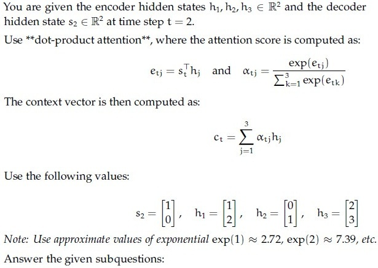

**Figure 33.** Dot-product attention formulation and values for Passage 6 (Questions 270–277).

e21: _________________

**Correct answer:** `1`  
**Source evidence:** Official accepted answer/range '1' in Possible Answers field on PDF page 17 with green text.

---

### Question 271

**Question ID:** `6406531333828` · **Type:** SA · **Marks:** 0.5  
**PDF pages:** 17

**Comprehension:**

You are given the encoder hidden states $h_1, h_2, h_3 \in \mathbb{R}^2$ and the decoder hidden state $s_2 \in \mathbb{R}^2$ at time step $t = 2$.
Use **dot-product attention**, where $e_{tj} = s_t^T h_j$ and context vector $c_t = \sum_{j=1}^3 \alpha_{tj} h_j$.
*(Refer to Figure 33 in Question 270 for values and formulation).*

Answer the given subquestions:

e22: _________________

**Correct answer:** `0`  
**Source evidence:** Official accepted answer/range '0' in Possible Answers field on PDF page 17 with green text.

---

### Question 272

**Question ID:** `6406531333829` · **Type:** SA · **Marks:** 0.5  
**PDF pages:** 17

**Comprehension:**

You are given the encoder hidden states $h_1, h_2, h_3 \in \mathbb{R}^2$ and the decoder hidden state $s_2 \in \mathbb{R}^2$ at time step $t = 2$.
Use **dot-product attention**, where $e_{tj} = s_t^T h_j$ and context vector $c_t = \sum_{j=1}^3 \alpha_{tj} h_j$.
*(Refer to Figure 33 in Question 270 for values and formulation).*

Answer the given subquestions:

e23: _________________

**Correct answer:** `2`  
**Source evidence:** Official accepted answer/range '2' in Possible Answers field on PDF page 17 with green text.

---

### Question 273

**Question ID:** `6406531333830` · **Type:** SA · **Marks:** 0.5  
**PDF pages:** 17, 18

**Comprehension:**

You are given the encoder hidden states $h_1, h_2, h_3 \in \mathbb{R}^2$ and the decoder hidden state $s_2 \in \mathbb{R}^2$ at time step $t = 2$.
Use **dot-product attention**, where $e_{tj} = s_t^T h_j$ and context vector $c_t = \sum_{j=1}^3 \alpha_{tj} h_j$.
*(Refer to Figure 33 in Question 270 for values and formulation).*

Answer the given subquestions:

α21: _________________

**Correct answer:** `0.24 to 0.25`  
**Source evidence:** Official accepted answer/range '0.24 to 0.25' in Possible Answers field on PDF page 18 with green text.

---

### Question 274

**Question ID:** `6406531333831` · **Type:** SA · **Marks:** 0.5  
**PDF pages:** 18

**Comprehension:**

You are given the encoder hidden states $h_1, h_2, h_3 \in \mathbb{R}^2$ and the decoder hidden state $s_2 \in \mathbb{R}^2$ at time step $t = 2$.
Use **dot-product attention**, where $e_{tj} = s_t^T h_j$ and context vector $c_t = \sum_{j=1}^3 \alpha_{tj} h_j$.
*(Refer to Figure 33 in Question 270 for values and formulation).*

Answer the given subquestions:

α22: _________________

**Correct answer:** `0.09 to 0.1`  
**Source evidence:** Official accepted answer/range '0.09 to 0.1' in Possible Answers field on PDF page 18 with green text.

---

### Question 275

**Question ID:** `6406531333832` · **Type:** SA · **Marks:** 0.5  
**PDF pages:** 18

**Comprehension:**

You are given the encoder hidden states $h_1, h_2, h_3 \in \mathbb{R}^2$ and the decoder hidden state $s_2 \in \mathbb{R}^2$ at time step $t = 2$.
Use **dot-product attention**, where $e_{tj} = s_t^T h_j$ and context vector $c_t = \sum_{j=1}^3 \alpha_{tj} h_j$.
*(Refer to Figure 33 in Question 270 for values and formulation).*

Answer the given subquestions:

α23: _________________

**Correct answer:** `0.66 to 0.68`  
**Source evidence:** Official accepted answer/range '0.66 to 0.68' in Possible Answers field on PDF page 18 with green text.

---

### Question 276

**Question ID:** `6406531333833` · **Type:** SA · **Marks:** 0.5  
**PDF pages:** 18, 19

**Comprehension:**

You are given the encoder hidden states $h_1, h_2, h_3 \in \mathbb{R}^2$ and the decoder hidden state $s_2 \in \mathbb{R}^2$ at time step $t = 2$.
Use **dot-product attention**, where $e_{tj} = s_t^T h_j$ and context vector $c_t = \sum_{j=1}^3 \alpha_{tj} h_j$.
*(Refer to Figure 33 in Question 270 for values and formulation).*

Answer the given subquestions:

c21: _________________

**Correct answer:** `1.5 to 1.6`  
**Source evidence:** Official accepted answer/range '1.5 to 1.6' in Possible Answers field on PDF page 19 with green text.

---

### Question 277

**Question ID:** `6406531333834` · **Type:** SA · **Marks:** 0.5  
**PDF pages:** 19

**Comprehension:**

You are given the encoder hidden states $h_1, h_2, h_3 \in \mathbb{R}^2$ and the decoder hidden state $s_2 \in \mathbb{R}^2$ at time step $t = 2$.
Use **dot-product attention**, where $e_{tj} = s_t^T h_j$ and context vector $c_t = \sum_{j=1}^3 \alpha_{tj} h_j$.
*(Refer to Figure 33 in Question 270 for values and formulation).*

Answer the given subquestions:

c22: _________________

**Correct answer:** `2.5 to 2.6`  
**Source evidence:** Official accepted answer/range '2.5 to 2.6' in Possible Answers field on PDF page 19 with green text.

---

### Question 278

**Question ID:** `6406531333836` · **Type:** SA · **Marks:** 0.5  
**PDF pages:** 19, 20

**Comprehension:**

You are given the encoder hidden states $h_1, h_2, h_3 \in \mathbb{R}^2$ and the decoder hidden state $s_2 \in \mathbb{R}^2$ at time step $t = 2$.

Use **additive attention**, where the alignment score is computed as:

$$e_{tj} = v_a^T \tanh(W_s s_t + W_h h_j) \quad \text{and} \quad \alpha_{tj} = \frac{\exp(e_{tj})}{\sum_{k=1}^3 \exp(e_{tk})}$$

The context vector is then computed as:

$$c_t = \sum_{j=1}^3 \alpha_{tj} h_j$$

Use the following values:

$$s_2 = \begin{bmatrix} 1 \\ 0 \end{bmatrix}, \quad h_1 = \begin{bmatrix} 1 \\ 2 \end{bmatrix}, \quad h_2 = \begin{bmatrix} 0 \\ 1 \end{bmatrix}, \quad h_3 = \begin{bmatrix} 2 \\ 3 \end{bmatrix}$$

$$W_s = \begin{bmatrix} 1 & 0 \\ 0 & 1 \end{bmatrix}, \quad W_h = \begin{bmatrix} 1 & 1 \\ 1 & 1 \end{bmatrix}, \quad v_a = \begin{bmatrix} 1 \\ -1 \end{bmatrix}$$

Hint: Approximate values of $\tanh(x)$: $\tanh(0) = 0$, $\tanh(1) \approx 0.76$, $\tanh(2) \approx 0.96$, $\tanh(3) \approx 0.995$, $\tanh(4) \approx 0.9993$, $\tanh(5) \approx 0.9999$, $\tanh(6) \approx 0.99999$.

Answer the given subquestions:

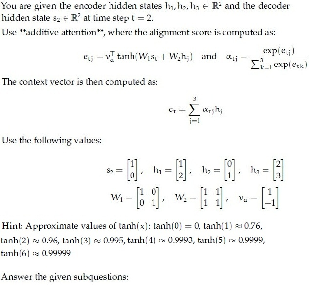

**Figure 34.** Additive attention formulation and values for Passage 7 (Questions 278–285).

e21:_________________

**Correct answer:** `-0.01 to 0.01`  
**Source evidence:** Official accepted answer/range '-0.01 to 0.01' in Possible Answers field on PDF page 20 with green text.

---

### Question 279

**Question ID:** `6406531333837` · **Type:** SA · **Marks:** 0.5  
**PDF pages:** 20, 21

**Comprehension:**

You are given the encoder hidden states $h_1, h_2, h_3 \in \mathbb{R}^2$ and the decoder hidden state $s_2 \in \mathbb{R}^2$ at time step $t = 2$.
Use **additive attention**, where $e_{tj} = v_a^T \tanh(W_s s_t + W_h h_j)$ and context vector $c_t = \sum_{j=1}^3 \alpha_{tj} h_j$.
*(Refer to Figure 34 in Question 278 for values and formulation).*

Answer the given subquestions:

e22:_________________

**Correct answer:** `-0.462`  
**Source evidence:** Official accepted answer/range '-0.462' in Possible Answers field on PDF page 21 with green text.

---

### Question 280

**Question ID:** `6406531333838` · **Type:** SA · **Marks:** 0.5  
**PDF pages:** 21

**Comprehension:**

You are given the encoder hidden states $h_1, h_2, h_3 \in \mathbb{R}^2$ and the decoder hidden state $s_2 \in \mathbb{R}^2$ at time step $t = 2$.
Use **additive attention**, where $e_{tj} = v_a^T \tanh(W_s s_t + W_h h_j)$ and context vector $c_t = \sum_{j=1}^3 \alpha_{tj} h_j$.
*(Refer to Figure 34 in Question 278 for values and formulation).*

Answer the given subquestions:

e23:_________________

**Correct answer:** `0.462`  
**Source evidence:** Official accepted answer/range '0.462' in Possible Answers field on PDF page 21 with green text.

---

### Question 281

**Question ID:** `6406531333839` · **Type:** SA · **Marks:** 0.5  
**PDF pages:** 21

**Comprehension:**

You are given the encoder hidden states $h_1, h_2, h_3 \in \mathbb{R}^2$ and the decoder hidden state $s_2 \in \mathbb{R}^2$ at time step $t = 2$.
Use **additive attention**, where $e_{tj} = v_a^T \tanh(W_s s_t + W_h h_j)$ and context vector $c_t = \sum_{j=1}^3 \alpha_{tj} h_j$.
*(Refer to Figure 34 in Question 278 for values and formulation).*

Answer the given subquestions:

α21:_________________

**Correct answer:** `0.32 to 0.34`  
**Source evidence:** Official accepted answer/range '0.32 to 0.34' in Possible Answers field on PDF page 21 with green text.

---

### Question 282

**Question ID:** `6406531333840` · **Type:** SA · **Marks:** 0.5  
**PDF pages:** 21, 22

**Comprehension:**

You are given the encoder hidden states $h_1, h_2, h_3 \in \mathbb{R}^2$ and the decoder hidden state $s_2 \in \mathbb{R}^2$ at time step $t = 2$.
Use **additive attention**, where $e_{tj} = v_a^T \tanh(W_s s_t + W_h h_j)$ and context vector $c_t = \sum_{j=1}^3 \alpha_{tj} h_j$.
*(Refer to Figure 34 in Question 278 for values and formulation).*

Answer the given subquestions:

α22:_________________

**Correct answer:** `0.22 to 0.24`  
**Source evidence:** Official accepted answer/range '0.22 to 0.24' in Possible Answers field on PDF page 22 with green text.

---

### Question 283

**Question ID:** `6406531333841` · **Type:** SA · **Marks:** 0.5  
**PDF pages:** 22

**Comprehension:**

You are given the encoder hidden states $h_1, h_2, h_3 \in \mathbb{R}^2$ and the decoder hidden state $s_2 \in \mathbb{R}^2$ at time step $t = 2$.
Use **additive attention**, where $e_{tj} = v_a^T \tanh(W_s s_t + W_h h_j)$ and context vector $c_t = \sum_{j=1}^3 \alpha_{tj} h_j$.
*(Refer to Figure 34 in Question 278 for values and formulation).*

Answer the given subquestions:

α23:_________________

**Correct answer:** `0.43 to 0.45`  
**Source evidence:** Official accepted answer/range '0.43 to 0.45' in Possible Answers field on PDF page 22 with green text.

---

### Question 284

**Question ID:** `6406531333842` · **Type:** SA · **Marks:** 0.5  
**PDF pages:** 22

**Comprehension:**

You are given the encoder hidden states $h_1, h_2, h_3 \in \mathbb{R}^2$ and the decoder hidden state $s_2 \in \mathbb{R}^2$ at time step $t = 2$.
Use **additive attention**, where $e_{tj} = v_a^T \tanh(W_s s_t + W_h h_j)$ and context vector $c_t = \sum_{j=1}^3 \alpha_{tj} h_j$.
*(Refer to Figure 34 in Question 278 for values and formulation).*

Answer the given subquestions:

c21:_________________

**Correct answer:** `1.4 to 1.6`  
**Source evidence:** Official accepted answer/range '1.4 to 1.6' in Possible Answers field on PDF page 22 with green text.

---

### Question 285

**Question ID:** `6406531333843` · **Type:** SA · **Marks:** 0.5  
**PDF pages:** 22

**Comprehension:**

You are given the encoder hidden states $h_1, h_2, h_3 \in \mathbb{R}^2$ and the decoder hidden state $s_2 \in \mathbb{R}^2$ at time step $t = 2$.
Use **additive attention**, where $e_{tj} = v_a^T \tanh(W_s s_t + W_h h_j)$ and context vector $c_t = \sum_{j=1}^3 \alpha_{tj} h_j$.
*(Refer to Figure 34 in Question 278 for values and formulation).*

Answer the given subquestions:

c22:_________________

**Correct answer:** `2.4 to 2.6`  
**Source evidence:** Official accepted answer/range '2.4 to 2.6' in Possible Answers field on PDF page 22 with green text.

---

## Answer key

| Source question | Question ID | Correct answer | PDF page(s) |
| :--- | :--- | :--- | :--- |
| 234 | `6406531333785` | A | 1–2 |
| 235 | `6406531333786` | B | 2 |
| 236 | `6406531333787` | C | 2 |
| 237 | `6406531333788` | D | 2 |
| 238 | `6406531333789` | D | 3 |
| 239 | `6406531333790` | D | 3 |
| 240 | `6406531333791` | 28 | 3–4 |
| 241 | `6406531333792` | A | 4 |
| 242 | `6406531333793` | C | 4–5 |
| 243 | `6406531333794` | B | 5 |
| 244 | `6406531333795` | D | 5–6 |
| 245 | `6406531333796` | B | 6 |
| 246 | `6406531333797` | B | 6 |
| 247 | `6406531333798` | D | 6–7 |
| 248 | `6406531333799` | A, C, D | 7 |
| 249 | `6406531333800` | B, D | 7 |
| 250 | `6406531333801` | 384 | 8 |
| 251 | `6406531333803` | -1 | 8–9 |
| 252 | `6406531333804` | j | 9 |
| 253 | `6406531333806` | 4 | 10 |
| 254 | `6406531333807` | 6 | 10 |
| 255 | `6406531333808` | 3 | 10 |
| 256 | `6406531333809` | 1 | 10–11 |
| 257 | `6406531333810` | 2 | 11 |
| 258 | `6406531333811` | 5 | 11 |
| 259 | `6406531333813` | 6422528 | 11–12 |
| 260 | `6406531333814` | 642252800 | 12 |
| 261 | `6406531333816` | 12544 | 12–13 |
| 262 | `6406531333817` | 1254400 | 13 |
| 263 | `6406531333818` | 131072 | 13 |
| 264 | `6406531333819` | 13107200 | 13–14 |
| 265 | `6406531333821` | 50 | 14–15 |
| 266 | `6406531333822` | 25 | 15 |
| 267 | `6406531333823` | 100 | 15 |
| 268 | `6406531333824` | 400 | 15–16 |
| 269 | `6406531333825` | 800 | 16 |
| 270 | `6406531333827` | 1 | 16–17 |
| 271 | `6406531333828` | 0 | 17 |
| 272 | `6406531333829` | 2 | 17 |
| 273 | `6406531333830` | 0.24 to 0.25 | 17–18 |
| 274 | `6406531333831` | 0.09 to 0.1 | 18 |
| 275 | `6406531333832` | 0.66 to 0.68 | 18 |
| 276 | `6406531333833` | 1.5 to 1.6 | 18–19 |
| 277 | `6406531333834` | 2.5 to 2.6 | 19 |
| 278 | `6406531333836` | -0.01 to 0.01 | 19–20 |
| 279 | `6406531333837` | -0.462 | 20–21 |
| 280 | `6406531333838` | 0.462 | 21 |
| 281 | `6406531333839` | 0.32 to 0.34 | 21 |
| 282 | `6406531333840` | 0.22 to 0.24 | 21–22 |
| 283 | `6406531333841` | 0.43 to 0.45 | 22 |
| 284 | `6406531333842` | 1.4 to 1.6 | 22 |
| 285 | `6406531333843` | 2.4 to 2.6 | 22 |

## Extraction notes

- Administrative confirmation question 233 on Page 1 (Question ID 6406531333784, 0 marks, YES/NO subject verification) was semantically excluded per Section 4 of MASTER_EXTRACTION_PROMPT.md.
- No overall section header table is present at the start of Page 1; scope is established by the visible subject confirmation on Page 1 and sub-sections 2 to 8 spanning Pages 1 through 22.
- All mathematical matrices and vectors have been verified directly against original PDF raster crops and formulas.
- For multi-part comprehension passages (Passages 1 to 7), shared problem stems, figures, and formulations are fully preserved in each subquestion block to maintain independent comprehension.
- All 34 embedded content figures and source diagrams have been extracted at native resolution and inspected.
