# DL(CV) — da5006_2025T3_ET_FN

**Subject:** Deep Learning for Computer Vision  
**Source:** `da5006_2025T3_ET_FN.pdf` (original PDF omitted from this bundle)  
**Academic questions:** 19  
**Scope:** DL(CV) section; administrative subject confirmation excluded.

## Questions

### Question 2

**Question ID:** `6406531862816` · **Type:** SA · **Marks:** 1  
**PDF pages:** 2

A single 2D convolution (no dilation). Input size $128 \times 128$, kernel $7 \times 7$, stride $2$, padding $1$.
What is the output spatial size $N \times N$? (Enter $N$.)

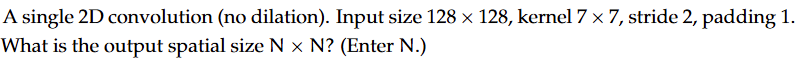

**Figure 1.** Source 2D convolution parameters for Question 2.

**Correct answer:** `62`  
**Source evidence:** Official answer '62' specified in Possible Answers field with green text (color 0x008000); calculation: floor((128 - 7 + 2*1)/2) + 1 = 61 + 1 = 62.

---

### Question 3

**Question ID:** `6406531862817` · **Type:** SA · **Marks:** 1  
**PDF pages:** 2

Given the $3 \times 3$ 8-bit grayscale image

$$\begin{bmatrix} 12 & 40 & 210 \\ 75 & 95 & 160 \\ 30 & 120 & 240 \end{bmatrix}$$

Apply linear contrast stretching from $[I_{min}, I_{max}]$ to $[0, 255]$. What is the central element after stretching?
(Round to the nearest integer.)

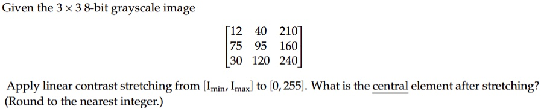

**Figure 2.** Source grayscale image matrix and linear contrast stretching task for Question 3.

**Correct answer:** `92 to 94`  
**Source evidence:** Official accepted range '92 to 94' specified in Possible Answers field with green text (color 0x008000); calculation: (95 - 12) / (240 - 12) * 255 = 83 / 228 * 255 ≈ 92.83, rounding to 93.

---

### Question 4

**Question ID:** `6406531862818` · **Type:** MCQ · **Marks:** 1  
**PDF pages:** 3

In a Vision Transformer (ViT), which step occurs immediately before adding positional embeddings?

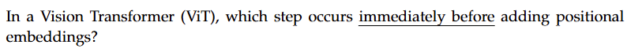

**Figure 3.** Source question text for Question 4.

**Options**

**A.** Passing patch embeddings through the Transformer encoder  
*Option ID:* `6406536034925`

**B.** Linear projection of flattened image patches  
*Option ID:* `6406536034926`

**C.** Adding a class token  
*Option ID:* `6406536034927`

**D.** Layer normalization of patch embeddings  
*Option ID:* `6406536034928`

**Correct answer:** **B** — Linear projection of flattened image patches.  
**Source evidence:** Option B (6406536034926) rendered in green font (color 0x008000) with green checkmark icon (xref 1374 at y=205.06..217.06) in source PDF.

---

### Question 5

**Question ID:** `6406531862819` · **Type:** MCQ · **Marks:** 1  
**PDF pages:** 3

In CLIP's contrastive objective, decreasing the temperature parameter $\tau$ (i.e., using a smaller $\tau$) typically:

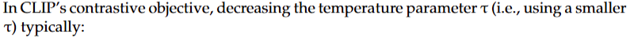

**Figure 4.** Source question text for Question 5.

**Options**

**A.** Flattens the softmax distribution, reducing gradient magnitude  
*Option ID:* `6406536034929`

**B.** sharpens the softmax distribution, increasing emphasis on hard negatives  
*Option ID:* `6406536034930`

**C.** has no effect on the loss landscape  
*Option ID:* `6406536034931`

**D.** makes image and text embeddings orthogonal  
*Option ID:* `6406536034932`

**Correct answer:** **B** — sharpens the softmax distribution, increasing emphasis on hard negatives.  
**Source evidence:** Option B (6406536034930) rendered in green font (color 0x008000) with green checkmark icon (xref 1374 at y=467.58..479.58) in source PDF.

---

### Question 6

**Question ID:** `6406531862820` · **Type:** MCQ · **Marks:** 1  
**PDF pages:** 3

In a Feature Pyramid Network (FPN), the primary purpose of the top-down pathway with lateral connections is to:

**Options**

**A.** increase the receptive field at the lowest-resolution level  
*Option ID:* `6406536034933`

**B.** enrich high-resolution feature maps with strong semantics from deeper layers  
*Option ID:* `6406536034934`

**C.** perform non-maximum suppression at multiple scales  
*Option ID:* `6406536034935`

**D.** reduce the number of anchors required per level  
*Option ID:* `6406536034936`

**Correct answer:** **B** — enrich high-resolution feature maps with strong semantics from deeper layers.  
**Source evidence:** Option B (6406536034934) rendered in green font (color 0x008000) with green checkmark icon (xref 1374 at y=687.60..699.60) in source PDF.

---

### Question 7

**Question ID:** `6406531862821` · **Type:** MCQ · **Marks:** 1  
**PDF pages:** 4

Consider the following pyTorch code:

```python
x = torch.tensor([[1., 2., 3.], [4., 5., 6.]])
y = torch.softmax(x, dim=1)
print(torch.round(y[0], decimals=2))
```

The printed tensor is:

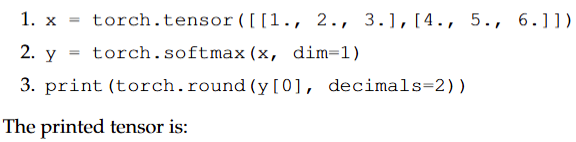

**Figure 5.** Source PyTorch code snippet for Question 7.

**Options**

**A.** tensor([0.09, 0.24, 0.67])  
*Option ID:* `6406536034937`

**B.** tensor([0.09, 0.24, 0.66])  
*Option ID:* `6406536034938`

**C.** tensor([0.09, 0.23, 0.68])  
*Option ID:* `6406536034939`

**D.** tensor([0.10, 0.27, 0.63])  
*Option ID:* `6406536034940`

**Correct answer:** **A** — tensor([0.09, 0.24, 0.67]).  
**Source evidence:** Option A (6406536034937) rendered in green font (color 0x008000) with green checkmark icon (xref 1374 at y=257.56..269.56) in source PDF.

---

### Question 8

**Question ID:** `6406531862822` · **Type:** MCQ · **Marks:** 1  
**PDF pages:** 4

Which of the following is the most appropriate way to tune hyperparameters when the dataset is small?

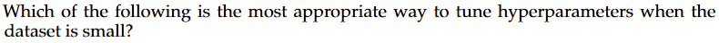

**Figure 6.** Source question text for Question 8.

**Options**

**A.** Use the test set to select the best hyperparameters  
*Option ID:* `6406536034941`

**B.** Use k-fold cross-validation on the training data and keep the test set untouched for final re-porting  
*Option ID:* `6406536034942`

**C.** Tune on the training loss only; validation is unnecessary  
*Option ID:* `6406536034943`

**D.** Pick hyperparameters from a prior paper without checking performance  
*Option ID:* `6406536034944`

**Correct answer:** **B** — Use k-fold cross-validation on the training data and keep the test set untouched for final re-porting.  
**Source evidence:** Option B (6406536034942) rendered in green font (color 0x008000) with green checkmark icon (xref 1374 at y=505.26..517.26) in source PDF.

---

### Question 9

**Question ID:** `6406531862823` · **Type:** MCQ · **Marks:** 1  
**PDF pages:** 4

How is disentangled representation evaluated?:

**Options**

**A.** Using Mutual Information Gap  
*Option ID:* `6406536034945`

**B.** Using mean Average Precision  
*Option ID:* `6406536034946`

**C.** KL divergence  
*Option ID:* `6406536034947`

**D.** Sparsity in the latent one-hot codes  
*Option ID:* `6406536034948`

**Correct answer:** **A** — Using Mutual Information Gap.  
**Source evidence:** Option A (6406536034945) rendered in green font (color 0x008000) with green checkmark icon (xref 1374 at y=704.46..716.46) in source PDF.

---

### Question 10

**Question ID:** `6406531862824` · **Type:** MSQ · **Marks:** 1  
**PDF pages:** 5

Which statements about generative models are true? (Select all that apply.)

**Options**

**A.** VAEs optimize a lower bound on the data log-likelihood.  
*Option ID:* `6406536034949`

**B.** GANs perform explicit maximum likelihood estimation.  
*Option ID:* `6406536034950`

**C.** Diffusion models can trade off speed and quality via the number of sampling steps.  
*Option ID:* `6406536034951`

**D.** Autoregressive models factorize the joint distribution into a product of conditionals.  
*Option ID:* `6406536034952`

**Correct answer:** **A**, **C**, **D** — VAEs optimize a lower bound on the data log-likelihood. ; Diffusion models can trade off speed and quality via the number of sampling steps. ; Autoregressive models factorize the joint distribution into a product of conditionals..  
**Source evidence:** Option A (6406536034949) rendered in green font (color 0x008000) with green checkmark icon (xref 1374 at y=114.92..126.92) in source PDF; Option C (6406536034951) rendered in green font (color 0x008000) with green checkmark icon (xref 1374 at y=156.56..168.56) in source PDF; Option D (6406536034952) rendered in green font (color 0x008000) with green checkmark icon (xref 1374 at y=193.70..205.70) in source PDF.

---

### Question 11

**Question ID:** `6406531862825` · **Type:** MSQ · **Marks:** 1  
**PDF pages:** 5

In classifier-free guidance for diffusion models, increasing the guidance scale $\gamma$ tends to: (Select all that apply.)

**Options**

**A.** improve fidelity to the conditioning signal  
*Option ID:* `6406536034953`

**B.** always reduce mode collapse to zero  
*Option ID:* `6406536034954`

**C.** reduce sample diversity at very high values  
*Option ID:* `6406536034955`

**D.** be equivalent to classifier guidance  
*Option ID:* `6406536034956`

**Correct answer:** **A**, **C** — improve fidelity to the conditioning signal ; reduce sample diversity at very high values.  
**Source evidence:** Option A (6406536034953) rendered in green font (color 0x008000) with green checkmark icon (xref 1374 at y=367.58..379.58) in source PDF; Option C (6406536034955) rendered in green font (color 0x008000) with green checkmark icon (xref 1374 at y=409.22..421.22) in source PDF.

---

### Question 12

**Question ID:** `6406531862826` · **Type:** MSQ · **Marks:** 1  
**PDF pages:** 5

Which statements are correct? (Select all that apply.)

**Options**

**A.** A linear autoencoder with MSE and no activation learns a subspace equivalent to PCA (up to rotation) when the hidden dimension < input dimension.  
*Option ID:* `6406536034957`

**B.** Global attention assigns alignment weights to all encoder time steps for each decoder step.  
*Option ID:* `6406536034958`

**C.** Positional encodings convey order information that self-attention lacks.  
*Option ID:* `6406536034959`

**D.** it is impossible to generate multiple, semantically similar captions with different styles for the same image.  
*Option ID:* `6406536034960`

**Correct answer:** **A**, **B**, **C** — A linear autoencoder with MSE and no activation learns a subspace equivalent to PCA (up to rotation) when the hidden dimension < input dimension. ; Global attention assigns alignment weights to all encoder time steps for each decoder step. ; Positional encodings convey order information that self-attention lacks..  
**Source evidence:** Option A (6406536034957) rendered in green font (color 0x008000) with green checkmark icon (xref 1374 at y=571.28..583.28) in source PDF; Option B (6406536034958) rendered in green font (color 0x008000) with green checkmark icon (xref 1374 at y=608.42..620.42) in source PDF; Option C (6406536034959) rendered in green font (color 0x008000) with green checkmark icon (xref 1374 at y=645.56..657.56) in source PDF.

---

### Question 13

**Question ID:** `6406531862827` · **Type:** SA · **Marks:** 1  
**PDF pages:** 6

Using the integral image $II$ below (1-indexed):

$$II = \begin{bmatrix} 4 & 9 & 12 \\ 10 & 20 & 30 \\ 15 & 33 & 50 \end{bmatrix}$$

Compute the sum of the original image over rectangle rows 2:3, cols 2:3.

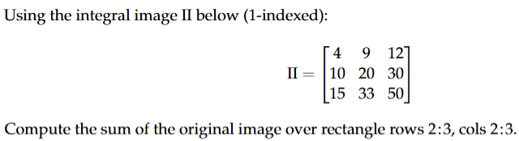

**Figure 7.** Source integral image matrix and query for Question 13.

**Correct answer:** `27`  
**Source evidence:** Official answer '27' specified in Possible Answers field with green text (color 0x008000); calculation: II(3,3) - II(1,3) - II(3,1) + II(1,1) = 50 - 12 - 15 + 4 = 27.

---

### Question 14

**Question ID:** `6406531862828` · **Type:** SA · **Marks:** 1  
**PDF pages:** 6

Calculate the output size ($W_{out}$) of a 1D convolution layer. Input width $W_{in} = 100$, Kernel size $K = 3$, Stride $S = 2$, Padding $P = 1$.

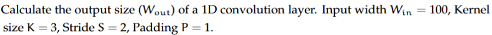

**Figure 8.** Source 1D convolution parameters for Question 14.

**Correct answer:** `50`  
**Source evidence:** Official answer '50' specified in Possible Answers field with green text (color 0x008000); calculation: floor((100 - 3 + 2*1)/2) + 1 = floor(99/2) + 1 = 49 + 1 = 50.

---

### Question 15

**Question ID:** `6406531862829` · **Type:** SA · **Marks:** 1  
**PDF pages:** 7

You are training a model with a batch size of 64 on a dataset of 10,000 images. How many iterations (parameter updates) happen in exactly one epoch? (Assume the final incomplete batch is dropped).

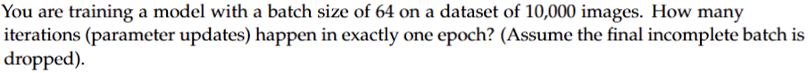

**Figure 9.** Source training dataset and batch size parameters for Question 15.

**Correct answer:** `156`  
**Source evidence:** Official answer '156' specified in Possible Answers field with green text (color 0x008000); calculation: floor(10000 / 64) = 156.

---

### Question 16

**Question ID:** `6406531862830` · **Type:** MCQ · **Marks:** 1  
**PDF pages:** 7

Mixup data augmentation primarily:

**Options**

**A.** reduces label noise by hardening labels  
*Option ID:* `6406536034964`

**B.** creates convex combinations of inputs and labels to encourage linear behavior between classes  
*Option ID:* `6406536034965`

**C.** prunes redundant training samples  
*Option ID:* `6406536034966`

**D.** increases input resolution without changing model capacity  
*Option ID:* `6406536034967`

**Correct answer:** **B** — creates convex combinations of inputs and labels to encourage linear behavior between classes.  
**Source evidence:** Option B (6406536034965) rendered in green font (color 0x008000) with green checkmark icon (xref 1374 at y=455.44..467.44) in source PDF.

---

### Question 17

**Question ID:** `6406531862831` · **Type:** SA · **Marks:** 1  
**PDF pages:** 8

In a classification problem with 3 classes, the logits are vector $\mathbf{z} = [2.0, 1.0, 0.1]$. Calculate the probability of the first class after applying Softmax. (Round to 2 decimal places).

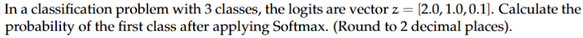

**Figure 10.** Source logits vector and softmax probability query for Question 17.

**Correct answer:** `0.6 to 0.69`  
**Source evidence:** Official accepted range '0.6 to 0.69' specified in Possible Answers field with green text (color 0x008000); calculation: exp(2.0)/(exp(2.0)+exp(1.0)+exp(0.1)) ≈ 7.389 / 11.213 ≈ 0.66.

---

### Question 18

**Question ID:** `6406531862832` · **Type:** MCQ · **Marks:** 1  
**PDF pages:** 8

During training, Batch Normalization uses:

**Options**

**A.** Running (population) statistics only  
*Option ID:* `6406536034969`

**B.** batch statistics for normalization and updates running estimates for inference  
*Option ID:* `6406536034970`

**C.** neither batch nor running statistics  
*Option ID:* `6406536034971`

**D.** group-wise normalization identical to GroupNorm  
*Option ID:* `6406536034972`

**Correct answer:** **B** — batch statistics for normalization and updates running estimates for inference.  
**Source evidence:** Option B (6406536034970) rendered in green font (color 0x008000) with green checkmark icon (xref 1374 at y=435.19..447.19) in source PDF.

---

### Question 19

**Question ID:** `6406531862833` · **Type:** MSQ · **Marks:** 1  
**PDF pages:** 8

Which techniques help mitigate exploding/vanishing gradients in RNNs? (Select all that apply.)

**Options**

**A.** Gradient clipping  
*Option ID:* `6406536034973`

**B.** Orthogonal or identity initialization of recurrent weights  
*Option ID:* `6406536034974`

**C.** Using LSTM/GRU cells  
*Option ID:* `6406536034975`

**D.** Randomly reversing input sequences as augmentation  
*Option ID:* `6406536034976`

**Correct answer:** **A**, **B**, **C** — Gradient clipping ; Orthogonal or identity initialization of recurrent weights ; Using LSTM/GRU cells.  
**Source evidence:** Option A (6406536034973) rendered in green font (color 0x008000) with green checkmark icon (xref 1374 at y=618.07..630.07) in source PDF; Option B (6406536034974) rendered in green font (color 0x008000) with green checkmark icon (xref 1374 at y=638.89..650.89) in source PDF; Option C (6406536034975) rendered in green font (color 0x008000) with green checkmark icon (xref 1374 at y=659.71..671.71) in source PDF.

---

### Question 20

**Question ID:** `6406531862834` · **Type:** SA · **Marks:** 1  
**PDF pages:** 9

Consider a scalar loss $l = \frac{1}{2}(\hat{y} - y)^2$ with $\hat{y} = wx + b$. For $x = 3, y = 5, w = 2, b = 1$, compute $\frac{\partial l}{\partial w}$.

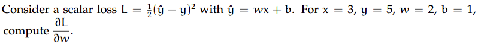

**Figure 11.** Source scalar loss and gradient query for Question 20.

**Correct answer:** `6`  
**Source evidence:** Official answer '6' specified in Possible Answers field with green text (color 0x008000); calculation: y_hat = 2*3 + 1 = 7, dl/dw = (y_hat - y) * x = (7 - 5) * 3 = 6.

---

## Answer key

| Source question | Question ID | Correct answer | PDF page(s) |
| :--- | :--- | :--- | :--- |
| 2 | `6406531862816` | 62 | 2 |
| 3 | `6406531862817` | 92 to 94 | 2 |
| 4 | `6406531862818` | B | 3 |
| 5 | `6406531862819` | B | 3 |
| 6 | `6406531862820` | B | 3 |
| 7 | `6406531862821` | A | 4 |
| 8 | `6406531862822` | B | 4 |
| 9 | `6406531862823` | A | 4 |
| 10 | `6406531862824` | A, C, D | 5 |
| 11 | `6406531862825` | A, C | 5 |
| 12 | `6406531862826` | A, B, C | 5 |
| 13 | `6406531862827` | 27 | 6 |
| 14 | `6406531862828` | 50 | 6 |
| 15 | `6406531862829` | 156 | 7 |
| 16 | `6406531862830` | B | 7 |
| 17 | `6406531862831` | 0.6 to 0.69 | 8 |
| 18 | `6406531862832` | B | 8 |
| 19 | `6406531862833` | A, B, C | 8 |
| 20 | `6406531862834` | 6 | 9 |

## Extraction notes

- **Scope boundaries:** The DL(CV) section begins on Page 1 at the `DL(CV)` section header (Section Id `640653124677`) and concludes on Page 9 at the end of Question 20. There are no preceding or trailing out-of-scope subjects in this question paper.
- **Administrative confirmation excluded:** Question 1 on Page 1 (Question Id `6406531862815`, 0 marks), the administrative subject verification prompt with YES/NO options, has been excluded in accordance with extraction requirements.
- **Question count and score reconciliation:** The Section header declares 20 questions and 19 section marks. Excluding the 0-mark administrative confirmation Question 1 leaves exactly 19 academic questions (Questions 2–20), each carrying 1 mark (total 19 marks), perfectly reconciling with the declared section marks.
- **Question types:** The paper consists of 7 Short Answer (SA) questions (Questions 2, 3, 13, 14, 15, 17, 20), 8 Multiple Choice Questions (MCQ) (Questions 4, 5, 6, 7, 8, 9, 16, 18), and 4 Multiple Select Questions (MSQ) (Questions 10, 11, 12, 19).
- **Embedded image stems:** Questions 2, 3, 4, 5, 7, 8, 13, 14, 15, 17, and 20 contain embedded source images in their stems. Each image has been faithfully transcribed in Markdown/LaTeX and accompanied by the exact source graphic asset (`assets/da5006_2025T3_ET_FN/qXX-stem-01-pYYY.png`) and sequential numbered caption.
- **MSQ questions:** Question 10 has 3 correct options (A, C, D); Question 11 has 2 correct options (A, C); Question 12 has 3 correct options (A, B, C); Question 19 has 3 correct options (A, B, C). All marked correct options are preserved with exact option IDs, green font color, and green checkmark evidence.
- **Numeric ranges and formulas:** Question 3 accepts range `92 to 94` (central element under linear contrast stretching); Question 17 accepts range `0.6 to 0.69` (softmax probability of class 1); Question 20 calculates $\frac{\partial l}{\partial w} = 6$ for $l = \frac{1}{2}(\hat{y} - y)^2$. All calculations and official keys have been independently verified.
