# DL(CV) — da5006_2025T3_Q2_NA

**Subject:** Deep Learning for Computer Vision  
**Source:** `da5006_2025T3_Q2_NA.pdf` (original PDF omitted from this bundle)  
**Academic questions:** 50  
**Scope:** DL(CV) section; administrative subject confirmation excluded.

## Questions

### Question 130

**Question ID:** `6406531815722` · **Type:** Multiple Choice Question · **Marks:** 2  
**PDF pages:** 2

The integral image (summed area table) of $\begin{bmatrix} 1 & 2 & 3 \\ 4 & 5 & 6 \\ 7 & 8 & 9 \end{bmatrix}$ is:

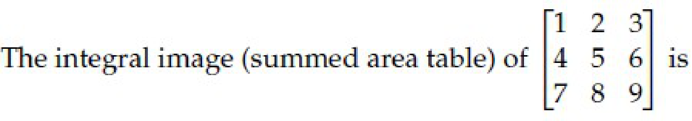

**Figure 1.** Input 3x3 matrix for Question 130.

**Options**

**A.** $\begin{bmatrix} 1 & 3 & 6 \\ 5 & 12 & 21 \\ 12 & 27 & 45 \end{bmatrix}$  
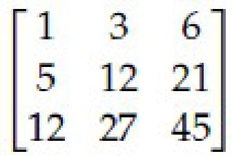

**Figure 2.** Option A matrix for Question 130.

*Option ID:* `6406535903082`

**B.** $\begin{bmatrix} 1 & 2 & 3 \\ 5 & 7 & 9 \\ 12 & 15 & 18 \end{bmatrix}$  
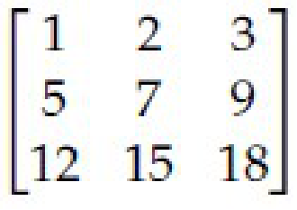

**Figure 3.** Option B matrix for Question 130.

*Option ID:* `6406535903083`

**C.** $\begin{bmatrix} 1 & 3 & 6 \\ 4 & 9 & 15 \\ 7 & 15 & 24 \end{bmatrix}$  
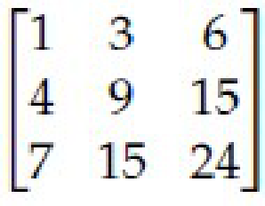

**Figure 4.** Option C matrix for Question 130.

*Option ID:* `6406535903084`

**D.** $\begin{bmatrix} 9 & 8 & 7 \\ 6 & 5 & 4 \\ 3 & 2 & 1 \end{bmatrix}$  
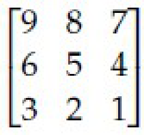

**Figure 5.** Option D matrix for Question 130.

*Option ID:* `6406535903085`

**Correct answer:** **A** — $\begin{bmatrix} 1 & 3 & 6 \\ 5 & 12 & 21 \\ 12 & 27 & 45 \end{bmatrix}$.  
**Source evidence:** Option ID 6406535903082 in green text (0x8000) with check icon, PDF page 2.

---

### Question 131

**Question ID:** `6406531815723` · **Type:** Multiple Choice Question · **Marks:** 2  
**PDF pages:** 2

Which of the following architectures introduced the ROI pooling layer for extracting fixed-size feature maps from variable-size region proposals?

**Options**

**A.** R-CNN  
*Option ID:* `6406535903086`

**B.** Fast R-CNN  
*Option ID:* `6406535903087`

**C.** Faster R-CNN  
*Option ID:* `6406535903088`

**D.** YOLO  
*Option ID:* `6406535903089`

**Correct answer:** **B** — Fast R-CNN.  
**Source evidence:** Option B (6406535903087) in green text (0x8000) with check icon, PDF page 2.

---

### Question 132

**Question ID:** `6406531815724` · **Type:** Multiple Choice Question · **Marks:** 2  
**PDF pages:** 3

Which object detection method first integrated a Region Proposal Network (RPN) to generate region proposals within the detection model?

**Options**

**A.** R-CNN  
*Option ID:* `6406535903090`

**B.** Fast R-CNN  
*Option ID:* `6406535903091`

**C.** Faster R-CNN  
*Option ID:* `6406535903092`

**D.** YOLO  
*Option ID:* `6406535903093`

**Correct answer:** **C** — Faster R-CNN.  
**Source evidence:** Option C (6406535903092) in green text (0x8000) with check icon, PDF page 3.

---

### Question 133

**Question ID:** `6406531815725` · **Type:** Multiple Choice Question · **Marks:** 2  
**PDF pages:** 3

Which architecture performs object detection as a single regression problem from image pixels to bounding boxes and class probabilities?

**Options**

**A.** R-CNN  
*Option ID:* `6406535903094`

**B.** Fast R-CNN  
*Option ID:* `6406535903095`

**C.** Faster R-CNN  
*Option ID:* `6406535903096`

**D.** YOLO  
*Option ID:* `6406535903097`

**Correct answer:** **D** — YOLO.  
**Source evidence:** Option D (6406535903097) in green text (0x8000) with check icon, PDF page 3.

---

### Question 134

**Question ID:** `6406531815726` · **Type:** Multiple Choice Question · **Marks:** 2  
**PDF pages:** 3

Match architectures to their characteristic ideas:

| Architecture | Characteristic idea |
| :--- | :--- |
| 1) AlexNet | i) Dense connections |
| 2) MobileNet | ii) Depthwise separable conv |
| 3) DenseNet | iii) Skip connection |
| 4) ResNet | iv) ReLU + Dropout + LRN |

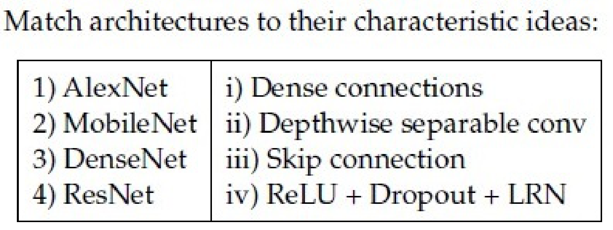

**Figure 6.** Architecture matching table for Question 134.

**Options**

**A.** 1→iv, 2→ii, 3→i, 4→iii  
*Option ID:* `6406535903098`

**B.** 1→ii, 2→iv, 3→i, 4→iii  
*Option ID:* `6406535903099`

**C.** 1→iv, 2→i, 3→ii, 4→iii  
*Option ID:* `6406535903100`

**D.** 1→iii, 2→ii, 3→iv, 4→i  
*Option ID:* `6406535903101`

**Correct answer:** **A** — 1→iv, 2→ii, 3→i, 4→iii.  
**Source evidence:** Option A (6406535903098) in green text (0x8000) with check icon, PDF page 3.

---

### Question 135

**Question ID:** `6406531815727` · **Type:** Multiple Choice Question · **Marks:** 2  
**PDF pages:** 3, 4

Consider the following statements P and Q regarding AlexNet and choose the correct option: (P) In AlexNet, a trainable Local Response Normalization Layers were introduced to emulate the competitive nature of real neurons, where highly active neurons suppress the activity of neighboring neurons, creating competition among different kernel outputs. (Q) In AlexNet, a total of 8 Convolutional layers contain only about 6-7% of the total parameters hence account for the least computation.

**Options**

**A.** Only statement P is true  
*Option ID:* `6406535903102`

**B.** Only statement Q is true  
*Option ID:* `6406535903103`

**C.** Both statements are true  
*Option ID:* `6406535903104`

**D.** None of the statements is true  
*Option ID:* `6406535903105`

**Correct answer:** **D** — None of the statements is true.  
**Source evidence:** Option D (6406535903105) in green text (0x8000) with check icon, PDF page 4.

---

### Question 136

**Question ID:** `6406531815728` · **Type:** Multiple Choice Question · **Marks:** 2  
**PDF pages:** 4

Consider two bounding boxes in an image:

- Box A: top-left at (0, 0), bottom-right at (12, 12)
- Box B: top-left at (4, 4), bottom-right at (16, 16)

What is the Intersection over Union (IoU) between these two boxes ______________

**Options**

**A.** 21%  
*Option ID:* `6406535903106`

**B.** 28%  
*Option ID:* `6406535903107`

**C.** 36%  
*Option ID:* `6406535903108`

**D.** 44%  
*Option ID:* `6406535903109`

**Correct answer:** **B** — 28%.  
**Source evidence:** Option B (6406535903107) in green text (0x8000) with check icon, PDF page 4.

---

### Question 137

**Question ID:** `6406531815729` · **Type:** Multiple Choice Question · **Marks:** 2  
**PDF pages:** 4

Which one of the following statements is True?

**Options**

**A.** Attention mechanisms can be applied to the bidirectional RNN model  
*Option ID:* `6406535903110`

**B.** An image captioning network cannot be trained end-to-end even though we are using 2 different modalities to train the network  
*Option ID:* `6406535903111`

**C.** One of the key components in the vanilla transformer are the recurrent connections that help them to deal with variable input length.  
*Option ID:* `6406535903112`

**D.** All Attention mechanisms can be applied to the bidirectional RNN model, An image captioning network cannot be trained end-to-end even though we are using 2 different modalities to train the network, One of the key components in the vanilla transformer are the recurrent connections that help them to deal with variable input length.  
*Option ID:* `6406535903113`

**E.** None of these  
*Option ID:* `6406535903114`

**Correct answer:** **A** — Attention mechanisms can be applied to the bidirectional RNN model.  
**Source evidence:** Option A (6406535903110) in green text (0x8000) with check icon, PDF page 4.

---

### Question 138

**Question ID:** `6406531815730` · **Type:** Multiple Choice Question · **Marks:** 2  
**PDF pages:** 5

Match the following computer vision tasks to situations:

| Task | Situation |
| :--- | :--- |
| 1) Instance Segmentation | i) There are cars in these pixels |
| 2) Classification | ii) There are 4 cars in the image |
| 3) Semantic Segmentation | iii) There is car in the image |
| 4) Object Detection | iv) There are 4 cars in the image, and here are the pixels with the shape of each of their occurrence |

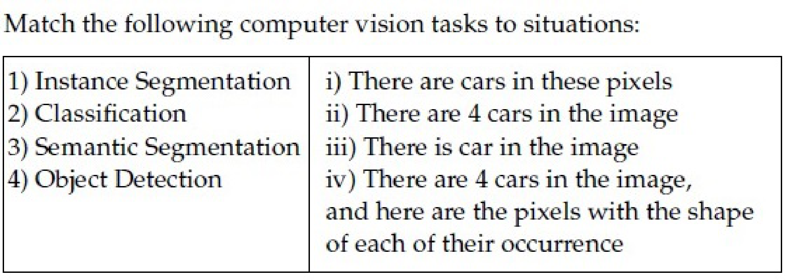

**Figure 7.** Computer vision tasks matching table for Question 138.

**Options**

**A.** 1 → iv, 2 → iii, 3 → ii, 4 → i  
*Option ID:* `6406535903115`

**B.** 1 → ii, 2 → iii, 3 → i, 4 →iv  
*Option ID:* `6406535903116`

**C.** 1 → iv, 2→ iii, 3 → i, 4 → ii  
*Option ID:* `6406535903117`

**D.** 1 → ii, 2 → iv, 3 → iii, 4 → i  
*Option ID:* `6406535903118`

**Correct answer:** **C** — 1 → iv, 2→ iii, 3 → i, 4 → ii.  
**Source evidence:** Option C (6406535903117) in green text (0x8000) with check icon, PDF page 5.

---

### Question 139

**Question ID:** `6406531815731` · **Type:** Multiple Choice Question · **Marks:** 2  
**PDF pages:** 5

Match the following:

| RNN Architecture | Application |
| :--- | :--- |
| 1) One-to-many RNN architecture | i) Sentiment analysis of Netflix reviews |
| 2) Many-to-one RNN architecture | ii) Convert English sentence to Hindi |
| 3) Many-to-many RNN architecture with equal number of inputs and outputs | iii) Named entity recognition |
| 4) Many-to-many RNN architecture with unequal number of inputs and outputs (Encoder and Decoder model) | iv) Music generation |

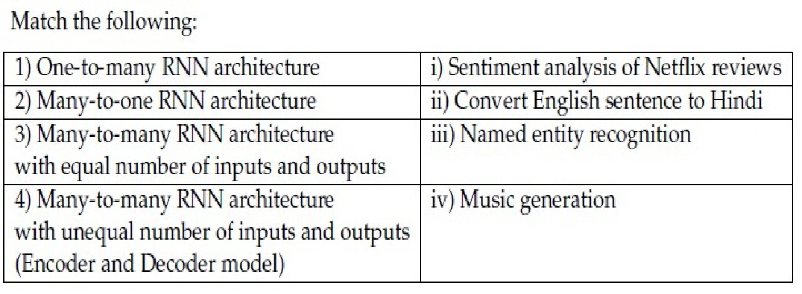

**Figure 8.** RNN architecture matching table for Question 139.

**Options**

**A.** 1 → iii, 2 → iv, 3 → ii, 4 → i  
*Option ID:* `6406535903119`

**B.** 1 → iv, 2→ i, 3 → iii, 4 →ii  
*Option ID:* `6406535903120`

**C.** 1 → i, 2 → ii, 3 → iii, 4 → iv  
*Option ID:* `6406535903121`

**D.** 1 → i, 2 → iii, 3→ ii, 4 → iv  
*Option ID:* `6406535903122`

**Correct answer:** **B** — 1 → iv, 2→ i, 3 → iii, 4 →ii.  
**Source evidence:** Option B (6406535903120) in green text (0x8000) with check icon, PDF page 5.

---

### Question 140

**Question ID:** `6406531815732` · **Type:** Multiple Choice Question · **Marks:** 2  
**PDF pages:** 5, 6

Match the following attention mechanisms to their corresponding alignment score functions:

| Attention Mechanism | Alignment Score Function |
| :--- | :--- |
| (1) General Attention | (i) $v_a^T \tanh(W_a [s_t; h_i])$ |
| (2) Content-Based Attention | (ii) $\alpha_{t,i} = \text{softmax}(W_a s_t)$ |
| (3) Dot-Product Attention | (iii) $s_t^T h_i$ |
| (4) Additive Attention | (iv) $\cos(s_t, h_i)$ |
| (5) Location-Based Attention | (v) $s_t^T W_a h_i$ |

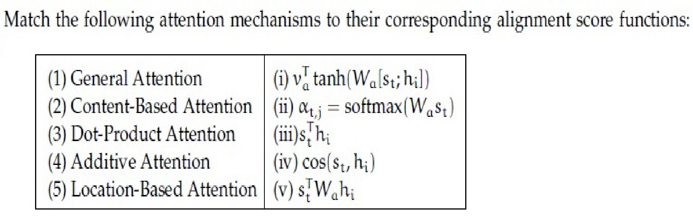

**Figure 9.** Attention mechanisms matching table for Question 140.

**Options**

**A.** 1→iii, 2→ii, 3→v, 4→iv,5→i  
*Option ID:* `6406535903123`

**B.** 1→iii, 2→iv, 3→i, 4→ii,5→v  
*Option ID:* `6406535903124`

**C.** 1→i, 2→iii, 3→iv, 4→ii,5→v  
*Option ID:* `6406535903125`

**D.** 1→v, 2→iv, 3→iii, 4→i,5→ii  
*Option ID:* `6406535903126`

**Correct answer:** **D** — 1→v, 2→iv, 3→iii, 4→i,5→ii.  
**Source evidence:** Option D (6406535903126) in green text (0x8000) with check icon, PDF page 6.

---

### Question 141

**Question ID:** `6406531815733` · **Type:** Multiple Choice Question · **Marks:** 2  
**PDF pages:** 6

Which of the following techniques help mitigate the vanishing gradient problem in recurrent neural networks?

1. Gradient clipping
2. Use of ReLU activation to preserve gradient flow
3. Use of LSTM units
4. Data augmentation (e.g., reversing input sequence)

**Options**

**A.** 1 and 2 only  
*Option ID:* `6406535903127`

**B.** 2 and 3 only  
*Option ID:* `6406535903128`

**C.** 3 and 4 only  
*Option ID:* `6406535903129`

**D.** 1, 2, and 3 only  
*Option ID:* `6406535903130`

**Correct answer:** **B** — 2 and 3 only.  
**Source evidence:** Option B (6406535903128) in green text (0x8000) with check icon, PDF page 6.

---

### Question 142

**Question ID:** `6406531815734` · **Type:** Multiple Choice Question · **Marks:** 2  
**PDF pages:** 6, 7

Which of the following techniques help mitigate the exploding gradient problem in recurrent neural networks?

1. Gradient clipping
2. Use of Sigmoid activation to prevent gradient growth
3. Use of LSTM units
4. Data augmentation (e.g., reversing input sequence)

**Options**

**A.** 1 and 2 only  
*Option ID:* `6406535903131`

**B.** 1 and 3 only  
*Option ID:* `6406535903132`

**C.** 1, 2, and 3  
*Option ID:* `6406535903133`

**D.** All of these  
*Option ID:* `6406535903134`

**Correct answer:** **B** — 1 and 3 only.  
**Source evidence:** Option B (6406535903132) in green text (0x8000) with check icon, PDF page 6.

---

### Question 143

**Question ID:** `6406531815735` · **Type:** Multiple Choice Question · **Marks:** 2  
**PDF pages:** 7

Which one of the following statements is false? (Pick the most appropriate one.)

**Options**

**A.** Attention mechanisms cannot be applied to the bidirectional RNN model  
*Option ID:* `6406535903135`

**B.** An image captioning network cannot be trained end-to-end even though we are using 2 different modalities to train the network  
*Option ID:* `6406535903136`

**C.** One of the key components in the vanilla transformer is the recurrent connection that help them to deal with variable input length.  
*Option ID:* `6406535903137`

**D.** All of these  
*Option ID:* `6406535903138`

**Correct answer:** **D** — All of these.  
**Source evidence:** Option D (6406535903138) in green text (0x8000) with check icon, PDF page 7.

---

### Question 144

**Question ID:** `6406531815739` · **Type:** Short Answer · **Marks:** 2  
**PDF pages:** 7

Consider a Faster R-CNN object detection framework, which is being trained with a mini-batch size of 2. The RPN produces 512 proposals, out of which 256 and 128 of them are foreground proposals, corresponding to each image in the mini-batch. For a single mini-batch update, the bounding box regression loss will be computed ____ times.

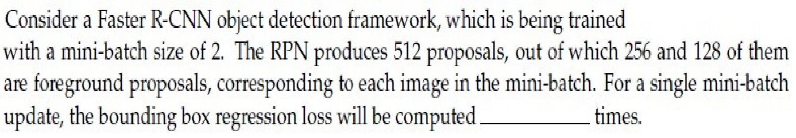

**Figure 10.** Faster R-CNN question specification for Question 144.

**Correct answer:** `384`  
**Source evidence:** Green text (0x8000) under Possible Answers : 384, PDF page 7.

---

### Question 145

**Question ID:** `6406531815736` · **Type:** Multiple Select Question · **Marks:** 3  
**PDF pages:** 7, 8

Which of the following is true regarding Hard Attention and Soft Attention?

**Options**

**A.** Soft Attention is smooth and differentiable  
*Option ID:* `6406535903139`

**B.** Variance reduction techniques are used to train Soft Attention models  
*Option ID:* `6406535903140`

**C.** Soft Attention is computationally cheaper than Hard Attention when the source input is large  
*Option ID:* `6406535903141`

**D.** The inference (test time) overhead is low in Hard Attention when compared to Soft Attention models  
*Option ID:* `6406535903142`

**Correct answer:** **A**, **D** — Soft Attention is smooth and differentiable; The inference (test time) overhead is low in Hard Attention when compared to Soft Attention models.  
**Source evidence:** Option A (6406535903139) in green text (0x8000) with check icon, PDF page 8.

---

### Question 146

**Question ID:** `6406531815737` · **Type:** Multiple Select Question · **Marks:** 3  
**PDF pages:** 8

Which of the following statements are correct regarding deep convolutional network interpretability and visualization?

**Options**

**A.** For generating an image of a required class, Deep Inside Convolutional Networks uses gradient descent with the following optimization : $\arg\min_I (S_c(I) - \lambda \|I\|_2^2)$ where $S_c$ is the scores vector for class $c$ before applying softmax.  
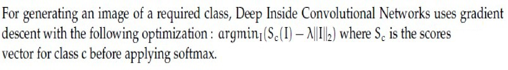

**Figure 11.** Option A optimization formula for Question 146.

*Option ID:* `6406535903143`

**B.** Visualizing the maximum of the data gradient across the channels provides insights into the image regions that have the most significant impact on generating high probability scores for a specific class.  
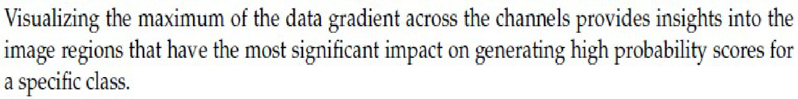

**Figure 12.** Option B data gradient visualization statement for Question 146.

*Option ID:* `6406535903144`

**C.** Global average Pooling refers to the average of all the pixels at a particular spatial location across all the channels.  
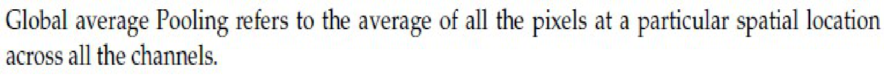

**Figure 13.** Option C Global Average Pooling statement for Question 146.

*Option ID:* `6406535903145`

**D.** Class Activation Map (CAM) does not require a backward pass through the entire model.  
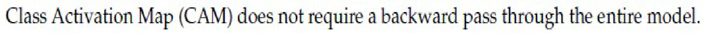

**Figure 14.** Option D Class Activation Map statement for Question 146.

*Option ID:* `6406535903146`

**Correct answer:** **A**, **C** — For generating an image of a required class, Deep Inside Convolutional Networks uses gradient descent with the following optimization : $\arg\min_I (S_c(I) - \lambda \|I\|_2^2)$ where $S_c$ is the scores vector for class $c$ before applying softmax.; Global average Pooling refers to the average of all the pixels at a particular spatial location across all the channels..  
**Source evidence:** Option A (6406535903143) with check icon and green text marker, PDF page 8.

---

### Question 147

**Question ID:** `6406531815738` · **Type:** Multiple Select Question · **Marks:** 3  
**PDF pages:** 8

Which techniques help mitigate exploding/vanishing gradients in RNNs? (Select all that apply.)

**Options**

**A.** Gradient clipping  
*Option ID:* `6406535903147`

**B.** Orthogonal or identity initialization of recurrent weights  
*Option ID:* `6406535903148`

**C.** Using LSTM/GRU cells  
*Option ID:* `6406535903149`

**D.** Randomly reversing input sequences as augmentation  
*Option ID:* `6406535903150`

**Correct answer:** **A**, **B**, **C** — Gradient clipping; Orthogonal or identity initialization of recurrent weights; Using LSTM/GRU cells.  
**Source evidence:** Option A (6406535903147) in green text (0x8000) with check icon, PDF page 8.

---

### Question 148

**Question ID:** `6406531815741` · **Type:** Short Answer · **Marks:** 0.5  
**PDF pages:** 9

Consider a Gated Recurrent Unit (GRU) cell at time step 't'. For each of the entities given, enter the appropriate number from the figure that corresponds to it:

Based on the above data, answer the given subquestion:

Hidden state $h_{t-1} = \text{___}$

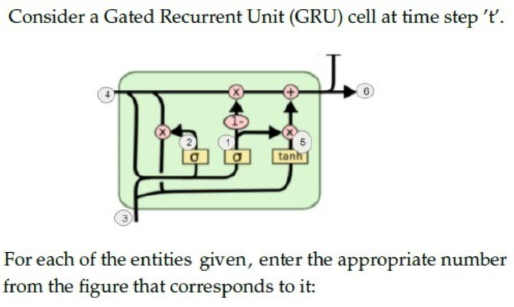

**Figure 15.** Gated Recurrent Unit (GRU) cell architecture for Questions 148 to 153.

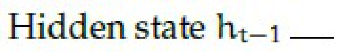

**Figure 16.** Subquestion stem for Question 148.

**Correct answer:** `4`  
**Source evidence:** Green text (0x8000) under Possible Answers : 4, PDF page 9.

---

### Question 149

**Question ID:** `6406531815742` · **Type:** Short Answer · **Marks:** 0.5  
**PDF pages:** 9, 10

Refer to the specifications and GRU architecture diagram in Question 148.

Based on the above data, answer the given subquestion:

Hidden state $h_t = \text{___}$

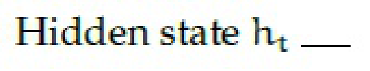

**Figure 17.** Subquestion stem for Question 149.

**Correct answer:** `6`  
**Source evidence:** Green text (0x8000) under Possible Answers : 6, PDF page 10.

---

### Question 150

**Question ID:** `6406531815743` · **Type:** Short Answer · **Marks:** 0.5  
**PDF pages:** 10

Refer to the specifications and GRU architecture diagram in Question 148.

Based on the above data, answer the given subquestion:

Current Input $x_t = \text{___}$

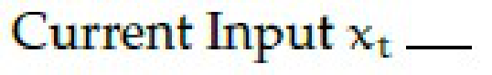

**Figure 18.** Subquestion stem for Question 150.

**Correct answer:** `3`  
**Source evidence:** Green text (0x8000) under Possible Answers : 3, PDF page 10.

---

### Question 151

**Question ID:** `6406531815744` · **Type:** Short Answer · **Marks:** 0.5  
**PDF pages:** 10

Refer to the specifications and GRU architecture diagram in Question 148.

Based on the above data, answer the given subquestion:

Update gate $z_t = \text{___}$

**Figure 19.** Subquestion stem for Question 151.

**Correct answer:** `1`  
**Source evidence:** Green text (0x8000) under Possible Answers : 1, PDF page 10.

---

### Question 152

**Question ID:** `6406531815745` · **Type:** Short Answer · **Marks:** 1  
**PDF pages:** 10

Refer to the specifications and GRU architecture diagram in Question 148.

Based on the above data, answer the given subquestion:

Reset gate $r_t = \text{___}$

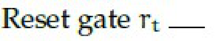

**Figure 20.** Subquestion stem for Question 152.

**Correct answer:** `2`  
**Source evidence:** Green text (0x8000) under Possible Answers : 2, PDF page 10.

---

### Question 153

**Question ID:** `6406531815746` · **Type:** Short Answer · **Marks:** 1  
**PDF pages:** 10, 11

Refer to the specifications and GRU architecture diagram in Question 148.

Based on the above data, answer the given subquestion:

New hidden state content $\tilde{h}_t = \text{___}$

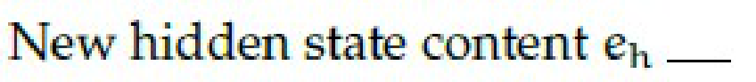

**Figure 21.** Subquestion stem for Question 153.

**Correct answer:** `5`  
**Source evidence:** Green text (0x8000) under Possible Answers : 5, PDF page 11.

---

### Question 154

**Question ID:** `6406531815748` · **Type:** Short Answer · **Marks:** 2  
**PDF pages:** 11

Let input have size $D_I \times D_I \times M$ where $D_I = 10$ and $M = 256$ and output feature map (after passing input through conv layer) has $D_I \times D_I \times N$ size where $N = 512$. Assume padded convolution. Let width of the square kernel in conv layer be $k$ where $k = 7$ (Ignore the bias term in the calculation). Calculate the number of parameters and computational cost for this convolution layer.

Based on the above data, answer the given subquestion.

Number of Parameters: ______________

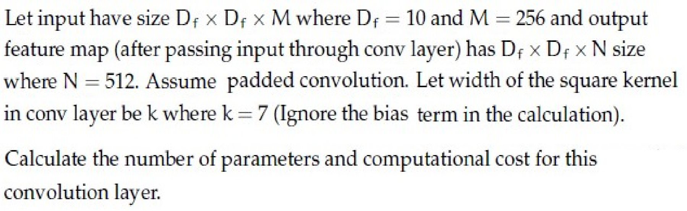

**Figure 22.** Convolutional layer specifications for Questions 154 and 155.

**Correct answer:** `6422528`  
**Source evidence:** Green text (0x8000) under Possible Answers : 6422528, PDF page 11.

---

### Question 155

**Question ID:** `6406531815749` · **Type:** Short Answer · **Marks:** 2  
**PDF pages:** 11, 12

Refer to the convolutional layer specifications in Question 154.

Based on the above data, answer the given subquestion.

Computational Cost: ________________

**Correct answer:** `642252800`  
**Source evidence:** Green text (0x8000) under Possible Answers : 642252800, PDF page 12.

---

### Question 156

**Question ID:** `6406531815751` · **Type:** Short Answer · **Marks:** 1  
**PDF pages:** 12

Using the same dimensions specified in the previous question main data ($D_I = 10, M = 256, N = 512, k = 7$), calculate the number of parameters and computational cost, but make use of Depthwise Seperable convolution and pointwise convolution instead of standard convolution.

Based on the above data, answer the given subquestion.

Number of parameters for depthwise seperable convolution: __________

**Correct answer:** `12544`  
**Source evidence:** Green text (0x8000) under Possible Answers : 12544, PDF page 12.

---

### Question 157

**Question ID:** `6406531815752` · **Type:** Short Answer · **Marks:** 1  
**PDF pages:** 12, 13

Refer to the specifications in Question 156.

Based on the above data, answer the given subquestion.

Computational Cost for depthwise seperable convolution: ____________

**Correct answer:** `1254400`  
**Source evidence:** Green text (0x8000) under Possible Answers : 1254400, PDF page 13.

---

### Question 158

**Question ID:** `6406531815753` · **Type:** Short Answer · **Marks:** 1  
**PDF pages:** 13

Refer to the specifications in Question 156.

Based on the above data, answer the given subquestion.

Number of parameters for pointwise convolution: _____________

**Correct answer:** `131072`  
**Source evidence:** Green text (0x8000) under Possible Answers : 131072, PDF page 13.

---

### Question 159

**Question ID:** `6406531815754` · **Type:** Short Answer · **Marks:** 1  
**PDF pages:** 13

Refer to the specifications in Question 156.

Based on the above data, answer the given subquestion.

Computational cost for pointwise convolution: ____________

**Correct answer:** `13107200`  
**Source evidence:** Green text (0x8000) under Possible Answers : 13107200, PDF page 13.

---

### Question 160

**Question ID:** `6406531815756` · **Type:** Short Answer · **Marks:** 1  
**PDF pages:** 13, 14, 15

The RNN given below is used for classification:

Based on the above data, answer the given subquestion.

Number of weights in Weight Matrix U1 is: _____________

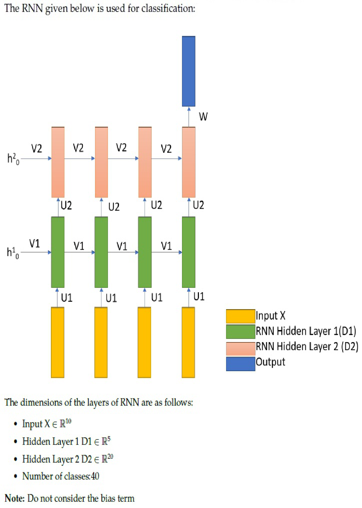

**Figure 23.** Recurrent neural network classification architecture for Questions 160 to 164.

**Correct answer:** `50`  
**Source evidence:** Green text (0x8000) under Possible Answers : 50, PDF page 15.

---

### Question 161

**Question ID:** `6406531815757` · **Type:** Short Answer · **Marks:** 1  
**PDF pages:** 15

Refer to the RNN classification architecture in Question 160.

Based on the above data, answer the given subquestion.

Number of weights in Weight Matrix V1 is: _____________

**Correct answer:** `25`  
**Source evidence:** Green text (0x8000) under Possible Answers : 25, PDF page 15.

---

### Question 162

**Question ID:** `6406531815758` · **Type:** Short Answer · **Marks:** 1  
**PDF pages:** 15

Refer to the RNN classification architecture in Question 160.

Based on the above data, answer the given subquestion.

Number of weights in Weight Matrix U2 is: _____________

**Correct answer:** `100`  
**Source evidence:** Green text (0x8000) under Possible Answers : 100, PDF page 15.

---

### Question 163

**Question ID:** `6406531815759` · **Type:** Short Answer · **Marks:** 0.5  
**PDF pages:** 15

Refer to the RNN classification architecture in Question 160.

Based on the above data, answer the given subquestion.

Number of weights in Weight Matrix V2 is: _____________

**Correct answer:** `400`  
**Source evidence:** Green text (0x8000) under Possible Answers : 400, PDF page 15.

---

### Question 164

**Question ID:** `6406531815760` · **Type:** Short Answer · **Marks:** 0.5  
**PDF pages:** 16

Refer to the RNN classification architecture in Question 160.

Based on the above data, answer the given subquestion.

Number of weights in Weight Matrix W is: _____________

**Correct answer:** `800`  
**Source evidence:** Green text (0x8000) under Possible Answers : 800, PDF page 16.

---

### Question 165

**Question ID:** `6406531815762` · **Type:** Short Answer · **Marks:** 0.5  
**PDF pages:** 16, 17

You are given the encoder hidden states $h_1, h_2, h_3 \in \mathbb{R}^2$ and the decoder hidden state $s_2 \in \mathbb{R}^2$ at time step $t = 2$.

Use dot-product attention, where the attention score is computed as:
$$e_{tj} = s_t^T h_j \quad \text{and} \quad \alpha_{tj} = \frac{\exp(e_{tj})}{\sum_{k=1}^3 \exp(e_{tk})}$$

The context vector is then computed as:
$$c_t = \sum_{j=1}^3 \alpha_{tj} h_j$$

Use the following values:
$$h_1 = \begin{bmatrix} 1 \\ 0 \end{bmatrix}, \quad h_2 = \begin{bmatrix} 0 \\ 2 \end{bmatrix}, \quad h_3 = \begin{bmatrix} 2 \\ 1 \end{bmatrix}, \quad s_2 = \begin{bmatrix} 1 \\ 0 \end{bmatrix}$$

Note: Use approximate values of exponential $\exp(1) \approx 2.72, \exp(2) \approx 7.39$, etc.

Answer the given subquestion:

$e_{21}:$

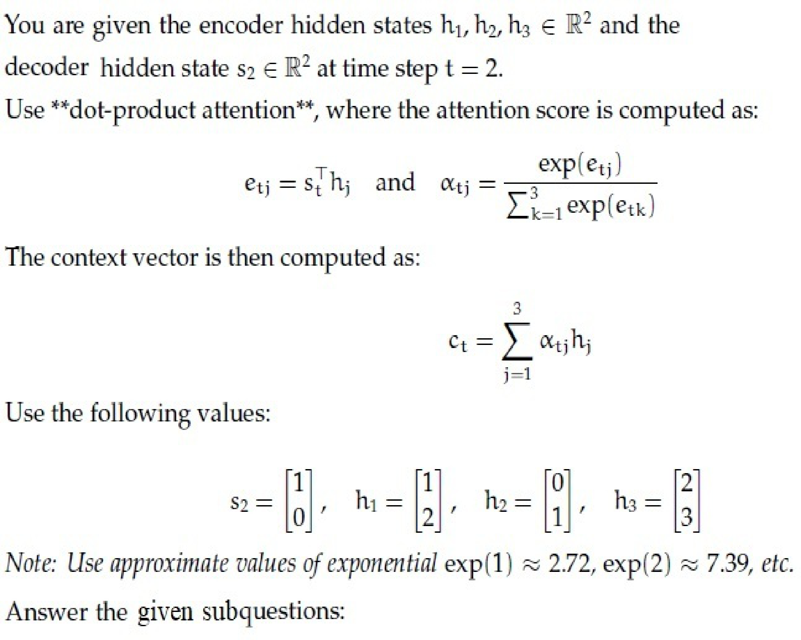

**Figure 24.** Dot-product attention equations and vector values for Questions 165 to 172.

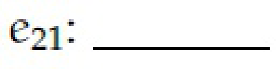

**Figure 25.** Subquestion stem for Question 165.

**Correct answer:** `1`  
**Source evidence:** Green text (0x8000) under Possible Answers : 1, PDF page 17.

---

### Question 166

**Question ID:** `6406531815763` · **Type:** Short Answer · **Marks:** 0.5  
**PDF pages:** 17

Refer to the dot-product attention specifications in Question 165.

Answer the given subquestion:

$e_{22}:$

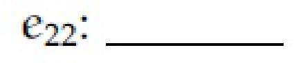

**Figure 26.** Subquestion stem for Question 166.

**Correct answer:** `0`  
**Source evidence:** Green text (0x8000) under Possible Answers : 0, PDF page 17.

---

### Question 167

**Question ID:** `6406531815764` · **Type:** Short Answer · **Marks:** 0.5  
**PDF pages:** 17

Refer to the dot-product attention specifications in Question 165.

Answer the given subquestion:

$e_{23}:$

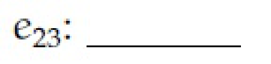

**Figure 27.** Subquestion stem for Question 167.

**Correct answer:** `2`  
**Source evidence:** Green text (0x8000) under Possible Answers : 2, PDF page 17.

---

### Question 168

**Question ID:** `6406531815765` · **Type:** Short Answer · **Marks:** 0.5  
**PDF pages:** 17, 18

Refer to the dot-product attention specifications in Question 165.

Answer the given subquestion:

$\alpha_{21}:$

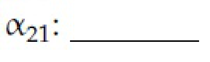

**Figure 28.** Subquestion stem for Question 168.

**Correct answer:** `0.24 to 0.25`  
**Source evidence:** Green text (0x8000) under Possible Answers : 0.24 to 0.25, PDF page 18.

---

### Question 169

**Question ID:** `6406531815766` · **Type:** Short Answer · **Marks:** 0.5  
**PDF pages:** 18

Refer to the dot-product attention specifications in Question 165.

Answer the given subquestion:

$\alpha_{22}:$

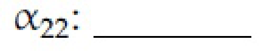

**Figure 29.** Subquestion stem for Question 169.

**Correct answer:** `0.09 to 0.1`  
**Source evidence:** Green text (0x8000) under Possible Answers : 0.09 to 0.1, PDF page 18.

---

### Question 170

**Question ID:** `6406531815767` · **Type:** Short Answer · **Marks:** 0.5  
**PDF pages:** 18

Refer to the dot-product attention specifications in Question 165.

Answer the given subquestion:

$\alpha_{23}:$

**Figure 30.** Subquestion stem for Question 170.

**Correct answer:** `0.66 to 0.68`  
**Source evidence:** Green text (0x8000) under Possible Answers : 0.66 to 0.68, PDF page 18.

---

### Question 171

**Question ID:** `6406531815768` · **Type:** Short Answer · **Marks:** 0.5  
**PDF pages:** 18

Refer to the dot-product attention specifications in Question 165.

Answer the given subquestion:

$c_{21}:$

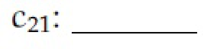

**Figure 31.** Subquestion stem for Question 171.

**Correct answer:** `1.5 to 1.6`  
**Source evidence:** Green text (0x8000) under Possible Answers : 1.5 to 1.6, PDF page 18.

---

### Question 172

**Question ID:** `6406531815769` · **Type:** Short Answer · **Marks:** 0.5  
**PDF pages:** 19

Refer to the dot-product attention specifications in Question 165.

Answer the given subquestion:

$c_{22}:$

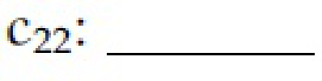

**Figure 32.** Subquestion stem for Question 172.

**Correct answer:** `2.5 to 2.6`  
**Source evidence:** Green text (0x8000) under Possible Answers : 2.5 to 2.6, PDF page 19.

---

### Question 173

**Question ID:** `6406531815771` · **Type:** Short Answer · **Marks:** 0.5  
**PDF pages:** 19, 20

You are given the encoder hidden states $h_1, h_2, h_3 \in \mathbb{R}^2$ and the decoder hidden state $s_2 \in \mathbb{R}^2$ at time step $t = 2$.

Use additive attention, where the alignment score is computed as:
$$e_{tj} = v_a^T \tanh(W_s s_t + W_e h_j) \quad \text{and} \quad \alpha_{tj} = \frac{\exp(e_{tj})}{\sum_{k=1}^3 \exp(e_{tk})}$$

The context vector is then computed as:
$$c_t = \sum_{j=1}^3 \alpha_{tj} h_j$$

Use the following values:
$$h_1 = \begin{bmatrix} 1 \\ 0 \end{bmatrix}, \quad h_2 = \begin{bmatrix} 1 \\ 1 \end{bmatrix}, \quad h_3 = \begin{bmatrix} 0 \\ 1 \end{bmatrix}, \quad s_2 = \begin{bmatrix} 2 \\ 1 \end{bmatrix}$$
$$W_s = \begin{bmatrix} 1 & 0 \\ 0 & 1 \end{bmatrix}, \quad W_e = \begin{bmatrix} 1 & 1 \\ 1 & 1 \end{bmatrix}, \quad v_a = \begin{bmatrix} 1 \\ -1 \end{bmatrix}$$

Answer the given subquestion:

$e_{21}:$

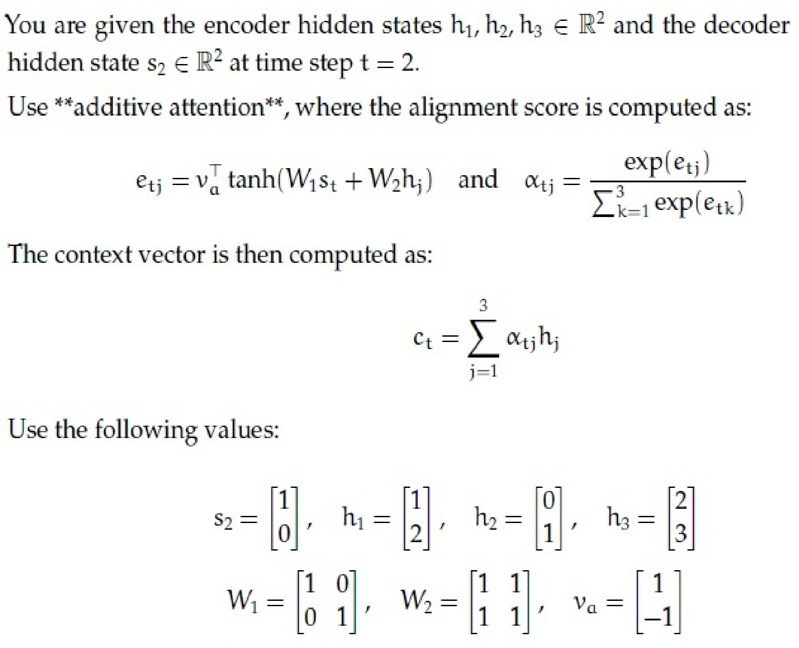

**Figure 33.** Additive attention equations and parameter values for Questions 173 to 179.

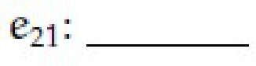

**Figure 34.** Subquestion stem for Question 173.

**Correct answer:** `-0.01 to 0.01`  
**Source evidence:** Green text (0x8000) under Possible Answers : -0.01 to 0.01, PDF page 20.

---

### Question 174

**Question ID:** `6406531815772` · **Type:** Short Answer · **Marks:** 0.5  
**PDF pages:** 20

Refer to the additive attention specifications in Question 173.

Answer the given subquestion:

$e_{22}:$

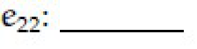

**Figure 35.** Subquestion stem for Question 174.

**Correct answer:** `-0.463 to -0.461`  
**Source evidence:** Green text (0x8000) under Possible Answers : -0.463 to -0.461, PDF page 20.

---

### Question 175

**Question ID:** `6406531815773` · **Type:** Short Answer · **Marks:** 0.5  
**PDF pages:** 20

Refer to the additive attention specifications in Question 173.

Answer the given subquestion:

$e_{23}:$

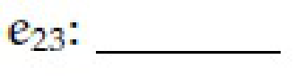

**Figure 36.** Subquestion stem for Question 175.

**Correct answer:** `0.461 to 0.463`  
**Source evidence:** Green text (0x8000) under Possible Answers : 0.461 to 0.463, PDF page 20.

---

### Question 176

**Question ID:** `6406531815774` · **Type:** Short Answer · **Marks:** 0.5  
**PDF pages:** 20, 21

Refer to the additive attention specifications in Question 173.

Answer the given subquestion:

$\alpha_{21}:$

**Figure 37.** Subquestion stem for Question 176.

**Correct answer:** `0.32 to 0.34`  
**Source evidence:** Green text (0x8000) under Possible Answers : 0.32 to 0.34, PDF page 21.

---

### Question 177

**Question ID:** `6406531815775` · **Type:** Short Answer · **Marks:** 0.5  
**PDF pages:** 21

Refer to the additive attention specifications in Question 173.

Answer the given subquestion:

$\alpha_{22}:$

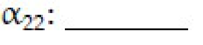

**Figure 38.** Subquestion stem for Question 177.

**Correct answer:** `0.22 to 0.24`  
**Source evidence:** Green text (0x8000) under Possible Answers : 0.22 to 0.24, PDF page 21.

---

### Question 178

**Question ID:** `6406531815776` · **Type:** Short Answer · **Marks:** 0.5  
**PDF pages:** 21

Refer to the additive attention specifications in Question 173.

Answer the given subquestion:

$\alpha_{23}:$

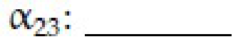

**Figure 39.** Subquestion stem for Question 178.

**Correct answer:** `0.43 to 0.45`  
**Source evidence:** Green text (0x8000) under Possible Answers : 0.43 to 0.45, PDF page 21.

---

### Question 179

**Question ID:** `6406531815777` · **Type:** Short Answer · **Marks:** 0.5  
**PDF pages:** 21

Refer to the additive attention specifications in Question 173.

Answer the given subquestion:

$c_{21}:$

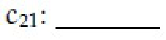

**Figure 40.** Subquestion stem for Question 179.

**Correct answer:** Answer not verifiable from the source PDF.  
**Source evidence:** Header 'Possible Answers :' present at page bottom margin (y=792.65-808.97), but numerical answer range is truncated off page., PDF page 21.

---

## Answer key

| Source question | Question ID | Correct answer | PDF page(s) |
| :--- | :--- | :--- | :--- |
| 130 | `6406531815722` | A | 2 |
| 131 | `6406531815723` | B | 2 |
| 132 | `6406531815724` | C | 3 |
| 133 | `6406531815725` | D | 3 |
| 134 | `6406531815726` | A | 3 |
| 135 | `6406531815727` | D | 3, 4 |
| 136 | `6406531815728` | B | 4 |
| 137 | `6406531815729` | A | 4 |
| 138 | `6406531815730` | C | 5 |
| 139 | `6406531815731` | B | 5 |
| 140 | `6406531815732` | D | 5, 6 |
| 141 | `6406531815733` | B | 6 |
| 142 | `6406531815734` | B | 6, 7 |
| 143 | `6406531815735` | D | 7 |
| 144 | `6406531815739` | 384 | 7 |
| 145 | `6406531815736` | A, D | 7, 8 |
| 146 | `6406531815737` | A, C | 8 |
| 147 | `6406531815738` | A, B, C | 8 |
| 148 | `6406531815741` | 4 | 9 |
| 149 | `6406531815742` | 6 | 9, 10 |
| 150 | `6406531815743` | 3 | 10 |
| 151 | `6406531815744` | 1 | 10 |
| 152 | `6406531815745` | 2 | 10 |
| 153 | `6406531815746` | 5 | 10, 11 |
| 154 | `6406531815748` | 6422528 | 11 |
| 155 | `6406531815749` | 642252800 | 11, 12 |
| 156 | `6406531815751` | 12544 | 12 |
| 157 | `6406531815752` | 1254400 | 12, 13 |
| 158 | `6406531815753` | 131072 | 13 |
| 159 | `6406531815754` | 13107200 | 13 |
| 160 | `6406531815756` | 50 | 13, 14, 15 |
| 161 | `6406531815757` | 25 | 15 |
| 162 | `6406531815758` | 100 | 15 |
| 163 | `6406531815759` | 400 | 15 |
| 164 | `6406531815760` | 800 | 16 |
| 165 | `6406531815762` | 1 | 16, 17 |
| 166 | `6406531815763` | 0 | 17 |
| 167 | `6406531815764` | 2 | 17 |
| 168 | `6406531815765` | 0.24 to 0.25 | 17, 18 |
| 169 | `6406531815766` | 0.09 to 0.1 | 18 |
| 170 | `6406531815767` | 0.66 to 0.68 | 18 |
| 171 | `6406531815768` | 1.5 to 1.6 | 18 |
| 172 | `6406531815769` | 2.5 to 2.6 | 19 |
| 173 | `6406531815771` | -0.01 to 0.01 | 19, 20 |
| 174 | `6406531815772` | -0.463 to -0.461 | 20 |
| 175 | `6406531815773` | 0.461 to 0.463 | 20 |
| 176 | `6406531815774` | 0.32 to 0.34 | 20, 21 |
| 177 | `6406531815775` | 0.22 to 0.24 | 21 |
| 178 | `6406531815776` | 0.43 to 0.45 | 21 |
| 179 | `6406531815777` | Answer not verifiable from the source PDF | 21 |

## Extraction notes

- **Administrative Confirmation Exclusion:** Question 129 (Question Id `6406531815721`, Sub-Section 1, PDF pages 1–2) was confirmed as the administrative subject confirmation question (YES/NO, 0 marks) and excluded from academic question count.
- **Scope Boundaries:** Lines 1–7 of PDF page 1 contain leftover option text from the preceding subject and were excluded. Academic content spans from Section 7 (DL(CV)) on page 1 through the end of Sub-Section 5 on page 21.
- **Declared Question Count Reconciliation:** Page 1 header declares 25 questions to be attempted. This corresponds to 1 administrative question (Q129), 14 standalone MCQs (Q130–143), 1 SA question (Q144), 3 MSQs (Q145–147), and 6 Comprehension blocks (Q148–153, Q154–155, Q156–159, Q160–164, Q165–172, Q173–179), totaling 1 + 14 + 1 + 3 + 6 = 25 parent question units. Excluding the administrative question yields exactly 50 academic questions.
- **Marks Reconciliation:** Section 7 declares 63 marks. The sum of actual question marks across all 50 academic questions is 62.5 marks (Q130–143: 14×2=28; Q144: 2; Q145–147: 3×3=9; Q148–153: 4; Q154–155: 4; Q156–159: 4; Q160–164: 4; Q165–172: 4; Q173–179: 3.5; Total = 62.5).
- **Source Answer Truncation (Question 179):** On PDF page 21, Question 179 terminates after the header `Possible Answers :` at y=808.97 with the numerical answer range truncated off the bottom of the page in the source PDF. This truncation is documented as a source defect.
