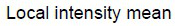
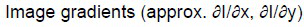
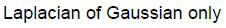
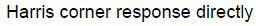

# DL(CV) — da5006_2026T1_ET_FN

**Subject:** Deep Learning for Computer Vision  
**Source:** `da5006_2026T1_ET_FN.pdf` (original PDF omitted from this bundle)  
**Academic questions:** 22  
**Scope:** DL(CV) section; administrative subject confirmation excluded.

## Questions

### Question 2

**Question ID:** `6406532136817` · **Type:** MCQ · **Marks:** 2  
**PDF pages:** 2

A standard RGB image of size 256×256 is stored as 8-bit unsigned integers per channel. What is the total memory (in bytes) to store the raw image (no compression)?

**Options**

**A.** 256×256 = 65,536 bytes  
*Option ID:* `6406536959477`

**B.** 256×256×2 = 131,072 bytes  
*Option ID:* `6406536959478`

**C.** 256×256×3 = 196,608 bytes  
*Option ID:* `6406536959479`

**D.** 256×256×3×8 = 1,572,864 bytes  
*Option ID:* `6406536959480`

**Correct answer:** **C** — 256×256×3 = 196,608 bytes.  
**Source evidence:** Option ID 6406536959479 rendered in green text (#008000) with checkmark icon (xref 1692) on PDF page 2.

---

### Question 3

**Question ID:** `6406532136818` · **Type:** MCQ · **Marks:** 2  
**PDF pages:** 2

Which statement is correct?

**Options**

**A.** Convolution equals correlation for all filters.  
*Option ID:* `6406536959481`

**B.** Convolution flips the kernel spatially; correlation does not.  
*Option ID:* `6406536959482`

**C.** Correlation flips the kernel; convolution does not.  
*Option ID:* `6406536959483`

**D.** Both operations always preserve energy.  
*Option ID:* `6406536959484`

**Correct answer:** **B** — Convolution flips the kernel spatially; correlation does not..  
**Source evidence:** Option ID 6406536959482 rendered in green text (#008000) with checkmark icon (xref 1692) on PDF page 2.

---

### Question 4

**Question ID:** `6406532136819` · **Type:** MCQ · **Marks:** 2  
**PDF pages:** 2, 3

You apply a 5×5 filter with stride 1 and no padding on a 32×32 image. Output size is:

**Options**

**A.** 32×32  
*Option ID:* `6406536959485`

**B.** 28×28  
*Option ID:* `6406536959486`

**C.** 27×27  
*Option ID:* `6406536959487`

**D.** 26×26  
*Option ID:* `6406536959488`

**Correct answer:** **B** — 28×28.  
**Source evidence:** Option ID 6406536959486 rendered in green text (#008000) with checkmark icon (xref 1692) on PDF page 3.

---

### Question 5

**Question ID:** `6406532136820` · **Type:** MCQ · **Marks:** 2  
**PDF pages:** 3

The Sobel operator primarily estimates:

**Options**

**A.** Local intensity mean  
  
**Figure 1.** Option A image for Question 5.  
*Option ID:* `6406536959489`

**B.** Image gradients (approx. $\partial I/\partial x$, $\partial I/\partial y$)  
  
**Figure 2.** Option B image for Question 5.  
*Option ID:* `6406536959490`

**C.** Laplacian of Gaussian only  
  
**Figure 3.** Option C image for Question 5.  
*Option ID:* `6406536959491`

**D.** Harris corner response directly  
  
**Figure 4.** Option D image for Question 5.  
*Option ID:* `6406536959492`

**Correct answer:** **B** — Image gradients (approx. $\partial I/\partial x$, $\partial I/\partial y$).  
**Source evidence:** Option ID 6406536959490 rendered in green text (#008000) with checkmark icon (xref 1692) on PDF page 3.

---

### Question 6

**Question ID:** `6406532136821` · **Type:** MCQ · **Marks:** 2  
**PDF pages:** 3

SIFT is designed to be robust mainly to:

**Options**

**A.** Scale and rotation changes  
*Option ID:* `6406536959493`

**B.** Only translation (shifts)  
*Option ID:* `6406536959494`

**C.** Only illumination changes  
*Option ID:* `6406536959495`

**D.** Only affine viewpoint changes with no residual error  
*Option ID:* `6406536959496`

**Correct answer:** **A** — Scale and rotation changes.  
**Source evidence:** Option ID 6406536959493 rendered in green text (#008000) with checkmark icon (xref 1692) on PDF page 3.

---

### Question 7

**Question ID:** `6406532136822` · **Type:** MCQ · **Marks:** 2  
**PDF pages:** 3

In classical scale-space theory, increasing $\sigma$ in Gaussian smoothing generally:

**Options**

**A.** Enhances high-frequency details  
*Option ID:* `6406536959497`

**B.** Suppresses high-frequency details and removes fine structures  
*Option ID:* `6406536959498`

**C.** Has no effect on edges  
*Option ID:* `6406536959499`

**D.** Increases noise  
*Option ID:* `6406536959500`

**Correct answer:** **B** — Suppresses high-frequency details and removes fine structures.  
**Source evidence:** Option ID 6406536959498 rendered in green text (#008000) with checkmark icon (xref 1692) on PDF page 3.

---

### Question 8

**Question ID:** `6406532136823` · **Type:** MCQ · **Marks:** 2  
**PDF pages:** 3, 4

Backpropagation is best described as:

**Options**

**A.** A method to avoid overfitting  
*Option ID:* `6406536959501`

**B.** Efficient computation of gradients using the chain rule through computation graphs  
*Option ID:* `6406536959502`

**C.** A method that works only for linear models  
*Option ID:* `6406536959503`

**D.** An optimizer like Adam  
*Option ID:* `6406536959504`

**Correct answer:** **B** — Efficient computation of gradients using the chain rule through computation graphs.  
**Source evidence:** Option ID 6406536959502 rendered in green text (#008000) with checkmark icon (xref 1692) on PDF page 4.

---

### Question 9

**Question ID:** `6406532136824` · **Type:** MCQ · **Marks:** 2  
**PDF pages:** 4

Which is a key effect of momentum?

**Options**

**A.** Makes gradients unbiased  
*Option ID:* `6406536959505`

**B.** Accumulates a velocity term  
*Option ID:* `6406536959506`

**C.** Gurantees to converge unlike vanilla Gradient Descent  
*Option ID:* `6406536959507`

**D.** Eliminates need for setting learning rate by adpatly calculaitng it on the fly.  
*Option ID:* `6406536959508`

**Correct answer:** **B** — Accumulates a velocity term.  
**Source evidence:** Option ID 6406536959506 rendered in green text (#008000) with checkmark icon (xref 1692) on PDF page 4.

---

### Question 10

**Question ID:** `6406532136825` · **Type:** MCQ · **Marks:** 2  
**PDF pages:** 4

L2 regularization on weights most directly encourages:

**Options**

**A.** Sparse weights with many exact zeros  
*Option ID:* `6406536959509`

**B.** Smaller-magnitude weights  
*Option ID:* `6406536959510`

**C.** Larger-magnitude weights  
*Option ID:* `6406536959511`

**D.** Larger learning rates  
*Option ID:* `6406536959512`

**Correct answer:** **B** — Smaller-magnitude weights.  
**Source evidence:** Option ID 6406536959510 rendered in green text (#008000) with checkmark icon (xref 1692) on PDF page 4.

---

### Question 11

**Question ID:** `6406532136826` · **Type:** MCQ · **Marks:** 2  
**PDF pages:** 4

A key reason CNNs are parameter-efficient compared to fully connected nets for images is:

**Options**

**A.** Weight sharing and local receptive fields  
*Option ID:* `6406536959513`

**B.** They never use nonlinearities thus easier to train  
*Option ID:* `6406536959514`

**C.** They always use pooling  
*Option ID:* `6406536959515`

**D.** Compared to vanilla neural network and RNN, they are robust to gradient explosion and vanishing gradient.  
*Option ID:* `6406536959516`

**Correct answer:** **A** — Weight sharing and local receptive fields.  
**Source evidence:** Option ID 6406536959513 rendered in green text (#008000) with checkmark icon (xref 1692) on PDF page 4.

---

### Question 12

**Question ID:** `6406532136827` · **Type:** MCQ · **Marks:** 2  
**PDF pages:** 5

Stacking multiple 3×3 convolutions (stride 1) increases receptive field because:

**Options**

**A.** Each layer composes local neighborhoods into larger effective context  
*Option ID:* `6406536959517`

**B.** Each layer reduces spatial resolution  
*Option ID:* `6406536959518`

**C.** It removes nonlinearities thereby increasing the effective context  
*Option ID:* `6406536959519`

**D.** It forces global averaging thereby increasing the contribution of input pixels  
*Option ID:* `6406536959520`

**Correct answer:** **A** — Each layer composes local neighborhoods into larger effective context.  
**Source evidence:** Option ID 6406536959517 rendered in green text (#008000) with checkmark icon (xref 1692) on PDF page 5.

---

### Question 13

**Question ID:** `6406532136828` · **Type:** MCQ · **Marks:** 2  
**PDF pages:** 5

In Faster R-CNN, the Region Proposal Network (RPN) outputs:

**Options**

**A.** Only class probabilities + pixel-wise masks  
*Option ID:* `6406536959521`

**B.** Objectness scores + bounding box proposals  
*Option ID:* `6406536959522`

**C.** Pixel-wise masks  
*Option ID:* `6406536959523`

**D.** Optical flow  
*Option ID:* `6406536959524`

**Correct answer:** **B** — Objectness scores + bounding box proposals.  
**Source evidence:** Option ID 6406536959522 rendered in green text (#008000) with checkmark icon (xref 1692) on PDF page 5.

---

### Question 14

**Question ID:** `6406532136829` · **Type:** MCQ · **Marks:** 2  
**PDF pages:** 5

Which statement is correct ?

**Options**

**A.** Semantic segmentation separates individual object instances.  
*Option ID:* `6406536959525`

**B.** Instance segmentation distinguishes different object instances of the same class.  
*Option ID:* `6406536959526`

**C.** Both are identical tasks.  
*Option ID:* `6406536959527`

**D.** Neither predicts labels per pixel.  
*Option ID:* `6406536959528`

**Correct answer:** **B** — Instance segmentation distinguishes different object instances of the same class..  
**Source evidence:** Option ID 6406536959526 rendered in green text (#008000) with checkmark icon (xref 1692) on PDF page 5.

---

### Question 15

**Question ID:** `6406532136830` · **Type:** MCQ · **Marks:** 2  
**PDF pages:** 5, 6

Vanishing gradients in vanilla RNNs occur mainly due to:

**Options**

**A.** High deapth of the RNN layers  
*Option ID:* `6406536959529`

**B.** Repeated multiplication by Jacobians across timesteps  
*Option ID:* `6406536959530`

**C.** Too many convolution layers before RNN  
*Option ID:* `6406536959531`

**D.** Use of softmax  
*Option ID:* `6406536959532`

**Correct answer:** **B** — Repeated multiplication by Jacobians across timesteps.  
**Source evidence:** Option ID 6406536959530 rendered in green text (#008000) with checkmark icon (xref 1692) on PDF page 5.

---

### Question 16

**Question ID:** `6406532136831` · **Type:** MSQ · **Marks:** 3  
**PDF pages:** 6

Select all correct statements:

**Options**

**A.** Harris corner detector responds strongly where gradient changes in two orthogonal directions.  
*Option ID:* `6406536959533`

**B.** Difference-of-Gaussians approximates Laplacian-of-Gaussian for blob detection.  
*Option ID:* `6406536959534`

**C.** SIFT descriptors are computed from raw pixel intensities without gradients.  
*Option ID:* `6406536959535`

**D.** Canny edge detector is a data driven method to calculate edges in an image.  
*Option ID:* `6406536959536`

**Correct answer:** **A**, **B** — Harris corner detector responds strongly where gradient changes in two orthogonal directions.; Difference-of-Gaussians approximates Laplacian-of-Gaussian for blob detection..  
**Source evidence:** Option ID 6406536959533 rendered in green text (#008000) with checkmark icon (xref 1692) on PDF page 6.; Option ID 6406536959534 rendered in green text (#008000) with checkmark icon (xref 1692) on PDF page 6.

---

### Question 17

**Question ID:** `6406532136832` · **Type:** MSQ · **Marks:** 3  
**PDF pages:** 6

Select all correct statements :

**Options**

**A.** Adam adapts per-parameter learning rates using estimates of first and second moments.  
*Option ID:* `6406536959537`

**B.** Early stopping can act as a form of regularization.  
*Option ID:* `6406536959538`

**C.** Dropout increases training accuracy by removing bad training data samples .  
*Option ID:* `6406536959539`

**D.** Data augmentation typically improves generalization in vision tasks.  
*Option ID:* `6406536959540`

**Correct answer:** **A**, **B**, **D** — Adam adapts per-parameter learning rates using estimates of first and second moments.; Early stopping can act as a form of regularization.; Data augmentation typically improves generalization in vision tasks..  
**Source evidence:** Option ID 6406536959537 rendered in green text (#008000) with checkmark icon (xref 1692) on PDF page 6.; Option ID 6406536959538 rendered in green text (#008000) with checkmark icon (xref 1692) on PDF page 6.; Option ID 6406536959540 rendered in green text (#008000) with checkmark icon (xref 1692) on PDF page 6.

---

### Question 18

**Question ID:** `6406532136833` · **Type:** MSQ · **Marks:** 3  
**PDF pages:** 6

Select all correct statements:

**Options**

**A.** Self-attention computes pairwise interactions between tokens within a sequence.  
*Option ID:* `6406536959541`

**B.** Positional encodings are needed because self-attention alone is permutation-invariant.  
*Option ID:* `6406536959542`

**C.** Transformers must use recurrence to handle sequences.  
*Option ID:* `6406536959543`

**D.** Multi-head attention allows the model to attend to different subspaces/relations.  
*Option ID:* `6406536959544`

**Correct answer:** **A**, **B**, **D** — Self-attention computes pairwise interactions between tokens within a sequence.; Positional encodings are needed because self-attention alone is permutation-invariant.; Multi-head attention allows the model to attend to different subspaces/relations..  
**Source evidence:** Option ID 6406536959541 rendered in green text (#008000) with checkmark icon (xref 1692) on PDF page 6.; Option ID 6406536959542 rendered in green text (#008000) with checkmark icon (xref 1692) on PDF page 6.; Option ID 6406536959544 rendered in green text (#008000) with checkmark icon (xref 1692) on PDF page 6.

---

### Question 19

**Question ID:** `6406532136834` · **Type:** SA · **Marks:** 4  
**PDF pages:** 7

Box A: top-left (0,0), bottom-right (8,8).
Box B: top-left (4,4), bottom-right (12,12).
Compute IoU as a decimal.

**Correct answer:** `0.142 to 0.144`  
**Source evidence:** Official text specification: 'Possible Answers : 0.142 to 0.144' rendered in green text (#008000) on PDF page 7.

---

### Question 20

**Question ID:** `6406532136835` · **Type:** SA · **Marks:** 4  
**PDF pages:** 7

For a single query, suppose similarity with the positive is $s+=2$ and with two negatives are $s1=1$, $s2=0$.
InfoNCE loss: $L = -\log( \exp(s+) / (\exp(s+)+\exp(s1)+\exp(s2)) )$.
Using $\exp(2)=7.39$, $\exp(1)=2.72$, $\exp(0)=1$, compute $L$.

**Correct answer:** `0.408 to 0.412`  
**Source evidence:** Official text specification: 'Possible Answers : 0.408 to 0.412' rendered in green text (#008000) on PDF page 7.

---

### Question 21

**Question ID:** `6406532136836` · **Type:** SA · **Marks:** 4  
**PDF pages:** 7, 8

Input image: 64×64. Convolution: kernel 7×7, stride 2, padding 3. Compute output spatial size.

**Correct answer:** `32`  
**Source evidence:** Official text specification: 'Possible Answers : 32' rendered in green text (#008000) on PDF page 8.

---

### Question 22

**Question ID:** `6406532136837` · **Type:** SA · **Marks:** 4  
**PDF pages:** 8

A fully connected network maps input 100 → hidden 50 → output 10. Ignore bias. What is the total number of weights?

**Correct answer:** `5500`  
**Source evidence:** Official text specification: 'Possible Answers : 5500' rendered in green text (#008000) on PDF page 8.

---

### Question 23

**Question ID:** `6406532136838` · **Type:** SA · **Marks:** 4  
**PDF pages:** 8

Input feature map has $M=64$ channels. You apply depthwise 3×3 followed by pointwise 1×1 to produce $N=128$ channels. Ignore bias. What is the Total parameters?

**Correct answer:** `8768`  
**Source evidence:** Official text specification: 'Possible Answers : 8768' rendered in green text (#008000) on PDF page 8.

---

## Answer key

| Source question | Question ID | Correct answer | PDF page(s) |
| :--- | :--- | :--- | :--- |
| 2 | `6406532136817` | C | 2 |
| 3 | `6406532136818` | B | 2 |
| 4 | `6406532136819` | B | 2, 3 |
| 5 | `6406532136820` | B | 3 |
| 6 | `6406532136821` | A | 3 |
| 7 | `6406532136822` | B | 3 |
| 8 | `6406532136823` | B | 3, 4 |
| 9 | `6406532136824` | B | 4 |
| 10 | `6406532136825` | B | 4 |
| 11 | `6406532136826` | A | 4 |
| 12 | `6406532136827` | A | 5 |
| 13 | `6406532136828` | B | 5 |
| 14 | `6406532136829` | B | 5 |
| 15 | `6406532136830` | B | 5, 6 |
| 16 | `6406532136831` | A, B | 6 |
| 17 | `6406532136832` | A, B, D | 6 |
| 18 | `6406532136833` | A, B, D | 6 |
| 19 | `6406532136834` | 0.142 to 0.144 | 7 |
| 20 | `6406532136835` | 0.408 to 0.412 | 7 |
| 21 | `6406532136836` | 32 | 7, 8 |
| 22 | `6406532136837` | 5500 | 8 |
| 23 | `6406532136838` | 8768 | 8 |

## Extraction notes

1. **Section scope & exclusions:** The DL(CV) section encompasses the entire paper da5006_2026T1_ET_FN.pdf from physical PDF Page 1 to Page 8 (Section Id 640653139242, Section Number 1). Question 1 (Question Id 6406532136816) on Pages 1–2 is the administrative subject confirmation question (YES/NO options, 0 marks) and is excluded from academic questions. There are no other exam subjects or extraneous sections.
2. **Declared question count reconciliation:** Section metadata declares 23 questions and 57 marks. This reconciles exactly as follows:
   - Sub-section 1: Administrative confirmation (Question 1, 0 marks, excluded).
   - Sub-section 2: 14 MCQs Q2–Q15 (14 @ 2 marks = 28 marks).
   - Sub-section 3: 3 MSQs Q16–Q18 (3 @ 3 marks = 9 marks).
   - Sub-section 4: 5 SAs Q19–Q23 (5 @ 4 marks = 20 marks).
   - Total delivery units = 1 + 14 + 3 + 5 = 23 questions.
   - Total scored academic questions = 14 + 3 + 5 = 22 questions, totaling exactly 28 + 9 + 20 = 57 marks.
3. **Source answers & evidence:** All answers are evidenced directly from the official PDF using font color (#008000 green text) and checkmark icons (xref 1692) for MCQs and MSQs, or explicit official 'Possible Answers :' text specifications for short-answer questions. All 3 MSQs preserve multiple verified correct answers.
4. **Figure fidelity & option images:** Question 5 options are embedded raster images from the original PDF (xrefs 1694, 1695, 1696, 1697) preserved faithfully at native resolution in assets/da5006_2026T1_ET_FN/ and captioned sequentially as Figures 1–4.
