# DL(CV) — da5006_2026T1_Q1_NA

**Subject:** Deep Learning for Computer Vision  
**Source:** `da5006_2026T1_Q1_NA.pdf` (original PDF omitted from this bundle)  
**Academic questions:** 14  
**Scope:** DL(CV) section; administrative subject confirmation excluded.

## Questions

### Question 2

**Question ID:** `6406531961516` · **Type:** Multiple Choice Question · **Marks:** 1  
**PDF pages:** 3

In the Canny edge detector, which is the correct order of major steps?

**Options**

**A.** Non-maximum suppression → Gaussian smoothing → gradient computation → hysteresis thresholding  
*Option ID:* `6406536373687`

**B.** Gaussian smoothing → gradient computation → non-maximum suppression → hysteresis thresholding  
*Option ID:* `6406536373688`

**C.** Gradient computation → Gaussian smoothing → hysteresis thresholding → non-maximum suppression  
*Option ID:* `6406536373689`

**D.** Gaussian smoothing → hysteresis thresholding → non-maximum suppression → gradient computation  
*Option ID:* `6406536373690`

**Correct answer:** **B** — Gaussian smoothing → gradient computation → non-maximum suppression → hysteresis thresholding  
**Source evidence:** Green option text and check marker, PDF page 3.

---

### Question 3

**Question ID:** `6406531961522` · **Type:** Multiple Choice Question · **Marks:** 1  
**PDF pages:** 3

Which is True?

**Options**

**A.** Nesterov momentum looks ahead and often converges faster than classical momentum.  
*Option ID:* `6406536373696`

**B.** large fixed learning rate always speeds convergence.  
*Option ID:* `6406536373697`

**C.** Adam uses only a first-moment estimate of gradients.  
*Option ID:* `6406536373698`

**D.** None of these.  
*Option ID:* `6406536373699`

**Correct answer:** **A** — Nesterov momentum looks ahead and often converges faster than classical momentum.  
**Source evidence:** Green option text and check marker, PDF page 3.

---

### Question 4

**Question ID:** `6406531961523` · **Type:** Multiple Choice Question · **Marks:** 1  
**PDF pages:** 4

Correct order of SIFT stages is:

**Options**

**A.** Orientation → Descriptor → Localization → Extrema Detection  
*Option ID:* `6406536373700`

**B.** Extrema Detection → Localization → Orientation → Descriptor  
*Option ID:* `6406536373701`

**C.** Extrema Detection → Descriptor → Localization → Orientation  
*Option ID:* `6406536373702`

**D.** None of these.  
*Option ID:* `6406536373703`

**Correct answer:** **B** — Extrema Detection → Localization → Orientation → Descriptor  
**Source evidence:** Green option text and check marker, PDF page 4.

---

### Question 5

**Question ID:** `6406531961524` · **Type:** Multiple Choice Question · **Marks:** 1  
**PDF pages:** 4

Which of the following $3 \times 3$ kernels is separable?

**Options**

**A.**

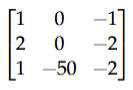

**Figure 1.** Option A kernel diagram for Question 5.

*Option ID:* `6406536373704`

**B.**

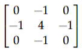

**Figure 2.** Option B kernel diagram for Question 5.

*Option ID:* `6406536373705`

**C.**

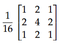

**Figure 3.** Option C kernel diagram for Question 5.

*Option ID:* `6406536373706`

**D.**

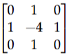

**Figure 4.** Option D kernel diagram for Question 5.

*Option ID:* `6406536373707`

**Correct answer:** **C** — Option C (separable Gaussian smoothing filter $\frac{1}{16} \begin{bmatrix} 1 & 2 & 1 \\ 2 & 4 & 2 \\ 1 & 2 & 1 \end{bmatrix}$)  
**Source evidence:** Green option ID and check marker, PDF page 4.

---

### Question 6

**Question ID:** `6406531961529` · **Type:** Multiple Choice Question · **Marks:** 1  
**PDF pages:** 4, 5

Consider the following pyTorch code:

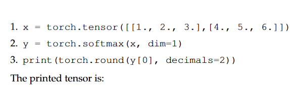

**Figure 5.** PyTorch code snippet for Question 6.

```python
1. x = torch.tensor([[1., 2., 3.], [4., 5., 6.]])
2. y = torch.softmax(x, dim=1)
3. print (torch.round(y[0], decimals=2))
```

The printed tensor is:

**Options**

**A.** `tensor([0.09, 0.24, 0.67])`  
*Option ID:* `6406536373712`

**B.** `tensor([0.09, 0.24, 0.66])`  
*Option ID:* `6406536373713`

**C.** `tensor([0.09, 0.23, 0.68])`  
*Option ID:* `6406536373714`

**D.** `tensor([0.10, 0.27, 0.63])`  
*Option ID:* `6406536373715`

**Correct answer:** **A** — `tensor([0.09, 0.24, 0.67])`  
**Source evidence:** Green option text and check marker, PDF page 5.

---

### Question 7

**Question ID:** `6406531961517` · **Type:** Short Answer Question · **Marks:** 1  
**PDF pages:** 5

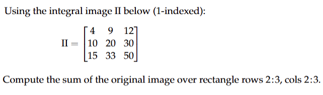

**Figure 6.** Integral image matrix and question stem for Question 7.

Using the integral image $II$ below (1-indexed):

$$II = \begin{bmatrix} 4 & 9 & 12 \\ 10 & 20 & 30 \\ 15 & 33 & 50 \end{bmatrix}$$

Compute the sum of the original image over rectangle rows 2:3, cols 2:3.

**Correct answer:** `27`  
**Source evidence:** Green text in Possible Answers field, PDF page 5.

---

### Question 8

**Question ID:** `6406531961518` · **Type:** Short Answer Question · **Marks:** 1  
**PDF pages:** 5, 6

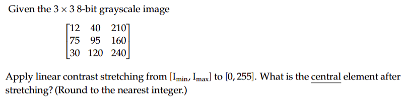

**Figure 7.** Grayscale image matrix and contrast stretching specification for Question 8.

Given the $3 \times 3$ 8-bit grayscale image

$$\begin{bmatrix} 12 & 40 & 210 \\ 75 & 95 & 160 \\ 30 & 120 & 240 \end{bmatrix}$$

Apply linear contrast stretching from $[I_{min}, I_{max}]$ to $[0, 255]$. What is the central element after stretching? (Round to the nearest integer.)

**Correct answer:** `92 to 94`  
**Source evidence:** Green text in Possible Answers range field, PDF page 6.

---

### Question 9

**Question ID:** `6406531961519` · **Type:** Short Answer Question · **Marks:** 1  
**PDF pages:** 6

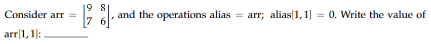

**Figure 8.** Array definition and aliasing operation for Question 9.

Consider $\text{arr} = \begin{bmatrix} 4 & 8 \\ 5 & 3 \end{bmatrix}$ and the operations $\text{alias} = \text{arr}; \text{alias}[1, 1] = 0$. Write the value of $\text{arr}[1, 1]$: ______

**Correct answer:** `0`  
**Source evidence:** Green text in Possible Answers field, PDF page 6.

---

### Question 10

**Question ID:** `6406531961520` · **Type:** Short Answer Question · **Marks:** 1  
**PDF pages:** 6, 7

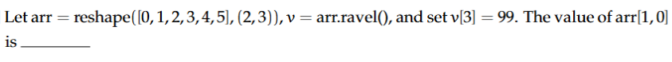

**Figure 9.** Array reshape and ravel operations for Question 10.

Let $\text{arr} = \text{reshape}([0, 1, 2, 3, 4, 5], (2, 3))$, $v = \text{arr.ravel}()$, and set $v[3] = 99$. The value of $\text{arr}[1, 0]$ is _____

**Correct answer:** `99`  
**Source evidence:** Green text in Possible Answers field, PDF page 7.

---

### Question 11

**Question ID:** `6406531961521` · **Type:** Short Answer Question · **Marks:** 1  
**PDF pages:** 7

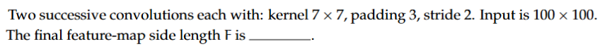

**Figure 10.** Successive convolution layer specifications for Question 11.

Two successive convolutions each with: kernel $7 \times 7$, padding 3, stride 2. Input is $100 \times 100$. The final feature-map side length $F$ is _____.

**Correct answer:** `25`  
**Source evidence:** Green text in Possible Answers field, PDF page 7.

---

### Question 12

**Question ID:** `6406531961525` · **Type:** Short Answer Question · **Marks:** 1  
**PDF pages:** 7

The sum of the degrees of freedom for translation and affine transformations in 3D is __

**Correct answer:** `12`  
**Source evidence:** Green text in Possible Answers field, PDF page 7.

---

### Question 13

**Question ID:** `6406531961526` · **Type:** Short Answer Question · **Marks:** 1  
**PDF pages:** 7, 8

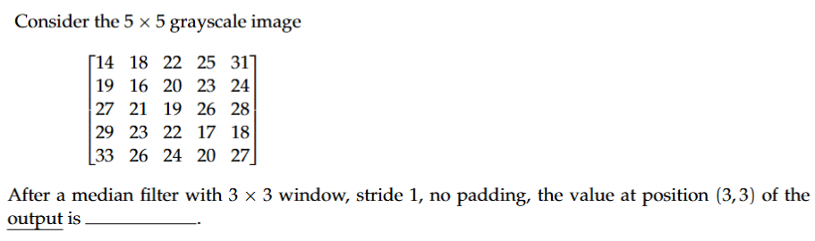

**Figure 11.** Grayscale image matrix and median filter specifications for Question 13.

Consider the $5 \times 5$ grayscale image

$$\begin{bmatrix} 14 & 18 & 22 & 25 & 31 \\ 19 & 16 & 20 & 23 & 24 \\ 27 & 21 & 19 & 26 & 28 \\ 29 & 23 & 22 & 17 & 18 \\ 33 & 26 & 24 & 20 & 27 \end{bmatrix}$$

After a median filter with $3 \times 3$ window, stride 1, no padding, the value at position (3, 3) of the output is ________.

**Correct answer:** `22`  
**Source evidence:** Green text in Possible Answers field, PDF page 8.

---

### Question 14

**Question ID:** `6406531961527` · **Type:** Short Answer Question · **Marks:** 1  
**PDF pages:** 8

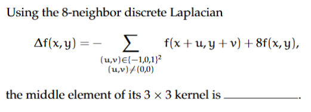

**Figure 12.** Discrete Laplacian definition and formula for Question 14.

Using the 8-neighbor discrete Laplacian

$$\Delta f(x, y) = - \sum_{\substack{(u, v) \in \{-1, 0, 1\}^2 \\ (u, v) \neq (0, 0)}} f(x+u, y+v) + 8 f(x, y),$$

the middle element of its $3 \times 3$ kernel is _____.

**Correct answer:** `8`  
**Source evidence:** Green text in Possible Answers field, PDF page 8.

---

### Question 15

**Question ID:** `6406531961528` · **Type:** Short Answer Question · **Marks:** 1  
**PDF pages:** 8, 9

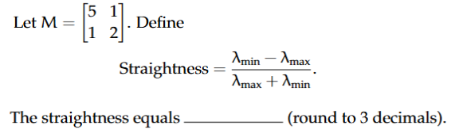

**Figure 13.** Matrix $M$ and straightness definition for Question 15.

Let $M = \begin{bmatrix} 5 & 1 \\ 1 & 2 \end{bmatrix}$. Define

$$\text{Straightness} = \frac{\lambda_{max} - \lambda_{min}}{\lambda_{max} + \lambda_{min}}$$

The straightness equals _______ (round to 3 decimals).

**Correct answer:** `-6 to -5`  
**Source evidence:** Green text in Possible Answers range field, PDF page 9.

---

## Answer key

| Source question | Question ID | Correct answer | PDF page(s) |
| :--- | :--- | :--- | :--- |
| 2 | `6406531961516` | B | 3 |
| 3 | `6406531961522` | A | 3 |
| 4 | `6406531961523` | B | 4 |
| 5 | `6406531961524` | C | 4 |
| 6 | `6406531961529` | A | 4, 5 |
| 7 | `6406531961517` | 27 | 5 |
| 8 | `6406531961518` | 92 to 94 | 5, 6 |
| 9 | `6406531961519` | 0 | 6 |
| 10 | `6406531961520` | 99 | 6, 7 |
| 11 | `6406531961521` | 25 | 7 |
| 12 | `6406531961525` | 12 | 7 |
| 13 | `6406531961526` | 22 | 7, 8 |
| 14 | `6406531961527` | 8 | 8 |
| 15 | `6406531961528` | -6 to -5 | 8, 9 |

## Extraction notes

- **Administrative confirmation excluded:** Question 1 (Question Id `6406531961515`, Sub-Section 1) is the administrative subject confirmation question (0 marks, YES/NO options). It is excluded from the academic questions in accordance with Section 4 of the extraction contract.
- **Section count reconciliation:** The `DL(CV)` section header specifies 15 questions and 14 marks. This matches exactly 1 excluded confirmation question (0 marks) plus 14 extracted academic questions (1 mark each, total 14 marks).
- **Question 5 options:** Options A, B, C, and D are visual kernel matrices. Option C represents the separable $3 \times 3$ Gaussian smoothing kernel $\frac{1}{16}\begin{bmatrix}1 & 2 & 1 \\ 2 & 4 & 2 \\ 1 & 2 & 1\end{bmatrix}$ and is marked correct in the source PDF.
- **Question 12 source answer:** The official key marks `12` as the correct answer. In 3D geometry, translation has 3 DOF and affine transformation has 12 DOF (algebraic sum would be 15, or affine alone 12). As mandated, the official source answer `12` is preserved faithfully.
- **Question 15 source key:** The official accepted range in the source PDF is `-6 to -5`. The mathematical eigenvalue calculation of $M$ yields eigenvalues $\frac{7 \pm \sqrt{13}}{2}$, giving a straightness ratio of $\approx \pm 0.515$. As observed by the coordinator and required by the extraction contract, the official accepted range `-6 to -5` is preserved faithfully without altering source keys.
