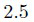
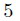
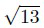
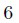
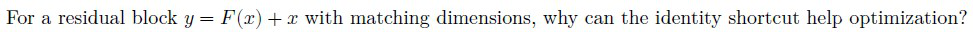
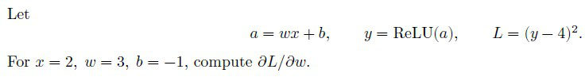
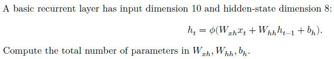
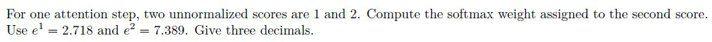
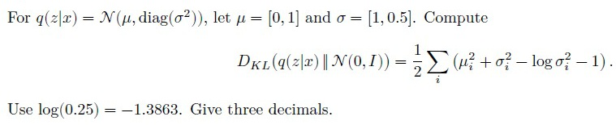
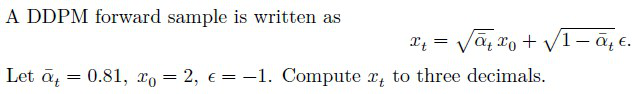

# DL(CV) — da5006_2026T2_ET_FN

**Subject:** Deep Learning for Computer Vision  
**Source:** `da5006_2026T2_ET_FN.pdf` (original PDF omitted from this bundle)  
**Academic questions:** 37  
**Scope:** DL(CV) section; administrative subject confirmation excluded.

## Questions

### Question 2

**Question ID:** `6406532270041` · **Type:** MCQ · **Marks:** 2  
**PDF pages:** 2

An RGB image of size $128 \times 96$ is stored with 32-bit floating-point values for every channel. Ignoring metadata, how many bytes are required?

**Options**

**A.** 36,864  
*Option ID:* `6406537379003`

**B.** 73,728  
*Option ID:* `6406537379004`

**C.** 147,456  
*Option ID:* `6406537379005`

**D.** 294,912  
*Option ID:* `6406537379006`

**Correct answer:** **C** — 147,456.  
**Source evidence:** Option ID 6406537379005 rendered in green text (#008000) with checkmark icon (xref 2581) on PDF page 2.

---

### Question 3

**Question ID:** `6406532270042` · **Type:** MCQ · **Marks:** 2  
**PDF pages:** 2

Let a 1-D filter be $h=[2,-1,3]$. A library routine performs cross-correlation. Which filter should be supplied to the routine to reproduce mathematical convolution with $h$, ignoring boundary effects?

**Options**

**A.** [2,-1,3]  
*Option ID:* `6406537379007`

**B.** [-2,1,-3]  
*Option ID:* `6406537379008`

**C.** [3,-1,2]  
*Option ID:* `6406537379009`

**D.** [3,1,2]  
*Option ID:* `6406537379010`

**Correct answer:** **C** — [3,-1,2].  
**Source evidence:** Option ID 6406537379009 rendered in green text (#008000) with checkmark icon (xref 2581) on PDF page 2.

---

### Question 4

**Question ID:** `6406532270043` · **Type:** MCQ · **Marks:** 2  
**PDF pages:** 2, 3

At a point on an ideal straight intensity edge, the local image-gradient vector is most naturally interpreted as pointing:

**Options**

**A.** Along the tangent direction of the edge  
*Option ID:* `6406537379011`

**B.** Approximately normal to the edge  
*Option ID:* `6406537379012`

**C.** Along the direction of maximum smoothing  
*Option ID:* `6406537379013`

**D.** Along the local isophote  
*Option ID:* `6406537379014`

**Correct answer:** **B** — Approximately normal to the edge.  
**Source evidence:** Option ID 6406537379012 rendered in green text (#008000) with checkmark icon (xref 2581) on PDF page 3.

---

### Question 5

**Question ID:** `6406532270044` · **Type:** MCQ · **Marks:** 2  
**PDF pages:** 3

An image is smoothed successively with Gaussian kernels of standard deviations 2 and 3. Ignoring discretization, the equivalent single Gaussian has standard deviation:

**Options**

**A.** $2.5$  
  
**Figure 1.** Option A image for Question 5.  
*Option ID:* `6406537379015`

**B.** $5$  
  
**Figure 2.** Option B image for Question 5.  
*Option ID:* `6406537379016`

**C.** $\sqrt{13}$  
  
**Figure 3.** Option C image for Question 5.  
*Option ID:* `6406537379017`

**D.** $6$  
  
**Figure 4.** Option D image for Question 5.  
*Option ID:* `6406537379018`

**Correct answer:** **C** — $\sqrt{13}$.  
**Source evidence:** Option ID 6406537379017 rendered in green text (#008000) with checkmark icon (xref 2581) on PDF page 3.

---

### Question 6

**Question ID:** `6406532270045` · **Type:** MCQ · **Marks:** 2  
**PDF pages:** 3

Which design choice is most directly responsible for the rotation robustness of a SIFT descriptor?

**Options**

**A.** Detecting candidate keypoints across multiple image scales  
*Option ID:* `6406537379019`

**B.** Expressing local gradient orientations relative to an assigned keypoint orientation  
*Option ID:* `6406537379020`

**C.** Normalizing the descriptor vector after histogram construction  
*Option ID:* `6406537379021`

**D.** Building an image pyramid without assigning an orientation  
*Option ID:* `6406537379022`

**Correct answer:** **B** — Expressing local gradient orientations relative to an assigned keypoint orientation.  
**Source evidence:** Option ID 6406537379020 rendered in green text (#008000) with checkmark icon (xref 2581) on PDF page 3.

---

### Question 7

**Question ID:** `6406532270046` · **Type:** MCQ · **Marks:** 2  
**PDF pages:** 3, 4

A hidden activation $h$ is used by two downstream branches, and both branches affect the same scalar loss $L$. During backpropagation, the gradient with respect to $h$ is obtained by:

**Options**

**A.** Taking the larger of the two branch gradients  
*Option ID:* `6406537379023`

**B.** Summing the gradient contributions from the two branches  
*Option ID:* `6406537379024`

**C.** Multiplying the two branch gradients  
*Option ID:* `6406537379025`

**D.** Averaging the two branch gradients regardless of the graph  
*Option ID:* `6406537379026`

**Correct answer:** **B** — Summing the gradient contributions from the two branches.  
**Source evidence:** Option ID 6406537379024 rendered in green text (#008000) with checkmark icon (xref 2581) on PDF page 3.

---

### Question 8

**Question ID:** `6406532270047` · **Type:** MCQ · **Marks:** 2  
**PDF pages:** 4

Suppose successive gradients keep pointing in a similar direction over several updates. Compared with plain gradient descent using the same nominal learning rate, momentum tends to:

**Options**

**A.** Cancel updates in that direction  
*Option ID:* `6406537379027`

**B.** Build velocity in that direction while smoothing short-term gradient fluctuations  
*Option ID:* `6406537379028`

**C.** Make the gradient exactly unbiased  
*Option ID:* `6406537379029`

**D.** Force every parameter to use the same accumulated gradient  
*Option ID:* `6406537379030`

**Correct answer:** **B** — Build velocity in that direction while smoothing short-term gradient fluctuations.  
**Source evidence:** Option ID 6406537379028 rendered in green text (#008000) with checkmark icon (xref 2581) on PDF page 4.

---

### Question 9

**Question ID:** `6406532270048` · **Type:** MCQ · **Marks:** 2  
**PDF pages:** 4

Training loss continues to decrease, but validation loss has begun to increase consistently. Which interpretation is most appropriate?

**Options**

**A.** The model is necessarily underfitting  
*Option ID:* `6406537379031`

**B.** Generalization is worsening even though optimization on the training set is improving  
*Option ID:* `6406537379032`

**C.** The training objective is necessarily non-differentiable  
*Option ID:* `6406537379033`

**D.** The model has reached the global optimum on unseen data  
*Option ID:* `6406537379034`

**Correct answer:** **B** — Generalization is worsening even though optimization on the training set is improving.  
**Source evidence:** Option ID 6406537379032 rendered in green text (#008000) with checkmark icon (xref 2581) on PDF page 4.

---

### Question 10

**Question ID:** `6406532270049` · **Type:** MCQ · **Marks:** 2  
**PDF pages:** 4

A $3 \times 3$ convolution maps 16 input channels to 32 output channels. If the input spatial size changes from $64 \times 64$ to $128 \times 128$ while the layer configuration is unchanged, the number of trainable convolution weights:

**Options**

**A.** Doubles  
*Option ID:* `6406537379035`

**B.** Quadruples  
*Option ID:* `6406537379036`

**C.** Remains unchanged  
*Option ID:* `6406537379037`

**D.** Is halved  
*Option ID:* `6406537379038`

**Correct answer:** **C** — Remains unchanged.  
**Source evidence:** Option ID 6406537379037 rendered in green text (#008000) with checkmark icon (xref 2581) on PDF page 4.

---

### Question 11

**Question ID:** `6406532270050` · **Type:** MCQ · **Marks:** 2  
**PDF pages:** 4, 5

A convolution kernel is reused at many spatial locations. The gradient of the loss with respect to one kernel coefficient therefore contains:

**Options**

**A.** A contribution from only the central output location  
*Option ID:* `6406537379039`

**B.** Contributions accumulated from all output locations where that coefficient was used  
*Option ID:* `6406537379040`

**C.** Only the gradient of the bias corresponding to that output channel  
*Option ID:* `6406537379041`

**D.** A contribution from exactly one spatial location chosen during the forward pass  
*Option ID:* `6406537379042`

**Correct answer:** **B** — Contributions accumulated from all output locations where that coefficient was used.  
**Source evidence:** Option ID 6406537379040 rendered in green text (#008000) with checkmark icon (xref 2581) on PDF page 5.

---

### Question 12

**Question ID:** `6406532270051` · **Type:** MCQ · **Marks:** 2  
**PDF pages:** 5

**Figure 5.** Source diagram for Question 12.

For a residual block $y = \mathcal{F}(x) + x$ with matching dimensions, why can the identity shortcut help optimization?

**Options**

**A.** It forces $\mathcal{F}(x)$ to be constant  
*Option ID:* `6406537379043`

**B.** The block can approach an identity mapping when the residual $\mathcal{F}(x)$ approaches zero  
*Option ID:* `6406537379044`

**C.** It prevents gradients from entering the residual branch  
*Option ID:* `6406537379045`

**D.** It makes every convolution invertible  
*Option ID:* `6406537379046`

**Correct answer:** **B** — The block can approach an identity mapping when the residual $\mathcal{F}(x)$ approaches zero.  
**Source evidence:** Option ID 6406537379044 rendered in green text (#008000) with checkmark icon (xref 2581) on PDF page 5.

---

### Question 13

**Question ID:** `6406532270052` · **Type:** MCQ · **Marks:** 2  
**PDF pages:** 5

A depthwise-separable convolution first applies a spatial filter independently to each input channel and then uses a $1 \times 1$ convolution across channels. Its main computational advantage over a dense spatial convolution is that it:

**Options**

**A.** Eliminates channel mixing from the layer  
*Option ID:* `6406537379047`

**B.** Factorizes spatial filtering and channel mixing into cheaper operations  
*Option ID:* `6406537379048`

**C.** Uses a larger spatial kernel with the same parameter count  
*Option ID:* `6406537379049`

**D.** Forces the number of output channels to equal the number of input channels  
*Option ID:* `6406537379050`

**Correct answer:** **B** — Factorizes spatial filtering and channel mixing into cheaper operations.  
**Source evidence:** Option ID 6406537379048 rendered in green text (#008000) with checkmark icon (xref 2581) on PDF page 5.

---

### Question 14

**Question ID:** `6406532270053` · **Type:** MCQ · **Marks:** 2  
**PDF pages:** 5, 6

When adapting a pretrained CNN to a related task with a relatively small labeled dataset, which training choice is generally the more conservative starting point?

**Options**

**A.** Reinitialize the entire network and use a very large learning rate  
*Option ID:* `6406537379051`

**B.** Retain pretrained features and update them cautiously, often with a smaller learning rate than newly initialized layers  
*Option ID:* `6406537379052`

**C.** Freeze the newly added prediction head and update only the old classifier  
*Option ID:* `6406537379053`

**D.** Randomly permute pretrained channels before optimization  
*Option ID:* `6406537379054`

**Correct answer:** **B** — Retain pretrained features and update them cautiously, often with a smaller learning rate than newly initialized layers.  
**Source evidence:** Option ID 6406537379052 rendered in green text (#008000) with checkmark icon (xref 2581) on PDF page 6.

---

### Question 15

**Question ID:** `6406532270054` · **Type:** MCQ · **Marks:** 2  
**PDF pages:** 6

Which processing pattern is characteristic of a two-stage object detector?

**Options**

**A.** Dense prediction of final detections in one stage with no proposal-processing step  
*Option ID:* `6406537379055`

**B.** Generation of candidate regions followed by prediction on those candidate regions  
*Option ID:* `6406537379056`

**C.** Pixel-wise class prediction without object localization  
*Option ID:* `6406537379057`

**D.** Sequence-level prediction using recurrent hidden states  
*Option ID:* `6406537379058`

**Correct answer:** **B** — Generation of candidate regions followed by prediction on those candidate regions.  
**Source evidence:** Option ID 6406537379056 rendered in green text (#008000) with checkmark icon (xref 2581) on PDF page 6.

---

### Question 16

**Question ID:** `6406532270055` · **Type:** MCQ · **Marks:** 2  
**PDF pages:** 6

For semantic image segmentation with $C$ classes, the model output before the final class decision is naturally organized as:

**Options**

**A.** One $C$-dimensional vector for the entire image only  
*Option ID:* `6406537379059`

**B.** A spatial grid with $C$ class scores at each output location  
*Option ID:* `6406537379060`

**C.** One bounding box for each of the $C$ classes  
*Option ID:* `6406537379061`

**D.** A sequence with one recurrent state per class and no spatial layout  
*Option ID:* `6406537379062`

**Correct answer:** **B** — A spatial grid with $C$ class scores at each output location.  
**Source evidence:** Option ID 6406537379060 rendered in green text (#008000) with checkmark icon (xref 2581) on PDF page 6.

---

### Question 17

**Question ID:** `6406532270056` · **Type:** MCQ · **Marks:** 2  
**PDF pages:** 6

Compared with a basic recurrent update, the gating mechanisms in LSTMs and GRUs are primarily intended to:

**Options**

**A.** Remove nonlinearities from the recurrent computation  
*Option ID:* `6406537379063`

**B.** Regulate information retention and update across timesteps  
*Option ID:* `6406537379064`

**C.** Make the model invariant to permutation of the sequence  
*Option ID:* `6406537379065`

**D.** Replace recurrent state with a fixed convolution kernel  
*Option ID:* `6406537379066`

**Correct answer:** **B** — Regulate information retention and update across timesteps.  
**Source evidence:** Option ID 6406537379064 rendered in green text (#008000) with checkmark icon (xref 2581) on PDF page 6.

---

### Question 18

**Question ID:** `6406532270057` · **Type:** MCQ · **Marks:** 2  
**PDF pages:** 7

In self-attention, changing the query vector for one token while keeping keys and values fixed directly changes:

**Options**

**A.** The number of tokens in the sequence  
*Option ID:* `6406537379067`

**B.** The attention weights used to combine the value vectors for that token  
*Option ID:* `6406537379068`

**C.** The dimensionality of every value vector  
*Option ID:* `6406537379069`

**D.** The number of transformer layers  
*Option ID:* `6406537379070`

**Correct answer:** **B** — The attention weights used to combine the value vectors for that token.  
**Source evidence:** Option ID 6406537379068 rendered in green text (#008000) with checkmark icon (xref 2581) on PDF page 7.

---

### Question 19

**Question ID:** `6406532270058` · **Type:** MCQ · **Marks:** 2  
**PDF pages:** 7

A standard way to convert an image for processing by a Vision Transformer is to:

**Options**

**A.** Treat the complete image batch as a single token  
*Option ID:* `6406537379071`

**B.** Divide the image into patches and map the patches to token embeddings  
*Option ID:* `6406537379072`

**C.** Replace each patch with its ground-truth class before attention  
*Option ID:* `6406537379073`

**D.** Use only the global mean RGB value as the token sequence  
*Option ID:* `6406537379074`

**Correct answer:** **B** — Divide the image into patches and map the patches to token embeddings.  
**Source evidence:** Option ID 6406537379072 rendered in green text (#008000) with checkmark icon (xref 2581) on PDF page 7.

---

### Question 20

**Question ID:** `6406532270059` · **Type:** MCQ · **Marks:** 2  
**PDF pages:** 7

Which statement correctly distinguishes the two model families?

**Options**

**A.** A GAN necessarily contains an explicit encoder that outputs a Gaussian posterior  
*Option ID:* `6406537379075`

**B.** A VAE uses a latent-variable objective with a regularized approximate posterior, whereas a GAN uses an adversarial training objective  
*Option ID:* `6406537379076`

**C.** A VAE is trained only through a discriminator  
*Option ID:* `6406537379077`

**D.** GANs and VAEs have the same training objective but different optimizers  
*Option ID:* `6406537379078`

**Correct answer:** **B** — A VAE uses a latent-variable objective with a regularized approximate posterior, whereas a GAN uses an adversarial training objective.  
**Source evidence:** Option ID 6406537379076 rendered in green text (#008000) with checkmark icon (xref 2581) on PDF page 7.

---

### Question 21

**Question ID:** `6406532270060` · **Type:** MCQ · **Marks:** 2  
**PDF pages:** 7, 8

Classifier-free guidance during sampling is based on combining:

**Options**

**A.** Predictions from two external classifiers trained on different label sets  
*Option ID:* `6406537379079`

**B.** Conditional and unconditional denoising predictions from the diffusion model  
*Option ID:* `6406537379080`

**C.** The forward-noise sample and a segmentation mask with equal weights  
*Option ID:* `6406537379081`

**D.** Two independently sampled latent codes without conditioning information  
*Option ID:* `6406537379082`

**Correct answer:** **B** — Conditional and unconditional denoising predictions from the diffusion model.  
**Source evidence:** Option ID 6406537379080 rendered in green text (#008000) with checkmark icon (xref 2581) on PDF page 8.

---

### Question 22

**Question ID:** `6406532270061` · **Type:** MSQ · **Marks:** 3  
**PDF pages:** 8

Select all correct statements

**Options**

**A.** A normalized averaging filter preserves a constant-valued region away from boundary effects.  
*Option ID:* `6406537379083`

**B.** Increasing Gaussian scale suppresses progressively finer image structure.  
*Option ID:* `6406537379084`

**C.** Image pyramids represent image information at multiple spatial scales.  
*Option ID:* `6406537379085`

**D.** Cross-correlation always flips the filter before applying it.  
*Option ID:* `6406537379086`

**Correct answer:** **A**, **B**, **C** — A normalized averaging filter preserves a constant-valued region away from boundary effects.; Increasing Gaussian scale suppresses progressively finer image structure.; Image pyramids represent image information at multiple spatial scales..  
**Source evidence:** Option ID 6406537379083 rendered in green text (#008000) with checkmark icon (xref 2581) on PDF page 8.; Option ID 6406537379084 rendered in green text (#008000) with checkmark icon (xref 2581) on PDF page 8.; Option ID 6406537379085 rendered in green text (#008000) with checkmark icon (xref 2581) on PDF page 8.

---

### Question 23

**Question ID:** `6406532270062` · **Type:** MSQ · **Marks:** 3  
**PDF pages:** 8

Select all correct statements .

**Options**

**A.** Backpropagation applies the chain rule efficiently through a computation graph.  
*Option ID:* `6406537379087`

**B.** Regularization can change the learned solution even when the network architecture is unchanged.  
*Option ID:* `6406537379088`

**C.** Gradient-descent variants can modify how current and past gradient information is used to update parameters.  
*Option ID:* `6406537379089`

**D.** Improving training means validation performance must increase after every individual parameter update.  
*Option ID:* `6406537379090`

**Correct answer:** **A**, **B**, **C** — Backpropagation applies the chain rule efficiently through a computation graph.; Regularization can change the learned solution even when the network architecture is unchanged.; Gradient-descent variants can modify how current and past gradient information is used to update parameters..  
**Source evidence:** Option ID 6406537379087 rendered in green text (#008000) with checkmark icon (xref 2581) on PDF page 8.; Option ID 6406537379088 rendered in green text (#008000) with checkmark icon (xref 2581) on PDF page 8.; Option ID 6406537379089 rendered in green text (#008000) with checkmark icon (xref 2581) on PDF page 8.

---

### Question 24

**Question ID:** `6406532270063` · **Type:** MSQ · **Marks:** 3  
**PDF pages:** 8, 9

Select all correct statements.

**Options**

**A.** Weight sharing allows the same convolution kernel parameters to be used at multiple spatial locations.  
*Option ID:* `6406537379091`

**B.** Inception-style designs can use multiple processing branches.  
*Option ID:* `6406537379092`

**C.** Residual connections create shortcut paths across learned transformations.  
*Option ID:* `6406537379093`

**D.** Finetuning requires discarding all pretrained weights before optimization starts.  
*Option ID:* `6406537379094`

**Correct answer:** **A**, **B**, **C** — Weight sharing allows the same convolution kernel parameters to be used at multiple spatial locations.; Inception-style designs can use multiple processing branches.; Residual connections create shortcut paths across learned transformations..  
**Source evidence:** Option ID 6406537379091 rendered in green text (#008000) with checkmark icon (xref 2581) on PDF page 8.; Option ID 6406537379092 rendered in green text (#008000) with checkmark icon (xref 2581) on PDF page 8.; Option ID 6406537379093 rendered in green text (#008000) with checkmark icon (xref 2581) on PDF page 8.

---

### Question 25

**Question ID:** `6406532270064` · **Type:** MSQ · **Marks:** 3  
**PDF pages:** 9

Select all correct statements.

**Options**

**A.** Two-stage detectors separate candidate-region generation from later prediction on candidates.  
*Option ID:* `6406537379095`

**B.** Single-stage detectors can produce final detection predictions without a separate proposal-processing stage.  
*Option ID:* `6406537379096`

**C.** Segmentation is a dense prediction task with spatially resolved outputs.  
*Option ID:* `6406537379097`

**D.** Object detection and segmentation necessarily produce identical output representations.  
*Option ID:* `6406537379098`

**Correct answer:** **A**, **B**, **C** — Two-stage detectors separate candidate-region generation from later prediction on candidates.; Single-stage detectors can produce final detection predictions without a separate proposal-processing stage.; Segmentation is a dense prediction task with spatially resolved outputs..  
**Source evidence:** Option ID 6406537379095 rendered in green text (#008000) with checkmark icon (xref 2581) on PDF page 9.; Option ID 6406537379096 rendered in green text (#008000) with checkmark icon (xref 2581) on PDF page 9.; Option ID 6406537379097 rendered in green text (#008000) with checkmark icon (xref 2581) on PDF page 9.

---

### Question 26

**Question ID:** `6406532270065` · **Type:** MSQ · **Marks:** 3  
**PDF pages:** 9

Select all correct statements .

**Options**

**A.** Recurrent models can process ordered sequences of visual features.  
*Option ID:* `6406537379099`

**B.** Backpropagation through a recurrent model propagates gradient information across unrolled timesteps.  
*Option ID:* `6406537379100`

**C.** LSTMs and GRUs use gating mechanisms.  
*Option ID:* `6406537379101`

**D.** Randomly permuting all video frames leaves every temporal model output unchanged by definition.  
*Option ID:* `6406537379102`

**Correct answer:** **A**, **B**, **C** — Recurrent models can process ordered sequences of visual features.; Backpropagation through a recurrent model propagates gradient information across unrolled timesteps.; LSTMs and GRUs use gating mechanisms..  
**Source evidence:** Option ID 6406537379099 rendered in green text (#008000) with checkmark icon (xref 2581) on PDF page 9.; Option ID 6406537379100 rendered in green text (#008000) with checkmark icon (xref 2581) on PDF page 9.; Option ID 6406537379101 rendered in green text (#008000) with checkmark icon (xref 2581) on PDF page 9.

---

### Question 27

**Question ID:** `6406532270066` · **Type:** MSQ · **Marks:** 3  
**PDF pages:** 9

Select all correct statements.

**Options**

**A.** Soft attention can form a weighted combination of visual features.  
*Option ID:* `6406537379103`

**B.** Self-attention allows token representations to depend directly on other tokens.  
*Option ID:* `6406537379104`

**C.** Vision Transformers adapt transformer-style token processing to visual inputs.  
*Option ID:* `6406537379105`

**D.** Transformer-based segmentation is restricted to producing one class label for an entire image.  
*Option ID:* `6406537379106`

**Correct answer:** **A**, **B**, **C** — Soft attention can form a weighted combination of visual features.; Self-attention allows token representations to depend directly on other tokens.; Vision Transformers adapt transformer-style token processing to visual inputs..  
**Source evidence:** Option ID 6406537379103 rendered in green text (#008000) with checkmark icon (xref 2581) on PDF page 9.; Option ID 6406537379104 rendered in green text (#008000) with checkmark icon (xref 2581) on PDF page 9.; Option ID 6406537379105 rendered in green text (#008000) with checkmark icon (xref 2581) on PDF page 9.

---

### Question 28

**Question ID:** `6406532270067` · **Type:** MSQ · **Marks:** 3  
**PDF pages:** 9, 10

Select all correct statements.

**Options**

**A.** GAN training involves adversarial objectives.  
*Option ID:* `6406537379107`

**B.** VAEs introduce latent variables and regularize an approximate posterior.  
*Option ID:* `6406537379108`

**C.** DDPMs use a noise-based forward process together with a learned reverse denoising process.  
*Option ID:* `6406537379109`

**D.** Classifier-free guidance requires a separate external classifier at sampling time.  
*Option ID:* `6406537379110`

**Correct answer:** **A**, **B**, **C** — GAN training involves adversarial objectives.; VAEs introduce latent variables and regularize an approximate posterior.; DDPMs use a noise-based forward process together with a learned reverse denoising process..  
**Source evidence:** Option ID 6406537379107 rendered in green text (#008000) with checkmark icon (xref 2581) on PDF page 10.; Option ID 6406537379108 rendered in green text (#008000) with checkmark icon (xref 2581) on PDF page 10.; Option ID 6406537379109 rendered in green text (#008000) with checkmark icon (xref 2581) on PDF page 10.

---

### Question 29

**Question ID:** `6406532270068` · **Type:** MSQ · **Marks:** 3  
**PDF pages:** 10

Select all correct statements .

**Options**

**A.** SimCLR is a self-supervised contrastive representation-learning method.  
*Option ID:* `6406537379111`

**B.** MoCo is a contrastive representation-learning method.  
*Option ID:* `6406537379112`

**C.** CLIP learns relationships between visual and textual representations.  
*Option ID:* `6406537379113`

**D.** In SimCLR, a positive pair is formed by two unrelated images solely because they receive the same predicted class.  
*Option ID:* `6406537379114`

**Correct answer:** **A**, **B**, **C** — SimCLR is a self-supervised contrastive representation-learning method.; MoCo is a contrastive representation-learning method.; CLIP learns relationships between visual and textual representations..  
**Source evidence:** Option ID 6406537379111 rendered in green text (#008000) with checkmark icon (xref 2581) on PDF page 10.; Option ID 6406537379112 rendered in green text (#008000) with checkmark icon (xref 2581) on PDF page 10.; Option ID 6406537379113 rendered in green text (#008000) with checkmark icon (xref 2581) on PDF page 10.

---

### Question 30

**Question ID:** `6406532270069` · **Type:** SA · **Marks:** 4  
**PDF pages:** 10

An input feature map has spatial size $63 \times 63$. A $5 \times 5$ convolution is applied with stride 2 and padding 1. Compute the output size along one spatial dimension.

**Correct answer:** `31`  
**Source evidence:** Official text specification: 'Possible Answers : 31' on PDF page 10.

---

### Question 31

**Question ID:** `6406532270070` · **Type:** SA · **Marks:** 4  
**PDF pages:** 10, 11

An image is smoothed successively by Gaussian kernels with $\sigma_1=1.2$ and $\sigma_2=1.6$. Ignoring discretization, compute the equivalent single Gaussian standard deviation.

**Correct answer:** `2.0`  
**Source evidence:** Official text specification: 'Possible Answers : 2.0' on PDF page 11.

---

### Question 32

**Question ID:** `6406532270071` · **Type:** SA · **Marks:** 4  
**PDF pages:** 11

**Figure 6.** Source formulation for Question 32.

Let
$$a = wx + b, \quad y = \text{ReLU}(a), \quad L = (y - 4)^2.$$
For $x = 2$, $w = 3$, $b = -1$, compute $\partial L/\partial w$.

**Correct answer:** `4`  
**Source evidence:** Official text specification: 'Possible Answers : 4' on PDF page 11.

---

### Question 33

**Question ID:** `6406532270072` · **Type:** SA · **Marks:** 4  
**PDF pages:** 11

A convolutional layer uses $3 \times 3$ kernels, 16 input channels and 32 output channels. The layer has one bias per output channel. Compute the total number of trainable parameters.

**Correct answer:** `4640`  
**Source evidence:** Official text specification: 'Possible Answers : 4640' on PDF page 11.

---

### Question 34

**Question ID:** `6406532270073` · **Type:** SA · **Marks:** 4  
**PDF pages:** 12

A depthwise-separable convolution receives 32 channels. It uses a $3 \times 3$ depthwise convolution followed by a $1 \times 1$ pointwise convolution producing 64 output channels. Ignore biases. Compute the total number of weights.

**Correct answer:** `2336`  
**Source evidence:** Official text specification: 'Possible Answers : 2336' on PDF page 12.

---

### Question 35

**Question ID:** `6406532270074` · **Type:** SA · **Marks:** 4  
**PDF pages:** 12

**Figure 7.** Source recurrent layer formulation for Question 35.

A basic recurrent layer has input dimension 10 and hidden-state dimension 8:
$$h_t = \sigma(W_{xh} x_t + W_{hh} h_{t-1} + b_h).$$
Compute the total number of parameters in $W_{xh}$, $W_{hh}$, $b_h$.

**Correct answer:** `152`  
**Source evidence:** Official text specification: 'Possible Answers : 152' on PDF page 12.

---

### Question 36

**Question ID:** `6406532270075` · **Type:** SA · **Marks:** 4  
**PDF pages:** 12, 13

**Figure 8.** Source attention formulation for Question 36.

For one attention step, two unnormalized scores are 1 and 2. Compute the softmax weight assigned to the second score.
Use $e^1 = 2.718$ and $e^2 = 7.389$. Give three decimals.

**Correct answer:** `0.730 to 0.732`  
**Source evidence:** Official text specification: 'Possible Answers : 0.730 to 0.732' on PDF page 13.

---

### Question 37

**Question ID:** `6406532270076` · **Type:** SA · **Marks:** 4  
**PDF pages:** 13

**Figure 9.** Source KL-divergence formulation for Question 37.

For $q(z|x) = \mathcal{N}(\mu, \text{diag}(\sigma^2))$, let $\mu = [0,1]$ and $\sigma = [1,0.5]$. Compute
$$D_{KL}(q(z|x) \parallel \mathcal{N}(0,I)) = \frac{1}{2} \sum_{i=1}^2 (\mu_i^2 + \sigma_i^2 - \log \sigma_i^2 - 1).$$
Use $\log(0.25) = -1.3863$. Give three decimals.

**Correct answer:** `0.817 to 0.819`  
**Source evidence:** Official text specification: 'Possible Answers : 0.817 to 0.819' on PDF page 13.

---

### Question 38

**Question ID:** `6406532270077` · **Type:** SA · **Marks:** 4  
**PDF pages:** 13

**Figure 10.** Source DDPM formulation for Question 38.

A DDPM forward sample is written as
$$x_t = \sqrt{\bar{\alpha}_t} x_0 + \sqrt{1 - \bar{\alpha}_t} \epsilon.$$
Let $\bar{\alpha}_t = 0.81$, $x_0 = 2$, $\epsilon = -1$. Compute $x_t$ to three decimals.

**Correct answer:** `1.363 to 1.365`  
**Source evidence:** Official text specification: 'Possible Answers : 1.363 to 1.365' on PDF page 13.

---

## Answer key

| Source question | Question ID | Correct answer | PDF page(s) |
| :--- | :--- | :--- | :--- |
| 2 | `6406532270041` | C | 2 |
| 3 | `6406532270042` | C | 2 |
| 4 | `6406532270043` | B | 2, 3 |
| 5 | `6406532270044` | C | 3 |
| 6 | `6406532270045` | B | 3 |
| 7 | `6406532270046` | B | 3, 4 |
| 8 | `6406532270047` | B | 4 |
| 9 | `6406532270048` | B | 4 |
| 10 | `6406532270049` | C | 4 |
| 11 | `6406532270050` | B | 4, 5 |
| 12 | `6406532270051` | B | 5 |
| 13 | `6406532270052` | B | 5 |
| 14 | `6406532270053` | B | 5, 6 |
| 15 | `6406532270054` | B | 6 |
| 16 | `6406532270055` | B | 6 |
| 17 | `6406532270056` | B | 6 |
| 18 | `6406532270057` | B | 7 |
| 19 | `6406532270058` | B | 7 |
| 20 | `6406532270059` | B | 7 |
| 21 | `6406532270060` | B | 7, 8 |
| 22 | `6406532270061` | A, B, C | 8 |
| 23 | `6406532270062` | A, B, C | 8 |
| 24 | `6406532270063` | A, B, C | 8, 9 |
| 25 | `6406532270064` | A, B, C | 9 |
| 26 | `6406532270065` | A, B, C | 9 |
| 27 | `6406532270066` | A, B, C | 9 |
| 28 | `6406532270067` | A, B, C | 9, 10 |
| 29 | `6406532270068` | A, B, C | 10 |
| 30 | `6406532270069` | 31 | 10 |
| 31 | `6406532270070` | 2.0 | 10, 11 |
| 32 | `6406532270071` | 4 | 11 |
| 33 | `6406532270072` | 4640 | 11 |
| 34 | `6406532270073` | 2336 | 12 |
| 35 | `6406532270074` | 152 | 12 |
| 36 | `6406532270075` | 0.730 to 0.732 | 12, 13 |
| 37 | `6406532270076` | 0.817 to 0.819 | 13 |
| 38 | `6406532270077` | 1.363 to 1.365 | 13 |

## Extraction notes

1. **Section scope & exclusions:** The DL(CV) section encompasses the entire paper `da5006_2026T2_ET_FN.pdf` from physical PDF Page 1 to Page 13 (Section Id 640653148370, Section Number 1). Question 1 (Question Id 6406532270040) on Pages 1–2 is the administrative subject confirmation question (YES/NO options, 0 marks) and is excluded from academic questions. There are no other exam subjects or extraneous sections.
2. **Declared question count reconciliation:** Section metadata declares 38 questions and 100 marks. This reconciles exactly as follows:
   - Sub-section 1: Administrative confirmation (Question 1, 0 marks, excluded).
   - Sub-section 2: 20 MCQs Q2–Q21 (20 @ 2 marks = 40 marks).
   - Sub-section 3: 8 MSQs Q22–Q29 (8 @ 3 marks = 24 marks).
   - Sub-section 4: 9 SAs Q30–Q38 (9 @ 4 marks = 36 marks).
   - Total delivery units = 1 + 20 + 8 + 9 = 38 questions.
   - Total scored academic questions = 20 + 8 + 9 = 37 questions, totaling exactly 40 + 24 + 36 = 100 marks.
3. **Source answers & evidence:** All answers are evidenced directly from the official PDF using font color (#008000 green text) and checkmark icons (xref 2581) for MCQs and MSQs, or explicit official 'Possible Answers :' text specifications for short-answer questions. In this paper export, option IDs are rendered in green (#008000) with checkmark icons, while option text is in standard font. All 8 MSQs (Questions 22–29) have verified correct options A, B, and C with full source evidence. Short-answer numerical questions Q36, Q37, and Q38 have verified ranges: Q36 = 0.730 to 0.732, Q37 = 0.817 to 0.819, Q38 = 1.363 to 1.365.
4. **Figure fidelity & option images:** All figures and raster option images are preserved at native resolution in `assets/da5006_2026T2_ET_FN/` and sequentially captioned as Figures 1–10:
   - Figures 1–4: Option images A, B, C, D for Question 5 (xrefs 2583, 2584, 2585, 2586).
   - Figure 5: Source residual block diagram for Question 12 (xref 2587).
   - Figure 6: Source scalar loss and derivative formulation for Question 32 (xref 2588).
   - Figure 7: Source recurrent layer formulation for Question 35 (xref 2589).
   - Figure 8: Source softmax attention formulation for Question 36 (xref 2590).
   - Figure 9: Source Gaussian KL-divergence formulation for Question 37 (xref 2591).
   - Figure 10: Source DDPM forward sampling formulation for Question 38 (xref 2592).
   Each image stem includes both the native crop and a fully verified source-faithful mathematical transcription.
