# DL(CV) — da5006_2026T2_Q1_NA

**Subject:** Deep Learning for Computer Vision  
**Source:** `da5006_2026T2_Q1_NA.pdf` (original PDF omitted from this bundle)  
**Academic questions:** 13  
**Scope:** DL(CV) section; administrative subject confirmation excluded.

## Questions

### Question 2

**Question ID:** `6406532166253` · **Type:** Multiple Choice Question · **Marks:** 1  
**PDF pages:** 2

In the Canny edge detector, which is the correct order of major steps?

**Options**

**A.** Non-maximum suppression → Gaussian smoothing → gradient computation → hysteresis thresholding  
*Option ID:* `6406537043603`

**B.** Gaussian smoothing → gradient computation → non-maximum suppression → hysteresis thresholding  
*Option ID:* `6406537043604`

**C.** Gradient computation → Gaussian smoothing → hysteresis thresholding → non-maximum suppression  
*Option ID:* `6406537043605`

**D.** Gaussian smoothing → hysteresis thresholding → non-maximum suppression → gradient computation  
*Option ID:* `6406537043606`

**Correct answer:** **B** — Gaussian smoothing → gradient computation → non-maximum suppression → hysteresis thresholding  
**Source evidence:** Green option ID `6406537043604` and check marker, PDF page 2.

---

### Question 3

**Question ID:** `6406532166258` · **Type:** Multiple Choice Question · **Marks:** 1  
**PDF pages:** 2

Which is True?

**Options**

**A.** Nesterov momentum looks ahead and often converges faster than classical momentum.  
*Option ID:* `6406537043611`

**B.** large fixed learning rate always speeds convergence.  
*Option ID:* `6406537043612`

**C.** Adam uses only a first-moment estimate of gradients.  
*Option ID:* `6406537043613`

**D.** None of these.  
*Option ID:* `6406537043614`

**Correct answer:** **A** — Nesterov momentum looks ahead and often converges faster than classical momentum.  
**Source evidence:** Green option ID `6406537043611` and check marker, PDF page 2.

---

### Question 4

**Question ID:** `6406532166259` · **Type:** Multiple Choice Question · **Marks:** 1  
**PDF pages:** 2, 3

Correct order of SIFT stages is:

**Options**

**A.** Orientation → Descriptor → Localization → Extrema Detection  
*Option ID:* `6406537043615`

**B.** Extrema Detection → Localization → Orientation → Descriptor  
*Option ID:* `6406537043616`

**C.** Extrema Detection → Descriptor → Localization → Orientation  
*Option ID:* `6406537043617`

**D.** None of these  
*Option ID:* `6406537043618`

**Correct answer:** **B** — Extrema Detection → Localization → Orientation → Descriptor  
**Source evidence:** Green option ID `6406537043616` and check marker, PDF page 3.

---

### Question 5

**Question ID:** `6406532166260` · **Type:** Multiple Choice Question · **Marks:** 1  
**PDF pages:** 3

Which of the following $3 \times 3$ kernels is separable?

**Options**

**A.**

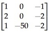

**Figure 1.** Option A kernel diagram for Question 5.

*Option ID:* `6406537043619`

**B.**

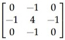

**Figure 2.** Option B kernel diagram for Question 5.

*Option ID:* `6406537043620`

**C.**

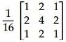

**Figure 3.** Option C kernel diagram for Question 5.

*Option ID:* `6406537043621`

**D.**

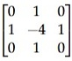

**Figure 4.** Option D kernel diagram for Question 5.

*Option ID:* `6406537043622`

**Correct answer:** **C** — Option C (separable Gaussian smoothing filter $\frac{1}{16} \begin{bmatrix} 1 & 2 & 1 \\ 2 & 4 & 2 \\ 1 & 2 & 1 \end{bmatrix}$)  
**Source evidence:** Green option ID `6406537043621` and check marker, PDF page 3.

---

### Question 6

**Question ID:** `6406532166265` · **Type:** Multiple Choice Question · **Marks:** 1  
**PDF pages:** 3, 4

Consider the following pyTorch code:

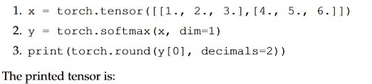

**Figure 5.** PyTorch code snippet for Question 6.

```python
1. x = torch.tensor([[1., 2., 3.], [4., 5., 6.]])
2. y = torch.softmax(x, dim=1)
3. print (torch.round(y[0], decimals=2))
```

The printed tensor is:

**Options**

**A.** `tensor([0.09, 0.24, 0.67])`  
*Option ID:* `6406537043627`

**B.** `tensor([0.09, 0.24, 0.66])`  
*Option ID:* `6406537043628`

**C.** `tensor([0.09, 0.23, 0.68])`  
*Option ID:* `6406537043629`

**D.** `tensor([0.10, 0.27, 0.63])`  
*Option ID:* `6406537043630`

**Correct answer:** **A** — `tensor([0.09, 0.24, 0.67])`  
**Source evidence:** Green option ID `6406537043627` and check marker, PDF page 3.

---

### Question 7

**Question ID:** `6406532166254` · **Type:** Short Answer Question · **Marks:** 1  
**PDF pages:** 4

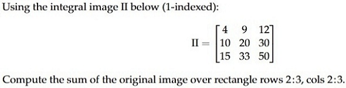

**Figure 6.** Integral image matrix and question stem for Question 7.

Using the integral image $II$ below (1-indexed):

$$II = \begin{bmatrix} 4 & 9 & 12 \\ 10 & 20 & 30 \\ 15 & 33 & 50 \end{bmatrix}$$

Compute the sum of the original image over rectangle rows 2:3, cols 2:3.

**Correct answer:** `27`  
**Source evidence:** Green text in Possible Answers field, PDF page 4.

---

### Question 8

**Question ID:** `6406532166255` · **Type:** Short Answer Question · **Marks:** 1  
**PDF pages:** 4, 5

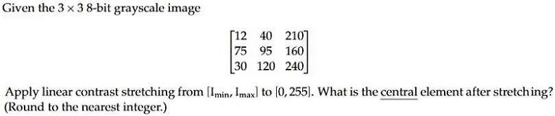

**Figure 7.** Grayscale image matrix and contrast stretching specification for Question 8.

Given the $3 \times 3$ 8-bit grayscale image

$$\begin{bmatrix} 12 & 40 & 210 \\ 75 & 95 & 160 \\ 30 & 120 & 240 \end{bmatrix}$$

Apply linear contrast stretching from $[I_{min}, I_{max}]$ to $[0, 255]$. What is the central element after stretching? (Round to the nearest integer.)

**Correct answer:** `92 to 94`  
**Source evidence:** Green text in Possible Answers range field, PDF page 5.

---

### Question 9

**Question ID:** `6406532166256` · **Type:** Short Answer Question · **Marks:** 1  
**PDF pages:** 5

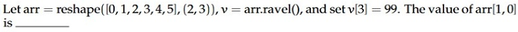

**Figure 8.** Array reshape and ravel operations for Question 9.

Let $\text{arr} = \text{reshape}([0, 1, 2, 3, 4, 5], (2, 3))$, $v = \text{arr.ravel}()$, and set $v[3] = 99$. The value of $\text{arr}[1, 0]$ is _____

**Correct answer:** `99`  
**Source evidence:** Green text in Possible Answers field, PDF page 5.

---

### Question 10

**Question ID:** `6406532166257` · **Type:** Short Answer Question · **Marks:** 1  
**PDF pages:** 5

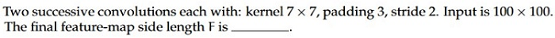

**Figure 9.** Successive convolution layer specifications for Question 10.

Two successive convolutions each with: kernel $7 \times 7$, padding 3, stride 2. Input is $100 \times 100$. The final feature-map side length $F$ is _____.

**Correct answer:** `25`  
**Source evidence:** Green text in Possible Answers field, PDF page 5.

---

### Question 11

**Question ID:** `6406532166261` · **Type:** Short Answer Question · **Marks:** 1  
**PDF pages:** 5, 6

The degrees of freedom for affine transformations in 3D is __

**Correct answer:** `12`  
**Source evidence:** Green text in Possible Answers field, PDF page 6.

---

### Question 12

**Question ID:** `6406532166262` · **Type:** Short Answer Question · **Marks:** 1  
**PDF pages:** 6

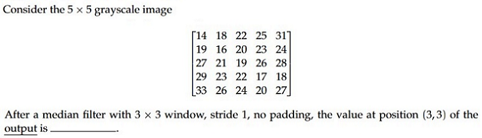

**Figure 10.** Grayscale image matrix and median filter specifications for Question 12.

Consider the $5 \times 5$ grayscale image

$$\begin{bmatrix} 14 & 18 & 22 & 25 & 31 \\ 19 & 16 & 20 & 23 & 24 \\ 27 & 21 & 19 & 26 & 28 \\ 29 & 23 & 22 & 17 & 18 \\ 33 & 26 & 24 & 20 & 27 \end{bmatrix}$$

After a median filter with $3 \times 3$ window, stride 1, no padding, the value at position (3, 3) of the output is ________.

**Correct answer:** `22`  
**Source evidence:** Green text in Possible Answers field, PDF page 6.

---

### Question 13

**Question ID:** `6406532166263` · **Type:** Short Answer Question · **Marks:** 1  
**PDF pages:** 6

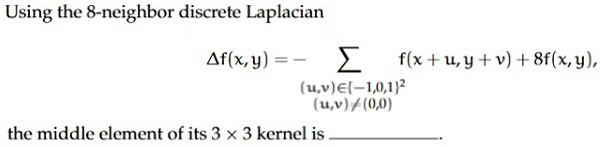

**Figure 11.** Discrete Laplacian definition and formula for Question 13.

Using the 8-neighbor discrete Laplacian

$$\Delta f(x, y) = - \sum_{\substack{(u, v) \in \{-1, 0, 1\}^2 \\ (u, v) \neq (0, 0)}} f(x+u, y+v) + 8 f(x, y),$$

the middle element of its $3 \times 3$ kernel is _____.

**Correct answer:** `8`  
**Source evidence:** Green text in Possible Answers field, PDF page 6.

---

### Question 14

**Question ID:** `6406532166264` · **Type:** Short Answer Question · **Marks:** 1  
**PDF pages:** 7

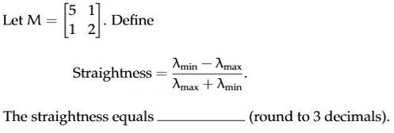

**Figure 12.** Matrix $M$ and straightness definition for Question 14.

Let $M = \begin{bmatrix} 5 & 1 \\ 1 & 2 \end{bmatrix}$. Define

$$\text{Straightness} = \frac{\lambda_{max} - \lambda_{min}}{\lambda_{max} + \lambda_{min}}$$

The straightness equals _______ (round to 3 decimals).

**Correct answer:** `-0.6 to -0.5`  
**Source evidence:** Green text in Possible Answers range field, PDF page 7.

---

## Answer key

| Source question | Question ID | Correct answer | PDF page(s) |
| :--- | :--- | :--- | :--- |
| 2 | `6406532166253` | B | 2 |
| 3 | `6406532166258` | A | 2 |
| 4 | `6406532166259` | B | 2, 3 |
| 5 | `6406532166260` | C | 3 |
| 6 | `6406532166265` | A | 3, 4 |
| 7 | `6406532166254` | 27 | 4 |
| 8 | `6406532166255` | 92 to 94 | 4, 5 |
| 9 | `6406532166256` | 99 | 5 |
| 10 | `6406532166257` | 25 | 5 |
| 11 | `6406532166261` | 12 | 5, 6 |
| 12 | `6406532166262` | 22 | 6 |
| 13 | `6406532166263` | 8 | 6 |
| 14 | `6406532166264` | -0.6 to -0.5 | 7 |

## Extraction notes

- Question 1 (Question ID `6406532166252`, Sub-Section 1) is the administrative subject confirmation question (YES/NO options, 0 marks) spanning PDF pages 1–2; it is excluded from academic questions in accordance with extraction specifications.
- In Question 5, Option A contains matrix $\begin{bmatrix} 1 & 0 & -1 \\ 2 & 0 & -2 \\ 1 & -50 & -2 \end{bmatrix}$ with bottom-middle element `-50` as visible in the source diagram; this has been preserved faithfully without normalization to `-5` or `50`.
- In Question 14, the official source key specifies the accepted range as `-0.6 to -0.5`. Analytically, for $M = \begin{bmatrix} 5 & 1 \\ 1 & 2 \end{bmatrix}$, the eigenvalues are $\lambda = \frac{7 \pm \sqrt{13}}{2}$, yielding $\text{Straightness} = \frac{\sqrt{13}}{7} \approx +0.515$. The negative range in the official key is retained verbatim from the source PDF.
